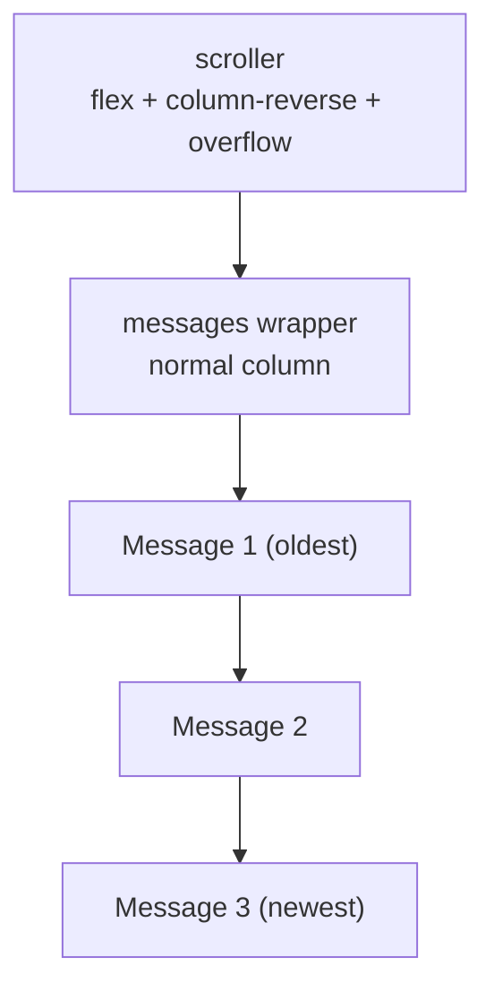

import { ReverseScrollChat } from "./reverse-scroll-chat.tsx";

# Reverse Scroll with Nested Flex Column-Reverse

> [!summary] TL;DR
> Chat UIs want the scroll origin at the **bottom**: new messages appear there, and the view only follows them when you are already pinned. Put `display: flex; flex-direction: column-reverse` on the **scroller**, and keep the messages inside a **single inner wrapper** in normal chronological order. The reverse axis anchors that wrapper to the bottom; the wrapper prevents each bubble from being flipped. No `scrollTop` bookkeeping required.

## The problem

A message list is not a normal document. Readers expect three behaviours at once:

1. The newest message sits at the **bottom** of the pane.
2. When you are already at the bottom, sending or receiving a message **keeps** you there.
3. When you scroll up to read history, new messages must **not** yank the viewport back down.

The usual fix is JavaScript: after every append, check whether the user was near the bottom, then set `el.scrollTop = el.scrollHeight`. It works until it does not — layout thrash, keyboard insets on mobile, image loads that change height after you scrolled, and a race every time the DOM mutates.

There is a CSS-shaped answer. It looks like a hack until you see why it works.

## The trick

Two layers:

```html
<div class="scroller">
  <div class="messages">
    <!-- oldest → newest, normal document order -->
  </div>
</div>
```

```css
.scroller {
  display: flex;
  flex-direction: column-reverse;
  overflow-y: auto;
  height: 20rem; /* or whatever fixed / flex height you need */
}

.messages {
  /* normal block / column flow — do NOT reverse again */
  display: flex;
  flex-direction: column;
  gap: 0.5rem;
}
```

That is the whole layout. Append messages chronologically. The scroller stays bottom-anchored.

## Try it

Toggle **Reverse** vs **Normal**, send a few messages, then scroll up and keep typing. In reverse mode the pane holds your place while you read history; flip to normal and new bubbles fall below the fold unless you scroll yourself.

<ReverseScrollChat />

## Why nesting matters

`flex-direction: column-reverse` does two useful things on the scroller:

- **Main-start moves to the bottom.** With one flex child (the messages wrapper), that child packs against the bottom when the list is shorter than the pane — the empty space sits above the conversation, the way a real chat looks.
- **Scroll origin flips.** `scrollTop === 0` means “showing the end of the flex flow,” which is now the **bottom**. Growing the content in the block direction extends away from that origin, so the viewport stays put when you were pinned, and stays put when you had scrolled away.

If you put the bubbles as **direct** children of the reversed scroller, they would paint newest-at-top / oldest-at-bottom. That is the wrong reading order unless you also reverse the DOM (and then screen readers meet the newest message first).

The **inner wrapper** is the nesting that saves you. The scroller only reverses **one** flex item — the wrapper — so message order inside stays oldest → newest, top → bottom. Visual order and DOM order agree; you can keep `array.push` / `.appendChild` semantics.



> [!tip] Mental model
> Reverse the **scroller**, not the **messages**. Nesting is what lets those be different decisions.

## What you get for free

| Behaviour | How it falls out |
| --- | --- |
| Stick to bottom on send/receive | Scroll origin is already the bottom; growth does not move `scrollTop` when it was `0` |
| Preserve position while reading history | Same: a non-zero (from-bottom) offset stays stable as content grows below |
| Short threads sit on the bottom | Single flex child packs to main-start (the bottom) |
| Chronological append API | Inner wrapper is normal flow |

Compare that to the `scrollTop` approach: you need a “was near bottom?” threshold, a post-layout effect, and special cases for images, fonts, and virtualised rows. The CSS version still needs JS to **add** messages — only the anchoring is free.

## A few sharp edges

> [!warning] Accessibility
> Reversing flex items that are **siblings** disconnects DOM order from visual order. With the nested wrapper, siblings are not reversed — only the wrapper is — so reading order stays sane. Prefer the nested form over “reverse the array in the DOM.”

> [!note] Scrollbar and wheel direction
> In most browsers the scrollbar still behaves like a normal vertical scroller (thumb at the bottom means “at the end”). If something feels inverted on an older engine, check before shipping; this pattern is widely used for chats now.

> [!tip] Start-from-top when the list is short
> Some products want the **first** message at the top until the thread overflows, then bottom-anchor. One approach is a flex `shim` sibling with `flex: 1` above the messages inside the reversed scroller (it paints below in reverse flow and eats the spare height). The live demo keeps the simpler “always bottom-aligned” chat look.

Images or embeds that load late can still shift layout inside the wrapper. The reverse scroller will not magically keep a mid-history viewport glued to a particular bubble across arbitrary height changes — only the bottom-pin and “do not jump me while I read” behaviours are free. For media-heavy threads you may still measure, or reserve aspect ratios.

## Minimal React sketch

```tsx
function Chat({ messages }: { messages: { id: string; text: string }[] }) {
  return (
    <div
      role="log"
      aria-live="polite"
      className="flex h-80 flex-col-reverse overflow-y-auto"
    >
      <div className="flex flex-col gap-2 p-3">
        {messages.map((m) => (
          <p key={m.id}>{m.text}</p>
        ))}
      </div>
    </div>
  );
}
```

Push onto `messages` in chronological order. No `useEffect` that writes `scrollTop`. The demo above is the same idea with chrome, a mode toggle, and a canned reply so you can feel the difference against a normal column.

## When not to use it

- **Virtualised lists** (`react-window`, TanStack Virtual, etc.): those own scroll position and item offset math. Bottom-anchoring there is a different problem; do not mix this flex trick with a virtualiser expecting a normal scrollport.
- **Bidirectional infinite scroll** with large histories: you can still start from this pattern, but prepending older pages needs care (spacer height, scroll anchoring APIs, or a virtualiser).
- **Feeds that should start at the top** and only grow downward without bottom gravity — use a normal column.

## Summary

Bottom-anchored chat scroll does not require a scroll-manager. A reversed flex scroller moves the origin to the bottom; a nested normal-flow wrapper keeps messages in reading order. You keep chronological appends, free pin-to-bottom behaviour, and stable history while the reader has scrolled up — which is exactly what a chat pane is supposed to feel like.
