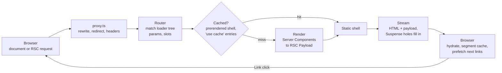

# Next.js in Practice: from request to pixels

> [!summary] TL;DR
> A request to a Next.js 16 app passes through five stages. **Proxy** (`proxy.ts`, formerly middleware) can rewrite, redirect or reject it. The **router** matches the URL against the loader tree built from `app/`. **Rendering** runs Server Components to an RSC Payload and Client Components to HTML. The **cache layer** (`'use cache'`, prerendered shells, the client segment cache) decides what can be reused instead of rendered. **Streaming** sends the static shell first and fills the dynamic holes through Suspense. The Features track explains each stage, the Patterns track combines them into rendering and auth strategies, and the Recipes track fixes the problems you hit along the way.

All parts are pinned to **Next.js v16.4.3** (tag commit `29bbeab`). Footnotes link to exact line ranges at that tag.

## How a request flows through Next

The same pipeline serves both kinds of request. A first visit asks for a document and gets HTML with the RSC Payload inlined. A client navigation asks only for the RSC Payload of the segments that changed. Mutations re-enter it through Server Actions and revalidation.

## Features track

How each built-in feature works, with links into the source.

- [[01 The App Router - Files, Segments and Layouts|01 · The App Router]]: folders become a loader tree, and each segment becomes layout, template, error, loading and not-found boundaries; groups, slots and interception.
- [[02 Server and Client Components|02 · Server and Client Components]]: what `'use client'` compiles to, the three renders of a first load, `server-only`, and what props can cross the boundary.
- [[03 Linking, Navigation and Prefetching|03 · Linking and Navigation]]: from a `<Link>` click to a committed route, the segment cache, prefetch scheduling, `useLinkStatus`, scroll and `redirect` vs `router.push`.
- [[04 Data Fetching and Streaming|04 · Data Fetching and Streaming]]: async Server Components, Suspense and `loading.tsx`, async `params`, React `cache`, and passing promises to `use()`.
- [[05 Cache Components - use cache, cacheLife and cacheTag|05 · Cache Components]]: the `cacheComponents` model, how `'use cache'` is compiled and keyed, cache handlers and profiles.
- [[06 Revalidation - Tags, Paths and Refresh|06 · Revalidation]]: `revalidateTag`, `updateTag`, `revalidatePath`, `refresh` and how invalidation reaches the client.
- [[07 Server Actions and Forms|07 · Server Actions and Forms]]: `'use server'`, action IDs, encrypted closures, origin checks, `useActionState`, `useOptimistic` and `<Form>`.
- [[08 Route Handlers and Proxy|08 · Route Handlers and Proxy]]: `route.ts`, its caching, and `proxy.ts` with matchers, rewrites and redirects.
- [[09 Metadata, Images, Fonts and Scripts|09 · Metadata, Images, Fonts and Scripts]]: the head, `next/image`, `next/font` and `next/script`.
- [[10 Errors, Redirects and Request Lifecycle APIs|10 · Errors and Lifecycle APIs]]: error boundaries, `notFound`, `forbidden`, `unauthorized`, redirects, `after()`, `connection()` and instrumentation.
- [[11 Configuration, Turbopack and Deployment|11 · Configuration and Deployment]]: `next.config`, environment variables, Turbopack, `standalone` and `export` output, adapters and self-hosting.

## Patterns track

Complete strategies built from the features.

- [[20 Rendering Strategies - A Decision Map|20 · Rendering Strategies]]: SSG, ISR, SSR, PPR, CSR and SPA compared, how Next decides static vs dynamic, and a decision flowchart.
- [[21 SSG and ISR - Static Pages and generateStaticParams|21 · SSG and ISR]]: prerendering pages at build time and regenerating them later.
- [[22 SSR - Rendering Per Request|22 · SSR]]: rendering per request, and what makes a route dynamic.
- [[23 PPR - Partial Prerendering with Cache Components|23 · PPR]]: a static shell with postponed holes, resumed per request.
- [[24 CSR - Client-Rendered Islands|24 · CSR Islands]]: client components that fetch on mount, `ssr: false`, and when that is the right call.
- [[25 Fully Client-Side - SPA and Static Export|25 · SPA and Static Export]]: `output: 'export'`, an SPA shell, and the limits of client-only routing.
- [[26 TanStack Query - Server Prefetch and Hydration|26 · TanStack Query]]: per-request clients, server prefetch, `HydrationBoundary`, streaming pending queries and mutations.
- [[27 Server-Aware Auth - Sessions, Proxy and the DAL|27 · Server-Aware Auth]]: cookie sessions, optimistic checks in `proxy.ts`, a Data Access Layer, and auth with Cache Components.
- [[28 Client-Only Auth - Tokens in the Browser|28 · Client-Only Auth]]: tokens for an external API, client route guards, refresh tokens, and the trade-offs against part 27.

## Recipes track

Short problem, cause, fix entries.

- [[40 Recipes - Data, Caching and Revalidation|40 · Data, Caching and Revalidation]]: stale data, over-caching, and invalidation that does not show up.
- [[41 Recipes - Routing and Navigation|41 · Routing and Navigation]]: 404s on refresh, modals, scroll, slow links and redirects.
- [[42 Recipes - Rendering and Hydration Errors|42 · Rendering and Hydration Errors]]: hydration mismatches, boundary errors and prerender bailouts.
- [[43 Recipes - Forms, Mutations and Uploads|43 · Forms, Mutations and Uploads]]: pending states, validation, optimistic UI and file uploads.
- [[44 Recipes - Performance, Config and Deployment|44 · Performance, Config and Deployment]]: bundle size, prefetch tuning, build and hosting issues.

## Reading order suggestions

- **New to the App Router:** 01 → 02 → 03 → 04, then 20.
- **Choosing an architecture:** 20, then the pattern parts that match (21 to 28).
- **Upgrading to 16 with caching in mind:** 05 → 06 → 23.
- **Fixing something today:** jump to the recipe part, then follow its links back into the features.

[[01 The App Router - Files, Segments and Layouts|Start: The App Router]] →
