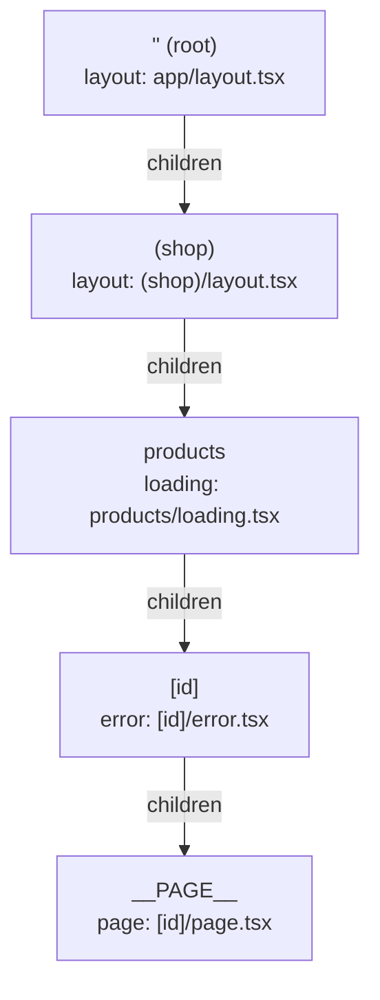
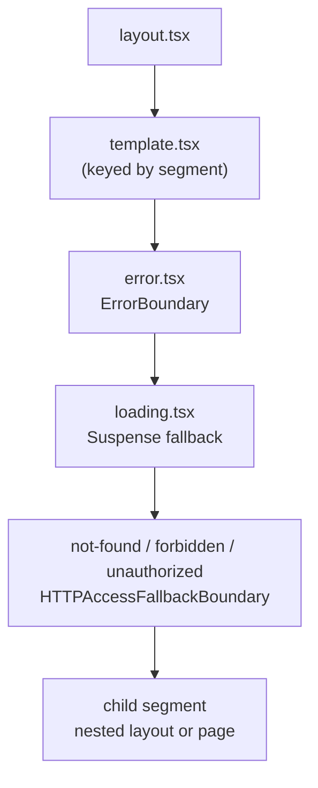

# The App Router - Files, Segments and Layouts

> [!summary] TL;DR
> Every folder under `app/` is a **route segment** and every special file (`layout`, `page`, `template`, `error`, `loading`, `not-found`, `default`, ...) is a slot on that segment. At build time Next walks the folders and emits a **loader tree**: nested tuples of `[segment, parallelRoutes, modules, staticSiblings]`. At render time each level of that tree becomes the same fixed stack of components: your layout, then a `LayoutRouter` per slot that wraps the child in template → error boundary → `Suspense` (from `loading`) → not-found boundary. Layouts persist across navigations because the server only renders from the first segment that changed. Route groups vanish from the URL, `@slots` become extra layout props, and interception is a rewrite keyed on the `Next-Url` header.

This course is pinned to **Next.js v16.4.3**. Every footnote links to the exact lines at that tag. The React side (Suspense, transitions, keys) is covered in the vault's React courses, and this part links there instead of re-explaining it.

## The running example

Most of this part uses one small store:

```txt
app/
  layout.tsx                 root layout (<html>, <body>)
  page.tsx                   /
  (shop)/
    layout.tsx               header + cart for shop pages
    products/
      page.tsx               /products
      loading.tsx
      [id]/
        page.tsx             /products/123
        error.tsx
  (account)/
    account/
      layout.tsx
      page.tsx               /account
  dashboard/
    layout.tsx               receives children, analytics, team
    page.tsx                 /dashboard
    default.tsx
    @analytics/page.tsx
    @analytics/default.tsx
    @team/page.tsx
    @team/default.tsx
  _components/
    price.tsx                not routable
```

Keep it in mind: by the end you should be able to predict exactly which React tree Next renders for `/products/123`, and why navigating to `/products/456` does not re-run `(shop)/layout.tsx`.

## Folders are segments, files are UI

The rule fits in one line: **folders define URL segments, files define what renders for a segment**. A folder only becomes a public route when it contains a `page` (UI) or a `route` (a Route Handler, see [[08 Route Handlers and Proxy|part 08]]). Everything else in the folder is ignored by the router, so components, tests and helpers can live next to the route that uses them.

| File | What it becomes |
| --- | --- |
| `layout` | Shared UI that wraps every child segment and **persists** across navigations |
| `page` | The leaf UI for a URL. Makes the route public |
| `template` | Like a layout, but **remounts** on every navigation into it |
| `loading` | The fallback of a `Suspense` boundary around the segment's children |
| `error` | A React error boundary around the children (must be a Client Component) |
| `not-found`, `forbidden`, `unauthorized` | Fallbacks for `notFound()`, `forbidden()`, `unauthorized()` |
| `default` | What a parallel slot renders when the URL does not match it |
| `global-error`, `global-not-found` | App-wide fallbacks at the root |
| `route` | A Route Handler instead of UI |

The bundler side knows these names as a fixed list. In the webpack loader it is `FILE_TYPES`, which spreads in the three HTTP access fallbacks so that `not-found`, `forbidden` and `unauthorized` are resolved the same way as `layout` or `error`.[^file-types] Turbopack has the same list as fields on the Rust struct `AppDirModules`.[^tp-modules]

Two folder prefixes change how a folder is read:

- **`_folder` (private folder)**: route discovery passes `ignorePartFilter: (part) => part.startsWith('_')` to the directory walk, so the folder and everything under it is skipped entirely.[^collect] Use it for `_components` and `_lib` when you want that to be explicit. If you really need a URL segment that starts with an underscore, name the folder `%5Ffolder`.
- **`(group)` (route group)**: kept in the file tree, removed from the URL. More on that below.

> [!tip] You don't need `_` for colocation
> A file is only routable if it is named `page` or `route`. `app/products/price.tsx` is already invisible to the router. Private folders are an organisational signal (and a guard against future special file names), not a requirement.

## From folders to a loader tree

At build time (and on demand in dev) Next turns the folders for one route into a **loader tree**. Its type is a four-tuple:[^loader-tree]

```ts
// packages/next/src/server/lib/app-dir-module.ts (shape)
type LoaderTree = [
  segment: string,                               // 'products', '[id]', '__PAGE__'
  parallelRoutes: { [slot: string]: LoaderTree }, // 'children' plus any @slots
  modules: AppDirModules,                        // layout, loading, error, ...
  staticSiblings: readonly string[] | null,      // e.g. ['sale'] next to [id]
]
```

The webpack loader builds it in `createSubtreePropsFromSegmentPath`, a recursive function that, for each level, resolves every special file in `FILE_TYPES`, recurses into the child segment, and writes one tuple per parallel key.[^subtree] The interesting line is where the tuple is emitted:

```ts
// next-app-loader/index.ts (simplified)
props[normalizedParallelKey] = `[
  '${parallelSegmentKey}',
  ${subtreeCode},
  ${modulesCode},
  ${staticSiblingsCode}
]`
```
[^tuple]

`normalizedParallelKey` is the folder name with the `@` stripped (`@analytics` → `analytics`), and the ordinary branch is always called `children`.[^keys] The page itself becomes a segment with the reserved key `__PAGE__`, and a synthesized default becomes `__DEFAULT__`.[^seg-keys]

For `/products/123` in the running example, the tree looks like this:



`staticSiblings` is new plumbing worth knowing about. For a dynamic segment the build records the static folders at the same URL level (for example `sale` next to `[id]`, even if they live in different route groups), so the client router can tell whether a cached prefetch for `[id]` may be reused for a URL that is actually a static sibling.[^loader-tree]

Turbopack (the default bundler in 16) builds the same structure in Rust as `AppPageLoaderTree`, with the same `segment`, `parallel_routes`, `modules` and `static_siblings` fields.[^tp-tree] So everything below is true whichever bundler you use.

## How a loader tree becomes React

On each request, `createComponentTree` walks the loader tree. For every segment it reads the modules (`layout`, `template`, `error`, `loading`, `not-found`, `forbidden`, `unauthorized`),[^ct-modules] and for every parallel key it creates a client component called `LayoutRouter`, passing that segment's template, error component and HTTP fallbacks as props.[^ct-map] The layout itself then receives each slot as a prop of the same name, plus `params`:[^ct-layout]

```ts
// create-component-tree.tsx (simplified)
createElement(SegmentComponent /* your layout */, {
  ...parallelRouteProps,   // children, analytics, team ...
  params,                  // a Promise
}, parallelRouteProps.children)
```

On the client, each `LayoutRouter` renders a fixed stack of boundaries around the child segment:[^outer]

```tsx
// layout-router.tsx (simplified)
<TemplateContext.Provider key={stateKey} value={
  <ScrollHandler>
    <ErrorBoundary errorComponent={error}>
      <LoadingBoundary loading={parentLoadingData}>   {/* <Suspense fallback={loading}> */}
        <HTTPAccessFallbackBoundary notFound={notFound} forbidden={forbidden} unauthorized={unauthorized}>
          <RedirectBoundary>
            <InnerLayoutRouter />                       {/* the child segment's RSC */}
          </RedirectBoundary>
        </HTTPAccessFallbackBoundary>
      </LoadingBoundary>
    </ErrorBoundary>
  </ScrollHandler>
}>
  {template /* your template.tsx, or a Fragment */}
</TemplateContext.Provider>
```
[^template-value][^template-key]

So for one segment the nesting is:



This one picture explains several rules people learn by trial and error:

- **`error.tsx` cannot catch errors thrown by the `layout.tsx` in the same folder.** The boundary sits *inside* the layout, around its children. An error in `(shop)/layout.tsx` goes to the error boundary of the parent segment, and an error in the root layout goes to `global-error`. [[10 Errors, Redirects and Request Lifecycle APIs#The boundary stack inside every segment|Part 10]] walks through the full boundary stack.
- **`loading.tsx` wraps the children, not the layout.** The layout renders immediately and the fallback appears where `children` goes. The loading module is stored on the parent and applied to each of its slots, which the source itself calls out as slightly surprising when a segment has several parallel slots.[^loading-boundary]
- **`error.tsx` must be a Client Component.** The SWC transform reports an error for any `error` or `global-error` file in `app/` that ends up in the server graph without `'use client'`.[^error-client]
- **The `params` you receive are a Promise.** Next 16 removed the temporary synchronous access that 15 still allowed, for `params` in layouts, pages, routes and defaults and for `searchParams` in pages.

```tsx
// app/(shop)/products/[id]/page.tsx
export default async function ProductPage(props: PageProps<'/products/[id]'>) {
  const { id } = await props.params
  const product = await getProduct(id)
  return <h1>{product.title}</h1>
}
```

`PageProps` and `LayoutProps` are global helper types generated by `next dev`, `next build` or `next typegen`. They infer the params and slot names from the folder structure, so you never import them.

## Why layouts persist

A layout "keeps its state" because, on a client navigation, nobody renders it again. Two mechanisms work together.

**The server starts rendering at the first changed segment.** A navigation request carries the client's current router state. `walkTreeWithFlightRouterState` compares it with the loader tree level by level and only starts rendering components where something differs:[^walk]

```ts
// walk-tree-with-flight-router-state.tsx
const renderComponentsOnThisLevel =
  !flightRouterState ||
  didRouteOrPathParamChange(actualSegment, flightRouterState[0]) ||
  (actualSegment === PAGE_SEGMENT_KEY &&
    getRenderedSearch(query) !== (flightRouterState[5] ?? '')) ||
  flightRouterState[3] === 'refetch'
```

`didRouteOrPathParamChange` compares static segments by string and dynamic segments by param name, type and value.[^didchange] Going from `/products/123` to `/products/456` changes the `[id]` value, so rendering starts at `[id]`. The root layout, `(shop)/layout.tsx` and `products` are never called.

**The client reuses the segments it already has.** The browser keeps a cache keyed by segment. Shared layouts stay mounted, and only the `LayoutRouter` whose child changed swaps its content (see [[03 Linking, Navigation and Prefetching|part 03]] for the client cache).

Two consequences follow:

- **Layouts never receive `searchParams`.** Only pages get them.[^page-props] The check above treats a search change as a change to the `__PAGE__` segment alone, so `/products?sort=price` → `/products?sort=name` re-renders the page and leaves every layout alone. If a layout needs the query string, read it in a Client Component with `useSearchParams`.
- **Do not put per-request side effects in layouts.** A layout runs on the first visit to a segment and then only when its own segment changes, on `router.refresh()`, or after revalidation. "Log a page view in the layout" undercounts.

> [!warning] Crossing root layouts is a full page load
> If two routes have different root layouts (for example `(marketing)/layout.tsx` and `(shop)/layout.tsx`, each rendering its own `<html>`), the client router cannot reconcile them. `isNavigatingToNewRootLayout` walks the root-layout prefix of both trees and, if they differ, the navigation becomes an MPA navigation (a normal document load).[^new-root] The same happens for any navigation to `global-not-found`.[^new-root-call]

## template.tsx: a layout that remounts

`template.tsx` sits between the layout and the boundaries. The trick is in the `key`: `TemplateContext.Provider` is keyed by the child segment's `stateKey`, so when the child segment changes, React sees a new key and remounts everything from the template down.[^template-key] Your template component itself only renders `children`, which is a tiny client component that reads the context:[^rftc]

```tsx
// render-from-template-context.tsx
export default function RenderFromTemplateContext() {
  const children = useContext(TemplateContext)
  return <>{children}</>
}
```

That remount is the whole feature, and it is plain React keys at work (see [[05 Reconciliation - Finding What Changed|How React Works: reconciliation]] for why a new key throws away state). Use a template for enter animations, for resetting a form between sibling pages, or for an effect that must run on every navigation into a section. Use a layout for everything else.

> [!note] The state key ignores search params
> The source spells this out: "search params do not cause state to be lost, so two segments with the same segment path but different search params should have the same state key."[^outer] A template remounts on `/products/1` → `/products/2`, but not on `/products?page=1` → `/products?page=2`.

## Dynamic segments

Square brackets make a segment dynamic. `getSegmentParam` reads the folder name and returns the param type:[^segparam]

| Folder | Param type | Matches | `params` value |
| --- | --- | --- | --- |
| `[id]` | `dynamic` | `/products/123` | `{ id: '123' }` |
| `[...slug]` | `catchall` | `/docs/a/b` (not `/docs`) | `{ slug: ['a', 'b'] }` |
| `[[...slug]]` | `optional-catchall` | `/docs` and `/docs/a/b` | `{}` or `{ slug: ['a', 'b'] }` |

Params accumulate downward: a page under `/shop/[category]/[id]` receives both. On the client, `OuterLayoutRouter` does the same accumulation while walking the tree, which is why `useParams()` works in any Client Component.[^outer]

If a dynamic segment can be known at build time, export `generateStaticParams` so the route is prerendered instead of rendered per request. That is the subject of [[21 SSG and ISR - Static Pages and generateStaticParams|part 21]].

## Route groups

A folder in parentheses is part of the tree but not of the URL. `normalizeAppPath` drops it (along with `@slot` folders and the trailing `page`/`route`) when computing the public path:[^normalize]

```ts
// app-paths.ts
normalizeAppPath('/(shop)/products/[id]/page') // '/products/[id]'
```

`isGroupSegment` is simply "starts with `(` and ends with `)`".[^isgroup] Because the group is still a real segment in the loader tree, you can hang files on it:

- **A layout for a section.** `(shop)/layout.tsx` wraps `/products` but not `/account`.
- **Several root layouts.** Delete `app/layout.tsx` and give each top-level group its own layout with `<html>` and `<body>`. Remember the warning above: crossing between them reloads the page.
- **A narrower `loading.tsx`.** Moving `loading.tsx` into `dashboard/(overview)/` scopes the skeleton to the overview page instead of every dashboard page.

> [!warning] Two groups cannot claim the same URL
> `(shop)/about/page.tsx` and `(marketing)/about/page.tsx` both normalize to `/about`. That is a build error, not a precedence rule.

## Parallel routes

A folder starting with `@` is a **slot**. It is not a URL segment; it becomes a second (third, ...) entry in `parallelRoutes` next to `children`, and the parent layout receives it as a prop:

```tsx
// app/dashboard/layout.tsx
export default function DashboardLayout(props: LayoutProps<'/dashboard'>) {
  return (
    <div className="grid">
      <main>{props.children}</main>
      <aside>{props.analytics}</aside>
      <section>{props.team}</section>
    </div>
  )
}
```

Each slot gets its own `LayoutRouter`, so each has its own error, loading and template stack and can stream independently. The server renders all slots of a layout in parallel (`Promise.all` over the parallel route keys).[^ct-map] `params` is reserved: a slot called `@params` would collide with the `params` prop, and dev mode logs an error for it.

### What renders when a slot does not match the URL

The URL only describes one branch. When you navigate to `/dashboard/settings` but `@analytics` has no `settings` folder, what goes in `props.analytics`?

- **Soft navigation (client-side):** the router keeps the slot's previously active content. Nothing is refetched for it.
- **Hard navigation (reload, direct visit):** the server has no previous state to keep, so it renders the slot's `default.tsx`.

If there is no `default.tsx`, the loader inserts a built-in default whose whole body is `notFound()`.[^builtin-default] That is the source of the classic "my page 404s on refresh but works when I click to it".

> [!warning] Changed in 16: missing `default.tsx` is a build error
> The 16 upgrade guide says every slot needs an explicit `default.js`. The exact rule in 16.4.3 is a little narrower: the loader throws `MissingDefaultParallelRouteError` when a slot has no `default` file, **unless** the slot is under a catch-all segment (the catch-all already covers every sub-path) or the segment has no child routes (so the slot can never become unmatched).[^missing-default] To keep the old behaviour, add a `default.tsx` that calls `notFound()`, or one that returns `null` to render nothing.

```tsx
// app/dashboard/@analytics/default.tsx
export default function Default() {
  return null
}
```

`children` is a slot too. In the running example `/dashboard/default.tsx` is what renders in `children` when you hard-load a URL that only one of the named slots matches. See [[41 Recipes - Routing and Navigation#"Missing required default.js file for parallel route", or a 404 on refresh|the default.js recipe]] for the build error and 404 symptoms.

## Intercepting routes

Interception lets a route render "in place" from somewhere else, the classic case being a photo that opens as a modal from a feed but as a full page when you load its URL. The folder prefix says how far up to look for the route being intercepted:

| Marker | Intercepts |
| --- | --- |
| `(.)photo` | `photo` at the same level |
| `(..)photo` | `photo` one level up |
| `(..)(..)photo` | `photo` two levels up |
| `(...)photo` | `photo` from the app root |

Two details from the source matter in practice.

**Levels are route segments, not folders.** `extractInterceptionRouteInformation` normalizes the intercepting path with `normalizeAppPath` before counting, so route groups and `@slot` folders do not count as a level.[^intercept-info] The markers are tried in a fixed order, `(..)(..)` first, so the longest marker wins.[^markers]

**Interception is a rewrite keyed on where you came from.** At build time `generateInterceptionRoutesRewrites` turns each intercepting route into a rewrite whose `has` condition matches the `Next-Url` header against the intercepting route.[^rewrites] The client router sends `Next-Url` (roughly, the current URL) with its RSC requests; a direct visit sends none. So the same URL renders the modal when you navigate from the feed and the full page on a reload, with no client-side branching on your side. This header is also part of the client cache key, which is why intercepted and non-intercepted versions of a URL are cached separately ([[03 Linking, Navigation and Prefetching|part 03]]).

The modal pattern combines interception with a parallel slot:

```txt
app/
  layout.tsx            renders {children} and {modal}
  @modal/
    default.tsx         returns null: no modal by default
    (.)photos/[id]/
      page.tsx          <Modal><Photo id={id} /></Modal>
  photos/[id]/
    page.tsx            the full page
```

```tsx
// app/layout.tsx
export default function RootLayout(props: LayoutProps<'/'>) {
  return (
    <html lang="en">
      <body>
        {props.children}
        {props.modal}
      </body>
    </html>
  )
}
```

Closing the modal is a `router.back()`. Because `@modal` falls back to a `default.tsx` that returns `null`, a hard load of any other page simply renders no modal. The full modal recipe, including the stale-modal fix, is in [[41 Recipes - Routing and Navigation#Open a page as a modal but keep a shareable URL|Routing recipes]].

## Hidden segments stay mounted with Cache Components

One more behaviour of `OuterLayoutRouter` is new and easy to miss. With `cacheComponents` enabled, each level of the router keeps the **last three** segments it rendered, not just the active one. The inactive ones are rendered inside React's `<Activity mode="hidden">`, so their React state and DOM survive while hidden.[^bfcache-comment][^activity] Without Cache Components the limit is one, which is the classic behaviour.[^bfcache-max]

In practice: with Cache Components, a half-filled form or a scroll container on `/products/1` can still be there when you go back from `/products/2`. If you relied on unmount to reset something, reset it explicitly (or key it) instead. Effects in hidden trees are cleaned up and re-run on reveal, which is how `Activity` works in React itself.

## The fallback files at the root

- **`not-found.tsx`** is rendered by the `HTTPAccessFallbackBoundary` when `notFound()` is thrown below it. The root one also handles unmatched URLs. If you have none, the loader inserts a built-in one.[^file-types]
- **`forbidden.tsx` and `unauthorized.tsx`** work the same way for `forbidden()` and `unauthorized()`, but only with `experimental.authInterrupts` enabled.[^auth-flag] Part [[27 Server-Aware Auth - Sessions, Proxy and the DAL|27]] uses them.
- **`global-error.tsx`** replaces the root layout when the root layout itself throws, so it must render its own `<html>` and `<body>`.
- **`global-not-found.tsx`** (behind `experimental.globalNotFound`) is a complete document for unmatched URLs that bypasses the root layout, useful when you have several root layouts and no single one should own the 404.

Errors, redirects and these interrupts get their own part: [[10 Errors, Redirects and Request Lifecycle APIs|part 10]].

## Summary

The App Router is a build-time translation from folders to a loader tree, and a render-time translation from that tree to nested React components. Each folder is a segment, each special file fills a slot on it, and every parallel key of every segment becomes a `LayoutRouter` that stacks template, error boundary, Suspense and the not-found boundary around the child. Layouts persist because the server starts rendering at the first changed segment and the client keeps the rest. Groups, slots and interception are all variations on that same tree: groups disappear from the URL, slots become extra props with `default.tsx` as their fallback, and interception is a rewrite chosen by the `Next-Url` header. Next, [[02 Server and Client Components|part 02]] looks at what each of those components is allowed to do, and where its code runs.

### Key takeaways

- **Folders and files**: a folder is a segment, a `page` or `route` file makes it public, and `_folders` are skipped by route discovery.
- **Loader tree**: each level is `[segment, parallelRoutes, modules, staticSiblings]`, built by the webpack loader or by Turbopack's `AppPageLoaderTree`.
- **Fixed nesting**: layout → template → error → loading (Suspense) → not-found → child, so `error.tsx` never catches its own layout.
- **Persistent layouts**: the server renders from the first changed segment, and layouts never receive `searchParams`.
- **`template.tsx`**: keyed by the child segment, so it remounts on segment changes but not on search param changes.
- **Dynamic segments**: `[id]`, `[...slug]` and `[[...slug]]`, with `params` always a Promise in 16.
- **Route groups**: removed from the URL by `normalizeAppPath`, used for section layouts and multiple root layouts.
- **Parallel slots**: extra layout props; unmatched slots keep state on soft navigation and render `default.tsx` on hard navigation, which 16 now requires in most cases.
- **Interception**: markers count route segments, and the result is a rewrite on the `Next-Url` header.
- **Cache Components**: up to three recent segments per level stay mounted in hidden `<Activity>` boundaries.

[[00 Next.js in Practice Index|Index]] · [[02 Server and Client Components|Server and Client Components]] →

[^file-types]: `HTTP_ACCESS_FALLBACKS`, `defaultHTTPAccessFallbackPaths`, `FILE_TYPES` — [packages/next/src/build/webpack/loaders/next-app-loader/index.ts#L73-L92](https://github.com/vercel/next.js/blob/v16.4.3/packages/next/src/build/webpack/loaders/next-app-loader/index.ts#L73-L92)
[^tp-modules]: Turbopack `AppDirModules` — [crates/next-core/src/app_structure.rs#L38-L52](https://github.com/vercel/next.js/blob/v16.4.3/crates/next-core/src/app_structure.rs#L38-L52)
[^collect]: `collectAppFiles` with `ignorePartFilter` for `_` folders — [packages/next/src/build/route-discovery.ts#L101-L116](https://github.com/vercel/next.js/blob/v16.4.3/packages/next/src/build/route-discovery.ts#L101-L116)
[^loader-tree]: `LoaderTree` type and the `staticSiblings` explanation — [packages/next/src/server/lib/app-dir-module.ts#L7-L29](https://github.com/vercel/next.js/blob/v16.4.3/packages/next/src/server/lib/app-dir-module.ts#L7-L29)
[^subtree]: `createSubtreePropsFromSegmentPath` — [packages/next/src/build/webpack/loaders/next-app-loader/index.ts#L359-L825](https://github.com/vercel/next.js/blob/v16.4.3/packages/next/src/build/webpack/loaders/next-app-loader/index.ts#L359-L825)
[^tuple]: emitting the `[segment, subtree, modules, staticSiblings]` tuple — [packages/next/src/build/webpack/loaders/next-app-loader/index.ts#L703-L711](https://github.com/vercel/next.js/blob/v16.4.3/packages/next/src/build/webpack/loaders/next-app-loader/index.ts#L703-L711)
[^keys]: `normalizeParallelKey`, `isCatchAllSegment`, `isDynamicSegment` — [packages/next/src/build/webpack/loaders/next-app-loader/index.ts#L128-L135](https://github.com/vercel/next.js/blob/v16.4.3/packages/next/src/build/webpack/loaders/next-app-loader/index.ts#L128-L135)
[^seg-keys]: `PAGE_SEGMENT_KEY`, `DEFAULT_SEGMENT_KEY` — [packages/next/src/shared/lib/segment.ts#L71-L72](https://github.com/vercel/next.js/blob/v16.4.3/packages/next/src/shared/lib/segment.ts#L71-L72)
[^tp-tree]: Turbopack `AppPageLoaderTree` — [crates/next-core/src/app_structure.rs#L475-L486](https://github.com/vercel/next.js/blob/v16.4.3/crates/next-core/src/app_structure.rs#L475-L486)
[^ct-modules]: `createComponentTreeInternal` reading the segment's modules — [packages/next/src/server/app-render/create-component-tree.tsx#L193-L201](https://github.com/vercel/next.js/blob/v16.4.3/packages/next/src/server/app-render/create-component-tree.tsx#L193-L201)
[^ct-map]: one `LayoutRouter` per parallel route key, rendered with `Promise.all` — [packages/next/src/server/app-render/create-component-tree.tsx#L527-L726](https://github.com/vercel/next.js/blob/v16.4.3/packages/next/src/server/app-render/create-component-tree.tsx#L527-L726)
[^ct-layout]: the layout element receives the slots and `params` — [packages/next/src/server/app-render/create-component-tree.tsx#L1044-L1077](https://github.com/vercel/next.js/blob/v16.4.3/packages/next/src/server/app-render/create-component-tree.tsx#L1044-L1077)
[^outer]: `OuterLayoutRouter` (state key comment, param accumulation, boundary stack) — [packages/next/src/client/components/layout-router.tsx#L506-L761](https://github.com/vercel/next.js/blob/v16.4.3/packages/next/src/client/components/layout-router.tsx#L506-L761)
[^template-value]: the boundary stack inside `templateValue` — [packages/next/src/client/components/layout-router.tsx#L666-L709](https://github.com/vercel/next.js/blob/v16.4.3/packages/next/src/client/components/layout-router.tsx#L666-L709)
[^template-key]: `TemplateContext.Provider key={stateKey}` — [packages/next/src/client/components/layout-router.tsx#L723-L728](https://github.com/vercel/next.js/blob/v16.4.3/packages/next/src/client/components/layout-router.tsx#L723-L728)
[^loading-boundary]: `LoadingBoundary` wraps children in `Suspense` with the loading module as fallback — [packages/next/src/client/components/layout-router.tsx#L465-L500](https://github.com/vercel/next.js/blob/v16.4.3/packages/next/src/client/components/layout-router.tsx#L465-L500)
[^error-client]: `assert_server_filename` rejects server `error`/`global-error` files — [crates/next-custom-transforms/src/transforms/react_server_components.rs#L845-L867](https://github.com/vercel/next.js/blob/v16.4.3/crates/next-custom-transforms/src/transforms/react_server_components.rs#L845-L867)
[^walk]: `renderComponentsOnThisLevel` — [packages/next/src/server/app-render/walk-tree-with-flight-router-state.tsx#L143-L154](https://github.com/vercel/next.js/blob/v16.4.3/packages/next/src/server/app-render/walk-tree-with-flight-router-state.tsx#L143-L154)
[^didchange]: `didRouteOrPathParamChange` — [packages/next/src/server/app-render/walk-tree-with-flight-router-state.tsx#L40-L60](https://github.com/vercel/next.js/blob/v16.4.3/packages/next/src/server/app-render/walk-tree-with-flight-router-state.tsx#L40-L60)
[^page-props]: page elements get `params` and `searchParams` — [packages/next/src/server/app-render/create-component-tree.tsx#L825-L891](https://github.com/vercel/next.js/blob/v16.4.3/packages/next/src/server/app-render/create-component-tree.tsx#L825-L891)
[^new-root]: `isNavigatingToNewRootLayout` — [packages/next/src/client/components/router-reducer/is-navigating-to-new-root-layout.ts#L4-L69](https://github.com/vercel/next.js/blob/v16.4.3/packages/next/src/client/components/router-reducer/is-navigating-to-new-root-layout.ts#L4-L69)
[^new-root-call]: root layout and `global-not-found` checks force an MPA navigation — [packages/next/src/client/components/render-tree.ts#L345-L375](https://github.com/vercel/next.js/blob/v16.4.3/packages/next/src/client/components/render-tree.ts#L345-L375)
[^rftc]: `RenderFromTemplateContext` — [packages/next/src/client/components/render-from-template-context.tsx#L6-L9](https://github.com/vercel/next.js/blob/v16.4.3/packages/next/src/client/components/render-from-template-context.tsx#L6-L9)
[^segparam]: `getSegmentParam` — [packages/next/src/shared/lib/router/utils/get-segment-param.tsx#L12-L51](https://github.com/vercel/next.js/blob/v16.4.3/packages/next/src/shared/lib/router/utils/get-segment-param.tsx#L12-L51)
[^normalize]: `normalizeAppPath` — [packages/next/src/shared/lib/router/utils/app-paths.ts#L23-L52](https://github.com/vercel/next.js/blob/v16.4.3/packages/next/src/shared/lib/router/utils/app-paths.ts#L23-L52)
[^isgroup]: `isGroupSegment` — [packages/next/src/shared/lib/segment.ts#L7-L10](https://github.com/vercel/next.js/blob/v16.4.3/packages/next/src/shared/lib/segment.ts#L7-L10)
[^builtin-default]: built-in `ParallelRouteDefault` calls `notFound()` — [packages/next/src/client/components/builtin/default.tsx#L1-L8](https://github.com/vercel/next.js/blob/v16.4.3/packages/next/src/client/components/builtin/default.tsx#L1-L8)
[^missing-default]: default resolution and `MissingDefaultParallelRouteError` — [packages/next/src/build/webpack/loaders/next-app-loader/index.ts#L766-L804](https://github.com/vercel/next.js/blob/v16.4.3/packages/next/src/build/webpack/loaders/next-app-loader/index.ts#L766-L804)
[^intercept-info]: `extractInterceptionRouteInformation` — [packages/next/src/shared/lib/router/utils/interception-routes.ts#L145-L214](https://github.com/vercel/next.js/blob/v16.4.3/packages/next/src/shared/lib/router/utils/interception-routes.ts#L145-L214)
[^markers]: `INTERCEPTION_ROUTE_MARKERS` — [packages/next/src/shared/lib/router/utils/interception-routes.ts#L4-L9](https://github.com/vercel/next.js/blob/v16.4.3/packages/next/src/shared/lib/router/utils/interception-routes.ts#L4-L9)
[^rewrites]: `generateInterceptionRoutesRewrites` — [packages/next/src/lib/generate-interception-routes-rewrites.ts#L9-L60](https://github.com/vercel/next.js/blob/v16.4.3/packages/next/src/lib/generate-interception-routes-rewrites.ts#L9-L60)
[^bfcache-comment]: rendering recent segments in hidden `<Activity>` boundaries — [packages/next/src/client/components/layout-router.tsx#L586-L597](https://github.com/vercel/next.js/blob/v16.4.3/packages/next/src/client/components/layout-router.tsx#L586-L597)
[^activity]: the `<Activity mode={visible|hidden}>` wrapper — [packages/next/src/client/components/layout-router.tsx#L744-L752](https://github.com/vercel/next.js/blob/v16.4.3/packages/next/src/client/components/layout-router.tsx#L744-L752)
[^bfcache-max]: `MAX_BF_CACHE_ENTRIES` — [packages/next/src/client/components/bfcache-state-manager.ts#L8-L9](https://github.com/vercel/next.js/blob/v16.4.3/packages/next/src/client/components/bfcache-state-manager.ts#L8-L9)
[^auth-flag]: `experimental.authInterrupts` — [packages/next/src/server/config-shared.ts#L1465-L1469](https://github.com/vercel/next.js/blob/v16.4.3/packages/next/src/server/config-shared.ts#L1465-L1469)
