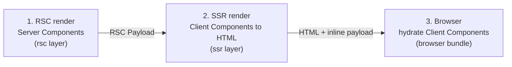
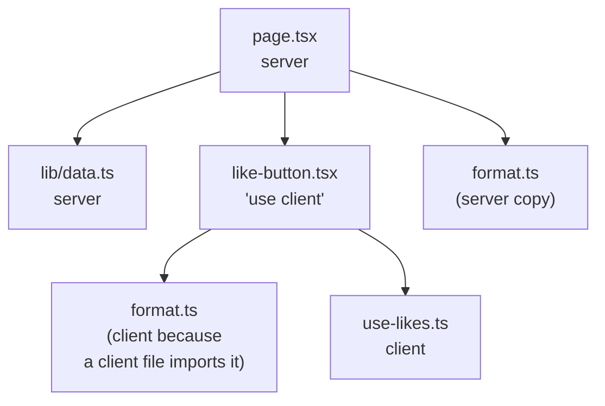

# Server and Client Components

> [!summary] TL;DR
> Every component in `app/` is a Server Component until a module says `'use client'`. That directive is not a flag on one component: it marks a **boundary in the module graph**. In the server (`rsc`) layer the compiler throws the client module's code away and replaces it with a **client reference** proxy. In the SSR and browser layers the same file is compiled normally. So a Client Component renders twice on a first load (once on the server to HTML, once in the browser to hydrate), while a Server Component only ever runs on the server and ships no JavaScript. Data crosses the boundary as props, which React must be able to serialize: plain data, JSX, Promises and Server Functions, but not ordinary functions or class instances. `server-only` and a set of compile-time import checks keep each side from pulling in the other's code.

The previous part ([[01 The App Router - Files, Segments and Layouts|part 01]]) showed which components Next renders for a route. This part is about *where* each of them runs and what that costs you.

## Two kinds of component, three renders

The names suggest a clean split, but the docs' own table is more honest:[^docs-boundary]

| | Runs on the server | Runs in the browser |
| --- | --- | --- |
| **Server Component** | Yes | No |
| **Client Component** | Yes (to HTML) | Yes (hydration and updates) |

"Client" means "*also* runs in the browser". On the first load of a page, three renders happen in sequence:



1. **RSC render.** Next runs your Server Components (layouts, pages, anything without `'use client'`) and produces the **RSC Payload**: the rendered output of Server Components, plus placeholders that say "render client component X from chunk Y here, with these props".
2. **SSR render.** React renders that payload to HTML. Client Components run here too, with no `window`, no effects and no event handlers, to produce their initial HTML.
3. **Browser.** The HTML paints. The payload is inlined in the same document as `<script>self.__next_f.push(...)</script>` tags,[^inline] which the client entry reads back from `self.__next_f`.[^next-f] React uses it to hydrate the Client Components.

On a client-side navigation only steps 1 and 3 run: the router fetches a fresh RSC Payload and React renders the Client Components in the browser, with no HTML involved ([[03 Linking, Navigation and Prefetching|part 03]]).

> [!warning] Misconception: "Client Components are not server-rendered"
> They are, on every first load. That is why `window is not defined` errors happen in a component marked `'use client'`. Code that touches browser APIs belongs in `useEffect` or an event handler, or the component must be loaded with `ssr: false` (see [[24 CSR - Client-Rendered Islands#Two kinds of "client-rendered"|part 24]]). The fix recipe is [[42 Recipes - Rendering and Hydration Errors#window is not defined (a browser-only library)|window is not defined]].

## What 'use client' compiles to

The directive is handled by a SWC transform, `react_server_components.rs`, that runs on every module in every layer. Its entry point decides what to do based on two facts: is this the React Server layer, and does the file start with `'use client'`?[^visit-mut]

```rust
// react_server_components.rs (simplified)
if self.is_react_server_layer {
    if is_client_entry {
        self.to_module_ref(module, is_cjs, &export_names); // replace the module
        return;
    }
} else if is_client_entry {
    self.prepend_comment_node(module, is_cjs, &export_names); // keep it, annotate it
}
```

**In the server layer**, `to_module_ref` clears the module body completely and emits two statements:[^module-ref]

```js
// what the rsc layer sees for app/ui/like-button.tsx
const { createProxy } = require("private-next-rsc-mod-ref-proxy")
module.exports = createProxy("/abs/path/app/ui/like-button.tsx")
```

`createProxy` is React's `createClientModuleProxy` from `react-server-dom-webpack/server`.[^proxy] The proxy is a **client reference**: an object that, when React's server renderer meets it as a component type, it does not call. It writes a reference ("module id + export name") into the payload instead. Your `useState`, your event handlers and every import in that file are simply gone from the server graph.

**In the SSR and browser layers**, the module is compiled normally, and the transform prepends a comment that lists its exports, `/* __next_internal_client_entry_do_not_use__ LikeButton auto */`.[^comment] The bundler plugins use that to know which exports a client entry provides.

With Turbopack (the default in 16), the same split is expressed as a **transition**: when a server module imports a `'use client'` file, `NextEcmascriptClientReferenceTransition` processes the source twice, once through the client transition and once through the SSR transition, and pairs the results into one client reference module.[^tp-transition] Different machinery, same outcome: one source file, two compiled copies, and a reference in between.

## A boundary in the module graph

Because the replacement happens at the module level, `'use client'` marks an **entry point**, not a single component. Everything that file imports is pulled into the client bundle with it.

You can see this in the webpack plugin that collects client components for each route. `filterClientComponents` walks the import graph from the server entry. When it reaches a client entry module it records it and **returns without following its imports**: from the server's point of view the subgraph below a client boundary does not exist.[^filter][^is-client]



Three practical rules follow:

- **Only entry points need the directive.** `use-likes.ts` and `format.ts` above do not need `'use client'`; being imported from a client module is enough.
- **Shared modules exist twice.** `format.ts` is imported by both sides, so it is bundled into both. That is fine for pure helpers and a leak for anything secret.
- **Push the boundary down.** Mark the smallest interactive leaf (`LikeButton`, `SearchInput`) as the client entry, not the page or layout above it. Everything above stays server-only and ships no JavaScript.

## Layers, and how server-only works

Internally the build is split into named layers. The ones that matter here are `rsc` (Server Components, Route Handlers, metadata), `ssr` (server rendering of Client Components), `app-pages-browser` (the browser bundle) and `action-browser` (Server Actions).[^layers] The `rsc` layer resolves packages with the `react-server` export condition, which is how a package can ship different code to Server Components.

`server-only` is just a package that uses that condition. Its `package.json` maps `react-server` to an empty file and everything else to a file that throws:[^so-pkg][^so-index]

```json
// next/dist/compiled/server-only/package.json
"exports": {
  ".": {
    "react-server": "./empty.js",
    "default": "./index.js"
  }
}
```

```js
// next/dist/compiled/server-only/index.js
throw new Error(
  "This module cannot be imported from a Client Component module. " +
    "It should only be used from a Server Component."
);
```

Next also aliases `server-only` and `client-only` to its own compiled copies, empty on the server and throwing (or erroring, for `client-only`) on the other side,[^aliases] so you do not have to install either package.

```ts
// lib/data.ts
import 'server-only'

export async function getProduct(id: string) {
  const res = await fetch(`https://api.example.com/products/${id}`, {
    headers: { authorization: `Bearer ${process.env.API_KEY}` },
  })
  return res.json()
}
```

Import that from a client module and the build fails, instead of quietly bundling a function whose `API_KEY` would be an empty string in the browser.

### The compile-time import checks

Before any bundling, the same SWC validator checks imports against fixed lists. In 16.4.3 they are:[^lists][^server-apis]

| In a Server Component you cannot import | In a Client Component you cannot import |
| --- | --- |
| `client-only`, `react-dom/client`, `react-dom/server`, `next/router` | `server-only`, `next/headers`, `next/root-params` |
| From `react`: `useState`, `useEffect`, `useRef`, `useReducer`, `createContext`, `useTransition`, `useOptimistic`, `useActionState`, `Component`, ... | From `next/cache`: `revalidatePath`, `revalidateTag`, `cacheLife`, `cacheTag` |
| From `react-dom`: `useFormStatus`, `flushSync`, ... | From `next/server`: `after` |
| From `next/navigation`: `useRouter`, `usePathname`, `useSearchParams`, `useParams`, ... | |
| From `next/link`: `useLinkStatus` | |

`assert_server_graph` reports the left column for any module in the server layer that is not a client entry, and `assert_client_graph` reports the right column for client modules (skipping `'use server'` and `'use cache'` files).[^visit][^client-graph] Two more checks live here: an `error.tsx` without `'use client'` is rejected,[^error-file] and `next/dynamic` with `{ ssr: false }` is rejected in Server Components, because there is no browser to defer to.[^ssr-false]

> [!note] node_modules are not checked
> Every one of these assertions begins with `if self.is_from_node_modules(&self.filepath) { return; }`. A library that calls `useState` without shipping `'use client'` is not caught at compile time. It fails at runtime instead, which is why you sometimes need a one-line wrapper (`'use client'; export { Carousel } from 'acme-carousel'`) around third-party components.

## Crossing the boundary: props must serialize

A Server Component renders a Client Component by passing it props. Those props travel inside the RSC Payload, so React has to serialize them. What can cross:

- Primitives: strings, numbers, bigints, booleans, `null`, `undefined`.
- Plain objects and arrays of serializable values, `Date`, `Map`, `Set`, typed arrays, `FormData`.
- **JSX**. Rendered elements are data (see [[02 Elements, Components and the Tree|How React Works: elements]]), including elements whose type is another Server Component's output.
- **Promises** of serializable values. The client unwraps them with `use()` and suspends until they resolve ([[04 Data Fetching and Streaming|part 04]]).
- **Server Functions** (`'use server'`), which cross as references with an ID ([[07 Server Actions and Forms|part 07]]).

What cannot cross: ordinary functions (event handlers, callbacks), class instances, symbols that are not globally registered, and anything with a prototype React does not know. The resulting error and its fixes are in [[42 Recipes - Rendering and Hydration Errors#Functions cannot be passed directly to Client Components|the recipes]].

```tsx
// app/products/[id]/page.tsx  (Server Component)
import { LikeButton } from '@/app/ui/like-button'

export default async function Page(props: PageProps<'/products/[id]'>) {
  const { id } = await props.params
  const product = await getProduct(id)

  return (
    <>
      <h1>{product.title}</h1>
      {/* fine: plain data */}
      <LikeButton productId={id} initialLikes={product.likes} />
      {/* error: functions cannot be passed to Client Components */}
      <LikeButton onLike={() => console.log('liked')} />
    </>
  )
}
```

> [!danger] Props are public
> Whatever you pass to a Client Component is written into the HTML and the RSC Payload, readable by anyone with view-source. Passing the whole `user` row to an `<Avatar>` ships its email, role and password hash too. Select the fields you need on the server. React's taint APIs (`experimental_taintObjectReference`, `experimental_taintUniqueValue`) can enforce this, but in 16.4.3 they require `experimental.taint`, and the SWC validator reports their use when the flag is off.[^lists]

## Composition patterns

### Server inside client, through children

A Client Component cannot *import* a Server Component (the import would pull it into the client graph). It can *receive* one, already rendered, as a prop:

```tsx
// app/ui/collapsible.tsx
'use client'
import { useState } from 'react'

export function Collapsible({ title, children }: { title: string; children: React.ReactNode }) {
  const [open, setOpen] = useState(false)
  return (
    <section>
      <button onClick={() => setOpen(!open)} aria-expanded={open}>{title}</button>
      {open && children}
    </section>
  )
}
```

```tsx
// app/products/[id]/page.tsx
import { Collapsible } from '@/app/ui/collapsible'
import { Reviews } from './reviews' // async Server Component

export default async function Page(props: PageProps<'/products/[id]'>) {
  const { id } = await props.params
  return (
    <Collapsible title="Reviews">
      <Reviews productId={id} />
    </Collapsible>
  )
}
```

`Reviews` runs on the server, before `Collapsible` ever renders, and arrives as serialized JSX. The client toggles it without knowing how it was produced. Any prop works for this, not only `children`; named "slot" props like `sidebar={<Sidebar />}` are the same pattern.

### Context providers as thin client wrappers

`createContext` is on the forbidden list for the server layer, so a provider must be a Client Component. Make it a wrapper that takes `children`, and render it as deep in the tree as it can go:

```tsx
// app/providers.tsx
'use client'
import { createContext, useState } from 'react'

export const CartContext = createContext<{ count: number; add: () => void } | null>(null)

export function CartProvider({ children }: { children: React.ReactNode }) {
  const [count, setCount] = useState(0)
  return <CartContext value={{ count, add: () => setCount((c) => c + 1) }}>{children}</CartContext>
}
```

```tsx
// app/(shop)/layout.tsx  (Server Component)
import { CartProvider } from '@/app/providers'

export default function ShopLayout({ children }: LayoutProps<'/'>) {
  return <CartProvider>{children}</CartProvider>
}
```

The pages under `(shop)` stay Server Components. Only the provider is client code, and `children` crosses as rendered JSX. React 19 renders a context object directly as a provider, so `<CartContext value>` replaces `<CartContext.Provider value>`.

### Pages and layouts can be client entries too

A `page.tsx` with `'use client'` is legal. Next then renders it through `ClientPageRoot`, a client wrapper that turns `params` and `searchParams` into the Promise-shaped values the page expects.[^client-page] Under Cache Components there is a behaviour change spelled out in that file: the server no longer sends the params as props, so the wrapper reads them from the router context, and `searchParams` are the canonical (browser) ones rather than the ones a rewrite produced.[^client-page][^page-branch] If a page depends on rewritten search params, read them in a Server Component and pass them down.

Making a whole page a client entry gives up the main benefit, though: its data fetching and everything it imports now ship to the browser. Usually the better shape is a Server Component page that fetches and passes data to client leaves.

## Environment variables

Only variables prefixed with `NEXT_PUBLIC_` are inlined into client bundles, at build time. Any other `process.env.X` in a client module becomes an empty string in the browser.[^docs-env] So a secret read in a shared helper does not leak, it just silently breaks on the client, which is exactly the bug `import 'server-only'` turns into a build error. The details of build-time versus runtime values are in [[11 Configuration, Turbopack and Deployment|part 11]].

## Choosing a side

| Need | Side |
| --- | --- |
| Read a database, a secret, the filesystem | Server |
| Big dependencies used only to render (Markdown, syntax highlighting, date libraries) | Server |
| `useState`, `useEffect`, refs, event handlers, browser APIs | Client |
| Context providers, most animation and form-state libraries | Client |
| A `<form>` that posts to a Server Function, `<details>`, `<a>` | Server is enough |

> [!tip] Start on the server, add islands
> Write the page as a Server Component, then extract the parts that need state or events into small client entries. The opposite direction (a client page that later "moves data fetching to the server") usually ends in a rewrite.

## Summary

`'use client'` draws a line in the module graph. On the server side of the line, the compiler replaces the module with a client reference, so Server Components render, serialize their output and point at client code without ever running it. On the client side, the same file is compiled twice, once for SSR and once for the browser, which is why Client Components still produce HTML on a first load. Props are the only way data crosses the line, so they must be serializable and should be treated as public. `server-only`, the `react-server` export condition and the SWC import checks keep each side honest at build time. Next, [[03 Linking, Navigation and Prefetching|part 03]] follows what happens when the user clicks a link and the router fetches a new RSC Payload.

### Key takeaways

- **Three renders**: RSC (server code only), SSR (Client Components to HTML), browser (hydration); navigations skip SSR.
- **Client reference**: in the `rsc` layer a `'use client'` module is replaced by `createProxy(path)`, React's `createClientModuleProxy`.
- **Boundary, not flag**: the directive marks an entry point; everything it imports is client code, and only entry points need it.
- **Turbopack**: a client reference transition compiles one source into a client module and an SSR module.
- **`server-only`**: an empty file under the `react-server` condition and a throwing file everywhere else.
- **Import checks**: hooks and `client-only` are rejected in server modules, `next/headers` and `server-only` in client modules, but `node_modules` are not checked.
- **Serializable props**: data, JSX, Promises and Server Functions cross; plain functions and class instances do not, and everything that crosses is public.
- **Composition**: pass Server Components to Client Components as `children` or slot props, and keep providers thin and deep.
- **Client pages**: rendered through `ClientPageRoot`; under Cache Components they get params from router context and canonical search params.

← [[01 The App Router - Files, Segments and Layouts|App Router]] · [[00 Next.js in Practice Index|Index]] · [[03 Linking, Navigation and Prefetching|Linking and Navigation]] →

[^docs-boundary]: Rendering environments — [docs/01-app/02-guides/server-and-client-boundary.mdx#L30-L79](https://github.com/vercel/next.js/blob/v16.4.3/docs/01-app/02-guides/server-and-client-boundary.mdx#L30-L79)
[^inline]: `writeInitialInstructions` and `writeFlightDataInstruction` emit `self.__next_f.push(...)` scripts — [packages/next/src/server/app-render/use-flight-response.tsx#L221-L273](https://github.com/vercel/next.js/blob/v16.4.3/packages/next/src/server/app-render/use-flight-response.tsx#L221-L273)
[^next-f]: client entry reading `self.__next_f` — [packages/next/src/client/app-index.tsx#L176](https://github.com/vercel/next.js/blob/v16.4.3/packages/next/src/client/app-index.tsx#L176)
[^visit-mut]: `ReactServerComponents::visit_mut_module` — [crates/next-custom-transforms/src/transforms/react_server_components.rs#L145-L175](https://github.com/vercel/next.js/blob/v16.4.3/crates/next-custom-transforms/src/transforms/react_server_components.rs#L145-L175)
[^module-ref]: `to_module_ref` replaces the module with `createProxy(filepath)` — [crates/next-custom-transforms/src/transforms/react_server_components.rs#L196-L255](https://github.com/vercel/next.js/blob/v16.4.3/crates/next-custom-transforms/src/transforms/react_server_components.rs#L196-L255)
[^proxy]: `createProxy = createClientModuleProxy` — [packages/next/src/build/webpack/loaders/next-flight-loader/module-proxy.ts#L1-L5](https://github.com/vercel/next.js/blob/v16.4.3/packages/next/src/build/webpack/loaders/next-flight-loader/module-proxy.ts#L1-L5)
[^comment]: `prepend_comment_node` — [crates/next-custom-transforms/src/transforms/react_server_components.rs#L257-L273](https://github.com/vercel/next.js/blob/v16.4.3/crates/next-custom-transforms/src/transforms/react_server_components.rs#L257-L273)
[^tp-transition]: `NextEcmascriptClientReferenceTransition::process` (client and SSR modules) — [crates/next-core/src/next_client_reference/ecmascript_client_reference/ecmascript_client_reference_transition.rs#L36-L84](https://github.com/vercel/next.js/blob/v16.4.3/crates/next-core/src/next_client_reference/ecmascript_client_reference/ecmascript_client_reference_transition.rs#L36-L84)
[^filter]: `filterClientComponents` stops at client entries — [packages/next/src/build/webpack/plugins/flight-client-entry-plugin.ts#L759-L847](https://github.com/vercel/next.js/blob/v16.4.3/packages/next/src/build/webpack/plugins/flight-client-entry-plugin.ts#L759-L847)
[^is-client]: `isClientComponentEntryModule` — [packages/next/src/build/webpack/loaders/utils.ts#L14-L21](https://github.com/vercel/next.js/blob/v16.4.3/packages/next/src/build/webpack/loaders/utils.ts#L14-L21)
[^layers]: `WEBPACK_LAYERS_NAMES` — [packages/next/src/lib/constants.ts#L116-L170](https://github.com/vercel/next.js/blob/v16.4.3/packages/next/src/lib/constants.ts#L116-L170)
[^so-pkg]: `server-only` export conditions — [packages/next/src/compiled/server-only/package.json#L13-L17](https://github.com/vercel/next.js/blob/v16.4.3/packages/next/src/compiled/server-only/package.json#L13-L17)
[^so-index]: `server-only/index.js` — [packages/next/src/compiled/server-only/index.js#L1-L4](https://github.com/vercel/next.js/blob/v16.4.3/packages/next/src/compiled/server-only/index.js#L1-L4)
[^aliases]: `createServerOnlyClientOnlyAliases` — [packages/next/src/build/create-compiler-aliases.ts#L254-L274](https://github.com/vercel/next.js/blob/v16.4.3/packages/next/src/build/create-compiler-aliases.ts#L254-L274)
[^server-apis]: `invalid_server_lib_apis_mapping` (hooks and APIs banned in Server Components) — [crates/next-custom-transforms/src/transforms/react_server_components.rs#L648-L697](https://github.com/vercel/next.js/blob/v16.4.3/crates/next-custom-transforms/src/transforms/react_server_components.rs#L648-L697)
[^lists]: `invalid_server_imports`, `invalid_client_imports`, `invalid_client_lib_apis_mapping`, `react_taint_apis` — [crates/next-custom-transforms/src/transforms/react_server_components.rs#L703-L737](https://github.com/vercel/next.js/blob/v16.4.3/crates/next-custom-transforms/src/transforms/react_server_components.rs#L703-L737)
[^visit]: `ReactServerComponentValidator::visit_module` picks the server or client checks — [crates/next-custom-transforms/src/transforms/react_server_components.rs#L1130-L1168](https://github.com/vercel/next.js/blob/v16.4.3/crates/next-custom-transforms/src/transforms/react_server_components.rs#L1130-L1168)
[^client-graph]: `assert_client_graph` — [crates/next-custom-transforms/src/transforms/react_server_components.rs#L869-L903](https://github.com/vercel/next.js/blob/v16.4.3/crates/next-custom-transforms/src/transforms/react_server_components.rs#L869-L903)
[^error-file]: `assert_server_filename` — [crates/next-custom-transforms/src/transforms/react_server_components.rs#L845-L867](https://github.com/vercel/next.js/blob/v16.4.3/crates/next-custom-transforms/src/transforms/react_server_components.rs#L845-L867)
[^ssr-false]: `check_for_next_ssr_false` — [crates/next-custom-transforms/src/transforms/react_server_components.rs#L1086-L1107](https://github.com/vercel/next.js/blob/v16.4.3/crates/next-custom-transforms/src/transforms/react_server_components.rs#L1086-L1107)
[^client-page]: `ClientPageRoot` — [packages/next/src/client/components/client-page.tsx#L22-L57](https://github.com/vercel/next.js/blob/v16.4.3/packages/next/src/client/components/client-page.tsx#L22-L57)
[^page-branch]: client page branch in `createComponentTreeInternal` — [packages/next/src/server/app-render/create-component-tree.tsx#L825-L858](https://github.com/vercel/next.js/blob/v16.4.3/packages/next/src/server/app-render/create-component-tree.tsx#L825-L858)
[^docs-env]: Preventing environment poisoning — [docs/01-app/01-getting-started/05-server-and-client-components.mdx#L528-L562](https://github.com/vercel/next.js/blob/v16.4.3/docs/01-app/01-getting-started/05-server-and-client-components.mdx#L528-L562)
