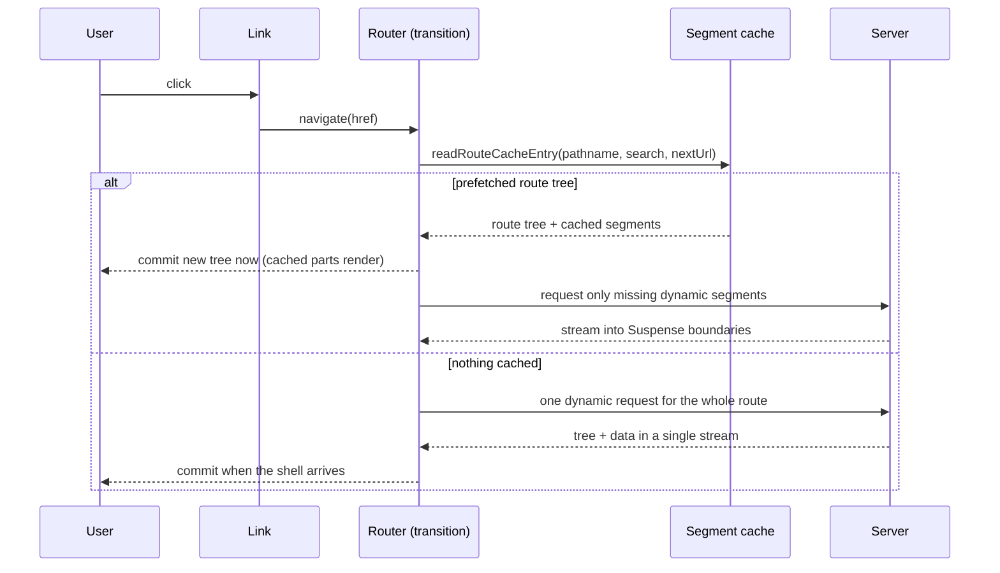

# Linking, Navigation and Prefetching

> [!summary] TL;DR
> `<Link>` renders a plain `<a>`, registers it with one shared `IntersectionObserver`, and in production prefetches the route when it comes within 200px of the viewport (and with higher priority on hover or touch). Prefetched data goes into the **segment cache**, keyed by pathname, search and the `Next-Url` header, and stored per segment so shared layouts are downloaded once. A click calls `navigate()` inside `startTransition`: if the route is in the cache the navigation is synchronous and any missing dynamic data streams in behind Suspense; if not, a single request fetches the whole route. `useLinkStatus` reads an optimistic pending flag the router sets on the clicked link, scrolling is done by a Fragment ref on the first changed segment, and `redirect()` is a thrown error that the nearest `RedirectBoundary` turns into `router.replace` or `router.push`.

In [[01 The App Router - Files, Segments and Layouts|part 01]] the server only rendered segments that changed, and in [[02 Server and Client Components|part 02]] a navigation fetched an RSC Payload instead of HTML. This part follows that request from the browser's side.

## A click, start to finish

`<Link>` is a Client Component that renders an `<a href>`, so a page works before hydration and middle-click still opens a new tab. Its `onClick` calls your `onClick` first, stops if you called `preventDefault()`, then hands off to `linkClicked`.[^onclick]

`linkClicked` decides whether this is a client navigation at all:[^linkclicked]

- **Modified clicks** (`target` other than `_self`, Cmd/Ctrl/Shift/Alt, middle button) and links with `download` return early, so the browser does its normal thing.[^modified]
- **External URLs** return early too (with a manual `location.replace` if you asked for `replace`).
- Otherwise it calls `e.preventDefault()`, then your **`onNavigate`**. If `onNavigate` calls its own `preventDefault()`, the navigation is cancelled. That is the hook for "you have unsaved changes".
- Finally it calls `navigate(href, 'push' | 'replace', scrollBehavior, linkInstance, transitionTypes, prefetchIntent)`.

`navigate` lives behind a small module, `navigator.ts`, whose comment explains it is the seam between the stable router queue and an experimental concurrent one (`experimental.concurrentRouterQueue`).[^navigator] The default implementation does the important work in one `startTransition`:[^navigate]

```ts
// sequential-router-queue.ts (simplified)
export function navigate(href, navigateType, scrollBehavior, linkInstance, transitionTypes, prefetchIntent) {
  if (isJavaScriptURLString(href)) throw new Error('Next.js has blocked a javascript: URL ...')

  startTransition(() => {
    for (const type of transitionTypes ?? []) addTransitionType(type)
    const url = new URL(addBasePath(href), location.href)
    setLinkForCurrentNavigation(linkInstance)       // drives useLinkStatus
    dispatchAppRouterAction({ type: ACTION_NAVIGATE, url, isExternalUrl: isExternalURL(url),
                              scrollBehavior, navigateType })
  })
}
```

Because the update is a **transition**, React keeps showing the current page while the new one is prepared, and an in-flight navigation can be superseded by a newer one (see [[07 Priorities, Transitions and Concurrency|How React Works: transitions]]). `transitionTypes` (the `<Link transitionTypes>` prop added in 16.2) are passed to `addTransitionType`, which is what `<ViewTransition>` reads to choose an animation.

The reducer then asks the segment cache for help:[^reducer][^navigate-impl]



The comment on `navigate` states the design goal: "To allow for synchronous navigations whenever possible, this is not an async function. It returns a promise only if there's no matching prefetch in the cache."[^navigate-impl] On a miss, `navigateToUnknownRoute` does not wait for a prefetch first; it fetches the static and dynamic parts in one stream and then pretends the response was a prefetch so the rest of the pipeline is shared.[^unknown]

## Prefetching: what, when and how much

### When a link prefetches

Every `<Link>` attaches a callback ref that registers the anchor with `mountLinkInstance`.[^mount] All links share **one** `IntersectionObserver` with `rootMargin: '200px'`, so a link starts prefetching slightly before it scrolls into view.[^observer]

- **Production only.** `onLinkVisibilityChanged` returns immediately in development, because prefetching would force the dev server to compile every linked page.[^visibility] Do not judge prefetching from `next dev`.
- **Leaving the viewport cancels.** `rescheduleLinkPrefetch` cancels the task of a link that is no longer visible.[^reschedule]
- **Hover and touch upgrade priority.** `onMouseEnter` and `onTouchStart` call `onNavigationIntent`, which reschedules the link with `PrefetchPriority.Intent`.[^intent]
- **Top links first.** Entries are processed in reverse document order because the scheduler favours the most recently scheduled task, so the link nearest the top wins.[^observer-order]

The scheduler caps concurrency: at most **4** prefetch requests in flight normally, and up to **12** when the newest task is a hover.[^bandwidth] It also pauses during a short cooldown after a revalidation, so a CDN has time to see the new data. After any cache invalidation, `pingVisibleLinks` re-prefetches every visible link whose task is now stale.[^ping]

There is only ever one `Intent` task. The priorities are `Intent = 2`, `Default = 1` and `Background = 0`.[^priority]

### How much a link prefetches

The `prefetch` prop picks a **prefetch intent**, which maps to a **fetch strategy**:[^intent-map][^strategy]

| `prefetch` | Intent | Without Cache Components | With Cache Components |
| --- | --- | --- | --- |
| omitted, `null` or `"auto"` | `auto` | Static route: whole route. Dynamic route: down to the first `loading.tsx` | The prerendered shell (static and cached parts) |
| `true` | `full` | Whole route, including dynamic data | Shell plus cached content that depends on this URL's params |
| `false` | `none` | Never, not even on hover | Never |

The table is the practical summary of `getFetchStrategyFromPrefetchIntent`: under Cache Components `auto` becomes the PPR strategy and `true` becomes `Full`; without it, `auto` *starts* as PPR and is downgraded to the loading-boundary strategy once the first prefetch reveals that the route does not support it.[^intent-map]

That is why the docs keep telling you to add `loading.tsx` to dynamic routes. Without Cache Components, a dynamic route with no loading boundary anywhere is not prefetched beyond its route tree: the server's tree walk sends "only the router state" for a prefetch when there is no `loading` component in the subtree.[^walk-prefetch] With a `loading.tsx`, the layouts and the skeleton are prefetched, the click commits instantly, and the page streams in.

> [!note] Partial Prefetching (16.x, opt-in)
> `partialPrefetching: true` in `next.config` (it requires Cache Components) changes the default again: `auto` prefetches one **App Shell** per route, shared by every link to that route, instead of a per-URL page. The `FetchStrategy` enum carries the extra tiers (`StaticShell`, `RuntimeShell`, `PPRRuntime`) for this mode.[^strategy] Parts [[23 PPR - Partial Prerendering with Cache Components|23]] and [[44 Recipes - Performance, Config and Deployment|44]] go deeper.

### The client cache

Prefetched and navigated data lives in the segment cache, a global in-memory structure that the router reads and writes outside React state. Two details shape its behaviour.

**Route entries are keyed by `pathname`, `search` and `nextUrl`.**[^cache-key] `nextUrl` is the `Next-Url` header value, so the intercepted and non-intercepted versions of the same URL ([[01 The App Router - Files, Segments and Layouts|part 01]]) never collide. Different search params are different route entries. If the client and server disagree on the deployment ID, the navigation becomes a hard one ([[11 Configuration, Turbopack and Deployment#3. Many instances: what must be shared|deployment IDs]]).

**Segment data is stored per segment.** The 16 upgrade guide calls this layout deduplication and incremental prefetching: when twenty product links share `(shop)/layout.tsx`, the layout is fetched once, and a prefetch only requests segments not already cached. The trade-off is more, smaller prefetch requests in the network tab. On a static export the same requests go to `.txt` files, see [[25 Fully Client-Side - SPA and Static Export#How client navigation works without a server|client navigation without a server]].

How long entries stay fresh is controlled by `staleTimes`, whose defaults are `dynamic: 0` and `static: 300` seconds.[^stale-defaults] The config comment explains which applies: `dynamic` when `prefetch` is left unspecified, `static` when it is `true`, and `static` must be at least 30 seconds.[^stale-comment] With the default `dynamic: 0`, dynamic data is never reused from the client cache on a later navigation; you always get fresh server output for dynamic segments.

> [!warning] Prefetching runs your components
> A prefetch is a real server render of layouts and (for static routes) pages. A `trackPageView()` call in a Server Component fires when the link scrolls into view, not when the user arrives. Put side effects in an event handler, a `useEffect`, or a Server Action.

## Rendering the new route

When the new tree commits, each `LayoutRouter` whose child changed renders `InnerLayoutRouter` for the new segment. If the segment has prefetched data (`prefetchRsc`) and full data (`rsc`) that may still be pending, it uses React's `useDeferredValue(rsc, prefetchRsc)`: the first render shows the prefetched version (often the `loading.tsx` fallback or a PPR shell), then React re-renders with the full data when it arrives.[^deferred] If the data is a promise, `use()` suspends into the nearest Suspense boundary. If the server returned nothing for the segment, it suspends forever and lets the router recover.[^inner]

So the user sees one of three things after a click:

1. **Cached and complete:** the new page, immediately.
2. **Cached shell, dynamic holes** ([[23 PPR - Partial Prerendering with Cache Components#Client navigations|PPR navigations]]): the new layout and skeleton immediately, content streaming in.
3. **Nothing cached:** the old page stays (it is a transition) until the server sends the new shell. This is the "my link feels dead" case.

## useLinkStatus: feedback for case 3

`useLinkStatus` returns `{ pending }` for the nearest parent `<Link>`. Under the hood, every `Link` holds `useOptimistic(IDLE_LINK_STATUS)`, and `setLinkForCurrentNavigation` flips the previous link to idle and the clicked one to pending inside a transition.[^optimistic][^link-status] Because it is optimistic state, it resets automatically when the navigation transition finishes. Only the most recently clicked link is pending.

```tsx
// app/ui/nav-link.tsx
'use client'
import Link, { useLinkStatus } from 'next/link'

function PendingDot() {
  const { pending } = useLinkStatus()
  return <span aria-hidden className={pending ? 'dot dot--pending' : 'dot'} />
}

export function NavLink({ href, children }: { href: string; children: React.ReactNode }) {
  return (
    <Link href={href}>
      {children}
      <PendingDot />
    </Link>
  )
}
```

```css
/* show the hint only if the navigation takes longer than ~100ms */
.dot { opacity: 0; }
.dot--pending { animation: appear 150ms 100ms forwards; }
@keyframes appear { to { opacity: 1; } }
```

The hook must be called in a **descendant** of the `Link` (it reads a context the `Link` provides).[^link-status] If the route was prefetched, the pending phase is usually too short to see. Treat `useLinkStatus` as a patch for slow links, and fix the cause with `loading.tsx` or prefetching.

## useRouter: navigating from code

`useRouter()` from `next/navigation` (never `next/router` in `app/`) returns the shared router instance:[^public-router]

| Method | Does |
| --- | --- |
| `push(href, { scroll, transitionTypes })` | Client navigation, new history entry |
| `replace(href, { scroll, transitionTypes })` | Client navigation, replaces the entry |
| `refresh()` | Re-renders the current route on the server and merges the result, keeping client state |
| `prefetch(href, { onInvalidate })` | Schedules a prefetch; `onInvalidate` fires when that data goes stale |
| `back()`, `forward()` | `window.history.back()` / `forward()` |

`push` and `replace` are the same `navigate()` call as a `Link` click, without a link instance (so no `useLinkStatus`) and without a prefetch intent.[^push] `refresh()` dispatches `ACTION_REFRESH` in a transition.[^refresh] It clears the client cache for the current route but does **not** touch server caches; to invalidate cached data on the server use `revalidateTag`, `updateTag` or `revalidatePath` ([[06 Revalidation - Tags, Paths and Refresh|part 06]]).

```tsx
// app/products/sort-select.tsx
'use client'
import { useRouter, useSearchParams, usePathname } from 'next/navigation'

export function SortSelect() {
  const router = useRouter()
  const pathname = usePathname()
  const searchParams = useSearchParams()

  return (
    <select
      defaultValue={searchParams.get('sort') ?? 'popular'}
      onChange={(e) => {
        const params = new URLSearchParams(searchParams)
        params.set('sort', e.target.value)
        router.replace(`${pathname}?${params}`, { scroll: false })
      }}
    >
      <option value="popular">Popular</option>
      <option value="price">Price</option>
    </select>
  )
}
```

> [!tip] Prefer Link when the user clicks something
> A `Link` gets viewport and hover prefetching, a real `href` for crawlers and middle-click, and `useLinkStatus`. Use `router.push` for navigations that do not come from a link: after a form succeeds, on a keyboard shortcut, in a command palette. If you build your own link from `router`, you own prefetching (`router.prefetch` with `onInvalidate`) as well.

For URL state that should not trigger a server round trip at all, `window.history.pushState` and `replaceState` are integrated with the router: `usePathname` and `useSearchParams` follow them.

### useSearchParams and prerendering

`useSearchParams` is a client hook, but it has a server-side consequence. During a prerender the search params are unknown, so the hook calls `useDynamicSearchParams`, which, depending on the render mode, suspends on a promise that never resolves during the prerender or throws a bailout error.[^usp][^dynamic-sp] Either way, the Client Component tree up to the nearest `Suspense` boundary is rendered in the browser instead of the build. Wrap components that read search params in `<Suspense>` so the rest of the page can still be prerendered.

## Scrolling and focus

After a navigation, `InnerScrollHandler` runs in a layout effect on the segments that changed. It uses a React **Fragment ref** around the segment's children, so it does not need a wrapper `<div>`:[^scroll]

1. With a `#hash`, it scrolls the element with that id (or the first element with that `name`, or the top for `#top`) into view.
2. Otherwise it measures the segment. If its top edge is already in the viewport (below any `scroll-padding-top`), it does **nothing**.
3. If not, it sets `document.documentElement.scrollTop = 0`, and if the segment is still not visible, calls `scrollIntoView()` on it.
4. It marks the scroll as handled, so only one segment scrolls per navigation.

So "Next scrolls to the top" is really "Next makes the new segment visible". Navigating between two tabs inside a tall layout leaves the scroll where it is if the tab content is on screen. For a sticky header, set `scroll-padding-top` on `html`; the handler reads it.[^scroll]

Pass `scroll={false}` to `Link` (or `{ scroll: false }` to `push`/`replace`) to skip all of this.

> [!note] Changed in 16: smooth scrolling is no longer overridden
> Up to 15, Next temporarily set `scroll-behavior: auto` during navigations if your CSS had `scroll-behavior: smooth`. In 16 it leaves your setting alone. Add `data-scroll-behavior="smooth"` to `<html>` to get the old override back.

The scroll handler explicitly leaves focus untouched ("resetting focus on navigation is deferred").[^scroll] The App Router does include a route announcer for screen readers, but if your layout needs focus to move to the new `<h1>` or `<main>`, do it yourself in the page, for example with a small client component that focuses a heading in `useEffect`.

## redirect() versus router.push()

`redirect()` and `permanentRedirect()` from `next/navigation` do not navigate. They **throw** an error whose `digest` encodes the target: `NEXT_REDIRECT;<type>;<url>;<status>;`.[^redirect] Whoever catches it decides what happens:

- **Server Component render:** the server converts it to a redirect response on the initial request (or a meta refresh if streaming has already started).
- **Route Handler:** a 307 (`redirect`) or 308 (`permanentRedirect`).
- **Server Action:** a client-side navigation when JavaScript has loaded, a 303 for a no-JS form post. The `type` defaults to `push` inside a Server Action and to `replace` everywhere else.[^redirect]
- **Client Component render:** the error reaches the `RedirectBoundary` that every segment has ([[01 The App Router - Files, Segments and Layouts|part 01]]). `HandleRedirect` then calls `router.push` or `router.replace` in a transition.[^redirect-boundary]

Because it throws, `redirect()` must not be called inside a `try` block that swallows errors, and it cannot be used in event handlers (there is no boundary to catch it). The rule of thumb:

| Situation | Use |
| --- | --- |
| Decide on the server while rendering (no session, moved content) | `redirect()` in the Server Component |
| After a mutation | `redirect()` at the end of the Server Action |
| Response to a user event in the browser | `router.push()` / `router.replace()` |
| Before rendering, for many routes at once | a redirect in `proxy.ts` or `next.config` ([[08 Route Handlers and Proxy|part 08]]) |

Status codes, `notFound()` and the other interrupts are covered in [[10 Errors, Redirects and Request Lifecycle APIs|part 10]]. The `try`/`catch` pitfall has a recipe: [[41 Recipes - Routing and Navigation#redirect() inside try/catch does nothing|redirect() inside try/catch]].

## Summary

A Next.js navigation is a React transition backed by a cache. `<Link>` prefetches through a single `IntersectionObserver` and a small priority scheduler, only in production, and the `prefetch` prop chooses how much: a shell, everything down to `loading.tsx`, or the full route. The segment cache stores data per segment under a key of pathname, search and `Next-Url`, so shared layouts download once and intercepted routes stay separate. On click, a cached route commits at once and streams the rest; an uncached route fetches everything in one request while the old page stays visible. `useLinkStatus`, `useRouter`, the scroll handler and `redirect()` are all thin layers on that flow. Next, [[04 Data Fetching and Streaming|part 04]] looks at the server side of the same request: fetching data in async components and streaming it through Suspense.

### Key takeaways

- **`linkClicked`**: modified clicks, downloads and external URLs fall through to the browser; `onNavigate` can cancel a client navigation.
- **`navigate()`**: runs in `startTransition`, applies `transitionTypes`, marks the link pending and dispatches `ACTION_NAVIGATE`.
- **Cache hit or miss**: a prefetched route navigates synchronously and streams missing data; a miss sends one request for the whole route.
- **Prefetch triggers**: one observer with a 200px margin, production only, hover and touch get `Intent` priority, at most 4 (or 12) requests in flight.
- **Prefetch amount**: `auto` means shell or up-to-`loading.tsx`, `true` means full, `false` means never; dynamic routes without `loading.tsx` barely prefetch without Cache Components.
- **Segment cache**: keyed by pathname, search and `Next-Url`, stored per segment, with `staleTimes` defaults of 0 (dynamic) and 300 seconds (static).
- **`useLinkStatus`**: optimistic per-link state, only in descendants of the `Link`, mostly useful when prefetching did not finish.
- **Scroll**: only scrolls if the new segment is off screen; `scroll={false}` opts out, and 16 no longer overrides smooth scrolling.
- **`redirect()`**: a thrown error with a digest, handled differently in Server Components, Route Handlers, Server Actions and the client `RedirectBoundary`.

← [[02 Server and Client Components|Server and Client Components]] · [[00 Next.js in Practice Index|Index]] · [[04 Data Fetching and Streaming|Data Fetching and Streaming]] →

[^onclick]: `<Link>` `onClick` and `onMouseEnter` handlers — [packages/next/src/client/app-dir/link.tsx#L666-L729](https://github.com/vercel/next.js/blob/v16.4.3/packages/next/src/client/app-dir/link.tsx#L666-L729)
[^linkclicked]: `linkClicked` — [packages/next/src/client/app-dir/link.tsx#L253-L318](https://github.com/vercel/next.js/blob/v16.4.3/packages/next/src/client/app-dir/link.tsx#L253-L318)
[^modified]: `isModifiedEvent` — [packages/next/src/client/app-dir/link.tsx#L240-L251](https://github.com/vercel/next.js/blob/v16.4.3/packages/next/src/client/app-dir/link.tsx#L240-L251)
[^navigator]: `navigator.ts` re-exports the router queue — [packages/next/src/client/components/navigator.ts#L1-L32](https://github.com/vercel/next.js/blob/v16.4.3/packages/next/src/client/components/navigator.ts#L1-L32)
[^navigate]: `navigate` in the sequential router queue — [packages/next/src/client/components/sequential-router-queue.ts#L47-L93](https://github.com/vercel/next.js/blob/v16.4.3/packages/next/src/client/components/sequential-router-queue.ts#L47-L93)
[^reducer]: `navigateReducer` — [packages/next/src/client/components/router-reducer/reducers/navigate-reducer.ts#L23-L56](https://github.com/vercel/next.js/blob/v16.4.3/packages/next/src/client/components/router-reducer/reducers/navigate-reducer.ts#L23-L56)
[^navigate-impl]: `navigate` and `navigateImpl` (cache hit, optimistic route, miss) — [packages/next/src/client/components/app-router-state.ts#L52-L225](https://github.com/vercel/next.js/blob/v16.4.3/packages/next/src/client/components/app-router-state.ts#L52-L225)
[^unknown]: `navigateToUnknownRoute` — [packages/next/src/client/components/app-router-state.ts#L447-L472](https://github.com/vercel/next.js/blob/v16.4.3/packages/next/src/client/components/app-router-state.ts#L447-L472)
[^mount]: `observeLinkVisibilityOnMount` callback ref — [packages/next/src/client/app-dir/link.tsx#L620-L653](https://github.com/vercel/next.js/blob/v16.4.3/packages/next/src/client/app-dir/link.tsx#L620-L653)
[^observer]: shared `IntersectionObserver` with `rootMargin: '200px'` — [packages/next/src/client/components/links.ts#L121-L127](https://github.com/vercel/next.js/blob/v16.4.3/packages/next/src/client/components/links.ts#L121-L127)
[^observer-order]: `handleIntersect` processes entries in reverse — [packages/next/src/client/components/links.ts#L252-L269](https://github.com/vercel/next.js/blob/v16.4.3/packages/next/src/client/components/links.ts#L252-L269)
[^visibility]: `onLinkVisibilityChanged` (disabled in development) — [packages/next/src/client/components/links.ts#L271-L291](https://github.com/vercel/next.js/blob/v16.4.3/packages/next/src/client/components/links.ts#L271-L291)
[^intent]: `onNavigationIntent` — [packages/next/src/client/components/links.ts#L293-L312](https://github.com/vercel/next.js/blob/v16.4.3/packages/next/src/client/components/links.ts#L293-L312)
[^reschedule]: `rescheduleLinkPrefetch` — [packages/next/src/client/components/links.ts#L314-L366](https://github.com/vercel/next.js/blob/v16.4.3/packages/next/src/client/components/links.ts#L314-L366)
[^ping]: `pingVisibleLinks` — [packages/next/src/client/components/links.ts#L368-L401](https://github.com/vercel/next.js/blob/v16.4.3/packages/next/src/client/components/links.ts#L368-L401)
[^bandwidth]: `hasNetworkBandwidth` (4 default, 12 for intent, revalidation cooldown) — [packages/next/src/client/components/segment-cache/scheduler.ts#L487-L526](https://github.com/vercel/next.js/blob/v16.4.3/packages/next/src/client/components/segment-cache/scheduler.ts#L487-L526)
[^priority]: `PrefetchPriority` — [packages/next/src/client/components/segment-cache/types.ts#L15-L32](https://github.com/vercel/next.js/blob/v16.4.3/packages/next/src/client/components/segment-cache/types.ts#L15-L32)
[^intent-map]: prefetch intent from the `prefetch` prop and `getFetchStrategyFromPrefetchIntent` — [packages/next/src/client/app-dir/link.tsx#L381-L389](https://github.com/vercel/next.js/blob/v16.4.3/packages/next/src/client/app-dir/link.tsx#L381-L389) and [#L808-L827](https://github.com/vercel/next.js/blob/v16.4.3/packages/next/src/client/app-dir/link.tsx#L808-L827)
[^strategy]: `FetchStrategy` — [packages/next/src/client/components/segment-cache/types.ts#L34-L66](https://github.com/vercel/next.js/blob/v16.4.3/packages/next/src/client/components/segment-cache/types.ts#L34-L66)
[^walk-prefetch]: prefetch without a loading boundary sends only router state — [packages/next/src/server/app-render/walk-tree-with-flight-router-state.tsx#L176-L193](https://github.com/vercel/next.js/blob/v16.4.3/packages/next/src/server/app-render/walk-tree-with-flight-router-state.tsx#L176-L193)
[^cache-key]: `createCacheKey` — [packages/next/src/client/components/segment-cache/cache-key.ts#L20-L31](https://github.com/vercel/next.js/blob/v16.4.3/packages/next/src/client/components/segment-cache/cache-key.ts#L20-L31)
[^stale-defaults]: `staleTimes` defaults — [packages/next/src/server/config-shared.ts#L2467-L2470](https://github.com/vercel/next.js/blob/v16.4.3/packages/next/src/server/config-shared.ts#L2467-L2470)
[^stale-comment]: `staleTimes` config documentation — [packages/next/src/server/config-shared.ts#L603-L613](https://github.com/vercel/next.js/blob/v16.4.3/packages/next/src/server/config-shared.ts#L603-L613)
[^deferred]: `useDeferredValue(rsc, prefetchRsc)` — [packages/next/src/client/components/layout-router.tsx#L333-L341](https://github.com/vercel/next.js/blob/v16.4.3/packages/next/src/client/components/layout-router.tsx#L333-L341)
[^inner]: `InnerLayoutRouter` — [packages/next/src/client/components/layout-router.tsx#L302-L414](https://github.com/vercel/next.js/blob/v16.4.3/packages/next/src/client/components/layout-router.tsx#L302-L414)
[^optimistic]: `PENDING_LINK_STATUS`, `IDLE_LINK_STATUS`, `setLinkForCurrentNavigation` — [packages/next/src/client/components/links.ts#L73-L88](https://github.com/vercel/next.js/blob/v16.4.3/packages/next/src/client/components/links.ts#L73-L88)
[^link-status]: `LinkStatusContext` and `useLinkStatus` — [packages/next/src/client/app-dir/link.tsx#L800-L806](https://github.com/vercel/next.js/blob/v16.4.3/packages/next/src/client/app-dir/link.tsx#L800-L806)
[^public-router]: `publicAppRouterInstance` — [packages/next/src/client/components/app-router-instance.ts#L324-L335](https://github.com/vercel/next.js/blob/v16.4.3/packages/next/src/client/components/app-router-instance.ts#L324-L335)
[^push]: `push` and `replace` — [packages/next/src/client/components/sequential-router-queue.ts#L95-L119](https://github.com/vercel/next.js/blob/v16.4.3/packages/next/src/client/components/sequential-router-queue.ts#L95-L119)
[^refresh]: `refresh` — [packages/next/src/client/components/sequential-router-queue.ts#L155-L161](https://github.com/vercel/next.js/blob/v16.4.3/packages/next/src/client/components/sequential-router-queue.ts#L155-L161)
[^usp]: `useSearchParams` — [packages/next/src/client/components/navigation.ts#L55-L92](https://github.com/vercel/next.js/blob/v16.4.3/packages/next/src/client/components/navigation.ts#L55-L92)
[^dynamic-sp]: `useDynamicSearchParams` — [packages/next/src/server/app-render/dynamic-rendering-client.ts#L80-L139](https://github.com/vercel/next.js/blob/v16.4.3/packages/next/src/server/app-render/dynamic-rendering-client.ts#L80-L139)
[^scroll]: `InnerScrollHandler` — [packages/next/src/client/components/layout-router.tsx#L148-L278](https://github.com/vercel/next.js/blob/v16.4.3/packages/next/src/client/components/layout-router.tsx#L148-L278)
[^redirect]: `getRedirectError`, `redirect`, `permanentRedirect` — [packages/next/src/client/components/redirect.ts#L10-L61](https://github.com/vercel/next.js/blob/v16.4.3/packages/next/src/client/components/redirect.ts#L10-L61)
[^redirect-boundary]: `HandleRedirect` in the redirect boundary — [packages/next/src/client/components/redirect-boundary.tsx#L13-L36](https://github.com/vercel/next.js/blob/v16.4.3/packages/next/src/client/components/redirect-boundary.tsx#L13-L36)
