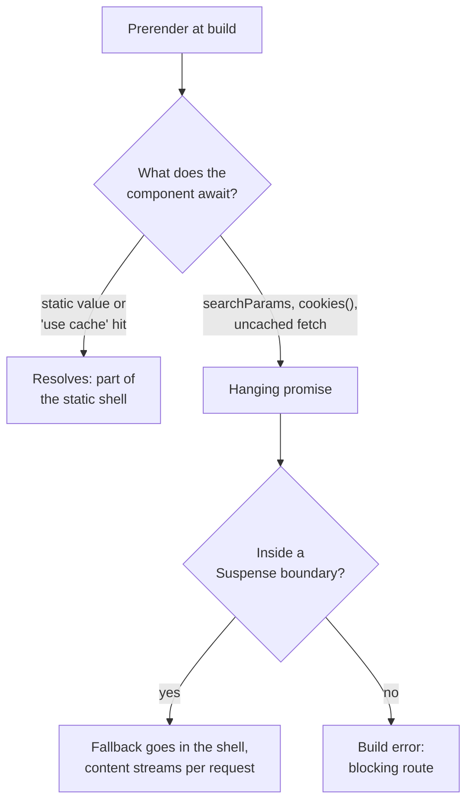
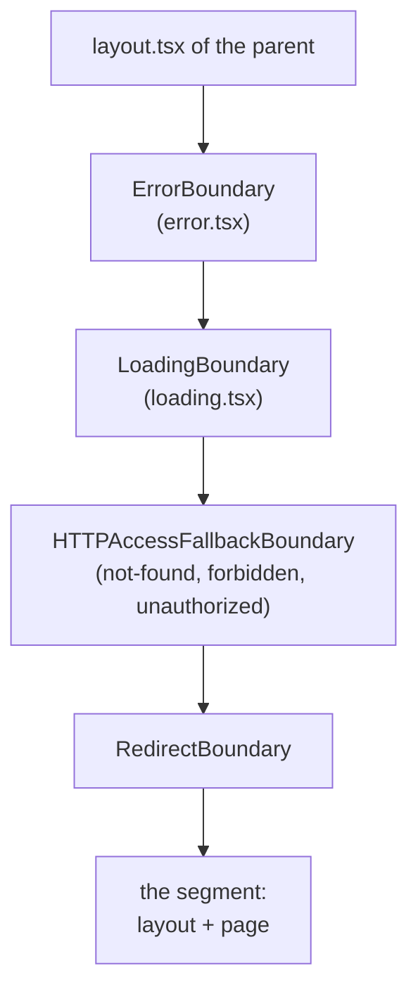
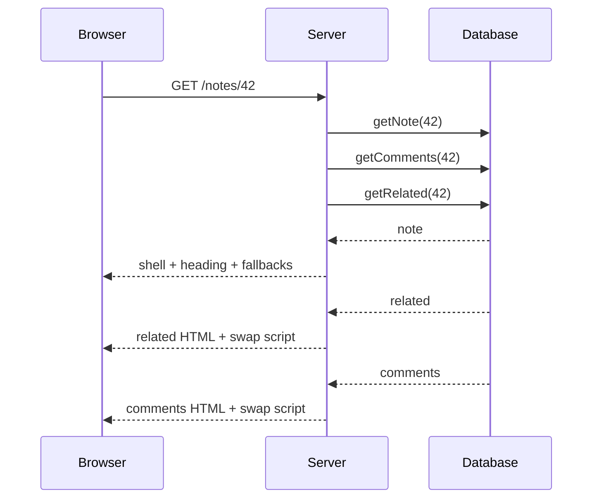

# Data Fetching and Streaming

> [!summary] TL;DR
> In the App Router you fetch data by making a Server Component `async` and awaiting whatever you like: `fetch`, an ORM, a file read. Nothing is cached by default. Identical `GET` fetches in one request are deduplicated by a `React.cache`-scoped map that Next.js wraps around `globalThis.fetch`. For other data sources you wrap the function in `React.cache` yourself. `params`, `searchParams`, `cookies()` and `headers()` are promises, because during a prerender Next.js hands out promises that never resolve when the value is not known yet. That is how it finds the dynamic parts of a page. Each `<Suspense>` boundary, and each `loading.tsx` (which becomes a `<Suspense>` around the segment's children), is a separate streaming point: the fallback goes out in the first chunk, and the content follows when its data arrives. Start independent requests before awaiting any of them, push slow reads down behind their own boundary, and when a Client Component needs the data, pass it the promise and read it there with `use()`.

The earlier parts built the route tree ([[01 The App Router - Files, Segments and Layouts|App Router]]) and drew the server/client line ([[02 Server and Client Components|Server and Client Components]]). This part puts data into that tree. It explains how a request gets its data, what Next.js does with the `fetch` you call, why the request APIs became promises in Next.js 15 and 16, and how streaming turns slow data into a page that paints in pieces.

The running example is the same small notes app used across the course: `/notes` lists notes, `/notes/[id]` shows one note with its comments and an author card.

## Fetching in a Server Component

A Server Component is just an async function that returns JSX. You await data inside it:

```tsx
// app/notes/page.tsx
import { db } from '@/lib/db'

export default async function NotesPage() {
  const notes = await db.note.findMany({ orderBy: { updatedAt: 'desc' } })

  return (
    <ul>
      {notes.map((note) => (
        <li key={note.id}>{note.title}</li>
      ))}
    </ul>
  )
}
```

There is no `getServerSideProps`, no loader file and no special data hook. The component runs on the server, so credentials and query code never reach the browser. The result is serialized into the RSC payload along with the rest of the tree.

Two defaults matter in Next.js 16:

- **Nothing is cached.** A plain `fetch` or database call runs every time the component renders. Caching is opt-in with `'use cache'` ([[05 Cache Components - use cache, cacheLife and cacheTag|Cache Components]]). This changed in Next.js 15, when `fetch` stopped defaulting to `force-cache`.
- **Identical `GET` fetches are deduplicated within one request.** Two components can both call `fetch('/api/notes/1')` and only one network request goes out. This is memoization for the lifetime of one render, not a cache.

> [!note] "Not cached" does not mean "not prerendered"
> With `cacheComponents: true`, a route is still prerendered at build time. An uncached read simply cannot be part of that prerender, so it must sit inside a `<Suspense>` boundary and stream at request time. Without such a boundary the build fails with a "blocking route" error. More on this below and in [[23 PPR - Partial Prerendering with Cache Components|PPR]].

## How fetch is deduplicated

When the server starts, `patchFetch` replaces `globalThis.fetch`. The first layer of that replacement is `createDedupeFetch`, which is adapted from React's own `ReactFetch.js`.[^patch][^dedupe]

```ts
// packages/next/src/server/lib/dedupe-fetch.ts (simplified)
export function createDedupeFetch(originalFetch: typeof fetch) {
  const getCacheEntries = React.cache((url: string): CacheEntry[] => [])

  return function dedupeFetch(resource, options) {
    if (options && options.signal) return originalFetch(resource, options)

    const request = new Request(resource, options)
    if ((request.method !== 'GET' && request.method !== 'HEAD') || request.keepalive) {
      return originalFetch(resource, options)
    }

    const cacheKey = generateCacheKey(request) // method, headers, mode, redirect, ...
    const cacheEntries = getCacheEntries(request.url)
    // reuse a matching in-flight promise, clone its Response, or start a new one
  }
}
```

Three details follow from this code:

- The map lives inside `React.cache`, so it is **scoped to the current React render**. A new request gets a new, empty map. Nothing survives across requests.
- The key is the URL plus the method, headers (except `traceparent` and `tracestate`), mode, redirect, credentials, referrer, referrer policy and integrity.[^dedupe-key] Two fetches to the same URL with different `Authorization` headers are two requests.
- **Passing an `AbortSignal` opts out**, and so do `POST`, `PUT`, `DELETE` and `keepalive` requests.[^dedupe-optout] A request with side effects is never collapsed into another one.

Each caller receives its own clone of the `Response`, so both can call `.json()`.

### React.cache for everything else

An ORM call is not a `fetch`, so nothing deduplicates it for you. Wrap the function in React's `cache`:

```ts
// lib/data/notes.ts
import 'server-only'
import { cache } from 'react'
import { db } from '@/lib/db'

export const getNote = cache(async (id: string) => {
  return db.note.findUnique({ where: { id }, include: { author: true } })
})
```

Now the page, `generateMetadata` and the author card can all call `getNote(id)` and the query runs once per request. `React.cache` compares arguments by identity (`Object.is`), so pass primitives like the id string, not a freshly built object.

> [!warning] `React.cache` is not a data cache
> It memoizes for one server render and is then thrown away. To keep results across requests you need `'use cache'`. Inside a `'use cache'` function, `React.cache` also gets a fresh, isolated scope, so you cannot smuggle a value into a cached function through it. See [[05 Cache Components - use cache, cacheLife and cacheTag|Cache Components]].

## Request data is a promise

In Next.js 16, every request-specific input is asynchronous:

```tsx
// app/notes/[id]/page.tsx
import { cookies } from 'next/headers'

export default async function NotePage({
  params,
  searchParams,
}: {
  params: Promise<{ id: string }>
  searchParams: Promise<{ tab?: string }>
}) {
  const { id } = await params
  const { tab = 'comments' } = await searchParams
  const theme = (await cookies()).get('theme')?.value
  // ...
}
```

`cookies()`, `headers()` and `draftMode()` return promises,[^cookies] and so do the `params` and `searchParams` props of pages and layouts. Next.js 15 introduced the async versions next to a temporary synchronous fallback. Next.js 16 removed the synchronous access, so `params.id` without `await` no longer works.

The reason is the prerender. To build a static shell, Next.js renders the route without a request. When it reaches something it cannot know yet, it needs a way to stop that branch without stopping the whole render. A promise that never resolves does exactly that: the component that awaits it suspends forever, React renders the nearest `<Suspense>` fallback in its place, and the rest of the page completes. [[23 PPR - Partial Prerendering with Cache Components#Build time: how holes are found|PPR]] shows how those holes are found.

You can see it in the code that creates `params`. During a Cache Components prerender, if any param is a fallback param (a value not listed by `generateStaticParams`), Next.js returns a hanging promise instead of the values:[^static-params]

```ts
// packages/next/src/server/request/params.ts (simplified)
function createStaticPrerenderParams(underlyingParams, ..., prerenderStore) {
  case 'prerender': {
    if (hasFallbackRouteParams(underlyingParams, prerenderStore.fallbackRouteParams)) {
      return makeHangingParams(underlyingParams, workStore, prerenderStore)
    }
    // ...all params known at build time:
    return makeUntrackedParams(userspaceParams) // Promise.resolve(params), cached per object
  }
}
```

`searchParams` is never known at build time, so in a Cache Components prerender it is always a hanging promise.[^search-hang] The same pattern applies to an uncached `fetch`. When a fetch with no cache configuration runs inside a prerender, `patchFetch` does not even send it. It returns a hanging promise right away, because the result could never be part of the shell.[^fetch-hang]



When an access like that is not covered by a boundary, the error text spells out the options: wrap the access in `<Suspense>`, cache it with `'use cache'` (for uncached data, not for `cookies()`), or set `export const instant = false` to accept a blocking route.[^blocking-msg]

> [!tip] Await late, not early
> Because `params` and `searchParams` are promises, you can pass them down unresolved: `<Comments params={params} />`. The child awaits them inside its own `<Suspense>`. The page itself never touches the value, so it stays in the static shell.

## Streaming with loading.tsx and Suspense

Streaming means the server sends HTML in pieces. The first chunk contains everything that rendered without waiting: layouts, static markup and the fallbacks of every `<Suspense>` boundary whose content was not ready. When a boundary's content finishes, React streams that HTML plus a small inline script that swaps it in for the fallback. The browser applies the swap before the JavaScript bundle has even loaded. What React does when it renders and commits a tree is covered in [[03 What Rendering Really Means|React Concepts: rendering]]. This section is about where Next.js places the boundaries.

### loading.tsx is a Suspense boundary

A `loading.tsx` next to a `page.tsx` streams the whole segment:

```tsx
// app/notes/[id]/loading.tsx
export default function Loading() {
  return <NoteSkeleton />
}
```

There is no special loading mechanism behind it. The router renders each segment inside a fixed stack of client components, and one of them is `LoadingBoundary`, which turns the module into a plain React `Suspense` fallback:[^loading-boundary]

```tsx
// packages/next/src/client/components/layout-router.tsx (simplified)
function LoadingBoundary({ loading, children }) {
  if (loading !== null) {
    const [loadingRsc, loadingStyles, loadingScripts] = loading
    return (
      <Suspense fallback={<>{loadingStyles}{loadingScripts}{loadingRsc}</>}>
        {children}
      </Suspense>
    )
  }
  return <>{children}</>
}
```

The order of the stack explains several behaviours people trip over:[^segment-stack]



- The loading boundary sits **below** the parent layout and **wraps the child segment**. A `loading.tsx` in `app/notes/[id]/` covers that folder's `page.tsx` and any nested segments. It does **not** cover `app/notes/[id]/layout.tsx`'s own data, because the layout of the same folder renders the boundary, not inside it.
- So a layout that awaits `cookies()` or an uncached fetch is not covered by its sibling `loading.tsx`. It blocks the navigation. Move that read into the page, or wrap it in its own `<Suspense>` inside the layout.
- `error.tsx` wraps the loading boundary, so an error thrown while the content streams in still lands in the segment's error UI.

On a client navigation the same boundary is what makes the UI respond immediately: the router shows the `loading.tsx` fallback (prefetched with the route, see [[03 Linking, Navigation and Prefetching|Navigation]]) while the new segment's payload streams in.

### Suspense for finer control

`loading.tsx` is coarse: one fallback for the whole page. A `<Suspense>` boundary can wrap exactly the slow part:

```tsx
// app/notes/[id]/page.tsx
import { Suspense } from 'react'
import { getNote } from '@/lib/data/notes'

export default async function NotePage({ params }: { params: Promise<{ id: string }> }) {
  const { id } = await params
  const note = await getNote(id) // fast, needed for the heading

  return (
    <article>
      <h1>{note.title}</h1>
      <NoteBody note={note} />
      <Suspense fallback={<CommentsSkeleton />}>
        <Comments noteId={id} />
      </Suspense>
      <Suspense fallback={<RelatedSkeleton />}>
        <RelatedNotes noteId={id} />
      </Suspense>
    </article>
  )
}
```

Sibling boundaries are independent streaming points. `Comments` and `RelatedNotes` start together and each one streams in as soon as its own data is ready, in whatever order they finish.

> [!note] Suspense alone does not make anything dynamic
> A boundary only matters when something inside it suspends. A component that does only synchronous work completes during the prerender whether or not it is wrapped in `<Suspense>`.

### What streaming cannot do

Once the first byte is sent, the status code and headers are fixed. If `notFound()` fires inside a boundary that has already streamed its fallback, Next.js cannot turn the `200` into a `404`. It injects `<meta name="robots" content="noindex">` instead, and a `redirect()` there becomes a client-side redirect. Call `notFound()` or `redirect()` before the first `await` that sits under a boundary if you need the real status code ([[10 Errors, Redirects and Request Lifecycle APIs|Errors and Redirects]]).

HTML-limited bots and crawlers are also treated differently: Next.js waits for `generateMetadata` before streaming the body for them, so the metadata lands in `<head>` ([[09 Metadata, Images, Fonts and Scripts|Metadata]]).

## Sequential vs parallel fetching

Streaming hides latency. It does not remove it. The other half is making sure requests do not wait on each other for no reason.

### The accidental waterfall

```tsx
// app/notes/[id]/page.tsx: sequential (slow)
const { id } = await params
const note = await getNote(id)          // 80 ms
const comments = await getComments(id)  // 120 ms, starts only after getNote
const author = await getAuthor(note.authorId) // 60 ms, really depends on note
// total: about 260 ms
```

`getComments` does not need `note`, but it waits for it anyway because of where the `await` is.

### Start first, await later

Calling an async function starts the work. Awaiting only waits for it. So start everything that is independent, then wait for all of it:

```tsx
// app/notes/[id]/page.tsx: parallel
const { id } = await params
const notePromise = getNote(id)
const commentsPromise = getComments(id)

const [note, comments] = await Promise.all([notePromise, commentsPromise])
const author = await getAuthor(note.authorId) // a real dependency, stays sequential
// total: about 120 + 60 = 180 ms
```

Use `Promise.allSettled` when one failure should not throw away the others.

### Let the tree parallelize for you

Separate components are the cleanest form of parallel fetching. Next.js builds the element for every segment (layout, page, parallel route slots) up front and gives each segment's content to React as its own node in the payload, so a layout's slow `await` does not delay the page from starting its own fetches.[^parallel-tree] Inside one segment, sibling Server Components that each fetch their own data start at the same time as React renders them, and sibling `<Suspense>` boundaries stream independently.



### Preloading behind a blocking check

Sometimes a request must wait for a check, but the data for what comes after could start now. Start it early without awaiting it, and let the consumer pick up the same in-flight call through deduplication:

```tsx
// app/notes/[id]/note-body.tsx
import { getNote } from '@/lib/data/notes' // wrapped in React.cache

export const preloadNote = (id: string) => {
  void getNote(id)
}

export async function NoteBody({ id }: { id: string }) {
  const note = await getNote(id) // reuses the promise started by preloadNote
  return <div>{note.body}</div>
}
```

```tsx
// app/notes/[id]/page.tsx
import { NoteBody, preloadNote } from './note-body'

export default async function NotePage({ params }: { params: Promise<{ id: string }> }) {
  const { id } = await params
  preloadNote(id)                   // starts now
  const allowed = await canRead(id) // runs at the same time
  return allowed ? <NoteBody id={id} /> : null
}
```

This only works if the function deduplicates: a plain `fetch`, a `React.cache` wrapper, or a `'use cache'` function.

## Handing data to Client Components with use()

Client Components cannot be async, but they can read a promise with React's `use`. The pattern is: start the request in a Server Component, do not await it, and pass the promise down as a prop.

```tsx
// app/notes/[id]/page.tsx (Server Component)
import { Suspense } from 'react'
import { getComments } from '@/lib/data/comments'
import { CommentList } from './comment-list'

export default async function NotePage({ params }: { params: Promise<{ id: string }> }) {
  const { id } = await params
  const commentsPromise = getComments(id) // not awaited

  return (
    <Suspense fallback={<CommentsSkeleton />}>
      <CommentList commentsPromise={commentsPromise} />
    </Suspense>
  )
}
```

```tsx
// app/notes/[id]/comment-list.tsx
'use client'

import { use, useState } from 'react'

type Comment = { id: string; body: string; author: string }

export function CommentList({ commentsPromise }: { commentsPromise: Promise<Comment[]> }) {
  const comments = use(commentsPromise)
  const [sort, setSort] = useState<'new' | 'old'>('new')
  const sorted = sort === 'new' ? comments : [...comments].reverse()

  return (
    <section>
      <button onClick={() => setSort(sort === 'new' ? 'old' : 'new')}>Sort: {sort}</button>
      <ul>{sorted.map((c) => <li key={c.id}>{c.body}</li>)}</ul>
    </section>
  )
}
```

A promise is one of the values the RSC protocol can serialize ([[02 Server and Client Components|Server and Client Components]]). The server sends a placeholder for it, keeps the request open, and streams the resolved value into the same response when it settles. On the client, `use` suspends until that row arrives, and the surrounding `<Suspense>` shows its fallback meanwhile.

Prefer this over fetching in `useEffect`. The request starts on the server during the same render, there is no second round trip after hydration, and the data never goes through a public API route. If the promise rejects, the nearest error boundary catches it.

> [!tip] Sharing one promise across many client components
> Put the promise in a context provider in a layout and read it with `use(useContext(Ctx))` where needed. Every consumer suspends on the same request. Client data libraries like TanStack Query take this further with server prefetch and hydration, see [[26 TanStack Query - Server Prefetch and Hydration|TanStack Query]].

## Choosing where the data comes from

| Data | Where to fetch | Why |
| --- | --- | --- |
| Public, changes rarely | Server Component, inside `'use cache'` | Ends up in the static shell, see part 05 |
| Per request (cookies, search) | Server Component behind `<Suspense>` | Streams after the shell |
| Needed by an interactive widget | Server Component, pass the promise, `use()` in the client | One round trip, no API route |
| Changes while the page is open (polling, live) | Client library (SWR, TanStack Query) | The client owns the refresh cycle, see [[24 CSR - Client-Rendered Islands|CSR Islands]] |
| A mutation | Server Action | See [[07 Server Actions and Forms|Server Actions]] |

## Summary

A Server Component fetches data by awaiting it, and in Next.js 16 nothing is cached unless you opt in. `patchFetch` wraps `fetch` in a per-render `React.cache` map that collapses identical `GET` requests, and `React.cache` does the same for your own functions. `params`, `searchParams`, `cookies()` and `headers()` are promises so that a prerender can hand out promises that never resolve for unknown values, which suspends exactly the components that need them. `loading.tsx` is a `Suspense` boundary placed by the layout router around a segment's children, and every `<Suspense>` is an independent streaming point. Start independent work before awaiting it, keep slow reads behind their own boundary, and pass promises to Client Components to read with `use()`. The next part turns the uncached reads into cached ones with `'use cache'`.

### Key takeaways

- **No default caching**: a plain `fetch` or ORM call runs on every render in Next.js 16; caching is opt-in with `'use cache'`.
- **`createDedupeFetch`**: identical `GET`/`HEAD` fetches in one render share one request; a `signal`, a non-GET method or `keepalive` opts out.
- **`React.cache`**: per-request memoization for non-fetch data access; it is not a cross-request cache.
- **Async request APIs**: `params`, `searchParams`, `cookies()` and `headers()` are promises; synchronous access was removed in Next.js 16.
- **Hanging promises**: during a prerender, unknown params, `searchParams` and uncached fetches never resolve, which is how Next.js finds the dynamic holes.
- **`loading.tsx`**: becomes `LoadingBoundary`, a `Suspense` around the segment's children, so it does not cover its own folder's layout.
- **Parallel by structure**: start promises before awaiting, use `Promise.all`, and split slow reads into sibling components and boundaries.
- **Preloading**: call a deduplicated fetcher without awaiting it before a blocking check, then await it in the consumer.
- **`use()` in Client Components**: pass an unawaited promise from the server; it streams into the same response.

← [[03 Linking, Navigation and Prefetching|Navigation]] · [[00 Next.js in Practice Index|Index]] · [[05 Cache Components - use cache, cacheLife and cacheTag|Cache Components]] →

[^patch]: `patchFetch` wraps `globalThis.fetch` with `createDedupeFetch` and the caching fetcher — [packages/next/src/server/lib/patch-fetch.ts#L1389-L1399](https://github.com/vercel/next.js/blob/v16.4.3/packages/next/src/server/lib/patch-fetch.ts#L1389-L1399)
[^dedupe]: `createDedupeFetch` — [packages/next/src/server/lib/dedupe-fetch.ts#L43-L131](https://github.com/vercel/next.js/blob/v16.4.3/packages/next/src/server/lib/dedupe-fetch.ts#L43-L131)
[^dedupe-key]: `generateCacheKey` and the excluded tracing headers — [packages/next/src/server/lib/dedupe-fetch.ts#L9-L35](https://github.com/vercel/next.js/blob/v16.4.3/packages/next/src/server/lib/dedupe-fetch.ts#L9-L35)
[^dedupe-optout]: opt-outs for `signal`, non-GET/HEAD and `keepalive` — [packages/next/src/server/lib/dedupe-fetch.ts#L56-L91](https://github.com/vercel/next.js/blob/v16.4.3/packages/next/src/server/lib/dedupe-fetch.ts#L56-L91)
[^cookies]: `cookies()` returns `Promise<ReadonlyRequestCookies>` — [packages/next/src/server/request/cookies.ts#L36](https://github.com/vercel/next.js/blob/v16.4.3/packages/next/src/server/request/cookies.ts#L36); `headers()` — [packages/next/src/server/request/headers.ts#L43](https://github.com/vercel/next.js/blob/v16.4.3/packages/next/src/server/request/headers.ts#L43)
[^static-params]: `createStaticPrerenderParams` — [packages/next/src/server/request/params.ts#L321-L408](https://github.com/vercel/next.js/blob/v16.4.3/packages/next/src/server/request/params.ts#L321-L408); `makeHangingParams` and `makeUntrackedParams` — [#L717-L755](https://github.com/vercel/next.js/blob/v16.4.3/packages/next/src/server/request/params.ts#L717-L755)
[^search-hang]: `createStaticPrerenderSearchParams` returns `makeHangingSearchParams` in a Cache Components prerender — [packages/next/src/server/request/search-params.ts#L212-L235](https://github.com/vercel/next.js/blob/v16.4.3/packages/next/src/server/request/search-params.ts#L212-L235)
[^fetch-hang]: uncached `fetch` inside a prerender returns `makeDynamicHangingPromise` — [packages/next/src/server/lib/patch-fetch.ts#L645-L664](https://github.com/vercel/next.js/blob/v16.4.3/packages/next/src/server/lib/patch-fetch.ts#L645-L664)
[^blocking-msg]: `createRuntimeBodyError` and `createDynamicBodyError` — [packages/next/src/server/app-render/blocking-route-messages.ts#L1-L22](https://github.com/vercel/next.js/blob/v16.4.3/packages/next/src/server/app-render/blocking-route-messages.ts#L1-L22)
[^loading-boundary]: `LoadingBoundary` — [packages/next/src/client/components/layout-router.tsx#L465-L500](https://github.com/vercel/next.js/blob/v16.4.3/packages/next/src/client/components/layout-router.tsx#L465-L500)
[^segment-stack]: boundary stack around each segment in `OuterLayoutRouter` — [packages/next/src/client/components/layout-router.tsx#L666-L709](https://github.com/vercel/next.js/blob/v16.4.3/packages/next/src/client/components/layout-router.tsx#L666-L709)
[^parallel-tree]: `createComponentTreeInternal` builds every parallel route with `Promise.all` and keeps each child as a separate transport node — [packages/next/src/server/app-render/create-component-tree.tsx#L527-L755](https://github.com/vercel/next.js/blob/v16.4.3/packages/next/src/server/app-render/create-component-tree.tsx#L527-L755)
