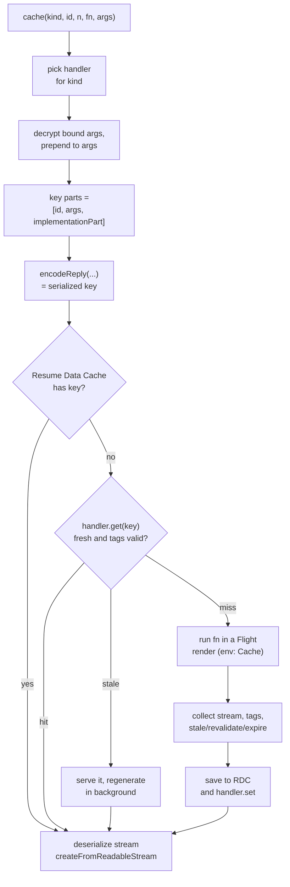

# Cache Components - use cache, cacheLife and cacheTag

> [!summary] TL;DR
> With `cacheComponents: true`, nothing is cached unless you say so, and what you say is `'use cache'` at the top of an async function, component or file. The SWC transform hoists that function, gives it a server reference id (a SHA-1 of the hash salt, file name and export name, plus one info byte), and replaces it with `React.cache(function () { return cache('default', id, boundArgsLength, inner, arguments) })`. Variables the function closes over become encrypted bound arguments. At runtime `cache()` decrypts them, builds the key `[id, args, buildId]`, serializes it with React's `encodeReply`, and looks it up first in the per-render Resume Data Cache and then in a cache handler. On a miss it runs the function inside a separate React Flight render (environment "Cache"), collects the RSC stream, the tags from `cacheTag()` and the lifetime from `cacheLife()`, and stores all of it. `cacheLife` profiles set `stale` (browser), `revalidate` (background refresh) and `expire` (hard limit). An entry with `revalidate: 0` or `expire` under 5 minutes is left out of the static shell. The default handler is an in-memory LRU per process. `'use cache: remote'` routes to a handler you configure, and `'use cache: private'` is never stored on the server in production.

[[04 Data Fetching and Streaming|The previous part]] ended with every read being uncached: it either streamed per request or blocked the build. This part adds the other half of the model. It starts with what Cache Components means for a route, then follows one `'use cache'` function through the compiler and the runtime, and ends with lifetimes, tags and storage. Revalidating those entries on demand is the topic of [[06 Revalidation - Tags, Paths and Refresh|the next part]].

## The Cache Components model

Cache Components is one config flag. In Next.js 16 it is top-level, and it also turns on Partial Prerendering:

```ts
// next.config.ts
import type { NextConfig } from 'next'

const nextConfig: NextConfig = {
  cacheComponents: true,
  partialPrefetching: true,
}

export default nextConfig
```

> [!note] What changed in 16.x
> `cacheComponents` replaces the experimental `dynamicIO`, `useCache` and `ppr` flags of Next.js 15, and `'use cache'` became stable in 16.0. In 16.4.3 the docs ask you to set `partialPrefetching` explicitly too. Leaving it unset logs a warning, because the first Cache Components release did not include partial prefetching.

With the flag on, every part of a page falls into one of three groups when the route is prerendered:

| Content | How you write it | Where it ends up |
| --- | --- | --- |
| Static | Plain JSX, synchronous code | The static shell, built once |
| Cached | Inside `'use cache'`, with a long enough lifetime | Also the static shell, refreshed by its `cacheLife` or a tag |
| Dynamic | Uncached I/O or request data, inside `<Suspense>` | A hole in the shell, filled per request |

So `'use cache'` is not only a performance feature. It is how you tell the prerender "this I/O is allowed to be baked into the HTML". The rendering side of this (static shell, postponed holes, resume) is [[23 PPR - Partial Prerendering with Cache Components|PPR]]. Here we look at the cache itself. A `GET` Route Handler is prerendered by the same rules, see [[08 Route Handlers and Proxy#With Cache Components: the same model as pages|Route Handlers]].

## Three ways to write it

```ts
// lib/data/notes.ts: data level
import { cacheLife, cacheTag } from 'next/cache'
import { db } from '@/lib/db'

export async function getNote(id: string) {
  'use cache'
  cacheLife('hours')
  cacheTag('notes', `note-${id}`)
  return db.note.findUnique({ where: { id } })
}
```

```tsx
// app/notes/popular.tsx: UI level
import { cacheLife } from 'next/cache'

export async function PopularNotes() {
  'use cache'
  cacheLife('days')
  const notes = await db.note.findMany({ orderBy: { views: 'desc' }, take: 5 })
  return <ul>{notes.map((n) => <li key={n.id}>{n.title}</li>)}</ul>
}
```

```ts
// lib/data/reports.ts: file level, every export is cached and must be async
'use cache'

export async function getMonthlyTotals(accountId: string) { /* ... */ }
export async function getTopTags() { /* ... */ }
```

Cached functions must be async. Their arguments and return values must be serializable by React's RSC protocol (plain objects, arrays, `Date`, `Map`, `Set`, typed arrays, JSX in the return value). Class instances, symbols and functions you call are not allowed.

## What the compiler produces

The directive is handled by the same SWC transform as `'use server'`, in `crates/next-custom-transforms/src/transforms/server_actions.rs`. It accepts `'use cache'` (kind `default`) and `'use cache: <kind>'`. An unknown kind is a compile error, and so is the directive when `cacheComponents` is off.[^directive]

Take this input:

```ts
// input
const v = 'world'

async function fn() {
  'use cache'
  return 'hello, ' + v
}
```

The transform's test fixture shows the server-side output exactly:[^fixture-33]

```js
// output (server layer)
import { registerServerReference } from "private-next-rsc-server-reference";
import { cache as $$cache__ } from "private-next-rsc-cache-wrapper";
import { cache as $$reactCache__ } from "react";

const v = 'world';
const $$RSC_SERVER_CACHE_0_INNER = async function fn() {
    return 'hello, ' + v;
};
export var $$RSC_SERVER_CACHE_0 = $$reactCache__(function fn() {
    return $$cache__("default", "803128060c414d59f8552e4788b846c0d2b7f74743", 0,
                     $$RSC_SERVER_CACHE_0_INNER, []);
});
registerServerReference($$RSC_SERVER_CACHE_0, "803128060c414d59f8552e4788b846c0d2b7f74743", null);
var fn = $$RSC_SERVER_CACHE_0;
```

Four things happened:

1. **The body was hoisted** to module scope as `..._INNER`, and the original name now points at a wrapper.[^hoist]
2. **The wrapper calls `$$cache__`**, which is `cache()` from `use-cache-wrapper.ts` (the `private-next-rsc-cache-wrapper` alias is a one-line re-export).[^alias] Its arguments are the cache kind, the reference id, the number of bound arguments, the inner function, and the call's arguments. The arguments are sliced to the declared parameter count, so extra arguments a caller passes do not end up in the key.[^wrapper]
3. **The wrapper is wrapped in React's `cache`** (`$$reactCache__`). Within one render, calling the function twice with the same arguments (compared by identity) returns the same promise without even reaching `cache()`.
4. **It is registered as a server reference**, the same mechanism Server Actions use. That is why a file-level `'use cache'` module can be imported into a Client Component: on the client it compiles to `createServerReference(id, callServer)` and calling it makes a POST, like a Server Action.

### The id

The id is computed at build time:[^ref-id]

```text
id = hex( infoByte + sha1(hashSalt + fileName + ":" + exportName) )

infoByte bits:  [type][6-bit argument mask][rest-args]
                 1 = 'use cache', 0 = Server Action
```

In the example, `80` means type 1 (cache), no parameters, no rest args. The salt is the build's Server Actions encryption key (both Turbopack and webpack pass it in), so ids are not guessable from the source alone. The id identifies the function's *location*, not its implementation. That limitation shapes the cache key below.

### Closures become encrypted bound arguments

Inline cached functions often read variables from the enclosing component. The compiler cannot hoist a closure as it is, so it rewrites captured variables into arguments. The fixture with a cache function nested inside a Server Action inside a component shows it:[^fixture-40]

```js
// output (excerpt)
const $$RSC_SERVER_CACHE_0_INNER = async function cache([$$ACTION_ARG_0, $$ACTION_ARG_1], e) {
    const f = $$ACTION_ARG_0 + e;
    return [f, { a: $$ACTION_ARG_1 }];
};
export var $$RSC_SERVER_CACHE_0 = $$reactCache__(function cache() {
    return $$cache__("default", "e03128060c414d59f8552e4788b846c0d2b7f74743", 2,
                     $$RSC_SERVER_CACHE_0_INNER, Array.prototype.slice.call(arguments, 0, 2));
});

// at the original call site:
var cache = $$RSC_SERVER_CACHE_0.bind(null, encryptActionBoundArgs("e031...", d, $$ACTION_ARG_0));
```

The captured values `d` and `a` are serialized with Flight, encrypted with AES-GCM, and bound as the first argument. The `2` tells `cache()` how many bound values to expect. Encryption is the same machinery as for Server Action closures ([[07 Server Actions and Forms|Server Actions]]). Each encryption uses a random IV, but `cache()` decrypts the bound values before it builds the key, so the same captured values always produce the same key.

## What cache() does at runtime

`cache(kind, id, boundArgsLength, originalFn, args)` is about 2,000 lines, mostly special cases for prerenders, dev validation and probes. The main path is:[^cache-fn]



### Building the key

First the bound arguments are decrypted and put in front of the call arguments.[^bound] Then the key parts are assembled and serialized:[^key]

```ts
// packages/next/src/server/use-cache/use-cache-wrapper.ts (simplified)
export type CacheKeyParts = [id: string, args: unknown[], implementationHash: unknown]

const { implementationPart, runtimeEnvVarStateHash } =
  await computeCacheKeyImplementationPart(workStore, workUnitStore, id)
const cacheKeyParts: CacheKeyParts = [id, args, implementationPart]
const encodedCacheKeyParts = await encodeReply(cacheKeyParts, { temporaryReferences })
const serializedCacheKey =
  typeof encodedCacheKeyParts === 'string'
    ? encodedCacheKeyParts
    : await encodeFormData(encodedCacheKeyParts)
```

`encodeReply` is the function a browser uses to send Server Action arguments. Reusing it means the key and the arguments follow exactly the same serialization rules, which is why cached arguments must be serializable.

The implementation part answers "which version of this code produced the entry". Because the id only hashes the location, Next.js uses the build:[^impl]

- By default it is `[deploymentId || buildId]`, plus the HMR refresh hash in development so that editing a file invalidates its entries. **A new deployment therefore starts with an empty `'use cache'` cache**, even for a durable remote handler.
- With `experimental.durableUseCacheEntries` (Turbopack only), it is `[codeHash, nextVersion]` instead, where `codeHash` hashes the code that can affect the result. The runtime environment variables the code reads are hashed separately and appended to the handler key, so a changed env value misses without leaking secrets into the key.[^durable]

The handler key is the serialized key plus that env hash. If the function reads root params, Next.js learns which ones on the first run and adds their values as a suffix, using a small redirect entry so later lookups go straight to the specific key.[^handler-key]

> [!tip] What does and does not end up in the key
> In: the function's id, its arguments, captured closure values, the build or deployment id. Not in: cookies, headers or anything else from the request, because a public cache cannot read them at all (pass the user id as an argument instead, see [[27 Server-Aware Auth - Sessions, Proxy and the DAL#Rule 2: Never read the session inside a plain 'use cache'|auth with Cache Components]]). For a cached `page` the `searchParams` prop is also left out of the key; reading it inside throws instead.[^page-search]

### Children pass through

React elements passed as props, such as `children`, are encoded as *temporary references*. They are part of the call but not of the stored output: the cached render leaves a slot where they go, and the caller fills it on each use. That is what lets a cached layout wrap dynamic children without caching them.

```tsx
// app/notes/layout.tsx
export default async function NotesLayout({ children }: { children: React.ReactNode }) {
  'use cache'
  cacheLife('days')
  const tags = await getAllTags()
  return (
    <div className="grid">
      <TagSidebar tags={tags} />
      {children /* not cached, just passed through */}
    </div>
  )
}
```

The rule is "do not look inside": as soon as the function reads a field of `children` or calls a function prop, the value is no longer opaque.

### Generating an entry

On a miss, `generateCacheEntryImpl` decodes the arguments back from the encoded key with `decodeReply`, so the function receives deserialized copies rather than the caller's objects.[^generate] It then invokes the function lazily inside a React Flight render with `environmentName: 'Cache'`. In a prerender it uses `prerender()` with an abort signal and a timeout, about 90% of `staticPageGenerationTimeout` by default, so a cache fill that waits on request data fails with a clear error instead of hanging the build.[^timeout]

The function runs with a fresh work unit store of type `'cache'`. That store is why:

- `cookies()`, `headers()` and `searchParams` throw inside it: a public cache store has no request.
- `React.cache` values set outside are invisible inside, because the cache gets its own isolated scope.
- `cacheLife()` and `cacheTag()` work only inside it. Both switch on the store type and throw for anything that is not `'cache'` or `'private-cache'`.[^life-fn][^tag-fn]

`collectResult` buffers the whole stream, then decides the entry's lifetime. An explicit `cacheLife()` wins. Without one, the store holds the minimum of the default profile and every nested cache, `fetch` and `unstable_cache` that ran inside.[^collect][^propagate]

The finished entry is a `CacheEntry`: the RSC bytes as a stream, `tags`, `stale`, `revalidate`, `expire` and a `timestamp`.[^entry-type]

### Reading an entry

A lookup goes through two layers:

- **The Resume Data Cache (RDC)** is per page render. The prerender fills it, and when a request resumes a partially prerendered page, it reads cached values from the RDC so the resumed render sees exactly what the shell saw ([[23 PPR - Partial Prerendering with Cache Components#The prelude and the postponed state|how it travels with the shell]]).
- **The cache handler** is the shared store, by default an in-memory LRU per process.

When the handler returns an entry, `cache()` checks it again before use:[^handler-get][^discard]

1. If a tag on the entry, or one of the route's implicit path tags, was revalidated after the entry's timestamp, the entry is discarded.
2. If the entry is past `expire` (or, for a consumer that will store the result in another server cache, past `revalidate`), it is a miss and regenerates in the foreground.[^miss]
3. If it is only past `revalidate`, it is served, and a background regeneration starts. A per-key map makes sure only one runs at a time.[^bg]

Finally the stored stream is turned back into React values with `createFromReadableStream` and returned to the caller.

## cacheLife: three numbers

`cacheLife(profile)` sets the lifetime of the entry it runs in. A profile has three fields:

| Field | Applies to | Meaning |
| --- | --- | --- |
| `stale` | Browser | How long the client router reuses the result without asking the server |
| `revalidate` | Server | After this, the next request gets the cached value and triggers a background refresh |
| `expire` | Server | After this with no refresh, the next request waits for a fresh value |

The built-in profiles are defined in the default config:[^profiles]

| Profile | `stale` | `revalidate` | `expire` |
| --- | --- | --- | --- |
| `default` | `staleTimes.static` (300 s) | 15 min | never |
| `seconds` | 30 s | 1 s | 1 min |
| `minutes` | 5 min | 1 min | 1 hour |
| `hours` | 5 min | 1 hour | 1 day |
| `days` | 5 min | 1 day | 1 week |
| `weeks` | 5 min | 1 week | 30 days |
| `max` | 5 min | 30 days | 1 year |

You can redefine any of them or add your own in `next.config.ts` under `cacheLife`, or pass an inline object. Missing fields inherit from `default`, and `expire` must be longer than `revalidate`.

```ts
// next.config.ts
const nextConfig = {
  cacheComponents: true,
  cacheLife: {
    editorial: { stale: 600, revalidate: 3600, expire: 86400 },
  },
}
```

### Nesting

Inside `cacheLife`, each explicit value only ever lowers the store's `explicitRevalidate`, `explicitExpire` and `explicitStale`, so two calls in one scope keep the shorter one.[^life-fn] Across scopes, a nested cache passes its tags and lifetime up to the enclosing store, which keeps the minimum.[^propagate] At collection time an explicit `cacheLife` in the outer scope overrides that minimum.[^collect] The result:

- An outer cache **with** `cacheLife('hours')` lives for an hour even if it renders a widget cached for one minute. On a hit it returns the widget's old output too.
- An outer cache **without** `cacheLife` gets the `default` profile, shortened by any shorter nested cache.

That second case can silently turn a static page dynamic, so Next.js refuses one version of it: a short-lived nested cache (below) inside a `'use cache'` with no explicit `cacheLife` fails the prerender. Add an explicit `cacheLife` to the outer scope to choose.

### Short lifetimes leave the shell

Three thresholds decide whether a cached result can be part of a prerender:[^thresholds][^omit]

- `revalidate: 0`, or `expire` under **300 s** (`MIN_PRERENDERABLE_EXPIRE`): not prerendered at all. The entry becomes a dynamic hole and resolves per request, still served from the cache when possible.
- `stale` under **30 s** (`MIN_PREFETCHABLE_STALE`): excluded, because a prefetch would expire before the user could click.
- `stale` under **300 s** (`MIN_SHELL_STALE`): prerendered, but not in the route's App Shell.

Of the presets only `seconds` crosses a threshold (`expire` of one minute), so `cacheLife('seconds')` content needs a `<Suspense>` boundary around it. See [[23 PPR - Partial Prerendering with Cache Components#Cache what is shared, stream what is personal|PPR]] for how to design around these thresholds.

> [!note] The client side of `stale`
> The server sends the stale time in the `x-nextjs-stale-time` header, and the client router keeps the payload for that long. It enforces a 30-second minimum so prefetched links stay usable. Calling `updateTag` or `revalidatePath` in a Server Action clears the client cache regardless of `stale`, and `refresh` drops its dynamic data, see [[06 Revalidation - Tags, Paths and Refresh|Revalidation]].

## cacheTag: names for invalidation

`cacheTag(...tags)` appends tags to the current cache store:[^tag-fn]

```ts
export async function getNote(id: string) {
  'use cache'
  cacheLife('max')
  cacheTag('notes', `note-${id}`)
  return db.note.findUnique({ where: { id } })
}
```

Tags are validated by the same `validateTags` that checks `fetch` tags: each must be a string of at most 256 characters, and one call keeps at most 128 of them. Invalid ones are dropped with a warning, not an error.[^validate] Nested caches propagate their tags to the outer entry, so revalidating `note-42` also invalidates a cached page that rendered `getNote('42')`.

A good scheme has one tag per collection (`notes`) and one per record (`note-42`). The page part of the scheme, the implicit `_N_T_/...` path tags that `revalidatePath` uses, is added by Next.js automatically.

## Where entries live: cache handlers

The kind in `'use cache: <kind>'` selects a handler. At startup `initializeCacheHandlers` registers two: `default` and `remote`. Unless you configure `cacheHandlers`, **both point at the same in-memory handler**, sized by `cacheMaxMemorySize`.[^handlers]

The built-in handler is small and worth reading, because it explains most "why did my cache miss" questions:[^default-handler]

- It is an LRU in process memory. Each server instance, and each serverless invocation, has its own.
- In production it treats an entry past `revalidate` as missing. The file comment says it plainly: in-memory caches "should not use stale-while-revalidate semantics", because the entry would likely be evicted before the refreshed one is used. Only `next dev` keeps serving stale entries until `expire`.
- An entry with `expire: 0` is not stored at all in production.
- Tags are tracked in a process-wide `tagsManifest` map shared with the legacy file-system cache.

A custom handler implements five methods:[^handler-api]

```ts
interface CacheHandler {
  get(cacheKey: string, softTags: string[]): Promise<undefined | CacheEntry>
  set(cacheKey: string, pendingEntry: Promise<CacheEntry>): Promise<void>
  refreshTags(): Promise<void>                 // once per request, before the first read
  getExpiration(tags: string[]): Promise<number> // latest revalidation time of these tags
  updateTags(tags: string[], durations?: { expire?: number }): Promise<void>
}
```

```ts
// next.config.ts
const nextConfig = {
  cacheComponents: true,
  cacheHandlers: {
    remote: require.resolve('./cache-handlers/redis.mjs'),
  },
}
```

Now `'use cache'` stays in memory and `'use cache: remote'` goes to Redis. You can also register more kinds (`'use cache: sessions'`). `set` receives a *pending* entry whose stream may still be filling, and the handler owns eviction. Next.js never deletes keys itself. With several instances, the handler is what must be shared: see [[11 Configuration, Turbopack and Deployment#3. Many instances: what must be shared|Many instances]].

### 'use cache: remote'

`'use cache: remote'` is ordinary `'use cache'` with a different handler kind. It exists for runtime caching that has to survive across instances, such as data read after a `cookies()` check, where the in-memory default would miss on most serverless requests. Each lookup is a network round trip, so cache on low-cardinality inputs: `getCMSContent(language)`, not `getUserProfile(sessionId)`. It does not persist across deployments either, because the key still contains the build id.

### 'use cache: private'

`'use cache: private'` is the only variant that may read `cookies()`, `headers()` and `searchParams` inside. In exchange it is never stored in a shared server cache in production. Its results live in the request's Resume Data Cache (so matching calls in one request are deduplicated, and runtime prefetches can include them) and in the browser for the `stale` time.[^private] In development it is stored in a separate in-memory handler keyed by the request's cookies and headers, so reloads stay fast. Private caches cannot be nested inside remote caches or the other way round, and the private kind cannot be given a custom handler. See [[27 Server-Aware Auth - Sessions, Proxy and the DAL#Rule 3: 'use cache: private' when the read cannot be lifted out|Rule 3 of the auth part]] for when to reach for it.

| | `'use cache'` | `'use cache: remote'` | `'use cache: private'` |
| --- | --- | --- | --- |
| Server storage | In-memory (or your `default` handler) | Your `remote` handler | None in production |
| Shared between users | Yes | Yes | No |
| May read cookies/headers | No, pass values as arguments | No | Yes |
| In the static shell | Yes, if long-lived | Yes, if long-lived | No |

## Compared with the previous model

Without `cacheComponents`, Next.js 16 still supports the older APIs: `fetch(url, { cache: 'force-cache', next: { revalidate, tags } })`, `unstable_cache`, and route segment config like `export const revalidate = 60` or `dynamic = 'force-static'`. The differences that matter:

| | Previous model | Cache Components |
| --- | --- | --- |
| Unit of caching | A `fetch` response or an `unstable_cache` result | Any async function or component output (RSC) |
| Static or dynamic | Whole route, switched by the first dynamic API | Per boundary, the rest of the page stays static |
| Lifetime | `revalidate` seconds | `cacheLife` profile with `stale`/`revalidate`/`expire` |
| Storage | Incremental cache (`cacheHandler`, singular), on disk by default | `cacheHandlers` (plural), in memory by default |
| Survives a deploy | `fetch` cache and `unstable_cache` can | No, the key includes the build id |

If you need data to persist across deploys, the docs still point to `unstable_cache` or the `fetch` cache. Within one deployment, `'use cache'` is the tool.

## Summary

Cache Components makes uncached the default and gives you `'use cache'` to mark what may be reused and baked into the static shell. The compiler hoists each cached function, assigns it a hashed server reference id, encrypts any captured variables as bound arguments, and routes calls through `React.cache` and then `cache()`. At runtime the key is the id, the serialized arguments and the build id, looked up in the per-render Resume Data Cache and then in a cache handler, with tag and lifetime checks on every hit. `cacheLife` sets `stale`, `revalidate` and `expire`, and short lifetimes turn a cached value back into a dynamic hole. `cacheTag` names entries so that [[06 Revalidation - Tags, Paths and Refresh|the next part]] can invalidate them on demand.

### Key takeaways

- **`cacheComponents: true`**: top-level in Next.js 16; nothing is cached unless marked, and cached output can join the static shell.
- **The transform**: hoists the body to `$$RSC_SERVER_CACHE_n_INNER`, wraps it as `React.cache(() => cache(kind, id, n, inner, args))` and registers it as a server reference.
- **Reference id**: SHA-1 of hash salt, file name and export name, prefixed by a byte encoding "cache function" and which arguments are used.
- **Closures**: captured variables become AES-GCM encrypted bound arguments and part of the key.
- **Cache key**: `encodeReply([id, args, buildId or deploymentId])`; a new deploy starts with an empty cache unless you use the Turbopack-only durable entries.
- **Isolated store**: no `cookies()`/`headers()` inside, a separate `React.cache` scope, and `cacheLife`/`cacheTag` only work there.
- **`cacheLife`**: `stale` for the browser, `revalidate` for background refresh, `expire` as the hard limit; `revalidate: 0` or `expire` under 5 minutes keeps it out of the shell.
- **Nesting**: inner lifetimes and tags propagate up; an explicit outer `cacheLife` wins over them.
- **Handlers**: `default` and `remote` share one in-memory LRU unless configured, and in production it drops entries past `revalidate`.
- **`private` vs `remote`**: private may read request data but is never stored server-side in production; remote is shared storage you provide.

← [[04 Data Fetching and Streaming|Data Fetching]] · [[00 Next.js in Practice Index|Index]] · [[06 Revalidation - Tags, Paths and Refresh|Revalidation]] →

[^directive]: directive parsing for `'use cache'` and `'use cache: <kind>'` — [crates/next-custom-transforms/src/transforms/server_actions.rs#L3481-L3530](https://github.com/vercel/next.js/blob/v16.4.3/crates/next-custom-transforms/src/transforms/server_actions.rs#L3481-L3530)
[^fixture-33]: transform fixture, top-level function with `'use cache'` — [crates/next-custom-transforms/tests/fixture/server-actions/server-graph/33/output.js](https://github.com/vercel/next.js/blob/v16.4.3/crates/next-custom-transforms/tests/fixture/server-actions/server-graph/33/output.js)
[^hoist]: `create_and_hoist_cache_function` — [crates/next-custom-transforms/src/transforms/server_actions.rs#L3068-L3157](https://github.com/vercel/next.js/blob/v16.4.3/crates/next-custom-transforms/src/transforms/server_actions.rs#L3068-L3157); the injected imports — [#L2585-L2625](https://github.com/vercel/next.js/blob/v16.4.3/crates/next-custom-transforms/src/transforms/server_actions.rs#L2586-L2628)
[^alias]: `private-next-rsc-cache-wrapper` re-exports `cache` — [packages/next/src/build/webpack/loaders/next-flight-loader/cache-wrapper.ts#L1](https://github.com/vercel/next.js/blob/v16.4.3/packages/next/src/build/webpack/loaders/next-flight-loader/cache-wrapper.ts#L1)
[^wrapper]: `create_cache_wrapper` — [crates/next-custom-transforms/src/transforms/server_actions.rs#L2984-L3066](https://github.com/vercel/next.js/blob/v16.4.3/crates/next-custom-transforms/src/transforms/server_actions.rs#L2984-L3066)
[^ref-id]: `generate_server_reference_id` — [crates/next-custom-transforms/src/transforms/server_actions.rs#L284-L371](https://github.com/vercel/next.js/blob/v16.4.3/crates/next-custom-transforms/src/transforms/server_actions.rs#L284-L371); salt is the encryption key in Turbopack — [crates/next-core/src/next_shared/transforms/server_actions.rs#L79-L89](https://github.com/vercel/next.js/blob/v16.4.3/crates/next-core/src/next_shared/transforms/server_actions.rs#L79-L89) and in webpack — [packages/next/src/build/webpack-config.ts#L2403](https://github.com/vercel/next.js/blob/v16.4.3/packages/next/src/build/webpack-config.ts#L2403)
[^fixture-40]: transform fixture, cache function closing over action and component variables — [crates/next-custom-transforms/tests/fixture/server-actions/server-graph/40/output.js#L1-L35](https://github.com/vercel/next.js/blob/v16.4.3/crates/next-custom-transforms/tests/fixture/server-actions/server-graph/40/output.js#L1-L35)
[^cache-fn]: `cache()` — [packages/next/src/server/use-cache/use-cache-wrapper.ts#L1867-L3853](https://github.com/vercel/next.js/blob/v16.4.3/packages/next/src/server/use-cache/use-cache-wrapper.ts#L1867-L3853)
[^bound]: decrypting bound args and prepending them — [packages/next/src/server/use-cache/use-cache-wrapper.ts#L2252-L2275](https://github.com/vercel/next.js/blob/v16.4.3/packages/next/src/server/use-cache/use-cache-wrapper.ts#L2252-L2275)
[^key]: `CacheKeyParts` — [packages/next/src/server/use-cache/use-cache-wrapper.ts#L187-L191](https://github.com/vercel/next.js/blob/v16.4.3/packages/next/src/server/use-cache/use-cache-wrapper.ts#L187-L191); building and encoding the key — [#L2289-L2297](https://github.com/vercel/next.js/blob/v16.4.3/packages/next/src/server/use-cache/use-cache-wrapper.ts#L2289-L2297) and [#L2419-L2424](https://github.com/vercel/next.js/blob/v16.4.3/packages/next/src/server/use-cache/use-cache-wrapper.ts#L2419-L2424)
[^impl]: `computeCacheKeyImplementationPart` — [packages/next/src/server/use-cache/use-cache-wrapper.ts#L3872-L3935](https://github.com/vercel/next.js/blob/v16.4.3/packages/next/src/server/use-cache/use-cache-wrapper.ts#L3872-L3935)
[^durable]: `experimental.durableUseCacheEntries` is Turbopack-only — [packages/next/src/server/config.ts#L584-L589](https://github.com/vercel/next.js/blob/v16.4.3/packages/next/src/server/config.ts#L584-L589)
[^handler-key]: `cacheHandlerKeyBase` and the root params suffix — [packages/next/src/server/use-cache/use-cache-wrapper.ts#L2426-L2451](https://github.com/vercel/next.js/blob/v16.4.3/packages/next/src/server/use-cache/use-cache-wrapper.ts#L2426-L2451)
[^page-search]: cached page segments get erroring `searchParams` instead of keying on them — [packages/next/src/server/use-cache/use-cache-wrapper.ts#L2178-L2222](https://github.com/vercel/next.js/blob/v16.4.3/packages/next/src/server/use-cache/use-cache-wrapper.ts#L2178-L2222)
[^generate]: `generateCacheEntryImpl` decoding args and invoking lazily — [packages/next/src/server/use-cache/use-cache-wrapper.ts#L1347-L1416](https://github.com/vercel/next.js/blob/v16.4.3/packages/next/src/server/use-cache/use-cache-wrapper.ts#L1347-L1416)
[^timeout]: `getUseCacheFillTimeoutMs` — [packages/next/src/server/use-cache/use-cache-wrapper.ts#L938-L950](https://github.com/vercel/next.js/blob/v16.4.3/packages/next/src/server/use-cache/use-cache-wrapper.ts#L938-L950); default `useCacheTimeout` — [packages/next/src/server/config.ts#L1796-L1799](https://github.com/vercel/next.js/blob/v16.4.3/packages/next/src/server/config.ts#L1796-L1799)
[^life-fn]: `cacheLife` — [packages/next/src/server/use-cache/cache-life.ts#L27-L122](https://github.com/vercel/next.js/blob/v16.4.3/packages/next/src/server/use-cache/cache-life.ts#L27-L122)
[^tag-fn]: `cacheTag` — [packages/next/src/server/use-cache/cache-tag.ts#L6-L42](https://github.com/vercel/next.js/blob/v16.4.3/packages/next/src/server/use-cache/cache-tag.ts#L6-L42)
[^collect]: explicit vs collected lifetime in `collectResult` — [packages/next/src/server/use-cache/use-cache-wrapper.ts#L1273-L1297](https://github.com/vercel/next.js/blob/v16.4.3/packages/next/src/server/use-cache/use-cache-wrapper.ts#L1273-L1297)
[^propagate]: `propagateCacheLifeAndTagsToRevalidateStore` — [packages/next/src/server/use-cache/use-cache-wrapper.ts#L986-L1009](https://github.com/vercel/next.js/blob/v16.4.3/packages/next/src/server/use-cache/use-cache-wrapper.ts#L986-L1009)
[^entry-type]: `CacheEntry` and `CacheHandler` types — [packages/next/src/server/lib/cache-handlers/types.ts#L6-L117](https://github.com/vercel/next.js/blob/v16.4.3/packages/next/src/server/lib/cache-handlers/types.ts#L6-L117)
[^handler-get]: handler lookup with the root-params redirect entry — [packages/next/src/server/use-cache/use-cache-wrapper.ts#L3263-L3291](https://github.com/vercel/next.js/blob/v16.4.3/packages/next/src/server/use-cache/use-cache-wrapper.ts#L3263-L3291)
[^discard]: `shouldDiscardCacheEntry` and `isRevalidatedAfter` — [packages/next/src/server/use-cache/use-cache-wrapper.ts#L4014-L4125](https://github.com/vercel/next.js/blob/v16.4.3/packages/next/src/server/use-cache/use-cache-wrapper.ts#L4014-L4125)
[^miss]: miss condition (past `expire`, or past `revalidate` for a server-caching consumer) — [packages/next/src/server/use-cache/use-cache-wrapper.ts#L3490-L3507](https://github.com/vercel/next.js/blob/v16.4.3/packages/next/src/server/use-cache/use-cache-wrapper.ts#L3490-L3507)
[^bg]: background revalidation of a stale hit — [packages/next/src/server/use-cache/use-cache-wrapper.ts#L3702-L3808](https://github.com/vercel/next.js/blob/v16.4.3/packages/next/src/server/use-cache/use-cache-wrapper.ts#L3702-L3808)
[^profiles]: default `cacheLife` profiles and `cacheHandlers` — [packages/next/src/server/config-shared.ts#L2346-L2387](https://github.com/vercel/next.js/blob/v16.4.3/packages/next/src/server/config-shared.ts#L2346-L2387); `staleTimes.static: 300` — [#L2467-L2470](https://github.com/vercel/next.js/blob/v16.4.3/packages/next/src/server/config-shared.ts#L2467-L2470)
[^thresholds]: `MIN_PRERENDERABLE_EXPIRE`, `MIN_PREFETCHABLE_STALE`, `MIN_SHELL_STALE` — [packages/next/src/server/use-cache/constants.ts#L3-L5](https://github.com/vercel/next.js/blob/v16.4.3/packages/next/src/server/use-cache/constants.ts#L3-L5)
[^omit]: omitting short-lived entries from a static prerender — [packages/next/src/server/use-cache/use-cache-wrapper.ts#L3331-L3375](https://github.com/vercel/next.js/blob/v16.4.3/packages/next/src/server/use-cache/use-cache-wrapper.ts#L3331-L3375)
[^validate]: `validateTags` (256 chars, 128 items) — [packages/next/src/server/lib/patch-fetch.ts#L127-L168](https://github.com/vercel/next.js/blob/v16.4.3/packages/next/src/server/lib/patch-fetch.ts#L127-L168); limits — [packages/next/src/lib/constants.ts#L34-L37](https://github.com/vercel/next.js/blob/v16.4.3/packages/next/src/lib/constants.ts#L34-L37)
[^handlers]: `initializeCacheHandlers` — [packages/next/src/server/use-cache/handlers.ts#L62-L141](https://github.com/vercel/next.js/blob/v16.4.3/packages/next/src/server/use-cache/handlers.ts#L62-L141)
[^default-handler]: the built-in handler (`createDefaultCacheHandler`) — [packages/next/src/server/lib/cache-handlers/default.ts#L1-L245](https://github.com/vercel/next.js/blob/v16.4.3/packages/next/src/server/lib/cache-handlers/default.ts#L1-L245)
[^handler-api]: `CacheHandler` interface — [packages/next/src/server/lib/cache-handlers/types.ts#L68-L117](https://github.com/vercel/next.js/blob/v16.4.3/packages/next/src/server/lib/cache-handlers/types.ts#L68-L117)
[^private]: handler selection, private caches use the RDC (and a dev-only handler) — [packages/next/src/server/use-cache/use-cache-wrapper.ts#L1930-L1969](https://github.com/vercel/next.js/blob/v16.4.3/packages/next/src/server/use-cache/use-cache-wrapper.ts#L1930-L1969)
