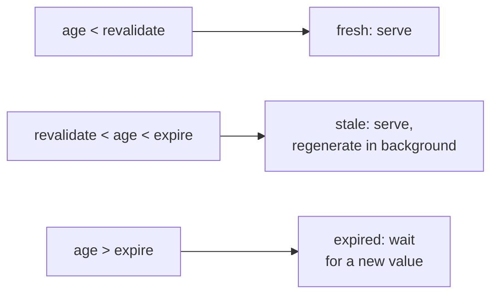
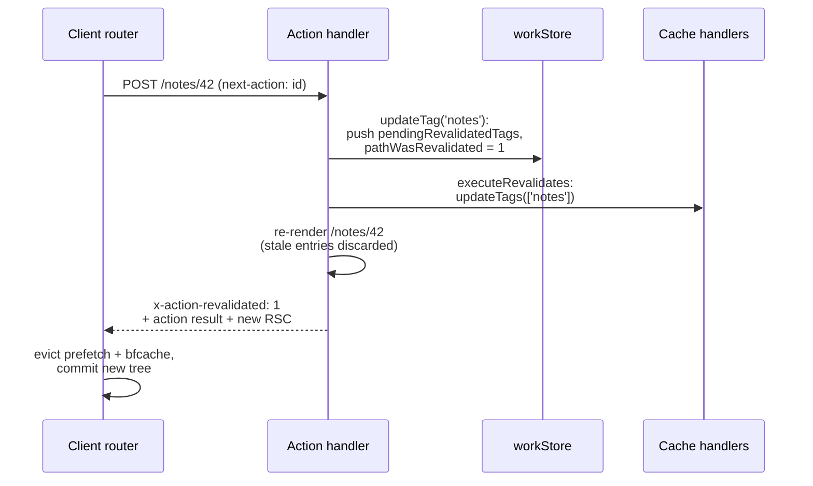

# Revalidation - Tags, Paths and Refresh

> [!summary] TL;DR
> Cached data becomes fresh in two ways. **Time-based**: the entry's `cacheLife` `revalidate` passes, the next read serves the old value and regenerates it in the background, and after `expire` a read waits for a new one. **On demand**: you call one of four functions after a mutation. `revalidateTag(tag, 'max')` marks the tag *stale* (stale-while-revalidate) and is the right choice for webhooks and Route Handlers. `updateTag(tag)` *expires* the tag right away and only works in Server Actions, so the action's own response already shows the new data. `revalidatePath(path)` does the same through implicit `_N_T_` path tags that every render carries. `refresh()` invalidates nothing on the server and only makes the client refetch the current page's dynamic data. Inside, all of them push onto `workStore.pendingRevalidatedTags` (or set a flag), and after the action Next.js calls `updateTags` on every cache handler and the incremental cache, re-renders the page into the same response when needed, and tells the client router through the `x-action-revalidated` header to drop its caches.

[[05 Cache Components - use cache, cacheLife and cacheTag|The previous part]] put data into caches and gave each entry a lifetime and tags. This part is about taking it back out: what each revalidation function does to the server caches and to the browser, when each one is allowed, and the path an invalidation takes through Next.js. Writing the mutations themselves is [[07 Server Actions and Forms|the next part]].

The running example is the notes app: `getNote(id)` is cached with tags `notes` and `note-${id}`, the `/notes` list is cached with `notes`, and a Server Action `saveNote` edits a note.

## Time-based revalidation

Every `'use cache'` entry has `revalidate` and `expire` from its `cacheLife` profile ([[05 Cache Components - use cache, cacheLife and cacheTag|part 05]]). On each read, `cache()` compares the entry's age with them:



Two details from the source change how this plays out in practice:

- **The default in-memory handler does not do the middle band in production.** It treats an entry past `revalidate` as missing, so with that handler a stale read is a blocking miss rather than a background refresh. Stale-while-revalidate between `revalidate` and `expire` needs a handler that keeps stale entries, or the prerendered page layer (below).[^default-get]
- **A revalidation is triggered by a request.** Nothing runs on a timer. A page nobody visits stays old until someone does. [[21 SSG and ISR - Static Pages and generateStaticParams#What a request sees|What a request sees]] shows this for prerendered pages.

The same numbers also shape the HTTP response of a prerendered route. Next.js turns the route's collected `revalidate` and `expire` into `Cache-Control: s-maxage=<revalidate>, stale-while-revalidate=<expire - revalidate>`, so a CDN in front can do its own stale-while-revalidate. A `revalidate` of `0` produces `private, no-cache, no-store`.[^cc-header]

## Tags, explicit and implicit

On-demand revalidation works on **tags**. There are two kinds.

**Explicit tags** are the ones you set: `cacheTag('notes', 'note-42')` inside `'use cache'`, or `fetch(url, { next: { tags: ['notes'] } })` in the previous model.

**Implicit tags** (the docs call them soft tags) are added by Next.js to every render, derived from the route's file path and the concrete URL, and prefixed with `_N_T_`. `getDerivedTags` walks the page path and adds a layout tag for each level:[^derived]

```ts
// packages/next/src/server/lib/implicit-tags.ts (simplified)
const getDerivedTags = (pathname: string): string[] => {
  const derivedTags: string[] = ['/layout']
  // for "/notes/[id]/page": "/notes/layout", "/notes/[id]/layout", "/notes/[id]/page"
  // ...
  return derivedTags
}
```

So rendering `/notes/42` carries these implicit tags:[^implicit]

```text
_N_T_/layout
_N_T_/notes/layout
_N_T_/notes/[id]/layout
_N_T_/notes/[id]/page
_N_T_/notes/42
```

Implicit tags are not stored on each cache entry. Instead, at the start of a request Next.js asks each cache handler for the latest revalidation time of the route's implicit tags (`getExpiration`), lazily, the first time a cache is read. Any `'use cache'` entry created before that time is discarded.[^implicit-exp][^discard] That is how `revalidatePath('/notes/42')` can invalidate a `getNote('42')` entry that never mentioned a path.

## The four functions

| | Where | Server cache | Client router | Re-render in the action's response |
| --- | --- | --- | --- | --- |
| `revalidateTag(tag, profile)` | Server Actions, Route Handlers | Tag marked stale (`'max'`) or expired (`{ expire: 0 }`) | Not cleared for a stale-while-revalidate profile | No, for a stale-while-revalidate profile |
| `updateTag(tag)` | Server Actions only | Tag expired now | Cleared | Yes |
| `revalidatePath(path, type?)` | Server Actions, Route Handlers | Implicit path tag expired now | Cleared | Yes |
| `refresh()` | Server Actions only | Nothing | Dynamic data dropped | Yes |

All four are imported from `next/cache` and none of them throws, so an action can call them and still return a value. All four live in one small file, `revalidate.ts`.

### revalidateTag: stale-while-revalidate on demand

```ts
// packages/next/src/server/web/spec-extension/revalidate.ts
export function revalidateTag(tag: string, profile: string | CacheLifeConfig) {
  if (!profile) {
    console.warn('"revalidateTag" without the second argument is now deprecated, ...')
  } else if (typeof profile === 'object') {
    profile = validateAndNormalizeCacheLifeProfile(profile, { kind: 'inline' })
  }
  return revalidate([encodeHeaderSafe(tag)], `revalidateTag(${JSON.stringify(tag)})`, profile)
}
```
[^revalidate-tag]

> [!note] What changed in 16.x
> In Next.js 15, `revalidateTag(tag)` expired the tag immediately. In 16 it takes a second argument, a `cacheLife` profile name or `{ expire }`, and the one-argument form logs a deprecation warning and keeps the old "expire now" behaviour. For read-your-own-writes in a Server Action, use the new `updateTag` instead.

Only the profile's `expire` is used. When the revalidation runs, the profile is resolved to `durations = { expire }`, and each handler's `updateTags(tags, durations)` records two timestamps in the tags manifest: `stale = now` and `expired = now + expire`.[^revalidate-tags][^update-tags]

Reads then compare an entry's timestamp with those two values:[^manifest]

- If the tag became **stale** after the entry was created, the built-in handler still returns the entry but with `revalidate: -1`. `cache()` serves it once more and regenerates it in the background.
- If the tag's **expired** time has passed and is after the entry was created, the entry is treated as missing, and the read waits for a fresh value.

With `'max'` the expire window is a year, so every read during the refresh gets the old value immediately. With `{ expire: 0 }` the tag expires on the spot, which is what a webhook needs when it cannot use `updateTag`.

```ts
// app/api/revalidate/route.ts: CMS webhook
import { revalidateTag } from 'next/cache'

export async function POST(request: Request) {
  if (request.headers.get('x-webhook-secret') !== process.env.WEBHOOK_SECRET) {
    return new Response('Unauthorized', { status: 401 })
  }
  const { noteId } = await request.json()
  revalidateTag(`note-${noteId}`, 'max')
  revalidateTag('notes', 'max')
  return Response.json({ revalidated: true })
}
```

### updateTag: read your own writes

```ts
// packages/next/src/server/web/spec-extension/revalidate.ts
export function updateTag(tag: string) {
  const workStore = workAsyncStorage.getStore()
  if (!workStore || workStore.page.endsWith('/route')) {
    throw new Error('updateTag can only be called from within a Server Action. ...')
  }
  return revalidate([encodeHeaderSafe(tag)], `updateTag(${JSON.stringify(tag)})`, undefined)
}
```
[^update-tag]

`updateTag` is `revalidate()` with no profile. No profile means two things. The handlers get `updateTags(tags)` with no durations, which sets `expired: now`, so the next read waits for fresh data. And `revalidate()` sets `workStore.pathWasRevalidated`, which makes the action re-render the current page into its own response.[^revalidate-core] The user who saved the note sees the saved note, not the cached one.

```ts
// app/notes/[id]/actions.ts
'use server'

import { updateTag } from 'next/cache'
import { db } from '@/lib/db'
import { verifySession } from '@/lib/dal'

export async function saveNote(id: string, formData: FormData) {
  const session = await verifySession()
  await db.note.update({
    where: { id, ownerId: session.userId },
    data: { body: String(formData.get('body')) },
  })
  updateTag(`note-${id}`)
  updateTag('notes')
}
```

### revalidatePath: a tag built from a path

```ts
// packages/next/src/server/web/spec-extension/revalidate.ts (simplified)
export function revalidatePath(originalPath: string, type?: 'layout' | 'page') {
  if (originalPath.length > NEXT_CACHE_SOFT_TAG_MAX_LENGTH) return // 1024, with a warning

  let normalizedPath = `_N_T_${encodeHeaderSafe(removeTrailingSlash(originalPath))}`
  if (type) {
    normalizedPath += `${normalizedPath.endsWith('/') ? '' : '/'}${type}`
  } else if (isDynamicRoute(originalPath)) {
    console.warn('... a dynamic page path ... was passed to "revalidatePath", but the "type" parameter is missing. This has no effect ...')
  }
  const tags = [normalizedPath]
  // "/" and "/index" are aliases of each other
  return revalidate(tags, `revalidatePath(${JSON.stringify(originalPath)})`)
}
```
[^revalidate-path]

`revalidatePath` is `updateTag` for an implicit tag. Match the strings to the list above:

- `revalidatePath('/notes/42')` expires `_N_T_/notes/42`: that one URL.
- `revalidatePath('/notes/[id]', 'page')` expires `_N_T_/notes/[id]/page`: every note page, but not pages nested below it.
- `revalidatePath('/notes', 'layout')` expires `_N_T_/notes/layout`: everything rendered under that layout.
- `revalidatePath('/', 'layout')` expires `_N_T_/layout`, which every page carries: the whole site.

The path is the **file-system route**, not the URL in the address bar. Behind a rewrite from `/blog` to `/news` you revalidate `/news`. And a route pattern without `type` does nothing, which is why the code warns.

Because it has no profile, `revalidatePath` behaves like `updateTag`: it expires, and it re-renders the page in a Server Action's response. Unlike `updateTag`, it is also allowed in Route Handlers.

### refresh: no cache involved

```ts
// packages/next/src/server/web/spec-extension/revalidate.ts
export function refresh() {
  const workStore = workAsyncStorage.getStore()
  const workUnitStore = workUnitAsyncStorage.getStore()
  if (!workStore || workStore.page.endsWith('/route') || workUnitStore?.phase !== 'action') {
    throw new Error('refresh can only be called from within a Server Action. ...')
  }
  workStore.pathWasRevalidated = ActionDidRevalidateDynamicOnly
}
```
[^refresh]

`refresh()` from `next/cache` only sets a flag. No tag is touched. The action re-renders the page into its response, and the client router drops its dynamic data but keeps its prefetch cache. Use it when the action changed something that is not in a cache at all: a value read uncached from the database inside a `<Suspense>` boundary, for example. On the client, `router.refresh()` from `useRouter` is the equivalent you call outside an action.

## How an invalidation travels

Here is what happens when a Server Action calls `updateTag('notes')`:



Step by step:

1. **Record.** Every function goes through `revalidate()`. It refuses to run inside a cache scope, during render, or in a prerender, then appends `{ tag, profile, revalidatedAt }` to `workStore.pendingRevalidatedTags` (deduplicated by tag and profile). With no profile, or a profile whose `expire` is `0`, it also sets `pathWasRevalidated`.[^revalidate-core]
2. **Apply.** When the action function returns, `executeActionAndPrepareForRender` checks the flag. If the page will be re-rendered, it first awaits `executeRevalidates`, which groups the tags by profile and calls `updateTags` on every registered cache handler, plus `revalidateTag` on the incremental cache that stores prerendered pages and the legacy `fetch` cache.[^prepare][^execute] If there is no re-render, the same work is attached to the response's `waitUntil` instead.[^waituntil] In a Route Handler it always goes to `waitUntil`, after the response.[^route-wait]
3. **Re-render.** The page render that follows reads caches again. An entry whose tag is in `pendingRevalidatedTags` with a later `revalidatedAt` is discarded even if a remote handler has not propagated the update yet, so the re-render cannot read its own stale data.[^discard]
4. **Tell the client.** `addRevalidationHeader` sets `x-action-revalidated`. It is `1` (static and dynamic) if a tag without a profile was revalidated or a cookie was modified, otherwise the value of `pathWasRevalidated` (`2` after `refresh()`).[^header]
5. **Client.** The server action reducer reads the header. Any non-zero value evicts the BFCache. A `1` also evicts the whole prefetch cache, and a short cooldown delays re-prefetching so CDN caches can catch up.[^client]

> [!warning] `revalidateTag(tag, 'max')` in an action does not update the current page
> A stale-while-revalidate profile skips both the re-render and the client invalidation, by design: the point is to keep serving the old value while the new one is built. If the user who made the change should see it, use `updateTag`. Use `revalidateTag` for everyone else's next visit. The recipe [[40 Recipes - Data, Caching and Revalidation#I mutated data in a Server Action but the page still shows the old value|I mutated data but the page still shows the old value]] walks through this trap.

Cookies count too. Setting or deleting a cookie in an action sets `pathWasRevalidated` to `1`, so the page re-renders with the new cookie value.[^cookie-flag]

### Prerendered pages

The pages that were prerendered (the static shell, or a full static page) are invalidated by the same tags. Their cache entries store the tags they used in an `x-next-cache-tags` header, implicit tags included. When the incremental cache reads a page entry, it checks those tags against the same manifest: an expired tag forces a blocking regeneration (`isStale = -1`) and a stale tag a background one.[^isr-tags] So `updateTag('notes')` refreshes both the `getNote` entries and the `/notes` page that rendered them.

## Where you cannot revalidate

`revalidate()` throws in three places:[^revalidate-core]

- **Inside `'use cache'`** (and `'use cache: private'`, `unstable_cache`): a cached function cannot have side effects.
- **During render**: calling it while a page or layout renders is an error. Mutations belong in actions and Route Handlers.
- **During a Cache Components prerender**: it errors unless `await connection()` ran first, because a revalidation implies a request.

`updateTag` and `refresh` additionally throw outside a Server Action, and `refresh` checks that the request store is in the `'action'` phase.

## Several instances

Each Next.js process has its own default handler and its own tags manifest. Calling `updateTag` on instance A invalidates instance A. Instance B keeps serving the old entry until something tells it otherwise.

The cache handler interface has the hooks for this:

- `updateTags(tags, durations)` is called when you revalidate. A shared handler writes the event to Redis, a database or an HTTP service.
- `refreshTags()` is called once per request before the first cache read. It pulls recent events into the local manifest.
- `getExpiration(tags)` returns the latest revalidation time for a set of tags, used for the implicit path tags. Returning `Infinity` tells Next.js to pass the soft tags into `get` and let the handler check them itself.

With a custom `remote` handler that implements these against shared storage, a revalidation on one instance is visible on all of them on their next request. If `refreshTags` throws, the request fails, so a production handler should catch errors there and fall back to the last known state. Platform adapters (Vercel and others) provide this layer for you. See [[11 Configuration, Turbopack and Deployment#3. Many instances: what must be shared|Many instances]] for what else must be shared, and [[44 Recipes - Performance, Config and Deployment#ISR pages and "use cache" data are stale on some pods but not others|the stale-pods recipe]] for the symptom.

## Choosing one

| Situation | Use |
| --- | --- |
| User saves a form and must see the change | `updateTag(tag)` in the Server Action |
| CMS webhook, other users can wait a moment | `revalidateTag(tag, 'max')` in a Route Handler |
| Webhook where stale data is not acceptable | `revalidateTag(tag, { expire: 0 })` |
| One page changed and it has no good tag | `revalidatePath('/notes/42')` |
| Every page of one route pattern | `revalidatePath('/notes/[id]', 'page')` |
| Data that is not cached changed (uncached read in `<Suspense>`) | `refresh()` in the action |
| Content that ages on its own | A `cacheLife` profile, no call at all |

Prefer tags over paths. A tag follows the data to every page that used it, while a path only knows the page you named. The revalidatePath docs show the trap: `revalidatePath('/blog')` refreshes `/blog` but not a dashboard that rendered the same tagged posts.

## Summary

Time-based revalidation comes from each entry's `cacheLife` and only happens when a request arrives, and the default in-memory handler in production treats a stale entry as a miss. On-demand revalidation goes through tags: explicit ones from `cacheTag`, and implicit `_N_T_` path tags that every render carries and that `revalidatePath` targets. `revalidateTag` with a profile marks a tag stale for background refresh, while `updateTag` and `revalidatePath` expire it and make a Server Action re-render the page into its own response. `refresh()` touches no cache and only refetches dynamic data. After the action, `executeRevalidates` pushes the tags into every cache handler, and the `x-action-revalidated` header tells the client router what to drop. Next, [[07 Server Actions and Forms|Server Actions and Forms]] covers the actions that call these functions.

### Key takeaways

- **Time-based**: past `revalidate` serve stale and refresh, past `expire` wait; triggered by requests, and the default handler skips the stale band in production.
- **Implicit tags**: every render carries `_N_T_` tags for each layout level, the page and the URL; `revalidatePath` expires one of them.
- **`revalidateTag(tag, profile)`**: marks the tag stale with an expire window from the profile; `'max'` for webhooks, `{ expire: 0 }` to expire now; the one-argument form is deprecated.
- **`updateTag(tag)`**: Server Actions only; expires the tag and re-renders the page in the action's response for read-your-own-writes.
- **`revalidatePath(path, type)`**: uses the route file path, needs `type` for dynamic patterns, and `'/', 'layout'` covers the whole site.
- **`refresh()`**: no server cache change; the client drops dynamic data only.
- **Propagation**: `pendingRevalidatedTags` → `executeRevalidates` → `updateTags` on every handler and the incremental cache → `x-action-revalidated` → client cache eviction.
- **Restrictions**: no revalidation inside `'use cache'`, during render, or in a prerender without `connection()`.
- **Multiple instances**: revalidation is local unless the handler shares tag state through `updateTags` and `refreshTags`.

← [[05 Cache Components - use cache, cacheLife and cacheTag|Cache Components]] · [[00 Next.js in Practice Index|Index]] · [[07 Server Actions and Forms|Server Actions]] →

[^default-get]: built-in handler `get`: production uses `revalidate` as the max age, stale tags return `revalidate: -1` — [packages/next/src/server/lib/cache-handlers/default.ts#L75-L152](https://github.com/vercel/next.js/blob/v16.4.3/packages/next/src/server/lib/cache-handlers/default.ts#L75-L152)
[^cc-header]: `getCacheControlHeader` — [packages/next/src/server/lib/cache-control.ts#L17-L35](https://github.com/vercel/next.js/blob/v16.4.3/packages/next/src/server/lib/cache-control.ts#L17-L35)
[^derived]: `getDerivedTags` — [packages/next/src/server/lib/implicit-tags.ts#L26-L57](https://github.com/vercel/next.js/blob/v16.4.3/packages/next/src/server/lib/implicit-tags.ts#L26-L57)
[^implicit]: `getImplicitTags` adds the derived tags, the pathname and the `/` ↔ `/index` alias — [packages/next/src/server/lib/implicit-tags.ts#L83-L119](https://github.com/vercel/next.js/blob/v16.4.3/packages/next/src/server/lib/implicit-tags.ts#L83-L119); prefix `_N_T_` — [packages/next/src/lib/constants.ts#L37](https://github.com/vercel/next.js/blob/v16.4.3/packages/next/src/lib/constants.ts#L37)
[^implicit-exp]: `createTagsExpirationsByCacheKind` (lazy `getExpiration` per handler) — [packages/next/src/server/lib/implicit-tags.ts#L63-L81](https://github.com/vercel/next.js/blob/v16.4.3/packages/next/src/server/lib/implicit-tags.ts#L63-L81)
[^discard]: `shouldDiscardCacheEntry` and `isRevalidatedAfter` (implicit tag expiration, entry tags, pending tags of the current action) — [packages/next/src/server/use-cache/use-cache-wrapper.ts#L4014-L4125](https://github.com/vercel/next.js/blob/v16.4.3/packages/next/src/server/use-cache/use-cache-wrapper.ts#L4014-L4125)
[^revalidate-tag]: `revalidateTag` — [packages/next/src/server/web/spec-extension/revalidate.ts#L37-L50](https://github.com/vercel/next.js/blob/v16.4.3/packages/next/src/server/web/spec-extension/revalidate.ts#L37-L50)
[^revalidate-tags]: `revalidateTags` resolves the profile to `{ expire }` and calls every handler — [packages/next/src/server/revalidation-utils.ts#L88-L192](https://github.com/vercel/next.js/blob/v16.4.3/packages/next/src/server/revalidation-utils.ts#L88-L192)
[^update-tags]: built-in handler `updateTags` — [packages/next/src/server/lib/cache-handlers/default.ts#L218-L243](https://github.com/vercel/next.js/blob/v16.4.3/packages/next/src/server/lib/cache-handlers/default.ts#L218-L243)
[^manifest]: `tagsManifest`, `areTagsExpired`, `areTagsStale` — [packages/next/src/server/lib/incremental-cache/tags-manifest.external.ts#L1-L43](https://github.com/vercel/next.js/blob/v16.4.3/packages/next/src/server/lib/incremental-cache/tags-manifest.external.ts#L1-L43)
[^update-tag]: `updateTag` — [packages/next/src/server/web/spec-extension/revalidate.ts#L58-L76](https://github.com/vercel/next.js/blob/v16.4.3/packages/next/src/server/web/spec-extension/revalidate.ts#L58-L76)
[^revalidate-core]: `revalidate` (context checks, `pendingRevalidatedTags`, `pathWasRevalidated`) — [packages/next/src/server/web/spec-extension/revalidate.ts#L138-L264](https://github.com/vercel/next.js/blob/v16.4.3/packages/next/src/server/web/spec-extension/revalidate.ts#L138-L264)
[^revalidate-path]: `revalidatePath` — [packages/next/src/server/web/spec-extension/revalidate.ts#L110-L136](https://github.com/vercel/next.js/blob/v16.4.3/packages/next/src/server/web/spec-extension/revalidate.ts#L110-L136)
[^refresh]: `refresh` — [packages/next/src/server/web/spec-extension/revalidate.ts#L83-L103](https://github.com/vercel/next.js/blob/v16.4.3/packages/next/src/server/web/spec-extension/revalidate.ts#L83-L103)
[^prepare]: `executeActionAndPrepareForRender` — [packages/next/src/server/app-render/action-handler.ts#L1461-L1515](https://github.com/vercel/next.js/blob/v16.4.3/packages/next/src/server/app-render/action-handler.ts#L1461-L1515)
[^execute]: `executeRevalidates` — [packages/next/src/server/revalidation-utils.ts#L194-L229](https://github.com/vercel/next.js/blob/v16.4.3/packages/next/src/server/revalidation-utils.ts#L194-L229)
[^waituntil]: `getRevalidationWaitUntil` — [packages/next/src/server/app-render/action-handler.ts#L602-L614](https://github.com/vercel/next.js/blob/v16.4.3/packages/next/src/server/app-render/action-handler.ts#L602-L614)
[^route-wait]: Route Handlers attach revalidations to `pendingWaitUntil` — [packages/next/src/server/route-modules/app-route/module.ts#L393-L411](https://github.com/vercel/next.js/blob/v16.4.3/packages/next/src/server/route-modules/app-route/module.ts#L393-L411)
[^header]: `addRevalidationHeader` — [packages/next/src/server/app-render/action-handler.ts#L163-L217](https://github.com/vercel/next.js/blob/v16.4.3/packages/next/src/server/app-render/action-handler.ts#L163-L217); revalidation kinds — [packages/next/src/shared/lib/action-revalidation-kind.ts#L1-L5](https://github.com/vercel/next.js/blob/v16.4.3/packages/next/src/shared/lib/action-revalidation-kind.ts#L1-L5)
[^client]: client handling of the revalidation kind — [packages/next/src/client/components/router-reducer/reducers/server-action-reducer.ts#L349-L374](https://github.com/vercel/next.js/blob/v16.4.3/packages/next/src/client/components/router-reducer/reducers/server-action-reducer.ts#L349-L374)
[^cookie-flag]: cookie writes set `pathWasRevalidated` — [packages/next/src/server/web/spec-extension/adapters/request-cookies.ts#L127-L133](https://github.com/vercel/next.js/blob/v16.4.3/packages/next/src/server/web/spec-extension/adapters/request-cookies.ts#L127-L133)
[^isr-tags]: incremental cache checks `x-next-cache-tags` of page entries against the tags manifest — [packages/next/src/server/lib/incremental-cache/index.ts#L689-L726](https://github.com/vercel/next.js/blob/v16.4.3/packages/next/src/server/lib/incremental-cache/index.ts#L689-L726)
