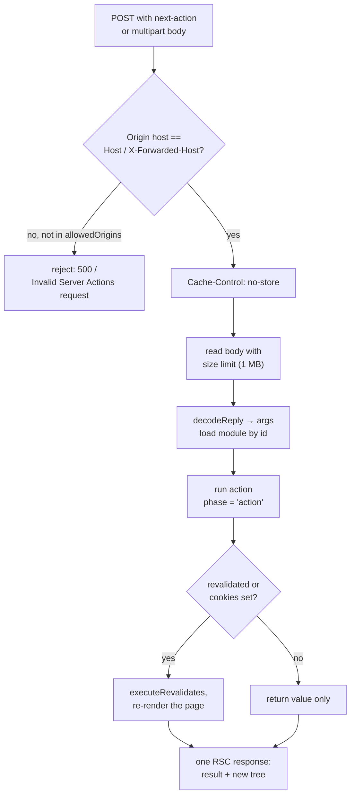

# Server Actions and Forms

> [!summary] TL;DR
> A `'use server'` function never ships to the browser. The compiler replaces it on the client with `createServerReference(id, callServer)`, where `id` is 21 bytes in hex: one info byte (cache function or not, which of the first six arguments are used, rest args) plus a SHA-1 of the hash salt, file name and export name. The salt is the Server Actions encryption key. Variables an inline action closes over are serialized with Flight, prefixed with the action id, encrypted with AES-GCM under a random IV, and bound as a hidden first argument. Calling the action dispatches into the router's action queue inside a transition, one action at a time, and POSTs to the current URL with a `next-action` header. On the server, `handleAction` compares `Origin` with `Host`/`X-Forwarded-Host` (or `experimental.serverActions.allowedOrigins`), enforces a 1 MB body limit, decodes the arguments, runs the function in the `'action'` phase, and then, if the action revalidated or set cookies, re-renders the page into the same response. Forms built this way work before JavaScript loads. On the client you add `useActionState` for results and errors, `useFormStatus` for pending UI, `useOptimistic` for instant feedback, and `next/form` for search-style forms that navigate instead of mutate.

The last two parts were about reading data and making cached data fresh again ([[05 Cache Components - use cache, cacheLife and cacheTag|Cache Components]], [[06 Revalidation - Tags, Paths and Refresh|Revalidation]]). This part covers writing it. A Server Action is the App Router's mutation primitive. You write an async function, mark it `'use server'`, and call it from a form or an event handler. The framework turns that call into an HTTP request, secures it, and sends back both the return value and the updated UI.

The running example is the notes app: a form to create a note, an inline "delete" button, and a comment box with an optimistic update.

## Defining an action

There are two ways to write one, and both use the `'use server'` directive.

**A file of actions.** Every export of the module becomes a Server Action. This is the only form a Client Component can import.

```ts
// app/notes/actions.ts
'use server'

import { updateTag } from 'next/cache'
import { redirect } from 'next/navigation'
import { verifySession } from '@/lib/dal'
import { db } from '@/lib/db'

export async function createNote(formData: FormData) {
  const session = await verifySession()
  const note = await db.note.create({
    data: { title: String(formData.get('title')), ownerId: session.userId },
  })
  updateTag('notes')
  redirect(`/notes/${note.id}`)
}
```

**An inline action** inside a Server Component, with the directive as the first statement of the function body:

```tsx
// app/notes/[id]/page.tsx
export default async function NotePage({ params }: { params: Promise<{ id: string }> }) {
  const { id } = await params

  async function deleteNote() {
    'use server'
    const session = await verifySession()
    await db.note.delete({ where: { id, ownerId: session.userId } })
    updateTag('notes')
    redirect('/notes')
  }

  return (
    <form action={deleteNote}>
      <button>Delete</button>
    </form>
  )
}
```

Actions must be async. The React term is *Server Function*. When one is used for a mutation (passed to `action`/`formAction`, or called inside a transition) it is usually called a Server Action. Next.js uses both terms.

## What the compiler does

The same SWC transform that handles `'use cache'` handles `'use server'`, and it produces different output for the server and client bundles.

### On the client: a reference, not the code

For a client bundle the whole module is replaced. A transform fixture shows the output for a file with a three-argument action and a default export:[^client-fixture]

```js
// app/send.ts as compiled for the browser
import { createServerReference, callServer, findSourceMapURL } from "private-next-rsc-action-client-wrapper";

const $$RSC_SERVER_ACTION_1 = createServerReference(
  "70e10665baac148856374b2789aceb970f66fec33e", callServer, void 0, findSourceMapURL, "myAction");
export { $$RSC_SERVER_ACTION_1 as myAction };
export default createServerReference("00c18c215a6b7cdc64bf709f3a714ffdef1bf9651d", callServer, ...);
```

None of the function bodies, and none of their imports, reach the browser. `createServerReference` comes from React's Flight client. It returns a function that, when called, hands its id and arguments to Next.js's `callServer`.[^client-wrapper] Exports that are never imported by client code get no reference and no id in the manifest, so they have no public endpoint at all.

### The action id

The id is computed by `generate_server_reference_id`:[^ref-id]

```text
id = hex( infoByte + sha1(hashSalt + fileName + ":" + exportName) )

infoByte = [type: 1 bit][argument mask: 6 bits][rest args: 1 bit]
```

The info byte is readable by the client. In `70e1...` above, `0x70` is `0 111000 0`: type `0` (a Server Action, not a cache function), the first three arguments used, no rest parameter. The client uses it to drop arguments the function does not declare before sending them (`omitUnusedArgs`), so extra event objects passed by mistake never get serialized.[^arg-mask]

The hash salt is the Server Actions encryption key in both Turbopack and webpack.[^salt] That key is generated at build time and cached in `.next/cache/.rscinfo` for 14 days, then rotated on the next build (or regenerated on every build when Next.js detects Docker and has no persistent cache directory).[^key-cache] So action ids are stable across builds for up to two weeks, then change. A browser still running the old JavaScript will then call an id the server does not know, and gets a "Failed to find Server Action" error. Setting `NEXT_SERVER_ACTIONS_ENCRYPTION_KEY` fixes the key, and therefore the ids, across builds and instances. See [[43 Recipes - Forms, Mutations and Uploads#"Failed to find Server Action" after a deploy|the recipe]] for diagnosing it.

### On the server: registered and hoisted

On the server the function stays, and gets registered with its id. Inline actions are hoisted to module scope so they have a stable export. Here is the fixture for a cache function inside a Server Action inside a component:[^server-fixture]

```js
// output (server layer, excerpt)
export const $$RSC_SERVER_ACTION_1 = async function action($$ACTION_CLOSURE_BOUND, c) {
    var [$$ACTION_ARG_0, $$ACTION_ARG_1] =
        await decryptActionBoundArgs("6090b5db271335765a4b0eab01f044b381b5ebd5cd", $$ACTION_CLOSURE_BOUND);
    const d = $$ACTION_ARG_0 + $$ACTION_ARG_1 + c;
    // ...
};
registerServerReference($$RSC_SERVER_ACTION_1, "6090b5db271335765a4b0eab01f044b381b5ebd5cd", null);

async function Component({ a }) {
    const b = 1;
    var action = $$RSC_SERVER_ACTION_1.bind(null,
        encryptActionBoundArgs("6090b5db271335765a4b0eab01f044b381b5ebd5cd", a, b));
    return <Form action={action}>...</Form>;
}
```

The inline `action` read `a` (a prop) and `b` (a local). After hoisting it can no longer see them, so the compiler passes them in: at render time it binds an encrypted copy of `[a, b]` as the first argument, and at call time the hoisted function decrypts and destructures it. The `.bind` result is what gets serialized into the RSC payload and handed to the `<form>`.

### Closure encryption

`encryptActionBoundArgs` does three things:[^encrypt]

1. Serializes the captured values with React Flight (`renderToReadableStream`), the same format as everything else in the payload.
2. Prepends the action id to the serialized string and encrypts it with AES-GCM using the build key and a fresh random 16-byte IV.
3. Returns `base64(iv + ciphertext)`.

`decryptActionBoundArgs` reverses it and checks that the plaintext starts with the action id, which works like a checksum: a payload encrypted for one action cannot be replayed against another.[^decrypt] The key is a 256-bit AES-GCM key, taken from `NEXT_SERVER_ACTIONS_ENCRYPTION_KEY` if set, otherwise from the action manifest.[^key]

> [!warning] Encrypted is not the same as safe to capture
> The captured values travel to the browser and back on every call. Encryption keeps them unreadable and tamper-evident, but the docs still advise against relying on it for secrets. Capture ids, not records, and re-read anything sensitive from the database inside the action.

## Calling an action from the client

Whether a form submits or your code calls `await createNote(fd)`, the reference ends up in `callServer`, which wraps the call in `startTransition` and dispatches it into the router's action queue:[^call-server]

```ts
// packages/next/src/client/sequential-call-server.ts
export async function callServer(actionId: string, actionArgs: any[]) {
  return new Promise((resolve, reject) => {
    startTransition(() => {
      dispatchAppRouterAction({ type: ACTION_SERVER_ACTION, actionId, actionArgs, resolve, reject })
    })
  })
}
```

Two consequences:

- **Actions run one at a time per client.** The default router queue processes actions sequentially (an `experimental.concurrentRouterQueue` flag swaps in a different implementation), so `Promise.all([a(), b()])` from the browser does not run them in parallel. If you need parallel work, do it inside one action. The server does not queue anything; it is purely a client-side ordering that keeps each re-rendered tree consistent with the action that produced it.
- **An action is a transition.** React keeps the current UI interactive while it runs, and `isPending`/`useFormStatus` reflect that. See [[07 Priorities, Transitions and Concurrency|React Concepts: transitions]].

The server action reducer then sends the request:[^fetch-action]

```text
POST /notes/42                       (the current URL, not a special endpoint)
next-action: 6090b5db...             (the action id)
next-router-state-tree: ...          (the client's current route tree)
Accept: text/x-component
body: encodeReply(args)              (string, or multipart FormData for files)
```

## On the server: handleAction

The POST arrives at the same page route that rendered the form. Before rendering, the app renderer calls `handleAction`, which runs the following steps.



### 1. Is it an action?

`getServerActionRequestMetadata` classifies the request. A `POST` with a `next-action` header is a *fetch action* (sent by the router). A `POST` with a `multipart/form-data` body may be an *MPA action*, a form submitted before JavaScript loaded. URL-encoded bodies are not supported as actions.[^meta]

### 2. The CSRF check

Server Actions are POST-only, which with `SameSite` cookies already blocks most cross-site form posts. On top of that, `handleAction` compares the host part of the `Origin` header with `X-Forwarded-Host` (if present) or `Host`:[^csrf]

- No `Origin` header: allowed, with a warning. Modern browsers send it on every POST, so a request without it comes from a hand-made or very old client, not from a page the user was tricked into visiting.
- `Origin` matches: allowed.
- Mismatch: allowed only if the origin matches `experimental.serverActions.allowedOrigins`. Otherwise the action does not run, and a fetch action gets a 500 with "Invalid Server Actions request". Behind a reverse proxy this is the usual cause, see [[43 Recipes - Forms, Mutations and Uploads#"Invalid Server Actions request." behind a reverse proxy or tunnel|the recipe]].

`isCsrfOriginAllowed` matches entries case-insensitively and supports wildcards: `*.example.com` matches one subdomain level, `**.example.com` any depth, and a bare `*` or `**` is rejected so a wildcard can never match every domain.[^csrf-match]

```ts
// next.config.ts
const nextConfig = {
  experimental: {
    serverActions: {
      allowedOrigins: ['notes.example.com', '*.preview.example.com'],
      bodySizeLimit: '4mb',
    },
  },
}
```

> [!note] Still under `experimental` in 16.4.3
> Server Actions themselves have been stable since Next.js 14, but their two config options, `allowedOrigins` and `bodySizeLimit`, still live under `experimental.serverActions` in the 16.4.3 config type.[^config]

### 3. Body and arguments

The response gets `Cache-Control: no-cache, no-store, max-age=0, must-revalidate` so no CDN caches an action. The body is read with a size check against `bodySizeLimit` (1 MB by default) and decoded with React's `decodeReply` (or a busboy-based multipart decoder on Node.js) into an argument array. The action module is loaded by its id from the server manifest. If the id is unknown, the response is a plain-text 409 "Server Action unavailable" (400 for a malformed id) with an `x-nextjs-action-not-found` header, which the client turns into an `UnrecognizedActionError`. More than 1,000 arguments are rejected before `apply`.[^handle][^args-limit] For uploads that exceed the limit, see [[43 Recipes - Forms, Mutations and Uploads#File upload fails with "Body exceeded 1 MB limit."|the upload recipe]].

### 4. Running the action

`executeActionAndPrepareForRender` sets `requestStore.phase = 'action'` and calls the function. The phase is what makes `cookies().set()` and `draftMode().enable()` legal here and illegal during render.[^prepare]

When the function returns, the handler decides whether to render the page too. It does so only if `workStore.pathWasRevalidated` was set: by `updateTag`, `revalidatePath`, `revalidateTag` without a stale-while-revalidate profile, `refresh()`, or a cookie write. In that case it first copies the action's cookie writes into the render's cookies, applies the pending revalidations, and switches the phase back to `'render'`. Otherwise the page is skipped and the response carries only the return value.

### 5. The response

For a fetch action the response is one RSC stream that contains the action's return value and, if the page was re-rendered, the new tree for the current URL. The client resolves your `await` with the value and commits the tree as a navigation, so the UI updates without a second request. The `x-action-revalidated` header tells the client which caches to drop ([[06 Revalidation - Tags, Paths and Refresh|Revalidation]]).

`redirect()` inside an action throws a control-flow error that `handleAction` catches. For a fetch action it answers `200` with an `x-action-redirect: <url>;<push|replace>` header and, for an internal URL, the destination's RSC payload in the body, so the redirect is a client navigation in the same round trip (the status codes are tabulated in [[10 Errors, Redirects and Request Lifecycle APIs#redirect() and permanentRedirect()|Errors & Lifecycle]]). For an MPA action it sends a real `303 See Other`. `notFound()`, `forbidden()` and `unauthorized()` set the status code and render the matching boundary. Any other error becomes a 500 and rejects the promise on the client, where the nearest error boundary catches it.[^errors] A `redirect()` swallowed by a `try/catch` is a classic bug, see [[43 Recipes - Forms, Mutations and Uploads#redirect() inside my action does nothing, or I see "NEXT_REDIRECT" in my logs|the recipe]].

> [!tip] Revalidate before you redirect
> `redirect()` throws, so nothing after it runs. Call `updateTag` or `revalidatePath` first, then `redirect`, and the destination is rendered with fresh data in the same response.

## Progressive enhancement

A `<form action={serverAction}>` rendered by a Server Component works with JavaScript disabled. React renders it as a real HTML form that posts `multipart/form-data` to the current URL, with hidden `$ACTION_ID_<id>` (or `$ACTION_REF_`) fields that identify the action. On the server `handleAction` sees a multipart POST without a `next-action` header, calls React's `decodeAction(formData)` to find the action, runs it, and calls `decodeFormState` so a `useActionState` on the page can be rendered with the new state. Then the whole page is rendered to HTML as the response.[^mpa]

After hydration the same form is intercepted by React and submitted through `callServer` instead. In a Client Component a form submitted before hydration is queued and replayed once React is ready.

## Forms on the client

The React 19 form hooks are what make Server Actions pleasant to use. All three are React APIs, so they also work with client-only actions.

### useActionState: results and validation errors

`useActionState(action, initialState)` returns `[state, formAction, isPending]`. The action receives the previous state as its first argument and the `FormData` as its second, and whatever it returns becomes the new state:

```ts
// app/notes/actions.ts
'use server'

import { z } from 'zod' // zod 4
import { updateTag } from 'next/cache'
import { redirect } from 'next/navigation'

const NoteSchema = z.object({
  title: z.string().trim().min(1, 'Title is required').max(120),
  body: z.string().max(10_000),
})

export type CreateNoteState = {
  errors?: { title?: string[]; body?: string[] }
  values?: { title: string; body: string }
}

export async function createNote(
  _prev: CreateNoteState,
  formData: FormData,
): Promise<CreateNoteState> {
  const session = await verifySession()
  const raw = { title: String(formData.get('title') ?? ''), body: String(formData.get('body') ?? '') }

  const parsed = NoteSchema.safeParse(raw)
  if (!parsed.success) {
    return { errors: z.flattenError(parsed.error).fieldErrors, values: raw }
  }

  const note = await db.note.create({ data: { ...parsed.data, ownerId: session.userId } })
  updateTag('notes')
  redirect(`/notes/${note.id}`)
}
```

```tsx
// app/notes/new/note-form.tsx
'use client'

import { useActionState } from 'react'
import { createNote, type CreateNoteState } from '../actions'

const initialState: CreateNoteState = {}

export function NoteForm() {
  const [state, formAction, isPending] = useActionState(createNote, initialState)

  return (
    <form action={formAction}>
      <label>
        Title
        <input name="title" defaultValue={state.values?.title} aria-invalid={!!state.errors?.title} />
      </label>
      {state.errors?.title && <p role="alert">{state.errors.title[0]}</p>}
      <textarea name="body" defaultValue={state.values?.body} />
      <button disabled={isPending}>{isPending ? 'Saving…' : 'Create note'}</button>
    </form>
  )
}
```

Return field values with the errors. React resets an uncontrolled form after a successful submission, and echoing the values back keeps what the user typed when validation fails.

### useFormStatus: pending state in a child

`useFormStatus()` from `react-dom` reads the status of the *parent* `<form>`, so it must be called in a component rendered inside it:

```tsx
// app/ui/submit-button.tsx
'use client'

import { useFormStatus } from 'react-dom'

export function SubmitButton({ children }: { children: React.ReactNode }) {
  const { pending } = useFormStatus()
  return <button disabled={pending} aria-busy={pending}>{children}</button>
}
```

This is the reusable version of the `isPending` flag above, for forms whose action is passed in from a Server Component.

### useOptimistic: show the result before the server answers

```tsx
// app/notes/[id]/comments.tsx
'use client'

import { useOptimistic, useRef } from 'react'
import { addComment } from './actions'

type Comment = { id: string; body: string; pending?: boolean }

export function Comments({ noteId, comments }: { noteId: string; comments: Comment[] }) {
  const formRef = useRef<HTMLFormElement>(null)
  const [optimistic, addOptimistic] = useOptimistic(
    comments,
    (current, body: string) => [...current, { id: `tmp-${current.length}`, body, pending: true }],
  )

  async function submit(formData: FormData) {
    addOptimistic(String(formData.get('body')))
    formRef.current?.reset()
    await addComment(noteId, formData)
  }

  return (
    <>
      <ul>
        {optimistic.map((c) => (
          <li key={c.id} style={{ opacity: c.pending ? 0.6 : 1 }}>{c.body}</li>
        ))}
      </ul>
      <form ref={formRef} action={submit}>
        <input name="body" required />
        <button>Comment</button>
      </form>
    </>
  )
}
```

The optimistic list exists only while the action's transition is pending. When `addComment` finishes and calls `updateTag(`note-${noteId}`)`, the response carries the re-rendered page with the real `comments` prop, and React drops the optimistic version for it. If the action throws, the optimistic item disappears and the error boundary (or your `try/catch`) takes over.

### Passing extra arguments

A form only sends its fields. To pass an id, bind it:

```tsx
const addCommentToNote = addComment.bind(null, noteId)
<form action={addCommentToNote}>...</form>
```

`.bind` on a server reference works like the compiler's closure binding: the bound values are serialized into the form's hidden fields so the no-JavaScript submission includes them. Unlike captured closure variables they travel as ordinary serialized values, **not encrypted**. Treat a bound id as user input and check it against the session in the action. A hidden `<input name="noteId">` has the same property.

## next/form: forms that navigate

Not every form mutates. A search box should change the URL and render the results page. `next/form` exists for that case:

```tsx
// app/notes/search-box.tsx
import Form from 'next/form'

export function SearchBox() {
  return (
    <Form action="/notes/search">
      <input name="q" placeholder="Search notes" />
      <button>Search</button>
    </Form>
  )
}
```

With a **string** `action`, `<Form>` prefetches the target route when it becomes visible, and on submit it builds the URL from the form fields (`/notes/search?q=...`), calls `event.preventDefault()`, and runs `router.push` (or `replace` with the `replace` prop). Before hydration it is an ordinary GET form.[^form] With a **function** `action` it renders a plain React `<form>` and behaves exactly like the forms above.

## A security checklist

Every exported action is a public POST endpoint, reachable with `curl` whether or not your UI shows the button. The framework gives you the origin check, the body limit, unguessable ids, encrypted closures and dead-code elimination of unused actions. Everything else is yours:

- **Authenticate inside the action.** Rendering the form only for signed-in users is not a check. Call your `verifySession()` from the Data Access Layer first ([[27 Server-Aware Auth - Sessions, Proxy and the DAL#Server Actions are public endpoints|Server-Aware Auth]]).
- **Authorize on the resource.** Look the record up by id *and* owner. A valid id from someone else's note is still a valid id.
- **Validate every argument.** `FormData`, bound values and plain arguments all come from the client. Parse them with a schema.
- **Shape the return value.** It is serialized to the browser. Return what the UI renders, not the database row.
- **Set `NEXT_SERVER_ACTIONS_ENCRYPTION_KEY`** for multi-instance or self-hosted deployments, so every instance can decrypt every closure and action ids survive a rolling deploy ([[11 Configuration, Turbopack and Deployment#3. Many instances: what must be shared|Many instances]]).

## Summary

A Server Action is a server-only function that the compiler turns into a reference: on the client, `createServerReference` with a hashed id whose first byte describes the arguments, and on the server, a registered and hoisted function whose captured variables arrive as an AES-GCM encrypted bound argument. Calling it dispatches a transition into the router's sequential action queue and POSTs to the current URL. `handleAction` checks the origin against the host, enforces the body limit, decodes the arguments, runs the action in the `'action'` phase, and re-renders the page into the same response when the action revalidated or wrote cookies. The same form works without JavaScript through `decodeAction`. `useActionState`, `useFormStatus` and `useOptimistic` handle results, pending state and instant feedback, and `next/form` covers forms that should navigate instead. Next, [[08 Route Handlers and Proxy|Route Handlers and Proxy]] covers the other way to accept requests: plain HTTP handlers.

### Key takeaways

- **`'use server'`**: at the top of a file (importable by Client Components) or of an async function inside a Server Component.
- **Client bundle**: the module becomes `createServerReference(id, callServer)` calls; no server code ships, and unused exports get no endpoint.
- **Action id**: info byte (type, six-argument mask, rest flag) plus SHA-1 of salt, file and export; the salt is the encryption key, cached for up to 14 days.
- **Closures**: captured variables are Flight-serialized, prefixed with the action id, AES-GCM encrypted and bound as the first argument; `.bind` arguments are not encrypted.
- **Dispatch**: `callServer` runs inside `startTransition` and actions are processed one at a time per client, as a POST to the current URL with `next-action`.
- **CSRF**: `Origin` must match `Host`/`X-Forwarded-Host` or `experimental.serverActions.allowedOrigins`; the body limit defaults to 1 MB.
- **Single round trip**: when the action revalidates or sets cookies, the page is re-rendered into the same RSC response; `redirect()` becomes `x-action-redirect` for fetch actions and a 303 without JavaScript.
- **Progressive enhancement**: multipart posts are decoded with `decodeAction` and `decodeFormState`, so forms work before hydration.
- **Form hooks**: `useActionState` for state and errors, `useFormStatus` in a child of the form, `useOptimistic` for instant feedback; `next/form` for navigating GET forms.

← [[06 Revalidation - Tags, Paths and Refresh|Revalidation]] · [[00 Next.js in Practice Index|Index]] · [[08 Route Handlers and Proxy|Route Handlers & Proxy]] →

[^client-fixture]: transform fixture, `'use server'` file compiled for the client — [crates/next-custom-transforms/tests/fixture/server-actions/client-graph/1/output.js](https://github.com/vercel/next.js/blob/v16.4.3/crates/next-custom-transforms/tests/fixture/server-actions/client-graph/1/output.js)
[^client-wrapper]: `private-next-rsc-action-client-wrapper` — [packages/next/src/build/webpack/loaders/next-flight-loader/action-client-wrapper.ts#L1-L10](https://github.com/vercel/next.js/blob/v16.4.3/packages/next/src/build/webpack/loaders/next-flight-loader/action-client-wrapper.ts#L1-L10)
[^ref-id]: `generate_server_reference_id` — [crates/next-custom-transforms/src/transforms/server_actions.rs#L284-L371](https://github.com/vercel/next.js/blob/v16.4.3/crates/next-custom-transforms/src/transforms/server_actions.rs#L284-L371)
[^arg-mask]: `extractInfoFromServerReferenceId` and `omitUnusedArgs` — [packages/next/src/shared/lib/server-reference-info.ts#L33-L89](https://github.com/vercel/next.js/blob/v16.4.3/packages/next/src/shared/lib/server-reference-info.ts#L33-L89)
[^salt]: hash salt is the encryption key — Turbopack [crates/next-core/src/next_shared/transforms/server_actions.rs#L79-L89](https://github.com/vercel/next.js/blob/v16.4.3/crates/next-core/src/next_shared/transforms/server_actions.rs#L79-L89), webpack [packages/next/src/build/webpack-config.ts#L2403](https://github.com/vercel/next.js/blob/v16.4.3/packages/next/src/build/webpack-config.ts#L2403)
[^key-cache]: key cache in `.rscinfo`, 14-day expiry, rotation at build — [packages/next/src/server/app-render/encryption-utils-server.ts#L8-L95](https://github.com/vercel/next.js/blob/v16.4.3/packages/next/src/server/app-render/encryption-utils-server.ts#L8-L95); no storage directory in Docker — [packages/next/src/server/cache-dir.ts#L4-L11](https://github.com/vercel/next.js/blob/v16.4.3/packages/next/src/server/cache-dir.ts#L4-L11)
[^server-fixture]: transform fixture, inline action and cache function with closures — [crates/next-custom-transforms/tests/fixture/server-actions/server-graph/40/output.js#L1-L35](https://github.com/vercel/next.js/blob/v16.4.3/crates/next-custom-transforms/tests/fixture/server-actions/server-graph/40/output.js#L1-L35)
[^encrypt]: `encodeActionBoundArg` and `encryptActionBoundArgs` — [packages/next/src/server/app-render/encryption.ts#L72-L240](https://github.com/vercel/next.js/blob/v16.4.3/packages/next/src/server/app-render/encryption.ts#L72-L240)
[^decrypt]: `decodeActionBoundArg` (action-id prefix check) — [packages/next/src/server/app-render/encryption.ts#L45-L70](https://github.com/vercel/next.js/blob/v16.4.3/packages/next/src/server/app-render/encryption.ts#L45-L70); `decryptActionBoundArgs` — [#L242-L296](https://github.com/vercel/next.js/blob/v16.4.3/packages/next/src/server/app-render/encryption.ts#L242-L329)
[^key]: AES-GCM `encrypt`/`decrypt` and `getActionEncryptionKey` — [packages/next/src/server/app-render/encryption-utils.ts#L37-L91](https://github.com/vercel/next.js/blob/v16.4.3/packages/next/src/server/app-render/encryption-utils.ts#L37-L91); 256-bit key generation — [packages/next/src/server/app-render/encryption-utils-server.ts#L97-L129](https://github.com/vercel/next.js/blob/v16.4.3/packages/next/src/server/app-render/encryption-utils-server.ts#L97-L129)
[^call-server]: `callServer` (sequential) — [packages/next/src/client/sequential-call-server.ts#L17-L29](https://github.com/vercel/next.js/blob/v16.4.3/packages/next/src/client/sequential-call-server.ts#L17-L29)
[^fetch-action]: `fetchServerAction` — [packages/next/src/client/components/router-reducer/reducers/server-action-reducer.ts#L108-L151](https://github.com/vercel/next.js/blob/v16.4.3/packages/next/src/client/components/router-reducer/reducers/server-action-reducer.ts#L108-L151)
[^meta]: `getServerActionRequestMetadata` — [packages/next/src/server/lib/server-action-request-meta.ts#L15-L52](https://github.com/vercel/next.js/blob/v16.4.3/packages/next/src/server/lib/server-action-request-meta.ts#L15-L52)
[^csrf]: origin check in `handleAction` — [packages/next/src/server/app-render/action-handler.ts#L710-L793](https://github.com/vercel/next.js/blob/v16.4.3/packages/next/src/server/app-render/action-handler.ts#L710-L793)
[^csrf-match]: `matchWildcardDomain` and `isCsrfOriginAllowed` — [packages/next/src/server/app-render/csrf-protection.ts#L6-L94](https://github.com/vercel/next.js/blob/v16.4.3/packages/next/src/server/app-render/csrf-protection.ts#L6-L94)
[^config]: `experimental.serverActions` in `ExperimentalConfig` — [packages/next/src/server/config-shared.ts#L1302-L1315](https://github.com/vercel/next.js/blob/v16.4.3/packages/next/src/server/config-shared.ts#L1302-L1315)
[^handle]: `handleAction`: no-store header, body size limit, decoding — [packages/next/src/server/app-render/action-handler.ts#L795-L851](https://github.com/vercel/next.js/blob/v16.4.3/packages/next/src/server/app-render/action-handler.ts#L795-L851); loading the action module by id — [#L1251-L1258](https://github.com/vercel/next.js/blob/v16.4.3/packages/next/src/server/app-render/action-handler.ts#L1251-L1258)
[^args-limit]: `SERVER_ACTION_ARGS_LIMIT` — [packages/next/src/server/app-render/action-handler.ts#L1455-L1459](https://github.com/vercel/next.js/blob/v16.4.3/packages/next/src/server/app-render/action-handler.ts#L1455-L1459)
[^prepare]: `executeActionAndPrepareForRender` — [packages/next/src/server/app-render/action-handler.ts#L1461-L1515](https://github.com/vercel/next.js/blob/v16.4.3/packages/next/src/server/app-render/action-handler.ts#L1461-L1515)
[^errors]: redirect, access-fallback and error handling — [packages/next/src/server/app-render/action-handler.ts#L1342-L1453](https://github.com/vercel/next.js/blob/v16.4.3/packages/next/src/server/app-render/action-handler.ts#L1342-L1453)
[^mpa]: MPA action path with `decodeAction` and `decodeFormState` — [packages/next/src/server/app-render/action-handler.ts#L1158-L1191](https://github.com/vercel/next.js/blob/v16.4.3/packages/next/src/server/app-render/action-handler.ts#L1158-L1191)
[^form]: `next/form` `Form` and `onFormSubmit` — [packages/next/src/client/app-dir/form.tsx#L26-L224](https://github.com/vercel/next.js/blob/v16.4.3/packages/next/src/client/app-dir/form.tsx#L26-L224)
