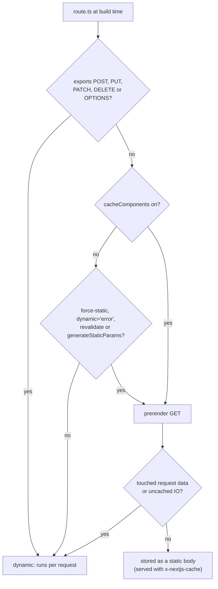
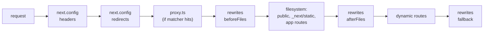
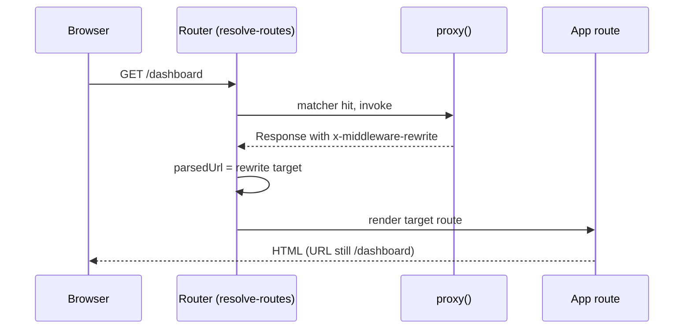

# Route Handlers and Proxy

> [!summary] TL;DR
> A `route.ts` file exports one function per HTTP verb. Next.js wraps them in an `AppRouteRouteModule`, fills in `HEAD` and `OPTIONS` for you, returns `405` for verbs you did not export, and runs your function inside the same request stores as a page, so `cookies()`, `redirect()` and `notFound()` work there too. A `GET` is only prerendered when you opt in (without Cache Components) or when it touches no request data (with Cache Components). If the file also exports `POST`, `PUT`, `PATCH`, `DELETE` or `OPTIONS`, it is never prerendered. `proxy.ts` is what `middleware.ts` was called before Next.js 16. It always runs on Node.js, before the filesystem routes, on every path its `matcher` covers. `NextResponse.next()`, `rewrite()` and `redirect()` are not magic: they set `x-middleware-*` headers that the router reads after your function returns.

This part covers the two places in the App Router where you write plain request-to-response code instead of React components. Route Handlers are endpoints that live inside `app/`. Proxy is a single function in front of the whole app. They look alike, since both take a `Request` and return a `Response`, but they run at different points in the request and have different jobs.

The running example is a small notes app: `app/api/notes/route.ts` serves JSON, `app/feed.xml/route.ts` serves an RSS feed, and `proxy.ts` sends signed-out visitors away from `/dashboard`.

## Route Handlers: the file convention

A Route Handler is a `route.ts` (or `.js`) file anywhere under `app/`. It exports named functions, one per HTTP method:

```ts
// app/api/notes/route.ts
import { cookies } from 'next/headers'
import { db } from '@/lib/db'

export async function GET(request: Request) {
  const { searchParams } = new URL(request.url)
  const tag = searchParams.get('tag')
  const notes = await db.note.findMany({ where: tag ? { tag } : {} })
  return Response.json(notes)
}

export async function POST(request: Request) {
  const session = (await cookies()).get('session')?.value
  if (!session) return new Response('Unauthorized', { status: 401 })

  const body = await request.json()
  const note = await db.note.create({ data: body })
  return Response.json(note, { status: 201 })
}
```

Three rules come straight from the router:

- A `route.ts` and a `page.tsx` cannot live in the same segment. Either file takes over every HTTP verb for its URL, so `app/route.ts` next to `app/page.tsx` is a conflict, while `app/api/route.ts` is fine.
- Route Handlers do not take part in layouts or client-side navigation. A `<Link>` to `/api/notes` does a normal browser request.
- The exports must be uppercase named functions. In development, Next.js logs an error for `export function get()` and for a default export, and another one when the file exports no method at all.[^onload-dev]

### Which methods exist, and what you get for free

The list of methods is fixed: `GET`, `HEAD`, `OPTIONS`, `POST`, `PUT`, `DELETE`, `PATCH`.[^http] When the module loads, `autoImplementMethods` builds a table with one entry per method:[^auto]

| You export | Next.js does |
|---|---|
| the method | calls your function |
| `GET` but not `HEAD` | answers `HEAD` with your `GET` function |
| anything, but not `OPTIONS` | answers `OPTIONS` with `204` and an `Allow` header that lists your methods (plus `HEAD` if `GET` exists) |
| not that method | answers `405 Method Not Allowed` |

A method name outside the list (say `PROPFIND`) never reaches the table. `resolveHandler` checks it first and returns `400`, with a comment in the source saying this is there to prevent remote code execution through arbitrary method names.[^resolve]

> [!tip] You rarely need to write `OPTIONS`
> The automatic `OPTIONS` reply is enough for clients that only want the `Allow` header. Write your own only for CORS preflights that must return `Access-Control-*` headers, or set CORS headers for all of `/api` in Proxy (the docs have a full CORS example).

### The handler signature

```ts
// app/api/notes/[id]/route.ts
import type { NextRequest } from 'next/server'

export async function GET(
  request: NextRequest,
  ctx: RouteContext<'/api/notes/[id]'>,
) {
  const { id } = await ctx.params
  const note = await getNote(id)
  if (!note) return new Response(null, { status: 404 })
  return Response.json(note)
}
```

- The first argument is a `NextRequest`, which extends the Web `Request` with `nextUrl` (a parsed URL with `pathname` and `searchParams`) and `cookies`.
- The second argument holds `params`, and `params` is a **Promise**. Next.js builds it with `createServerParamsForRoute`, the same helper family that makes page `params` async.[^params] Always `await ctx.params`.
- `RouteContext<'/path'>` is a global type that `next dev`, `next build` or `next typegen` generate from your routes, so `id` is typed as `string`.

The return value must be a `Response`. If it is not, Next.js sends a bare `500`. Returning `NextResponse.next()` or `NextResponse.rewrite()` from a Route Handler throws an error, because those helpers only mean something to Proxy (more on why below).[^validate]

### What runs around your function

`executeRequest` does not call your function directly. It nests it in three `AsyncLocalStorage` scopes (the action store, the request "work unit" store and the work store) and then calls `renderToResponse`.[^exec] These are the same stores a page render uses, which is why request APIs work the same way in both places:

```ts
// app/api/logout/route.ts
import { cookies } from 'next/headers'
import { redirect } from 'next/navigation'

export async function POST() {
  ;(await cookies()).delete('session')
  redirect('/') // throws; Next.js turns it into a redirect Response
}
```

`redirect()` and `notFound()` work by throwing special errors (see [[10 Errors, Redirects and Request Lifecycle APIs|Errors & Lifecycle]]). In a Route Handler, `handleHandlerError` catches them. A redirect error becomes an empty response with a `Location` header, any cookies you set through `cookies()` are copied onto it, and the status is `303` when the request is a Server Action POST, otherwise the redirect's own status (`307` by default). `notFound()`, `forbidden()` and `unauthorized()` become an empty `404`, `403` or `401`. Any other error is rethrown and turns into a `500`.[^herr]

> [!warning] `notFound()` in a Route Handler is not your `not-found.tsx`
> The `404` from a Route Handler has no body. The `not-found.tsx` UI only renders for pages. If an API client needs a JSON error body, return `Response.json({ error: 'Not found' }, { status: 404 })` yourself.

## When a GET is cached

This is the part of Route Handlers that changed the most between versions. The answer depends on whether `cacheComponents` is on in `next.config.ts`.



### Without Cache Components: opt in

Route Handlers are not cached by default. At build time, `exportAppRoute` checks `isStaticGenEnabled` and skips the prerender unless the module exports one of `dynamic = 'force-static'`, `dynamic = 'error'`, `revalidate = false`, a `revalidate` greater than `0`, or `generateStaticParams`.[^staticgen] Metadata routes such as `sitemap.ts` are the exception: they are always tried, which is why the docs call them "static by default".[^export]

```ts
// app/feed.xml/route.ts (previous model, cacheComponents off)
export const revalidate = 3600 // prerender, then regenerate at most hourly

export async function GET() {
  const posts = await getPublishedPosts()
  return new Response(renderRss(posts), {
    headers: { 'Content-Type': 'application/rss+xml' },
  })
}
```

With `force-static`, the request object is wrapped in a Proxy that hands your code empty headers, empty cookies and a URL with the query string removed. Reading `request.headers` is therefore safe, but you get nothing back.[^forcestatic] Without `force-static`, a different wrapper (`proxyNextRequest`) watches for reads of `headers`, `cookies`, `url`, `body`, `json()`, `formData()` and the `nextUrl` search fields, and calls `trackDynamic` on each.[^proxyreq] During a legacy prerender, `trackDynamic` throws a `DynamicServerError`, the build catches it, and the route becomes dynamic. With `dynamic = 'error'`, it throws a build error instead.[^track]

### With Cache Components: the same model as pages

When `cacheComponents` is on, `exportAppRoute` tries every `GET` handler, opted in or not.[^export] The prerender runs the handler twice, the same way a page prerender does ([[23 PPR - Partial Prerendering with Cache Components#Build time: how holes are found|how holes are found]]). A first "prospective" pass lets caches fill. A second pass then checks whether the handler resolves without waiting on any IO.[^prospective] If it reads request data, `trackDynamic` aborts the prerender. If it waits on uncached IO, the response is not ready in time. In both cases the route becomes dynamic. Cached work (`'use cache'` functions) resolves in time and ends up in the static body.

```ts
// app/api/tags/route.ts (cacheComponents on)
import { cacheLife, cacheTag } from 'next/cache'

export async function GET() {
  return Response.json(await getAllTags())
}

async function getAllTags() {
  'use cache'
  cacheLife('hours')
  cacheTag('tags')
  return db.tag.findMany()
}
```

Two rules are specific to Route Handlers here:

- `'use cache'` cannot go directly in the handler body. Put it in a helper function as above. Reading `request.headers` or `cookies` inside a `'use cache'` scope throws, because `trackDynamic` rejects request access when the current store is a cache.[^track]
- The segment config exports `dynamic`, `dynamicParams`, `revalidate`, `fetchCache` and `runtime` are compile errors under `cacheComponents`, in route files as well as pages. The SWC transform reports "Route segment config ... is not compatible with `nextConfig.cacheComponents`".[^rsc-transform] Use `cacheLife` for time and `connection()` to mark a handler as dynamic on purpose.

How caching and invalidation work in general is in [[05 Cache Components - use cache, cacheLife and cacheTag|Cache Components]] and [[06 Revalidation - Tags, Paths and Refresh|Revalidation]].

### The surprise: other methods make the whole file dynamic

The docs say other methods "are not cached, even if they are placed alongside a `GET` method that is cached". The source goes further than that. `hasNonStaticMethods` returns `true` if the module exports `POST`, `PUT`, `DELETE`, `PATCH` or `OPTIONS`.[^nonstatic] At the very start of `executePrerender`, before the `dynamic` setting is even read, a `true` value throws a `DynamicServerError` with the message "Route is configured with methods that cannot be statically generated".[^prerender-check] The build treats that as dynamic usage. So the `GET` in a file that also exports `POST` is never prerendered, even with `force-static`.

> [!tip] Split read and write endpoints when the read should be static
> Keep the cacheable `GET` in its own `route.ts` (for example `app/api/notes/route.ts`) and move the writes to a sibling (`app/api/notes/mutate/route.ts`), or use a [[07 Server Actions and Forms|Server Action]] for the writes. Better still, read the data in a Server Component and skip the HTTP hop entirely when the only consumer is your own UI.

### How a static response is stored

A prerendered `GET` is not HTML. At build time its status, headers and body are written next to each other, and the collected cache tags go into a header.[^export] At runtime, the generated handler (`build/templates/app-route.ts`) checks the prerender manifest. For an ISR route it buffers the response with `response.blob()` and stores a cache entry of kind `APP_ROUTE` with `{ status, body, headers }` and a `cacheControl` built from the collected `revalidate` and `expire`.[^isr] Responses served from that cache carry `x-nextjs-cache: HIT`, `STALE`, `MISS` or `REVALIDATED`, which is the quickest way to see whether caching is on.[^xcache]

```bash
curl -sI https://example.com/feed.xml | grep -i x-nextjs-cache
# x-nextjs-cache: HIT
```

### Streaming and other Response bodies

Because a handler returns a Web `Response`, any `ReadableStream` works as a body. This is how you stream AI tokens or Server-Sent Events:

```ts
// app/api/events/route.ts
export async function GET() {
  const encoder = new TextEncoder()
  const stream = new ReadableStream({
    async start(controller) {
      for (const msg of ['hello', 'from', 'the', 'server']) {
        controller.enqueue(encoder.encode(`data: ${msg}\n\n`))
        await new Promise((r) => setTimeout(r, 500))
      }
      controller.close()
    },
  })
  return new Response(stream, {
    headers: { 'Content-Type': 'text/event-stream', 'Cache-Control': 'no-store' },
  })
}
```

The `setTimeout` counts as IO, so even with Cache Components this handler stays dynamic.

## Proxy: the renamed middleware

Next.js 16 renamed the `middleware` file convention to `proxy`. The docs give the reasons: "middleware" made people think of Express middleware chains, and the feature is meant as a last resort for work that has to happen in front of the app, like a network proxy. It is also not an auth gate, see [[27 Server-Aware Auth - Sessions, Proxy and the DAL#Proxy is not a security boundary|Proxy is not a security boundary]].

```ts
// proxy.ts (project root, or src/proxy.ts)
import { NextResponse, type NextRequest } from 'next/server'

export function proxy(request: NextRequest) {
  const hasSession = request.cookies.has('session')
  if (!hasSession) {
    const login = new URL('/login', request.url)
    login.searchParams.set('next', request.nextUrl.pathname)
    return NextResponse.redirect(login)
  }
  return NextResponse.next()
}

export const config = {
  matcher: ['/dashboard/:path*'],
}
```

What changed in 16:

- **File and export name.** The build looks for `proxy` (and `src/proxy`) next to `middleware`.[^constants] The file must export a function named `proxy`, or a default export. If both `middleware.ts` and `proxy.ts` exist, the build fails with "Both middleware file ... and proxy file ... are detected". A lone `middleware.ts` still works but logs a deprecation warning that points to the codemod.[^both]

  ```bash
  npx @next/codemod@canary middleware-to-proxy .
  ```

- **Runtime.** `proxy.ts` is always added to the Node.js server bundle. The entry code calls `onServer()` for a proxy file and never `onEdgeServer()`.[^entries] Exporting a `runtime` (or any route segment config) from `proxy.ts` is a build error, and in development it logs and falls back to Node.js: "Proxy always runs on Node.js runtime".[^proxy-runtime] The old `middleware.ts` still defaults to the Edge runtime unless it says `runtime = 'nodejs'`, and the Edge Runtime itself now logs a deprecation warning wherever it is used.[^edge-warn] See [[44 Recipes - Performance, Config and Deployment#Should I still use the Edge runtime?|the Edge runtime recipe]].

> [!note] Node.js means you can use Node APIs, not that Proxy shares your app's memory
> The docs warn that Proxy may be deployed separately, for example close to the CDN, so do not rely on module-level globals or modules shared with your render code. Pass information onward with request headers, cookies, rewrites or the URL.

### Where Proxy sits in the request

The router builds one ordered list of route steps per request, and Proxy is a fixed slot in that list:[^routes]



Two consequences:

- `redirects` in `next.config.ts` run **before** Proxy. A config redirect for `/old` means Proxy never sees `/old`.
- Server Actions are not separate routes. They are POST requests to the page that uses them. A matcher that skips `/settings` also skips every action posted to `/settings`, so always check auth inside the action itself ([[27 Server-Aware Auth - Sessions, Proxy and the DAL|Server-Aware Auth]]).

### The matcher

Without a `matcher`, Proxy runs on every request, including `/_next/static`, `/_next/image` and files in `public/`. An auth redirect without a matcher can block your own CSS and JS. The common negative pattern:

```ts
// proxy.ts
export const config = {
  matcher: [
    // everything except API routes, static assets, image optimizer and files with an extension
    '/((?!api|_next/static|_next/image|.*\\..*).*)',
  ],
}
```

A matcher entry can also be an object with `has` and `missing` conditions on headers, cookies or query params, and `locale: false` to ignore i18n prefixes:

```ts
// proxy.ts
export const config = {
  matcher: [
    {
      source: '/dashboard/:path*',
      missing: [{ type: 'cookie', key: 'session' }],
    },
  ],
}
```

Matchers are read at build time by static analysis, so they must be literal values. A variable or a function call is ignored. `getMiddlewareMatchers` compiles each `source` (a path-to-regexp pattern) into a regex and adds a few things you never wrote:[^matchers]

- an optional `/_next/data/<buildId>` prefix, so Pages Router data requests match the page they belong to;
- an optional suffix for `.json` and the App Router transport forms (`.rsc` and per-segment prefetch files), so a client navigation to `/dashboard` hits the same matcher as a full page load;[^matcher-consts]
- the `basePath`, and a locale prefix when i18n is configured and `locale` is not `false`.

At request time, the router tests the matcher against the raw pathname and against the URL-decoded pathname, and invokes Proxy if either matches.[^invoke]

> [!tip] Test the matcher instead of guessing
> `unstable_doesProxyMatch` from `next/experimental/testing/server` takes your `config`, a URL and optional headers or cookies, and tells you whether Proxy would run. It is experimental, so pin your Next.js version if you rely on it.

### NextResponse is a header protocol

Proxy can return any `Response`. The `NextResponse` helpers are thin wrappers that set headers the router reads once your function returns:[^nextresponse]

| Helper | Sets | The router then |
|---|---|---|
| `NextResponse.next()` | `x-middleware-next: 1` | continues to the next route step |
| `NextResponse.rewrite(url)` | `x-middleware-rewrite: <url>` | resolves the request as `url`, keeping the browser URL |
| `NextResponse.redirect(url, 307)` | `Location` with a `301`, `302`, `303`, `307` or `308` status (else `RangeError`) | ends the request with that redirect |
| `next({ request: { headers } })` | `x-middleware-request-<name>` plus `x-middleware-override-headers` | replaces the upstream request headers |
| any other `Response` | nothing special | sends it as the final response |



The code in `resolve-routes.ts` shows the protocol directly. It reads `x-middleware-override-headers`, deletes every request header that is not in the list, copies each `x-middleware-request-*` value into `req.headers`, and removes those internal headers.[^override] If the response has none of `x-middleware-rewrite`, `x-middleware-next` or `location`, the router marks it `x-middleware-refresh` and sends your response as is. A rewrite target with a protocol (an external URL) ends routing and proxies to that host. A relative one replaces `parsedUrl` and routing continues.[^rewrite]

This is also why `NextResponse.next()` in a Route Handler is an error. Route Handlers run after routing has finished, so nobody would read the header.[^validate]

> [!warning] Request headers versus response headers
> `NextResponse.next({ request: { headers } })` changes what your pages and Route Handlers see in `headers()`. `NextResponse.next({ headers })` sets **response** headers that go back to the browser. Mixing them up is a common way to leak an internal header such as `x-user-id` to clients.

```ts
// proxy.ts: pass a derived value to the app, never to the client
import { NextResponse, type NextRequest } from 'next/server'

export function proxy(request: NextRequest) {
  const requestHeaders = new Headers(request.headers)
  requestHeaders.set('x-pathname', request.nextUrl.pathname)
  return NextResponse.next({ request: { headers: requestHeaders } })
}
```

### Flight headers are hidden from Proxy

A client navigation is an RSC request with headers like `rsc`, `next-router-state-tree` and `next-router-prefetch`. Before calling your function, the adapter takes every header in `FLIGHT_HEADERS` out of the request and puts them aside. If your function overrides request headers, the adapter appends the saved Flight headers to that override list at the end, so you cannot remove or change them.[^flight] This keeps a page load and a client navigation to the same URL on the same code path. If you branched on `rsc`, the HTML and the RSC payload could disagree. With `NextResponse.rewrite()`, Next.js forwards what the target needs. Custom `fetch()`-based proxying has to forward those headers itself, and `skipProxyUrlNormalize: true` (formerly `skipMiddlewareUrlNormalize`) gives you the raw URL and headers to do that.

### Background work with waitUntil

The second argument is a `NextFetchEvent`. Its `waitUntil(promise)` keeps the invocation alive after the response is sent, which suits logging and analytics:

```ts
// proxy.ts
import type { NextFetchEvent, NextRequest } from 'next/server'

export function proxy(request: NextRequest, event: NextFetchEvent) {
  event.waitUntil(
    fetch('https://logs.example.com', {
      method: 'POST',
      body: JSON.stringify({ path: request.nextUrl.pathname }),
    }),
  )
}
```

Inside the app (pages, Route Handlers, actions), use `after()` for the same thing ([[10 Errors, Redirects and Request Lifecycle APIs|Errors & Lifecycle]]).

## Choosing between them

| Need | Use |
|---|---|
| A JSON or file endpoint for external clients, webhooks, RSS, OAuth callbacks | Route Handler |
| Data for your own Server Components | neither: read it directly in the component |
| A mutation from your own UI | Server Action ([[07 Server Actions and Forms|Server Actions]]) |
| A fast redirect or rewrite based on cookie, header, locale or A/B bucket | Proxy |
| A fixed redirect or rewrite (`/old` to `/new`) | `redirects()` / `rewrites()` in `next.config.ts` |
| Real authorization | the Data Access Layer, close to the data ([[27 Server-Aware Auth - Sessions, Proxy and the DAL|Server-Aware Auth]]) |

```ts
// next.config.ts: static rules need no Proxy at all
import type { NextConfig } from 'next'

const nextConfig: NextConfig = {
  async redirects() {
    return [{ source: '/blog/:slug', destination: '/posts/:slug', permanent: true }]
  },
  async rewrites() {
    return {
      beforeFiles: [],
      afterFiles: [{ source: '/docs/:path*', destination: 'https://docs.example.com/:path*' }],
      fallback: [],
    }
  },
}

export default nextConfig
```

> [!danger] Proxy is an optimistic check, not your security boundary
> Proxy only sees the URL, headers and cookies. It is easy to skip with a matcher change, and it does not cover Server Actions that are posted to routes outside the matcher. Use it to redirect early when a session cookie is missing. Verify the session again where the data is read.

## Summary

Route Handlers are `route.ts` files that export one function per HTTP verb. Next.js fills in `HEAD`, `OPTIONS` and `405` responses, gives you async `params`, and runs your function inside the same request stores as a page, so `cookies()`, `redirect()` and `notFound()` work and are turned into plain responses. A `GET` is prerendered only when you opt in (previous model) or when it touches no request data and no uncached IO (Cache Components), and any write method in the same file makes the whole file dynamic. Proxy is the renamed middleware: one Node.js function in front of routing, after config headers and redirects, whose matcher is compiled at build time and also covers RSC and data requests. Its `NextResponse` helpers are a header protocol that the router reads. Next, [[09 Metadata, Images, Fonts and Scripts|Metadata & Assets]] covers the special Route Handlers (`sitemap`, `opengraph-image`) and the components that load assets.

### Key takeaways

- **`autoImplementMethods`**: `HEAD` reuses `GET`, `OPTIONS` returns `204` with `Allow`, unexported verbs get `405`, unknown verbs get `400`.
- **Request stores**: handlers run inside the same `AsyncLocalStorage` stores as pages, and a thrown `redirect()` becomes a `Location` response (`303` for actions), `notFound()` an empty `404`.
- **`isStaticGenEnabled`**: without Cache Components, a `GET` is static only with `force-static`, `dynamic = 'error'`, `revalidate` or `generateStaticParams`.
- **Cache Components**: every `GET` is tried, and reading request data or awaiting uncached IO makes it dynamic. Put `'use cache'` in helpers, and drop `dynamic`/`revalidate`/`runtime` exports.
- **`hasNonStaticMethods`**: exporting `POST`, `PUT`, `PATCH`, `DELETE` or `OPTIONS` stops the file's `GET` from ever being prerendered.
- **`proxy.ts`**: renamed from `middleware.ts` in 16, always Node.js, no segment config, and it cannot coexist with a `middleware.ts`.
- **Matcher**: literal values, compiled at build time, with data and RSC transport suffixes added automatically, so client navigations hit Proxy too.
- **`NextResponse`**: `next`, `rewrite` and request-header overrides are `x-middleware-*` headers that `resolve-routes` reads, and Flight headers are hidden from your code.
- **Placement**: config `redirects` run before Proxy, and Server Actions skipped by the matcher skip Proxy, so authorize in the action and the DAL.

← [[07 Server Actions and Forms|Server Actions]] · [[00 Next.js in Practice Index|Index]] · [[09 Metadata, Images, Fonts and Scripts|Metadata & Assets]] →

[^onload-dev]: `AppRouteRouteModule._onUserlandLoaded` (output export checks and dev-only export warnings) — [packages/next/src/server/route-modules/app-route/module.ts#L310-L366](https://github.com/vercel/next.js/blob/v16.4.3/packages/next/src/server/route-modules/app-route/module.ts#L310-L366)
[^http]: `HTTP_METHODS` — [packages/next/src/server/web/http.ts#L5-L13](https://github.com/vercel/next.js/blob/v16.4.3/packages/next/src/server/web/http.ts#L5-L13)
[^auto]: `autoImplementMethods` — [packages/next/src/server/route-modules/app-route/helpers/auto-implement-methods.ts#L11-L82](https://github.com/vercel/next.js/blob/v16.4.3/packages/next/src/server/route-modules/app-route/helpers/auto-implement-methods.ts#L11-L82)
[^resolve]: `resolveHandler` ("Prevent RCE: only allow recognized HTTP methods") — [packages/next/src/server/route-modules/app-route/module.ts#L373-L378](https://github.com/vercel/next.js/blob/v16.4.3/packages/next/src/server/route-modules/app-route/module.ts#L373-L378)
[^params]: `renderToResponse` building `params` with `createServerParamsForRoute` — [packages/next/src/server/route-modules/app-route/module.ts#L803-L849](https://github.com/vercel/next.js/blob/v16.4.3/packages/next/src/server/route-modules/app-route/module.ts#L803-L849)
[^validate]: `validateExecutionResponse` (non-Response → 500, `rewrite()`/`next()` errors) — [packages/next/src/server/route-modules/app-route/module.ts#L915-L936](https://github.com/vercel/next.js/blob/v16.4.3/packages/next/src/server/route-modules/app-route/module.ts#L915-L936)
[^exec]: `executeRequest` (async storage nesting and `dynamic` switch) — [packages/next/src/server/route-modules/app-route/module.ts#L939-L1000](https://github.com/vercel/next.js/blob/v16.4.3/packages/next/src/server/route-modules/app-route/module.ts#L939-L1000)
[^herr]: `handleHandlerError` (redirect → `Location`, 303 for actions; access fallback → status) — [packages/next/src/server/route-modules/app-route/module.ts#L414-L455](https://github.com/vercel/next.js/blob/v16.4.3/packages/next/src/server/route-modules/app-route/module.ts#L414-L455)
[^staticgen]: `isStaticGenEnabled` — [packages/next/src/server/route-modules/app-route/helpers/is-static-gen-enabled.ts#L3-L20](https://github.com/vercel/next.js/blob/v16.4.3/packages/next/src/server/route-modules/app-route/helpers/is-static-gen-enabled.ts#L3-L20)
[^export]: `exportAppRoute` (opt-in gate, metadata exception, Cache Components bypass, body and meta files) — [packages/next/src/export/routes/app-route.ts#L110-L178](https://github.com/vercel/next.js/blob/v16.4.3/packages/next/src/export/routes/app-route.ts#L110-L178)
[^forcestatic]: `forceStaticRequestHandlers` — [packages/next/src/server/route-modules/app-route/module.ts#L1171-L1228](https://github.com/vercel/next.js/blob/v16.4.3/packages/next/src/server/route-modules/app-route/module.ts#L1171-L1228)
[^proxyreq]: `proxyNextRequest` — [packages/next/src/server/route-modules/app-route/module.ts#L1275-L1361](https://github.com/vercel/next.js/blob/v16.4.3/packages/next/src/server/route-modules/app-route/module.ts#L1275-L1361)
[^track]: `trackDynamic` — [packages/next/src/server/route-modules/app-route/module.ts#L1449-L1509](https://github.com/vercel/next.js/blob/v16.4.3/packages/next/src/server/route-modules/app-route/module.ts#L1449-L1509)
[^prospective]: `prerenderToResponse` Cache Components two-pass comment — [packages/next/src/server/route-modules/app-route/module.ts#L542-L560](https://github.com/vercel/next.js/blob/v16.4.3/packages/next/src/server/route-modules/app-route/module.ts#L542-L560)
[^rsc-transform]: segment config exports rejected under `cacheComponents` — [crates/next-custom-transforms/src/transforms/react_server_components.rs#L935-L971](https://github.com/vercel/next.js/blob/v16.4.3/crates/next-custom-transforms/src/transforms/react_server_components.rs#L935-L971)
[^nonstatic]: `hasNonStaticMethods` — [packages/next/src/server/route-modules/app-route/module.ts#L1127-L1139](https://github.com/vercel/next.js/blob/v16.4.3/packages/next/src/server/route-modules/app-route/module.ts#L1127-L1139)
[^prerender-check]: `executePrerender` bailing on non-static methods — [packages/next/src/server/route-modules/app-route/module.ts#L1018-L1025](https://github.com/vercel/next.js/blob/v16.4.3/packages/next/src/server/route-modules/app-route/module.ts#L1018-L1025)
[^isr]: app-route handler storing an `APP_ROUTE` cache entry — [packages/next/src/build/templates/app-route.ts#L355-L405](https://github.com/vercel/next.js/blob/v16.4.3/packages/next/src/build/templates/app-route.ts#L355-L405)
[^xcache]: `x-nextjs-cache` header — [packages/next/src/build/templates/app-route.ts#L466-L477](https://github.com/vercel/next.js/blob/v16.4.3/packages/next/src/build/templates/app-route.ts#L466-L477)
[^constants]: `PROXY_FILENAME` and `MIDDLEWARE_FILENAME` — [packages/next/src/lib/constants.ts#L48-L54](https://github.com/vercel/next.js/blob/v16.4.3/packages/next/src/lib/constants.ts#L48-L54)
[^both]: both-files error and middleware deprecation warning — [packages/next/src/build/index.ts#L1524-L1539](https://github.com/vercel/next.js/blob/v16.4.3/packages/next/src/build/index.ts#L1524-L1539)
[^entries]: proxy file always goes to the Node.js server bundle — [packages/next/src/build/entries.ts#L339-L351](https://github.com/vercel/next.js/blob/v16.4.3/packages/next/src/build/entries.ts#L339-L351)
[^proxy-runtime]: "Proxy always runs on Node.js runtime" — [packages/next/src/build/analysis/get-page-static-info.ts#L859-L874](https://github.com/vercel/next.js/blob/v16.4.3/packages/next/src/build/analysis/get-page-static-info.ts#L859-L874)
[^edge-warn]: `warnAboutEdgeRuntime` — [packages/next/src/build/warn-about-edge-runtime.ts#L3-L12](https://github.com/vercel/next.js/blob/v16.4.3/packages/next/src/build/warn-about-edge-runtime.ts#L3-L12)
[^routes]: `calculateRoutes` (route step order) — [packages/next/src/server/lib/router-utils/resolve-routes.ts#L85-L116](https://github.com/vercel/next.js/blob/v16.4.3/packages/next/src/server/lib/router-utils/resolve-routes.ts#L85-L116)
[^matchers]: `getMiddlewareMatchers` — [packages/next/src/build/analysis/get-page-static-info.ts#L476-L534](https://github.com/vercel/next.js/blob/v16.4.3/packages/next/src/build/analysis/get-page-static-info.ts#L476-L534)
[^matcher-consts]: transport and data suffix matchers — [packages/next/src/build/analysis/get-page-static-info.ts#L113-L116](https://github.com/vercel/next.js/blob/v16.4.3/packages/next/src/build/analysis/get-page-static-info.ts#L113-L116)
[^invoke]: matcher test on raw and decoded pathname, Proxy invocation — [packages/next/src/server/lib/router-utils/resolve-routes.ts#L565-L599](https://github.com/vercel/next.js/blob/v16.4.3/packages/next/src/server/lib/router-utils/resolve-routes.ts#L565-L599)
[^nextresponse]: `handleMiddlewareField`, `NextResponse.redirect`/`rewrite`/`next` — [packages/next/src/server/web/spec-extension/response.ts#L10-L29](https://github.com/vercel/next.js/blob/v16.4.3/packages/next/src/server/web/spec-extension/response.ts#L10-L29) and [#L117-L152](https://github.com/vercel/next.js/blob/v16.4.3/packages/next/src/server/web/spec-extension/response.ts#L117-L152)
[^override]: request header override and `x-middleware-refresh` — [packages/next/src/server/lib/router-utils/resolve-routes.ts#L668-L709](https://github.com/vercel/next.js/blob/v16.4.3/packages/next/src/server/lib/router-utils/resolve-routes.ts#L668-L709)
[^rewrite]: rewrite handling (external URL ends routing) — [packages/next/src/server/lib/router-utils/resolve-routes.ts#L738-L751](https://github.com/vercel/next.js/blob/v16.4.3/packages/next/src/server/lib/router-utils/resolve-routes.ts#L738-L751)
[^flight]: Flight headers stripped before Proxy — [packages/next/src/server/web/adapter.ts#L208-L219](https://github.com/vercel/next.js/blob/v16.4.3/packages/next/src/server/web/adapter.ts#L208-L219), re-added at [#L619-L634](https://github.com/vercel/next.js/blob/v16.4.3/packages/next/src/server/web/adapter.ts#L617-L634); `FLIGHT_HEADERS` — [packages/next/src/client/components/app-router-headers.ts#L24-L30](https://github.com/vercel/next.js/blob/v16.4.3/packages/next/src/client/components/app-router-headers.ts#L24-L30)
