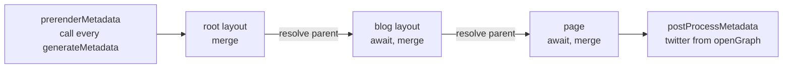
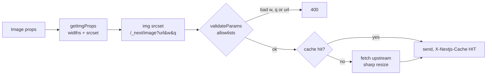

# Metadata, Images, Fonts and Scripts

> [!summary] TL;DR
> Metadata is resolved from the loader tree, root to leaf. Every `generateMetadata` starts at once, `parent` is a promise that settles when the segments above it are merged, and the merge is **shallow per top-level key**. In 16.x metadata streams into the body for normal browsers and blocks only for "HTML-limited" bots. Metadata files (`opengraph-image.tsx`, `sitemap.ts`, `robots.ts`, `icon.tsx`) compile into `GET` route handlers, and in 16 their `params` (and `id`) are promises. `next/image` builds a `srcset` that points at `/_next/image`, and that endpoint refuses any width, quality or URL you did not allowlist. 16 changed the defaults: `qualities: [75]`, `minimumCacheTTL: 14400`, no `16` in `imageSizes`, query strings on local images blocked, private IPs blocked, `priority` deprecated for `preload`. `next/font` downloads fonts **at build time** and serves them from `/_next/static/media`. `next/script` decides *when* a script is injected: `beforeInteractive` (before hydration, root layout only), `afterInteractive` (in an effect), `lazyOnload` (on idle after `load`), `worker` (Pages Router only).

These four features look unrelated, but they share one job: everything that belongs in or near `<head>` and that a page needs to load quickly. This part follows a small blog through each of them: `app/layout.tsx`, `app/blog/[slug]/page.tsx`, a generated OG image, a sitemap, a hero image, two fonts and an analytics tag.

## Metadata: two exports, one resolver

A `layout` or `page` (Server Components only) can export **either** a static `metadata` object **or** an async `generateMetadata` function. Exporting both from the same segment is an error.

```tsx
// app/layout.tsx
import type { Metadata } from 'next'

export const metadata: Metadata = {
  metadataBase: new URL('https://blog.example.com'),
  title: { default: 'Field Notes', template: '%s | Field Notes' },
  description: 'Long-form notes on web internals.',
  openGraph: { siteName: 'Field Notes', type: 'website' },
}
```

```tsx
// app/blog/[slug]/page.tsx
import type { Metadata, ResolvingMetadata } from 'next'
import { getPost } from '@/lib/posts'

type Props = { params: Promise<{ slug: string }> }

export async function generateMetadata(
  { params }: Props,
  parent: ResolvingMetadata,
): Promise<Metadata> {
  const { slug } = await params
  const post = await getPost(slug) // same React cache() call the page uses
  const parentImages = (await parent).openGraph?.images ?? []

  return {
    title: post.title, // -> "My post | Field Notes"
    description: post.summary,
    alternates: { canonical: `/blog/${slug}` },
    openGraph: { type: 'article', images: [...parentImages] },
  }
}
```

`params` and `searchParams` are promises in 16, as everywhere else ([[04 Data Fetching and Streaming|Data Fetching & Streaming]]). Wrap `getPost` in React `cache` (or rely on `fetch` memoization) so the metadata and the page share one fetch.

### How the tree is walked

`resolveMetadataItemsImpl` walks the loader tree from the root segment down through every parallel route. For each segment, `collectMetadata` pushes a pair `[metadataExport, staticFilesMetadata]`: the `metadata`/`generateMetadata` export plus any metadata files in that folder.[^items][^collect] Two details from that walk:

- **Layouts receive `{ params }` only. Pages receive `{ params, searchParams }`.**[^props] A layout's `generateMetadata` cannot read the query string.
- `getDefinedMetadata` wraps your function so it receives `(segmentProps, parent)` and an OpenTelemetry span named `generateMetadata <route>`.[^defined]

### All generators start at once

The interesting part is `accumulateMetadata`. Before merging anything, it calls `prerenderMetadata`, which **calls every `generateMetadata` immediately**. Each call gets a fresh `parent` promise, and the matching `resolve` function is stored next to the call's result.[^getresult] Then the loop walks the items in order. When it reaches a segment, it resolves that segment's `parent` with the metadata merged so far and awaits its result.[^accumulate]



So the fetches in different segments run **in parallel**. Only the code after `await parent` waits for the ancestors. One exception: a `'use cache'` `generateMetadata` that actually reads its second argument is wrapped in a lazy result, so it runs only when awaited and the cache key can include the parent data.[^getresult]

> [!tip] Don't `await parent` first
> Start your own fetch, then `await parent`. If you `await parent` on the first line, you serialize your fetch behind every ancestor's fetch.

### The merge is shallow

`mergeMetadata` `structuredClone`s the result so far, then loops over the **top-level keys** of the new segment's object and replaces each one (after resolving it: titles, URLs, Open Graph, and so on).[^merge] So if the page sets `openGraph: { type: 'article' }`, the layout's `openGraph.siteName` is gone. Nested objects are replaced, never deep-merged. Spread a shared constant if you want to keep fields.

Titles have their own rule. `resolveTitle` substitutes `%s` in the *stashed* template.[^title] `accumulateMetadata` only updates that stash for items before the last two, so a template applies to **child** segments, not the layout that defines it (and not to a page in the same folder as that layout).[^template] `title.absolute` skips the template.

After the loop, `postProcessMetadata` fills a missing `twitter` title, description and images from `openGraph`, and fills `openGraph`/`twitter` titles and descriptions from the top-level ones.[^post] That is why setting only `openGraph` usually gives you a Twitter card too.

> [!warning] `themeColor`, `colorScheme` and `viewport` in `metadata` are ignored
> `mergeMetadata` does not apply these keys. It only adds a build warning telling you to move them to the `viewport` export.[^warn]

File-based metadata wins over the export for images. If a folder has an `opengraph-image.*` and that segment's `openGraph` does not set `images` itself, `mergeStaticMetadata` swaps in the file's image.[^static-merge]

### Relative URLs and `metadataBase`

URL fields (`alternates.canonical`, `openGraph.images`) are resolved against `metadataBase`. If you don't set it, social images fall back to `localhost:$PORT` in dev, the preview URL on a Vercel preview, and in production to `VERCEL_PROJECT_PRODUCTION_URL`, then localhost.[^mbase] Set `metadataBase` in the root layout so self-hosted builds don't ship `http://localhost:3000/...` in `og:image`.

## Streaming metadata (16.x behaviour)

`createMetadataComponents` returns three components that `app-render` places in the tree: `Viewport`, `Metadata` and `MetadataOutlet`.[^components] `Metadata` renders inside a `<Suspense name="Next.Metadata">` in a hidden `<div>`. React hoists `<title>` and `<meta>` tags, so they work even though they arrive in the body.

- For a **normal browser**, `serveStreamingMetadata` is true. The shell flushes without waiting, and the tags stream in later when `generateMetadata` resolves.
- For an **HTML-limited bot**, `MetadataBlocker` returns the metadata promise, which holds the shell until the tags are ready, so they end up in `<head>`.[^components]

The decision is a user-agent regex. `shouldServeStreamingMetadata` tests the UA against `htmlLimitedBots` from your config, or the built-in list (`facebookexternalhit`, `Twitterbot`, `Slackbot`, `Discordbot`, `Bingbot`, `LinkedInBot`, and others).[^bots][^botre] Googlebot runs JavaScript, so it gets the streamed version. With PPR on, a bot request skips the prerendered shell (`shouldForceDynamicPPRRender`), because that shell has already closed its `<head>`.[^ppr-bots]

```ts
// next.config.ts: never stream metadata (slower TTFB for everyone)
import type { NextConfig } from 'next'
const config: NextConfig = { htmlLimitedBots: /.*/ }
export default config
```

> [!info] Cache Components and metadata
> With `cacheComponents: true`, a `generateMetadata` that reads `cookies()`, `headers()`, `params`/`searchParams`, or does uncached I/O defers to request time. If the rest of the page is fully prerenderable, the build errors and asks you to choose. Either add `'use cache'` to `generateMetadata`, or render an explicit dynamic marker (a `<Suspense>` around a component that `await connection()`). See [[05 Cache Components - use cache, cacheLife and cacheTag|Cache Components]] and [[23 PPR - Partial Prerendering with Cache Components|PPR]].

16.4.3 also has an `experimental.parallelRouteMetadata` flag, `false` by default. It swaps in a separate resolver (`resolve-metadata-parallel.ts`) through a build-time env check.[^parallel-flag] This part describes the default path.

### `viewport` and `generateViewport`

Viewport tags (`width`, `initialScale`, `themeColor`, `colorScheme`, ...) have their own export because they affect the first paint. The default is `width=device-width, initial-scale=1`.[^default-vp] `mergeViewport` works like the metadata merge: shallow, last segment wins.[^mergevp] Unlike metadata, **viewport never streams**. Under Cache Components, a `generateViewport` that reads runtime data blocks the route. Cache it with `'use cache'`, or accept a fully dynamic route.

```tsx
// app/layout.tsx
import type { Viewport } from 'next'

export const viewport: Viewport = {
  themeColor: [
    { media: '(prefers-color-scheme: light)', color: '#fafaf9' },
    { media: '(prefers-color-scheme: dark)', color: '#0c0a09' },
  ],
  colorScheme: 'light dark',
}
```

## Metadata files are route handlers

Next recognises these names in any `app/` folder (static extensions shown; `.js/.ts/.tsx` generate them):[^static-images]

| File | Static extensions | Becomes |
| --- | --- | --- |
| `favicon` | `ico` (root only) | `<link rel="icon">` |
| `icon` | `ico jpg jpeg png svg` | `<link rel="icon">` |
| `apple-icon` | `jpg jpeg png` | `<link rel="apple-touch-icon">` |
| `opengraph-image`, `twitter-image` | `jpg jpeg png gif` | `og:image`, `twitter:image` + size/type/alt |
| `sitemap` | `xml` | `/sitemap.xml` |
| `robots` | `txt` | `/robots.txt` |
| `manifest` | `json webmanifest` | `<link rel="manifest">` |

A code file is compiled by `next-metadata-route-loader` into an ordinary route handler that exports `GET`. For `sitemap.ts`/`robots.ts`, the generated `GET` calls your default export and serializes the result with `resolveRouteData`.[^text-route][^route-data] For an image file, it calls your function with `ctx.params`. With `generateImageMetadata`, it also adds a `generateStaticParams` over the returned `id`s and passes `id` as a promise.[^image-route] The `<meta>` URL gets a `?<contenthash>` query for cache busting.[^hash] Inside route groups or parallel slots, a short hash of the parent path is appended to the file name so two `(group)/opengraph-image` files don't collide. Sitemaps are the exception.[^suffix]

Because they are route handlers, everything from [[08 Route Handlers and Proxy|Route Handlers & Proxy]] applies: they are prerendered at build time unless they use request-time APIs or uncached data.

### `opengraph-image.tsx` with `ImageResponse`

```tsx
// app/blog/[slug]/opengraph-image.tsx
import { ImageResponse } from 'next/og'
import { getPost } from '@/lib/posts'

export const alt = 'Field Notes article'
export const size = { width: 1200, height: 630 }
export const contentType = 'image/png'

// 16: params is a Promise (it was a plain object in 15)
export default async function Image({ params }: { params: Promise<{ slug: string }> }) {
  const { slug } = await params
  const post = await getPost(slug)
  return new ImageResponse(
    (
      <div style={{ display: 'flex', width: '100%', height: '100%', padding: 72,
                    background: '#0c0a09', color: '#fafaf9', fontSize: 64 }}>
        {post.title}
      </div>
    ),
    size,
  )
}
```

> [!warning] Breaking in 16
> The image functions of `opengraph-image`, `twitter-image`, `icon` and `apple-icon` now receive `params` (and `id`, with `generateImageMetadata`) as **promises**. `generateImageMetadata` itself still gets plain `params`. `sitemap({ id })` from `generateSitemaps` also gets `id` as a `Promise<string>`.

`ImageResponse` is a `Response` subclass. It lazily imports `@vercel/og` (Satori plus a WASM rasterizer, with separate edge and Node builds) and sets `content-type: image/png` and `cache-control: public, max-age=0, must-revalidate` (`no-cache, no-store` in dev). Headers you pass in `options.headers` override these.[^imageresponse] Satori supports flexbox and a subset of CSS only, so every `div` with more than one child needs `display: 'flex'`.

With Cache Components on, there is an extra step. `getCachedImageResponseBody` first renders your element tree with React Flight inside the prerender's work-unit store, so `cookies()` or an uncached `fetch` inside the tree is caught by the normal Cache Components rules. Then it rasterizes the resolved tree once and stores the PNG in the Resume Data Cache. Metadata image routes can therefore stay static under Cache Components.[^cached-og]

### `sitemap.ts` and `robots.ts`

```ts
// app/sitemap.ts
import type { MetadataRoute } from 'next'
import { getAllPosts } from '@/lib/posts'

export default async function sitemap(): Promise<MetadataRoute.Sitemap> {
  const posts = await getAllPosts()
  return [
    { url: 'https://blog.example.com', changeFrequency: 'weekly', priority: 1 },
    ...posts.map((p) => ({
      url: `https://blog.example.com/blog/${p.slug}`,
      lastModified: p.updatedAt,
    })),
  ]
}
```

```ts
// app/robots.ts
import type { MetadataRoute } from 'next'

export default function robots(): MetadataRoute.Robots {
  return {
    rules: [{ userAgent: '*', allow: '/', disallow: ['/admin/'] }],
    sitemap: 'https://blog.example.com/sitemap.xml',
  }
}
```

Sitemap URLs must be absolute; `metadataBase` does not apply here. For more than 50,000 URLs, export `generateSitemaps()` returning `[{ id: 0 }, { id: 1 }, ...]` and read `await props.id` in the default export. `robots` gained an `other` field for non-standard per-agent directives in 16.3.

## `next/image`: a component and an endpoint

`next/image` has two halves. A Client Component builds `` attributes, and a server endpoint at `/_next/image` resizes and re-encodes the image on the first request.



### What the component renders

`getImgProps` is shared by the component and the public `getImageProps()`. It picks candidate widths in `getWidths`.[^widths]

- **With `sizes`**, it finds every `NNvw` in the string, takes the smallest, and keeps all configured sizes (`deviceSizes` + `imageSizes`) of at least `deviceSizes[0] × smallest%`. It emits `w` descriptors.
- **With a fixed `width` and no `sizes`**, it emits two candidates, `1x` and `2x` (3x is commented out on purpose: the comment cites that 3x screens rarely show a visible difference).
- **With `fill` and no `sizes`**, it uses all `deviceSizes` and `generateImgAttrs` sets `sizes="100vw"`.[^attrs]

That last case is the classic mistake. A `fill` image in a 300px card without `sizes` downloads a full-viewport-width file.

```tsx
// app/blog/[slug]/hero.tsx
import Image from 'next/image'
import hero from './hero.jpg' // static import: width, height, blurDataURL for free

export function Hero() {
  return (
    <Image
      src={hero}
      alt=""
      placeholder="blur"
      sizes="(min-width: 768px) 68ch, 100vw"
      preload // 16: replaces `priority` for the LCP image
    />
  )
}
```

Each candidate URL comes from the loader. The default loader returns `${path}?url=<encoded src>&w=<width>&q=<q>` (plus `&dpl=` for skew protection on local sources). `q` is snapped to the closest allowed quality by `findClosestQuality`.[^loader][^closest] Images are lazy unless `preload`, `priority` or `loading="eager"` is set; `data:` and `blob:` sources are never optimized.[^lazy] When `meta.preload` is true, the App Router calls `ReactDOM.preload(src, { as: 'image', imageSrcSet, imageSizes, fetchPriority })` and React Float emits the `<link rel="preload">` in `<head>`.[^preload-comp][^image-comp]

> [!note] `priority` → `preload` in 16
> `priority` is now `@deprecated` in the types, but it still works: the code computes `preload: preload || priority`.[^lazy] Setting both logs a dev warning. The docs say `preload` is for the single LCP image you know about. "In most cases" they recommend `loading="eager"` or `fetchPriority="high"` instead, because preloading several responsive candidates wastes bandwidth.

### What the endpoint does

`ImageOptimizerCache.validateParams` is the gatekeeper. A relative `url` must match `localPatterns`, and an absolute one must be `http(s)` and match `remotePatterns`. `w` must be **exactly** one of `deviceSizes` or `imageSizes`, and `q` must be in `qualities`. Anything else returns 400. Then it picks the output format from the `Accept` header and `formats`.[^validate] This is what stops someone from asking your server to transcode arbitrary URLs at arbitrary sizes.

`handleNextImageRequest` builds a cache key from `(href, width, quality, mimeType)` and goes through the image response cache, which is the disk cache by default or your `cacheHandler` if `images.customCacheHandler` is on.[^handler][^cachekey] On a miss, `fetchExternalImage` resolves the hostname and refuses private IPs unless `dangerouslyAllowLocalIP` is true. It also pins the DNS answer it checked, so a second lookup can't swap in a different address.[^external] `imageOptimizerTransform` then:[^transform]

- detects the real content type from the bytes, and rejects non-images and SVG (unless `dangerouslyAllowSVG`),
- passes animated GIF/WebP through untouched,
- otherwise calls `optimizeImage`, a `sharp` pipeline that auto-rotates, resizes without enlarging, and encodes WebP/AVIF/PNG/JPEG (AVIF quality is scaled by 50/80 to match WebP visually),[^optimize]
- sets `maxAge = max(minimumCacheTTL, upstream Cache-Control max-age)`.

The response carries `Vary: Accept`, a restrictive `Content-Security-Policy`, and `X-Nextjs-Cache: HIT|MISS|STALE`. Static imports (`/_next/static/media/...`) get `max-age=315360000, immutable` because their file names are content-hashed.[^headers]

### 16.x config defaults

These are the values of `imageConfigDefault` in 16.4.3, with what changed in 16:[^defaults]

| Option | 16.4.3 default | Change in 16 |
| --- | --- | --- |
| `qualities` | `[75]` | was "any quality"; other `q` values now return 400 |
| `minimumCacheTTL` | `14400` (4 h) | was `60` |
| `imageSizes` | `[32, 48, 64, 96, 128, 256, 384]` | `16` removed |
| `deviceSizes` | `[640, 750, 828, 1080, 1200, 1920, 2048, 3840]` | unchanged |
| `localPatterns` | allow every path, **no query string** | query strings on local `src` now need `localPatterns.search` |
| `remotePatterns` | `[]` (no remote images) | `domains` deprecated |
| `maximumRedirects` | `3` | was unlimited |
| `dangerouslyAllowLocalIP` | `false` | new; upstreams on private IPs blocked |
| `formats` | `['image/webp']` | unchanged |
| `maximumResponseBody` | `50_000_000` | added in 16.1.2 |
| `maximumDiskCacheSize` | auto (50% of free disk) | added in 16.1.7 |

The `localPatterns` row deserves a note. In `imageConfigDefault` it is `undefined`, but config loading replaces a missing value with `[{ pathname: '**', search: '' }]`, which means "any path, empty query only".[^lp-default] The default loader detects exactly that pattern and throws for a local `src` containing `?`.[^loader-query] If you set your own `localPatterns`, Next appends `/_next/static/media/**` (and the `immutable` variant) so static imports keep working.[^lp-default]

```ts
// next.config.ts
import type { NextConfig } from 'next'

const config: NextConfig = {
  images: {
    formats: ['image/avif', 'image/webp'],
    qualities: [60, 75, 90],
    remotePatterns: [new URL('https://images.example-cdn.com/blog/**')],
    localPatterns: [{ pathname: '/img/**', search: '?v=2' }],
  },
}
export default config
```

## `next/font`: fonts become build assets

`next/font/google` looks like a runtime call, but the bundler executes it at **build time**. In webpack builds the loader in `packages/font/src/google/loader.ts`:[^google-loader]

1. validates the options and builds a Google Fonts CSS URL for the requested axes, weights, styles and `display` (default `swap`),
2. fetches that CSS (cached per URL, so the client and server compiles share one fetch) and strips any `body {}` block,
3. finds the font files to download; only the requested `subsets` are marked for preload when `preload` is true,
4. downloads each file and **emits it to `.next/static/media`**, then rewrites the `src: url(...)` in the CSS to the self-hosted URL.

So the browser never contacts Google, and there is no extra DNS lookup or third-party privacy issue. If the download fails in **dev**, the loader logs an error and returns a fallback `@font-face` built on `local("Arial")`. In a production build, a failed download fails the build.

Turbopack is the default bundler in 16, and it has its own Rust implementation of the same steps (`crates/next-core/src/next_font`). `update_google_stylesheet` renames the family to a scoped name and rewrites file URLs to internal requests that are downloaded and emitted the same way.[^turbo-font]

The resulting CSS goes through a PostCSS plugin that:[^postcss]

- forces one font-family name (the hashed, scoped name) across every `@font-face`,
- adds a **fallback `@font-face`** that uses `local()` with `ascent-override`, `descent-override`, `line-gap-override` and `size-adjust` computed from precalculated metrics, so the fallback font takes up the same space and layout shift is close to zero (`adjustFontFallback`, on by default),
- emits a `.className` rule (`font-family`, plus `font-weight`/`font-style` when there is exactly one value), a `.variable` rule that defines your CSS custom property, and a `style` export.

`next/font/local` does the same with files from your repo. It resolves each `src`, reads the file, emits it, and computes the fallback metrics from the font file itself.[^local-loader]

Fonts are preloaded **per route segment**, not globally. The font manifest records which layout or page file used which font files. During render, `getPreloadableFonts` returns the files for the current layout or page that have not been injected yet, and `getLayerAssets` calls `preloadFont(href, 'font/woff2', ...)` for each one. If fonts are used but none should be preloaded, it emits a `preconnect` instead.[^preloadable][^layer-assets] A font imported in the root layout is preloaded on every route. A font used in one page is preloaded only there.

### CSS variables with Tailwind v4

```tsx
// app/fonts.ts (one definitions file, imported where needed)
import { Newsreader, Inter } from 'next/font/google'

export const serif = Newsreader({ subsets: ['latin'], variable: '--font-newsreader' })
export const sans = Inter({ subsets: ['latin'], variable: '--font-inter' })
```

```tsx
// app/layout.tsx
import { serif, sans } from './fonts'
import './globals.css'

export default function RootLayout({ children }: { children: React.ReactNode }) {
  return (
    <html lang="en" className={`${serif.variable} ${sans.variable}`}>
      <body className="font-sans">{children}</body>
    </html>
  )
}
```

```css
/* app/globals.css */
@import 'tailwindcss';

@theme inline {
  --font-sans: var(--font-inter);
  --font-serif: var(--font-newsreader);
}
```

`@theme inline` makes the `font-sans`/`font-serif` utilities reference `var(--font-inter)` and `var(--font-newsreader)` directly. Those variables are defined by the `.variable` classes on `<html>`. Give the `next/font` variables names that differ from Tailwind's theme keys, so a theme key never points at itself. Call each font function **once** and import the result. Every call site creates its own `@font-face` group and its own preload set.

## `next/script`: when, not whether

`next/script` is a Client Component that returns `null` in most cases. Its value is the **timing** of injection and deduplication across navigations.

| Strategy | When it runs | Where allowed | Mechanism |
| --- | --- | --- | --- |
| `beforeInteractive` | before hydration, in order | root layout | inline `self.__next_s.push(...)`, run by the bootstrap |
| `afterInteractive` (default) | after hydration starts | any layout/page | `ReactDOM.preload` on the server, inject in `useEffect` |
| `lazyOnload` | after `window.load`, on idle | any layout/page | `requestIdleCallback` |
| `worker` | in a web worker | **Pages Router only** | `type="text/partytown"`, needs `nextScriptWorkers` |

In the App Router, a `beforeInteractive` script is not rendered as a real `<script src>`. `Script` calls `ReactDOM.preload(src, { as: 'script' })` so the download starts early, and renders an inline script that pushes `[src, props]` onto `self.__next_s`.[^script-before] `appBootstrap` then loads those entries **one after another** (each waits for the previous `onload`), and only then requires `app-index` and calls `hydrate`.[^bootstrap] That gives you order and early fetching. It also means a slow `beforeInteractive` script delays hydration (the docs say its execution "does not block page hydration"; in the 16.4.3 bootstrap, hydration starts only after these scripts have loaded). Keep this strategy for consent managers and bot detection.

`afterInteractive` and `lazyOnload` are injected from `useEffect` (see [[08 The Commit Phase and Effects|React Concepts: effects]] for when effects run). `lazyOnload` waits for `document.readyState === 'complete'` or the `load` event, then `requestIdleCallback`.[^script-effects] `loadScript` dedupes by `src` (`ScriptCache` keeps the load promise) and by `id || src` (`LoadCache`), so a script in a layout is not loaded again when you navigate between its pages.[^loadscript] `onReady` fires after the first load and again on every remount; `onLoad` fires once. Both need a Client Component, because functions can't cross the server→client boundary ([[02 Server and Client Components|Server and Client Components]]).

```tsx
// app/analytics.tsx
'use client'
import Script from 'next/script'

export function Analytics() {
  return (
    <>
      <Script src="https://plausible.example.com/js/script.js" strategy="afterInteractive" />
      <Script id="plausible-init" strategy="afterInteractive">
        {`window.plausible = window.plausible || function(){(window.plausible.q=window.plausible.q||[]).push(arguments)}`}
      </Script>
    </>
  )
}
```

Inline scripts need an `id` so Next can track and deduplicate them. For a CSP nonce, `Script` uses a `nonce` prop you pass. Otherwise it takes the nonce Next provides through context.

## Summary

Everything in this part comes down to the cost of the first load. Metadata is resolved root to leaf: all `generateMetadata` calls start together, `parent` resolves as the merge reaches each segment, and the shallow per-key merge replaces nested objects such as `openGraph`. In 16.x the tags stream into the body for browsers and block only for HTML-limited bots. Metadata files are generated route handlers whose `params` are now promises. `next/image` pairs a `srcset` builder with a strict `/_next/image` endpoint whose allowlists and defaults got tighter in 16. `next/font` turns fonts into hashed build assets with size-matched fallbacks, and `next/script` only decides when a third-party script is injected. Next: [[10 Errors, Redirects and Request Lifecycle APIs|Errors & Lifecycle]], which covers what happens when `generateMetadata` or a page throws `notFound()` or `redirect()`.

### Key takeaways

- **`metadata` vs `generateMetadata`**: one per segment, Server Components only; layouts get `params`, pages also get `searchParams`.
- **Parallel resolution**: every `generateMetadata` is called up front; `await parent` waits only for ancestors, so start your own fetch first.
- **Shallow merge**: each top-level key replaces the previous one, so a child `openGraph` drops the parent's fields; title templates apply only to child segments.
- **Streaming metadata**: tags stream into the body for browsers; bots matched by `htmlLimitedBots` get them blocking in `<head>`; viewport never streams.
- **Metadata files**: compiled into `GET` route handlers with content-hash URLs; image functions receive `params`/`id` as promises in 16, and `ImageResponse` is prerendered and cached under Cache Components.
- **`next/image` srcset**: `sizes` with `vw` gives `w` candidates, a fixed width gives 1x/2x, and `fill` without `sizes` assumes `100vw`.
- **`/_next/image`**: rejects any `w`, `q` or URL outside the allowlists; 16 defaults are `qualities: [75]`, a 4-hour TTL, no local query strings, no private IPs and at most 3 redirects. `priority` is deprecated in favour of `preload`.
- **`next/font`**: downloads and self-hosts fonts at build time (webpack loader or Turbopack's Rust port), adds a metric-matched fallback, and preloads per layout/page.
- **`next/script`**: `beforeInteractive` loads in sequence before hydration (root layout only), `afterInteractive`/`lazyOnload` inject from effects, and `worker` is Pages Router only.

← [[08 Route Handlers and Proxy|Route Handlers & Proxy]] · [[00 Next.js in Practice Index|Index]] · [[10 Errors, Redirects and Request Lifecycle APIs|Errors & Lifecycle]] →

[^items]: `resolveMetadataItemsImpl` — [packages/next/src/lib/metadata/resolve-metadata.ts#L182-L262](https://github.com/vercel/next.js/blob/v16.4.3/packages/next/src/lib/metadata/resolve-metadata.ts#L182-L262)
[^collect]: `collectMetadata` — [packages/next/src/lib/metadata/resolve-metadata.ts#L61-L109](https://github.com/vercel/next.js/blob/v16.4.3/packages/next/src/lib/metadata/resolve-metadata.ts#L61-L109)
[^props]: `const props: SegmentProps = isPage ? { params, searchParams } : { params }` — [packages/next/src/lib/metadata/resolve-metadata.ts#L225](https://github.com/vercel/next.js/blob/v16.4.3/packages/next/src/lib/metadata/resolve-metadata.ts#L225)
[^defined]: `getDefinedMetadata` — [packages/next/src/lib/metadata/metadata-resolution-primitives.ts#L532-L557](https://github.com/vercel/next.js/blob/v16.4.3/packages/next/src/lib/metadata/metadata-resolution-primitives.ts#L532-L557)
[^getresult]: `prerenderMetadata`, `getResult` (eager calls, lazy `'use cache'` with parent) — [packages/next/src/lib/metadata/resolve-metadata.ts#L383-L468](https://github.com/vercel/next.js/blob/v16.4.3/packages/next/src/lib/metadata/resolve-metadata.ts#L383-L468)
[^accumulate]: `accumulateMetadata` — [packages/next/src/lib/metadata/resolve-metadata.ts#L480-L592](https://github.com/vercel/next.js/blob/v16.4.3/packages/next/src/lib/metadata/resolve-metadata.ts#L480-L592)
[^merge]: `mergeMetadata` — [packages/next/src/lib/metadata/metadata-resolution-primitives.ts#L215-L452](https://github.com/vercel/next.js/blob/v16.4.3/packages/next/src/lib/metadata/metadata-resolution-primitives.ts#L215-L452)
[^title]: `resolveTitle` — [packages/next/src/lib/metadata/resolvers/resolve-title.ts#L4-L40](https://github.com/vercel/next.js/blob/v16.4.3/packages/next/src/lib/metadata/resolvers/resolve-title.ts#L4-L40)
[^template]: title template stash updated only for `i < metadataItems.length - 2` — [packages/next/src/lib/metadata/resolve-metadata.ts#L550-L559](https://github.com/vercel/next.js/blob/v16.4.3/packages/next/src/lib/metadata/resolve-metadata.ts#L550-L559)
[^post]: `postProcessMetadata` — [packages/next/src/lib/metadata/metadata-resolution-primitives.ts#L640-L711](https://github.com/vercel/next.js/blob/v16.4.3/packages/next/src/lib/metadata/metadata-resolution-primitives.ts#L640-L711)
[^warn]: `themeColor` / `colorScheme` / `viewport` warning in `mergeMetadata` — [packages/next/src/lib/metadata/metadata-resolution-primitives.ts#L427-L435](https://github.com/vercel/next.js/blob/v16.4.3/packages/next/src/lib/metadata/metadata-resolution-primitives.ts#L427-L435)
[^static-merge]: `mergeStaticMetadata` — [packages/next/src/lib/metadata/metadata-resolution-primitives.ts#L161-L210](https://github.com/vercel/next.js/blob/v16.4.3/packages/next/src/lib/metadata/metadata-resolution-primitives.ts#L161-L210)
[^mbase]: `getSocialImageMetadataBaseFallback` — [packages/next/src/lib/metadata/resolvers/resolve-url.ts#L26-L55](https://github.com/vercel/next.js/blob/v16.4.3/packages/next/src/lib/metadata/resolvers/resolve-url.ts#L26-L55)
[^components]: `createMetadataComponents` (`MetadataWrapper`, `MetadataBlocker`, `MetadataOutlet`) — [packages/next/src/lib/metadata/metadata.tsx#L33-L172](https://github.com/vercel/next.js/blob/v16.4.3/packages/next/src/lib/metadata/metadata.tsx#L33-L172)
[^bots]: `shouldServeStreamingMetadata` — [packages/next/src/server/lib/streaming-metadata.ts#L6-L20](https://github.com/vercel/next.js/blob/v16.4.3/packages/next/src/server/lib/streaming-metadata.ts#L6-L20)
[^botre]: `HTML_LIMITED_BOT_UA_RE` — [packages/next/src/shared/lib/router/utils/html-bots.ts#L5-L6](https://github.com/vercel/next.js/blob/v16.4.3/packages/next/src/shared/lib/router/utils/html-bots.ts#L5-L6)
[^ppr-bots]: `serveStreamingMetadata` / `shouldForceDynamicPPRRender` — [packages/next/src/build/templates/app-page-runtime.ts#L601-L610](https://github.com/vercel/next.js/blob/v16.4.3/packages/next/src/build/templates/app-page-runtime.ts#L601-L610)
[^parallel-flag]: `__NEXT_PARALLEL_ROUTE_METADATA` switch — [packages/next/src/lib/metadata/index.ts#L1-L15](https://github.com/vercel/next.js/blob/v16.4.3/packages/next/src/lib/metadata/index.ts#L1-L15); default `parallelRouteMetadata: false` — [packages/next/src/server/config-shared.ts#L2400](https://github.com/vercel/next.js/blob/v16.4.3/packages/next/src/server/config-shared.ts#L2400)
[^default-vp]: `createDefaultViewport` — [packages/next/src/lib/metadata/default-metadata.tsx#L6-L15](https://github.com/vercel/next.js/blob/v16.4.3/packages/next/src/lib/metadata/default-metadata.tsx#L6-L15)
[^mergevp]: `mergeViewport` — [packages/next/src/lib/metadata/metadata-resolution-primitives.ts#L457-L503](https://github.com/vercel/next.js/blob/v16.4.3/packages/next/src/lib/metadata/metadata-resolution-primitives.ts#L457-L503)
[^static-images]: `STATIC_METADATA_IMAGES` — [packages/next/src/lib/metadata/is-metadata-route.ts#L6-L29](https://github.com/vercel/next.js/blob/v16.4.3/packages/next/src/lib/metadata/is-metadata-route.ts#L6-L29)
[^text-route]: `getDynamicTextRouteCode` — [packages/next/src/build/webpack/loaders/next-metadata-route-loader.ts#L127-L155](https://github.com/vercel/next.js/blob/v16.4.3/packages/next/src/build/webpack/loaders/next-metadata-route-loader.ts#L127-L155)
[^route-data]: `resolveRouteData` — [packages/next/src/build/webpack/loaders/metadata/resolve-route-data.ts#L162-L176](https://github.com/vercel/next.js/blob/v16.4.3/packages/next/src/build/webpack/loaders/metadata/resolve-route-data.ts#L162-L176)
[^image-route]: `getDynamicImageRouteCode`, `getSingleImageRouteCode` — [packages/next/src/build/webpack/loaders/next-metadata-route-loader.ts#L157-L230](https://github.com/vercel/next.js/blob/v16.4.3/packages/next/src/build/webpack/loaders/next-metadata-route-loader.ts#L157-L230)
[^hash]: `contentHash` / `hashQuery` — [packages/next/src/build/webpack/loaders/next-metadata-image-loader.ts#L52-L62](https://github.com/vercel/next.js/blob/v16.4.3/packages/next/src/build/webpack/loaders/next-metadata-image-loader.ts#L52-L62)
[^suffix]: `getMetadataRouteSuffix` — [packages/next/src/lib/metadata/get-metadata-route.ts#L31-L52](https://github.com/vercel/next.js/blob/v16.4.3/packages/next/src/lib/metadata/get-metadata-route.ts#L31-L52)
[^imageresponse]: `ImageResponse` — [packages/next/src/server/og/image-response.ts#L1-L93](https://github.com/vercel/next.js/blob/v16.4.3/packages/next/src/server/og/image-response.ts#L1-L93)
[^cached-og]: `getCachedImageResponseBody`, `getCachedImageResponseArrayBuffer` — [packages/next/src/server/og/cache-image-response.ts#L30-L90](https://github.com/vercel/next.js/blob/v16.4.3/packages/next/src/server/og/cache-image-response.ts#L30-L90)
[^widths]: `getWidths` — [packages/next/src/shared/lib/get-img-props.ts#L160-L201](https://github.com/vercel/next.js/blob/v16.4.3/packages/next/src/shared/lib/get-img-props.ts#L160-L201)
[^attrs]: `generateImgAttrs` — [packages/next/src/shared/lib/get-img-props.ts#L219-L277](https://github.com/vercel/next.js/blob/v16.4.3/packages/next/src/shared/lib/get-img-props.ts#L219-L277)
[^loader]: `defaultLoader` — [packages/next/src/shared/lib/image-loader.ts#L5-L128](https://github.com/vercel/next.js/blob/v16.4.3/packages/next/src/shared/lib/image-loader.ts#L5-L128)
[^closest]: `findClosestQuality` — [packages/next/src/shared/lib/find-closest-quality.ts#L9-L21](https://github.com/vercel/next.js/blob/v16.4.3/packages/next/src/shared/lib/find-closest-quality.ts#L9-L21)
[^lazy]: `getImgProps` (`priority` deprecation at L38-L42, `isLazy` at L425-L432, `preload: preload || priority` at L769) — [packages/next/src/shared/lib/get-img-props.ts#L282-L771](https://github.com/vercel/next.js/blob/v16.4.3/packages/next/src/shared/lib/get-img-props.ts#L282-L771)
[^preload-comp]: `ImagePreload` — [packages/next/src/client/image-component.tsx#L321-L362](https://github.com/vercel/next.js/blob/v16.4.3/packages/next/src/client/image-component.tsx#L321-L362)
[^image-comp]: `Image` — [packages/next/src/client/image-component.tsx#L369-L424](https://github.com/vercel/next.js/blob/v16.4.3/packages/next/src/client/image-component.tsx#L369-L424)
[^validate]: `ImageOptimizerCache.validateParams` — [packages/next/src/server/image-optimizer.ts#L178-L338](https://github.com/vercel/next.js/blob/v16.4.3/packages/next/src/server/image-optimizer.ts#L178-L338)
[^handler]: `handleNextImageRequest` — [packages/next/src/server/next-server.ts#L995-L1144](https://github.com/vercel/next.js/blob/v16.4.3/packages/next/src/server/next-server.ts#L995-L1144)
[^cachekey]: `ImageOptimizerCache.getCacheKey` — [packages/next/src/server/image-optimizer.ts#L340-L352](https://github.com/vercel/next.js/blob/v16.4.3/packages/next/src/server/image-optimizer.ts#L340-L352)
[^external]: `fetchExternalImage` private-IP check — [packages/next/src/server/image-optimizer.ts#L788-L829](https://github.com/vercel/next.js/blob/v16.4.3/packages/next/src/server/image-optimizer.ts#L788-L829)
[^transform]: `imageOptimizerTransform` — [packages/next/src/server/image-optimizer/transform.ts#L196-L314](https://github.com/vercel/next.js/blob/v16.4.3/packages/next/src/server/image-optimizer/transform.ts#L196-L314)
[^optimize]: `optimizeImage` — [packages/next/src/server/image-optimizer/transform.ts#L132-L194](https://github.com/vercel/next.js/blob/v16.4.3/packages/next/src/server/image-optimizer/transform.ts#L132-L194)
[^headers]: `setResponseHeaders` — [packages/next/src/server/image-optimizer.ts#L1121-L1158](https://github.com/vercel/next.js/blob/v16.4.3/packages/next/src/server/image-optimizer.ts#L1121-L1158)
[^defaults]: `imageConfigDefault` — [packages/next/src/shared/lib/image-config.ts#L237-L262](https://github.com/vercel/next.js/blob/v16.4.3/packages/next/src/shared/lib/image-config.ts#L237-L262)
[^lp-default]: `images.localPatterns` normalization — [packages/next/src/server/config.ts#L753-L794](https://github.com/vercel/next.js/blob/v16.4.3/packages/next/src/server/config.ts#L753-L794)
[^loader-query]: default loader rejects local query strings — [packages/next/src/shared/lib/image-loader.ts#L54-L65](https://github.com/vercel/next.js/blob/v16.4.3/packages/next/src/shared/lib/image-loader.ts#L54-L65)
[^google-loader]: `nextFontGoogleFontLoader` — [packages/font/src/google/loader.ts#L28-L193](https://github.com/vercel/next.js/blob/v16.4.3/packages/font/src/google/loader.ts#L28-L193)
[^turbo-font]: `update_google_stylesheet` (Turbopack) — [crates/next-core/src/next_font/google/mod.rs#L455-L502](https://github.com/vercel/next.js/blob/v16.4.3/crates/next-core/src/next_font/google/mod.rs#L455-L502)
[^postcss]: `postcssNextFontPlugin` — [packages/next/src/build/webpack/loaders/next-font-loader/postcss-next-font.ts#L5-L190](https://github.com/vercel/next.js/blob/v16.4.3/packages/next/src/build/webpack/loaders/next-font-loader/postcss-next-font.ts#L5-L190)
[^local-loader]: `nextFontLocalFontLoader` — [packages/font/src/local/loader.ts#L15-L112](https://github.com/vercel/next.js/blob/v16.4.3/packages/font/src/local/loader.ts#L15-L112)
[^preloadable]: `getPreloadableFonts` — [packages/next/src/server/app-render/get-preloadable-fonts.tsx#L11-L41](https://github.com/vercel/next.js/blob/v16.4.3/packages/next/src/server/app-render/get-preloadable-fonts.tsx#L11-L41)
[^layer-assets]: `getLayerAssets` font preload / preconnect — [packages/next/src/server/app-render/get-layer-assets.tsx#L37-L76](https://github.com/vercel/next.js/blob/v16.4.3/packages/next/src/server/app-render/get-layer-assets.tsx#L37-L76)
[^script-before]: `Script` App Router branch (`beforeInteractive` / `afterInteractive`) — [packages/next/src/client/script.tsx#L299-L377](https://github.com/vercel/next.js/blob/v16.4.3/packages/next/src/client/script.tsx#L299-L377)
[^bootstrap]: `loadScriptsInSequence`, `appBootstrap` — [packages/next/src/client/app-bootstrap.ts#L18-L81](https://github.com/vercel/next.js/blob/v16.4.3/packages/next/src/client/app-bootstrap.ts#L18-L81)
[^script-effects]: `loadLazyScript` and the `Script` load effect — [packages/next/src/client/script.tsx#L169-L177](https://github.com/vercel/next.js/blob/v16.4.3/packages/next/src/client/script.tsx#L169-L177) and [#L260-L271](https://github.com/vercel/next.js/blob/v16.4.3/packages/next/src/client/script.tsx#L260-L271)
[^loadscript]: `loadScript` (`ScriptCache`, `LoadCache`, `text/partytown`) — [packages/next/src/client/script.tsx#L62-L156](https://github.com/vercel/next.js/blob/v16.4.3/packages/next/src/client/script.tsx#L62-L156)
