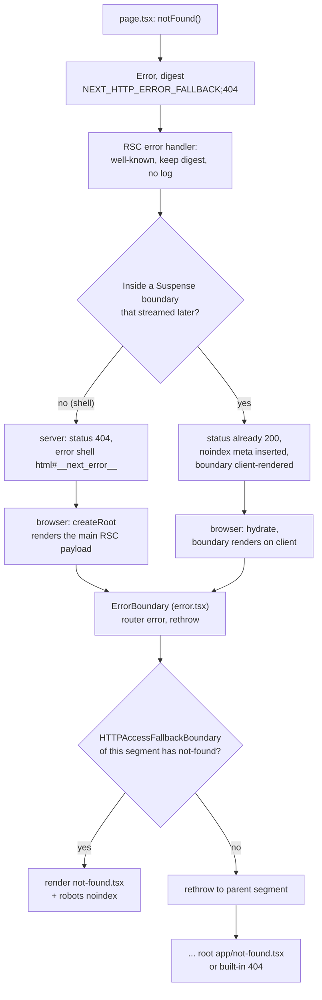

# Errors, Redirects and Request Lifecycle APIs

> [!summary] TL;DR
> `notFound()`, `forbidden()`, `unauthorized()`, `redirect()` and `permanentRedirect()` **throw an `Error` with a special `digest`** such as `NEXT_HTTP_ERROR_FALLBACK;404`. A stack of client boundaries in every segment either handles that digest or rethrows it outward, and the server reads the same digest to choose the status code. `error.tsx` only sees real errors, and since 16.3 it gets `error: unknown` and a stable `retry()`. `after()` runs once the response closes, `connection()` stops a prerender on purpose, request APIs are async-only, and `onRequestError` reports only the errors you did not intend.

The previous parts built pages, cached them and mutated data. This part covers what happens when something goes wrong, when the code decides the user should be somewhere else, and what runs around a request: before it (`register`), during it (`cookies`, `connection`) and after it (`after`). The running example is a small blog:

```txt
app/
├─ layout.tsx
├─ global-error.tsx
├─ not-found.tsx
├─ posts/[slug]/
│  ├─ page.tsx          // notFound() when the post is missing
│  ├─ error.tsx
│  └─ not-found.tsx
├─ admin/
│  ├─ page.tsx          // forbidden() for non-admins
│  └─ forbidden.tsx
└─ actions.ts           // createPost → redirect()
instrumentation.ts
```

## Control flow by throwing: the digest protocol

All five navigation helpers are tiny. They build an `Error`, stamp a `digest` string on it and throw. `notFound()` is the whole pattern in four lines:

```ts
// packages/next/src/client/components/not-found.ts (16.4.3)
const DIGEST = `${HTTP_ERROR_FALLBACK_ERROR_CODE};404`

export function notFound(): never {
  const error = new Error(DIGEST) as HTTPAccessFallbackError
  ;(error as HTTPAccessFallbackError).digest = DIGEST
  throw error
}
```
[^not-found]

`HTTP_ERROR_FALLBACK_ERROR_CODE` is `'NEXT_HTTP_ERROR_FALLBACK'`. The allowed statuses are exactly 404, 403 and 401. `isHTTPAccessFallbackError` splits the digest on `;` and checks both the prefix and the status.[^hafb] Redirects use a longer digest that carries the whole instruction:

| Helper | Digest thrown | Status it maps to |
|---|---|---|
| `notFound()` | `NEXT_HTTP_ERROR_FALLBACK;404` | 404 |
| `forbidden()` | `NEXT_HTTP_ERROR_FALLBACK;403` | 403 |
| `unauthorized()` | `NEXT_HTTP_ERROR_FALLBACK;401` | 401 |
| `redirect('/login')` | `NEXT_REDIRECT;replace;/login;307;` | 307 (303 from a no-JS action) |
| `permanentRedirect('/new')` | `NEXT_REDIRECT;replace;/new;308;` | 308 |

`getRedirectError` builds the string as `` `${REDIRECT_ERROR_CODE};${type};${url};${statusCode};` ``. `isRedirectError` parses it back. It takes everything between the type and the status as the URL (`digest.slice(2, -2).join(';')`), so a URL that contains `;` still survives the round trip.[^redirect-ts][^redirect-error] The status enum has only three members: `SeeOther = 303`, `TemporaryRedirect = 307`, `PermanentRedirect = 308`.[^status-codes]

Why use a string digest and not `instanceof`? An error thrown in a Server Component has to cross the Flight serialization boundary to reach the client boundaries. React serializes only the message and the `digest` of a thrown error. In production it replaces the message with a generic one, but **it keeps the digest**. A `digest` is the one field that reliably survives the trip, so the whole protocol rides on it. `isNextRouterError` is the umbrella check, "redirect or HTTP access fallback".[^is-router-error]

> [!info] Same file, three runtimes
> These helpers live under `client/components/`, but `next/navigation` re-exports them from `navigation.react-server.ts` for Server Components too. That file also defines the runtime `RedirectType` object (`{ push: 'push', replace: 'replace' }`). In `redirect-error.ts`, `RedirectType` is only a type.[^nav-rsc] One function works in Server Components, Route Handlers, Server Actions and client render, because each of those environments has its own catcher for the digest.

## The boundary stack inside every segment

[[01 The App Router - Files, Segments and Layouts|Part 1]] showed that a segment's files become nested components. Here is the exact nesting that `OuterLayoutRouter` renders for each child slot:

```tsx
// packages/next/src/client/components/layout-router.tsx (simplified)
<ScrollHandler>
  <ErrorBoundary errorComponent={error}>            {/* error.tsx */}
    <LoadingBoundary loading={parentLoadingData}>   {/* loading.tsx → <Suspense> */}
      <HTTPAccessFallbackBoundary
        notFound={notFound} forbidden={forbidden} unauthorized={unauthorized}>
        <RedirectBoundary>
          <InnerLayoutRouter /* the child segment: layout or page */ />
        </RedirectBoundary>
      </HTTPAccessFallbackBoundary>
    </LoadingBoundary>
  </ErrorBoundary>
</ScrollHandler>
```
[^layout-router]

These props come from the **parent** segment's files. When `createComponentTree` renders segment `posts/[slug]`, it creates a `LayoutRouter` for each of that segment's parallel slots and hands it `error: ErrorComponent` and the `not-found`/`forbidden`/`unauthorized` elements of `posts/[slug]`.[^cct-props] The page is just the `__PAGE__` child inside the `children` slot. That gives two rules the docs state and the code enforces:

- `error.tsx` wraps the page and the nested layouts, but **not the `layout.tsx` of its own segment**. That layout renders outside the `LayoutRouter` that carries the boundary. Errors in the root layout need `global-error.tsx`.
- `not-found.tsx`, `forbidden.tsx` and `unauthorized.tsx` are passed only to the **`children`** slot (`isChildrenRouteKey ? notFoundElement : undefined`). Parallel `@slots` do not get their own not-found UI.[^cct-children]

`forbidden` and `unauthorized` components are only loaded when `authInterrupts` is on (`authInterrupts && forbidden ? ... : []`).[^cct-auth]

### Each boundary handles one kind of error and rethrows the rest

Every boundary is a class component that inspects the error in `getDerivedStateFromError` and **rethrows** what is not its job. When a static `getDerivedStateFromError` throws, React treats it as a new error from that boundary and keeps looking for the next boundary outward. That turns the stack into a router for errors:

- **`ErrorBoundary`** (your `error.tsx`): `if (isNextRouterError(thrownValue)) throw thrownValue`. A `notFound()` or `redirect()` passes straight through `error.tsx`, even though `error.tsx` sits *outside* the not-found boundary.[^eb-gdsfe]
- **`HTTPAccessFallbackBoundary`**: keeps `triggeredStatus` for 404/403/401 and rethrows anything else. At render time, if this segment has no matching file (say a 403 with no `forbidden.tsx`), it **renders `children` again**. The children throw again, and this time the error reaches the parent segment's boundary. When it does match, it renders `<meta name="robots" content="noindex" />` and your component.[^hafb-boundary]
- **`RedirectBoundary`**: keeps the URL and type from the digest and renders `HandleRedirect`, which calls `router.push` or `router.replace` inside `startTransition` from an effect.[^redirect-boundary]

All three clear their state in `getDerivedStateFromProps` when `usePathname()` changes. That is why an error screen goes away when you navigate somewhere else.[^eb-reset]

## How a thrown notFound() travels

Here is the full path for `notFound()` in `app/posts/[slug]/page.tsx`. Two facts shape it. React's server renderer (Fizz) does **not** run class error boundaries, so the production `react-dom/server` builds bundled in Next never call `getDerivedStateFromError`. And the HTTP status can only change before the first byte is sent.



Step by step:

1. **RSC render.** `createReactServerErrorHandler` calls `getDigestForWellKnownError` first. For router errors it returns `error.digest` right away, before any logging, hashing or instrumentation. The digest goes into the Flight stream unchanged.[^well-known]
2. **Shell case.** If the error escapes the shell, `renderToStream`'s catch classifies it. `isHTTPAccessFallbackError` sets `res.statusCode = getAccessFallbackHTTPStatus(err)`. `isRedirectError` sets 307/308 and a `location` header, copying any mutable cookies into `set-cookie`. Anything else becomes 500.[^shell-catch] The HTML sent back is a minimal `<html id="__next_error__">` shell.[^error-shell] It deliberately inlines the **main** render's Flight data, not the error payload's.[^main-flight] The browser sees the id and calls `createRoot(...).render()` without hydrating.[^app-index] The tree renders on the client, the page throws again, and the client boundaries pick the right `not-found.tsx`.
3. **Streaming case.** If the throw happens inside a `<Suspense>` (for example `loading.tsx`) after the shell went out, Fizz marks that boundary for client rendering. `getServerInsertedHTML` sees the captured router error and injects `<meta name="robots" content="noindex">` into the stream.[^inserted-html] The status stays 200, which matches the docs: "Before streaming starts, Next.js returns a 404 status code. After streaming starts, the status code remains 200." See [[04 Data Fetching and Streaming#What streaming cannot do|What streaming cannot do]].

> [!tip] Where to put the check
> If you want a real 404 status, call `notFound()` before anything suspends, for example in a page that has no `loading.tsx` or `<Suspense>` above it. If you would rather show the shell fast, put the check inside the Suspense'd component and accept a 200 plus `noindex`. For bots, an earlier check in [[08 Route Handlers and Proxy|Proxy]] gives a 404 before rendering starts.

### `notFound()` for unmatched URLs is a different path

A URL that matches no route never throws. The router serves the `/_not-found` route, which is built from your root `app/not-found.tsx` inside the root layout and returns a 404. The optional `app/global-not-found.tsx` replaces that with a full document of its own (it must render `<html>` and `<body>`). It is **still experimental in 16.4.3**: the loader only resolves the file `if (isGlobalNotFoundEnabled)`, which reads `experimental.globalNotFound`.[^global-nf-loader] Use it when you have several root layouts, or a root layout under a dynamic segment such as `app/[lang]/layout.tsx`, where there is no single layout to put a 404 in.

## error.tsx in 16.x: error is unknown, retry is stable

```tsx
// app/posts/[slug]/error.tsx
'use client' // error boundaries are class components under the hood: client only

import { useEffect } from 'react'

export default function PostError({
  error,
  retry,
}: {
  error: unknown
  retry: () => void
}) {
  useEffect(() => {
    // digest matches the server log line for this error
    const digest = error instanceof Error && 'digest' in error ? error.digest : undefined
    reportToMyService({ digest })
  }, [error])

  return (
    <div role="alert">
      <h2>This post failed to load.</h2>
      <button onClick={() => retry()}>Try again</button>
    </div>
  )
}
```

> [!warning] What changed in 16.x
> - **`retry`** was added as `unstable_retry` in 16.2 and became stable as `retry` in 16.3. The 16.4.3 source has no `unstable_retry` left, so code written against 16.2 has to rename it.
> - **`error` is typed `unknown`.** The docs say a value thrown in a Client Component is passed through as-is and may not be an `Error`. Narrow it before reading `.message` or `.digest`. The boundary passes `thrownValue` straight through, with a `TODO(NAR-804)` comment noting the old "it's an Error" promise was never guaranteed.[^eb-render]
> - **`reset`** still exists. The docs now say to use `retry()` "in most cases".

The two functions differ in one line:

```tsx
// packages/next/src/client/components/error-boundary.tsx
reset = () => {
  this.setState({ error: null })
}

retry = () => {
  startTransition(() => {
    this.context?.refresh()
    this.reset()
  })
}
```
[^eb-retry]

`reset()` re-renders the children with the **same** RSC payload. If the error came from a Server Component, the Flight chunk is still an error, so it throws again and you get the same fallback. `retry()` calls `router.refresh()` (a fresh server render of the current URL, see [[06 Revalidation - Tags, Paths and Refresh|Revalidation]]) and clears the error in the **same transition**. React keeps showing the fallback until the new payload arrives, then swaps in the result. Client state outside the boundary survives. With TanStack Query you must also reset its error state; see [[26 TanStack Query - Server Prefetch and Hydration#Errors and the App Router error boundary|the error boundary recipe]].

### Production redaction and digest

In development the client gets the real message. In production, React's Flight server swaps the message of any Server Component error for a generic "An error occurred in the Server Components render..." text and sends only the `digest`. Next computes that digest as a hash of the message and stack, `stringHash(err.message + (err.stack || ''))`, unless the error already has one, and logs the original under the same digest.[^digest-hash] So `error.digest` on the client is the key for finding the real stack in your server logs or in `onRequestError`. Router errors keep their own readable digest, which is how the client can still recognize a `notFound()` in production.

### global-error.tsx and the built-in fallbacks

`app/global-error.tsx` wraps the whole router in a `RootErrorBoundary`, so it replaces the root layout when that layout or its template throws. It must render its own `<html>` and `<body>`, and it gets none of your global CSS or theme attribute.[^root-eb] Outside even that, `AppRouter` wraps everything in a second `RootErrorBoundary` with the built-in `DefaultGlobalError`. That component shows "This page couldn't load", a Reload button, and `ERROR <digest>` when the error came from the server.[^default-ge]

```tsx
// app/global-error.tsx
'use client'

export default function GlobalError({ retry }: { error: unknown; retry: () => void }) {
  return (
    <html lang="en">
      <body>
        <title>Something went wrong</title>
        <h1>Something went wrong</h1>
        <button onClick={() => retry()}>Try again</button>
      </body>
    </html>
  )
}
```

`metadata` exports are not supported here (it is a Client Component), so use React's `<title>`.

### catchError: the same boundary, anywhere

16.2 added `unstable_catchError`, and 16.3 made it stable as `catchError` from `next/error`. It is a fork of `ErrorBoundary` (the source says "This is forked from error-boundary") that you can put around any subtree. It rethrows router errors, resets on navigation, and gives you `{ error, reset, retry }`.[^catch-error]

```tsx
// app/ui/widget-boundary.tsx
'use client'
import { catchError, type ErrorInfo } from 'next/error'

function WidgetFallback({ title }: { title: string }, { error, retry }: ErrorInfo) {
  const message = error instanceof Error ? error.message : 'Unknown error'
  return (
    <section role="alert">
      <h3>{title} is unavailable</h3>
      <p>{message}</p>
      <button onClick={() => retry()}>Retry</button>
    </section>
  )
}

export default catchError(WidgetFallback)
// usage, even from a Server Component: <WidgetBoundary title="Revenue"><RevenueChart /></WidgetBoundary>
```

The fallback takes your props as its first argument and `ErrorInfo` as its second. `children` is left out on purpose. Importing `catchError` from a Server Component throws "`catchError` can only be used in Client Components", because the `react-server` export is a stub.[^catch-error-rsc] In the Pages Router, calling `retry()` throws and tells you to use `reset()`.

> [!note] What boundaries never catch
> Errors in event handlers, timers and un-awaited promises happen outside render, so no boundary sees them (see [[06 The Work Loop - Render Phase|React Internals: work loop]] for how render-time throws unwind). A `notFound()` inside an un-awaited promise turns into an `unhandledRejection` log and renders nothing. The exception is a function passed to `startTransition`: its errors do reach the nearest boundary. For expected failures in Server Actions, return a value and show it with `useActionState` ([[07 Server Actions and Forms|Server Actions]]) instead of throwing.

## forbidden() and unauthorized(): still experimental

Both work exactly like `notFound()` with 403 and 401. In 16.4.3 they are still gated, and the gate is checked **when you call them**:

```ts
// packages/next/src/client/components/forbidden.ts
export function forbidden(): never {
  if (!process.env.__NEXT_EXPERIMENTAL_AUTH_INTERRUPTS) {
    throw new Error(
      `\`forbidden()\` is experimental and only allowed to be enabled when \`experimental.authInterrupts\` is enabled.`
    )
  }
  // ... throw NEXT_HTTP_ERROR_FALLBACK;403
}
```
[^forbidden][^unauthorized]

`authInterrupts?: boolean` sits under `experimental` with the comment "TODO: Remove this config when the API is stable".[^config-ai]

```ts
// next.config.ts
import type { NextConfig } from 'next'

const nextConfig: NextConfig = {
  experimental: { authInterrupts: true },
}
export default nextConfig
```

```tsx
// app/admin/page.tsx
import { forbidden, unauthorized } from 'next/navigation'
import { verifySession } from '@/lib/dal'

export default async function AdminPage() {
  const session = await verifySession()
  if (!session) unauthorized()          // 401 → nearest unauthorized.tsx
  if (session.role !== 'admin') forbidden() // 403 → nearest forbidden.tsx
  return <AdminDashboard user={session.user} />
}
```

Use `unauthorized()` for "not signed in" (show a login form) and `forbidden()` for "signed in but not allowed". Neither can be called in the root layout. Because they throw from inside the render, they fit the Data Access Layer pattern from [[27 Server-Aware Auth - Sessions, Proxy and the DAL#Step 6: unauthorized() and forbidden()|Server-Aware Auth]]: put the check in the data function, and every page that uses it is protected.

## redirect() and permanentRedirect()

```ts
// packages/next/src/client/components/redirect.ts
export function redirect(url: string, type?: RedirectType): never {
  type ??= actionAsyncStorage?.getStore()?.isAction ? 'push' : 'replace'
  throw getRedirectError(url, type, RedirectStatusCode.TemporaryRedirect)
}

export function permanentRedirect(url: string, type: RedirectType = 'replace'): never {
  throw getRedirectError(url, type, RedirectStatusCode.PermanentRedirect)
}
```
[^redirect-ts]

Note the asymmetry. `redirect()` defaults to `push` inside a Server Action, so Back returns to the form, and to `replace` everywhere else. `permanentRedirect()` always defaults to `replace`. The type only matters for client navigations. It has no effect in a Server Component's HTTP redirect.

The same digest is handled differently depending on where it lands:

| Where `redirect()` runs | What the user gets | Source |
|---|---|---|
| Server Component, before the shell | `307`/`308` + `Location` (+ pending `Set-Cookie`) | `renderToStream` catch[^shell-catch] |
| Server Component, inside a streamed Suspense | 200, then `<meta http-equiv="refresh">` (`0;url=` for 308, `1;url=` for 307), and the client `RedirectBoundary` navigates | [^inserted-html][^redirect-boundary] |
| Server Action called with JS (fetch) | `200` with header `x-action-redirect: <url>;<type>`, optionally with the target's RSC payload in the body | [^action-redirect] |
| Server Action from a no-JS `<form>` post | `303 See Other` + `Location`, so the browser follows with a GET | [^action-redirect] |
| Route Handler | `307`/`308` + `Location`, or `303` if the handler runs as an action | [^route-handler] |
| Client Component render | `RedirectBoundary` → `router.push`/`replace` in a transition | [^redirect-boundary] |

```ts
// app/actions.ts
'use server'
import { redirect } from 'next/navigation'
import { updateTag } from 'next/cache'

export async function createPost(formData: FormData) {
  let slug: string
  try {
    slug = await db.posts.create(parse(formData))
  } catch (e) {
    return { error: 'Could not save the post.' }
  }
  updateTag('posts')
  redirect(`/posts/${slug}`) // outside try: it throws on purpose
}
```

> [!danger] The try/catch trap
> `redirect()` and `notFound()` throw, so a `try { ... redirect() } catch {}` swallows the redirect and the user stays where they are. Call them after the `try`, or rethrow with `unstable_rethrow` (next section). In event handlers, `redirect()` does not work at all. Use `useRouter().push()` there ([[03 Linking, Navigation and Prefetching|Navigation]]).

For redirects that do not depend on rendered data, `redirects` in `next.config` or `NextResponse.redirect` in `proxy.ts` run before rendering starts and are cheaper.

## unstable_rethrow: let framework errors through

Next.js uses throws for more than navigation. Prerendering also uses them for "this route is dynamic", "bail out to client rendering" and "this prerender was interrupted". `unstable_rethrow(err)` rethrows any of them, and it also checks `err.cause` recursively, so it catches a framework error wrapped by a library:

```ts
// packages/next/src/client/components/unstable-rethrow.ts
export function unstable_rethrow(error: unknown): void {
  if (
    isNextRouterError(error) ||
    isBailoutToCSRError(error) ||
    isDynamicServerError(error) ||
    isHangingPromiseRejectionError(error) ||
    isPrerenderInterruptedError(error)
  ) {
    throw error
  }
  if (error instanceof Error && 'cause' in error) {
    unstable_rethrow(error.cause)
  }
}
```
[^rethrow]

The browser build is aliased to a smaller version that checks only router errors and CSR bailouts, since the other three can only happen on the server.[^rethrow-browser]

```tsx
// app/posts/[slug]/page.tsx
import { notFound, unstable_rethrow } from 'next/navigation'

export default async function PostPage({ params }: PageProps<'/posts/[slug]'>) {
  const { slug } = await params
  try {
    const post = await getPost(slug) // may call notFound() or read cookies()
    return <Article post={post} />
  } catch (err) {
    unstable_rethrow(err) // first line of every catch that wraps framework calls
    return <p>Could not load this post right now.</p>
  }
}
```

## after(): work after the response

`after(fn)` is in `next/server`. It needs a request scope (the work store and work unit store). Otherwise it throws "`after` was called outside a request scope".[^after] What it does depends on what you pass:

- **A promise** goes straight to the platform's `waitUntil`. Rejections are caught and logged.
- **A function** is added to a `PromiseQueue` that is created **paused**. Callbacks are wrapped with `bindSnapshot`, so they keep the AsyncLocalStorage context of the place where `after` was called (a source comment says `after(() => x())`, `after(x())` and `await x()` should be "equivalent in every regard except timing").[^after-callback]
- The queue starts once the response's `onClose` fires. The `AfterContext` constructor registers that `onClose` hook and moves every work-unit store to `phase = 'after'`. The queue then runs inside `withExecuteRevalidates`, so `revalidateTag`/`updateTag` called in an after task still take effect.[^after-close][^after-run]

```tsx
// app/posts/[slug]/page.tsx
import { after } from 'next/server'
import { headers } from 'next/headers'

export default async function PostPage({ params }: PageProps<'/posts/[slug]'>) {
  const { slug } = await params
  const ua = (await headers()).get('user-agent') ?? 'unknown' // read during render
  after(() => analytics.track('post_view', { slug, ua }))     // runs after the stream closes
  return <Article slug={slug} />
}
```

> [!warning] Request APIs inside after()
> `isRequestApiAllowedInCurrentPhase` lets `cookies()`/`headers()`/`connection()` run inside an `after` callback only if that callback was **started from an action phase**, meaning a Route Handler or a Server Action body. In a page or layout they throw "used `cookies()` inside `after()` while rendering". The reason is that Next needs to see every request-data read during render to decide what is static, and `after` runs too late for that.[^phase] Read the value during render and close over it, as above.

Other details from the docs: `after` is **not** a request-time API, so it does not make a route dynamic. In a static page it runs at build time or on revalidation. It runs even when the render threw, called `notFound()` or redirected. It is limited by the route's `maxDuration`. On self-hosted or serverless platforms it needs a `waitUntil`. Without one, `after()` throws "`waitUntil` is not available in the current environment".

## connection() and io(): marking the request boundary

`connection()` (`next/server`) means "everything after this line needs a real request". It is the replacement for `unstable_noStore`. The implementation switches on the current work unit:[^connection]

- `prerender` / `prerender-client` / `prerender-runtime`: returns `makeDynamicHangingPromise(...)`, a promise that **never resolves** during the prerender. The prerender stops there, and the nearest `<Suspense>` fallback goes into the static shell ([[23 PPR - Partial Prerendering with Cache Components|PPR]]).
- `request`: tracks dynamic access and resolves immediately.
- `cache` / `private-cache` / `unstable-cache`: **throws**. A cached function cannot depend on "there is a request".
- `prerender-legacy` (no Cache Components): throws the internal error that marks the route dynamic.

```tsx
// app/lucky/page.tsx
import { Suspense } from 'react'
import { connection } from 'next/server'

async function LuckyNumber() {
  await connection() // prerender hangs here; at request time it resolves
  return <p>{Math.floor(Math.random() * 100)}</p>
}

export default function Page() {
  return (
    <Suspense fallback={<p>Rolling...</p>}>
      <LuckyNumber />
    </Suspense>
  )
}
```

> [!info] New in 16.3: `io()`
> With Cache Components, the docs now prefer `await io()` from `next/cache` for "keep this `Date.now()` / `Math.random()` out of the shell". `io()` suspends during the prerender like `connection()`, but it resolves inside `'use cache'` scopes and in the browser, so the code after it can still be cached and prefetched. `connection()` stays suspended until a real navigation reaches the server, so it also blocks prefetches. For the per-request SSR use of `connection()`, see [[22 SSR - Rendering Per Request|SSR]]. See [[05 Cache Components - use cache, cacheLife and cacheTag|Cache Components]].

## cookies(), headers(), draftMode(): async only

Next 15 made these async but kept a temporary synchronous fallback. **Next 16 removed the synchronous access entirely** (along with sync `params`/`searchParams`). Each function now returns a plain `Promise` from a per-store switch:[^cookies][^headers][^draft]

| Work unit store | `cookies()` / `headers()` | `draftMode()` |
|---|---|---|
| `request` | resolves; marks the render dynamic | resolves |
| `prerender` (Cache Components) | hanging promise: the prerender stops here | empty (disabled) draft mode |
| `prerender-legacy` | throws to mark the route dynamic | empty draft mode |
| `cache` (`'use cache'`) | **throws** (request data cannot be in a shared cache) | from the outer request, if enabled |
| `private-cache` (`'use cache: private'`) | allowed (resolves with the request values) | from the outer request |
| `build-time-generator` (e.g. `generateStaticParams`) | throws: no HTTP request | throws |

Writing cookies is allowed only when `requestStore.phase === 'action'`, which is the phase of Server Actions and Route Handlers. During a Server Component render, `cookies()` returns the read-only view, and `.set()` throws `ReadonlyRequestCookiesError`, because headers are already on their way once streaming starts.[^cookies-mutable]

```tsx
// app/page.tsx
import { cookies, headers, draftMode } from 'next/headers'

export default async function Page() {
  const [jar, hdrs, draft] = await Promise.all([cookies(), headers(), draftMode()])
  const theme = jar.get('theme')?.value ?? 'system'
  const lang = hdrs.get('accept-language')
  return <Home theme={theme} lang={lang} preview={draft.isEnabled} />
}
```

> [!tip] Client Components
> A Client Component cannot call these functions. Read the value in a Server Component and pass the promise down, then unwrap it with React's `use()` ([[04 Data Fetching and Streaming|Data Fetching]]). The 16 upgrade guide suggests the same for any leftover `UnsafeUnwrapped` casts.

## instrumentation.ts: register and onRequestError

`instrumentation.ts` sits at the project root (or `src/`) and exports two optional hooks.

**`register()`** runs once per server instance, before it accepts requests. `NextNodeServer.prepareImpl` awaits `ensureInstrumentationRegistered`, which caches the promise so `register` runs only once. `registerInstrumentation` returns early when `NEXT_PHASE === 'phase-production-build'`, so it does not run during `next build`. The module is loaded from `.next/server/instrumentation.js`.[^prepare][^register] If `register` throws, the error message is prefixed with "An error occurred while loading instrumentation hook".

**`onRequestError(error, request, context)`** is called for errors the server catches while rendering, in Route Handlers, in Server Actions and in Proxy. The renderer's RSC error handler calls it with `renderSource: 'react-server-components'`. That handler runs after the well-known check, so **`notFound()`, `redirect()`, `forbidden()` and prerender bailouts never reach `onRequestError`**. They return early with their digest.[^rsc-onerror][^well-known] A throw inside your hook is caught and logged as "Error in instrumentation.onRequestError", so a broken reporter cannot crash the request.[^base-onerror]

```ts
// instrumentation.ts
import type { Instrumentation } from 'next'

export async function register() {
  if (process.env.NEXT_RUNTIME === 'nodejs') {
    const { registerOTel } = await import('@vercel/otel')
    registerOTel({ serviceName: 'blog' })
  }
}

export const onRequestError: Instrumentation.onRequestError = async (err, request, context) => {
  const digest =
    typeof err === 'object' && err !== null && 'digest' in err ? String(err.digest) : undefined
  await fetch(process.env.ERROR_SINK_URL!, {
    method: 'POST',
    headers: { 'content-type': 'application/json' },
    body: JSON.stringify({
      digest, // same value the user sees as error.digest
      message: err instanceof Error ? err.message : String(err),
      path: request.path,
      method: request.method,
      routePath: context.routePath,   // e.g. /posts/[slug]
      routeType: context.routeType,   // 'render' | 'route' | 'action' | 'proxy'
      renderSource: context.renderSource,
      revalidateReason: context.revalidateReason, // 'on-demand' | 'stale' | undefined
    }),
  })
}
```

The `context` type in 16.4.3 is `RequestErrorContext`: `routerKind`, `routePath`, `routeType` (with `'proxy'`, since middleware became Proxy), optional `renderSource`, and `revalidateReason`.[^instr-types] Because the server logs and reports the original error under the same digest the client shows, a user's "ERROR 123456789" screenshot points to one exact entry.

## Summary

Next.js uses exceptions as messages. `notFound`, `forbidden`, `unauthorized`, `redirect` and `permanentRedirect` throw an `Error` with a digest string that survives Flight serialization. The server reads that digest to choose a status code while it still can, and each segment's client boundaries (error, loading, HTTP access fallback, redirect) either handle it or rethrow it outward. The status is decided by when the throw happens: before the shell you get 404/403/401/307/308, after it you get a 200 plus `noindex` or a meta refresh. In 16.x, `error.tsx` receives `error: unknown` and a stable `retry()`, `catchError` brings the same boundary to any component, `forbidden`/`unauthorized` and `global-not-found` are still experimental, and request APIs are async only. Around the request, `register` runs once, `connection()`/`io()` mark where prerendering stops, `after()` runs once the response closes, and `onRequestError` reports only the errors you did not intend. Next: [[11 Configuration, Turbopack and Deployment|Config & Deployment]] covers the config and runtimes these hooks run in.

### Key takeaways

- **Digest protocol**: navigation helpers throw `Error`s whose `digest` (`NEXT_HTTP_ERROR_FALLBACK;404`, `NEXT_REDIRECT;replace;/x;307;`) is the only field guaranteed to cross the server-client boundary intact.
- **Boundary stack**: each segment renders `ErrorBoundary` → `Suspense` → `HTTPAccessFallbackBoundary` → `RedirectBoundary`. Each handles one error kind and rethrows the rest, so `error.tsx` never swallows `notFound()`.
- **Parent files, child slot**: a segment's `error.tsx` and `not-found.tsx` wrap its page and nested layouts but not its own layout. Not-found UI attaches only to the `children` slot.
- **Status depends on timing**: a throw before the shell sets a real 404/403/401/307/308. A throw inside streamed Suspense keeps 200 and adds `noindex` or a meta refresh.
- **`retry()` vs `reset()`**: `retry` (stable since 16.3) runs `router.refresh()` and clears the error in one transition. `reset` only re-renders the same payload. `error` is `unknown`.
- **`catchError`**: the same Next-aware boundary as a function in `next/error`, for any subtree. Client Components only.
- **`forbidden`/`unauthorized`**: still behind `experimental.authInterrupts` in 16.4.3, checked when called. `global-not-found` still needs `experimental.globalNotFound`.
- **`redirect` variants**: 307 by default, 308 for permanent, 303 for no-JS action posts, and `x-action-redirect` for JS actions. Keep it out of `try` blocks or use `unstable_rethrow`.
- **`after`, `connection`, async request APIs**: `after` waits for `onClose` and keeps request context. `connection()` hangs prerenders (prefer `io()` with Cache Components). `cookies`/`headers`/`draftMode` are async only, and writes happen only in actions or Route Handlers.
- **`instrumentation.ts`**: `register` runs once per server, not at build. `onRequestError` gets unexpected errors with the same digest the user sees, and never navigation errors.

← [[09 Metadata, Images, Fonts and Scripts|Metadata & Assets]] · [[00 Next.js in Practice Index|Index]] · [[11 Configuration, Turbopack and Deployment|Config & Deployment]] →

[^not-found]: `notFound` — [packages/next/src/client/components/not-found.ts#L21-L28](https://github.com/vercel/next.js/blob/v16.4.3/packages/next/src/client/components/not-found.ts#L21-L28)
[^hafb]: `HTTPAccessErrorStatus`, `HTTP_ERROR_FALLBACK_ERROR_CODE`, `isHTTPAccessFallbackError` — [packages/next/src/client/components/http-access-fallback/http-access-fallback.ts#L1-L39](https://github.com/vercel/next.js/blob/v16.4.3/packages/next/src/client/components/http-access-fallback/http-access-fallback.ts#L1-L39)
[^redirect-ts]: `getRedirectError`, `redirect`, `permanentRedirect` — [packages/next/src/client/components/redirect.ts#L10-L61](https://github.com/vercel/next.js/blob/v16.4.3/packages/next/src/client/components/redirect.ts#L10-L61)
[^redirect-error]: `REDIRECT_ERROR_CODE`, `RedirectType`, `isRedirectError` — [packages/next/src/client/components/redirect-error.ts#L3-L42](https://github.com/vercel/next.js/blob/v16.4.3/packages/next/src/client/components/redirect-error.ts#L3-L42)
[^status-codes]: `RedirectStatusCode` — [packages/next/src/client/components/redirect-status-code.ts#L1-L5](https://github.com/vercel/next.js/blob/v16.4.3/packages/next/src/client/components/redirect-status-code.ts#L1-L5)
[^is-router-error]: `isNextRouterError` — [packages/next/src/client/components/is-next-router-error.ts#L12-L16](https://github.com/vercel/next.js/blob/v16.4.3/packages/next/src/client/components/is-next-router-error.ts#L12-L16)
[^nav-rsc]: server exports and runtime `RedirectType` — [packages/next/src/client/components/navigation.react-server.ts#L9-L19](https://github.com/vercel/next.js/blob/v16.4.3/packages/next/src/client/components/navigation.react-server.ts#L9-L19)
[^layout-router]: `OuterLayoutRouter` boundary nesting — [packages/next/src/client/components/layout-router.tsx#L666-L708](https://github.com/vercel/next.js/blob/v16.4.3/packages/next/src/client/components/layout-router.tsx#L666-L708)
[^cct-props]: `createElement(LayoutRouter, { error, notFound, forbidden, unauthorized })` — [packages/next/src/server/app-render/create-component-tree.tsx#L697-L722](https://github.com/vercel/next.js/blob/v16.4.3/packages/next/src/server/app-render/create-component-tree.tsx#L697-L722)
[^cct-children]: `isChildrenRouteKey` gating of not-found/forbidden/unauthorized — [packages/next/src/server/app-render/create-component-tree.tsx#L532-L546](https://github.com/vercel/next.js/blob/v16.4.3/packages/next/src/server/app-render/create-component-tree.tsx#L532-L546)
[^cct-auth]: `authInterrupts && forbidden` / `authInterrupts && unauthorized` — [packages/next/src/server/app-render/create-component-tree.tsx#L282-L302](https://github.com/vercel/next.js/blob/v16.4.3/packages/next/src/server/app-render/create-component-tree.tsx#L282-L302)
[^eb-gdsfe]: `ErrorBoundaryHandler.getDerivedStateFromError` rethrows router errors — [packages/next/src/client/components/error-boundary.tsx#L57-L67](https://github.com/vercel/next.js/blob/v16.4.3/packages/next/src/client/components/error-boundary.tsx#L57-L67)
[^hafb-boundary]: `HTTPAccessFallbackErrorBoundary` `getDerivedStateFromError` and `render` — [packages/next/src/client/components/http-access-fallback/error-boundary.tsx#L81-L151](https://github.com/vercel/next.js/blob/v16.4.3/packages/next/src/client/components/http-access-fallback/error-boundary.tsx#L81-L151)
[^redirect-boundary]: `HandleRedirect`, `RedirectErrorBoundary` — [packages/next/src/client/components/redirect-boundary.tsx#L13-L62](https://github.com/vercel/next.js/blob/v16.4.3/packages/next/src/client/components/redirect-boundary.tsx#L13-L62)
[^eb-reset]: `getDerivedStateFromProps` clears the error on pathname change — [packages/next/src/client/components/error-boundary.tsx#L69-L105](https://github.com/vercel/next.js/blob/v16.4.3/packages/next/src/client/components/error-boundary.tsx#L69-L105)
[^well-known]: `getDigestForWellKnownError`, early return in `createReactServerErrorHandler` — [packages/next/src/server/app-render/create-error-handler.tsx#L34-L70](https://github.com/vercel/next.js/blob/v16.4.3/packages/next/src/server/app-render/create-error-handler.tsx#L34-L70)
[^shell-catch]: `renderToStream` error recovery classification (status, `location`, `set-cookie`) — [packages/next/src/server/app-render/app-render.tsx#L4433-L4461](https://github.com/vercel/next.js/blob/v16.4.3/packages/next/src/server/app-render/app-render.tsx#L4433-L4461)
[^error-shell]: `getErrorRSCPayload` error shell `html#__next_error__` — [packages/next/src/server/app-render/app-render.tsx#L2299-L2318](https://github.com/vercel/next.js/blob/v16.4.3/packages/next/src/server/app-render/app-render.tsx#L2299-L2318)
[^main-flight]: error HTML inlines the main render's Flight data — [packages/next/src/server/app-render/app-render.tsx#L4640-L4648](https://github.com/vercel/next.js/blob/v16.4.3/packages/next/src/server/app-render/app-render.tsx#L4640-L4648)
[^app-index]: `__next_error__` → `createRoot` instead of `hydrateRoot` — [packages/next/src/client/app-index.tsx#L403-L422](https://github.com/vercel/next.js/blob/v16.4.3/packages/next/src/client/app-index.tsx#L403-L422)
[^inserted-html]: `makeGetServerInsertedHTML`: `noindex` for access errors, `meta refresh` for redirects — [packages/next/src/server/app-render/make-get-server-inserted-html.tsx#L41-L75](https://github.com/vercel/next.js/blob/v16.4.3/packages/next/src/server/app-render/make-get-server-inserted-html.tsx#L41-L75)
[^global-nf-loader]: `isGlobalNotFoundEnabled` gate in the app loader — [packages/next/src/build/webpack/loaders/next-app-loader/index.ts#L490-L502](https://github.com/vercel/next.js/blob/v16.4.3/packages/next/src/build/webpack/loaders/next-app-loader/index.ts#L490-L502)
[^eb-render]: `ErrorBoundaryHandler.render` passes `thrownValue`, `reset`, `retry` — [packages/next/src/client/components/error-boundary.tsx#L119-L141](https://github.com/vercel/next.js/blob/v16.4.3/packages/next/src/client/components/error-boundary.tsx#L119-L141)
[^eb-retry]: `reset` and `retry` — [packages/next/src/client/components/error-boundary.tsx#L107-L116](https://github.com/vercel/next.js/blob/v16.4.3/packages/next/src/client/components/error-boundary.tsx#L107-L116)
[^digest-hash]: digest assignment via `stringHash` in `createReactServerErrorHandler` — [packages/next/src/server/app-render/create-error-handler.tsx#L78-L116](https://github.com/vercel/next.js/blob/v16.4.3/packages/next/src/server/app-render/create-error-handler.tsx#L78-L116)
[^root-eb]: `RootErrorBoundary` with the app's `globalError` — [packages/next/src/client/components/app-router.tsx#L544-L553](https://github.com/vercel/next.js/blob/v16.4.3/packages/next/src/client/components/app-router.tsx#L544-L553)
[^default-ge]: outer `RootErrorBoundary` with `DefaultGlobalError` — [packages/next/src/client/components/app-router.tsx#L615-L621](https://github.com/vercel/next.js/blob/v16.4.3/packages/next/src/client/components/app-router.tsx#L615-L621); built-in UI — [packages/next/src/client/components/builtin/global-error.tsx#L13-L62](https://github.com/vercel/next.js/blob/v16.4.3/packages/next/src/client/components/builtin/global-error.tsx#L13-L62)
[^catch-error]: `CatchError` class and `catchError` — [packages/next/src/client/components/catch-error.tsx#L37-L220](https://github.com/vercel/next.js/blob/v16.4.3/packages/next/src/client/components/catch-error.tsx#L37-L220)
[^catch-error-rsc]: `catchError` react-server stub — [packages/next/src/api/error.react-server.ts#L1-L3](https://github.com/vercel/next.js/blob/v16.4.3/packages/next/src/api/error.react-server.ts#L1-L3)
[^forbidden]: `forbidden` — [packages/next/src/client/components/forbidden.ts#L20-L32](https://github.com/vercel/next.js/blob/v16.4.3/packages/next/src/client/components/forbidden.ts#L20-L32)
[^unauthorized]: `unauthorized` — [packages/next/src/client/components/unauthorized.ts#L21-L33](https://github.com/vercel/next.js/blob/v16.4.3/packages/next/src/client/components/unauthorized.ts#L21-L33)
[^config-ai]: `experimental.authInterrupts` — [packages/next/src/server/config-shared.ts#L1465-L1469](https://github.com/vercel/next.js/blob/v16.4.3/packages/next/src/server/config-shared.ts#L1465-L1469)
[^action-redirect]: Server Action redirect and access-fallback handling (`x-action-redirect` / 303) — [packages/next/src/server/app-render/action-handler.ts#L1342-L1410](https://github.com/vercel/next.js/blob/v16.4.3/packages/next/src/server/app-render/action-handler.ts#L1342-L1410); `createRedirectRenderResult` — [#L402-L412](https://github.com/vercel/next.js/blob/v16.4.3/packages/next/src/server/app-render/action-handler.ts#L402-L412)
[^route-handler]: `AppRouteRouteModule.handleHandlerError` — [packages/next/src/server/route-modules/app-route/module.ts#L414-L455](https://github.com/vercel/next.js/blob/v16.4.3/packages/next/src/server/route-modules/app-route/module.ts#L414-L455)
[^rethrow]: `unstable_rethrow` (server) — [packages/next/src/client/components/unstable-rethrow.ts#L19-L33](https://github.com/vercel/next.js/blob/v16.4.3/packages/next/src/client/components/unstable-rethrow.ts#L19-L33)
[^rethrow-browser]: `unstable_rethrow` (browser) — [packages/next/src/client/components/unstable-rethrow.browser.ts#L4-L12](https://github.com/vercel/next.js/blob/v16.4.3/packages/next/src/client/components/unstable-rethrow.browser.ts#L4-L12)
[^after]: `after` — [packages/next/src/server/after/after.ts#L10-L23](https://github.com/vercel/next.js/blob/v16.4.3/packages/next/src/server/after/after.ts#L10-L23)
[^after-callback]: `AfterContext.after`, `addThenable`, `addCallback` — [packages/next/src/server/after/after-context.ts#L55-L137](https://github.com/vercel/next.js/blob/v16.4.3/packages/next/src/server/after/after-context.ts#L55-L137)
[^after-close]: `AfterContext` constructor: paused queue, `onClose` sets `phase = 'after'` — [packages/next/src/server/after/after-context.ts#L31-L53](https://github.com/vercel/next.js/blob/v16.4.3/packages/next/src/server/after/after-context.ts#L31-L53)
[^after-run]: `runCallbacksOnClose`, `runCallbacks` with `withExecuteRevalidates` — [packages/next/src/server/after/after-context.ts#L139-L163](https://github.com/vercel/next.js/blob/v16.4.3/packages/next/src/server/after/after-context.ts#L139-L163)
[^phase]: `isRequestApiAllowedInCurrentPhase` — [packages/next/src/server/request/utils.ts#L29-L67](https://github.com/vercel/next.js/blob/v16.4.3/packages/next/src/server/request/utils.ts#L29-L67)
[^connection]: `connection` — [packages/next/src/server/request/connection.ts#L30-L134](https://github.com/vercel/next.js/blob/v16.4.3/packages/next/src/server/request/connection.ts#L30-L134)
[^cookies]: `cookies` — [packages/next/src/server/request/cookies.ts#L36-L147](https://github.com/vercel/next.js/blob/v16.4.3/packages/next/src/server/request/cookies.ts#L36-L147)
[^headers]: `headers` — [packages/next/src/server/request/headers.ts#L43-L158](https://github.com/vercel/next.js/blob/v16.4.3/packages/next/src/server/request/headers.ts#L43-L158)
[^draft]: `draftMode` — [packages/next/src/server/request/draft-mode.ts#L31-L93](https://github.com/vercel/next.js/blob/v16.4.3/packages/next/src/server/request/draft-mode.ts#L31-L93)
[^cookies-mutable]: `areCookiesMutableInCurrentPhase`, `ensureCookiesAreStillMutable` — [packages/next/src/server/web/spec-extension/adapters/request-cookies.ts#L220-L239](https://github.com/vercel/next.js/blob/v16.4.3/packages/next/src/server/web/spec-extension/adapters/request-cookies.ts#L220-L239)
[^prepare]: `NextNodeServer.prepareImpl` → `ensureInstrumentationRegistered` — [packages/next/src/server/next-server.ts#L401-L408](https://github.com/vercel/next.js/blob/v16.4.3/packages/next/src/server/next-server.ts#L401-L408)
[^register]: `getInstrumentationModule`, `registerInstrumentation`, `ensureInstrumentationRegistered` — [packages/next/src/server/lib/router-utils/instrumentation-globals.external.ts#L82-L227](https://github.com/vercel/next.js/blob/v16.4.3/packages/next/src/server/lib/router-utils/instrumentation-globals.external.ts#L82-L227)
[^rsc-onerror]: `onHTMLRenderRSCError` → `onInstrumentationRequestError` — [packages/next/src/server/app-render/app-render.tsx#L3711-L3725](https://github.com/vercel/next.js/blob/v16.4.3/packages/next/src/server/app-render/app-render.tsx#L3711-L3725)
[^base-onerror]: `BaseServer.instrumentationOnRequestError` — [packages/next/src/server/base-server.ts#L846-L871](https://github.com/vercel/next.js/blob/v16.4.3/packages/next/src/server/base-server.ts#L846-L871)
[^instr-types]: `RequestErrorContext`, `InstrumentationOnRequestError`, `Instrumentation` — [packages/next/src/server/instrumentation/types.ts#L1-L30](https://github.com/vercel/next.js/blob/v16.4.3/packages/next/src/server/instrumentation/types.ts#L1-L30)
