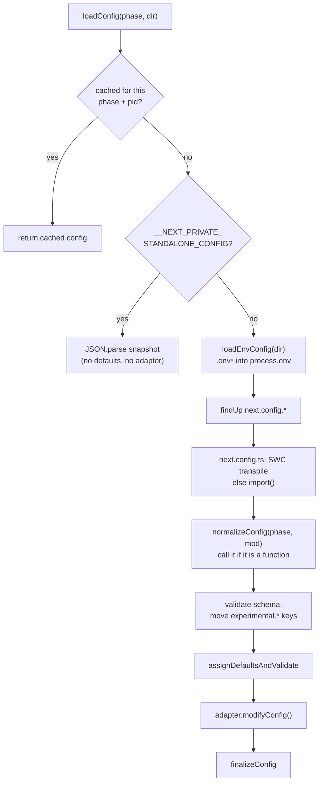
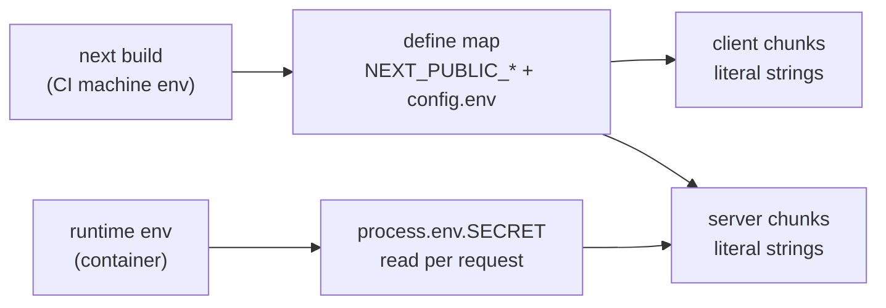
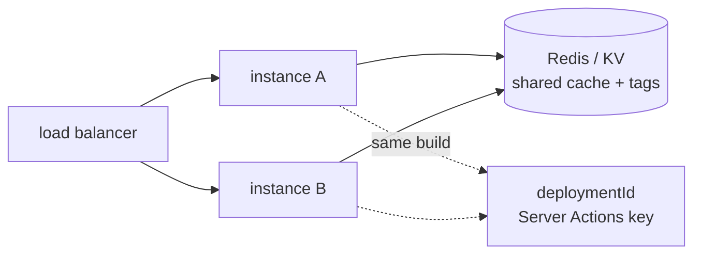
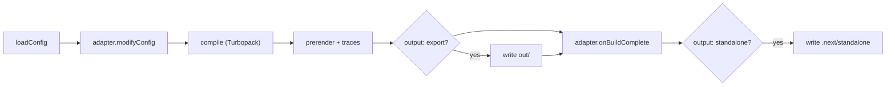

# Configuration, Turbopack and Deployment

> [!summary] TL;DR
> `next.config.ts` is loaded by `loadConfig(phase, dir)`. That function first loads your `.env*` files, then finds the config file, transpiles it with SWC, calls it with the current **phase** if it exports a function, merges defaults, and lets a deployment **adapter** rewrite it. In 16.x, `cacheComponents`, `reactCompiler`, `typedRoutes`, `cacheLife`, `cacheHandlers` and `adapterPath` are top-level options. `experimental.ppr` and `experimental.dynamicIO` now throw errors that point you to `cacheComponents`. `NEXT_PUBLIC_*` variables are replaced with literal values at build time. Every other variable is only a runtime read on the server. Turbopack is the default for both `next dev` and `next build` unless you pass `--webpack`. For self-hosting, `output: 'standalone'` traces a minimal `server.js` bundle. Once you run several instances, you also need one `deploymentId`, one Server Actions key and a shared cache handler for both cache layers.

This part covers what happens between `next.config.ts` and production traffic. It follows one app, a blog with posts, an admin area and some `'use cache'` data. First we configure it, then build it with Turbopack, then ship it: one Node process, a Docker image behind a load balancer, a platform with an adapter, and a static export.

## How next.config.ts is loaded

Every CLI command (`dev`, `build`, `start`, `typegen`, and others) calls `loadConfig(phase, dir)` from `packages/next/src/server/config.ts`.[^load-config] The real work happens in `loadConfigImpl`. Its steps are in a fixed order, and that order explains several surprises:[^load-impl]



Four things follow from this pipeline:

- **`.env` files are already loaded when your config runs.** `loadEnvConfig(dir, ...)` is called before `findUp(CONFIG_FILES)`, so `process.env.DATABASE_URL` from `.env.local` can be read inside `next.config.ts`.[^env-first]
- **The file list is fixed.** `CONFIG_FILES` is `next.config.js`, `next.config.mjs`, `next.config.ts`, and `next.config.mts` when Node has native TypeScript support. `.cjs`, `.cts`, `.json`, `.jsx` and `.tsx` give a hard error.[^config-files][^find-up]
- **`next.config.ts` is compiled by Next.js, not by `tsc`.** `transpileConfig` runs SWC over the file and evaluates it with a temporary require hook. Node's own type stripping is used only when you pass `--experimental-next-config-strip-types`.[^transpile]
- **A function export receives the phase.** `normalizeConfig` calls `config(phase, { defaultConfig })` and awaits the result, so an `async` config works.[^normalize]

The phases are plain strings exported from `next/constants`: `phase-development-server`, `phase-production-build`, `phase-production-server`, `phase-export`, `phase-analyze`, `phase-test` and `phase-info`.[^phases] They let you keep dev-only plugins out of the production build:

```ts
// next.config.ts
import type { NextConfig } from 'next'
import { PHASE_DEVELOPMENT_SERVER } from 'next/constants'

export default function config(phase: string): NextConfig {
  const isDev = phase === PHASE_DEVELOPMENT_SERVER
  return {
    cacheComponents: true,
    reactCompiler: true,
    typedRoutes: true,
    images: {
      remotePatterns: [new URL('https://images.example.com/**')],
    },
    logging: isDev ? { fetches: { fullUrl: true } } : undefined,
  }
}
```

> [!warning] With standalone output, the config runs once, at build time
> The generated `server.js` contains your resolved config as JSON in `__NEXT_PRIVATE_STANDALONE_CONFIG`. When `loadConfigImpl` sees that variable, it returns the parsed snapshot right away. It does not load `.env` files, apply defaults or call adapters at that point.[^standalone-config] So a `next.config.ts` that reads `process.env.API_ORIGIN` freezes the build-time value into the image. If a value must change per environment, read it in server code at request time, not in the config.

## The 16.x config surface

The `NextConfig` interface in `config-shared.ts` is the source of truth for option names. Use `import type { NextConfig } from 'next'` and the editor will flag a misplaced key. During loading, `warnOptionHasBeenMovedOutOfExperimental` copies an old `experimental.x` value to its new location and logs a warning, so old configs keep working for a while.[^moved]

| Option | 16.4.3 location | What changed |
| --- | --- | --- |
| `cacheComponents` | top level | Stable in 16.0. One flag for `'use cache'`, `cacheLife`/`cacheTag` and Partial Prerendering[^cc-type] |
| `experimental.ppr` | removed | Throws `HardDeprecatedConfigError`. PPR is now enabled through `cacheComponents`[^ppr] |
| `experimental.dynamicIO` | removed | The schema error tells you it was replaced by `cacheComponents`[^moved] |
| `experimental.useCache` | deprecated | Filled in from `cacheComponents`. Setting it to `false` while `cacheComponents` is on throws[^use-cache] |
| `reactCompiler` | top level | Stable in 16.0. `true` or an options object. Needs `babel-plugin-react-compiler`[^moved] |
| `typedRoutes` | top level | `experimental.typedRoutes` is marked `@deprecated`[^moved] |
| `cacheLife`, `cacheHandlers` | top level | Moved out of `experimental`[^moved] |
| `adapterPath` | top level | Stable in 16.2. Also read from `NEXT_ADAPTER_PATH`[^defaults] |
| `turbopack` | top level | The old `experimental.turbo` key became `turbopack` in 15.3[^tp-type] |
| `eslint` | removed | Gives a "no longer supported" warning. `next build` no longer runs a linter[^eslint] |

What these options do at runtime is covered in their own parts. `cacheComponents` is in [[05 Cache Components - use cache, cacheLife and cacheTag|Cache Components]]. `images` is in [[09 Metadata, Images, Fonts and Scripts|Metadata & Assets]]. `reactCompiler` turns on the transform explained in [[14 React Compiler - How It Works|React Internals: React Compiler]]. This part only cares about how each option is loaded and where it lives.

> [!tip] Defaults worth knowing
> `defaultConfig` sets `cacheComponents: false`, `typedRoutes: false`, `cacheMaxMemorySize` of 50 MB and `distDir: '.next'`. Three defaults come from environment variables: `cacheHandler` reads `NEXT_CACHE_HANDLER_PATH`, `cacheHandlers.default`/`remote`/`static` read `NEXT_DEFAULT_CACHE_HANDLER_PATH` and the matching variables, and `adapterPath` reads `NEXT_ADAPTER_PATH`. `output` becomes `'standalone'` when `NEXT_PRIVATE_STANDALONE` is set.[^defaults] A platform can therefore configure your app without you editing `next.config.ts`.

## Environment variables: build time vs runtime

### Load order, from the source

`@next/env` is a small package that wraps `dotenv` and `dotenv-expand`. Next.js uses it internally, and you can use it too. `loadEnvConfig(dir, dev)` picks a mode (`test` when `NODE_ENV=test`, else `development` or `production`) and reads these files in order:[^dotenv]

1. `.env.${mode}.local`
2. `.env.local` (skipped in `test`, so tests behave the same on every machine)
3. `.env.${mode}`
4. `.env`

The rule that decides precedence is in `processEnv`. A key is written only if it was **not already in the original `process.env`** and **not set by an earlier file**.[^precedence] So the first file wins, and a real environment variable beats every file. `$VAR` references are expanded by `dotenv-expand`.

```ts
// scripts/migrate.ts (outside Next.js, e.g. for an ORM CLI)
import { loadEnvConfig } from '@next/env'

loadEnvConfig(process.cwd()) // same files, same order as next dev/build
console.log(process.env.DATABASE_URL)
```

### NEXT_PUBLIC_ is a find-and-replace

At build time, `getDefineEnv` creates the define map that every compiler uses: client, Node server and edge. That map includes `getNextPublicEnvironmentVariables()`, which is every `process.env` key starting with `NEXT_PUBLIC_`. It also includes `getNextConfigEnv(config)`, which is every key from the `env` option in `next.config`.[^define-env][^static-env] The bundler then replaces each **literal** `process.env.NEXT_PUBLIC_X` with the string value.



That has three consequences:

- **Public values are frozen per build.** If one Docker image is promoted from staging to production, it keeps the staging value of `NEXT_PUBLIC_API_URL`. The docs say this plainly: set the value correctly when you build, or serve runtime config from an API of your own.
- **Only static member access is replaced.** `process.env[name]` and `const env = process.env; env.NEXT_PUBLIC_X` are left alone. In the browser they read an empty object.
- **The `env` config key is also inlined, into client bundles too.** It is not a way to keep a value server-only. Keys matching `NODE_*`, `__*` or `NEXT_RUNTIME` are rejected.[^env-conflict]

Variables without the prefix are never sent to the browser. They are ordinary `process.env` reads in server code. With Cache Components, a read during prerendering becomes part of the static shell. To read the value at request time, as the environment variables guide shows, first await a request-time API:

```tsx
// app/status/page.tsx
import { connection } from 'next/server'

export default async function Status() {
  await connection() // stop the prerender: this value is per-deployment
  return <p>Region: {process.env.FLY_REGION ?? 'unknown'}</p>
}
```

> [!warning] Standalone copies only `.env` and `.env.production`
> `writeStandaloneDirectory` copies the traced files plus any loaded env file whose name is exactly `.env` or `.env.production`. `.env.local` and `.env.production.local` are never copied into `.next/standalone`.[^standalone-env] This is good for secrets. It also means a value that exists only in `.env.local` is missing at runtime in the container, so pass it with `-e` or your orchestrator's secrets instead. The [[44 Recipes - Performance, Config and Deployment#My Docker image is 1 GB, or the standalone server has no CSS and no images|Docker recipe]] covers the usual image-size and missing-asset problems.

## Turbopack is the default bundler

### How the CLI picks a bundler

`parseBundlerArgs` collects every bundler signal: `--turbopack`/`--turbo`, `--webpack`, `TURBOPACK=…` and `NEXT_RSPACK`. If it finds more than one, it prints "Multiple bundler flags set" and exits. **If it finds none, it sets `TURBOPACK=auto` and returns `Bundler.Turbopack`.**[^bundler] The same default appears in `build()`'s signature (`bundler = Bundler.Turbopack`).[^build-id] So in 16.x a plain `next dev` and a plain `next build` both use Turbopack, and `--turbopack` is no longer needed in `package.json`. The [[44 Recipes - Performance, Config and Deployment|recipe for that build error]] shows it in context.

The `auto` value has a purpose. If Turbopack was chosen only because it is the default, **and** your config has a `webpack` function, **and** it has no `turbopack` key, the build fails with "This build is using Turbopack, with a `webpack` config and no `turbopack` config", then exits.[^tp-warning] The reason is that a plugin may have added a webpack hook you don't know about, and Turbopack ignores webpack hooks. There are three ways out:

```json
{
  "scripts": {
    "dev": "next dev",
    "build": "next build",
    "build:legacy": "next build --webpack"
  }
}
```

- pass `--webpack` to keep webpack, or pass `--turbopack` to say you accept that the webpack hook is ignored,
- add `turbopack: {}` to silence the check when the app already works,
- or port the hook to `turbopack.rules` / `turbopack.resolveAlias`.

### The turbopack key

The top-level `turbopack` option covers what a webpack hook used to do in most apps:

```ts
// next.config.ts
import type { NextConfig } from 'next'

const nextConfig: NextConfig = {
  turbopack: {
    rules: {
      '*.svg': { loaders: ['@svgr/webpack'], as: '*.js' },
    },
    resolveAlias: { 'lodash': 'lodash-es' },
    resolveExtensions: ['.tsx', '.ts', '.jsx', '.js', '.mdx', '.json'],
  },
}
export default nextConfig
```

According to the turbopack reference, only loaders that **return JavaScript** are supported, and loader options must be plain JSON-like values. You cannot pass a `require()`'d plugin. 16.2 added `rules.*.type` (module types such as `'raw'`, `'bytes'` or `'css-module'`) and per-import loaders through import attributes. 16.4 added `experimental.turbopackAdditionalRoots`. In monorepos, set `turbopack.root` and `outputFileTracingRoot` to the same directory. `loadConfig` warns if they differ and uses `outputFileTracingRoot`.

### The filesystem cache

Turbopack saves its incremental work to disk. Both flags default to `true` in 16.4.3: `experimental.turbopackFileSystemCacheForDev` writes to `.next/dev/cache/turbopack`, and `turbopackFileSystemCacheForBuild` writes to `.next/cache/turbopack`.[^tp-fs] The dev cache became the default in 16.1, the build cache in 16.3. A warm build only helps if `.next/cache` survives between builds. In Docker, mount it as a BuildKit cache (`RUN --mount=type=cache,target=/app/.next/cache ...`). On CI, use the CI caching guide. If nothing ever restores that directory, turn the build flag off so the build doesn't write a cache nobody reads.

> [!note] The React Compiler under Turbopack
> `reactCompiler: true` still runs the Babel plugin. Next.js applies it only to files that contain JSX or hooks. `experimental.turbopackRustReactCompiler` uses the native Rust port inside Turbopack instead, and it throws if `reactCompiler` is not also enabled.

## Shipping it: four ways

The getting-started "Deploying" page lists four targets: a Node.js server (every feature), Docker (every feature), static export (limited), and adapters (depends on the adapter).

### 1. A single Node process: next start

`next build && next start` supports every feature, including ISR, PPR, Server Actions, `proxy.ts` and `after()`. The cache lives in memory (50 MB LRU) and on the instance's local disk. The docs recommend putting a reverse proxy in front for slow clients and body limits. If that proxy is nginx, it must not buffer responses. Otherwise streaming and the PPR shell arrive all at once at the end, so set `X-Accel-Buffering: no` through `headers()`. Send `SIGTERM` and allow a drain period of 10 to 30 seconds, so in-flight requests and pending `after()` callbacks can finish.

### 2. Standalone output and Docker

`output: 'standalone'` makes `next build` copy into `.next/standalone` only the files that each server entry actually needs. Here is what `copyTracedFiles` collects:[^copy-traced]

- the `.nft.json` trace of every App Router page and route, of `proxy`/middleware when it runs on Node, of `instrumentation.js`, and of `next-server.js` itself. These traces come from `@vercel/nft` static analysis of `import`, `require` and `fs`,
- the files in `required-server-files.json`, plus `.env` / `.env.production`,
- the prerendered `server/app` and `server/pages` output and the route cache directory.[^standalone-write]

Then it **writes a `server.js`**. That file sets `NODE_ENV=production`, reads `PORT` (default 3000), `HOSTNAME` (default `0.0.0.0`) and `KEEP_ALIVE_TIMEOUT`, embeds the config JSON and calls `startServer()`.[^server-js] Running `next start` against a standalone build only prints a warning that tells you to use `node .next/standalone/server.js` instead.[^start-warn]

The standalone folder does **not** contain `public/` or `.next/static/`, because the assumption is that a CDN serves those. If you copy both next to `server.js`, it serves them itself. A Dockerfile in the style of the official `with-docker` example:

```dockerfile
# Dockerfile
ARG NODE_VERSION=24.13.0-slim

FROM node:${NODE_VERSION} AS deps
WORKDIR /app
COPY package.json pnpm-lock.yaml* ./
RUN corepack enable pnpm && pnpm install --frozen-lockfile

FROM node:${NODE_VERSION} AS builder
WORKDIR /app
COPY --from=deps /app/node_modules ./node_modules
COPY . .
ENV NODE_ENV=production
# NEXT_PUBLIC_* must be present HERE: they are inlined now
ARG NEXT_PUBLIC_SITE_URL
ENV NEXT_PUBLIC_SITE_URL=$NEXT_PUBLIC_SITE_URL
RUN --mount=type=cache,target=/app/.next/cache \
    corepack enable pnpm && pnpm build

FROM node:${NODE_VERSION} AS runner
WORKDIR /app
ENV NODE_ENV=production PORT=3000 HOSTNAME=0.0.0.0
COPY --from=builder --chown=node:node /app/public ./public
RUN mkdir .next && chown node:node .next
COPY --from=builder --chown=node:node /app/.next/standalone ./
COPY --from=builder --chown=node:node /app/.next/static ./.next/static
USER node
EXPOSE 3000
CMD ["node", "server.js"]
```

> [!warning] Monorepos and native files
> Tracing starts at the project directory. In a monorepo, set `outputFileTracingRoot` to the repo root. Without it, files outside that root are skipped and the build logs "traced files were not included in the standalone output". For files that are loaded dynamically and that `nft` cannot see, such as `sharp` binaries, `aws-crt` or locale JSON, use `outputFileTracingIncludes: { '/*': [...] }`, with route globs as keys. On a monorepo, `server.js` ends up at `.next/standalone/<path-to-app>/server.js`, not at the root.

### 3. Many instances: what must be shared

Once the same image runs behind a load balancer, three things that were per-process before must now be the same everywhere:



**One Server Actions key.** Closure variables of Server Functions are encrypted with a key that is generated per build. Set `NEXT_SERVER_ACTIONS_ENCRYPTION_KEY`, a base64 AES key of 16, 24 or 32 bytes, **at build time**. If you don't, a rebuilt image will fail to decrypt actions from pages rendered by the old image, and you get "Failed to find Server Action" errors. See [[44 Recipes - Performance, Config and Deployment#"Failed to find Server Action" right after a deploy|the recipe for that error]]. The mechanism is described in [[07 Server Actions and Forms|Server Actions]].

**One `deploymentId` per deployment.** When it is set, static asset URLs get `?dpl=<id>`, client navigations send `x-deployment-id`, responses carry `x-nextjs-deployment-id`, and the id becomes part of the `'use cache'` key. If a client sees a different id from the server, it falls back to a hard navigation instead of a soft one.[^dpl-define] Two 16.x details matter here:

- Since 16.2, when `deploymentId` is set and `generateBuildId` is not, the build id is the constant `build-TfctsWXpff2fKS`. Skew detection relies on the deployment id instead.[^build-id] Without a deployment id, `generateBuildId` falls back to a random `nanoid`, and it rerolls any id that contains `ad` so that ad blockers don't block `/_next/` URLs.[^gen-build-id]
- The docs say `deploymentId` in the config wins over `NEXT_DEPLOYMENT_ID`. In the 16.4.3 source, the env var is assigned **after** the config, so it actually wins. On Vercel, a mismatch between the two throws.[^dpl-env] Set only one of them.

The stale-pod symptom is walked through in [[44 Recipes - Performance, Config and Deployment#ISR pages and "use cache" data are stale on some pods but not others|this recipe]]. Next.js does not route by `?dpl=`. A deployment id prevents mixed assets, but if old and new instances share one load balancer during a rollout, clients reload instead of navigating. You need deployment-aware routing at the proxy, or `supportsImmutableAssets` with a static bucket that only grows, to avoid those reloads.

**A shared cache, in two parts.** There are two independent cache layers, and each has its own handler:

| | `cacheHandler` (singular) | `cacheHandlers` (plural) |
| --- | --- | --- |
| Covers | ISR pages, route handler responses, patched `fetch`, `unstable_cache`, image optimizer | `'use cache'`, `'use cache: remote'`, `'use cache: <name>'` |
| Shape | class with `get`, `set`, `revalidateTag`, `resetRequestCache`[^incr] | object with `get`, `set`, `refreshTags`, `getExpiration`, `updateTags`[^ch-iface] |
| Loaded by | `getIncrementalCache()` imports it per request scope | `loadCustomCacheHandlers()` registers one per kind[^load-handlers] |
| Default | memory + `.next` on disk | in-memory LRU, `remote` falls back to `default`[^init-handlers] |

```ts
// next.config.ts
import type { NextConfig } from 'next'

const nextConfig: NextConfig = {
  cacheComponents: true,
  deploymentId: process.env.GIT_SHA,
  cacheHandler: require.resolve('./cache/isr-redis.mjs'),
  cacheHandlers: {
    remote: require.resolve('./cache/use-cache-redis.mjs'),
  },
  cacheMaxMemorySize: 0, // no per-instance copy of ISR entries
}
export default nextConfig
```

The `CacheHandler` interface comments set the rules for a `'use cache'` handler. `set()` receives a **pending** entry whose `value` is a single-use `ReadableStream`, and a `get()` that arrives during that time has to wait for it. Next.js never evicts entries, so the store must have a TTL or LRU of its own. `refreshTags()` runs once per request, before the first read from that handler kind, so it is where an instance pulls tag invalidations from the shared store.[^ch-iface] If you skip `refreshTags`, a `revalidateTag` on instance A never reaches instance B. [[06 Revalidation - Tags, Paths and Refresh|Revalidation]] explains how tags spread through the system. `'use cache: private'` is the exception: it never goes through a handler.

> [!tip] cacheMaxMemorySize: 0 and dev
> `cacheMaxMemorySize: 0` turns the built-in `'use cache'` handler into a no-op in production. `initializeCacheHandlers` deliberately replaces it with a real in-memory size under `next dev`, so reloads stay fast.[^init-handlers] So the dev server caching more than production does is expected.

**CDN in front.** Use `assetPrefix` to load `/_next/static` from another origin. Hashed assets are served `public, max-age=31536000, immutable`. ISR pages get `s-maxage=<revalidate>, stale-while-revalidate`. Pages that touched request data get `private, no-cache, no-store`. A CDN that respects those headers and the RSC `Vary` key can cache everything that is safe to cache.

### 4. Platforms and the Deployment Adapter API

The adapter API exists in 16.4.3 and it is public. `adapterPath`, or the `NEXT_ADAPTER_PATH` variable, points to a module whose default export implements `NextAdapter`, which is exported from `next`:[^types-export]

```ts
// my-adapter.ts (compiled to my-adapter.js)
import type { NextAdapter } from 'next'

const adapter: NextAdapter = {
  name: 'acme-cloud',
  async modifyConfig(config, { phase }) {
    if (phase !== 'phase-production-build') return config
    return { ...config, cacheHandlers: { ...config.cacheHandlers, remote: '/opt/acme/kv-handler.js' } }
  },
  async onBuildComplete({ outputs, routing, distDir, buildId }) {
    for (const page of outputs.appPages) {
      // page.pathname, page.filePath, page.assets (traced files), page.runtime
    }
    for (const p of outputs.prerenders) {
      // ISR / static entries with fallback + revalidate info
    }
    // routing.beforeFiles / afterFiles / dynamicRoutes / fallback -> your router config
  },
}
export default adapter
```

The interface has two hooks:[^adapter-iface]

- **`modifyConfig(config, { phase, nextVersion, projectDir })`** runs on **every** command that loads the config. `applyModifyConfig` calls it after defaults are applied and before `finalizeConfig`, so check `phase` if you only want to change the build.[^modify-config]
- **`onBuildComplete(ctx)`** runs once after `next build`. It receives `outputs` (`pages`, `pagesApi`, `appPages`, `appRoutes`, `prerenders`, `staticFiles`, `middleware`), each with its traced `assets`. It also gets the full `routing` table (`beforeMiddleware`, `beforeFiles`, `afterFiles`, `dynamicRoutes`, `onMatch`, `fallback`, `rsc`), plus `buildId`, `distDir`, `repoRoot` and the final config.[^handle-build]

`build()` calls the adapter **after** the `output: 'export'` step and **before** the standalone step. A code comment says standalone may be disallowed in the future when an adapter has `onBuildComplete`.[^build-order] With `output: 'export'`, only `outputs.staticFiles` is filled. According to the docs, Vercel's own integration and Bun are the current verified adapters, and they use this same public API. Cloudflare and Netlify are listed as working toward verified adapters. Other hosts (Amplify, Firebase App Hosting, Deno Deploy and others) use their own integrations instead.



> [!note] Vercel vs self-hosting, in one sentence each
> On Vercel the adapter maps each output to a function or a static file, the cache and tag service is shared, and every deployment gets a deployment id, so the three multi-instance problems above are handled for you. When you self-host, you handle them yourself with `NEXT_SERVER_ACTIONS_ENCRYPTION_KEY`, `deploymentId`, `cacheHandler` + `cacheHandlers` with `refreshTags`, and a proxy that does not buffer streams.

### Static export, briefly

`output: 'export'` writes plain HTML, RSC payloads and assets to `out/`. There is no server, so `next start` throws and tells you to use `npx serve@latest out`. Config validation rejects `i18n`, and it warns that `rewrites`, `redirects` and `headers` will not apply.[^export-validate] What still works, and how to build a client-only SPA on top of it, is covered in [[25 Fully Client-Side - SPA and Static Export|Static Export]].

> [!warning] The Edge Runtime is deprecated in 16.x
> `export const runtime = 'edge'` now logs "The Edge Runtime is deprecated. You can use the "nodejs" runtime instead", and the `preferredRegion` segment config is deprecated too.[^edge-dep] For deployment, every route can be a plain Node function, and `proxy.ts` runs on Node by default ([[08 Route Handlers and Proxy|Route Handlers & Proxy]]).

## Summary

`next.config.ts` is not a static JSON file. `loadConfig` loads your `.env*` files first, transpiles the config with SWC, calls it with the current phase, moves old `experimental.*` keys to their new places, merges defaults that can come from environment variables, and lets an adapter rewrite the result. Environment variables follow one rule: `NEXT_PUBLIC_*` and `env` values are text replaced at build time in every bundle, and everything else is a runtime read on the server that you can delay with `connection()`. Turbopack is now the default for dev and build. You opt out with `--webpack`, and the build stops on purpose when a `webpack` hook would be silently ignored. To ship, `next start` runs every feature on one box. `output: 'standalone'` adds a traced `server.js` for Docker. Multiple instances need a shared encryption key, a deployment id and shared cache handlers. Platforms use the public adapter API. [[20 Rendering Strategies - A Decision Map|Rendering Strategies]] starts the patterns track, which builds on these deployment choices.

### Key takeaways

- **`loadConfig(phase, dir)`**: loads `.env*`, then finds `next.config.{js,mjs,ts,mts}`, transpiles TS with SWC, and calls a function export with `(phase, { defaultConfig })`.
- **Standalone config snapshot**: `server.js` embeds the resolved config as JSON, so config logic and the env values it reads are fixed at build time.
- **Moved out of `experimental`**: `cacheComponents`, `reactCompiler`, `typedRoutes`, `cacheLife`, `cacheHandlers` and `adapterPath` are top-level. `experimental.ppr` and `dynamicIO` now error and point to `cacheComponents`.
- **`.env` precedence**: real env first, then `.env.$mode.local`, `.env.local` (not in test), `.env.$mode`, `.env`. The first value found wins.
- **`NEXT_PUBLIC_` and `env`**: both are inlined as literals into every bundle at build. They cannot change per environment, and `env` does not keep anything server-only.
- **Turbopack default**: no flag means `TURBOPACK=auto`. Use `--webpack` to opt out. A `webpack` hook without a `turbopack` key fails the build on purpose.
- **`output: 'standalone'`**: traced files plus `server.js` (`PORT`, `HOSTNAME`). You copy `public/` and `.next/static/` yourself, and `.env.local` is never included.
- **Multi-instance checklist**: `NEXT_SERVER_ACTIONS_ENCRYPTION_KEY` at build, one `deploymentId` (in 16.4.3 the env var overrides the config), `cacheHandler` for ISR/fetch, and `cacheHandlers` with `refreshTags` for `'use cache'`.
- **`NextAdapter`**: `modifyConfig` runs on every command, and `onBuildComplete` gets typed outputs and the routing table. It runs between export and standalone.

← [[10 Errors, Redirects and Request Lifecycle APIs|Errors & Lifecycle]] · [[00 Next.js in Practice Index|Index]] · [[20 Rendering Strategies - A Decision Map|Rendering Strategies]] →

[^load-config]: `loadConfig` — [packages/next/src/server/config.ts#L1952-L1970](https://github.com/vercel/next.js/blob/v16.4.3/packages/next/src/server/config.ts#L1952-L1970)
[^load-impl]: `loadConfigImpl` — [packages/next/src/server/config.ts#L1978-L2401](https://github.com/vercel/next.js/blob/v16.4.3/packages/next/src/server/config.ts#L1978-L2401)
[^env-first]: `loadEnvConfig(dir, phase === PHASE_DEVELOPMENT_SERVER, curLog)` before the config file is found — [packages/next/src/server/config.ts#L2063-L2103](https://github.com/vercel/next.js/blob/v16.4.3/packages/next/src/server/config.ts#L2063-L2103)
[^config-files]: `CONFIG_FILES` — [packages/next/src/shared/lib/constants.ts#L112-L119](https://github.com/vercel/next.js/blob/v16.4.3/packages/next/src/shared/lib/constants.ts#L112-L119)
[^find-up]: `findUp(CONFIG_FILES)`, `transpileConfig` branch and the unsupported-extension error — [packages/next/src/server/config.ts#L2103-L2131](https://github.com/vercel/next.js/blob/v16.4.3/packages/next/src/server/config.ts#L2103-L2131) and [#L2343-L2362](https://github.com/vercel/next.js/blob/v16.4.3/packages/next/src/server/config.ts#L2343-L2362)
[^transpile]: `transpileConfig` (native TS loader fallback, SWC transform) — [packages/next/src/build/next-config-ts/transpile-config.ts#L60-L112](https://github.com/vercel/next.js/blob/v16.4.3/packages/next/src/build/next-config-ts/transpile-config.ts#L60-L112)
[^normalize]: `normalizeConfig` — [packages/next/src/server/config-shared.ts#L2509-L2515](https://github.com/vercel/next.js/blob/v16.4.3/packages/next/src/server/config-shared.ts#L2509-L2515)
[^phases]: `PHASE_*` constants and `PHASE_TYPE` — [packages/next/src/shared/lib/constants.ts#L70-L85](https://github.com/vercel/next.js/blob/v16.4.3/packages/next/src/shared/lib/constants.ts#L70-L85)
[^standalone-config]: `__NEXT_PRIVATE_STANDALONE_CONFIG` short-circuit — [packages/next/src/server/config.ts#L2038-L2053](https://github.com/vercel/next.js/blob/v16.4.3/packages/next/src/server/config.ts#L2038-L2053)
[^moved]: `warnOptionHasBeenMovedOutOfExperimental` — [packages/next/src/server/config.ts#L288-L316](https://github.com/vercel/next.js/blob/v16.4.3/packages/next/src/server/config.ts#L288-L316); its calls (typedRoutes, reactCompiler, cacheComponents, cacheLife, cacheHandlers, adapterPath, …) — [#L914-L1039](https://github.com/vercel/next.js/blob/v16.4.3/packages/next/src/server/config.ts#L914-L1039); `dynamicIO` replacement message — [#L133-L137](https://github.com/vercel/next.js/blob/v16.4.3/packages/next/src/server/config.ts#L133-L137); deprecated `experimental.typedRoutes` — [packages/next/src/server/config-shared.ts#L1190-L1195](https://github.com/vercel/next.js/blob/v16.4.3/packages/next/src/server/config-shared.ts#L1190-L1195)
[^cc-type]: `NextConfig.cacheComponents` — [packages/next/src/server/config-shared.ts#L2152-L2161](https://github.com/vercel/next.js/blob/v16.4.3/packages/next/src/server/config-shared.ts#L2152-L2161)
[^ppr]: `experimental.ppr` hard deprecation — [packages/next/src/server/config.ts#L674-L678](https://github.com/vercel/next.js/blob/v16.4.3/packages/next/src/server/config.ts#L674-L678)
[^use-cache]: `experimental.useCache` deprecation and backfill from `cacheComponents` — [packages/next/src/server/config.ts#L1705-L1741](https://github.com/vercel/next.js/blob/v16.4.3/packages/next/src/server/config.ts#L1705-L1741)
[^tp-type]: `NextConfig.turbopack`, `output`, `reactCompiler` — [packages/next/src/server/config-shared.ts#L2117-L2120](https://github.com/vercel/next.js/blob/v16.4.3/packages/next/src/server/config-shared.ts#L2117-L2120), [#L2100-L2108](https://github.com/vercel/next.js/blob/v16.4.3/packages/next/src/server/config-shared.ts#L2100-L2108), [#L1989-L1994](https://github.com/vercel/next.js/blob/v16.4.3/packages/next/src/server/config-shared.ts#L1989-L1994)
[^eslint]: `eslint` config no longer supported — [packages/next/src/server/config.ts#L248-L253](https://github.com/vercel/next.js/blob/v16.4.3/packages/next/src/server/config.ts#L248-L253)
[^defaults]: `defaultConfig` (`cacheHandler`, `output`, `cacheComponents`, `cacheHandlers`, `adapterPath`) — [packages/next/src/server/config-shared.ts#L2291-L2388](https://github.com/vercel/next.js/blob/v16.4.3/packages/next/src/server/config-shared.ts#L2291-L2388); `adapterPath` / `cacheHandlers` types — [#L1877-L1888](https://github.com/vercel/next.js/blob/v16.4.3/packages/next/src/server/config-shared.ts#L1877-L1888)
[^dotenv]: `loadEnvConfig` (mode and `dotenvFiles` order) — [packages/next-env/index.ts#L124-L190](https://github.com/vercel/next.js/blob/v16.4.3/packages/next-env/index.ts#L124-L190)
[^precedence]: `processEnv` first-wins rule — [packages/next-env/index.ts#L95-L115](https://github.com/vercel/next.js/blob/v16.4.3/packages/next-env/index.ts#L95-L115)
[^define-env]: `getDefineEnv` spreading `nextPublicEnv` and `nextConfigEnv` — [packages/next/src/build/define-env.ts#L106-L133](https://github.com/vercel/next.js/blob/v16.4.3/packages/next/src/build/define-env.ts#L106-L133)
[^static-env]: `getNextPublicEnvironmentVariables`, `getNextConfigEnv` — [packages/next/src/lib/static-env.ts#L23-L54](https://github.com/vercel/next.js/blob/v16.4.3/packages/next/src/lib/static-env.ts#L23-L54)
[^env-conflict]: `errorIfEnvConflicted` — [packages/next/src/lib/static-env.ts#L6-L18](https://github.com/vercel/next.js/blob/v16.4.3/packages/next/src/lib/static-env.ts#L6-L18)
[^standalone-env]: `writeStandaloneDirectory` copying only `.env` / `.env.production` — [packages/next/src/build/index.ts#L883-L907](https://github.com/vercel/next.js/blob/v16.4.3/packages/next/src/build/index.ts#L883-L907)
[^bundler]: `parseBundlerArgs` (default `TURBOPACK=auto`) — [packages/next/src/lib/bundler.ts#L41-L113](https://github.com/vercel/next.js/blob/v16.4.3/packages/next/src/lib/bundler.ts#L41-L113)
[^tp-warning]: `validateTurboNextConfig` webpack-without-turbopack error — [packages/next/src/lib/turbopack-warning.ts#L143-L166](https://github.com/vercel/next.js/blob/v16.4.3/packages/next/src/lib/turbopack-warning.ts#L143-L166)
[^tp-fs]: `turbopackFileSystemCacheForDev` / `ForBuild` defaults — [packages/next/src/server/config-shared.ts#L2494-L2495](https://github.com/vercel/next.js/blob/v16.4.3/packages/next/src/server/config-shared.ts#L2494-L2495)
[^copy-traced]: `copyTracedFiles` — [packages/next/src/build/utils.ts#L1355-L1661](https://github.com/vercel/next.js/blob/v16.4.3/packages/next/src/build/utils.ts#L1355-L1661)
[^standalone-write]: `writeStandaloneDirectory` — [packages/next/src/build/index.ts#L852-L977](https://github.com/vercel/next.js/blob/v16.4.3/packages/next/src/build/index.ts#L852-L977)
[^server-js]: generated `server.js` template — [packages/next/src/build/utils.ts#L1585-L1643](https://github.com/vercel/next.js/blob/v16.4.3/packages/next/src/build/utils.ts#L1585-L1643)
[^start-warn]: `next start` with `output: standalone` / `export` — [packages/next/src/server/next.ts#L385-L398](https://github.com/vercel/next.js/blob/v16.4.3/packages/next/src/server/next.ts#L385-L398)
[^dpl-define]: `process.env.NEXT_DEPLOYMENT_ID` define — [packages/next/src/build/define-env.ts#L198-L221](https://github.com/vercel/next.js/blob/v16.4.3/packages/next/src/build/define-env.ts#L198-L221)
[^build-id]: `getBuildId` (constant id when `deploymentId` is set) and `build(..., bundler = Bundler.Turbopack)` — [packages/next/src/build/index.ts#L1096-L1124](https://github.com/vercel/next.js/blob/v16.4.3/packages/next/src/build/index.ts#L1096-L1124)
[^gen-build-id]: `generateBuildId` — [packages/next/src/build/generate-build-id.ts#L1-L22](https://github.com/vercel/next.js/blob/v16.4.3/packages/next/src/build/generate-build-id.ts#L1-L22)
[^dpl-env]: `NEXT_DEPLOYMENT_ID` assigned over `deploymentId` — [packages/next/src/server/config.ts#L1231-L1251](https://github.com/vercel/next.js/blob/v16.4.3/packages/next/src/server/config.ts#L1231-L1251)
[^incr]: incremental `CacheHandler` base class — [packages/next/src/server/lib/incremental-cache/index.ts#L113-L142](https://github.com/vercel/next.js/blob/v16.4.3/packages/next/src/server/lib/incremental-cache/index.ts#L113-L142); loaded in `getIncrementalCache` — [packages/next/src/server/next-server.ts#L451-L490](https://github.com/vercel/next.js/blob/v16.4.3/packages/next/src/server/next-server.ts#L451-L490)
[^ch-iface]: `'use cache'` `CacheHandler` interface — [packages/next/src/server/lib/cache-handlers/types.ts#L68-L117](https://github.com/vercel/next.js/blob/v16.4.3/packages/next/src/server/lib/cache-handlers/types.ts#L68-L117)
[^load-handlers]: `loadCustomCacheHandlers` — [packages/next/src/server/next-server.ts#L430-L449](https://github.com/vercel/next.js/blob/v16.4.3/packages/next/src/server/next-server.ts#L430-L449)
[^init-handlers]: `initializeCacheHandlers` — [packages/next/src/server/use-cache/handlers.ts#L62-L142](https://github.com/vercel/next.js/blob/v16.4.3/packages/next/src/server/use-cache/handlers.ts#L62-L142)
[^types-export]: `NextAdapter` re-export from `next` — [packages/next/src/types.ts#L32](https://github.com/vercel/next.js/blob/v16.4.3/packages/next/src/types.ts#L32)
[^adapter-iface]: `NextAdapter` interface — [packages/next/src/build/adapter/build-complete.ts#L505-L577](https://github.com/vercel/next.js/blob/v16.4.3/packages/next/src/build/adapter/build-complete.ts#L505-L577)
[^modify-config]: `applyModifyConfig` — [packages/next/src/server/config.ts#L1862-L1888](https://github.com/vercel/next.js/blob/v16.4.3/packages/next/src/server/config.ts#L1862-L1888)
[^handle-build]: `handleBuildComplete` — [packages/next/src/build/adapter/build-complete.ts#L601-L660](https://github.com/vercel/next.js/blob/v16.4.3/packages/next/src/build/adapter/build-complete.ts#L601-L660)
[^build-order]: adapter step before `output: 'standalone'` in `build()` — [packages/next/src/build/index.ts#L4748-L4790](https://github.com/vercel/next.js/blob/v16.4.3/packages/next/src/build/index.ts#L4748-L4790)
[^export-validate]: `output: 'export'` validation — [packages/next/src/server/config.ts#L680-L704](https://github.com/vercel/next.js/blob/v16.4.3/packages/next/src/server/config.ts#L680-L704)
[^edge-dep]: `warnAboutEdgeRuntime`, `warnAboutPreferredRegion` — [packages/next/src/build/warn-about-edge-runtime.ts#L3-L19](https://github.com/vercel/next.js/blob/v16.4.3/packages/next/src/build/warn-about-edge-runtime.ts#L3-L19)
