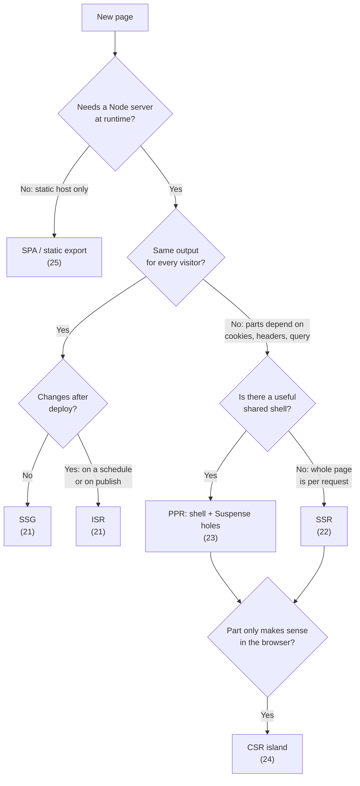
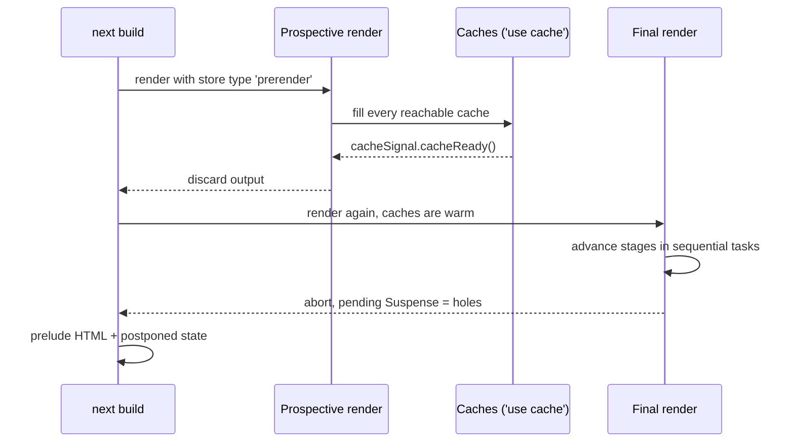

# Rendering Strategies - A Decision Map

> [!summary] TL;DR
> Next.js does not ask you to pick a rendering mode per route. It **tries to prerender everything** at build time and watches what your code touches. Every request API (`cookies()`, `headers()`, `searchParams`, `connection()`, uncached `fetch`) checks which kind of render it is running in by reading the current *work unit store*. In the **Cache Components** world (`cacheComponents: true`, the Next 16 recommendation) those APIs return promises that never resolve during the prerender. The render is aborted after a few tasks, and whatever is still pending inside a `<Suspense>` becomes a hole in a static shell. That is **PPR**, and it is the default. In the **legacy** world (no `cacheComponents`) the same APIs throw a `DynamicServerError`. The whole route then becomes dynamic (**SSR**), and `revalidate` / `generateStaticParams` give you **SSG** and **ISR**. CSR and SPA are choices you make in your own code: Client Components that fetch, or `output: 'export'`. This part is the map. Parts 21 to 28 are the territory.

## Two worlds, one framework

Everything in the Patterns track depends on one line in `next.config.ts`. Read this section first. The rest of the notes keep saying "with Cache Components" and "legacy".

```ts
// next.config.ts
import type { NextConfig } from 'next'

const nextConfig: NextConfig = {
  cacheComponents: true, // the Next 16 model: PPR, 'use cache', cacheLife
  partialPrefetching: true, // set it explicitly; leaving it unset logs a warning
}

export default nextConfig
```

| | **With `cacheComponents: true`** | **Without it (legacy model)** |
| --- | --- | --- |
| Unit of static vs dynamic | A component subtree (a `<Suspense>` boundary) | The whole route |
| Default for a dynamic API | A hole in the static shell, streamed per request | The whole route renders per request |
| Caching data | `'use cache'` + `cacheLife` + `cacheTag` | `fetch(..., { cache, next: { revalidate, tags } })`, `unstable_cache` |
| Route segment config | `instant`, `prefetch`, `ensureStatic` (plus `runtime`, `maxDuration`...) | `dynamic`, `revalidate`, `fetchCache`, `dynamicParams` |
| Build output symbol for mixed pages | `◐` Partial Prerender | n/a (a route is `○`, `●` or `ƒ`) |
| Escape hatch for "always per request" | `instant = false`, or `<Suspense>` above `<body>` | `dynamic = 'force-dynamic'`, `revalidate = 0` |

The two config sets do not mix. With Cache Components on, the SWC transform rejects `dynamicParams`, `dynamic`, `fetchCache`, `revalidate` and `experimental_ppr` exports with "Route segment config "…" is not compatible with `nextConfig.cacheComponents`. Please remove it."[^rsc-config] Going the other way, `instant`, `prefetch` and `ensureStatic` fail the build without `cacheComponents`.[^page-static-info] For what `partialPrefetching` changes on the client, see [[03 Linking, Navigation and Prefetching#How much a link prefetches|How much a link prefetches]].

> [!warning] What changed in 16.x
> - `experimental.ppr` is gone. Setting it throws a hard deprecation error: "`experimental.ppr` has been merged into `cacheComponents`".[^ppr-deprecated] The `experimental_ppr` segment export was removed in 16.0.0.
> - With Cache Components, the build turns PPR on for **every** App Router page. A page supports partial prerendering "when it is an app page and Cache Components is enabled".[^ppr-per-route] There is no per-route opt-in any more.
> - `ensureStatic` (16.4.0) and `instant` are new route segment configs that only exist in the Cache Components world.

## The six strategies at a glance

| Strategy | HTML produced | Data freshness | Pick it when | How in Next 16 (Cache Components) | How in legacy | Part |
| --- | --- | --- | --- | --- | --- | --- |
| **SSG** | At build | Fixed until the next deploy | Docs, marketing, blog posts | No dynamic access; `'use cache'` with a long `cacheLife`; `generateStaticParams` for dynamic segments | No dynamic access, or `dynamic = 'force-static'` | [[21 SSG and ISR - Static Pages and generateStaticParams\|21]] |
| **ISR** | At build, regenerated in the background | Stale-while-revalidate, or on demand by tag/path | Catalogs, CMS pages, anything that changes hourly or on publish | `cacheLife('hours')`, `cacheTag` + `revalidateTag`/`updateTag`; unknown params get an App Shell, then an upgrade | `export const revalidate = 3600`, `fetch` `next.revalidate`, `revalidatePath` | [[21 SSG and ISR - Static Pages and generateStaticParams\|21]] |
| **SSR** | Per request on the server | Always fresh | Personalised or request-shaped pages with no useful shell | `instant = false` on the segment, or `<Suspense>` above `<body>` | Any dynamic API, `dynamic = 'force-dynamic'`, `revalidate = 0` | [[22 SSR - Rendering Per Request\|22]] |
| **PPR** | Static shell at build, holes streamed per request | Shell cached, holes fresh | Mostly-static pages with a few per-user or live parts (cart, greeting, price) | The default: wrap request-time parts in `<Suspense>` | Not available | [[23 PPR - Partial Prerendering with Cache Components\|23]] |
| **CSR** | Server sends a shell or skeleton; the browser fetches the data | Whatever the client fetches | Highly interactive widgets, data behind a client-only token, frequent polling | Client Component + SWR/TanStack Query, `next/dynamic` with `ssr: false` | Same | [[24 CSR - Client-Rendered Islands\|24]] |
| **SPA** | One static HTML per route (or one shell), no Node server | Client only | Hosting on a plain CDN or inside a native shell, no server at all | `output: 'export'` | Same | [[25 Fully Client-Side - SPA and Static Export\|25]] |

Two more patterns sit across these: server-prefetched client caches ([[26 TanStack Query - Server Prefetch and Hydration|26]]) and the two auth styles ([[27 Server-Aware Auth - Sessions, Proxy and the DAL|27]], [[28 Client-Only Auth - Tokens in the Browser|28]]). Auth is a rendering decision too. Reading a session cookie on the server makes that subtree request-time.

## The decision flowchart

Start from the content, not from the acronym. The questions are about **who** the content is for and **when** it changes.



Three questions settle almost every case:

1. **Same for everyone?** If yes, the page is static, and the only question left is how often it changes (SSG vs ISR).
2. **Is there a shell?** Most "dynamic" pages have a header, navigation, product details or an article body that is the same for everyone. With Cache Components that part is prerendered and only the personal bits stream. Pure SSR is right only when nothing useful can be shown before the request data is known.
3. **Does it need the browser?** Geolocation, `localStorage`, a WebSocket, a token that only the browser holds. That part is CSR whatever you chose for the rest.

> [!tip] Mixing is normal
> One route can be all of these at once. Picture a product page with a prerendered description (SSG), a price cached with `cacheLife('minutes')` (ISR), a cart badge that reads a cookie (a PPR hole) and a live stock ticker in a Client Component (CSR). The flowchart is for each **region** of a page, not for the route.

## How Next decides: the prerender is the test

There is no static analysis that marks a page "dynamic". At build time Next **runs** your components in a prerender and records what happens. The mechanism is two `AsyncLocalStorage` stores that every request API reads.

### workStore and workUnitStore

- The **`WorkStore`** describes the route being rendered. It has the route name, the incremental cache, and the legacy switches `forceDynamic`, `forceStatic` and `dynamicShouldError`. It also has `dynamicUsageDescription` and `dynamicUsageStack`, which become the "why is this route dynamic" message.[^workstore]
- The **`WorkUnitStore`** describes *what kind of render* is running right now. It is a tagged union: `request`, the `cache` stores (`'use cache'`, `unstable_cache`), the prerender stores, and `build-time-generator` (used while `generateStaticParams` runs).[^workunit-union]

The prerender stores are the important ones here:

| `type` | Used by | What a dynamic API does |
| --- | --- | --- |
| `'prerender'` | Cache Components server prerender | Returns a never-resolving ("hanging") promise |
| `'prerender-client'` | Cache Components SSR (HTML) prerender | Same, for the client side of the tree |
| `'prerender-runtime'` | Runtime prefetches (session data known) | Waits for the right render stage, then resolves |
| `'prerender-legacy'` | Prerender without Cache Components | Throws `DynamicServerError` and sets `revalidate = 0` |
| `'request'` | A real request | Returns the real value |

The modern server store also carries the `renderSignal` and the abort `controller`. Its comment calls the controller "the boundary between Prerender and dynamic", and says it is aborted "after one task, or when you call a sync API which requires the prerender to end immediately".[^prerender-common]

### One API, five behaviours: `cookies()`

`cookies()` is the clearest example. It reads both stores and switches on the work unit type:[^cookies]

```ts
// packages/next/src/server/request/cookies.ts (simplified)
export function cookies(): Promise<ReadonlyRequestCookies> {
  const workStore = workAsyncStorage.getStore()
  const workUnitStore = workUnitAsyncStorage.getStore()

  if (workStore.forceStatic) return makeUntrackedCookies(createEmptyCookies()) // dynamic = 'force-static'
  if (workStore.dynamicShouldError) throw new StaticGenBailoutError(/* dynamic = "error" */)

  switch (workUnitStore.type) {
    case 'cache':                 throw createCookiesInUseCacheError(route)   // not allowed in 'use cache'
    case 'build-time-generator':  throw new Error(/* not inside generateStaticParams */)
    case 'prerender':             return makeHangingCookies(workStore, workUnitStore)  // Cache Components
    case 'prerender-legacy':      return throwToInterruptStaticGeneration('cookies', workStore, workUnitStore)
    case 'prerender-runtime':     return stagedRendering.delayUntilStage(/* sessionData */)
    case 'request':               return /* the real cookies */
  }
}
```

The two prerender branches are the two worlds:

- **Legacy:** `throwToInterruptStaticGeneration` builds a `DynamicServerError`, sets `prerenderStore.revalidate = 0`, records the expression on the work store, and throws.[^throw-interrupt] The build's export step catches dynamic-usage errors and records the route with `cacheControl: { revalidate: 0 }`. That is how a route becomes `ƒ`.[^export-catch]
- **Cache Components:** `makeHangingCookies` returns `makeSessionDataHangingPromise(...)`. That is a promise that never resolves. It rejects only when the render signal aborts, and it records that session data was read.[^hanging-session][^hanging-impl] Nothing throws. The component simply never finishes during the prerender.

`searchParams`, `headers()`, `connection()` and a `fetch` with `cache: 'no-store'` follow the same pattern. Each one is a hanging promise in `'prerender'` and an interrupt in `'prerender-legacy'`.[^search-params][^connection][^fetch-nostore]

### Static vs partial vs dynamic in the build output

After the prerender, the build prints one symbol per route. The function that chooses it is short and worth reading:[^tree-symbol]

```ts
// packages/next/src/build/utils.ts (simplified)
if (pageInfo.isRoutePPREnabled) {               // Cache Components
  if (pageInfo.hasEmptyStaticShell ||
      (pageInfo.isDynamicAppRoute && !pageInfo.hasPostponed)) return 'ƒ'
  if (!pageInfo.hasPostponed) return '○'         // fully static
  return '◐'                                     // static shell + holes
}
if (pageInfo.isStatic) return '○'
if (pageInfo.isSSG) return '●'                   // generateStaticParams paths
return 'ƒ'
```

The legend reads `○ (Static)`, `● (SSG)`, `◐ (Partial Prerender) prerendered as static HTML with dynamic server-streamed content` and `ƒ (Dynamic) server-rendered on demand`.[^legend] With Cache Components you will mostly see `○` and `◐`. A `ƒ` there means the prerender produced an empty shell, which is the SSR case in [[22 SSR - Rendering Per Request|part 22]].

## The Cache Components prerender in one picture

With Cache Components the prerender runs **twice**. That is what makes "abort after one task" safe for code that uses caches.



1. **Prospective render.** React's prerender runs until every cache read has settled. Next waits on `cacheSignal.cacheReady()` before it aborts this pass.[^prospective] The code comment explains why: "we can't synchronously abort the render when a dynamic API is used during the initial render because we need to ensure all caches can be filled".[^cc-comment]
2. **Final render.** Now every `'use cache'` result is in memory and resolves at once. Next renders again inside `runInSequentialTasks`, moves through the render stages one task at a time, and then aborts the React controller.[^final-render][^sequential] If the stream is still pending at that point, the result is marked partial: "we have blocked for longer than a Task and we assume there is something unfinished".[^partial]

That timing rule is how a plain database call becomes dynamic even though Next never patched your ORM. Uncached I/O cannot finish inside a few synchronous tasks. Cached reads can. Anything still waiting is a hole. [[23 PPR - Partial Prerendering with Cache Components|Part 23]] follows the holes into the postponed state and the resume.

## Every route must produce a shell

The Cache Components model adds a rule the legacy one never had. **A pending hole must sit inside a `<Suspense>` boundary.** During validation each hole is matched against its component stack. A hole under a Suspense boundary counts as allowed dynamic. A hole with no boundary above it becomes an error ("blocking route" in the dev overlay).[^track-hole] After the render, `throwIfDisallowedDynamic` fails the build if the prelude is not complete and errors were collected. The two opt-outs are checked first: `allowEmptyStaticShell` and a Suspense boundary above `<body>`.[^throw-disallowed] `allowEmptyStaticShell` is set when a segment exports `instant = false`.[^allowed-to-block][^allow-empty]

So with Cache Components every uncached or request-time access needs one of three fixes:

| Fix | Code | Result |
| --- | --- | --- |
| **Stream it** | Wrap the component in `<Suspense fallback={…}>` | PPR: the fallback goes into the shell, the content streams |
| **Cache it** | `'use cache'` + `cacheLife(...)` on the function or component | Static: the result is part of the shell (if its lifetime is long enough) |
| **Block on it** | `export const instant = false` on the page or layout | SSR: no shell, the route renders per request |

> [!warning] Short cache lifetimes are holes
> `'use cache'` does not guarantee a static result. An entry with `revalidate: 0` or an `expire` under 5 minutes is left out of the prerender and becomes a dynamic hole. The constant is `MIN_PRERENDERABLE_EXPIRE = 300`.[^cache-min][^cache-hole] Of the built-in profiles only `seconds` (`expire: 60`) falls below it.[^cachelife-profiles]

## What counts as dynamic

| Access | Cache Components prerender | Legacy prerender |
| --- | --- | --- |
| `cookies()`, `headers()`, `draftMode()` | Hole (session data) | Route becomes `ƒ` |
| `searchParams` (server) | Hole (URL data) | Route becomes `ƒ` on `await` |
| `params` with a value not in `generateStaticParams` | Hole until the ISR upgrade | Rendered on demand, then cached (if `dynamicParams` allows) |
| `connection()` | Hole | Route becomes `ƒ` |
| `fetch` with `cache: 'no-store'` or `next.revalidate: 0` | Hole | Route becomes `ƒ` |
| `fetch` with no cache option, DB call, any slow I/O | Hole (still pending when the render aborts) | Fetched once at build if reached before a dynamic API |
| `Date.now()`, `Math.random()`, `crypto.randomUUID()` | Error unless after `connection()` or inside `'use cache'` | Frozen at build time |
| `'use cache'` with `expire < 5 min` | Hole | n/a |

The legacy row for plain `fetch` comes from the previous-model docs: a `fetch` without a `cache` option "is fetched once during `next build` if it is reachable **before** any Request-time APIs".[^docs-legacy] The `Date.now()` row is one of the biggest behaviour changes. In legacy mode a timestamp silently froze into the HTML. With Cache Components the dev overlay flags it and asks you to choose ([[05 Cache Components - use cache, cacheLife and cacheTag|part 05]]).

## The same page in both worlds

A product page: shared details, a personalised "in your cart" badge.

```tsx
// app/products/[slug]/page.tsx (Cache Components)
import { Suspense } from 'react'
import { cookies } from 'next/headers'
import { cacheLife, cacheTag } from 'next/cache'

export async function generateStaticParams() {
  return [{ slug: 'coffee-grinder' }] // at least one, or the build fails
}

export default function Page({ params }: PageProps<'/products/[slug]'>) {
  return (
    <>
      <Suspense fallback={<h1>Loading…</h1>}>
        <Details params={params} />
      </Suspense>
      <Suspense fallback={<span>Cart</span>}>
        <CartBadge params={params} />
      </Suspense>
    </>
  )
}

async function Details({ params }: { params: Promise<{ slug: string }> }) {
  const { slug } = await params
  const product = await getProduct(slug)
  return <h1>{product.name}</h1>
}

async function getProduct(slug: string) {
  'use cache'
  cacheLife('hours')
  cacheTag(`product:${slug}`)
  return db.product.findUniqueOrThrow({ where: { slug } })
}

async function CartBadge({ params }: { params: Promise<{ slug: string }> }) {
  const { slug } = await params
  const cart = (await cookies()).get('cart')?.value?.split(',') ?? []
  return <span>{cart.includes(slug) ? 'In your cart' : 'Cart'}</span>
}
```

Build result: `◐`. The details are in the shell, the badge streams.

```tsx
// app/products/[slug]/page.tsx (legacy, no cacheComponents)
import { cookies } from 'next/headers'

export const revalidate = 3600

export default async function Page({ params }: { params: Promise<{ slug: string }> }) {
  const { slug } = await params
  const product = await fetch(`https://api.example.com/products/${slug}`, {
    next: { tags: [`product:${slug}`] },
  }).then((r) => r.json())
  const cart = (await cookies()).get('cart')?.value // makes the WHOLE route dynamic
  return <h1>{product.name} {cart?.includes(slug) && '(in cart)'}</h1>
}
```

Build result: `ƒ`. One cookie read turned the route into SSR, and `revalidate = 3600` now only governs the `fetch` cache. To keep the page static in legacy mode you would move the badge into a Client Component that reads the cart through an API: CSR ([[24 CSR - Client-Rendered Islands|part 24]]).

## Common misconceptions

> [!question] "`<Suspense>` makes a component dynamic"
> No. Suspense only gives a hole somewhere to stream. A component that only does synchronous or cached work completes during the prerender whether or not it is wrapped. The docs say so directly: Suspense "does not itself opt a component into dynamic rendering".

> [!question] "`dynamic = 'force-dynamic'` is how you do SSR in Next 16"
> Only in the legacy model. With Cache Components the export is a compile error.[^rsc-config] The Cache Components equivalent is `instant = false` (no shell needed) or `connection()` inside a Suspense boundary (one region per request; see [[10 Errors, Redirects and Request Lifecycle APIs#connection() and io(): marking the request boundary|connection() and io()]]).

> [!question] "PPR needs special hosting"
> `next start` serves PPR on its own. It sends the cached shell and resumes the dynamic render into the same response. CDNs that serve the shell at the edge use the resume protocol ([[23 PPR - Partial Prerendering with Cache Components|part 23]]). Without streaming, the response is buffered but still correct. HTML-limited bots skip the shell and get a blocking render ([[22 SSR - Rendering Per Request#Bots get a blocking render|Bots get a blocking render]]), and once the shell is sent the status code is fixed ([[10 Errors, Redirects and Request Lifecycle APIs#How a thrown notFound() travels|how a thrown notFound() travels]]).

## Summary

Next.js decides static vs dynamic by running your code in a prerender and listening to the request APIs. Each API reads the `workUnitStore`. In the legacy model a dynamic access throws `DynamicServerError` and the route becomes `ƒ`. With Cache Components the API returns a hanging promise. The final prerender is aborted after a few tasks, and every pending Suspense boundary becomes a hole in a static shell. That is why PPR is the default there, and why a route must always produce a shell unless it opts out with `instant = false`. Choose a strategy per region of the page: same for everyone means SSG or ISR, per request with a useful shell means PPR, no shell means SSR, browser-only means CSR, and no server at all means a static export. The next parts walk through each one, starting with [[21 SSG and ISR - Static Pages and generateStaticParams|SSG and ISR]].

### Key takeaways

- **Two worlds**: `cacheComponents: true` brings component-level PPR, `'use cache'` and `instant`/`ensureStatic`. The legacy `dynamic`/`revalidate`/`fetchCache`/`dynamicParams` exports are a compile error there.
- **PPR is not a flag any more**: with Cache Components every App Router page is PPR-enabled, and `experimental.ppr` throws.
- **`workUnitStore.type`**: every request API switches on it. `'prerender'` gives a hanging promise, `'prerender-legacy'` throws, `'request'` gives real data.
- **Legacy detection**: `throwToInterruptStaticGeneration` sets `revalidate = 0` and the export step records the route as dynamic.
- **Cache Components detection**: a prospective render fills caches, then a final render is aborted after sequential tasks. Anything still pending is a hole.
- **Shell rule**: holes must be inside `<Suspense>`. The opt-outs are `instant = false` or Suspense above `<body>`.
- **Short caches are holes**: `'use cache'` with `revalidate: 0` or `expire` under 5 minutes is not prerendered.
- **Build symbols**: `○` static, `●` SSG (legacy), `◐` partial prerender, `ƒ` dynamic or empty shell.
- **Decide per region**: same for everyone (SSG/ISR), useful shell (PPR), no shell (SSR), browser-only (CSR), no server (SPA).

← [[11 Configuration, Turbopack and Deployment|Configuration]] · [[00 Next.js in Practice Index|Index]] · [[21 SSG and ISR - Static Pages and generateStaticParams|SSG & ISR]] →

[^rsc-config]: `react_server_components` invalid segment config under Cache Components — [crates/next-custom-transforms/src/transforms/react_server_components.rs#L958-L971](https://github.com/vercel/next.js/blob/v16.4.3/crates/next-custom-transforms/src/transforms/react_server_components.rs#L958-L971); error text — [#L383](https://github.com/vercel/next.js/blob/v16.4.3/crates/next-custom-transforms/src/transforms/react_server_components.rs#L383)
[^page-static-info]: `instant`/`prefetch`/`ensureStatic` require `cacheComponents` — [packages/next/src/build/analysis/get-page-static-info.ts#L748-L762](https://github.com/vercel/next.js/blob/v16.4.3/packages/next/src/build/analysis/get-page-static-info.ts#L748-L762)
[^ppr-deprecated]: `experimental.ppr` hard deprecation — [packages/next/src/server/config.ts#L674-L678](https://github.com/vercel/next.js/blob/v16.4.3/packages/next/src/server/config.ts#L674-L678)
[^ppr-per-route]: `isRoutePPREnabled` = app page and `cacheComponents` — [packages/next/src/build/utils.ts#L971-L974](https://github.com/vercel/next.js/blob/v16.4.3/packages/next/src/build/utils.ts#L971-L974)
[^workstore]: `WorkStore` (`forceDynamic`, `forceStatic`, `dynamicShouldError`, `dynamicUsageDescription`) — [packages/next/src/server/app-render/work-async-storage.external.ts#L18-L49](https://github.com/vercel/next.js/blob/v16.4.3/packages/next/src/server/app-render/work-async-storage.external.ts#L18-L49)
[^workunit-union]: `WorkUnitStore` union — [packages/next/src/server/app-render/work-unit-async-storage.external.ts#L427-L431](https://github.com/vercel/next.js/blob/v16.4.3/packages/next/src/server/app-render/work-unit-async-storage.external.ts#L427-L431); prerender store types — [#L149-L219](https://github.com/vercel/next.js/blob/v16.4.3/packages/next/src/server/app-render/work-unit-async-storage.external.ts#L149-L219); `PrerenderStoreLegacy` — [#L302-L307](https://github.com/vercel/next.js/blob/v16.4.3/packages/next/src/server/app-render/work-unit-async-storage.external.ts#L302-L307)
[^prerender-common]: `PrerenderStoreModernCommon` (`renderSignal`, `controller`, `cacheSignal`) — [packages/next/src/server/app-render/work-unit-async-storage.external.ts#L229-L292](https://github.com/vercel/next.js/blob/v16.4.3/packages/next/src/server/app-render/work-unit-async-storage.external.ts#L229-L292)
[^cookies]: `cookies()` — [packages/next/src/server/request/cookies.ts#L36-L147](https://github.com/vercel/next.js/blob/v16.4.3/packages/next/src/server/request/cookies.ts#L36-L147)
[^throw-interrupt]: `throwToInterruptStaticGeneration` — [packages/next/src/server/app-render/dynamic-rendering.ts#L159-L175](https://github.com/vercel/next.js/blob/v16.4.3/packages/next/src/server/app-render/dynamic-rendering.ts#L159-L175)
[^export-catch]: `exportAppPage` dynamic-usage catch — [packages/next/src/export/routes/app-page.ts#L287-L312](https://github.com/vercel/next.js/blob/v16.4.3/packages/next/src/export/routes/app-page.ts#L287-L312); `revalidate === 0` result — [#L137-L154](https://github.com/vercel/next.js/blob/v16.4.3/packages/next/src/export/routes/app-page.ts#L137-L154)
[^hanging-session]: `makeHangingCookies` — [packages/next/src/server/request/cookies.ts#L159-L177](https://github.com/vercel/next.js/blob/v16.4.3/packages/next/src/server/request/cookies.ts#L159-L177); `makeSessionDataHangingPromise` — [packages/next/src/server/dynamic-rendering-utils.ts#L126-L140](https://github.com/vercel/next.js/blob/v16.4.3/packages/next/src/server/dynamic-rendering-utils.ts#L126-L140)
[^hanging-impl]: `makeHangingPromiseWithError` — [packages/next/src/server/dynamic-rendering-utils.ts#L605-L637](https://github.com/vercel/next.js/blob/v16.4.3/packages/next/src/server/dynamic-rendering-utils.ts#L605-L637)
[^search-params]: `createStaticPrerenderSearchParams` — [packages/next/src/server/request/search-params.ts#L212-L235](https://github.com/vercel/next.js/blob/v16.4.3/packages/next/src/server/request/search-params.ts#L212-L235)
[^connection]: `connection()` prerender branches — [packages/next/src/server/request/connection.ts#L79-L104](https://github.com/vercel/next.js/blob/v16.4.3/packages/next/src/server/request/connection.ts#L79-L104)
[^fetch-nostore]: patched `fetch`, `no-store` and `revalidate: 0` branches — [packages/next/src/server/lib/patch-fetch.ts#L1186-L1279](https://github.com/vercel/next.js/blob/v16.4.3/packages/next/src/server/lib/patch-fetch.ts#L1186-L1279)
[^tree-symbol]: `getTreeViewSymbol` — [packages/next/src/build/utils.ts#L236-L277](https://github.com/vercel/next.js/blob/v16.4.3/packages/next/src/build/utils.ts#L236-L277)
[^legend]: build output legend — [packages/next/src/build/utils.ts#L572-L591](https://github.com/vercel/next.js/blob/v16.4.3/packages/next/src/build/utils.ts#L572-L591)
[^prospective]: prospective render waits for `cacheSignal.cacheReady()` — [packages/next/src/server/app-render/app-render.tsx#L9366-L9370](https://github.com/vercel/next.js/blob/v16.4.3/packages/next/src/server/app-render/app-render.tsx#L9366-L9370)
[^cc-comment]: Cache Components prerender strategy comment — [packages/next/src/server/app-render/app-render.tsx#L9117-L9150](https://github.com/vercel/next.js/blob/v16.4.3/packages/next/src/server/app-render/app-render.tsx#L9117-L9150)
[^final-render]: final server prerender in sequential tasks — [packages/next/src/server/app-render/app-render.tsx#L9686-L9798](https://github.com/vercel/next.js/blob/v16.4.3/packages/next/src/server/app-render/app-render.tsx#L9686-L9798)
[^sequential]: `runInSequentialTasks` — [packages/next/src/server/app-render/app-render-render-utils.ts#L18-L87](https://github.com/vercel/next.js/blob/v16.4.3/packages/next/src/server/app-render/app-render-render-utils.ts#L18-L87)
[^partial]: `resultIsPartial` when the stream is still pending — [packages/next/src/server/app-render/app-render.tsx#L9788-L9797](https://github.com/vercel/next.js/blob/v16.4.3/packages/next/src/server/app-render/app-render.tsx#L9788-L9797)
[^track-hole]: `trackDynamicHoleInStaticShell` — [packages/next/src/server/app-render/dynamic-rendering-validation.ts#L718-L784](https://github.com/vercel/next.js/blob/v16.4.3/packages/next/src/server/app-render/dynamic-rendering-validation.ts#L718-L784)
[^throw-disallowed]: `throwIfDisallowedDynamic` — [packages/next/src/server/app-render/dynamic-rendering-validation.ts#L838-L907](https://github.com/vercel/next.js/blob/v16.4.3/packages/next/src/server/app-render/dynamic-rendering-validation.ts#L838-L907)
[^allowed-to-block]: `isPageAllowedToBlock` (`instant = false`) — [packages/next/src/server/app-render/instant-validation/instant-config.tsx#L80-L110](https://github.com/vercel/next.js/blob/v16.4.3/packages/next/src/server/app-render/instant-validation/instant-config.tsx#L80-L110)
[^allow-empty]: `allowEmptyStaticShell` in `prerenderToStream` — [packages/next/src/server/app-render/app-render.tsx#L8929-L8931](https://github.com/vercel/next.js/blob/v16.4.3/packages/next/src/server/app-render/app-render.tsx#L8929-L8931)
[^cache-min]: `MIN_PRERENDERABLE_EXPIRE`, `MIN_PREFETCHABLE_STALE`, `MIN_SHELL_STALE` — [packages/next/src/server/use-cache/constants.ts#L3-L5](https://github.com/vercel/next.js/blob/v16.4.3/packages/next/src/server/use-cache/constants.ts#L3-L5)
[^cache-hole]: short-lived `'use cache'` entry omitted from the prerender — [packages/next/src/server/use-cache/use-cache-wrapper.ts#L2540-L2565](https://github.com/vercel/next.js/blob/v16.4.3/packages/next/src/server/use-cache/use-cache-wrapper.ts#L2540-L2565)
[^cachelife-profiles]: default `cacheLife` profiles — [packages/next/src/server/config-shared.ts#L2346-L2382](https://github.com/vercel/next.js/blob/v16.4.3/packages/next/src/server/config-shared.ts#L2346-L2382)
[^docs-legacy]: Caching and Revalidating (Previous Model), `fetchCache` — [docs/01-app/02-guides/caching-without-cache-components.mdx](https://github.com/vercel/next.js/blob/v16.4.3/docs/01-app/02-guides/caching-without-cache-components.mdx); see also [nextjs.org/docs/app/guides/caching-without-cache-components](https://nextjs.org/docs/app/guides/caching-without-cache-components)
