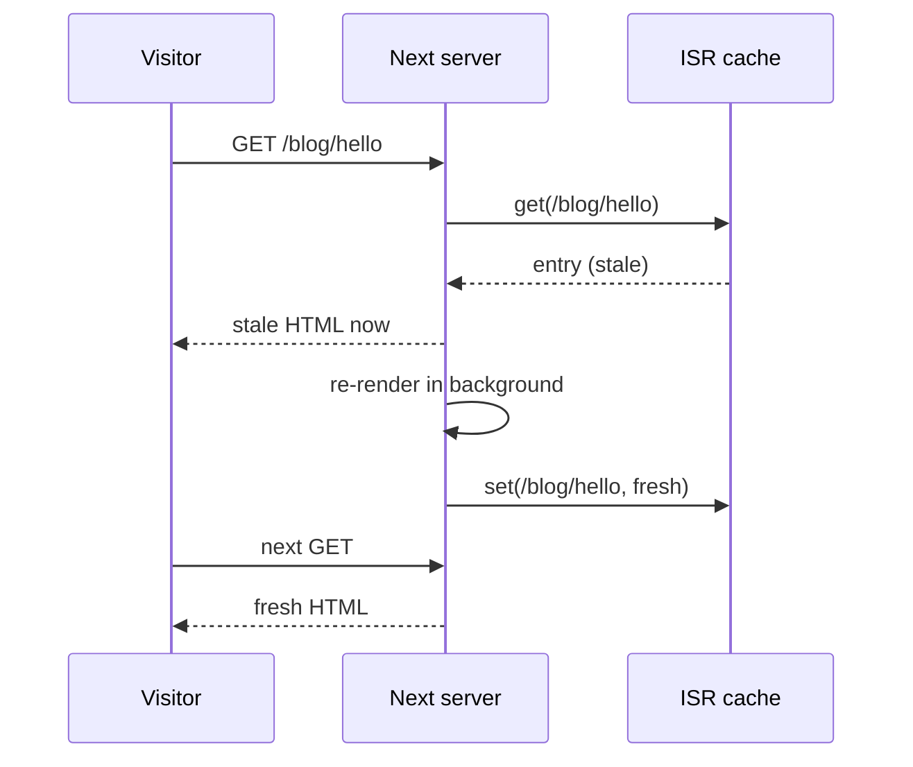

# SSG and ISR - Static Pages and generateStaticParams

> [!summary] TL;DR
> A page is **static (SSG)** when its prerender finishes without touching request data or uncached I/O. For dynamic segments, `generateStaticParams` lists the URLs to build. It runs before the pages, inside a `build-time-generator` store where `cookies()` throws. **ISR** is a static page with a lifetime. In the **legacy** model that lifetime comes from `export const revalidate`, `fetch(..., { next: { revalidate } })`, and the lowest value on the route wins. Unknown params are rendered on first request in blocking mode, or return 404 with `dynamicParams = false`. With **Cache Components** the lifetime comes from the `cacheLife` of every `'use cache'` scope in the page. `generateStaticParams` must return at least one entry. Unknown params get the **App Shell** at once and are upgraded to a full static page in the background. Both models serve stale content and regenerate behind it (`s-maxage` + `stale-while-revalidate`), and both can be invalidated on demand by tag or path ([[06 Revalidation - Tags, Paths and Refresh|part 06]]).

## What "static" means in Next 16

There is no `getStaticProps` and no "static" flag. The build prerenders every route ([[20 Rendering Strategies - A Decision Map|part 20]]). A route comes out static when nothing in it reads request data or waits on uncached I/O. You see the result in the build output:

```text
Route (app)
├ ○ /about
├ ● /blog/[slug]            (legacy: paths from generateStaticParams)
│ ├ /blog/hello-world
│ └ /blog/second-post
└ ◐ /shop/[slug]            (Cache Components: shell + holes)

○  (Static)             prerendered as static content
●  (SSG)                prerendered as static HTML (uses generateStaticParams)
◐  (Partial Prerender)  prerendered as static HTML with dynamic server-streamed content
```

The legacy `●` symbol is chosen when the page "isSSG". Under Cache Components the same function returns `○` for a fully static result and `◐` when anything postponed, so `●` does not appear there.[^tree-symbol]

Each static route produces an `.html` file, the RSC payload for client navigations, per-segment prefetch files and a `.meta` file with headers and (for PPR) the postponed state.[^export-write] These files are what the incremental cache serves later.

## A plain static page

No dynamic API, nothing slow. This is the same in both worlds.

```tsx
// app/about/page.tsx
import { readFile } from 'node:fs/promises'

// Read once at module scope: same for every request, not "uncached I/O" in render.
const team = JSON.parse(await readFile('./content/team.json', 'utf-8'))

export default function About() {
  return (
    <ul>
      {team.map((m: { id: string; name: string }) => (
        <li key={m.id}>{m.name}</li>
      ))}
    </ul>
  )
}
```

> [!warning] Cache Components and async reads inside render
> With Cache Components, `await readFile()` *inside* the component counts as uncached data. It must go in `'use cache'` or behind `<Suspense>`. The docs recommend module scope for files that never change per request. Synchronous reads (`fs.readFileSync`, `better-sqlite3`) and imports complete during the prerender and are static automatically.

## generateStaticParams: which URLs to build

`generateStaticParams` is exported from a page, layout or route handler that has a dynamic segment. It returns an array of param objects:

```tsx
// app/blog/[slug]/page.tsx
export async function generateStaticParams() {
  const posts = await getAllPostSlugs()
  return posts.map((slug) => ({ slug })) // [{ slug: 'hello-world' }, ...]
}
```

### How the build calls it

The build walks the route's segments from the top. For each segment that exports `generateStaticParams`, it calls the function once per parent param set and merges the results. A child sees the parent's params as `{ params }`.[^route-static-params]

Each call runs inside a special work unit store:[^call-gsp]

```ts
// packages/next/src/build/static-paths/app.ts (simplified)
const workUnitStore: BuildTimeGeneratorStore = {
  type: 'build-time-generator',
  functionName: 'generateStaticParams',
  phase: 'render',
  implicitTags,
  rootParams,
}
const generatedParams = await workUnitAsyncStorage.run(
  workUnitStore, generateStaticParams, { params: parentParams },
)
if (!Array.isArray(generatedParams)) throw new Error(/* Expected an array */)
if (isStaticExport && generatedParams.length === 0) throw new Error(/* at least one route */)
```

That store type explains a runtime error people hit: `cookies()`, `headers()` and `connection()` throw "runs at build time without an HTTP request" when called from `generateStaticParams`.[^cookies-gsp] There is no request at that point.

> [!tip] Nested segments
> `app/shop/[category]/[product]/page.tsx` can return both params at once (bottom-up). It can also let `app/shop/[category]/layout.tsx` return categories and receive each one as `params.category` (top-down). A layout can only generate params for segments at or above itself.

### The empty array rule differs between the worlds

The same function behaves differently when it returns `[]`:

| Return value | Legacy | Cache Components |
| --- | --- | --- |
| `[{ slug: 'a' }, ...]` | Those paths are built | Those paths are built, plus a fallback shell |
| `[]` | Nothing built at build time; every path renders on first request and is cached | **Build error** (`empty-generate-static-params`) |
| No array | Route is dynamic | Build error |

In the source, an empty result while PPR is on calls `throwEmptyGenerateStaticParamsError`. Without PPR the parent params just pass through.[^empty-gsp] The docs give the reason: at least one real param lets the build validate that the route does not read `cookies()`, `headers()` or `searchParams` where it should not. If you truly have no value at build time, return a placeholder and call `notFound()` for it in the page. The docs warn that this weakens build validation.

## ISR in the legacy model

### Time-based

Without Cache Components, ISR is configured with route segment config and `fetch` options:

```tsx
// app/blog/[slug]/page.tsx (legacy)
export const revalidate = 3600 // seconds; must be a literal, not 60 * 60

export async function generateStaticParams() {
  const posts = await fetch('https://cms.example.com/posts').then((r) => r.json())
  return posts.map((p: { slug: string }) => ({ slug: p.slug }))
}

export default async function Post({ params }: { params: Promise<{ slug: string }> }) {
  const { slug } = await params
  const post = await fetch(`https://cms.example.com/posts/${slug}`, {
    next: { revalidate: 600, tags: [`post:${slug}`] }, // can only lower the route's revalidate
  }).then((r) => r.json())
  return <article><h1>{post.title}</h1></article>
}
```

The route's effective lifetime is the **minimum** of every value found during the prerender:

- `createComponentTree` reads each layout's and page's `revalidate` export. It lowers `workUnitStore.revalidate` if the export is smaller, and throws `DynamicServerError` for `revalidate = 0` (unless the route is `force-static`).[^segment-revalidate]
- The patched `fetch` does the same with `next.revalidate`. A smaller value lowers the store's `revalidate`, and `0` marks the scope dynamic.[^fetch-revalidate]

The collected value is returned with the prerender result as `collectedRevalidate` and stored with the page.[^legacy-branch]

### What a request sees

On each request the response cache looks up the stored page. If it exists and is not past `expire`, it is returned **at once**. When it is stale, a regeneration runs behind it:[^swr]

```ts
// packages/next/src/server/response-cache/index.ts (simplified)
if (previousEntry && !isOnDemandRevalidate && previousEntry.isStale !== -1) {
  resolve(previousEntry)               // the user gets the cached page now
  if (!previousEntry.isStale) return   // still fresh: done
}
// stale (or missing): regenerate and store
```

`isStale === -1` is the exception. It means the entry passed its `expire` time (or an expired tag), and that request waits for a fresh render. The CDN gets matching headers: `s-maxage=<revalidate>` plus `stale-while-revalidate=<expire - revalidate>` when an expire is set. A `revalidate` of `0` means `private, no-cache, no-store`.[^cache-control]



### Unknown params: `dynamicParams`

A path not returned by `generateStaticParams` is decided by `dynamicParams`:

- `true` (default): rendered on the first request, stored, then treated like any other ISR page. In legacy mode the first visitor waits (`BLOCKING_STATIC_RENDER`).
- `false`: 404. The build marks the route `FallbackMode.NOT_FOUND`.[^fallback-mode]

```tsx
// app/blog/[slug]/page.tsx (legacy)
export const dynamicParams = false // only the generated slugs exist
```

### `force-static`

`export const dynamic = 'force-static'` forces a prerender even when the code reads request data. `cookies()` returns an empty cookie jar and `searchParams` becomes `{}` instead of making the route dynamic.[^force-static-cookies][^force-static-search] The docs list it, next to returning `[]`, as one way to get runtime ISR for all paths. Be careful: the page silently renders as if every visitor had no cookies.

## ISR with Cache Components

With Cache Components the route segment exports above are compile errors ([[20 Rendering Strategies - A Decision Map|part 20]]). Lifetimes live on the data instead.

### Lifetimes come from `cacheLife`

```tsx
// app/blog/[slug]/page.tsx (Cache Components)
import { Suspense } from 'react'
import { notFound } from 'next/navigation'
import { cacheLife, cacheTag } from 'next/cache'

export async function generateStaticParams() {
  const slugs = await getPopularSlugs() // at least one
  return slugs.map((slug) => ({ slug }))
}

export default function Post({ params }: PageProps<'/blog/[slug]'>) {
  return (
    <Suspense fallback={<ArticleSkeleton />}>
      <Article params={params} />
    </Suspense>
  )
}

async function Article({ params }: { params: Promise<{ slug: string }> }) {
  const { slug } = await params
  const post = await getPost(slug)
  if (!post) notFound()
  return <article><h1>{post.title}</h1></article>
}

async function getPost(slug: string) {
  'use cache'
  cacheLife('hours') // revalidate 1h, expire 1 day
  cacheTag(`post:${slug}`)
  return db.post.findUnique({ where: { slug } })
}
```

Every `'use cache'` result propagates its metadata into the enclosing prerender store. Tags are merged, and `stale`, `revalidate` and `expire` are lowered to the smallest value seen.[^propagate] So the page's ISR lifetime is the shortest `cacheLife` in its static output. The built-in profiles are `default` (revalidate 15 min, expire never), `seconds`, `minutes`, `hours`, `days`, `weeks` and `max`.[^profiles]

> [!warning] A short `cacheLife` takes data out of the page
> An entry with `revalidate: 0` or `expire` under 5 minutes is not prerendered at all. It becomes a hole that fills per request.[^cache-hole] `cacheLife('seconds')` therefore does not give you "ISR every second". It turns that part of the page into request-time rendering (PPR, [[23 PPR - Partial Prerendering with Cache Components|part 23]]).

### Unknown params: App Shell first, upgrade after

This is the biggest practical change in 16.x. For each dynamic route the build renders the listed params **and** one extra pass where unknown params are *fallback params*. Awaiting a fallback param gives a hanging promise (the same mechanism as `cookies()`), so that subtree becomes a hole.[^fallback-params]

The result for a two-level route `/[category]/[product]` with `tops/tee` listed:

| URL | What is served first | What happens next |
| --- | --- | --- |
| `/tops/tee` | Full static page | Nothing, until its lifetime expires |
| `/tops/overshirt` | Shell for `/tops/[product]`: category header rendered, product fallback | Product streams; the page is rendered in the background with `overshirt` and stored |
| `/shoes/sneaker` | Generic App Shell for `/[category]/[product]` | Both stream; background upgrade |

The build picks the fallback mode from these inputs. With `dynamicParams` off it is `NOT_FOUND`. Legacy uses `BLOCKING_STATIC_RENDER`. Cache Components uses `PRERENDER`, which means "serve a shell", unless `ensureStatic = 'navigation'` forces blocking.[^infer-fallback] At request time, with `partialPrefetching` on, a generic shell can be upgraded to a more specific prerendered shell (`FallbackMode.PRERENDER`) instead of blocking.[^runtime-fallback]

> [!info] Version note
> The docs mark this explicitly: "The App Shell for unlisted params is served from Next.js 16.3. Earlier versions wait for a full server render before sending the response."

### Partial Prefetching changes where you await `params`

The ISR-with-Cache-Components guide has two rules that depend on `partialPrefetching`:

- **On:** await `params` **inside** `<Suspense>`. The fallback is served at once for an unlisted path, then the URL-specific result is stored.
- **Off:** await `params` **outside** any Suspense boundary (including `loading.tsx`). The first request then waits, and an ISR entry is created for that URL. If you await inside Suspense without Partial Prefetching, Next keeps serving the shared fallback and never creates a URL-specific entry.

```tsx
// app/[category]/layout.tsx (partialPrefetching: true)
import { Suspense } from 'react'

export async function generateStaticParams() {
  return (await getTopCategories()).map((c) => ({ category: c.slug }))
}

export default function CategoryLayout(props: LayoutProps<'/[category]'>) {
  return (
    <>
      {/* not async: params is passed down as a promise */}
      <Suspense fallback={<h1>Category</h1>}>
        <CategoryHeader params={props.params} />
      </Suspense>
      {props.children}
    </>
  )
}
```

### "This page must be fully static": `ensureStatic`

`dynamicParams` is not available with Cache Components. The new tool for "this route must never render on the server per request" is `ensureStatic` (16.4.0):

```tsx
// app/guides/[id]/page.tsx
export const ensureStatic = 'navigation'
```

With `'navigation'` the build requires:

- an exported `generateStaticParams` with at least one complete param set,
- no uncached data, no `cookies()`/`headers()`/server `searchParams`, no `connection()`,
- no `'use cache'` with `expire` under 5 minutes, `stale` under 30 seconds, or `revalidate: 0`.

Unlisted params then **block** on the first request (no shell is served), and the finished page is stored.[^infer-fallback] Inside `prerenderToStream`, the `'navigation'` level switches validation to `throwIfDisallowedDynamicInStaticRoute`.[^ensure-validate] The other levels (`'shell'`, `'prefetch'`) keep only parts of the route static and are covered in [[03 Linking, Navigation and Prefetching|part 03]].

## On-demand ISR

Time is a fallback. Most content sites want "rebuild this page when the CMS publishes". Both models do it through tags:

```ts
// app/api/cms-webhook/route.ts
import { revalidateTag } from 'next/cache'

export async function POST(req: Request) {
  const { slug, secret } = await req.json()
  if (secret !== process.env.CMS_SECRET) return new Response('no', { status: 401 })
  revalidateTag(`post:${slug}`, 'max') // stale-while-revalidate with the "max" profile
  return Response.json({ ok: true })
}
```

- Legacy: tag with `fetch(..., { next: { tags } })` or `unstable_cache(..., { tags })`.
- Cache Components: tag with `cacheTag()` inside `'use cache'`. In a Server Action, `updateTag()` gives read-your-own-writes.

The two-argument `revalidateTag(tag, profile)`, `updateTag`, `revalidatePath` and how invalidation reaches the stored HTML are covered in [[06 Revalidation - Tags, Paths and Refresh|part 06]]. One trap matters here: `revalidatePath` marks entries stale, but **regeneration happens on the next request**, not at once.

## Choosing what to prerender

Prerendering every product in a 200,000-item catalog makes builds slow and fills storage with pages nobody visits before the next deploy. The guide's advice is to prerender the popular and predictable pages and let the rest be generated on demand.

- **Legacy:** return the top N from `generateStaticParams` and keep `dynamicParams = true`. The first visitor of a cold URL waits for a full render.
- **Cache Components:** return the top N. A cold URL gets the App Shell at once and is upgraded in the background. A `<Link prefetch={true}>` to it starts that upgrade before the click.

> [!danger] Pitfalls
> - **Builds see build-time data.** `generateStaticParams` and the prerender run in CI. A database that CI cannot reach fails the build. Bots and crawlers can also skip the static shell and get a blocking render at runtime, so the data source must work there too.
> - **A new deploy starts cold.** The ISR cache and `'use cache'` entries are scoped to a deployment (the build id is part of the key).
> - **Self-hosting with several instances** needs a shared cache handler, or each instance regenerates on its own ([[11 Configuration, Turbopack and Deployment|part 11]]).
> - **`revalidate = 60 * 10` is invalid.** The legacy export must be statically analyzable.
> - **Dev always renders on demand.** ISR timing can only be tested with `next build && next start`.

## Summary

SSG is what a prerender produces when nothing in the page reads request data or waits on uncached I/O. `generateStaticParams` lists the concrete URLs and runs in a `build-time-generator` store with no request. ISR adds a lifetime and serves the stale page while it regenerates. In the legacy model the lifetime is the smallest `revalidate` among segment exports and `fetch` options, and `dynamicParams` decides between blocking on-demand renders and 404s. With Cache Components the lifetime is the shortest `cacheLife` in the static output, `generateStaticParams` must return something, and unknown params get an App Shell that is upgraded in the background (16.3+). `ensureStatic = 'navigation'` is the new way to require a fully static route. When part of a page has to be fresh per request, the next step is [[22 SSR - Rendering Per Request|SSR]] or, better, [[23 PPR - Partial Prerendering with Cache Components|PPR]].

### Key takeaways

- **Static is an outcome**: a route is `○` when its prerender finishes without request data or uncached I/O.
- **`generateStaticParams`**: called top-down per segment inside a `build-time-generator` store, so `cookies()` and `headers()` throw there.
- **Empty array**: means "all paths on demand" in legacy mode, and is a build error with Cache Components.
- **Legacy lifetime**: the minimum of `revalidate` exports and `fetch` `next.revalidate`; `0` makes the route dynamic.
- **Cache Components lifetime**: the minimum `cacheLife` propagated from every `'use cache'` scope; `expire` under 5 minutes becomes a hole.
- **Stale-while-revalidate**: the response cache returns the stale entry and regenerates behind it, unless the entry passed `expire`.
- **Unknown params**: legacy blocks on first request or 404s (`dynamicParams = false`); Cache Components serves the App Shell, then upgrades.
- **`ensureStatic = 'navigation'`**: requires a fully static route and blocks unlisted params until their static page exists.
- **On-demand**: tag the data and call `revalidateTag`/`updateTag`; regeneration happens on the next request.

← [[20 Rendering Strategies - A Decision Map|Decision Map]] · [[00 Next.js in Practice Index|Index]] · [[22 SSR - Rendering Per Request|SSR]] →

[^tree-symbol]: `getTreeViewSymbol` — [packages/next/src/build/utils.ts#L236-L277](https://github.com/vercel/next.js/blob/v16.4.3/packages/next/src/build/utils.ts#L236-L277)
[^export-write]: `exportAppPage` writes `.rsc`, segment data, `.html` and `.meta` — [packages/next/src/export/routes/app-page.ts#L156-L254](https://github.com/vercel/next.js/blob/v16.4.3/packages/next/src/export/routes/app-page.ts#L156-L254)
[^route-static-params]: `generateRouteStaticParams` — [packages/next/src/build/static-paths/app.ts#L724-L823](https://github.com/vercel/next.js/blob/v16.4.3/packages/next/src/build/static-paths/app.ts#L724-L823)
[^call-gsp]: `callGenerateStaticParams` — [packages/next/src/build/static-paths/app.ts#L659-L709](https://github.com/vercel/next.js/blob/v16.4.3/packages/next/src/build/static-paths/app.ts#L659-L709)
[^cookies-gsp]: `cookies()` in a `build-time-generator` store — [packages/next/src/server/request/cookies.ts#L71-L74](https://github.com/vercel/next.js/blob/v16.4.3/packages/next/src/server/request/cookies.ts#L71-L74)
[^empty-gsp]: empty result with PPR throws — [packages/next/src/build/static-paths/app.ts#L780-L815](https://github.com/vercel/next.js/blob/v16.4.3/packages/next/src/build/static-paths/app.ts#L780-L815)
[^segment-revalidate]: segment `revalidate` lowers the store and `0` throws — [packages/next/src/server/app-render/create-component-tree.tsx#L344-L378](https://github.com/vercel/next.js/blob/v16.4.3/packages/next/src/server/app-render/create-component-tree.tsx#L344-L378)
[^fetch-revalidate]: patched `fetch` `next.revalidate` — [packages/next/src/server/lib/patch-fetch.ts#L1234-L1283](https://github.com/vercel/next.js/blob/v16.4.3/packages/next/src/server/lib/patch-fetch.ts#L1234-L1283)
[^legacy-branch]: legacy prerender branch and `collectedRevalidate` — [packages/next/src/server/app-render/app-render.tsx#L10168-L10265](https://github.com/vercel/next.js/blob/v16.4.3/packages/next/src/server/app-render/app-render.tsx#L10168-L10265)
[^swr]: response cache stale-while-revalidate — [packages/next/src/server/response-cache/index.ts#L384-L401](https://github.com/vercel/next.js/blob/v16.4.3/packages/next/src/server/response-cache/index.ts#L384-L401)
[^cache-control]: `getCacheControlHeader` — [packages/next/src/server/lib/cache-control.ts#L17-L35](https://github.com/vercel/next.js/blob/v16.4.3/packages/next/src/server/lib/cache-control.ts#L17-L35)
[^fallback-mode]: `calculateFallbackMode` — [packages/next/src/build/static-paths/app.ts#L307-L319](https://github.com/vercel/next.js/blob/v16.4.3/packages/next/src/build/static-paths/app.ts#L307-L319)
[^force-static-cookies]: `cookies()` under `force-static` — [packages/next/src/server/request/cookies.ts#L48-L53](https://github.com/vercel/next.js/blob/v16.4.3/packages/next/src/server/request/cookies.ts#L48-L53)
[^force-static-search]: `searchParams` under `force-static` — [packages/next/src/server/request/search-params.ts#L212-L220](https://github.com/vercel/next.js/blob/v16.4.3/packages/next/src/server/request/search-params.ts#L212-L220)
[^propagate]: `propagateCacheLifeAndTagsToRevalidateStore` — [packages/next/src/server/use-cache/use-cache-wrapper.ts#L986-L1009](https://github.com/vercel/next.js/blob/v16.4.3/packages/next/src/server/use-cache/use-cache-wrapper.ts#L986-L1009)
[^profiles]: default `cacheLife` profiles — [packages/next/src/server/config-shared.ts#L2346-L2382](https://github.com/vercel/next.js/blob/v16.4.3/packages/next/src/server/config-shared.ts#L2346-L2382)
[^cache-hole]: short-lived entry omitted from the prerender — [packages/next/src/server/use-cache/use-cache-wrapper.ts#L2540-L2565](https://github.com/vercel/next.js/blob/v16.4.3/packages/next/src/server/use-cache/use-cache-wrapper.ts#L2540-L2565); thresholds — [packages/next/src/server/use-cache/constants.ts#L3-L5](https://github.com/vercel/next.js/blob/v16.4.3/packages/next/src/server/use-cache/constants.ts#L3-L5)
[^fallback-params]: `createStaticPrerenderParams` (fallback params hang) — [packages/next/src/server/request/params.ts#L321-L408](https://github.com/vercel/next.js/blob/v16.4.3/packages/next/src/server/request/params.ts#L321-L408); `makeHangingParams` — [#L717-L743](https://github.com/vercel/next.js/blob/v16.4.3/packages/next/src/server/request/params.ts#L717-L743)
[^infer-fallback]: inferred fallback mode (`NOT_FOUND`, `BLOCKING_STATIC_RENDER`, `PRERENDER`) — [packages/next/src/build/static-paths/app.ts#L1153-L1169](https://github.com/vercel/next.js/blob/v16.4.3/packages/next/src/build/static-paths/app.ts#L1153-L1169)
[^runtime-fallback]: request-time fallback mode with Partial Prefetching — [packages/next/src/build/templates/app-page-runtime.ts#L1227-L1258](https://github.com/vercel/next.js/blob/v16.4.3/packages/next/src/build/templates/app-page-runtime.ts#L1227-L1258)
[^ensure-validate]: `ensureStatic = 'navigation'` validation in `prerenderToStream` — [packages/next/src/server/app-render/app-render.tsx#L9979-L9997](https://github.com/vercel/next.js/blob/v16.4.3/packages/next/src/server/app-render/app-render.tsx#L9979-L9997)
