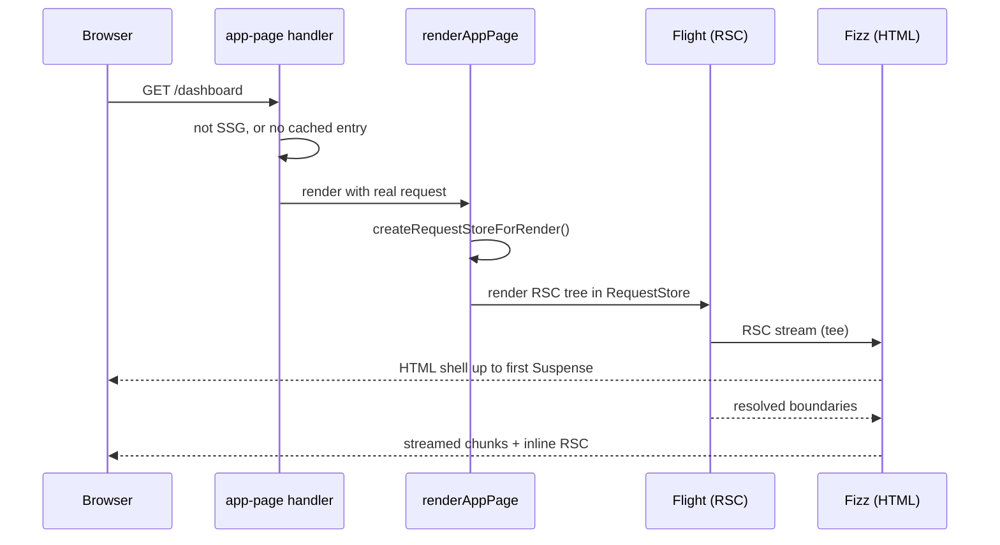

# SSR - Rendering Per Request

> [!summary] TL;DR
> SSR means the server runs your component tree for **each request**, with the real `cookies()`, `headers()` and `searchParams`, and streams HTML plus the RSC payload back. For that request, `renderAppPage` creates a `RequestStore` from the incoming headers and cookies, and `renderToStream` runs Flight and Fizz inside it. Every request API then takes its `'request'` branch and returns real data. In the **legacy** model a route becomes SSR as a whole the moment the prerender touches a dynamic API, or when you export `dynamic = 'force-dynamic'` or `revalidate = 0`. With **Cache Components**, request-time work is normally a Suspense hole inside a static shell (PPR). Whole-route SSR is the exception, chosen with `instant = false` or a `<Suspense>` above `<body>`, and shown as `ƒ` in the build. Either way the response is sent with `Cache-Control: private, no-cache, no-store`. Inside it you can still cache data with `'use cache'`, dedupe with React `cache`, and stream slow parts.

## When SSR is the right call

SSR costs a server render per request, and the first byte waits for whatever sits above the first Suspense boundary. It pays off when:

- **The whole page depends on who is asking.** A dashboard where even the layout shows account data, or a page whose structure depends on a feature-flag cookie.
- **Nothing useful can be shown first.** A search results page where the header is trivial and every result depends on `searchParams`. A PPR shell with one spinner gains little here.
- **The response must be computed from the request.** A/B variant chosen from headers, geo-specific legal text, or a page that must never be cached anywhere.
- **Crawlers need blocking metadata.** Next already handles HTML-limited bots by skipping the static shell (see [[#Bots get a blocking render]]).

If most of the page is the same for everyone, prefer PPR ([[23 PPR - Partial Prerendering with Cache Components|part 23]]). If the data only exists in the browser, prefer CSR ([[24 CSR - Client-Rendered Islands|part 24]]).

## How a route becomes per-request

### Legacy model: one dynamic read deopts the route

Without Cache Components the prerender runs in a `'prerender-legacy'` store. Any of these throws a `DynamicServerError` and the route is recorded as `revalidate: 0` (`ƒ`):

- `cookies()`, `headers()`, `draftMode()`, `connection()`
- `await searchParams`
- `fetch(..., { cache: 'no-store' })` or `next: { revalidate: 0 }`
- `export const revalidate = 0`

The interrupt itself is `throwToInterruptStaticGeneration`. It sets `prerenderStore.revalidate = 0`, records the expression as `dynamicUsageDescription`, and throws.[^throw-interrupt] The legacy `markCurrentScopeAsDynamic` (used by `no-store` fetches) does the same for `prerender-legacy`, and throws a `StaticGenBailoutError` instead when the route exports `dynamic = "error"`.[^mark-dynamic]

You can also ask for SSR up front:

```tsx
// app/dashboard/page.tsx (legacy)
export const dynamic = 'force-dynamic'
```

During a prerender, `createComponentTree` sees `force-dynamic`, sets `workStore.forceDynamic` and throws a `DynamicServerError` ("won't be rendered statically").[^force-dynamic-tree] The build also sets the route's `revalidate` to `0` when it reads that config.[^force-dynamic-build] At request time `forceDynamic` short-circuits `markCurrentScopeAsDynamic`, because "the entire page is already dynamic".[^mark-dynamic]

> [!warning] Legacy SSR is all-or-nothing
> One `cookies()` call in a shared layout makes **every** page under it SSR. That is the main reason Cache Components exists. If you are staying on the legacy model, keep request reads in the leaves, or move them into Client Components.

### Cache Components: SSR is an explicit choice

With Cache Components, the same `cookies()` call does not change the route. It returns a hanging promise during the prerender, and its subtree becomes a hole ([[20 Rendering Strategies - A Decision Map|part 20]]). If that read is **not** inside a `<Suspense>` boundary, the build reports a blocking route. So whole-route SSR has to be requested. There are two ways:

```tsx
// app/dashboard/layout.tsx (Cache Components)
// Opt this segment out of instant validation: it may block on request data.
export const instant = false

export default async function DashboardLayout({ children }: LayoutProps<'/dashboard'>) {
  const session = await getSession() // reads cookies(), not wrapped in Suspense
  return <Shell user={session.user}>{children}</Shell>
}
```

`instant = false` makes `isPageAllowedToBlock` return true. `prerenderToStream` then sets `allowEmptyStaticShell`, so `throwIfDisallowedDynamic` returns early instead of failing.[^allowed-to-block][^allow-empty][^throw-disallowed] The prerender produces an empty shell, and the build marks the route `ƒ`. An empty static shell "is equivalent to a dynamic page".[^tree-symbol]

The second way is structural. A `<Suspense>` boundary **above `<body>`** in the root layout is read as "this shell is allowed to be empty". The validation code records it as `hasSuspenseAboveBody` and treats it like the opt-in.[^track-hole]

| Want | Cache Components | Legacy |
| --- | --- | --- |
| One region per request | `<Suspense>` around a component that reads request data or calls `connection()` | Not possible on the server; use a Client Component |
| Whole segment per request, may block | `export const instant = false` | `export const dynamic = 'force-dynamic'` |
| Per request but no request data used | `await connection()` inside Suspense | `export const dynamic = 'force-dynamic'` or `connection()` |

### `connection()`: dynamic without reading the request

Sometimes a value must be computed per request but does not come from the request: a random A/B bucket, the current time, a request id. `connection()` says "from here on, this is request time":

```tsx
// app/lottery/page.tsx
import { Suspense } from 'react'
import { connection } from 'next/server'

async function Ticket() {
  await connection() // never resolves during the prerender
  return <p>Your number: {Math.floor(Math.random() * 1000)}</p>
}

export default function Page() {
  return (
    <Suspense fallback={<p>Drawing…</p>}>
      <Ticket />
    </Suspense>
  )
}
```

In a Cache Components prerender, `connection()` returns `makeDynamicHangingPromise`. In a legacy prerender it calls `throwToInterruptStaticGeneration('connection', …)`.[^connection] With Cache Components this is also the required fix for `Math.random()`, `Date.now()` and `crypto.randomUUID()` outside `'use cache'`. See [[10 Errors, Redirects and Request Lifecycle APIs#connection() and io(): marking the request boundary|connection() and io()]] for the behaviour in every work unit.

## What the server does for one request



### The RequestStore

`renderAppPage` binds `createRequestStoreForRender` with the request, response, URL, root params and implicit tags, then creates the store.[^request-store-bind] The store is built from `req.headers` and an `onUpdateCookies` callback that writes `Set-Cookie` to the response.[^request-store] It holds the `url`, read-only `headers`, `cookies` and `mutableCookies` (writable during Server Actions).[^request-store-type]

From here every request API takes its `'request'` branch. For `cookies()` that branch tracks the dynamic access for dev tooling and returns the real cookies. In a Server Action phase it returns the mutable ones.[^cookies-request]

### Streaming the response

`renderAppPage` calls `renderToStream` with that store.[^render-app-page] For a regular dynamic render, `renderToStream` runs the Fizz HTML renderer over the RSC stream inside `workUnitAsyncStorage.run(requestStore, …)`. It then pipes the result through `continueFizzStream`, which injects the inline RSC payload, server-inserted HTML (CSS-in-JS, metadata) and the bootstrap scripts.[^dynamic-render]

`waitForAllReady` is `supportsDynamicResponse !== true`.[^wait-all-ready] For a real dynamic request that is `false`, so the response **streams**. The HTML up to the first unresolved `<Suspense>` boundary goes out first, and later boundaries arrive as chunks. For a static generation, the whole document is buffered so it can be stored.

That is why `loading.tsx` and `<Suspense>` still matter in SSR. They do not make anything static, but they decide how early the first byte goes out. See [[04 Data Fetching and Streaming|Data Fetching and Streaming]] for the streaming patterns, and [[07 Priorities, Transitions and Concurrency|React Concepts: priorities]] for why React can reveal boundaries in any order. Once the first byte is out, the status code is fixed: see [[10 Errors, Redirects and Request Lifecycle APIs#How a thrown notFound() travels|how a thrown notFound() travels]].

### Headers on an SSR response

A dynamic page response carries `revalidate: 0`. `getCacheControlHeader` turns that into `private, no-cache, no-store, max-age=0, must-revalidate`.[^cache-control] CDNs and browsers will not store it. If you want edge caching for a per-request page, it is not SSR. Make it ISR or PPR.

## Caching inside an SSR page

"Rendered per request" does not mean "fetch everything per request". Three tools keep SSR cheap:

```tsx
// app/dashboard/page.tsx (Cache Components)
import { Suspense } from 'react'
import { cookies } from 'next/headers'
import { cache } from 'react'
import { cacheLife, cacheTag } from 'next/cache'

export const instant = false // whole dashboard is per user

// 1. Per-request dedupe: many components can call this, the DB is hit once
const getSession = cache(async () => {
  const token = (await cookies()).get('session')?.value
  return token ? verifySession(token) : null
})

// 2. Cross-request cache keyed by an argument extracted from the request
async function getTeamStats(teamId: string) {
  'use cache'
  cacheLife('minutes')
  cacheTag(`team:${teamId}`)
  return db.stats.forTeam(teamId)
}

export default async function Dashboard() {
  const session = await getSession()
  if (!session) return <SignIn />
  return (
    <>
      <h1>Hello {session.user.name}</h1>
      {/* 3. Stream the slow part even in SSR */}
      <Suspense fallback={<StatsSkeleton />}>
        <Stats teamId={session.teamId} />
      </Suspense>
    </>
  )
}

async function Stats({ teamId }: { teamId: string }) {
  const stats = await getTeamStats(teamId)
  return <StatsGrid stats={stats} />
}
```

- **React `cache`** dedupes within one render. It is the basis of the Data Access Layer in [[27 Server-Aware Auth - Sessions, Proxy and the DAL|part 27]].
- **`'use cache'` with arguments** shares results across requests. You cannot call `cookies()` *inside* it: the `'cache'` branch of `cookies()` throws.[^cookies-cache] Read the cookie outside and pass the value in. It becomes part of the cache key.
- **`'use cache: private'`** caches a function that reads cookies directly, in the browser only ([[05 Cache Components - use cache, cacheLife and cacheTag|part 05]]).

In the legacy model the equivalents are `fetch` with `cache: 'force-cache'` / `next.revalidate`, and `unstable_cache`. They keep working inside a dynamic route, because the data cache and the page are separate.

## Bots get a blocking render

PPR streams metadata after the shell. Some crawlers only read the initial `<head>`. Next checks the user agent against `htmlLimitedBots`. When a PPR route is requested by such a bot, `shouldForceDynamicPPRRender` is set and `isSSG` becomes false, so the bot gets a fresh blocking render with metadata in the head.[^bots] The metadata side is in [[09 Metadata, Images, Fonts and Scripts#Streaming metadata (16.x behaviour)|Streaming metadata]]. This is automatic SSR you did not ask for. It is also why the data your prerender used at build time must be reachable at runtime, or those bots get a 500.

## Common mistakes

> [!bug] "My page is `ƒ` and I don't know why" (legacy)
> Run `next build --debug-prerender` (do not deploy that build), or read the build log. The prerender records `dynamicUsageDescription`, for example "Route /blog couldn't be rendered statically because it used `cookies`", and the export step logs it with the stack.[^export-catch] The usual culprit is a header component or analytics helper in the root layout.

> [!bug] "`instant = false` everywhere"
> It silences validation and removes the shell. Use it on the segment that truly blocks (often an authenticated layout), and keep `instant` validation on the pages below so their navigations stay instant. A child can still be validated when the parent sets `false`.

> [!bug] Reading `searchParams` in a layout
> Layouts do not receive `searchParams`. Reading the query in a page is fine, but in the legacy model it makes the page SSR. With Cache Components, put the reading component inside Suspense so the rest of the page stays in the shell.

> [!bug] Expecting `Date.now()` to be per request
> In a legacy static page it is frozen at build time. With Cache Components it is an error until you put it after `connection()` or inside `'use cache'`.

## Summary

SSR is a full server render per request. `renderAppPage` builds a `RequestStore` from the incoming request, so `cookies()`, `headers()` and `searchParams` take their `'request'` branch. `renderToStream` then streams Fizz HTML with the inline RSC payload, flushing at each Suspense boundary. In the legacy model any dynamic read during the prerender throws and turns the whole route into SSR, and `force-dynamic` or `revalidate = 0` force it. With Cache Components, request-time work is a Suspense hole by default. Whole-route SSR is opted into with `instant = false` or Suspense above `<body>`, which allows an empty shell (`ƒ`). Keep SSR cheap with React `cache`, `'use cache'` keyed by values you read outside it, and streaming. When most of the page is shared, the better tool is [[23 PPR - Partial Prerendering with Cache Components|PPR]].

### Key takeaways

- **Request store**: `createRequestStoreForRender` wraps the request's headers and cookies, and every request API reads real data from it.
- **Streaming by default**: `waitForAllReady` is off for dynamic responses, so HTML flushes at each Suspense boundary.
- **Legacy deopt**: one dynamic read in a prerender throws `DynamicServerError` and makes the whole route `ƒ`.
- **`force-dynamic`**: legacy only; it sets `forceDynamic`, throws during prerender, and sets the route's `revalidate` to 0.
- **Cache Components opt-in**: `instant = false` or Suspense above `<body>` allows an empty shell; otherwise an unwrapped request read is a build error.
- **`connection()`**: marks request time without reading the request; required before random values and timestamps.
- **Not cacheable**: SSR responses are sent with `private, no-cache, no-store`.
- **Cache inside**: dedupe with React `cache`, share with `'use cache'` arguments, never call `cookies()` inside `'use cache'`.
- **Bots**: HTML-limited crawlers skip the PPR shell and get a blocking render.

← [[21 SSG and ISR - Static Pages and generateStaticParams|SSG & ISR]] · [[00 Next.js in Practice Index|Index]] · [[23 PPR - Partial Prerendering with Cache Components|PPR]] →

[^throw-interrupt]: `throwToInterruptStaticGeneration` — [packages/next/src/server/app-render/dynamic-rendering.ts#L159-L175](https://github.com/vercel/next.js/blob/v16.4.3/packages/next/src/server/app-render/dynamic-rendering.ts#L159-L175)
[^mark-dynamic]: `markCurrentScopeAsDynamic` — [packages/next/src/server/app-render/dynamic-rendering.ts#L91-L151](https://github.com/vercel/next.js/blob/v16.4.3/packages/next/src/server/app-render/dynamic-rendering.ts#L91-L151)
[^force-dynamic-tree]: `dynamic` segment config in `createComponentTree` — [packages/next/src/server/app-render/create-component-tree.tsx#L304-L336](https://github.com/vercel/next.js/blob/v16.4.3/packages/next/src/server/app-render/create-component-tree.tsx#L304-L336)
[^force-dynamic-build]: `force-dynamic` sets `revalidate = 0` without PPR — [packages/next/src/build/utils.ts#L981-L986](https://github.com/vercel/next.js/blob/v16.4.3/packages/next/src/build/utils.ts#L981-L986)
[^allowed-to-block]: `isPageAllowedToBlock` — [packages/next/src/server/app-render/instant-validation/instant-config.tsx#L80-L110](https://github.com/vercel/next.js/blob/v16.4.3/packages/next/src/server/app-render/instant-validation/instant-config.tsx#L80-L110)
[^allow-empty]: `allowEmptyStaticShell` — [packages/next/src/server/app-render/app-render.tsx#L8929-L8931](https://github.com/vercel/next.js/blob/v16.4.3/packages/next/src/server/app-render/app-render.tsx#L8929-L8931)
[^throw-disallowed]: `throwIfDisallowedDynamic` — [packages/next/src/server/app-render/dynamic-rendering-validation.ts#L838-L907](https://github.com/vercel/next.js/blob/v16.4.3/packages/next/src/server/app-render/dynamic-rendering-validation.ts#L838-L907)
[^tree-symbol]: `getTreeViewSymbol` — [packages/next/src/build/utils.ts#L236-L277](https://github.com/vercel/next.js/blob/v16.4.3/packages/next/src/build/utils.ts#L236-L277)
[^track-hole]: `trackDynamicHoleInStaticShell` (`hasSuspenseAboveBody`) — [packages/next/src/server/app-render/dynamic-rendering-validation.ts#L718-L784](https://github.com/vercel/next.js/blob/v16.4.3/packages/next/src/server/app-render/dynamic-rendering-validation.ts#L718-L784)
[^connection]: `connection()` — [packages/next/src/server/request/connection.ts#L79-L104](https://github.com/vercel/next.js/blob/v16.4.3/packages/next/src/server/request/connection.ts#L79-L104)
[^request-store-bind]: `renderAppPage` creates the request store — [packages/next/src/server/app-render/app-render.tsx#L2975-L2990](https://github.com/vercel/next.js/blob/v16.4.3/packages/next/src/server/app-render/app-render.tsx#L2975-L2990)
[^request-store]: `createRequestStoreForRender` — [packages/next/src/server/async-storage/request-store.ts#L184-L219](https://github.com/vercel/next.js/blob/v16.4.3/packages/next/src/server/async-storage/request-store.ts#L184-L219)
[^request-store-type]: `RequestStore` — [packages/next/src/server/app-render/work-unit-async-storage.external.ts#L36-L60](https://github.com/vercel/next.js/blob/v16.4.3/packages/next/src/server/app-render/work-unit-async-storage.external.ts#L36-L60)
[^cookies-request]: `cookies()` `'request'` branch — [packages/next/src/server/request/cookies.ts#L107-L138](https://github.com/vercel/next.js/blob/v16.4.3/packages/next/src/server/request/cookies.ts#L107-L138)
[^render-app-page]: `renderAppPage` → `renderToStream` — [packages/next/src/server/app-render/app-render.tsx#L3134-L3150](https://github.com/vercel/next.js/blob/v16.4.3/packages/next/src/server/app-render/app-render.tsx#L3134-L3150)
[^dynamic-render]: regular dynamic render in `renderToStream` (web streams) — [packages/next/src/server/app-render/app-render.tsx#L4344-L4402](https://github.com/vercel/next.js/blob/v16.4.3/packages/next/src/server/app-render/app-render.tsx#L4344-L4402)
[^wait-all-ready]: `waitForAllReady` — [packages/next/src/server/app-render/app-render.tsx#L3599](https://github.com/vercel/next.js/blob/v16.4.3/packages/next/src/server/app-render/app-render.tsx#L3599)
[^cache-control]: `getCacheControlHeader` — [packages/next/src/server/lib/cache-control.ts#L17-L35](https://github.com/vercel/next.js/blob/v16.4.3/packages/next/src/server/lib/cache-control.ts#L17-L35)
[^cookies-cache]: `cookies()` inside `'use cache'` throws — [packages/next/src/server/request/cookies.ts#L63-L70](https://github.com/vercel/next.js/blob/v16.4.3/packages/next/src/server/request/cookies.ts#L63-L70)
[^bots]: `serveStreamingMetadata`, `shouldForceDynamicPPRRender`, `isSSG` — [packages/next/src/build/templates/app-page-runtime.ts#L596-L616](https://github.com/vercel/next.js/blob/v16.4.3/packages/next/src/build/templates/app-page-runtime.ts#L596-L616)
[^export-catch]: `exportAppPage` dynamic-usage catch and warning — [packages/next/src/export/routes/app-page.ts#L287-L312](https://github.com/vercel/next.js/blob/v16.4.3/packages/next/src/export/routes/app-page.ts#L287-L312)
