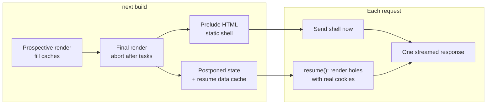
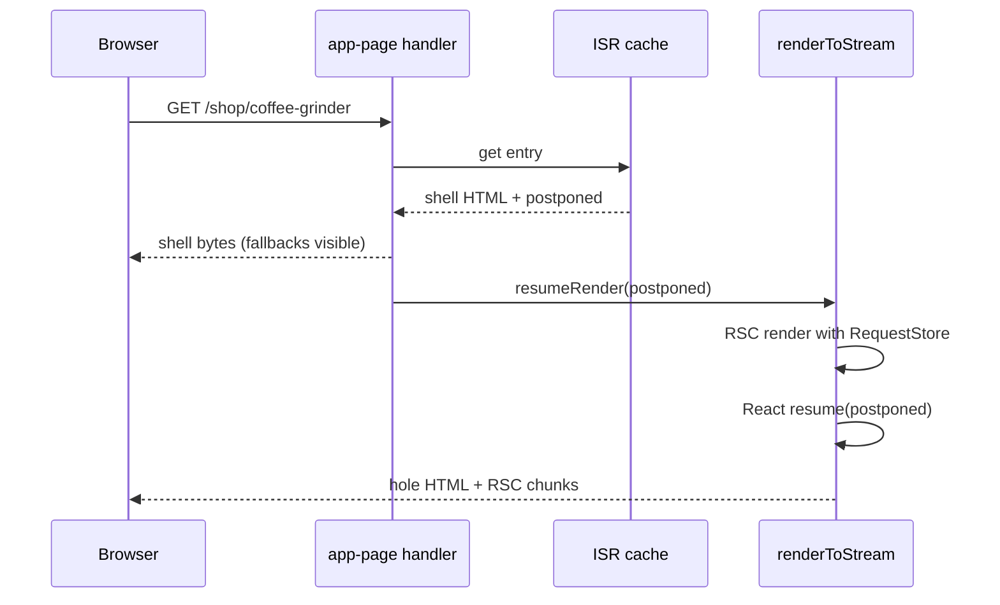

# PPR - Partial Prerendering with Cache Components

> [!summary] TL;DR
> With `cacheComponents: true`, every App Router page is prerendered in two passes. A **prospective** render fills all `'use cache'` entries. A **final** render then runs in a few sequential tasks and is aborted. Request APIs (`cookies()`, `searchParams`, unknown `params`, `connection()`, uncached `fetch`) return promises that never resolve during the prerender, and uncached I/O simply does not finish in time. Every subtree still pending at the abort becomes a **hole**. React's `prerender` emits the HTML **prelude**, which is the static shell with Suspense fallbacks, plus a `postponed` blob. Next serializes the blob with the **resume data cache** (the cached results the shell used) into `metadata.postponed` and stores it next to the HTML (`◐`). On a request, `next start` sends the cached shell at once and calls `resumeRender`. That re-renders the RSC tree with real request data and passes the postponed state to React's `resume`, which streams only the holes into the same response. A CDN can do the same split with a `POST` and `next-resume: 1`. The rule you design around: **every hole must sit inside a `<Suspense>` boundary**, and the deeper the hole, the bigger the shell.

## The idea in one page

PPR answers "what if a route could be static and dynamic at the same time?". The static part is computed once, at build or on revalidation. The dynamic part is computed per request. Both arrive in **one** HTTP response.



Compare that with the other strategies in [[20 Rendering Strategies - A Decision Map|part 20]]. SSG has no holes. SSR has no shell. CSR fills the holes from the browser after hydration, which costs a second round trip. PPR fills them on the server in the same response.

PPR is not a separate switch any more. A page "supports partial prerendering when it is an app page and Cache Components is enabled", and `experimental.ppr` now throws a deprecation error.[^ppr-route][^ppr-deprecated]

## A page built for PPR

```tsx
// app/shop/[slug]/page.tsx
import { Suspense } from 'react'
import { cookies } from 'next/headers'
import { cacheLife, cacheTag } from 'next/cache'

export async function generateStaticParams() {
  return [{ slug: 'coffee-grinder' }]
}

export default function ProductPage({ params }: PageProps<'/shop/[slug]'>) {
  return (
    <main>
      <Header />                                   {/* static */}
      <Suspense fallback={<DetailsSkeleton />}>
        <Details params={params} />                {/* cached: in the shell */}
      </Suspense>
      <Suspense fallback={<button>Add to cart</button>}>
        <CartButton params={params} />             {/* hole: reads a cookie */}
      </Suspense>
      <Suspense fallback={<p>Loading reviews…</p>}>
        <LiveReviews params={params} />            {/* hole: uncached I/O */}
      </Suspense>
    </main>
  )
}

async function Details({ params }: { params: Promise<{ slug: string }> }) {
  const { slug } = await params
  const p = await getProduct(slug)
  return <section><h1>{p.name}</h1><p>{p.price}</p></section>
}

async function getProduct(slug: string) {
  'use cache'
  cacheLife('hours')
  cacheTag(`product:${slug}`)
  return db.product.findUniqueOrThrow({ where: { slug } })
}

async function CartButton({ params }: { params: Promise<{ slug: string }> }) {
  const { slug } = await params
  const cart = (await cookies()).get('cart')?.value?.split(',') ?? []
  return <button>{cart.includes(slug) ? 'In cart' : 'Add to cart'}</button>
}

async function LiveReviews({ params }: { params: Promise<{ slug: string }> }) {
  const { slug } = await params
  const reviews = await fetch(`https://reviews.example.com/${slug}`).then((r) => r.json())
  return <ReviewList reviews={reviews} />
}
```

`next build` prints `◐ /shop/coffee-grinder`. The shell contains the header, the product details and two fallbacks. The cart button and the reviews are rendered per request.

## Build time: how holes are found

### Pass 1: the prospective render

The Cache Components branch of `prerenderToStream` starts with a comment that explains the whole design. It renders the RSC stream first "allowing any cache reads to resolve", then restarts and aborts "after a single Task". It cannot abort on the first dynamic API, "because we need to ensure all caches can be filled".[^cc-branch]

The first pass runs in a `'prerender'` store with a `CacheSignal`. Next waits for every pending cache fill and module import, then aborts this render and throws its output away.[^prospective] If a cache scope did something forbidden, such as reading `cookies()` inside `'use cache'`, the error is already on `workStore.invalidDynamicUsageError` and the build stops here.

### Pass 2: the final render

Now every cache entry is warm in the prerender's resume data cache. The final render runs inside `runInSequentialTasks`. That helper schedules the first function and then each following callback on its own timer task.[^sequential] Between tasks a `StagedRenderingController` advances through the render stages: `ShellStatic`, `PrefetchStatic`, `NavigationStatic`, `Static`.[^final-render][^stages] In the last task, if the stream is still pending, the result is marked partial ("we have blocked for longer than a Task and we assume there is something unfinished"), and the React controller is aborted.[^partial]

Each kind of access ends up pending for a different reason:

| Access | Why it is still pending at the abort |
| --- | --- |
| `cookies()`, `headers()` | Returns `makeSessionDataHangingPromise`, which never resolves[^cookies-hang] |
| `searchParams` | Returns a URL-data hanging promise[^search-hang] |
| `params` with a fallback (unknown) value | `makeHangingParams`[^params-hang] |
| `connection()`, `fetch` with `no-store` | `makeDynamicHangingPromise`[^connection][^fetch-hang] |
| Plain `fetch`, DB query, any network I/O | Real I/O cannot settle inside a few synchronous tasks |
| `'use cache'` with `expire` < 5 min or `revalidate: 0` | The entry is omitted from the prerender on purpose[^cache-hole] |

The hanging promises are not left dangling forever. They register a listener on the `renderSignal` and reject with a `HangingPromiseRejectionError` when the prerender aborts. That lets React record where the I/O was pending.[^hanging-impl] For `connection()` in every work unit, see [[10 Errors, Redirects and Request Lifecycle APIs#connection() and io(): marking the request boundary|connection() and io()]].

> [!info] Synchronous IO aborts at once
> A few APIs end the prerender immediately instead of waiting for the abort. During builds Next wraps `Date.now()` and similar sources of synchronous IO (the clock, randomness). In a `'prerender'` or `'prerender-client'` store each call goes through `io()`, which aborts the prerender at that point.[^io] `abortOnSynchronousPlatformIOAccess` calls `prerenderStore.controller.abort(error)` and records the expression.[^sync-abort] After the final render, `throwIfSyncIOUsed` turns that into a build error, because a cut-off root chunk can leave the payload unusable.[^sync-check]

### Validation: holes must be inside Suspense

Each hole is checked against its component stack. Under a `<Suspense>` it is "allowed dynamic". Under `<Suspense>` above `<body>` it marks the shell as allowed to be empty. In metadata or the viewport it gets a dedicated error. Anything else becomes a "blocking route" error.[^track-hole] `throwIfDisallowedDynamic` then fails the build when the prelude is incomplete and errors were collected, unless the route opted out with `instant = false`.[^throw-disallowed]

So the Suspense boundary is doing two jobs. It is a **streaming** boundary for React, and it is the line where Next is allowed to cut the shell.

### The prelude and the postponed state

The HTML side runs React's static `prerender` over the RSC stream in a `'prerender-client'` store. It returns `{ prelude, postponed }`.[^client-prerender] Then there are three outcomes:

1. **Partial result, `postponed != null`.** The usual `◐` case. `getDynamicHTMLPostponedState` stores React's postponed data with a flag saying whether the prelude is empty or full, plus the fallback params and the resume data cache.[^postponed-html]
2. **Partial result, `postponed == null`.** The HTML completed but the RSC did not, so only data is missing. `getDynamicDataPostponedState` stores just the resume data cache. On a request, the full HTML is reused and only a new RSC payload is streamed after it.[^postponed-data][^resume-data]
3. **Not partial, but React postponed anyway.** Something suspended in the HTML pass without any dynamic data. Next calls `resumeAndAbort` right away so those boundaries switch to client rendering, and stores a complete document.[^resume-abort]

The postponed state is serialized as `<length>:<postponed JSON><resume data cache>`, and the cache part is compressed with deflate by default. If `experimental.maxPostponedStateSize` is exceeded, Next warns that the route might not resume after a future change.[^serialize] The two state shapes are typed in `postponed-state.ts`: `DynamicState.DATA = 1` ("the dynamic access occurred during the RSC render phase") and `DynamicState.HTML = 2`.[^dynamic-state]

> [!tip] Why the resume data cache travels with the shell
> The shell was built from specific `'use cache'` results. If the resume fetched those again and got newer data, the holes could disagree with the shell around them. Shipping the cache inside the postponed state keeps one response consistent. The same cache is reused for client navigations and Server Action re-renders of the page.[^rdc-nav]

The export step writes the HTML, the per-segment prefetch files and a `.meta` file whose `postponed` field holds that state. Fully static outputs (no postponed state, no fallback params) also get a route `.rsc` file.[^export]

## Request time: shell first, then resume

### On `next start`

The app page handler finds the cached entry. If it has no postponed state, or this is an RSC request, it just sends the stored body. Otherwise it calls `resumeRender(body, cachedData.postponed)` and sends the result with `cacheControl: { revalidate: 0 }`. The combined response is per request, even though its first bytes came from the cache.[^serve] Because the shell goes out first, the status code is already fixed when the holes render ([[10 Errors, Redirects and Request Lifecycle APIs#How a thrown notFound() travels|how a thrown notFound() travels]]). HTML-limited bots skip the shell and get a blocking render ([[22 SSR - Rendering Per Request#Bots get a blocking render|Bots get a blocking render]], [[09 Metadata, Images, Fonts and Scripts#Streaming metadata (16.x behaviour)|Streaming metadata]]).

`resumeRender` pushes a `TransformStream` onto the body, so the shell starts streaming immediately. It then starts a normal render with `postponed` set and pipes that HTML into the transform.[^resume-render]



Inside the render, `prepareAppPage` parses `renderOpts.postponed` into a `PostponedState`.[^prepare] `renderToStream` then branches. For `DynamicState.DATA` it streams only the inline RSC data and closes the document. For HTML state it builds the `App` element over the fresh RSC stream and calls `resumeToFizzStream(resumeAppElement, postponed)`. When the prelude was empty, it delays data until the first HTML chunk.[^resume-path] React's `resume` skips everything already in the prelude and renders only the postponed boundaries.

Because the RSC render runs in a `'request'` store, `cookies()` now returns the real cookies. Cached functions hit the resume data cache, so they return the same values the shell was built with.

### Behind a CDN: the resume protocol

A platform can keep the shell at the edge and ask the origin only for the holes. The handler accepts a `POST` with `next-resume: 1` and the postponed state as the body, guarded by `maxPostponedStateSize` (413 if exceeded).[^resume-header] The PPR platform guide describes the contract: store the shell and `postponedState` together, update them atomically on revalidation, and fall back to a full render if the state is missing. Adapters find these routes through `renderingMode: 'PARTIALLY_STATIC'`. The handler itself decides `isRoutePPREnabled` from that same manifest field.[^ppr-manifest]

> [!warning] Shell and postponed state are a pair
> Serving a new shell with an old postponed state, or the other way round, produces wrong output. Revalidation (time-based or `revalidateTag`) regenerates both together. Custom cache handlers must store them as one entry.

### Client navigations

A client-side navigation into a PPR route does not need HTML. For a dynamic RSC request, the handler loads the cached entry, takes its `postponed` state and uses its resume data cache, so cached data matches the static render. If the entry is stale, it schedules a background revalidation.[^rdc-nav] The router gets the static parts from prefetches (the **App Shell** with `partialPrefetching`) and the holes from the navigation request. `ensureStatic`, `instant`, and the per-subtree `prefetch()` and `navigation()` stage functions control which stage each part loads in. They are covered in [[03 Linking, Navigation and Prefetching#How much a link prefetches|How much a link prefetches]].

## Designing for a big shell

The shell ends at the first Suspense boundary above each hole. Everything you can move below that line becomes static.

### Push request reads down

```tsx
// Bad: the layout awaits params, so the whole layout is a hole for unknown slugs
export default async function Layout({ children, params }: LayoutProps<'/shop/[slug]'>) {
  const { slug } = await params
  return <><Sidebar /><h1>{slug}</h1>{children}</>
}
```

```tsx
// Good: pass the promise down and await inside a boundary
import { Suspense } from 'react'

export default function Layout({ children, params }: LayoutProps<'/shop/[slug]'>) {
  return (
    <>
      <Sidebar />
      <Suspense fallback={<h1>Loading…</h1>}>
        {params.then(({ slug }) => <h1>{slug}</h1>)}
      </Suspense>
      {children}
    </>
  )
}
```

The same applies to `cookies()`, `headers()` and `searchParams`. Read them in the smallest component that needs them, and pass promises rather than awaited values through layouts ([[04 Data Fetching and Streaming|part 04]]).

### Cache what is shared, stream what is personal

- Data that is the same for everyone: `'use cache'` with a `cacheLife` of at least 5 minutes `expire`. Then it is in the shell. Data that should also appear in the App Shell needs `stale` of at least 5 minutes (`MIN_SHELL_STALE`).[^cache-min]
- Data that depends on the user: read the cookie outside, pass the id into a `'use cache'` function. It is still a hole, but cheap.
- Data that must be live: leave it uncached inside Suspense.

### Pick fallbacks that do not shift the layout

A fallback is what users see first and what crawlers that do not run JS index. Give it the same size as the final content. Use the real button label ("Add to cart") rather than a spinner when the default is right for most visitors.

## Debugging PPR

| Question | Tool |
| --- | --- |
| Which routes are partial? | Build output: `◐` vs `○` vs `ƒ`[^tree-symbol] |
| Where is the blocking access? | Dev overlay "blocking route" insight (source-mapped), or `next build --debug-prerender` |
| What does the shell look like alone? | `?__nextppronly=1` with `__NEXT_EXPERIMENTAL_STATIC_SHELL_DEBUGGING=1`: the handler serves the shell without resuming[^debug-shell] |
| Why is my cached data a hole? | Check `cacheLife`: `expire` under 5 minutes or `revalidate: 0` is never prerendered |

## Summary

PPR splits one render into a cached static shell and per-request holes. The Cache Components prerender fills every cache in a prospective pass. A final pass then runs in sequential tasks and is aborted, and any subtree still waiting on a hanging request API or on uncached I/O becomes a hole, which must sit inside `<Suspense>`. React returns the prelude HTML and a postponed blob. Next stores that blob with the resume data cache as the route's postponed state, next to the shell. On a request, the handler streams the shell at once and resumes the render with real cookies and the same cached data, so React streams only the holes into the same response. CDNs can split the two with the `next-resume` protocol. Design for it by caching shared data, pushing request reads to the leaves and choosing fallbacks with care. When a part of the page can only run in the browser, continue with [[24 CSR - Client-Rendered Islands|CSR islands]].

### Key takeaways

- **Always on**: with Cache Components every App Router page is PPR-capable; `experimental.ppr` is gone.
- **Two passes**: a prospective render fills caches (`cacheSignal.cacheReady()`), and a final render in sequential tasks is aborted.
- **Holes**: hanging promises from request APIs, unfinished uncached I/O, and short-lived `'use cache'` entries.
- **Suspense is the cut line**: holes outside a boundary fail validation unless the segment sets `instant = false`.
- **Postponed state**: React's `postponed` plus the resume data cache, serialized and compressed, stored with the shell; `DATA` or `HTML` kind.
- **Resume**: `next start` streams the cached shell, then `resumeRender` → `resumeToFizzStream` streams only the holes in one response.
- **Consistency**: the resume data cache makes holes, navigations and action re-renders use the same cached values as the shell.
- **CDN protocol**: `POST` with `next-resume: 1` and the postponed state as body; shell and state must be updated together.
- **Bigger shell**: pass promises down, cache shared data with long enough lifetimes, read cookies in the leaves.

← [[22 SSR - Rendering Per Request|SSR]] · [[00 Next.js in Practice Index|Index]] · [[24 CSR - Client-Rendered Islands|CSR]] →

[^ppr-route]: `isRoutePPREnabled` = app page and `cacheComponents` — [packages/next/src/build/utils.ts#L971-L974](https://github.com/vercel/next.js/blob/v16.4.3/packages/next/src/build/utils.ts#L971-L974)
[^ppr-deprecated]: `experimental.ppr` hard deprecation — [packages/next/src/server/config.ts#L674-L678](https://github.com/vercel/next.js/blob/v16.4.3/packages/next/src/server/config.ts#L674-L678)
[^cc-branch]: Cache Components branch of `prerenderToStream` — [packages/next/src/server/app-render/app-render.tsx#L9117-L9150](https://github.com/vercel/next.js/blob/v16.4.3/packages/next/src/server/app-render/app-render.tsx#L9117-L9150)
[^prospective]: prospective render waits for caches, then aborts — [packages/next/src/server/app-render/app-render.tsx#L9366-L9377](https://github.com/vercel/next.js/blob/v16.4.3/packages/next/src/server/app-render/app-render.tsx#L9366-L9377)
[^sequential]: `runInSequentialTasks` — [packages/next/src/server/app-render/app-render-render-utils.ts#L18-L87](https://github.com/vercel/next.js/blob/v16.4.3/packages/next/src/server/app-render/app-render-render-utils.ts#L18-L87)
[^final-render]: final server prerender with stage advances — [packages/next/src/server/app-render/app-render.tsx#L9686-L9798](https://github.com/vercel/next.js/blob/v16.4.3/packages/next/src/server/app-render/app-render.tsx#L9686-L9798)
[^stages]: `RenderStage` — [packages/next/src/server/app-render/staged-rendering.ts#L4-L22](https://github.com/vercel/next.js/blob/v16.4.3/packages/next/src/server/app-render/staged-rendering.ts#L4-L22)
[^partial]: `resultIsPartial` and the final abort — [packages/next/src/server/app-render/app-render.tsx#L9788-L9797](https://github.com/vercel/next.js/blob/v16.4.3/packages/next/src/server/app-render/app-render.tsx#L9788-L9797)
[^cookies-hang]: `makeHangingCookies` — [packages/next/src/server/request/cookies.ts#L159-L177](https://github.com/vercel/next.js/blob/v16.4.3/packages/next/src/server/request/cookies.ts#L159-L177)
[^search-hang]: `createStaticPrerenderSearchParams` — [packages/next/src/server/request/search-params.ts#L212-L235](https://github.com/vercel/next.js/blob/v16.4.3/packages/next/src/server/request/search-params.ts#L212-L235)
[^params-hang]: `makeHangingParams` — [packages/next/src/server/request/params.ts#L717-L743](https://github.com/vercel/next.js/blob/v16.4.3/packages/next/src/server/request/params.ts#L717-L743)
[^connection]: `connection()` — [packages/next/src/server/request/connection.ts#L79-L104](https://github.com/vercel/next.js/blob/v16.4.3/packages/next/src/server/request/connection.ts#L79-L104)
[^fetch-hang]: patched `fetch` `no-store` in a prerender — [packages/next/src/server/lib/patch-fetch.ts#L1186-L1231](https://github.com/vercel/next.js/blob/v16.4.3/packages/next/src/server/lib/patch-fetch.ts#L1186-L1231)
[^cache-hole]: short-lived `'use cache'` entry omitted — [packages/next/src/server/use-cache/use-cache-wrapper.ts#L2540-L2565](https://github.com/vercel/next.js/blob/v16.4.3/packages/next/src/server/use-cache/use-cache-wrapper.ts#L2540-L2565)
[^hanging-impl]: `makeHangingPromiseWithError` — [packages/next/src/server/dynamic-rendering-utils.ts#L605-L637](https://github.com/vercel/next.js/blob/v16.4.3/packages/next/src/server/dynamic-rendering-utils.ts#L605-L637)
[^sync-abort]: `abortOnSynchronousDynamicDataAccess`, `abortOnSynchronousPlatformIOAccess` — [packages/next/src/server/app-render/dynamic-rendering.ts#L217-L260](https://github.com/vercel/next.js/blob/v16.4.3/packages/next/src/server/app-render/dynamic-rendering.ts#L217-L260)
[^io]: `io()` aborts prerenders on sync IO — [packages/next/src/server/node-environment-extensions/io-utils.tsx#L14-L56](https://github.com/vercel/next.js/blob/v16.4.3/packages/next/src/server/node-environment-extensions/io-utils.tsx#L14-L56); `Date.now()` wrapper — [packages/next/src/server/node-environment-extensions/date.tsx#L1-L21](https://github.com/vercel/next.js/blob/v16.4.3/packages/next/src/server/node-environment-extensions/date.tsx#L1-L21)
[^sync-check]: `throwIfSyncIOUsed` after the final render — [packages/next/src/server/app-render/app-render.tsx#L9800-L9808](https://github.com/vercel/next.js/blob/v16.4.3/packages/next/src/server/app-render/app-render.tsx#L9800-L9808)
[^track-hole]: `trackDynamicHoleInStaticShell` — [packages/next/src/server/app-render/dynamic-rendering-validation.ts#L718-L784](https://github.com/vercel/next.js/blob/v16.4.3/packages/next/src/server/app-render/dynamic-rendering-validation.ts#L718-L784)
[^throw-disallowed]: `throwIfDisallowedDynamic` — [packages/next/src/server/app-render/dynamic-rendering-validation.ts#L838-L907](https://github.com/vercel/next.js/blob/v16.4.3/packages/next/src/server/app-render/dynamic-rendering-validation.ts#L838-L907)
[^client-prerender]: final client (HTML) prerender returns `prelude` and `postponed` — [packages/next/src/server/app-render/app-render.tsx#L9884-L9974](https://github.com/vercel/next.js/blob/v16.4.3/packages/next/src/server/app-render/app-render.tsx#L9884-L9974)
[^postponed-html]: storing HTML or data postponed state — [packages/next/src/server/app-render/app-render.tsx#L10058-L10078](https://github.com/vercel/next.js/blob/v16.4.3/packages/next/src/server/app-render/app-render.tsx#L10058-L10078); `getDynamicHTMLPostponedState` — [packages/next/src/server/app-render/postponed-state.ts#L121-L164](https://github.com/vercel/next.js/blob/v16.4.3/packages/next/src/server/app-render/postponed-state.ts#L121-L164)
[^postponed-data]: `getDynamicDataPostponedState` — [packages/next/src/server/app-render/postponed-state.ts#L166-L191](https://github.com/vercel/next.js/blob/v16.4.3/packages/next/src/server/app-render/postponed-state.ts#L166-L191)
[^resume-data]: `DynamicState.DATA` resume streams only RSC data — [packages/next/src/server/app-render/app-render.tsx#L4276-L4291](https://github.com/vercel/next.js/blob/v16.4.3/packages/next/src/server/app-render/app-render.tsx#L4276-L4291)
[^resume-abort]: postponed without dynamic data: `resumeAndAbort` — [packages/next/src/server/app-render/app-render.tsx#L10100-L10128](https://github.com/vercel/next.js/blob/v16.4.3/packages/next/src/server/app-render/app-render.tsx#L10100-L10128)
[^serialize]: `serializePostponedState` — [packages/next/src/server/app-render/postponed-state.ts#L88-L119](https://github.com/vercel/next.js/blob/v16.4.3/packages/next/src/server/app-render/postponed-state.ts#L88-L119)
[^dynamic-state]: `DynamicState` and the postponed state types — [packages/next/src/server/app-render/postponed-state.ts#L11-L86](https://github.com/vercel/next.js/blob/v16.4.3/packages/next/src/server/app-render/postponed-state.ts#L11-L86)
[^rdc-nav]: dynamic RSC requests and actions reuse the cached postponed state and resume data cache — [packages/next/src/build/templates/app-page-runtime.ts#L1460-L1558](https://github.com/vercel/next.js/blob/v16.4.3/packages/next/src/build/templates/app-page-runtime.ts#L1460-L1558)
[^export]: `exportAppPage` writes `.rsc`, segments, `.html` and `.meta` with `postponed` — [packages/next/src/export/routes/app-page.ts#L156-L254](https://github.com/vercel/next.js/blob/v16.4.3/packages/next/src/export/routes/app-page.ts#L156-L254)
[^serve]: serving a postponed entry: shell, then `resumeRender` — [packages/next/src/build/templates/app-page-runtime.ts#L2351-L2426](https://github.com/vercel/next.js/blob/v16.4.3/packages/next/src/build/templates/app-page-runtime.ts#L2351-L2426)
[^resume-render]: `resumeRender` — [packages/next/src/build/templates/app-page-runtime.ts#L1753-L1806](https://github.com/vercel/next.js/blob/v16.4.3/packages/next/src/build/templates/app-page-runtime.ts#L1753-L1806)
[^prepare]: `prepareAppPage` parses the postponed state — [packages/next/src/server/app-render/app-render.tsx#L3335-L3399](https://github.com/vercel/next.js/blob/v16.4.3/packages/next/src/server/app-render/app-render.tsx#L3335-L3399)
[^resume-path]: HTML resume via `resumeToFizzStream` — [packages/next/src/server/app-render/app-render.tsx#L4292-L4341](https://github.com/vercel/next.js/blob/v16.4.3/packages/next/src/server/app-render/app-render.tsx#L4292-L4341)
[^resume-header]: `next-resume: 1` POST reads the postponed body — [packages/next/src/build/templates/app-page-runtime.ts#L459-L481](https://github.com/vercel/next.js/blob/v16.4.3/packages/next/src/build/templates/app-page-runtime.ts#L459-L481)
[^ppr-manifest]: `isRoutePPREnabled` from `renderingMode === 'PARTIALLY_STATIC'` — [packages/next/src/build/templates/app-page-runtime.ts#L519-L533](https://github.com/vercel/next.js/blob/v16.4.3/packages/next/src/build/templates/app-page-runtime.ts#L519-L533)
[^cache-min]: `MIN_PRERENDERABLE_EXPIRE`, `MIN_PREFETCHABLE_STALE`, `MIN_SHELL_STALE` — [packages/next/src/server/use-cache/constants.ts#L3-L5](https://github.com/vercel/next.js/blob/v16.4.3/packages/next/src/server/use-cache/constants.ts#L3-L5)
[^tree-symbol]: `getTreeViewSymbol` — [packages/next/src/build/utils.ts#L236-L277](https://github.com/vercel/next.js/blob/v16.4.3/packages/next/src/build/utils.ts#L236-L277)
[^debug-shell]: `__nextppronly` static shell debugging — [packages/next/src/build/templates/app-page-runtime.ts#L483-L492](https://github.com/vercel/next.js/blob/v16.4.3/packages/next/src/build/templates/app-page-runtime.ts#L483-L492)
