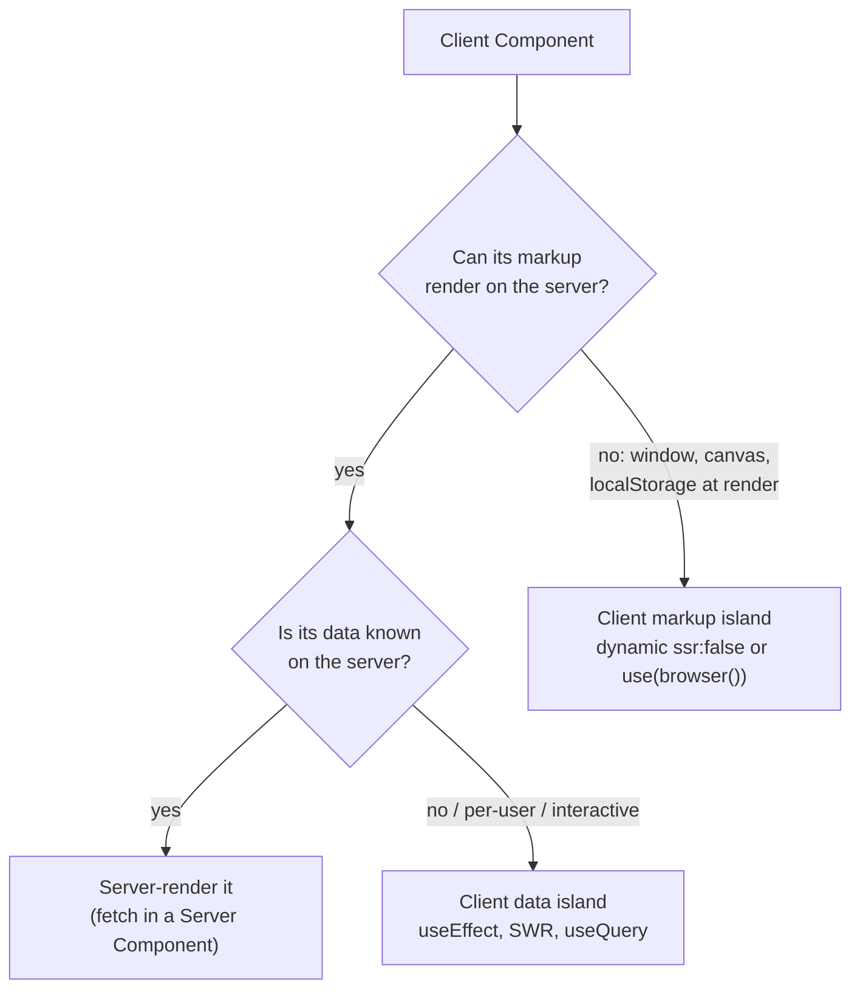
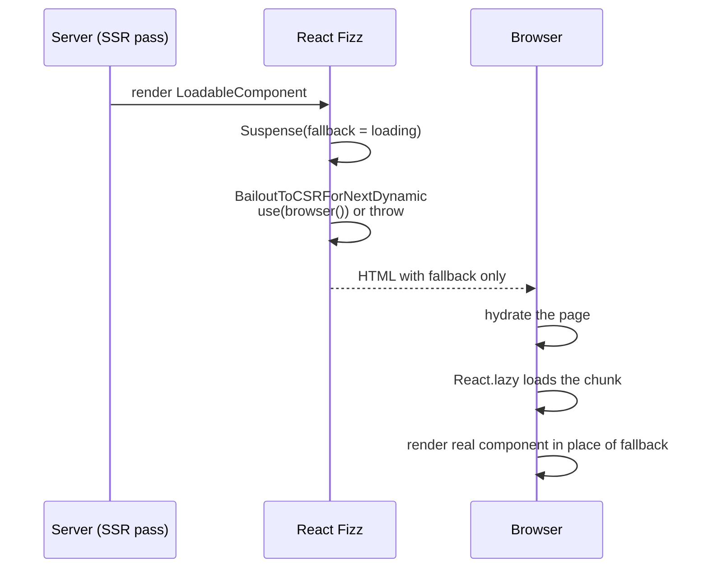

# CSR - Client-Rendered Islands

> [!summary] TL;DR
> In the App Router, Client Components are still rendered to HTML on the server. A "CSR island" is a subtree whose server HTML is only a placeholder, with the real content produced in the browser. You get one in two ways. Either the component renders on the server but fetches its **data** after mount (`useEffect`, SWR, `useQuery` without a server prefetch), or the component's **markup** is skipped on the server entirely (`next/dynamic` with `ssr: false`, or React's `use(browser())`). `next/dynamic` is `React.lazy` plus a `Suspense` boundary. With `ssr: false` it renders a child that, on the server, calls `use(browser(reason))` (the default in 16.4.3) or throws `BailoutToCSRError`. That makes React send the boundary's fallback as HTML and render the subtree in the browser. The compiler also removes the imported module from the SSR bundle. Use islands for browser-only widgets and data that is personal, interactive, or below the fold. Everything else should be server-rendered.

Earlier parts covered the server-rendering strategies: static ([[21 SSG and ISR - Static Pages and generateStaticParams|SSG and ISR]]), per request ([[22 SSR - Rendering Per Request|SSR]]), and the mixed static-shell model ([[23 PPR - Partial Prerendering with Cache Components|PPR]]). This part goes the other way: how to deliberately keep a piece of the page out of the server render, and what Next.js does when you ask for that.

## Two kinds of "client-rendered"

People say "CSR" for two different things, and the difference decides which tool to use.

| What happens on the server | What the HTML contains | Example |
| --- | --- | --- |
| The component renders, but its data is fetched after hydration | The component's loading state (skeleton, "Loading…") | `useEffect` + `fetch`, `useSWR`, `useQuery` without prefetch |
| The component does not render at all | The nearest `Suspense` fallback (or nothing) | `dynamic(() => import('./Map'), { ssr: false })`, `use(browser())` |

The first kind is *client data*. The second is *client markup*. A chart that reads `window.devicePixelRatio` at import time needs the second kind. A "recently viewed" panel that calls your API needs only the first.



> [!warning] Misconception: "`'use client'` means client-side rendering"
> `'use client'` marks a *module boundary*: the component and its imports ship to the browser and can use state and effects. It does not skip the server. During the initial load, Next.js renders Client Components to HTML in the SSR pass and then hydrates them ([[02 Server and Client Components|Server and Client Components]]). That is why a Client Component that touches `window` during render crashes the server render.

## Pattern 1: fetch on mount

The plain React way. The component renders its loading state on the server and on the first client render, so hydration matches. The effect then runs in the browser only (effects never run during SSR; see [[08 The Commit Phase and Effects|React Concepts: effects]]).

```tsx
// app/dashboard/recently-viewed.tsx
'use client'

import { useEffect, useState } from 'react'

type Item = { id: string; title: string }

export function RecentlyViewed() {
  const [items, setItems] = useState<Item[] | null>(null)
  const [error, setError] = useState<Error | null>(null)

  useEffect(() => {
    const controller = new AbortController()
    fetch('/api/recently-viewed', { signal: controller.signal })
      .then((res) => {
        if (!res.ok) throw new Error(`HTTP ${res.status}`)
        return res.json() as Promise<Item[]>
      })
      .then(setItems)
      .catch((err) => {
        if (err.name !== 'AbortError') setError(err)
      })
    // Abort on unmount, and on the dev-mode Strict Mode double mount
    return () => controller.abort()
  }, [])

  if (error) return <p role="alert">Could not load your history.</p>
  if (!items) return <ul aria-busy="true" className="skeleton-list" />
  return (
    <ul>
      {items.map((item) => (
        <li key={item.id}>{item.title}</li>
      ))}
    </ul>
  )
}
```

The page around it stays a Server Component and can be fully static:

```tsx
// app/dashboard/page.tsx
import { RecentlyViewed } from './recently-viewed'

export default function Page() {
  return (
    <main>
      <h1>Dashboard</h1>
      {/* Static HTML around a client data island */}
      <RecentlyViewed />
    </main>
  )
}
```

This works, but you write the caching, deduplication, retries and race handling yourself. Past one or two widgets, use a library.

## Pattern 2: SWR or TanStack Query without a server prefetch

A client data library gives you a shared browser cache, request deduplication, focus revalidation and mutations. Without a server prefetch, the behaviour matches Pattern 1: the server HTML shows the loading state, and the request starts after hydration. The Next.js docs call this the "inline loading states" pattern, and the "provided by the server" pattern is the alternative.[^docs-csr]

SWR (`swr@2.5.1`):

```tsx
// app/dashboard/notifications.tsx
'use client'

import useSWR from 'swr'

const fetcher = (url: string) =>
  fetch(url).then((res) => {
    if (!res.ok) throw new Error(`HTTP ${res.status}`)
    return res.json()
  })

export function Notifications() {
  const { data, error, isLoading } = useSWR<{ count: number }>(
    '/api/notifications',
    fetcher,
    { refreshInterval: 30_000 },
  )

  if (error) return <span>!</span>
  if (isLoading) return <span aria-busy="true">…</span>
  return <span>{data!.count}</span>
}
```

TanStack Query (`@tanstack/react-query@5.104.5`, provider set up as in [[26 TanStack Query - Server Prefetch and Hydration|part 26]]):

```tsx
// app/search/autocomplete.tsx
'use client'

import { useQuery } from '@tanstack/react-query'

export function Autocomplete({ query }: { query: string }) {
  const { data = [], isPending, error } = useQuery({
    queryKey: ['search', query],
    queryFn: async ({ signal }) => {
      const res = await fetch(`/api/search?q=${encodeURIComponent(query)}`, { signal })
      if (!res.ok) throw new Error('Search failed')
      return (await res.json()) as string[]
    },
    // Do not fetch until there is something to search for
    enabled: query.length > 1,
  })

  if (query.length < 2) return null
  if (error) return <p>Search failed.</p>
  if (isPending) return <p aria-busy="true">Searching…</p>
  return <ul>{data.map((s) => <li key={s}>{s}</li>)}</ul>
}
```

> [!tip] Client data needs an endpoint
> The browser cannot call your database. A client-fetched island needs a [[08 Route Handlers and Proxy|Route Handler]] (or an external API) to talk to. If the only reason for the endpoint is to feed the initial render, fetch on the server instead and skip both the endpoint and the loading state.

`useSuspenseQuery` or SWR's `suspense: true` moves the loading UI to the nearest `<Suspense>` boundary. Without a server prefetch, the request still starts in the browser after hydration. Suspense changes where the loading state is shown, not when the request starts.[^docs-csr]

## Pattern 3: `next/dynamic` with `ssr: false`

When the component itself cannot render on the server, because it or a library it imports reads `window`, `document`, `localStorage` or a canvas at import time or during render, skip its server render (the symptom is the [[42 Recipes - Rendering and Hydration Errors#window is not defined (a browser-only library)|"window is not defined" error]]):

```tsx
// app/map/map-island.tsx
'use client'

import dynamic from 'next/dynamic'

// The module './leaflet-map' is never evaluated on the server
const LeafletMap = dynamic(() => import('./leaflet-map'), {
  ssr: false,
  // Rendered on the server and until the chunk loads in the browser
  loading: () => <div className="map-placeholder" style={{ aspectRatio: '16 / 9' }} />,
})

export function MapIsland({ lat, lng }: { lat: number; lng: number }) {
  return <LeafletMap lat={lat} lng={lng} />
}
```

```tsx
// app/map/page.tsx
import { MapIsland } from './map-island'

export default function Page() {
  return <MapIsland lat={52.37} lng={4.9} />
}
```

For a named export, return it from the promise: `dynamic(() => import('./charts').then((m) => m.LineChart), { ssr: false })`.[^docs-lazy]

The rest of this section follows the call through the source.

### Step 1: `next/dynamic` is aliased for the App Router

`next/dynamic` resolves to different implementations in the two routers. For App Router bundles, the compiler aliases `next/dynamic` to `next/dist/api/app-dynamic`,[^alias] which re-exports `shared/lib/app-dynamic.tsx`. Its `dynamic()` only normalizes arguments (a bare loader function or an options object) and hands them to `Loadable`. The `modules` list it forwards is generated by the compiler and used to preload CSS.[^app-dynamic]

### Step 2: `Loadable` is `React.lazy` plus `Suspense`

`Loadable` creates one `React.lazy` component around your loader. Each render returns that lazy component inside a wrapper.[^loadable]

```tsx
// packages/next/src/shared/lib/lazy-dynamic/loadable.tsx (simplified)
function Loadable(options) {
  const opts = { ...defaultOptions, ...options } // ssr: true by default
  const Lazy = lazy(() => opts.loader().then(convertModule))
  const Loading = opts.loading

  function LoadableComponent(props) {
    const fallbackElement = Loading
      ? <Loading isLoading pastDelay error={null} />
      : null
    // ssr:false or a loading component -> wrap in a Suspense boundary
    const hasSuspenseBoundary = !opts.ssr || !!opts.loading
    const Wrap = hasSuspenseBoundary ? Suspense : Fragment

    const children = opts.ssr ? (
      <>
        {typeof window === 'undefined' ? <PreloadChunks moduleIds={opts.modules} /> : null}
        <Lazy {...props} />
      </>
    ) : (
      <BailoutToCSRForNextDynamic>
        <Lazy {...props} />
      </BailoutToCSRForNextDynamic>
    )
    return <Wrap fallback={fallbackElement}>{children}</Wrap>
  }
  return LoadableComponent
}
```

Two details matter:

- With `ssr: false`, the lazy component is **always** inside its own `Suspense`, whose fallback is your `loading` component, or `null` if you passed none. You never need to add a boundary yourself for `next/dynamic`.
- With `ssr: true` (the default), the server also renders `PreloadChunks`. It looks up the dynamic import's files in the loadable manifest and emits a `<link rel="stylesheet" precedence="dynamic">` for each CSS chunk and a low-priority `preload` for each JS chunk, so the lazily loaded component does not flash unstyled.[^preload]

### Step 3: the server bails out to the browser

`BailoutToCSRForNextDynamic` is a tiny Client Component that only does something on the server:[^bailout-comp]

```tsx
// packages/next/src/shared/lib/lazy-dynamic/dynamic-bailout-to-csr.tsx (simplified)
export function BailoutToCSRForNextDynamic({ children }) {
  if (process.env.__NEXT_EXPERIMENTAL_REACT_BROWSER_BAILOUT) {
    use(browser(getNextDynamicBailoutReason)) // React 19.3 primitive
    return children
  }
  if (typeof window === 'undefined') {
    throw new BailoutToCSRError('next/dynamic')
  }
  return children
}
```

In 16.4.3 there are two paths:

- **`experimental.reactBrowserBailout`, on by default.** The option is documented as "Uses ReactDOM's browser rendering primitive for supported client-rendering bailouts instead of Next.js' internal bailout error". Its default in `defaultConfig` is `true`,[^rbb-config] and it is compiled in as `process.env.__NEXT_EXPERIMENTAL_REACT_BROWSER_BAILOUT`.[^rbb-define] The component then calls `use(browser(reason))`. `browser` is a new `react-dom` export in React 19.3, which the App Router vendors as `19.3.0-canary`. During a server render it suspends to the closest `<Suspense>`, and that boundary's fallback becomes the HTML. In the browser it returns `undefined`, so the component renders normally.[^docs-spa-browser] The `reason` is tagged with a global symbol so both copies of the module (user bundle and precompiled runtime) recognize it.[^rbb-reason]
- **The older path.** On the server it throws `BailoutToCSRError`, an `Error` with `digest: 'BAILOUT_TO_CLIENT_SIDE_RENDERING'`.[^bailout-error] React catches it at the nearest `Suspense` boundary, sends the fallback, and marks that boundary to be client-rendered. Next.js recognizes the digest in its error handler and does not log it as a render error,[^digest] and the browser's `onRecoverableError` ignores it when React reports the client-rendered boundary.[^recoverable]

Either way, the result is the same: the HTML contains the `loading` fallback, and the browser loads the chunk and renders the real component.



### Step 4: the compiler keeps the module out of the SSR bundle

Bailing out at render time is not enough on its own. If the server bundle still *evaluated* `./leaflet-map`, a top-level `window.L = …` would crash before any component rendered. The SWC `next_dynamic` transform handles this. When it sees `ssr: false` as a literal `false` in a call compiled for the server's SSR layer (not the React Server layer), it replaces the loader argument:[^swc-detect]

- with Turbopack: `dynamic(() => import('./leaflet-map'), { ssr: false })` becomes `dynamic(async () => {}, { ssr: false })`
- with webpack: the loader becomes a side-effect-free `require.resolveWeak('./leaflet-map')`, which records the module ID without loading it[^swc-rewrite]

So the server never imports the module, and only the browser bundle contains it.

> [!warning] `ssr: false` must be a literal and must live in a Client Component
> The transform checks for the literal `ssr: false`. `{ ssr: isMobile }` or a spread options object will not trigger it. A Server Component that calls `dynamic(..., { ssr: false })` fails the build with "``ssr: false`` is not allowed with `next/dynamic` in Server Components. Please move it into a Client Component."[^rsc-check] The fix is the shape shown above: a small `'use client'` wrapper that owns the `dynamic()` call.

## Pattern 4: `use(browser())` directly

`next/dynamic` lazy-loads a whole module. If you only need to skip the server render of a component that is already in the bundle (for example, one that reads `localStorage` during render), React 19.3's primitive does it without a separate chunk. The Next.js SPA guide's example:[^docs-spa-browser]

```tsx
// app/browser-only-editor.tsx
'use client'

import { use, useState, type ChangeEvent } from 'react'
import { browser } from 'react-dom'

export default function BrowserOnlyEditor() {
  // Suspends on the server; returns undefined in the browser
  use(browser('The saved draft is stored in localStorage.'))
  const [draft, setDraft] = useState(() => localStorage.getItem('draft') ?? '')

  function handleChange(event: ChangeEvent<HTMLTextAreaElement>) {
    setDraft(event.target.value)
    localStorage.setItem('draft', event.target.value)
  }
  return <textarea value={draft} onChange={handleChange} />
}
```

```tsx
// app/page.tsx
import { Suspense } from 'react'
import BrowserOnlyEditor from './browser-only-editor'

export default function Page() {
  return (
    <Suspense fallback={<p>Loading editor…</p>}>
      <BrowserOnlyEditor />
    </Suspense>
  )
}
```

Unlike `next/dynamic`, this needs a `Suspense` boundary that you provide. Crawlers that do not run JavaScript see only the fallback, so keep indexable content outside it. The docs recommend `use(browser())` "only when a Client Component's first browser render cannot match server-rendered HTML".[^docs-spa-browser]

> [!note] `@types/react-dom` may lag
> The Next.js source itself uses `@ts-expect-error` on `browser(reason)` because the published types did not include the argument yet.[^bailout-comp] If your editor complains, check the installed `@types/react-dom` version before working around it.

## The implicit island: `useSearchParams()` in a static route

You can also create an island without asking for one. Without Cache Components, a statically prerendered route has no request, so it has no search params. When a Client Component calls `useSearchParams()` during that prerender (work unit type `prerender-legacy`), Next.js bails out to client rendering for the subtree. It does this with `use(browser(...))` or `BailoutToCSRError`, the same two paths `next/dynamic` uses, unless the route is `force-static`.[^use-search-params]

If no `Suspense` boundary is above the hook, the bailout reaches the page root. Next.js then logs "``useSearchParams()`` should be wrapped in a suspense boundary at page …" and fails the prerender.[^no-suspense] The fix is to wrap the component that reads search params (the error in context is in [[42 Recipes - Rendering and Hydration Errors#useSearchParams() should be wrapped in a suspense boundary|this recipe]]):

```tsx
// app/products/page.tsx
import { Suspense } from 'react'
import { SortControls } from './sort-controls' // calls useSearchParams()

export default function Page() {
  return (
    <>
      <h1>Products</h1>
      <Suspense fallback={<div className="sort-skeleton" />}>
        <SortControls />
      </Suspense>
    </>
  )
}
```

With `cacheComponents` enabled, the same hook during a client prerender (`prerender-client`) does not bail out to CSR. It suspends on a promise that never resolves during the prerender, which turns the boundary into a dynamic hole that is filled at request time ([[23 PPR - Partial Prerendering with Cache Components|PPR]]).[^use-search-params]

## Avoiding a mismatch without an island

Sometimes you only need one browser value, such as the theme from `localStorage` or the viewport width, and a full island is too much. Two smaller tools:

```tsx
// app/ui/use-is-client.ts
import { useSyncExternalStore } from 'react'

const subscribe = () => () => {}

/** false during SSR and hydration, true afterwards. No mismatch. */
export function useIsClient() {
  return useSyncExternalStore(
    subscribe,
    () => true, // client snapshot
    () => false, // server snapshot, also used during hydration
  )
}
```

```tsx
// app/ui/local-time.tsx
'use client'

import { useIsClient } from './use-is-client'

export function LocalTime({ iso }: { iso: string }) {
  const isClient = useIsClient()
  // Server and hydration render the UTC string, then the browser switches to local time
  return (
    <time dateTime={iso}>
      {isClient ? new Date(iso).toLocaleString() : iso}
    </time>
  )
}
```

The server snapshot is used during hydration too, so the first client render matches the HTML, and React re-renders with the client value right after. This keeps the markup on the server and changes only the value. For the "flash before hydration" problem with themes, see the official [preventing flash before hydration](https://nextjs.org/docs/app/guides/preventing-flash-before-hydration) guide and [[42 Recipes - Rendering and Hydration Errors|the hydration recipes]].

## When an island is the right call

| Use a CSR island when | Prefer server rendering when |
| --- | --- |
| The library needs `window`, `document`, WebGL or canvas (maps, editors, charts) | The content must be indexed or shared as a link preview |
| The data is per-user, changes constantly, and is not needed for first paint | The data is needed for the first meaningful paint |
| The widget is below the fold or behind an interaction | The widget is the main content of the page |
| You are migrating a client-only app and need it to run first ([[25 Fully Client-Side - SPA and Static Export]]) | You only need a browser value: use `useSyncExternalStore` instead |

Compare all six strategies in the [[20 Rendering Strategies - A Decision Map#The six strategies at a glance|decision table]].

> [!danger] The hidden waterfall
> A client-markup island costs three round trips before content appears: the HTML, then the island's JS chunk, then (often) its data request. A server-rendered component costs one. Reserve islands for code that cannot run on the server. For data the server already knows, render it there, or pass a promise to the client and unwrap it with `use()` ([[04 Data Fetching and Streaming|Data Fetching and Streaming]]).

Practical rules for islands that feel good:

- **Reserve the space.** Give the fallback the island's final size (`aspect-ratio`, fixed height) so the swap does not shift the layout.
- **Keep the island small.** Put `dynamic()` around the leaf that needs the browser, not around a whole page section. Everything outside stays server HTML.
- **Make loading accessible.** Use `aria-busy` or a visually hidden "Loading map" label in the fallback, and keep focusable controls outside it where you can.
- **Prefetch on intent.** For an island behind a click (a modal editor), trigger the import early: `onPointerEnter={() => import('./editor')}` warms the chunk the `dynamic()` call will use.

## Summary

A CSR island is either a component whose data is fetched after hydration or a component whose markup is skipped on the server. The first is ordinary React: effects, SWR or `useQuery` without a server prefetch, with the loading state as the server HTML. The second is `next/dynamic` with `ssr: false` or React 19.3's `use(browser())`. `next/dynamic` is `React.lazy` inside its own `Suspense`. On the server, a bailout child either suspends through `browser()` (the 16.4.3 default) or throws `BailoutToCSRError`, so the fallback is sent as HTML and the browser renders the real component, while the SWC transform keeps the module out of the SSR bundle. The same bailout explains why `useSearchParams()` needs a `Suspense` boundary in static routes. The next part takes this to the extreme: an app that is entirely client-rendered and exported as static files.

### Key takeaways

- **`'use client'` is not CSR**: Client Components are server-rendered to HTML on first load. Islands are an extra, explicit choice.
- **Client data vs client markup**: fetch-on-mount and query libraries keep the markup on the server, while `ssr: false` and `use(browser())` skip it.
- **`next/dynamic`**: aliased to `app-dynamic` in the App Router. It is `React.lazy` plus a `Suspense` boundary whose fallback is your `loading` component.
- **`BailoutToCSRForNextDynamic`**: on the server it calls `use(browser(reason))` (default `reactBrowserBailout: true`) or throws `BailoutToCSRError`, and React ships the fallback.
- **Compiler step**: a literal `ssr: false` makes SWC replace the loader in the SSR layer, so the module is never evaluated on the server.
- **Server Components**: `ssr: false` there is a build error. Wrap the `dynamic()` call in a small Client Component.
- **`use(browser())`**: a module-free way to skip SSR for one component. You must supply the `Suspense` boundary.
- **`useSearchParams()`**: in a static route without Cache Components it bails out to CSR, and without a `Suspense` boundary the prerender fails.
- **Cost**: islands add a JS chunk and often a data round trip. Reserve space, keep them small, and server-render anything needed for first paint.

← [[23 PPR - Partial Prerendering with Cache Components|PPR]] · [[00 Next.js in Practice Index|Index]] · [[25 Fully Client-Side - SPA and Static Export|SPA & Static Export]] →

[^docs-csr]: Client-side data fetching guide, "Choose a client fetching pattern" — [docs/01-app/02-guides/client-side-data-fetching/index.mdx#L19-L31](https://github.com/vercel/next.js/blob/v16.4.3/docs/01-app/02-guides/client-side-data-fetching/index.mdx#L19-L31)
[^docs-lazy]: Lazy loading guide, `next/dynamic` and "Importing Named Exports" — [docs/01-app/02-guides/lazy-loading.mdx](https://github.com/vercel/next.js/blob/v16.4.3/docs/01-app/02-guides/lazy-loading.mdx)
[^alias]: `createAppRouterApiAliases` (`dynamic: 'next/dist/api/app-dynamic'`) — [packages/next/src/build/create-compiler-aliases.ts#L305-L311](https://github.com/vercel/next.js/blob/v16.4.3/packages/next/src/build/create-compiler-aliases.ts#L305-L311)
[^app-dynamic]: `dynamic` — [packages/next/src/shared/lib/app-dynamic.tsx#L35-L54](https://github.com/vercel/next.js/blob/v16.4.3/packages/next/src/shared/lib/app-dynamic.tsx#L35-L54)
[^loadable]: `Loadable` and `defaultOptions` — [packages/next/src/shared/lib/lazy-dynamic/loadable.tsx#L28-L75](https://github.com/vercel/next.js/blob/v16.4.3/packages/next/src/shared/lib/lazy-dynamic/loadable.tsx#L28-L75)
[^preload]: `PreloadChunks` — [packages/next/src/shared/lib/lazy-dynamic/preload-chunks.tsx#L9-L75](https://github.com/vercel/next.js/blob/v16.4.3/packages/next/src/shared/lib/lazy-dynamic/preload-chunks.tsx#L9-L75)
[^bailout-comp]: `BailoutToCSRForNextDynamic` — [packages/next/src/shared/lib/lazy-dynamic/dynamic-bailout-to-csr.tsx#L18-L35](https://github.com/vercel/next.js/blob/v16.4.3/packages/next/src/shared/lib/lazy-dynamic/dynamic-bailout-to-csr.tsx#L18-L35)
[^rbb-config]: `reactBrowserBailout` option doc — [packages/next/src/server/config-shared.ts#L579-L583](https://github.com/vercel/next.js/blob/v16.4.3/packages/next/src/server/config-shared.ts#L579-L583); default `reactBrowserBailout: true` in `defaultConfig` — [packages/next/src/server/config-shared.ts#L2408](https://github.com/vercel/next.js/blob/v16.4.3/packages/next/src/server/config-shared.ts#L2408)
[^rbb-define]: `process.env.__NEXT_EXPERIMENTAL_REACT_BROWSER_BAILOUT` — [packages/next/src/build/define-env.ts#L260-L262](https://github.com/vercel/next.js/blob/v16.4.3/packages/next/src/build/define-env.ts#L260-L262)
[^docs-spa-browser]: SPA guide, "Rendering components only in the browser" (`next/dynamic`, `use(browser())`) — [docs/01-app/02-guides/single-page-applications.mdx](https://github.com/vercel/next.js/blob/v16.4.3/docs/01-app/02-guides/single-page-applications.mdx)
[^rbb-reason]: `createReactBrowserBailoutReason` — [packages/next/src/shared/lib/lazy-dynamic/react-browser-bailout.ts#L1-L18](https://github.com/vercel/next.js/blob/v16.4.3/packages/next/src/shared/lib/lazy-dynamic/react-browser-bailout.ts#L1-L18)
[^bailout-error]: `BailoutToCSRError`, `isBailoutToCSRError` — [packages/next/src/shared/lib/lazy-dynamic/bailout-to-csr.ts#L1-L20](https://github.com/vercel/next.js/blob/v16.4.3/packages/next/src/shared/lib/lazy-dynamic/bailout-to-csr.ts#L1-L20)
[^digest]: `getDigestForWellKnownError` — [packages/next/src/server/app-render/create-error-handler.tsx#L29-L36](https://github.com/vercel/next.js/blob/v16.4.3/packages/next/src/server/app-render/create-error-handler.tsx#L29-L36)
[^recoverable]: `onRecoverableError` — [packages/next/src/client/react-client-callbacks/on-recoverable-error.ts#L19-L25](https://github.com/vercel/next.js/blob/v16.4.3/packages/next/src/client/react-client-callbacks/on-recoverable-error.ts#L19-L25)
[^swc-detect]: `next_dynamic` transform, `has_ssr_false` / `should_skip_ssr_compile` — [crates/next-custom-transforms/src/transforms/dynamic.rs#L263-L293](https://github.com/vercel/next.js/blob/v16.4.3/crates/next-custom-transforms/src/transforms/dynamic.rs#L263-L293)
[^swc-rewrite]: loader rewrite for webpack (`require.resolveWeak`) and Turbopack (empty async loader) — [crates/next-custom-transforms/src/transforms/dynamic.rs#L295-L378](https://github.com/vercel/next.js/blob/v16.4.3/crates/next-custom-transforms/src/transforms/dynamic.rs#L295-L378)
[^rsc-check]: `check_for_next_ssr_false` — [crates/next-custom-transforms/src/transforms/react_server_components.rs#L1086-L1108](https://github.com/vercel/next.js/blob/v16.4.3/crates/next-custom-transforms/src/transforms/react_server_components.rs#L1086-L1108); message — [#L377-L381](https://github.com/vercel/next.js/blob/v16.4.3/crates/next-custom-transforms/src/transforms/react_server_components.rs#L377-L381)
[^use-search-params]: `useDynamicSearchParams` — [packages/next/src/server/app-render/dynamic-rendering-client.ts#L80-L139](https://github.com/vercel/next.js/blob/v16.4.3/packages/next/src/server/app-render/dynamic-rendering-client.ts#L80-L139)
[^no-suspense]: `renderToStream` unwrapped CSR bailout error — [packages/next/src/server/app-render/app-render.tsx#L4420-L4430](https://github.com/vercel/next.js/blob/v16.4.3/packages/next/src/server/app-render/app-render.tsx#L4420-L4430)
