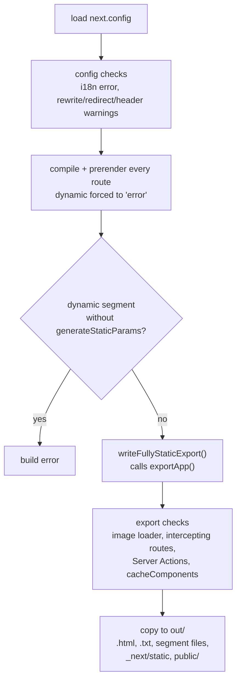
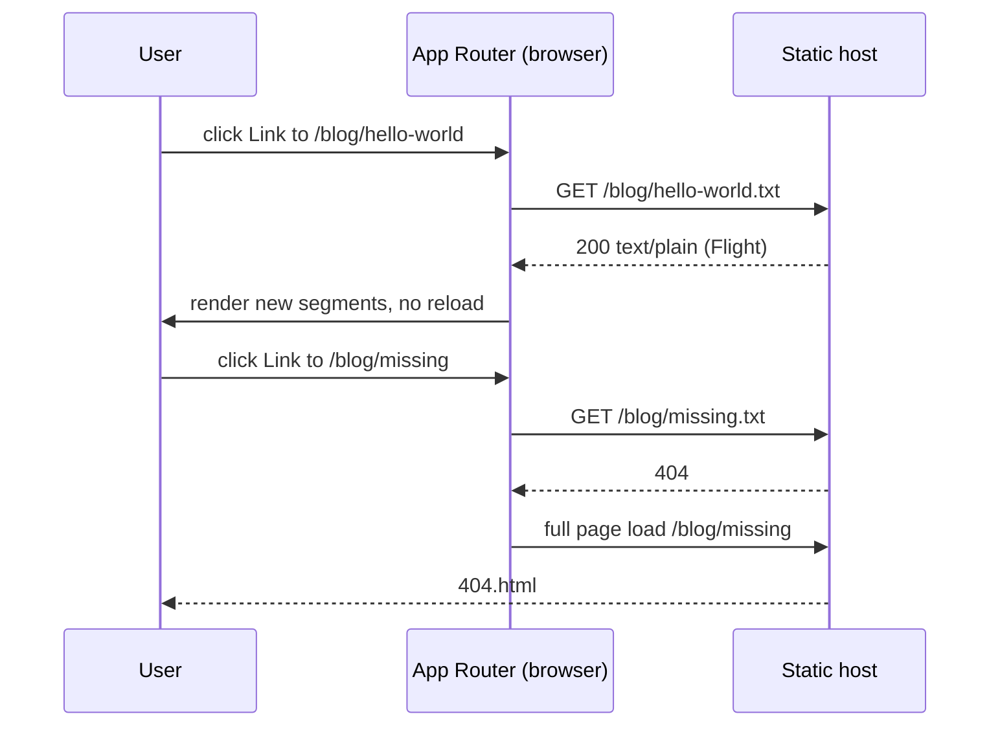

# Fully Client-Side - SPA and Static Export

> [!summary] TL;DR
> `output: 'export'` makes `next build` prerender every route at build time and write plain files to `out/`. Each route gets an `.html` page, a `.txt` RSC payload for client navigation, and per-segment prefetch files. There is no server afterwards, so anything that needs a request is refused. The build forces `dynamic = 'error'` on every page, requires `generateStaticParams` for dynamic segments, rejects Server Actions, intercepting routes, `i18n`, the default image loader and (in 16.4.3) `cacheComponents`, and warns that rewrites, redirects, headers and proxy are not applied. On the client, the App Router fetches `<route>.txt` instead of sending an RSC header, and falls back to a full page load when that file does not exist. A "strict SPA" is one more step: a single `app/[[...slug]]/page.tsx` shell that renders your client router with `next/dynamic` and `ssr: false`, plus a host rule that serves the shell for every path.

[[24 CSR - Client-Rendered Islands|The previous part]] made pieces of a page client-rendered. This part makes the whole deployment client-side: no Node.js server, no edge functions, just files on a CDN, S3 bucket, Nginx or GitHub Pages.

## Static export vs strict SPA

These are two different shapes, and Next.js supports both.

| | Static export (`output: 'export'`) | Strict SPA (one shell) |
| --- | --- | --- |
| HTML files | One per route, fully rendered at build | One `index.html` for everything |
| First paint | Real content for every route | Shell, then the app renders in the browser |
| Routing | Next.js App Router (`<Link>`, prefetch) | Your client router (React Router, TanStack Router) or Next.js for known routes |
| Server Components | Run once, at build time | Only the shell page |
| SEO | Good: crawlers get real HTML | Poor unless you prerender separately |
| Host requirement | Serve files, map `/a` to `a.html` | Serve files, fall back to `index.html` |

The Next.js docs define a strict SPA as "served by one HTML file" with every route and data fetch handled in the browser, and recommend the static export instead when you can, because each route then gets its own HTML and code-split JS.[^docs-spa] Treat the strict SPA as a migration step (for example from Vite or Create React App) and the static export as a destination.

## Turning it on

```ts
// next.config.ts
import type { NextConfig } from 'next'

const nextConfig: NextConfig = {
  output: 'export',
  // Optional: /about -> /about/index.html, links get a trailing slash
  trailingSlash: true,
  // The default image optimizer needs a server
  images: { unoptimized: true },
  // Optional: write to dist/ instead of out/
  // distDir: 'dist',
}

export default nextConfig
```

Run `next build`. The output lands in `out/` (or `distDir` if set). `next start` refuses to run: "``next start`` does not work with ``output: export`` configuration. Use ``npx serve@latest out`` instead."[^next-start] Preview with any static server, for example `npx serve@latest out`.

> [!note] `next export` is gone
> The separate `next export` command was removed in Next.js 14 in favour of the config option.[^docs-export] Inside the source, the exporter still lives in `packages/next/src/export/`, and `next build` calls it at the end of the build.

## What `next build` does with `output: 'export'`

The export is a normal production build plus a set of extra checks and a final copy step. Following it through the source:



### 1. Config validation

When the config is loaded, `output: 'export'` combined with `i18n` throws ("Specified ``i18n`` cannot be used with ``output: export``"). `rewrites`, `redirects` and `headers` only produce warnings, because some hosts implement them separately.[^config-check]

### 2. Every page is forced static

While building the component tree, an export build rewrites each layout's and page's `dynamic` segment config. A missing value or `'auto'` becomes `'error'`, and `'force-dynamic'` stops the build with "Page with ``dynamic = "force-dynamic"`` couldn't be exported".[^force-error] With `dynamic = 'error'`, any request-time API (`cookies()`, `headers()`, `connection()`, an uncached `searchParams` read) fails the prerender instead of quietly making the route dynamic. The docs describe this as "similar to setting the `dynamic` option to `error` in the root layout".[^docs-export]

Route Handlers get the same treatment. A `GET` handler must be static (`export const dynamic = 'force-static'` or a `revalidate` config), or the module throws when it loads, and `force-dynamic` is rejected. In export mode the route module even loads eagerly, so the error surfaces at load time instead of on the first request.[^route-module]

```ts
// app/feed.json/route.ts
// Rendered once at build time into out/feed.json
export const dynamic = 'force-static'

export async function GET() {
  const posts = await getAllPosts()
  return Response.json(posts.map(({ slug, title }) => ({ slug, title })))
}
```

### 3. Dynamic segments need `generateStaticParams`

A route like `app/blog/[slug]/page.tsx` can only be exported for the params you list. During the build, a dynamic page without `generateStaticParams` fails with "Page ``/blog/[slug]`` is missing ``generateStaticParams()`` so it cannot be used with ``output: export`` config."[^gsp-build] `next dev` enforces the same rule per request. It errors if the function is missing, and also if the URL you visit is not one of the returned params.[^gsp-dev] There is no runtime fallback, so `dynamicParams = true` cannot work: an unknown slug is simply a 404 file.

```tsx
// app/blog/[slug]/page.tsx
import { getAllPosts, getPost } from '@/lib/posts'

export async function generateStaticParams() {
  const posts = await getAllPosts()
  return posts.map((post) => ({ slug: post.slug }))
}

// Only the listed slugs exist; any other slug is a 404
export const dynamicParams = false

export default async function Page({ params }: PageProps<'/blog/[slug]'>) {
  const { slug } = await params
  const post = await getPost(slug)
  return <article dangerouslySetInnerHTML={{ __html: post.html }} />
}
```

### 4. The exporter's own checks

At the end of `next build`, `writeFullyStaticExport` calls the exporter (`exportApp`) with `buildExport: false`, which means "write the final `out/` directory".[^write-export][^build-export-call] Before copying anything, `exportAppImpl` checks the build output:

- **Image optimization.** If any page imported `next/image`, the loader is `'default'` and `images.unoptimized` is not set, the export fails. The error suggests `next start` or `images.unoptimized = true`. A custom `loader`/`loaderFile` (Cloudinary, imgix) also works.[^image-check]
- **Intercepting routes.** These are implemented as generated rewrites, so their presence fails the export: "Intercepting routes are not supported with static export."[^actions-check]
- **Server Actions.** If the server reference manifest contains any action of type `server-action`, the export fails: "Server Actions are not supported with static export."[^actions-check] There is no server to POST to.
- **Proxy and API routes.** If a `proxy.ts` (ex-middleware) or Pages Router API routes exist, the exporter warns that a static export "disables API routes and middleware".[^middleware-warn]
- **Cache Components.** In 16.4.3, `exportAppImpl` throws `Invariant: PPR cannot be enabled in export mode` when `nextConfig.cacheComponents` is on. The comment there says "Export mode provide static outputs that are not compatible with PPR mode".[^ppr-invariant] Keep `cacheComponents` off for an exported app. Plain `fetch` and Server Components at build time still work.
- **Custom routes.** If `rewrites`, `redirects` or `headers` are defined, the exporter repeats the config-time warning: they "are not applied when exporting your application".[^custom-routes]

### 5. The files it writes

For each prerendered App Router route, the exporter copies the build's `.html` and `.rsc` files into `out/`, renaming the RSC payload to `.txt`. With `trailingSlash: true` it uses `index.html`/`index.txt` inside a folder.[^copy-files] It also writes the per-segment prefetch data into a folder named after the route, and copies `_next/static` and `public/`.

```text
out/
├── index.html            # "/" rendered at build time
├── index.txt             # its RSC payload, fetched on client navigation
├── 404.html              # from app/not-found.tsx
├── blog/
│   ├── hello-world.html
│   └── hello-world.txt
├── blog/hello-world/     # per-segment prefetch files for the segment cache
├── feed.json             # static Route Handler output
└── _next/static/...      # JS, CSS, fonts
```

## How client navigation works without a server

On a normal deployment, the App Router fetches the same URL with an `RSC: 1` header and the server answers with the Flight payload. A static host ignores request headers, so in a production export build the router changes the URL instead. It appends `.txt` (or `index.txt` for a trailing slash) before fetching, and it accepts `text/plain` as a valid Flight content type because that is what a file server sends for `.txt`.[^fetch-txt][^fetch-ctype] The segment cache does the same for prefetches by adding the segment path to the URL in export mode ([[03 Linking, Navigation and Prefetching|Linking and Prefetching]]).

If the response is not a Flight payload or is not `200`, the router falls back to a normal full-page navigation.[^fetch-ctype] This is what makes a static export robust. A `<Link>` to a page that was never generated does not break the app. It becomes a regular page load and the host serves its `404.html`.



## What you give up

| Feature | What happens in an export build | Use instead |
| --- | --- | --- |
| `cookies()`, `headers()`, `connection()` | Prerender error (`dynamic = 'error'`) | Read cookies/state in Client Components |
| `searchParams` in pages | Not available at build time | `useSearchParams()` in a Client Component, inside `Suspense` |
| Dynamic segments without `generateStaticParams` | Build error | Enumerate params, or use query strings |
| Server Actions | Export error | Call an external API from the client |
| Route Handlers that read the request, non-`GET` methods | Error at module load | External API, serverless function elsewhere |
| `proxy.ts`, rewrites, redirects, headers | Warning, not applied | Host configuration (Nginx, `_redirects`, `vercel.json`) |
| ISR, `revalidate*`, `updateTag`, Draft Mode | Nothing to revalidate | Rebuild and redeploy |
| `next/image` default loader | Export error | `images.unoptimized: true` or a custom loader |
| Intercepting routes | Export error | Regular routes or client modals |
| `cacheComponents` / PPR | Export invariant error | Leave off |
| `i18n` config | Config error | Locale segments, `app/[lang]`, with `generateStaticParams` |

The docs list the same set under "Unsupported Features".[^docs-export]

> [!tip] Client Components still prerender
> Client Components in an exported app are rendered to HTML at build time like any other. Code that touches `window` or `localStorage` during render breaks the build, exactly as it would in SSR. Move it into `useEffect`, or make it a client-markup island ([[24 CSR - Client-Rendered Islands|CSR islands]]).

## Pattern A: static export with client data

The usual shape of an exported app: static Server Components for everything known at build time, and client islands for user data from an external API.

```tsx
// app/account/page.tsx
import { Suspense } from 'react'
import { AccountPanel } from './account-panel'

export const metadata = { title: 'Account' }

export default function Page() {
  return (
    <main>
      <h1>Account</h1>
      {/* Built once; the panel fills in from the API in the browser */}
      <Suspense fallback={<div className="panel-skeleton" aria-busy="true" />}>
        <AccountPanel />
      </Suspense>
    </main>
  )
}
```

```tsx
// app/account/account-panel.tsx
'use client'

import { useSearchParams } from 'next/navigation'
import useSWR from 'swr'

const API = process.env.NEXT_PUBLIC_API_URL // inlined at build time

const fetcher = (url: string) =>
  fetch(url, { credentials: 'include' }).then((r) => {
    if (!r.ok) throw new Error(`HTTP ${r.status}`)
    return r.json()
  })

export function AccountPanel() {
  const tab = useSearchParams().get('tab') ?? 'profile'
  const { data, error, isLoading } = useSWR(`${API}/me?section=${tab}`, fetcher)

  if (error) return <p role="alert">Please sign in again.</p>
  if (isLoading) return <div className="panel-skeleton" aria-busy="true" />
  return <pre>{JSON.stringify(data, null, 2)}</pre>
}
```

Two export-specific details:

- `useSearchParams()` in a statically prerendered page bails out to client rendering up to the nearest `Suspense`. Without the boundary, the build fails with "should be wrapped in a suspense boundary". In the exporter, a CSR bailout that reaches the page level is rethrown as an error rather than tolerated.[^page-bailout] [[24 CSR - Client-Rendered Islands|Part 24]] shows how that bailout works.
- Use query strings (`/product?id=42`) for values you cannot enumerate at build time. They need no generated file, and the Client Component reads them after hydration.

Auth in this model is token-based in the browser ([[28 Client-Only Auth - Tokens in the Browser#With a static export there is no server at all|Client-Only Auth]]).

## Pattern B: a strict SPA shell

If you are moving an existing client-routed app (React Router, TanStack Router) into Next.js, you can first run it unchanged inside one optional catch-all route. This is the setup the official Vite and Create React App migration guides use.[^docs-vite]

```tsx
// app/[[...slug]]/page.tsx
import '../../index.css'
import { ClientOnly } from './client'

// Only generate "/". Every other path is handled by the host fallback below.
export function generateStaticParams() {
  return [{ slug: [''] }]
}

export default function Page() {
  return <ClientOnly />
}
```

```tsx
// app/[[...slug]]/client.tsx
'use client'

import dynamic from 'next/dynamic'

// The whole legacy app renders only in the browser
const App = dynamic(() => import('../../App'), { ssr: false })

export function ClientOnly() {
  return <App />
}
```

```tsx
// app/layout.tsx
export const metadata = { title: 'My App' }

export default function RootLayout({ children }: LayoutProps<'/'>) {
  return (
    <html lang="en">
      <body>
        <div id="root">{children}</div>
      </body>
    </html>
  )
}
```

`next build` then emits one real page, `out/index.html`, containing the layout and the `dynamic()` fallback. Your router inside `App` reads `window.location` and renders the right screen. For deep links such as `/settings/billing` to work on a hard reload, the host must serve `index.html` for paths that do not match a file:

```nginx
# nginx.conf (strict SPA: fall back to the shell)
server {
  listen 80;
  root /var/www/out;

  location /_next/ {
    # Hashed assets: cache forever
    add_header Cache-Control "public, max-age=31536000, immutable";
    try_files $uri =404;
  }

  location / {
    try_files $uri $uri.html $uri/ /index.html;
  }
}
```

For a static export with real routes, swap the last fallback for `=404` and add `error_page 404 /404.html;`. That is the configuration the docs show.[^docs-export]

> [!warning] Mixing the two routers
> In the SPA shell, navigate with your client router's links, not `next/link`. A Next.js `<Link>` to `/settings` makes the App Router fetch `/settings.txt`. That file does not exist, so the router falls back to a full page load of the shell. It works, but each click reloads the app. Migrate one route at a time instead: move a screen into a real `app/settings/page.tsx`, link to it with `<Link>`, and shrink the catch-all as you go.

The docs list what you gain over a plain Vite build even in this mode: automatic code splitting per route as you migrate, and an upgrade path to server features when you drop `output: 'export'`.[^docs-spa]

## Deploying

- **Any file host (S3, Cloudflare R2 + CDN, Nginx, Apache).** Upload `out/`. Map `/a` to `a.html` (or use `trailingSlash: true` so it becomes `/a/index.html`, which most hosts serve automatically), and set `404.html` as the error document.
- **GitHub Pages.** Set `basePath: '/repo-name'` (and `assetPrefix` if needed) when the site is not at the domain root. `trailingSlash: true` avoids extension mapping. The docs point to the `nextjs/deploy-github-pages` template.[^docs-export]
- **Vercel or Netlify.** They can serve an export, but on those platforms you usually do not need `output: 'export'`: static routes are already served from the CDN, and you keep the option of a dynamic route later.
- **Caching.** Everything under `/_next/static/` has content hashes and can be cached as immutable. Cache `.html` and `.txt` briefly, because they change on every deploy and must stay in sync with each other.

> [!danger] Environment variables are frozen at build time
> With no server, only `NEXT_PUBLIC_*` variables reach the app, and they are inlined into the JS at build time. Never put a secret in one. Building the same `out/` for staging and production requires two builds, or a small runtime `config.json` in `public/` that the app fetches on boot ([[11 Configuration, Turbopack and Deployment|Configuration and Deployment]]).

## Choosing it, and leaving it

Choose a static export when the content is known at build time (docs, marketing, a blog) or when the app is a client of an API you do not host in Next.js, and the deployment target cannot run Node.js. Choose the SPA shell only as a migration bridge. The [[20 Rendering Strategies - A Decision Map#The six strategies at a glance|decision table]] compares it with the other strategies.

Leaving is cheap. Remove `output: 'export'`, deploy to a Node.js server or a platform, and the same code gains SSR, ISR, Server Actions and `proxy.ts`. Turn on `cacheComponents` then if you want PPR ([[20 Rendering Strategies - A Decision Map|Rendering Strategies]]).

## Summary

`output: 'export'` is a normal `next build` with stricter rules and a final copy step. Every page is forced to `dynamic = 'error'`, dynamic segments must be enumerated with `generateStaticParams`, Route Handlers must be static `GET`s, and the exporter refuses Server Actions, intercepting routes, the default image loader, `i18n` and, in 16.4.3, `cacheComponents`. The result is `.html` pages, `.txt` RSC payloads and segment files. The browser router fetches those `.txt` files for client navigation and falls back to a full page load when one is missing. A strict SPA is a single catch-all route that renders a client-only app through `next/dynamic` with `ssr: false`, plus a host fallback to `index.html`. It is useful as a migration step, not a destination. The next part goes back to a server and shows how to combine server prefetching with a client cache using TanStack Query.

### Key takeaways

- **Static export vs strict SPA**: the export writes real HTML per route, while a strict SPA serves one shell. Prefer the export.
- **`dynamic = 'error'` everywhere**: export builds rewrite each page's segment config, so request-time APIs fail the build instead of making routes dynamic.
- **`generateStaticParams` is mandatory** for dynamic segments, in both `next build` and `next dev`. Unknown params are 404s.
- **Refused at export**: Server Actions, intercepting routes, the default image loader, `i18n`, and `cacheComponents` (an invariant error in 16.4.3).
- **Warned, not applied**: rewrites, redirects, headers and `proxy.ts`. Configure them on the host.
- **`.txt` payloads**: client navigation fetches `<route>.txt`, accepts `text/plain`, and falls back to a hard navigation on a miss.
- **`useSearchParams()` needs `Suspense`**: in a static route it bails out to CSR, and an unwrapped bailout fails the export.
- **SPA shell**: `app/[[...slug]]/page.tsx` with `generateStaticParams() => [{ slug: [''] }]`, the app behind `dynamic(..., { ssr: false })`, and a host fallback to `/index.html`.
- **Build-time env**: only `NEXT_PUBLIC_*` values exist, and they are inlined at build. Never put secrets in them.

← [[24 CSR - Client-Rendered Islands|CSR Islands]] · [[00 Next.js in Practice Index|Index]] · [[26 TanStack Query - Server Prefetch and Hydration|TanStack Query]] →

[^docs-spa]: SPA guide, "What is a Single-Page Application?" and "Static export (optional)" — [docs/01-app/02-guides/single-page-applications.mdx](https://github.com/vercel/next.js/blob/v16.4.3/docs/01-app/02-guides/single-page-applications.mdx)
[^docs-export]: Static exports guide (configuration, unsupported features, Nginx, version history) — [docs/01-app/02-guides/static-exports.mdx](https://github.com/vercel/next.js/blob/v16.4.3/docs/01-app/02-guides/static-exports.mdx)
[^docs-vite]: Migrating from Vite, step 5 (`[[...slug]]` entrypoint with `ssr: false`) — [docs/01-app/02-guides/migrating/from-vite.mdx#L363-L465](https://github.com/vercel/next.js/blob/v16.4.3/docs/01-app/02-guides/migrating/from-vite.mdx#L363-L465)
[^next-start]: `next start` refuses `output: export` — [packages/next/src/server/next.ts#L396-L400](https://github.com/vercel/next.js/blob/v16.4.3/packages/next/src/server/next.ts#L396-L400)
[^config-check]: config validation for `output: 'export'` — [packages/next/src/server/config.ts#L680-L704](https://github.com/vercel/next.js/blob/v16.4.3/packages/next/src/server/config.ts#L680-L704)
[^force-error]: `dynamic` forced to `'error'` in export mode — [packages/next/src/server/app-render/create-component-tree.tsx#L304-L315](https://github.com/vercel/next.js/blob/v16.4.3/packages/next/src/server/app-render/create-component-tree.tsx#L304-L315)
[^route-module]: `AppRouteRouteModule` export-mode checks and eager load — [packages/next/src/server/route-modules/app-route/module.ts#L303-L332](https://github.com/vercel/next.js/blob/v16.4.3/packages/next/src/server/route-modules/app-route/module.ts#L303-L332)
[^gsp-build]: missing `generateStaticParams()` build error — [packages/next/src/build/index.ts#L2744-L2753](https://github.com/vercel/next.js/blob/v16.4.3/packages/next/src/build/index.ts#L2744-L2753)
[^gsp-dev]: dev server `generateStaticParams` checks — [packages/next/src/server/dev/next-dev-server.ts#L798-L813](https://github.com/vercel/next.js/blob/v16.4.3/packages/next/src/server/dev/next-dev-server.ts#L798-L813)
[^write-export]: `writeFullyStaticExport` — [packages/next/src/build/index.ts#L1064-L1094](https://github.com/vercel/next.js/blob/v16.4.3/packages/next/src/build/index.ts#L1064-L1094)
[^build-export-call]: `next build` calls it when `output === 'export'` — [packages/next/src/build/index.ts#L4726-L4744](https://github.com/vercel/next.js/blob/v16.4.3/packages/next/src/build/index.ts#L4726-L4744)
[^image-check]: default image loader check — [packages/next/src/export/index.ts#L412-L436](https://github.com/vercel/next.js/blob/v16.4.3/packages/next/src/export/index.ts#L412-L436)
[^actions-check]: intercepting routes and Server Actions checks — [packages/next/src/export/index.ts#L438-L476](https://github.com/vercel/next.js/blob/v16.4.3/packages/next/src/export/index.ts#L438-L476)
[^middleware-warn]: middleware/proxy and API routes warning — [packages/next/src/export/index.ts#L631-L670](https://github.com/vercel/next.js/blob/v16.4.3/packages/next/src/export/index.ts#L631-L670)
[^ppr-invariant]: `cacheComponents` invariant in `exportAppImpl` — [packages/next/src/export/index.ts#L903-L907](https://github.com/vercel/next.js/blob/v16.4.3/packages/next/src/export/index.ts#L903-L907)
[^custom-routes]: rewrites/redirects/headers warning — [packages/next/src/export/index.ts#L248-L258](https://github.com/vercel/next.js/blob/v16.4.3/packages/next/src/export/index.ts#L248-L258)
[^copy-files]: copy `.html` and `.rsc` → `.txt`, segment files — [packages/next/src/export/index.ts#L995-L1045](https://github.com/vercel/next.js/blob/v16.4.3/packages/next/src/export/index.ts#L995-L1045)
[^fetch-txt]: `fetchServerResponse` appends `.txt` in export mode — [packages/next/src/client/components/router-reducer/fetch-server-response.ts#L170-L186](https://github.com/vercel/next.js/blob/v16.4.3/packages/next/src/client/components/router-reducer/fetch-server-response.ts#L170-L186)
[^fetch-ctype]: `text/plain` accepted, MPA fallback — [packages/next/src/client/components/router-reducer/fetch-server-response.ts#L218-L228](https://github.com/vercel/next.js/blob/v16.4.3/packages/next/src/client/components/router-reducer/fetch-server-response.ts#L218-L228)
[^page-bailout]: `exportAppPage` rethrows a page-level CSR bailout — [packages/next/src/export/routes/app-page.ts#L286-L296](https://github.com/vercel/next.js/blob/v16.4.3/packages/next/src/export/routes/app-page.ts#L286-L296)
