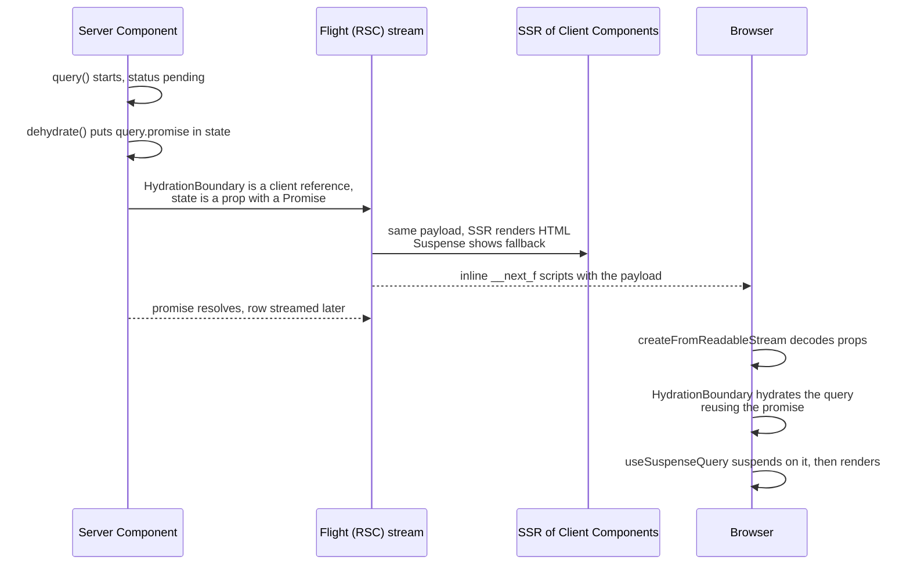

# TanStack Query - Server Prefetch and Hydration

> [!summary] TL;DR
> Pin `@tanstack/react-query@5.104.5`. Use one `getQueryClient()` that returns a **new** client on every server call and a **singleton** in the browser, with `staleTime > 0` and `dehydrate.shouldDehydrateQuery` that also includes `pending` queries. In a Server Component, start `queryClient.query(...)` without awaiting it and render `<HydrationBoundary state={dehydrate(queryClient)}>`. The dehydrated state contains the in-flight **promise**, and React's Flight protocol streams promises to Client Components. In the browser, `HydrationBoundary` puts the promise into the cache, and `useSuspenseQuery` suspends on it instead of refetching. For writes, a Server Action changes the data and calls `updateTag()`, which expires Next's server cache and re-renders the current route. On the client, `onSuccess` calls `queryClient.invalidateQueries()` for the browser cache. With `cacheComponents`, `dehydrate()` reads `Date.now()`, so keep prefetching inside a request-time `Suspense` boundary or build the dehydrated state from a cached timestamp. In 5.10x, `queryClient.query()` replaces `prefetchQuery`/`fetchQuery`, and `environmentManager.isServer()` replaces `isServer`.

[[24 CSR - Client-Rendered Islands|Part 24]] used TanStack Query purely on the client: the HTML shows a spinner and the request starts after hydration. This part adds the server. The Server Component starts the request during the render, the client cache receives the result (or the still-pending promise), and TanStack Query takes over in the browser for refetching, polling and mutations.

## Do you need it?

The Next.js docs open their client data guide with a warning. If a Client Component only needs server data once, pass it a promise from a Server Component and unwrap it with React's `use()`. No library needed ([[04 Data Fetching and Streaming|Data Fetching and Streaming]]).[^docs-index] TanStack's own guide gives similar advice: in a new Server Components app, start with the framework's data tools and add React Query only when you need it.[^tq-ssr-doc]

Add TanStack Query when Client Components need a **shared browser cache**: refetch on focus, polling, infinite lists, optimistic updates, or many components reading the same query. With it, three caches hold related data, each with its own freshness rules:[^docs-index]

| Layer | Holds | Freshness |
| --- | --- | --- |
| Next.js server cache | `'use cache'` results and Server Component output | `cacheLife` `revalidate`/`expire`, `updateTag`, `revalidateTag` |
| Next.js client router cache | RSC payloads of visited and prefetched routes | `cacheLife` `stale`, `router.refresh()` |
| TanStack Query cache | Query data by query key, in the browser | `staleTime`, `invalidateQueries`, `setQueryData` |

The durations do not need to match. What must stay consistent is the identity of the data (query key and cache tag) and the invalidation on writes.

## Install

```bash
pnpm add @tanstack/react-query@5.104.5
pnpm add -D @tanstack/react-query-devtools@5.104.5
```

> [!note] API changes inside v5 (5.10x)
> Recent v5 releases deprecated several names you will still see in older guides. They work, but are scheduled for removal in v6:
> - `queryClient.prefetchQuery()` and `fetchQuery()` → `queryClient.query()`. Swallow errors with `.catch(noop)` when you only want to prefetch.[^tq-query][^tq-prefetch]
> - `ensureQueryData()` → `queryClient.query({ ...options, staleTime: 'static' })`.[^tq-query]
> - `isServer` → `environmentManager.isServer()`.[^tq-isserver]
>
> Dehydrating pending queries has been supported since 5.40.0, which is the minimum for the streaming pattern below.[^docs-tq]

## Step 1: one client factory for both worlds

```ts
// lib/query/get-query-client.ts
import {
  QueryClient,
  defaultShouldDehydrateQuery,
  environmentManager,
} from '@tanstack/react-query'

function makeQueryClient() {
  return new QueryClient({
    defaultOptions: {
      queries: {
        // > 0 so hydrated data is not refetched immediately on mount
        staleTime: 60 * 1000,
      },
      dehydrate: {
        // Also send queries that are still in flight (streamed as promises)
        shouldDehydrateQuery: (query) =>
          defaultShouldDehydrateQuery(query) || query.state.status === 'pending',
        // Let Next.js see the real error (and redact it with a digest in production)
        shouldRedactErrors: () => false,
      },
    },
  })
}

let browserQueryClient: QueryClient | undefined

export function getQueryClient() {
  if (environmentManager.isServer()) {
    // Server: always a new client, so no data leaks between requests or users
    return makeQueryClient()
  }
  // Browser: one client for the lifetime of the tab
  return (browserQueryClient ??= makeQueryClient())
}
```

Why each line is there:

- **`environmentManager.isServer()`** returns true when `window` is undefined (or in Deno). TanStack uses the same check to change its server defaults: no retries and an infinite `gcTime`, so nothing is garbage-collected mid-render.[^tq-env][^tq-server-defaults] Both of the server passes count as server here: the React Server Components render and the SSR render of Client Components.
- **New client per server call.** A module-level client on the server would be shared by every request the process handles, so one user's data would end up in another user's HTML. On the server, `getQueryClient()` must never return a shared instance.
- **Singleton in the browser.** If the provider created the client during render and React suspended before the first commit, React would throw that render away, *including* a client held in `useState`. The module variable survives that. TanStack's guide makes the same point.[^tq-ssr-doc]
- **`staleTime: 60_000`.** With the default of `0`, data hydrated from the server is already stale, so the first client mount refetches it immediately and you pay for the request twice.
- **`shouldDehydrateQuery`.** The default only dehydrates `success` queries.[^tq-default-dehydrate] Adding `pending` lets you start a prefetch without awaiting it. `dehydrateQuery` then attaches the query's in-flight `promise` to the dehydrated state.[^tq-dehydrate-query]
- **`shouldRedactErrors: () => false`.** For pending queries, TanStack wraps the promise so that a rejection becomes `new Error('redacted')` unless this returns `false`.[^tq-dehydrate-promise] TanStack's Next.js guide turns redaction off for two reasons. Next.js must see its own control-flow errors (`notFound()`, `redirect()`, dynamic-usage signals) unchanged, and Next.js already replaces server error messages with a digest in production.[^tq-ssr-doc]

This file has no `'use client'` and no `server-only`. It is imported from Server Components *and* from the Client Component provider. Each environment gets its own copy of the module ([[02 Server and Client Components|Server and Client Components]]), so the browser singleton never exists on the server.

## Step 2: the provider

```tsx
// app/providers.tsx
'use client'

import { QueryClientProvider } from '@tanstack/react-query'
import { ReactQueryDevtools } from '@tanstack/react-query-devtools'
import type { ReactNode } from 'react'
import { getQueryClient } from '@/lib/query/get-query-client'

export function Providers({ children }: { children: ReactNode }) {
  // No useState: see "Singleton in the browser" above
  const queryClient = getQueryClient()

  return (
    <QueryClientProvider client={queryClient}>
      {children}
      <ReactQueryDevtools initialIsOpen={false} />
    </QueryClientProvider>
  )
}
```

```tsx
// app/layout.tsx
import { Providers } from './providers'

export default function RootLayout({ children }: LayoutProps<'/'>) {
  return (
    <html lang="en">
      <body>
        <Providers>{children}</Providers>
      </body>
    </html>
  )
}
```

`QueryClientProvider` uses context, so it must be inside a Client Component. Server Components passed as `children` still render on the server. Only the provider itself crosses the boundary. If only part of the app uses queries, put the provider in that segment's `layout.tsx` instead of the root. See [[28 Client-Only Auth - Tokens in the Browser#Step 2: The AuthProvider|Client-Only Auth]] for a provider that also clears the cache on logout.

## Step 3: share the query definition

The server prefetch and the client hook must use the **same query key**, or the client treats the hydrated data as a different query and fetches again. Put the key and options in one module that both sides import:

```ts
// lib/posts/queries.ts  (imported by server and client: no server-only imports)
import { queryOptions } from '@tanstack/react-query'

export type Post = { id: string; title: string; publishedAt: string }

export const postKeys = {
  all: ['posts'] as const,
  list: () => [...postKeys.all, 'list'] as const,
  detail: (id: string) => [...postKeys.all, 'detail', id] as const,
}

// Next.js cache tags for the same data
export const postTags = {
  list: 'posts:list',
  detail: (id: string) => `posts:${id}`,
}

async function getJSON<T>(url: string): Promise<T> {
  const res = await fetch(url)
  if (!res.ok) throw new Error(`Request failed: ${res.status}`)
  return res.json()
}

// queryFn runs in the browser on refetch, so it calls a Route Handler
export const postQueries = {
  list: () =>
    queryOptions({
      queryKey: postKeys.list(),
      queryFn: () => getJSON<Post[]>('/api/posts'),
    }),
  detail: (id: string) =>
    queryOptions({
      queryKey: postKeys.detail(id),
      queryFn: () => getJSON<Post>(`/api/posts/${id}`),
    }),
}
```

The server cannot call `/api/posts` with a relative URL, and calling your own Route Handler from a Server Component wastes a network hop anyway. So the server overrides `queryFn` with a direct data-layer call. The Next.js guide uses the same approach.[^docs-tq]

```ts
// lib/posts/data.ts
import 'server-only'
import { db } from '@/lib/db'
import type { Post } from './queries'

export async function listPosts(): Promise<Post[]> {
  const rows = await db.post.findMany({ orderBy: { publishedAt: 'desc' } })
  // Same JSON shape the Route Handler returns: strings, not Date objects
  return rows.map((r) => ({ id: r.id, title: r.title, publishedAt: r.publishedAt.toISOString() }))
}
```

```ts
// app/api/posts/route.ts
import { listPosts } from '@/lib/posts/data'

export async function GET() {
  return Response.json(await listPosts())
}
```

## Step 4: prefetch in a Server Component

```tsx
// app/posts/page.tsx
import { Suspense } from 'react'
import { HydrationBoundary, dehydrate, noop } from '@tanstack/react-query'
import { getQueryClient } from '@/lib/query/get-query-client'
import { postQueries } from '@/lib/posts/queries'
import { listPosts } from '@/lib/posts/data'
import { PostList } from './post-list'
import { NewPostForm } from './new-post-form'

export default function Page() {
  return (
    <main>
      <h1>Posts</h1>
      <NewPostForm />
      {/* The boundary is where useSuspenseQuery will suspend */}
      <Suspense fallback={<PostListSkeleton />}>
        <PostsPrefetch />
      </Suspense>
    </main>
  )
}

function PostsPrefetch() {
  const queryClient = getQueryClient()

  // Not awaited: the query is "pending" when dehydrate() runs,
  // so its promise is sent to the client and the HTML is not blocked
  void queryClient
    .query({ ...postQueries.list(), queryFn: listPosts })
    .catch(noop)

  return (
    <HydrationBoundary state={dehydrate(queryClient)}>
      <PostList />
    </HydrationBoundary>
  )
}

function PostListSkeleton() {
  return <ul aria-busy="true" className="post-list-skeleton" />
}
```

For a dynamic segment, resolve `params` inside the boundary so the page shell can render before it. This is the shape the Next.js guide uses:[^docs-tq]

```tsx
// app/posts/[id]/page.tsx
import { Suspense } from 'react'
import { HydrationBoundary, dehydrate, noop } from '@tanstack/react-query'
import { getQueryClient } from '@/lib/query/get-query-client'
import { postQueries } from '@/lib/posts/queries'
import { getPost } from '@/lib/posts/data'
import { PostView } from './post-view'

export default function Page({ params }: PageProps<'/posts/[id]'>) {
  return (
    <Suspense fallback={<p>Loading post…</p>}>
      {params.then(({ id }) => <PostPrefetch id={id} />)}
    </Suspense>
  )
}

function PostPrefetch({ id }: { id: string }) {
  const queryClient = getQueryClient()
  void queryClient.query({ ...postQueries.detail(id), queryFn: () => getPost(id) }).catch(noop)

  return (
    <HydrationBoundary state={dehydrate(queryClient)}>
      <PostView id={id} />
    </HydrationBoundary>
  )
}
```

> [!tip] Await or not?
> Not awaiting streams the data, because the HTML and the promise are sent and the boundary reveals when it settles. Awaiting (`await queryClient.query(...)`, inside an `async` component) is also fine and dehydrates a `success` query. Await when the Server Component itself needs the result, for example to call `notFound()` on a missing post. Prefetch several independent queries by starting them all before the single `dehydrate()` call. Starting them in sequence with `await` creates a waterfall.

## Step 5: read it in a Client Component

```tsx
// app/posts/post-list.tsx
'use client'

import Link from 'next/link'
import { useSuspenseQuery } from '@tanstack/react-query'
import { postQueries } from '@/lib/posts/queries'

export function PostList() {
  // Same key as the prefetch: reads the hydrated data or promise, no new request
  const { data: posts, isFetching } = useSuspenseQuery(postQueries.list())

  return (
    <ul aria-busy={isFetching}>
      {posts.map((post) => (
        <li key={post.id}>
          <Link href={`/posts/${post.id}`}>{post.title}</Link>
        </li>
      ))}
    </ul>
  )
}
```

`useSuspenseQuery` is `useBaseQuery` with `suspense: true`, `enabled: true` and a `throwOnError` that throws whenever the query has no data yet.[^tq-use-suspense][^tq-throw] Once data exists, background refetches keep showing the cached data (watch `isFetching`) instead of falling back to Suspense again.

> [!warning] `useQuery` here gives up server HTML
> `useQuery` also picks up the hydrated promise, but it does not suspend. It renders in `pending` status, so the server HTML contains your loading state, not the posts.[^tq-ssr-doc] Use `useSuspenseQuery` for anything prefetched on the server.

## What actually travels from server to browser

Here Next.js and TanStack Query split the work.



What Next.js owns:

- **The client boundary.** `@tanstack/react-query` marks `HydrationBoundary.tsx` with `'use client'`.[^tq-boundary] In the server graph, the Next.js flight loader replaces every export of such a module with `registerClientReference(...)`. The Server Component therefore renders a *reference* to `HydrationBoundary` plus serialized props, not the component itself.[^flight-loader]
- **Serializing props, including promises.** The RSC payload is produced by React's Flight renderer, which Next.js calls with the client module manifest (`renderToReadableStream`, or `renderToPipeableStream` on Node).[^flight-web][^flight-node] Flight can serialize a `Promise` in props. It writes a placeholder and streams the resolved value as a later row. That is why a pending query can cross the boundary at all.
- **Getting the payload to the browser.** For the initial HTML, Next.js inlines the Flight rows into `<script>self.__next_f.push(...)</script>` tags as they are produced.[^inline-flight] The browser decodes them with `createFromReadableStream`,[^app-index] so the promise inside `state` becomes a live promise again, even after the HTML has already been sent.

What TanStack Query owns:

- **`dehydrate`** walks the cache, applies `shouldDehydrateQuery`, and for pending queries attaches `promise`, which is the query's in-flight promise with optional `serializeData` and error redaction applied.[^tq-dehydrate][^tq-dehydrate-promise]
- **`HydrationBoundary`** sorts the dehydrated queries during render. Queries not in the cache yet are hydrated immediately (in `useMemo`), so children can read them in the same render. Queries that already exist are hydrated only if the dehydrated copy is newer, and only in an effect after commit, so for one render the children may still see the old data.[^tq-hb]
- **`hydrate`** resumes a pending query with `query.fetch(undefined, { initialPromise })`. This does not call `queryFn`. It wraps the streamed promise in `Promise.resolve(...)` because, as the source comment says, "RSC transformed promises are not thenable".[^tq-hydrate]

> [!note] One client per Server Component, or one per request
> The code above creates a fresh client in every prefetching component, and each `dehydrate()` only serializes its own queries. If utilities deep in the tree need the server client, you can share one per request with React's `cache(() => new QueryClient())`. Every `dehydrate()` then serializes the whole shared cache again, so TanStack recommends the per-component approach.[^tq-ssr-doc]

## Step 6: mutations that update both caches

A write has to fix three things: the database, the Next.js server cache entry that fed the prefetch, and the browser query cache. Do the first two in a Server Action and the third on the client.

```ts
// app/posts/actions.ts
'use server'

import { updateTag } from 'next/cache'
import { z } from 'zod'
import { db } from '@/lib/db'
import { verifySession } from '@/lib/dal' // see part 27
import { postTags, type Post } from '@/lib/posts/queries'

const CreatePost = z.object({ title: z.string().trim().min(1).max(200) })

export async function createPost(input: z.input<typeof CreatePost>): Promise<Post> {
  const session = await verifySession()
  const { title } = CreatePost.parse(input)

  const row = await db.post.create({ data: { title, authorId: session.userId } })

  // Expire the cached server read now: the next listPosts() is fresh
  updateTag(postTags.list)

  return { id: row.id, title: row.title, publishedAt: row.publishedAt.toISOString() }
}
```

```tsx
// app/posts/new-post-form.tsx
'use client'

import { useMutation, useQueryClient } from '@tanstack/react-query'
import { useState } from 'react'
import { createPost } from './actions'
import { postKeys, type Post } from '@/lib/posts/queries'

export function NewPostForm() {
  const queryClient = useQueryClient()
  const [title, setTitle] = useState('')

  const mutation = useMutation({
    mutationFn: createPost, // a Server Action is just an async function here
    onMutate: async (input) => {
      await queryClient.cancelQueries({ queryKey: postKeys.list() })
      const previous = queryClient.getQueryData<Post[]>(postKeys.list())
      queryClient.setQueryData<Post[]>(postKeys.list(), (old = []) => [
        { id: 'optimistic', title: input.title, publishedAt: new Date().toISOString() },
        ...old,
      ])
      return { previous }
    },
    onError: (_err, _input, context) => {
      queryClient.setQueryData(postKeys.list(), context?.previous)
    },
    // Returning the promise keeps the mutation pending until the refetch is done
    onSettled: () => queryClient.invalidateQueries({ queryKey: postKeys.all }),
  })

  return (
    <form
      onSubmit={(e) => {
        e.preventDefault()
        mutation.mutate({ title }, { onSuccess: () => setTitle('') })
      }}
    >
      <label htmlFor="title">Title</label>
      <input id="title" value={title} onChange={(e) => setTitle(e.target.value)} />
      <button disabled={mutation.isPending}>{mutation.isPending ? 'Saving…' : 'Add post'}</button>
      {mutation.isError && <p role="alert">Could not save the post.</p>}
    </form>
  )
}
```

What each call does, from the source:

- **`updateTag(tag)`** expires the tag immediately (no profile). It may only run inside a Server Action and throws in Route Handlers, which should use `revalidateTag` instead.[^update-tag] The tag only matters once the server read is cached and tagged (see [[#With Cache Components]]). With an uncached read there is no server entry to expire, but the call still has the next effect.
- Because it has no stale-while-revalidate profile, `updateTag` also marks the path as revalidated.[^path-revalidated] The action handler then re-renders the current page into the action response instead of skipping it.[^action-render] Your `PostsPrefetch` runs again on the server, and the new dehydrated state reaches `HydrationBoundary`, which merges it if it is newer than what the browser has.
- **`revalidateTag(tag, 'max')`** marks the entry stale and serves it once more while it refreshes in the background. It does *not* mark the path revalidated, so "server actions don't pull their own writes".[^path-revalidated] Use it for passive updates. When a webhook needs immediate expiry, use `revalidateTag(tag, { expire: 0 })`.[^docs-index] See [[06 Revalidation - Tags, Paths and Refresh#Choosing one|Choosing one]] for which function fits which write.
- **`invalidateQueries({ queryKey })`** marks every matching browser query stale and refetches the active ones through their client `queryFn` (the Route Handler). This covers queries the current page's server render does not prefetch.

> [!tip] Avoid doing the refresh twice
> With `updateTag` plus `invalidateQueries`, the current route's prefetch and the client refetch both run. That is harmless, because the newer data wins in the cache, but it costs an extra request. If the page's server render already prefetches every affected query, you can skip `invalidateQueries` for those keys. If the data is client-only, skip the server tag. Pick one owner per screen and make the other a backstop.

Mutating through a Route Handler instead (for example from a mobile client too) looks the same on the client, with `mutationFn: (input) => fetch('/api/posts', { method: 'POST', body: JSON.stringify(input) })`, and the handler calls `revalidateTag(postTags.list, { expire: 0 })`.

## With Cache Components

With `cacheComponents: true` ([[05 Cache Components - use cache, cacheLife and cacheTag|Cache Components]]), two things change.

**The server fetcher can be cached.** Add `'use cache'`, a `cacheLife` profile and the same tag the Server Action passes to `updateTag`. The prefetch's `queryFn` and the Route Handler then both read from the Next.js server cache, and TanStack's `staleTime` stays independent of `cacheLife`.[^docs-tq]

```ts
// lib/posts/data.ts (cacheComponents: true)
import 'server-only'
import { cacheLife, cacheTag } from 'next/cache'
import { db } from '@/lib/db'
import { postTags, type Post } from './queries'

export async function listPosts(): Promise<Post[]> {
  'use cache'
  cacheLife('minutes')
  cacheTag(postTags.list) // matches updateTag(postTags.list) in the action

  const rows = await db.post.findMany({ orderBy: { publishedAt: 'desc' } })
  return rows.map((r) => ({ id: r.id, title: r.title, publishedAt: r.publishedAt.toISOString() }))
}
```

**`dehydrate()` reads the clock.** Each dehydrated query gets `dehydratedAt: Date.now()`.[^tq-dehydrate-query] Under Cache Components, Next.js patches `Date.now()` during prerenders. Reading it outside a `'use cache'` scope counts as synchronous I/O and aborts or errors the prerender ("current-time prerender error").[^date-io][^io] The Next.js docs also note that TanStack Query can read the current time while creating active query state in Client Components, so a query needed for the initial render must sit behind a `Suspense` boundary.[^docs-tq] Two ways out:

1. **Make the prefetch request-time.** Inside the `Suspense` boundary, await something dynamic before `dehydrate()` runs: `await connection()`, `cookies()`, or the `params` promise in a route without `generateStaticParams`. The static shell is then prerendered with the fallback, and the prefetch runs per request ([[23 PPR - Partial Prerendering with Cache Components|PPR]]).

   ```tsx
   // app/posts/page.tsx (cacheComponents: true)
   import { connection } from 'next/server'

   async function PostsPrefetch() {
     await connection() // everything below runs at request time
     const queryClient = getQueryClient()
     void queryClient.query({ ...postQueries.list(), queryFn: listPosts }).catch(noop)
     return (
       <HydrationBoundary state={dehydrate(queryClient)}>
         <PostList />
       </HydrationBoundary>
     )
   }
   ```

2. **Prerender the data too.** Build the dehydrated state by hand from awaited cached data and a timestamp that is itself cached with the same tags. When `updateTag` invalidates the data, the timestamp moves with it, so `HydrationBoundary` sees newer data on the next navigation. The Next.js guide ships this helper as `app/lib/hydrate.ts` (a `getHydrationUpdatedAt(tags)` function with `'use cache'` + `cacheTag(...tags)` + `cacheLife('max')` returning `Date.now()`, plus a `dehydrate(queries, { tags })` that calls `setQueryData(..., { updatedAt })`).[^docs-tq] Copy it from there rather than re-deriving it, and pass the same tags as the underlying `'use cache'` read.

## Errors and the App Router error boundary

`useSuspenseQuery` throws a failed initial fetch to the nearest error boundary, which in the App Router is the closest `error.tsx`. TanStack remembers that the query errored, so a plain re-render throws again. Reset TanStack's error state *and* Next's boundary together:

```tsx
// app/posts/error.tsx
'use client'

import { useQueryErrorResetBoundary } from '@tanstack/react-query'

export default function Error({ retry }: { error: unknown; retry: () => void }) {
  const { reset: resetQueries } = useQueryErrorResetBoundary()

  return (
    <div role="alert">
      <p>Could not load posts.</p>
      <button
        onClick={() => {
          resetQueries() // let failed queries fetch again on the next mount
          retry() // Next 16.3+: refresh the segment from the server, then re-render
        }}
      >
        Try again
      </button>
    </div>
  )
}
```

`retry` became stable in 16.3. It refreshes the router (`AppRouterContext.refresh()`) and resets the boundary inside one transition.[^error-boundary] Use `reset` only if you want to re-render without refetching server data. In production, server error messages reach the client as a generic message plus `digest`. Because `shouldRedactErrors` is off, that is Next.js's redaction, not TanStack's `'redacted'`.

## Pitfalls

> [!danger] `new QueryClient()` in a component body
> `const queryClient = new QueryClient()` inside `Providers` creates a fresh, empty cache on every render, so all cached data disappears whenever the provider re-renders. `useState(() => new QueryClient())` fixes re-renders but not a suspended first render, where React discards the state. Use `getQueryClient()` as in step 1.

- **A shared client on the server.** `export const queryClient = new QueryClient()` imported by Server Components is a cross-request cache and a data leak. Server code must always call the factory.
- **`staleTime: 0`.** Hydrated data is stale on arrival, the client refetches on mount, and two requests hit your API for every page view.
- **Different keys.** `['posts']` on the server and `['posts', 'list']` on the client are different queries. Import the key from one module (`postQueries`).
- **Different shapes.** If the server `queryFn` returns `Date` objects (Flight can serialize them) while the client `queryFn` returns JSON strings, the first refetch changes the type under your components. Return the same JSON-safe shape from both, or use `dehydrate.serializeData` / `hydrate.deserializeData`.[^tq-ssr-doc]
- **Hydration mismatches.** Formatting `publishedAt` with `toLocaleString()` renders different text on the server and in the browser. Format with an explicit locale and time zone, or render it after mount ([[42 Recipes - Rendering and Hydration Errors|hydration recipes]]).
- **Rendering query data in the Server Component too.** If the Server Component prints `posts.length` from an awaited `query()` and the client list later refetches, the two disagree. TanStack's rule: treat Server Components as a place to prefetch, not to render query results.[^tq-ssr-doc]
- **Several `useSuspenseQuery` calls in one component** run one after another, because the first suspends before the second starts. Put independent queries in sibling components, use `useSuspenseQueries`, or prefetch them all on the server.[^docs-tq]
- **Passing the client across the boundary.** A `QueryClient` is a class instance and cannot be a prop of a Client Component. Pass the dehydrated state, which is plain data plus promises.
- **Private data and caching.** `'use cache'` output is shared across users. Never put per-user reads (a session's drafts) in a plain `'use cache'` function. Fetch them request-time, and see [[27 Server-Aware Auth - Sessions, Proxy and the DAL|Server-Aware Auth]] for what can be cached.

## Summary

The App Router integration rests on one small factory: a new `QueryClient` per server call, a singleton in the browser, `staleTime` above zero, and pending queries included in dehydration. A Server Component starts `queryClient.query()` without awaiting and renders `HydrationBoundary` with `dehydrate(queryClient)`. Next.js turns that into a client reference with a serialized prop, and React Flight streams the in-flight promise to the browser, where `hydrate` resumes it and `useSuspenseQuery` suspends on it instead of refetching. Writes go through a Server Action that calls `updateTag()`, which expires the server cache and re-renders the route, while the client invalidates its own queries. With Cache Components, cache the server fetcher and keep `dehydrate()` out of the prerender, either at request time or with the cached-timestamp helper. The next part moves to authentication, where the server's knowledge of the user decides what can be cached and prefetched at all.

### Key takeaways

- **Pin `@tanstack/react-query@5.104.5`**: use `queryClient.query()` (not the deprecated `prefetchQuery`/`fetchQuery`) and `environmentManager.isServer()` (not `isServer`).
- **`getQueryClient()`**: new per server call to avoid cross-request leaks, and a module singleton in the browser that survives a suspended first render.
- **`staleTime > 0` and pending dehydration**: hydrated data is not refetched immediately, and unawaited prefetches stream as promises.
- **`shouldRedactErrors: () => false`**: lets Next.js see its own control-flow errors and apply its digest-based redaction.
- **Shared `queryOptions`**: one module for keys and client `queryFn`. The server overrides `queryFn` with a direct data call that returns the same shape.
- **Next owns the transport**: `HydrationBoundary` becomes a client reference, Flight serializes the promise prop, and Next inlines and decodes the stream.
- **TanStack owns the cache**: new queries hydrate during render, existing ones only if newer and after commit, and pending ones resume without calling `queryFn`.
- **Mutations**: Server Action + `updateTag()` (expires and re-renders the route) plus `invalidateQueries()` on the client. Use `revalidateTag` from Route Handlers.
- **Cache Components**: `'use cache'` the server fetcher, and keep `dehydrate()` (which reads `Date.now()`) request-time or use the cached-timestamp helper.

← [[25 Fully Client-Side - SPA and Static Export|SPA & Static Export]] · [[00 Next.js in Practice Index|Index]] · [[27 Server-Aware Auth - Sessions, Proxy and the DAL|Server-Aware Auth]] →

[^docs-index]: Client-side data fetching guide (pattern table, cache layers, mutation table) — [docs/01-app/02-guides/client-side-data-fetching/index.mdx#L13-L68](https://github.com/vercel/next.js/blob/v16.4.3/docs/01-app/02-guides/client-side-data-fetching/index.mdx#L13-L68)
[^docs-tq]: Next.js TanStack Query guide (5.40.0 note, server `queryFn` override, Cache Components, prerenderable hydration helper) — [docs/01-app/02-guides/client-side-data-fetching/tanstack-query.mdx](https://github.com/vercel/next.js/blob/v16.4.3/docs/01-app/02-guides/client-side-data-fetching/tanstack-query.mdx)
[^tq-ssr-doc]: TanStack Query "Advanced Server Rendering" guide at 5.104.5 — [docs/framework/react/guides/advanced-ssr.md](https://github.com/TanStack/query/blob/%40tanstack%2Freact-query%405.104.5/docs/framework/react/guides/advanced-ssr.md)
[^tq-query]: `QueryClient.query` — [packages/query-core/src/queryClient.ts#L595-L636](https://github.com/TanStack/query/blob/%40tanstack%2Freact-query%405.104.5/packages/query-core/src/queryClient.ts#L595-L636); `ensureQueryData` deprecation — [#L205](https://github.com/TanStack/query/blob/%40tanstack%2Freact-query%405.104.5/packages/query-core/src/queryClient.ts#L205)
[^tq-prefetch]: `prefetchQuery` (deprecated, delegates to `fetchQuery`) — [packages/query-core/src/queryClient.ts#L684-L696](https://github.com/TanStack/query/blob/%40tanstack%2Freact-query%405.104.5/packages/query-core/src/queryClient.ts#L684-L696)
[^tq-isserver]: `isServer` deprecated — [packages/query-core/src/utils.ts#L113-L116](https://github.com/TanStack/query/blob/%40tanstack%2Freact-query%405.104.5/packages/query-core/src/utils.ts#L113-L116)
[^tq-env]: `environmentManager` — [packages/query-core/src/environmentManager.ts#L1-L42](https://github.com/TanStack/query/blob/%40tanstack%2Freact-query%405.104.5/packages/query-core/src/environmentManager.ts#L1-L42)
[^tq-server-defaults]: server `gcTime` default `Infinity` — [packages/query-core/src/removable.ts#L44-L47](https://github.com/TanStack/query/blob/%40tanstack%2Freact-query%405.104.5/packages/query-core/src/removable.ts#L44-L47); server `retry` default `0` — [packages/query-core/src/retryer.ts#L251](https://github.com/TanStack/query/blob/%40tanstack%2Freact-query%405.104.5/packages/query-core/src/retryer.ts#L251)
[^tq-default-dehydrate]: `defaultShouldDehydrateQuery` — [packages/query-core/src/hydration.ts#L219-L221](https://github.com/TanStack/query/blob/%40tanstack%2Freact-query%405.104.5/packages/query-core/src/hydration.ts#L219-L221)
[^tq-dehydrate-query]: `dehydrateQuery` (`dehydratedAt: Date.now()`, `promise` for pending) — [packages/query-core/src/hydration.ts#L178-L201](https://github.com/TanStack/query/blob/%40tanstack%2Freact-query%405.104.5/packages/query-core/src/hydration.ts#L178-L201)
[^tq-dehydrate-promise]: `dehydratePromise` (error redaction) — [packages/query-core/src/hydration.ts#L139-L165](https://github.com/TanStack/query/blob/%40tanstack%2Freact-query%405.104.5/packages/query-core/src/hydration.ts#L139-L165)
[^tq-dehydrate]: `dehydrate` — [packages/query-core/src/hydration.ts#L245-L283](https://github.com/TanStack/query/blob/%40tanstack%2Freact-query%405.104.5/packages/query-core/src/hydration.ts#L245-L283)
[^tq-hydrate]: `hydrate` resuming a pending query with `initialPromise` — [packages/query-core/src/hydration.ts#L413-L433](https://github.com/TanStack/query/blob/%40tanstack%2Freact-query%405.104.5/packages/query-core/src/hydration.ts#L413-L433)
[^tq-boundary]: `'use client'` on `HydrationBoundary` — [packages/react-query/src/HydrationBoundary.tsx#L1](https://github.com/TanStack/query/blob/%40tanstack%2Freact-query%405.104.5/packages/react-query/src/HydrationBoundary.tsx#L1)
[^tq-hb]: `HydrationBoundary` (render-time vs effect hydration) — [packages/react-query/src/HydrationBoundary.tsx#L85-L170](https://github.com/TanStack/query/blob/%40tanstack%2Freact-query%405.104.5/packages/react-query/src/HydrationBoundary.tsx#L85-L170)
[^tq-use-suspense]: `useSuspenseQuery` — [packages/react-query/src/useSuspenseQuery.ts#L73-L99](https://github.com/TanStack/query/blob/%40tanstack%2Freact-query%405.104.5/packages/react-query/src/useSuspenseQuery.ts#L73-L99)
[^tq-throw]: `defaultThrowOnError` — [packages/react-query/src/suspense.ts#L18-L26](https://github.com/TanStack/query/blob/%40tanstack%2Freact-query%405.104.5/packages/react-query/src/suspense.ts#L18-L26)
[^flight-loader]: flight loader turns a client boundary's exports into `registerClientReference` — [packages/next/src/build/webpack/loaders/next-flight-loader/index.ts#L99-L149](https://github.com/vercel/next.js/blob/v16.4.3/packages/next/src/build/webpack/loaders/next-flight-loader/index.ts#L99-L149)
[^flight-web]: `renderToWebFlightStream` — [packages/next/src/server/app-render/stream-ops.web.ts#L249-L256](https://github.com/vercel/next.js/blob/v16.4.3/packages/next/src/server/app-render/stream-ops.web.ts#L249-L256)
[^flight-node]: `renderToNodeFlightStream` — [packages/next/src/server/app-render/stream-ops.node.ts#L543-L590](https://github.com/vercel/next.js/blob/v16.4.3/packages/next/src/server/app-render/stream-ops.node.ts#L543-L590)
[^inline-flight]: `createInlinedDataReadableStream`, `writeInitialInstructions`, `writeFlightDataInstruction` (`self.__next_f.push`) — [packages/next/src/server/app-render/use-flight-response.tsx#L164-L273](https://github.com/vercel/next.js/blob/v16.4.3/packages/next/src/server/app-render/use-flight-response.tsx#L164-L273)
[^app-index]: browser `createFromReadableStream` of the initial payload — [packages/next/src/client/app-index.tsx#L269-L277](https://github.com/vercel/next.js/blob/v16.4.3/packages/next/src/client/app-index.tsx#L269-L277)
[^update-tag]: `updateTag` and `revalidateTag` — [packages/next/src/server/web/spec-extension/revalidate.ts#L37-L76](https://github.com/vercel/next.js/blob/v16.4.3/packages/next/src/server/web/spec-extension/revalidate.ts#L37-L76)
[^path-revalidated]: `revalidate` marks `pathWasRevalidated` only without a stale-while-revalidate profile — [packages/next/src/server/web/spec-extension/revalidate.ts#L248-L263](https://github.com/vercel/next.js/blob/v16.4.3/packages/next/src/server/web/spec-extension/revalidate.ts#L248-L263)
[^action-render]: action handler `skipPageRendering` — [packages/next/src/server/app-render/action-handler.ts#L1432-L1446](https://github.com/vercel/next.js/blob/v16.4.3/packages/next/src/server/app-render/action-handler.ts#L1432-L1446)
[^date-io]: `Date.now()` patched during prerenders — [packages/next/src/server/node-environment-extensions/date.tsx#L1-L21](https://github.com/vercel/next.js/blob/v16.4.3/packages/next/src/server/node-environment-extensions/date.tsx#L1-L21)
[^io]: `io()` aborting prerenders on synchronous platform I/O — [packages/next/src/server/node-environment-extensions/io-utils.tsx#L14-L118](https://github.com/vercel/next.js/blob/v16.4.3/packages/next/src/server/node-environment-extensions/io-utils.tsx#L14-L118)
[^error-boundary]: `ErrorBoundaryHandler.reset` / `retry` — [packages/next/src/client/components/error-boundary.tsx#L107-L116](https://github.com/vercel/next.js/blob/v16.4.3/packages/next/src/client/components/error-boundary.tsx#L107-L116)
