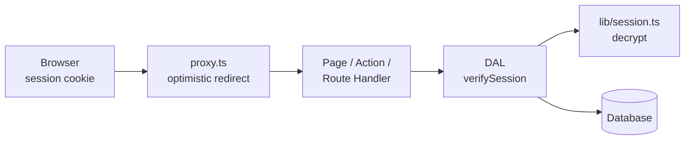
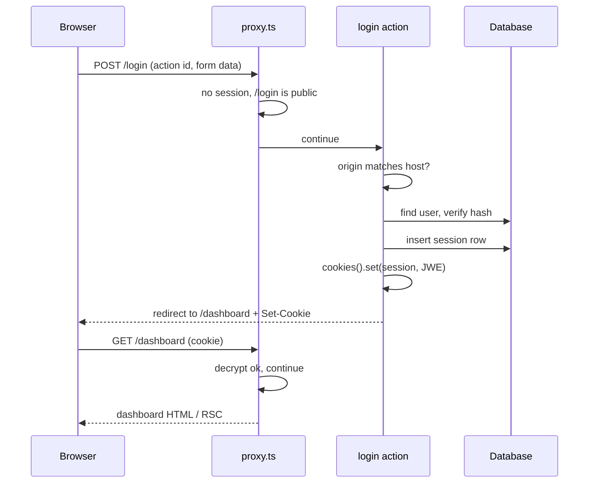
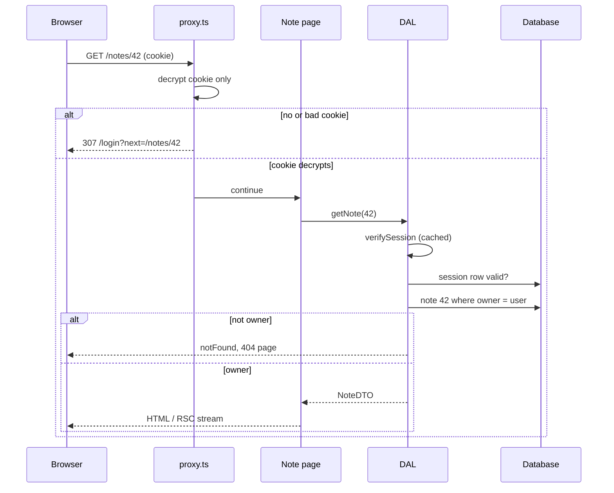

# Server-Aware Auth - Sessions, Proxy and the DAL

> [!summary] TL;DR
> The session lives in an `httpOnly`, `Secure`, `SameSite=Lax` cookie that holds an encrypted token (JWE via `jose`). Only Server Actions, Route Handlers and `proxy.ts` can write it, because `cookies().set` checks that the request store is in the `'action'` phase. `proxy.ts` decrypts the cookie and redirects early, but that is only an optimistic check. The real check is a `verifySession()` in a server-only **Data Access Layer**, wrapped in React `cache`, called next to every data read, in every Server Action and in every Route Handler. Actions are public POST endpoints, so each one authorizes itself. `unauthorized()` and `forbidden()` render `unauthorized.tsx` and `forbidden.tsx`, and they are still behind `experimental.authInterrupts` in 16.4.3. With Cache Components the session read is request data: it streams behind `<Suspense>`, it can never run inside a plain `'use cache'`, and you cache per user by passing the user id as an argument or by using `'use cache: private'`.

This part builds one app from scratch: a small notes app with `/login`, `/dashboard`, `/notes/[id]`, an admin page and a JSON API at `/api/notes`. Every piece is real code you can paste. Along the way we look at how Next.js 16.4.3 implements the pieces we lean on: `cookies()`, the request phases, proxy execution and the Server Action origin check.

If you only need auth in the browser against someone else's API (or a static export), read [[28 Client-Only Auth - Tokens in the Browser|Client-Only Auth]] instead. This part assumes a Next.js server.

## The shape of the system

There are four layers, and each has one job:

| Layer | File | Job | Trust level |
| --- | --- | --- | --- |
| Session | `lib/session.ts` | encrypt, decrypt, set and delete the cookie | the only code that touches the secret |
| Proxy | `proxy.ts` | cheap redirect before rendering | optimistic, can be skipped |
| DAL | `lib/dal.ts` | `verifySession`, `getUser`, data reads with checks | the security boundary |
| Entry points | pages, actions, route handlers | call the DAL, never the DB directly | untrusted input |



The important arrow is the one from every entry point into the DAL. The proxy arrow is a convenience.

## Step 1: The session token

### Signed or encrypted

The official guide signs a JWT with `SignJWT` (JWS, `HS256`). A signed token cannot be forged, but anyone holding the cookie can base64-decode the payload and read it. That is fine for a bare user id. If you want the payload hidden too, encrypt it (JWE). `jose` (6.x) does both with almost the same API, so this build encrypts with `dir` + `A256GCM`, which needs a 32-byte key.

```bash
# 32 random bytes, base64 encoded
openssl rand -base64 32
```

```bash
# .env.local  (never NEXT_PUBLIC_, so it is never inlined into client code)
SESSION_SECRET=q3m1nY0q1hH4...base64...=
```

### lib/session.ts

```ts
// lib/session.ts
import 'server-only'
import { EncryptJWT, jwtDecrypt, type JWTPayload } from 'jose'
import { cookies } from 'next/headers'

export const SESSION_COOKIE = 'session'
const SESSION_TTL_MS = 7 * 24 * 60 * 60 * 1000

export type Role = 'user' | 'admin'
export type SessionPayload = JWTPayload & {
  userId: string
  role: Role
  sessionId: string // row id in the sessions table, used for revocation
}

function getKey(): Uint8Array {
  const raw = process.env.SESSION_SECRET
  if (!raw) throw new Error('SESSION_SECRET is not set')
  const key = Buffer.from(raw, 'base64')
  if (key.length !== 32) throw new Error('SESSION_SECRET must be 32 bytes')
  return key
}

export async function encrypt(payload: SessionPayload, expiresAt: Date) {
  return new EncryptJWT(payload)
    .setProtectedHeader({ alg: 'dir', enc: 'A256GCM' })
    .setIssuedAt()
    .setExpirationTime(expiresAt)
    .encrypt(getKey())
}

// Returns null for a missing, tampered, expired or malformed token. Never throws.
export async function decrypt(token: string | undefined) {
  if (!token) return null
  try {
    const { payload } = await jwtDecrypt<SessionPayload>(token, getKey(), {
      keyManagementAlgorithms: ['dir'],
      contentEncryptionAlgorithms: ['A256GCM'],
    })
    return payload
  } catch {
    return null
  }
}

export async function createSession(input: Omit<SessionPayload, keyof JWTPayload>) {
  const expiresAt = new Date(Date.now() + SESSION_TTL_MS)
  const token = await encrypt(input, expiresAt)
  const cookieStore = await cookies()
  cookieStore.set(SESSION_COOKIE, token, {
    httpOnly: true, // JavaScript in the page cannot read it (XSS cannot steal it)
    secure: process.env.NODE_ENV === 'production', // HTTPS only in production
    sameSite: 'lax', // not sent on cross-site POSTs, still sent on top-level GET links
    path: '/',
    expires: expiresAt,
  })
}

export async function deleteSession() {
  const cookieStore = await cookies()
  cookieStore.delete(SESSION_COOKIE)
}
```

Three details are worth a sentence each:

- `jwtDecrypt` checks `exp` for you, so an expired cookie decrypts to `null` instead of a payload. Pinning the algorithms stops a token with a different header from being accepted.
- `decrypt` never throws. The proxy and the DAL both call it, and neither wants a broken cookie to become a 500.
- The `'server-only'` import makes any client import of this file a build error. It is allowed in `proxy.ts` too: the `middleware` bundling layer is in the server-only group, so `server-only` resolves to its empty module there.[^layers]

> [!tip] Stateless or database sessions
> The token above is *stateless*: the server trusts it until it expires. Putting a `sessionId` inside lets the DAL also look the session up in a table, which is what makes "log out everywhere" and admin revocation possible. The proxy keeps reading only the cookie (fast), and the DAL does the database check (correct). That split is the whole design.

### What `cookies()` really is

`cookies()` from `next/headers` is an async function that reads the current request from `AsyncLocalStorage`. It looks up two stores: the work store (the route) and the work unit store (what kind of work is running right now). It then switches on the work unit type.[^cookies]

- Inside a `'use cache'` function the type is `'cache'`, and `cookies()` throws "`cookies()` can't be read inside `"use cache"`".[^cookies-cache][^cookies-msg]
- During a static prerender (`'prerender'`) it returns a promise that never resolves. That is how Cache Components notices dynamic access and moves the component into a postponed hole (see [[23 PPR - Partial Prerendering with Cache Components|PPR]]).
- Inside `'use cache: private'` it returns the real request cookies.[^cookies-private]
- On a normal request it returns either the read-only cookies or the mutable ones, depending on the phase.[^cookies-request]

The phase is the interesting part. Pages start in the `'render'` phase. Route Handlers and the proxy start in the `'action'` phase.[^store-render][^store-api] A Server Action flips the phase to `'action'` while your function runs and back to `'render'` before the page is re-rendered.[^action-phase] Mutation is allowed only in `'action'`:[^mutable-phase]

```ts
// packages/next/src/server/web/spec-extension/adapters/request-cookies.ts (excerpt)
export function areCookiesMutableInCurrentPhase(requestStore: RequestStore) {
  return requestStore.phase === 'action'
}
```

In the render phase the cookie object is sealed with a `Proxy` whose `set`, `delete` and `clear` throw `ReadonlyRequestCookiesError`: "Cookies can only be modified in a Server Action or Route Handler."[^seal] So a Server Component can never set the session, which is correct: by the time it renders, the response headers may already be streaming.

One more detail explains why login "just works" without a manual refresh. Every `set` or `delete` on the mutable cookies marks the work store with `pathWasRevalidated = ActionDidRevalidateStaticAndDynamic`.[^cookie-revalidate] A Server Action that changes a cookie therefore re-renders the current route in the same response, so the new RSC payload already reflects the logged-in (or logged-out) user.

## Step 2: Login and logout Server Actions

### The schema and the action

```ts
// app/(auth)/login/actions.ts
'use server'

import { z } from 'zod'
import { redirect } from 'next/navigation'
import { createSession, deleteSession } from '@/lib/session'
import { getOptionalSession } from '@/lib/dal'
import { db } from '@/lib/db'
import { verifyPassword } from '@/lib/password' // argon2id or bcrypt, server-only

const LoginSchema = z.object({
  email: z.string().trim().toLowerCase().pipe(z.email()),
  password: z.string().min(1, 'Password is required'),
  next: z.string().optional(),
})

export type LoginState = { error?: string; email?: string } | undefined

export async function login(_prev: LoginState, formData: FormData): Promise<LoginState> {
  const parsed = LoginSchema.safeParse(Object.fromEntries(formData))
  if (!parsed.success) {
    return { error: 'Enter your email and password.' }
  }
  const { email, password, next } = parsed.data

  const user = await db.user.findUnique({ where: { email } })
  // Same message and similar timing whether the email exists or not
  const ok = await verifyPassword(user?.passwordHash, password)
  if (!user || !ok) {
    return { error: 'Email or password is incorrect.', email }
  }

  const session = await db.session.create({
    data: { userId: user.id, expiresAt: new Date(Date.now() + 7 * 864e5) },
  })
  await createSession({ userId: user.id, role: user.role, sessionId: session.id })

  // Only allow same-site relative paths, never "//evil.com" or "https://..."
  const safeNext = next && next.startsWith('/') && !next.startsWith('//') ? next : '/dashboard'
  redirect(safeNext)
}

export async function logout() {
  // Deleting the DB row revokes every copy of this cookie, not just this browser's
  const session = await getOptionalSession()
  if (session) await db.session.delete({ where: { id: session.sessionId } })
  await deleteSession()
  redirect('/login')
}
```

`redirect()` must stay outside any `try/catch`, because it works by throwing. When JavaScript is running, the redirect travels inside the action response and the client router navigates. For a plain no-JS form post, Next.js answers with `303 See Other`, so the browser does not re-POST the form. See [[07 Server Actions and Forms|Server Actions and Forms]] for how action IDs and the action response work.

### The form

```tsx
// app/(auth)/login/login-form.tsx
'use client'

import { useActionState } from 'react'
import { useSearchParams } from 'next/navigation'
import { login, type LoginState } from './actions'

export function LoginForm() {
  const next = useSearchParams().get('next') ?? ''
  const [state, action, pending] = useActionState<LoginState, FormData>(login, undefined)

  return (
    <form action={action} noValidate>
      <input type="hidden" name="next" value={next} />
      <label htmlFor="email">Email</label>
      <input id="email" name="email" type="email" autoComplete="username" defaultValue={state?.email} required />
      <label htmlFor="password">Password</label>
      <input id="password" name="password" type="password" autoComplete="current-password" required />
      {state?.error && <p role="alert">{state.error}</p>}
      <button disabled={pending}>{pending ? 'Signing in…' : 'Sign in'}</button>
    </form>
  )
}
```

```tsx
// app/(auth)/login/page.tsx
import { Suspense } from 'react'
import { LoginForm } from './login-form'

export default function LoginPage() {
  // useSearchParams in a client component needs a Suspense boundary to keep the page prerenderable
  return (
    <main>
      <h1>Sign in</h1>
      <Suspense>
        <LoginForm />
      </Suspense>
    </main>
  )
}
```

The form works before JavaScript loads: a Server Action bound to `<form action>` is a plain POST with a progressive-enhancement fallback.

### The login, end to end



The "origin matches host" step is built into every Server Action, and it is covered in [[#Server Actions are public endpoints]].

## Step 3: The optimistic check in proxy.ts

Next.js 16 renamed `middleware.ts` to `proxy.ts` (the old name is deprecated) and made the Node.js runtime the default. The `runtime` option is not allowed in a proxy file. The function runs before routing for every path the matcher accepts. See [[08 Route Handlers and Proxy#Proxy: the renamed middleware|Proxy]] for the file convention and matcher rules.

```ts
// proxy.ts
import { NextResponse, type NextRequest } from 'next/server'
import { decrypt, SESSION_COOKIE } from '@/lib/session'

const PUBLIC_ONLY = ['/login', '/signup'] // signed-in users get bounced away from these
const PROTECTED_PREFIXES = ['/dashboard', '/notes', '/admin']

export default async function proxy(req: NextRequest) {
  const { pathname, search } = req.nextUrl
  const isProtected = PROTECTED_PREFIXES.some((p) => pathname === p || pathname.startsWith(p + '/'))
  const isPublicOnly = PUBLIC_ONLY.includes(pathname)
  if (!isProtected && !isPublicOnly) return NextResponse.next()

  // Cookie only. No database call here: proxy runs on prefetches too.
  const session = await decrypt(req.cookies.get(SESSION_COOKIE)?.value)

  if (isProtected && !session) {
    const url = new URL('/login', req.nextUrl)
    url.searchParams.set('next', pathname + search)
    return NextResponse.redirect(url)
  }
  if (isPublicOnly && session) {
    return NextResponse.redirect(new URL('/dashboard', req.nextUrl))
  }
  return NextResponse.next()
}

export const config = {
  // Skip static assets. Keep /api in so API calls without a cookie fail fast too.
  matcher: ['/((?!_next/static|_next/image|favicon.ico|.*\\.(?:png|jpg|svg|webp)$).*)'],
}
```

### How the proxy runs

On a self-hosted server the router walks its route list, and when it reaches the `middleware` entry it calls the matcher function built from `config.matcher` against both the raw and the decoded pathname.[^resolve-mw] If it matches, the request goes to the proxy's `adapter`. The adapter creates a request store with `createRequestStoreForAPI` (so the phase is `'action'` and `cookies()` from `next/headers` works, including `set`), runs your function inside `workAsyncStorage` and `workUnitAsyncStorage`, then copies any cookies you set onto the response as `set-cookie`.[^adapter][^adapter-store][^adapter-cookies] The response comes back to the router as headers like `x-middleware-rewrite` and `x-middleware-next`, which tell it what to do next.

Two facts follow from this and matter for auth:

- **Server Actions go through the proxy as POSTs to the page path.** The proxy docs say it plainly: a matcher that excludes a path also skips Server Function calls on that path, and moving an action to another route can silently remove proxy coverage.
- **Prefetches go through it too.** That is why the docs insist on a cookie-only check. A database call here runs for every `<Link>` that scrolls into view.

### Proxy is not a security boundary

In March 2025, CVE-2025-29927 (CVSS 9.1) showed what happens when auth lives only in middleware. Next.js used an internal request header, `x-middleware-subrequest`, to stop middleware from recursing into itself. The server trusted that header even when it came from the client, so an attacker who sent it with the right value made self-hosted apps (`next start`, `output: 'standalone'`) skip middleware entirely. Releases 12.3.5, 13.5.9, 14.2.25 and 15.2.3 fixed it. Apps hosted on Vercel and Netlify were not affected.

In 16.4.3 that header name no longer appears anywhere in `packages/next/src`. The router server now deletes a list of internal headers (`x-middleware-rewrite`, `x-middleware-next`, `x-matched-path`, `x-nextjs-data` and others) from every incoming request before handling it.[^filter-call][^filter-list] That fixes the bug class, not the lesson. Proxies get skipped for boring reasons too: a matcher typo, a refactor that moves an action, a CDN rule, a new route added outside the prefixes list. Treat the proxy as UX (fast redirects, no flash of the wrong page) and put the security checks in the DAL.

> [!warning] Static routes are the one exception
> A DAL check only runs at request time. A fully static page that is the same for every user (a paywalled article, say) is built once and served from the CDN, so no server code runs per request. For that case the proxy check *is* the gate. Either keep such pages dynamic and check in the DAL, or accept the proxy as the gate and keep the matcher strict.

## Step 4: The Data Access Layer

### verifySession and getUser

```ts
// lib/dal.ts
import 'server-only'
import { cache } from 'react'
import { cookies } from 'next/headers'
import { forbidden, redirect } from 'next/navigation'
import { decrypt, SESSION_COOKIE, type Role } from '@/lib/session'
import { db } from '@/lib/db'

export type Session = { userId: string; role: Role; sessionId: string }

// Read and validate once per render pass. Returns null when signed out.
export const getOptionalSession = cache(async (): Promise<Session | null> => {
  const token = (await cookies()).get(SESSION_COOKIE)?.value
  const payload = await decrypt(token)
  if (!payload) return null

  // The secure check: the row must still exist (logout-everywhere, revocation)
  const row = await db.session.findUnique({ where: { id: payload.sessionId } })
  if (!row || row.expiresAt < new Date()) return null

  return { userId: payload.userId, role: payload.role, sessionId: payload.sessionId }
})

// For pages: redirect to /login when there is no session.
export const verifySession = cache(async (): Promise<Session> => {
  const session = await getOptionalSession()
  if (!session) redirect('/login')
  return session
})

export async function requireRole(role: Role): Promise<Session> {
  const session = await verifySession()
  if (session.role !== role) forbidden() // needs experimental.authInterrupts, see Step 6
  return session
}
```

React `cache` memoizes per server render, so a layout, a page and five components that each call `verifySession()` cost one cookie decrypt and one database lookup. That is all it does. The docs call out the edge: Server Actions and Route Handlers are not a React render pass, so there the wrapper does nothing and every call runs the function. That is harmless, just not free. See [[04 Data Fetching and Streaming|Data Fetching and Streaming]] for how `cache` scopes work.

### DTOs: return only what the caller may see

The DAL is also where data is shaped. A component never gets a raw database row, because whatever a Server Component passes to a Client Component is serialized into the RSC payload where anyone can read it.

```ts
// lib/dal/notes.ts
import 'server-only'
import { notFound } from 'next/navigation'
import { verifySession } from '@/lib/dal'
import { db } from '@/lib/db'

export type NoteDTO = { id: string; title: string; body: string; updatedAt: string; canEdit: boolean }

function toDTO(note: { id: string; title: string; body: string; updatedAt: Date; ownerId: string }, viewerId: string): NoteDTO {
  return {
    id: note.id,
    title: note.title,
    body: note.body,
    updatedAt: note.updatedAt.toISOString(),
    canEdit: note.ownerId === viewerId, // a decision, not the owner's id
  }
}

export async function getMyNotes(): Promise<NoteDTO[]> {
  const { userId } = await verifySession()
  const notes = await db.note.findMany({ where: { ownerId: userId }, orderBy: { updatedAt: 'desc' } })
  return notes.map((n) => toDTO(n, userId))
}

export async function getNote(id: string): Promise<NoteDTO> {
  const { userId } = await verifySession()
  const note = await db.note.findUnique({ where: { id } })
  // 404, not 403: do not confirm that someone else's note exists
  if (!note || note.ownerId !== userId) notFound()
  return toDTO(note, userId)
}
```

The rule that keeps this safe: pages, actions and route handlers import from `lib/dal/*`, never from `lib/db`. A lint rule (`no-restricted-imports` on `@/lib/db` outside `lib/dal`) makes it mechanical.

### Using the DAL in pages, not in layouts

```tsx
// app/dashboard/page.tsx
import { Suspense } from 'react'
import { getMyNotes } from '@/lib/dal/notes'

export default function DashboardPage() {
  return (
    <main>
      <h1>Your notes</h1>
      <Suspense fallback={<p>Loading notes…</p>}>
        <NoteList />
      </Suspense>
    </main>
  )
}

async function NoteList() {
  const notes = await getMyNotes() // verifySession runs here, next to the data
  return <ul>{notes.map((n) => <li key={n.id}>{n.title}</li>)}</ul>
}
```

Do not make a layout the auth gate. Layouts are not re-rendered on client navigation between their children (partial rendering), so a check in a layout does not run for every page change. And a layout that renders `null` for signed-out users does not stop the router from rendering the page segment and its parallel slots, which still run and still appear in the RSC payload. A layout can call `getUser()` to show an avatar. The gate belongs next to the data. See [[41 Recipes - Routing and Navigation#Protect every page in a route group|Protect every page in a route group]] for the route-group case.

> [!note] Push the session read down
> A top-level `await verifySession()` in a layout holds the first streamed bytes and all of `{children}` behind a cookie decrypt and a database query. Read it inside a small component wrapped in `<Suspense>` (the user menu), so the rest of the shell streams first.

## Step 5: Authorization at every entry point

### Server Actions are public endpoints

Every exported function in a `'use server'` file gets an action ID, and anyone who has the ID can POST to it with any arguments. The UI not showing a "Delete" button protects nothing. Each action does three things in order: authenticate, validate input, authorize against the specific record.

```ts
// app/notes/actions.ts
'use server'

import { z } from 'zod'
import { updateTag } from 'next/cache'
import { unauthorized } from 'next/navigation'
import { getOptionalSession } from '@/lib/dal'
import { db } from '@/lib/db'

const UpdateNote = z.object({ id: z.uuid(), title: z.string().min(1).max(200), body: z.string().max(50_000) })

export async function updateNote(input: z.input<typeof UpdateNote>) {
  // 1. Authenticate (cache() does not dedupe here; this is a fresh read)
  const session = await getOptionalSession()
  if (!session) unauthorized()

  // 2. Validate: arguments come from the network, not from your component
  const { id, title, body } = UpdateNote.parse(input)

  // 3. Authorize against the record, in the same query as the write
  const { count } = await db.note.updateMany({ where: { id, ownerId: session.userId }, data: { title, body } })
  if (count === 0) return { ok: false as const, error: 'Not found' }

  updateTag(`notes:${session.userId}`)
  return { ok: true as const }
}
```

Next.js adds one more layer of its own: a CSRF check on every action. It reads the `Origin` header and compares its host with `Host` (or `X-Forwarded-Host`). A missing `Origin` is let through with a warning (a hand-crafted request carries no ambient credentials, and old browsers do not send it). A mismatching one is allowed only if it is listed in `serverActions.allowedOrigins`; otherwise the action is aborted with "Invalid Server Actions request." and never runs.[^csrf][^csrf-allowed] Actions only accept POST, and `SameSite=Lax` already keeps the cookie off cross-site POSTs, so the two checks back each other up. Neither replaces step 1: a same-origin request from a signed-in attacker's own browser passes both. See [[07 Server Actions and Forms#A security checklist|the security checklist]] for the rest of the action hardening.

### Route Handlers

Route Handlers run with `createRequestStoreForAPI`, the same `'action'` phase as the proxy, so `cookies()` works and the DAL works.[^route-store]

```ts
// app/api/notes/route.ts
import { NextResponse } from 'next/server'
import { getOptionalSession } from '@/lib/dal'
import { getMyNotes } from '@/lib/dal/notes'

export async function GET() {
  const session = await getOptionalSession()
  if (!session) {
    // An API answers with a status, never with a redirect to an HTML login page
    return NextResponse.json({ error: 'unauthorized' }, { status: 401, headers: { 'WWW-Authenticate': 'Cookie' } })
  }
  return NextResponse.json(await getMyNotes(), { headers: { 'Cache-Control': 'private, no-store' } })
}
```

Calling `unauthorized()` or `forbidden()` in a Route Handler also works: the route module catches the HTTP-access error and returns an empty `Response` with status 401 or 403.[^route-http] Return a JSON body yourself when the client needs one. Note that `verifySession()` would be wrong here, because its `redirect('/login')` turns an API call into a 307 to an HTML page.

### A protected request, end to end



The proxy and the DAL both decrypt the cookie. Only the DAL knows whether the session was revoked and whether this user owns note 42.

## Step 6: unauthorized() and forbidden()

`notFound()` has two siblings for auth: `unauthorized()` (401, "who are you?") and `forbidden()` (403, "I know who you are, and no"). In 16.4.3 both are still experimental. The functions check a build-time flag and throw if it is off:[^unauth-fn][^forbid-fn][^define-env]

```ts
// next.config.ts
import type { NextConfig } from 'next'

const nextConfig: NextConfig = {
  experimental: {
    authInterrupts: true, // still under experimental in 16.4.3
  },
}

export default nextConfig
```

The config type even carries a "Remove this config when the API is stable" comment.[^config-flag]

Both work like `notFound()`. They throw an error whose `digest` is `NEXT_HTTP_ERROR_FALLBACK;401` or `;403`. The client-side `HTTPAccessFallbackErrorBoundary` (rendered by `HTTPAccessFallbackBoundary`) catches it, matches the status to the nearest `not-found`, `forbidden` or `unauthorized` file, and renders that file together with a `<meta name="robots" content="noindex">`.[^digest][^boundary] If a segment has no matching file, the boundary re-renders its children and the error keeps bubbling up. At the root (and at a first-level route group root) the app loader inserts built-in defaults, so there is always something to render.[^loader]

```tsx
// app/unauthorized.tsx
import Link from 'next/link'

export default function Unauthorized() {
  return (
    <main>
      <h1>Please sign in</h1>
      <p>You need an account to see this page.</p>
      <Link href="/login">Sign in</Link>
    </main>
  )
}
```

```tsx
// app/forbidden.tsx
import Link from 'next/link'

export default function Forbidden() {
  return (
    <main>
      <h1>Not allowed</h1>
      <p>Your account does not have access to this page.</p>
      <Link href="/dashboard">Back to your notes</Link>
    </main>
  )
}
```

```tsx
// app/admin/page.tsx
import { requireRole } from '@/lib/dal'

export default async function AdminPage() {
  await requireRole('admin') // forbidden() for signed-in non-admins
  return <h1>Admin</h1>
}
```

Status codes follow streaming. If the throw happens before the first byte is sent, the response is a real 401 or 403. If it happens inside a `<Suspense>` boundary that streams later, the status is already 200 and only the UI changes. So call these early (in the page body, before any boundary) when the status code matters, for example for crawlers or API-like clients.

When to use which:

| Situation | Call | Why |
| --- | --- | --- |
| Signed out, on a page | `redirect('/login?next=…')` or `unauthorized()` | redirect for a smooth flow, `unauthorized()` to keep the URL and show a login prompt in place |
| Signed in, wrong role | `forbidden()` | 403 with a helpful page |
| Signed in, someone else's record | `notFound()` | do not leak existence |
| API call, any of the above | `NextResponse.json(..., { status })` | clients want a body, not HTML |

See [[10 Errors, Redirects and Request Lifecycle APIs|Errors, Redirects and Request Lifecycle APIs]] for how these interrupts compare with `redirect()` and error boundaries.

## Step 7: Auth with Cache Components

With `cacheComponents: true` (top-level config in 16, see [[05 Cache Components - use cache, cacheLife and cacheTag|Cache Components]]), every route is prerendered into a static shell, and anything that reads request data has to sit in a `<Suspense>` hole. A session is request data. Three rules follow.

### Rule 1: The session read streams behind Suspense

Reading `cookies()` outside a boundary is a build error under Cache Components, because the prerender gets a promise that never resolves and has nothing to put in the shell. Put the user-specific part in a component behind `<Suspense>` and keep everything else static or cached.

```tsx
// app/dashboard/page.tsx (Cache Components version)
import { Suspense } from 'react'
import { getAnnouncements } from '@/lib/content'
import { getMyNotes } from '@/lib/dal/notes'

export default function Page() {
  return (
    <main>
      <Announcements /> {/* cached, part of the static shell */}
      <Suspense fallback={<p>Loading your notes…</p>}>
        <NoteList /> {/* reads the session, streams per request */}
      </Suspense>
    </main>
  )
}

async function Announcements() {
  'use cache'
  const items = await getAnnouncements()
  return <ul>{items.map((a) => <li key={a.id}>{a.text}</li>)}</ul>
}
```

### Rule 2: Never read the session inside a plain 'use cache'

Inside `'use cache'`, `cookies()` and `headers()` throw.[^cookies-cache] This is not an arbitrary restriction. A plain `'use cache'` entry is shared by every caller whose arguments match, so a cookie read inside it would serve one user's data to the next. The fix is to resolve the user outside and pass the **user id as an argument**. Arguments are part of the cache key, so each user gets their own entry.

```ts
// lib/dal/notes.ts (cached variant)
import 'server-only'
import { cacheLife, cacheTag } from 'next/cache'
import { verifySession } from '@/lib/dal'
import { db } from '@/lib/db'

export async function getMyNotesCached() {
  const { userId } = await verifySession() // request-time, outside the cache
  return notesForUser(userId)
}

// Not exported: nobody can call it with someone else's id
async function notesForUser(userId: string) {
  'use cache'
  cacheTag(`notes:${userId}`)
  cacheLife('minutes')
  return db.note.findMany({ where: { ownerId: userId }, select: { id: true, title: true } })
}
```

Keeping `notesForUser` unexported is the security part. The exported function proves who you are and only then picks the key. The `updateNote` action above calls `updateTag(`notes:${userId}`)`, which expires that user's entry and makes the action response read fresh data (see [[06 Revalidation - Tags, Paths and Refresh|Revalidation]]).

> [!danger] Cache keys and tags are plain text
> Arguments and closed-over values are serialized into the cache key, and `cacheTag` values are stored as written. The default handler keeps them as in-memory map keys, and a remote handler receives them as-is. Key and tag on a stable id. Never pass the session token, an email or a password as an argument to a cached function.

### Rule 3: 'use cache: private' when the read cannot be lifted out

Sometimes the cookie read is buried inside a library and there is nothing to pass in, or the validation is time-dependent (an expired seal must be rejected). That is what `'use cache: private'` is for. Inside it, `cookies()`, `headers()` and `searchParams` are allowed, but the result is never stored in a server cache across requests. In production a private cache does not use a cache handler at all: its entries go to the per-request resume data cache, and only in development is a dedicated in-memory handler used to make reloads fast.[^private-handler] The client router can keep the rendered output in browser memory for the `stale` time. Custom cache handlers cannot be configured for it.

```ts
// lib/current-user.ts
import 'server-only'
import { cacheLife } from 'next/cache'
import { redirect } from 'next/navigation'
import { getOptionalSession } from '@/lib/dal'
import { db } from '@/lib/db'

export async function getCurrentUser() {
  'use cache: private'
  cacheLife({ stale: 60 }) // keep >= 30s or the scope drops out of prefetching

  const session = await getOptionalSession()
  if (!session) redirect('/login') // throws, so it is never cached
  const user = await db.user.findUnique({ where: { id: session.userId }, select: { id: true, name: true } })
  if (!user) redirect('/login')
  return user // narrow DTO, safe to hand to client components
}
```

Use it for "who am I" data in the header. Use the argument pattern for per-user data you want cached on the server and invalidated by tag.

| What | Where it may run | Cached where | How it is keyed |
| --- | --- | --- | --- |
| `cookies()` / `verifySession()` | page, component behind Suspense, action, route handler | per render (React `cache`) | the request |
| `'use cache'` with `userId` arg | anywhere | server cache handler | function + arguments |
| `'use cache: remote'` with `userId` arg | anywhere | shared remote handler | function + arguments |
| `'use cache: private'` reading cookies | behind Suspense | browser router cache only | the request |
| `cookies()` inside plain `'use cache'` | nowhere | throws | n/a |

For an existing app, every route that reads the session gets flagged by instant navigation validation once Cache Components is on. You can set `export const instant = false` on such a page or layout to let it keep blocking, then move routes over one at a time. See [[22 SSR - Rendering Per Request#Common mistakes|SSR]] for when blocking is the right call.

## Libraries

The pieces above are what auth libraries do for you, so knowing them makes any library easier to judge. In the App Router world:

- **Auth.js (NextAuth v5)** gives you an `auth()` helper that reads the session in Server Components, actions and route handlers, plus OAuth providers and adapters. You still write the DAL checks.
- **Better Auth** is a TypeScript-first library with a database-backed session model, plugins for organizations, 2FA and passkeys, and a `nextCookies()` plugin so its actions can set cookies.
- **iron-session** is the small option if you only want sealed cookies; the official Cache Components auth guide uses it.

Whatever you pick, check two things: that it can read the session in your proxy (now Node.js by default, so most can), and that its "protect this page" helper is a server-side check, not only a proxy matcher.

## Summary

Server-aware auth in Next.js 16 is a cookie plus a discipline. The session is an encrypted token in an `httpOnly`, `Secure`, `SameSite=Lax` cookie that only Server Actions, Route Handlers and the proxy can write, because `cookies().set` is allowed only in the `'action'` phase. The proxy decrypts the cookie for fast redirects, but it can be skipped, so the security boundary is a server-only Data Access Layer whose `verifySession()` runs next to every read, inside every action and in every route handler. `unauthorized()` and `forbidden()` give proper 401 and 403 pages but still need `experimental.authInterrupts`. Under Cache Components the session read streams behind Suspense, and per-user caching works by passing the user id into `'use cache'` or by using `'use cache: private'`. The next part does the opposite and keeps all auth in the browser: [[28 Client-Only Auth - Tokens in the Browser|Client-Only Auth]].

### Key takeaways

- **Session cookie**: encrypt with `jose` (`EncryptJWT`, `dir` + `A256GCM`), set `httpOnly`, `secure`, `sameSite: 'lax'`, `path` and `expires`, and make `decrypt` return `null` instead of throwing.
- **Cookie phases**: pages render in `'render'` where cookies are read-only; actions, route handlers and the proxy run in `'action'` where `set` and `delete` work, and a cookie change makes the action re-render the route.
- **`proxy.ts`**: a cookie-only, optimistic redirect that also runs for prefetches and Server Action POSTs; CVE-2025-29927 showed it can be bypassed, so never make it the only check.
- **DAL**: `verifySession()` wrapped in React `cache` is called next to the data, checks the session row for revocation, and returns narrow DTOs.
- **Layouts**: they do not re-run on client navigation and do not stop child segments from rendering, so they are not a gate.
- **Server Actions**: public POST endpoints; authenticate, validate with zod and authorize against the record in each one; Next adds an Origin-vs-Host CSRF check on top.
- **Route Handlers**: return 401/403 JSON instead of redirecting; `unauthorized()` there yields an empty-body 401.
- **`unauthorized()` / `forbidden()`**: digest-based interrupts rendered by the nearest `unauthorized.tsx` / `forbidden.tsx`, still behind `experimental.authInterrupts` in 16.4.3.
- **Cache Components**: no `cookies()` in plain `'use cache'`; pass the user id as an argument from an exported, session-checking wrapper, or use `'use cache: private'` for request-bound reads.

← [[26 TanStack Query - Server Prefetch and Hydration|TanStack Query]] · [[00 Next.js in Practice Index|Index]] · [[28 Client-Only Auth - Tokens in the Browser|Client-Only Auth]] →

[^layers]: `WEBPACK_LAYERS.GROUP.serverOnly` includes the `middleware` layer — [packages/next/src/lib/constants.ts#L182-L187](https://github.com/vercel/next.js/blob/v16.4.3/packages/next/src/lib/constants.ts#L182-L187); server-only layers alias `server-only` to its empty module — [packages/next/src/build/create-compiler-aliases.ts#L253-L274](https://github.com/vercel/next.js/blob/v16.4.3/packages/next/src/build/create-compiler-aliases.ts#L253-L274)
[^cookies]: `cookies()` — [packages/next/src/server/request/cookies.ts#L36-L147](https://github.com/vercel/next.js/blob/v16.4.3/packages/next/src/server/request/cookies.ts#L36-L147)
[^cookies-cache]: `cookies()` throws inside `'use cache'` (`case 'cache'`) — [packages/next/src/server/request/cookies.ts#L63-L68](https://github.com/vercel/next.js/blob/v16.4.3/packages/next/src/server/request/cookies.ts#L63-L68)
[^cookies-msg]: `createCookiesInUseCacheError` — [packages/next/src/server/use-cache/use-cache-messages.ts#L35-L39](https://github.com/vercel/next.js/blob/v16.4.3/packages/next/src/server/use-cache/use-cache-messages.ts#L35-L39)
[^cookies-private]: `cookies()` in a private cache (`case 'private-cache'`) — [packages/next/src/server/request/cookies.ts#L103-L106](https://github.com/vercel/next.js/blob/v16.4.3/packages/next/src/server/request/cookies.ts#L103-L106)
[^cookies-request]: `cookies()` on a request picks mutable or read-only cookies by phase — [packages/next/src/server/request/cookies.ts#L107-L119](https://github.com/vercel/next.js/blob/v16.4.3/packages/next/src/server/request/cookies.ts#L107-L119)
[^store-render]: `createRequestStoreForRender` starts in `phase: 'render'` — [packages/next/src/server/async-storage/request-store.ts#L184-L219](https://github.com/vercel/next.js/blob/v16.4.3/packages/next/src/server/async-storage/request-store.ts#L184-L219)
[^store-api]: `createRequestStoreForAPI` starts in `phase: 'action'` — [packages/next/src/server/async-storage/request-store.ts#L221-L243](https://github.com/vercel/next.js/blob/v16.4.3/packages/next/src/server/async-storage/request-store.ts#L221-L243)
[^action-phase]: `executeActionAndPrepareForRender` sets `phase = 'action'`, then back to `'render'` — [packages/next/src/server/app-render/action-handler.ts#L1461-L1497](https://github.com/vercel/next.js/blob/v16.4.3/packages/next/src/server/app-render/action-handler.ts#L1461-L1497)
[^mutable-phase]: `areCookiesMutableInCurrentPhase` — [packages/next/src/server/web/spec-extension/adapters/request-cookies.ts#L220-L222](https://github.com/vercel/next.js/blob/v16.4.3/packages/next/src/server/web/spec-extension/adapters/request-cookies.ts#L220-L222)
[^seal]: `ReadonlyRequestCookiesError` and `RequestCookiesAdapter.seal` — [packages/next/src/server/web/spec-extension/adapters/request-cookies.ts#L12-L50](https://github.com/vercel/next.js/blob/v16.4.3/packages/next/src/server/web/spec-extension/adapters/request-cookies.ts#L12-L50)
[^cookie-revalidate]: `MutableRequestCookiesAdapter.wrap` → `updateResponseCookies` sets `pathWasRevalidated` — [packages/next/src/server/web/spec-extension/adapters/request-cookies.ts#L128-L133](https://github.com/vercel/next.js/blob/v16.4.3/packages/next/src/server/web/spec-extension/adapters/request-cookies.ts#L128-L133)
[^resolve-mw]: `resolveRoutes` middleware entry and matcher — [packages/next/src/server/lib/router-utils/resolve-routes.ts#L565-L586](https://github.com/vercel/next.js/blob/v16.4.3/packages/next/src/server/lib/router-utils/resolve-routes.ts#L565-L586)
[^adapter]: `adapter` (proxy/middleware entry) — [packages/next/src/server/web/adapter.ts#L157-L176](https://github.com/vercel/next.js/blob/v16.4.3/packages/next/src/server/web/adapter.ts#L157-L176)
[^adapter-store]: proxy request store via `createRequestStoreForAPI`, run inside `workAsyncStorage` — [packages/next/src/server/web/adapter.ts#L365-L419](https://github.com/vercel/next.js/blob/v16.4.3/packages/next/src/server/web/adapter.ts#L365-L419)
[^adapter-cookies]: cookies set in the proxy copied to `set-cookie` — [packages/next/src/server/web/adapter.ts#L466-L468](https://github.com/vercel/next.js/blob/v16.4.3/packages/next/src/server/web/adapter.ts#L466-L468)
[^filter-call]: router server strips internal headers from incoming requests — [packages/next/src/server/lib/router-server.ts#L362-L366](https://github.com/vercel/next.js/blob/v16.4.3/packages/next/src/server/lib/router-server.ts#L362-L366)
[^filter-list]: `INTERNAL_HEADERS` and `filterInternalHeaders` — [packages/next/src/server/lib/server-ipc/utils.ts#L40-L64](https://github.com/vercel/next.js/blob/v16.4.3/packages/next/src/server/lib/server-ipc/utils.ts#L40-L64)
[^csrf]: Server Action Origin vs Host check — [packages/next/src/server/app-render/action-handler.ts#L710-L762](https://github.com/vercel/next.js/blob/v16.4.3/packages/next/src/server/app-render/action-handler.ts#L710-L762)
[^csrf-allowed]: `isCsrfOriginAllowed` — [packages/next/src/server/app-render/csrf-protection.ts#L72-L94](https://github.com/vercel/next.js/blob/v16.4.3/packages/next/src/server/app-render/csrf-protection.ts#L72-L94)
[^route-store]: Route Handler request store via `createRequestStoreForAPI` — [packages/next/src/server/route-modules/app-route/module.ts#L894-L901](https://github.com/vercel/next.js/blob/v16.4.3/packages/next/src/server/route-modules/app-route/module.ts#L894-L901)
[^route-http]: Route Handler turns HTTP-access errors into a status-only `Response` — [packages/next/src/server/route-modules/app-route/module.ts#L449-L452](https://github.com/vercel/next.js/blob/v16.4.3/packages/next/src/server/route-modules/app-route/module.ts#L449-L452)
[^unauth-fn]: `unauthorized` — [packages/next/src/client/components/unauthorized.ts#L21-L33](https://github.com/vercel/next.js/blob/v16.4.3/packages/next/src/client/components/unauthorized.ts#L21-L33)
[^forbid-fn]: `forbidden` — [packages/next/src/client/components/forbidden.ts#L20-L32](https://github.com/vercel/next.js/blob/v16.4.3/packages/next/src/client/components/forbidden.ts#L20-L32)
[^define-env]: `__NEXT_EXPERIMENTAL_AUTH_INTERRUPTS` defined from `experimental.authInterrupts` — [packages/next/src/build/define-env.ts#L333-L334](https://github.com/vercel/next.js/blob/v16.4.3/packages/next/src/build/define-env.ts#L333-L334)
[^config-flag]: `authInterrupts` in the experimental config type — [packages/next/src/server/config-shared.ts#L1465-L1469](https://github.com/vercel/next.js/blob/v16.4.3/packages/next/src/server/config-shared.ts#L1465-L1469)
[^digest]: `HTTPAccessErrorStatus`, `isHTTPAccessFallbackError` — [packages/next/src/client/components/http-access-fallback/http-access-fallback.ts#L1-L39](https://github.com/vercel/next.js/blob/v16.4.3/packages/next/src/client/components/http-access-fallback/http-access-fallback.ts#L1-L39)
[^boundary]: `HTTPAccessFallbackErrorBoundary.render` — [packages/next/src/client/components/http-access-fallback/error-boundary.tsx#L114-L151](https://github.com/vercel/next.js/blob/v16.4.3/packages/next/src/client/components/http-access-fallback/error-boundary.tsx#L114-L151)
[^loader]: default `forbidden` / `unauthorized` fallbacks inserted at the root layer — [packages/next/src/build/webpack/loaders/next-app-loader/index.ts#L522-L545](https://github.com/vercel/next.js/blob/v16.4.3/packages/next/src/build/webpack/loaders/next-app-loader/index.ts#L522-L545)
[^private-handler]: private caches use the resume data cache, not a cache handler (dev-only handler) — [packages/next/src/server/use-cache/use-cache-wrapper.ts#L1935-L1941](https://github.com/vercel/next.js/blob/v16.4.3/packages/next/src/server/use-cache/use-cache-wrapper.ts#L1935-L1941)
