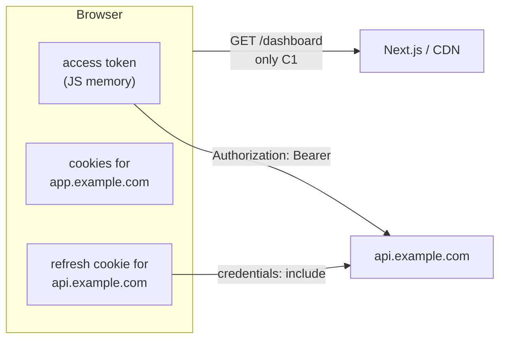
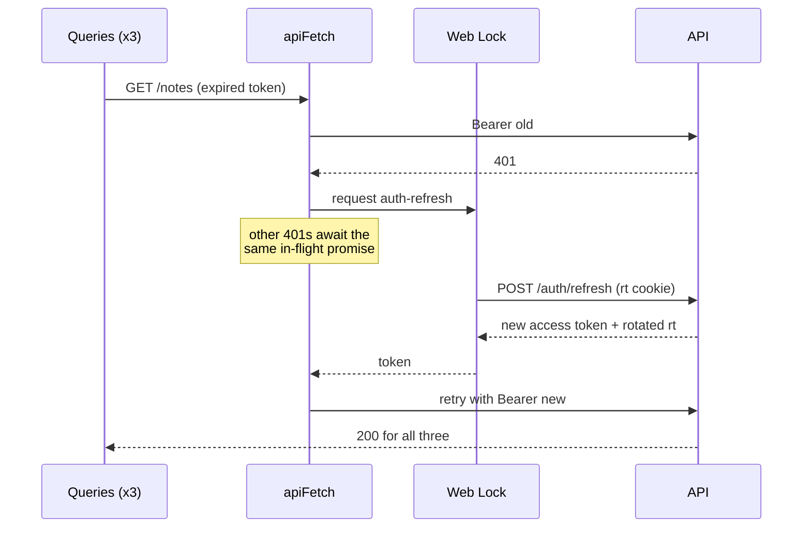
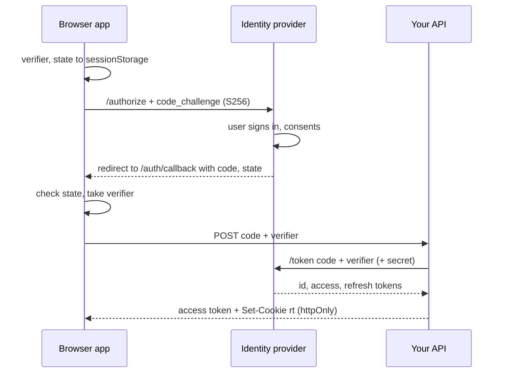

# Client-Only Auth - Tokens in the Browser

> [!summary] TL;DR
> When the Next.js app is only a client for someone else's API (or a static export with no server at all), auth lives in the browser. Keep a short-lived **access token in memory**, keep the **refresh token in an `httpOnly` cookie set by the API on its own domain**, and put both behind one `apiFetch` wrapper that attaches the bearer token, refreshes once on a 401 (single-flight, serialized across tabs with the Web Locks API) and retries. An `AuthProvider` exposes `status`, `user`, `login` and `logout`. A client layout acts as the route guard and renders a loading gate until the status is known, which is what prevents the flash of protected UI. OAuth uses the authorization-code flow with PKCE. Logout is broadcast to every tab with `BroadcastChannel`. None of this is visible to `proxy.ts` or Server Components, because the token never travels with the document request, so the guard is UX and the API is the only security boundary.

[[27 Server-Aware Auth - Sessions, Proxy and the DAL|Part 27]] put the session in a cookie the Next.js server could read. This part takes the server out of the picture. The running example is the same notes app, now built with `output: 'export'` and talking to `https://api.example.com`, a separate service that owns users, passwords and tokens.

## When this is the right model

Client-only auth is the right call when at least one of these holds:

- The app is a static export (`output: 'export'`) served from a CDN or object storage, so there is no Next.js server to read a cookie. See [[25 Fully Client-Side - SPA and Static Export|Fully Client-Side]].
- The API already exists and already issues tokens (a mobile app uses it too), and you do not want a second session layer.
- Auth is delegated to an identity provider (Auth0, Cognito, Keycloak, Entra ID) through OAuth.

If you have a Next.js server anyway, part 27 is simpler and safer: an `httpOnly` session cookie on your own origin gives you server rendering of signed-in pages and keeps tokens out of JavaScript entirely.

## Why the server side of Next cannot help

### The token is not in the request

A browser sends cookies for the target origin automatically. It never sends `localStorage` values or JavaScript variables. When the user loads `/dashboard`, the document request carries the cookies for the app's origin and nothing else. The access token sits in memory on the client, and the refresh cookie belongs to `api.example.com`, so the app's origin never sees it.



So `proxy.ts`, a Server Component calling `cookies()`, or a Route Handler would see a request with no credentials at all. That is not a bug to work around. It is the trade you make by keeping the token in the browser.

### With a static export there is no server at all

`output: 'export'` turns the build into HTML, JS and CSS files. The static export docs list what does not exist in that mode: `cookies()`, Server Actions, rewrites, redirects, headers, ISR, dynamic routes without `generateStaticParams`, Route Handlers that read the request, and the proxy. In `next dev` the bundler refuses to load a proxy for an export build and logs "Middleware cannot be used with \"output: export\"".[^export-proxy] Everything below therefore runs in client components.

### Configuration is public

`NEXT_PUBLIC_*` variables are collected at build time and inlined into the client bundle as literal strings.[^public-env] The API URL and an OAuth client id are fine there. A client secret is not: anyone can read it from the JavaScript. Browser apps are OAuth *public clients*, which is why PKCE exists.

```bash
# .env.production
NEXT_PUBLIC_API_URL=https://api.example.com
NEXT_PUBLIC_OAUTH_CLIENT_ID=notes-web
NEXT_PUBLIC_OAUTH_ISSUER=https://id.example.com
```

## Where to keep the tokens

This is the decision that sets your security posture. The threat that matters is **XSS**: any script running in your origin (a compromised npm package, an injected ad, a `dangerouslySetInnerHTML` bug) can do what your code can do.

| Storage | Readable by injected JS | Survives reload | Shared across tabs | Main risk |
| --- | --- | --- | --- | --- |
| `localStorage` | yes | yes | yes | XSS can copy the token and use it from anywhere until it expires |
| `sessionStorage` | yes | per tab | no | same as above, slightly smaller window |
| JS memory (module variable) | only while the page is open, by code in the page | no | no | lost on reload, so it needs a refresh mechanism |
| `httpOnly` cookie on the API domain | no | yes | yes | CSRF on the endpoints that accept it; third-party cookie rules if the API is cross-site |

The recommended combination:

- **Access token in memory**, short-lived (5 to 15 minutes). If XSS happens, the attacker can still make calls while the page is open, but they cannot walk away with a long-lived credential.
- **Refresh token in an `httpOnly`, `Secure` cookie set by the API**, with `Path=/auth` so it is only sent to the auth endpoints, and rotated on every use.

```http
Set-Cookie: rt=…opaque…; HttpOnly; Secure; SameSite=Strict; Path=/auth; Max-Age=1209600
```

> [!warning] Same-site, or the cookie does not arrive
> `app.example.com` and `api.example.com` are the **same site** (same registrable domain), so `SameSite=Strict` works and the cookie is first-party. If the API lives on a different registrable domain (`notes-api.io`), the cookie is third-party: it needs `SameSite=None`, and Safari, Firefox and Brave block or partition it. Put the API under the app's domain, or put a small backend-for-frontend on the app's origin (which is part 27 again).

The API side has to cooperate: CORS with an explicit origin (not `*`) and `Access-Control-Allow-Credentials: true` for the auth endpoints, refresh tokens stored hashed, rotation with **reuse detection** (if an old refresh token is presented again, revoke the whole token family), and a requirement for a custom header such as `X-Requested-With` on `/auth/refresh` so a cross-site form cannot trigger it without a CORS preflight.

> [!note] Do not put tokens in localStorage "because it is simpler"
> It is simpler, until the first XSS. Memory plus a refresh cookie costs one extra request on page load and removes the long-lived secret from JavaScript's reach.

## Step 1: The token store and the fetch wrapper

### A tiny in-memory store

```ts
// lib/auth/token-store.ts
'use client'

let accessToken: string | null = null
const listeners = new Set<() => void>()

export const tokenStore = {
  get: () => accessToken,
  set(token: string | null) {
    accessToken = token
    listeners.forEach((l) => l())
  },
  subscribe(listener: () => void) {
    listeners.add(listener)
    return () => listeners.delete(listener)
  },
}
```

A module variable is the right shape: it is per tab, it disappears on reload, and the fetch wrapper can read it without going through React.

### apiFetch with single-flight refresh

```ts
// lib/auth/api.ts
'use client'

import { tokenStore } from './token-store'

const API = process.env.NEXT_PUBLIC_API_URL!

export class ApiError extends Error {
  constructor(public status: number, message: string) {
    super(message)
  }
}

type TokenResponse = { accessToken: string; expiresIn: number }

let refreshInFlight: Promise<string | null> | null = null

async function doRefresh(): Promise<string | null> {
  const res = await fetch(`${API}/auth/refresh`, {
    method: 'POST',
    credentials: 'include', // sends the httpOnly rt cookie to api.example.com
    headers: { 'X-Requested-With': 'fetch' },
  })
  if (!res.ok) {
    tokenStore.set(null)
    return null
  }
  const body = (await res.json()) as TokenResponse
  tokenStore.set(body.accessToken)
  return body.accessToken
}

// One refresh at a time per tab, and one at a time across tabs.
export function refreshAccessToken(): Promise<string | null> {
  refreshInFlight ??= (
    typeof navigator !== 'undefined' && 'locks' in navigator
      ? navigator.locks.request('auth-refresh', doRefresh)
      : doRefresh()
  ).finally(() => {
    refreshInFlight = null
  })
  return refreshInFlight
}

export async function apiFetch<T>(path: string, init: RequestInit = {}): Promise<T> {
  const send = (token: string | null) =>
    fetch(`${API}${path}`, {
      ...init,
      headers: {
        'Content-Type': 'application/json',
        ...init.headers,
        ...(token ? { Authorization: `Bearer ${token}` } : {}),
      },
    })

  let res = await send(tokenStore.get())
  if (res.status === 401) {
    const fresh = await refreshAccessToken()
    if (!fresh) throw new ApiError(401, 'Session expired')
    res = await send(fresh) // retry exactly once
  }
  if (!res.ok) throw new ApiError(res.status, await res.text())
  return res.status === 204 ? (undefined as T) : ((await res.json()) as T)
}
```

Why both guards matter with rotating refresh tokens:

- **Single-flight per tab.** Five queries that all get a 401 at once must cause one refresh, not five. With rotation, the second refresh would present an already-used token, the API would detect reuse and revoke the family, and the user would be logged out for no reason. React Strict Mode runs effects twice in development, which triggers exactly this if the bootstrap refresh is not deduplicated.
- **Serialized across tabs.** Two tabs share one cookie jar. `navigator.locks.request` makes the second tab wait until the first tab's refresh has finished and the new cookie is stored, so the second tab sends the rotated token, not the spent one.



## Step 2: The AuthProvider

```tsx
// lib/auth/auth-provider.tsx
'use client'

import { createContext, use, useCallback, useEffect, useMemo, useState, type ReactNode } from 'react'
import { useQueryClient } from '@tanstack/react-query'
import { apiFetch, refreshAccessToken } from './api'
import { tokenStore } from './token-store'
import { authChannel } from './auth-channel'

export type User = { id: string; name: string; role: 'user' | 'admin' }
type Status = 'loading' | 'authenticated' | 'unauthenticated'
type AuthContextValue = {
  status: Status
  user: User | null
  login: (email: string, password: string) => Promise<void>
  logout: () => Promise<void>
}

const AuthContext = createContext<AuthContextValue | null>(null)
const API = process.env.NEXT_PUBLIC_API_URL!

export function AuthProvider({ children }: { children: ReactNode }) {
  const queryClient = useQueryClient()
  const [status, setStatus] = useState<Status>('loading')
  const [user, setUser] = useState<User | null>(null)

  const loadUser = useCallback(async () => {
    const me = await apiFetch<User>('/me')
    setUser(me)
    setStatus('authenticated')
  }, [])

  const clearLocal = useCallback(() => {
    tokenStore.set(null)
    setUser(null)
    setStatus('unauthenticated')
    queryClient.clear() // drop every cached response that belonged to this user
  }, [queryClient])

  // Bootstrap: a reload lost the in-memory token, so try the refresh cookie once.
  useEffect(() => {
    let cancelled = false
    refreshAccessToken().then(async (token) => {
      if (cancelled) return
      if (!token) return setStatus('unauthenticated')
      try {
        await loadUser()
      } catch {
        if (!cancelled) clearLocal()
      }
    })
    return () => {
      cancelled = true
    }
  }, [loadUser, clearLocal])

  // Other tabs tell us when they log in or out.
  useEffect(
    () =>
      authChannel.subscribe((event) => {
        if (event === 'logout') clearLocal()
        if (event === 'login') refreshAccessToken().then((t) => (t ? loadUser() : clearLocal()))
      }),
    [clearLocal, loadUser],
  )

  const login = useCallback(
    async (email: string, password: string) => {
      const res = await fetch(`${API}/auth/login`, {
        method: 'POST',
        credentials: 'include', // the API sets the rt cookie in this response
        headers: { 'Content-Type': 'application/json', 'X-Requested-With': 'fetch' },
        body: JSON.stringify({ email, password }),
      })
      if (!res.ok) throw new Error(res.status === 401 ? 'Email or password is incorrect.' : 'Sign-in failed.')
      const { accessToken } = (await res.json()) as { accessToken: string }
      tokenStore.set(accessToken)
      await loadUser()
      authChannel.post('login')
    },
    [loadUser],
  )

  const logout = useCallback(async () => {
    // Revoke on the server first, so the refresh cookie is useless even if it leaked
    await fetch(`${API}/auth/logout`, {
      method: 'POST',
      credentials: 'include',
      headers: { 'X-Requested-With': 'fetch' },
    }).catch(() => {})
    clearLocal()
    authChannel.post('logout')
  }, [clearLocal])

  const value = useMemo(() => ({ status, user, login, logout }), [status, user, login, logout])
  return <AuthContext value={value}>{children}</AuthContext>
}

export function useAuth() {
  const ctx = use(AuthContext)
  if (!ctx) throw new Error('useAuth must be used inside <AuthProvider>')
  return ctx
}
```

The provider sits inside the TanStack Query provider so it can clear the cache on logout:

```tsx
// app/providers.tsx
'use client'

import { useState, type ReactNode } from 'react'
import { QueryClient, QueryClientProvider } from '@tanstack/react-query'
import { AuthProvider } from '@/lib/auth/auth-provider'
import { ApiError } from '@/lib/auth/api'

export function Providers({ children }: { children: ReactNode }) {
  const [queryClient] = useState(
    () =>
      new QueryClient({
        defaultOptions: {
          queries: {
            staleTime: 30_000,
            // apiFetch already refreshed once; retrying a 401 or 403 cannot help
            retry: (count, error) =>
              !(error instanceof ApiError && (error.status === 401 || error.status === 403)) && count < 2,
          },
        },
      }),
  )
  return (
    <QueryClientProvider client={queryClient}>
      <AuthProvider>{children}</AuthProvider>
    </QueryClientProvider>
  )
}
```

```tsx
// app/layout.tsx
import type { ReactNode } from 'react'
import { Providers } from './providers'

export default function RootLayout({ children }: { children: ReactNode }) {
  return (
    <html lang="en">
      <body>
        <Providers>{children}</Providers>
      </body>
    </html>
  )
}
```

The root layout stays a Server Component (it is prerendered once at build time in an export). Only `Providers` and below are client code. This is the plain TanStack Query v5 setup without server prefetch; compare it with the hydration setup in [[26 TanStack Query - Server Prefetch and Hydration|TanStack Query]].

### Data hooks use the wrapper

```tsx
// app/(app)/dashboard/notes-list.tsx
'use client'

import { useQuery, useMutation, useQueryClient } from '@tanstack/react-query'
import { apiFetch } from '@/lib/auth/api'

type Note = { id: string; title: string }

export function NotesList() {
  const qc = useQueryClient()
  const notes = useQuery({ queryKey: ['notes'], queryFn: () => apiFetch<Note[]>('/notes') })
  const remove = useMutation({
    mutationFn: (id: string) => apiFetch<void>(`/notes/${id}`, { method: 'DELETE' }),
    onSuccess: () => qc.invalidateQueries({ queryKey: ['notes'] }),
  })

  if (notes.isPending) return <p>Loading notes…</p>
  if (notes.isError) return <p role="alert">Could not load notes.</p>
  return (
    <ul>
      {notes.data.map((n) => (
        <li key={n.id}>
          {n.title} <button onClick={() => remove.mutate(n.id)}>Delete</button>
        </li>
      ))}
    </ul>
  )
}
```

The query layer never sees tokens. The wrapper handles expiry, and a failed refresh surfaces as a 401 `ApiError`. To turn that into a logout everywhere, add a global handler with a `QueryCache({ onError })` that calls `logout()` for a 401.

## Step 3: Route guards in a client layout

### The flash of unauthenticated content

A static export prerenders every page at build time, when nobody is signed in. If `/dashboard` rendered its real content and then redirected in an effect, the user would see the dashboard shell for a frame (or a "signed out" UI flash for a signed-in user, the mirror problem). Effects run after the browser paints, which is the root cause; see [[08 The Commit Phase and Effects|The Commit Phase and Effects]].

The fix is a **loading gate**: while `status` is `'loading'`, render a neutral skeleton, never the protected children. The prerendered HTML then contains the skeleton, the JS bootstraps, and the gate either reveals the page or redirects.

```tsx
// app/(app)/layout.tsx
'use client'

import { useEffect, type ReactNode } from 'react'
import { usePathname, useRouter } from 'next/navigation'
import { useAuth } from '@/lib/auth/auth-provider'

export default function AppLayout({ children }: { children: ReactNode }) {
  const { status } = useAuth()
  const router = useRouter()
  const pathname = usePathname()

  useEffect(() => {
    if (status === 'unauthenticated') {
      router.replace(`/login?next=${encodeURIComponent(pathname)}`)
    }
  }, [status, pathname, router])

  if (status !== 'authenticated') {
    return <div aria-busy="true" aria-label="Loading" className="app-skeleton" />
  }
  return <>{children}</>
}
```

Everything under the `(app)` route group is guarded, and `(auth)/login` sits outside it. A layout persists across navigations between its children, so the gate does not unmount and the user does not see the skeleton again on every click; only the page under it changes (see [[01 The App Router - Files, Segments and Layouts|The App Router]]). `useRouter` and `usePathname` are plain context reads from the app router, so they work the same in an export.[^use-router][^use-pathname] `router.replace` keeps the protected URL out of the history stack, so Back does not loop.

### Role gates and the login page

```tsx
// app/(app)/admin/layout.tsx
'use client'

import type { ReactNode } from 'react'
import { useAuth } from '@/lib/auth/auth-provider'

export default function AdminLayout({ children }: { children: ReactNode }) {
  const { user } = useAuth() // the parent gate guarantees a user here
  if (user?.role !== 'admin') return <p role="alert">You do not have access to this page.</p>
  return <>{children}</>
}
```

```tsx
// app/(auth)/login/page.tsx
'use client'

import { Suspense, useState, type FormEvent } from 'react'
import { useRouter, useSearchParams } from 'next/navigation'
import { useAuth } from '@/lib/auth/auth-provider'
import { startOAuthLogin } from '@/lib/auth/oauth'

function LoginForm() {
  const { login } = useAuth()
  const router = useRouter()
  const next = useSearchParams().get('next')
  const [error, setError] = useState<string | null>(null)
  const [pending, setPending] = useState(false)
  const safeNext = next?.startsWith('/') && !next.startsWith('//') ? next : '/dashboard'

  async function onSubmit(e: FormEvent<HTMLFormElement>) {
    e.preventDefault()
    const form = new FormData(e.currentTarget)
    setPending(true)
    setError(null)
    try {
      await login(String(form.get('email')), String(form.get('password')))
      router.replace(safeNext)
    } catch (err) {
      setError((err as Error).message)
    } finally {
      setPending(false)
    }
  }

  return (
    <form onSubmit={onSubmit}>
      <input name="email" type="email" autoComplete="username" required />
      <input name="password" type="password" autoComplete="current-password" required />
      {error && <p role="alert">{error}</p>}
      <button disabled={pending}>Sign in</button>
      <button type="button" onClick={() => startOAuthLogin(safeNext)}>Continue with SSO</button>
    </form>
  )
}

export default function LoginPage() {
  // useSearchParams has no value at build time in an export, so it needs a boundary
  return (
    <Suspense>
      <LoginForm />
    </Suspense>
  )
}
```

`useSearchParams` reads the `SearchParamsContext` on the client.[^use-search] In a static export the query string is unknown at build time, so wrap its consumer in `<Suspense>`; the prerendered HTML contains the fallback and the form renders once the browser has the URL.

> [!danger] A client guard is not access control
> Anyone can open devtools, flip `status` to `'authenticated'`, or call the API with curl. The guard only decides what the UI shows. Every API endpoint must check the bearer token and the user's permissions on its own. The same rule as part 27 applies, just one hop further away.

## Step 4: OAuth with PKCE

For "Sign in with your company account", use the authorization-code flow with PKCE (Proof Key for Code Exchange). The browser invents a random `code_verifier`, sends only its SHA-256 hash (`code_challenge`) to the authorize endpoint, and later proves possession by sending the verifier with the code. A stolen authorization code is useless without it. The implicit flow (tokens in the URL fragment) is deprecated; do not use it.

```ts
// lib/auth/oauth.ts
'use client'

const ISSUER = process.env.NEXT_PUBLIC_OAUTH_ISSUER!
const CLIENT_ID = process.env.NEXT_PUBLIC_OAUTH_CLIENT_ID!
const KEY = 'oauth:pkce'

function base64url(bytes: Uint8Array) {
  return btoa(String.fromCharCode(...bytes)).replace(/\+/g, '-').replace(/\//g, '_').replace(/=+$/, '')
}

function randomString(byteLength = 32) {
  return base64url(crypto.getRandomValues(new Uint8Array(byteLength)))
}

async function s256(verifier: string) {
  const digest = await crypto.subtle.digest('SHA-256', new TextEncoder().encode(verifier))
  return base64url(new Uint8Array(digest))
}

export function redirectUri() {
  return `${window.location.origin}/auth/callback`
}

export async function startOAuthLogin(next: string) {
  const verifier = randomString(48)
  const state = randomString(16)
  sessionStorage.setItem(KEY, JSON.stringify({ verifier, state, next }))

  const url = new URL(`${ISSUER}/authorize`)
  url.search = new URLSearchParams({
    response_type: 'code',
    client_id: CLIENT_ID,
    redirect_uri: redirectUri(),
    scope: 'openid profile offline_access',
    state,
    code_challenge: await s256(verifier),
    code_challenge_method: 'S256',
  }).toString()
  window.location.assign(url)
}

export function takePkce(): { verifier: string; state: string; next: string } | null {
  const raw = sessionStorage.getItem(KEY)
  sessionStorage.removeItem(KEY) // one use only
  return raw ? JSON.parse(raw) : null
}
```

The callback is a static page. It reads `code` and `state` on the client, checks `state` against what it stored (CSRF protection for the redirect), and exchanges the code.

```tsx
// app/auth/callback/page.tsx
'use client'

import { Suspense, useEffect, useState } from 'react'
import { useSearchParams } from 'next/navigation'
import { takePkce, redirectUri } from '@/lib/auth/oauth'

let exchangeStarted = false // module-level: survives Strict Mode's double effect

function Callback() {
  const params = useSearchParams()
  const [error, setError] = useState<string | null>(null)

  useEffect(() => {
    if (exchangeStarted) return
    exchangeStarted = true

    const pkce = takePkce()
    const code = params.get('code')
    if (!pkce || !code || params.get('state') !== pkce.state) {
      setError('Sign-in could not be verified. Please try again.')
      return
    }
    // Token-mediating backend: the API exchanges the code, sets the httpOnly rt cookie,
    // and returns only a short-lived access token to the browser.
    fetch(`${process.env.NEXT_PUBLIC_API_URL}/auth/oauth/callback`, {
      method: 'POST',
      credentials: 'include',
      headers: { 'Content-Type': 'application/json', 'X-Requested-With': 'fetch' },
      body: JSON.stringify({ code, codeVerifier: pkce.verifier, redirectUri: redirectUri() }),
    })
      .then((r) => {
        if (!r.ok) throw new Error('exchange failed')
        // A full navigation drops this page's memory anyway, so ignore the returned
        // access token: the AuthProvider on the next page bootstraps from the new rt cookie.
        window.location.replace(pkce.next)
      })
      .catch(() => setError('Sign-in failed. Please try again.'))
  }, [params])

  return error ? <p role="alert">{error}</p> : <p aria-busy="true">Signing you in…</p>
}

export default function CallbackPage() {
  return (
    <Suspense>
      <Callback />
    </Suspense>
  )
}
```



The diagram uses a token-mediating API, which is what the IETF "OAuth 2.0 for Browser-Based Applications" guidance prefers: the refresh token from the identity provider stays on a server you control, and the browser only ever holds a short-lived access token. If you must call the provider's `/token` endpoint directly from the browser, the refresh token lands in JavaScript. Then keep it in memory only, require refresh-token rotation and a short absolute lifetime from the provider, and accept that a reload means a fresh redirect (often silent if the provider session is still alive). Prefer a maintained library (`oauth4webapi`, or the provider's SPA SDK) over hand-rolled code for anything beyond this sketch.

## Step 5: Logout across tabs

A user who logs out in one tab expects every tab to be logged out. Each tab has its own in-memory token, so they must be told.

```ts
// lib/auth/auth-channel.ts
'use client'

type AuthEvent = 'login' | 'logout'
const NAME = 'auth'
const STORAGE_KEY = 'auth:event'

export const authChannel = {
  post(event: AuthEvent) {
    if (typeof BroadcastChannel !== 'undefined') {
      const ch = new BroadcastChannel(NAME)
      ch.postMessage(event)
      ch.close()
    } else {
      // storage events fire in *other* tabs only; the timestamp makes repeats distinct
      localStorage.setItem(STORAGE_KEY, JSON.stringify({ event, at: Date.now() }))
    }
  },
  subscribe(listener: (event: AuthEvent) => void) {
    if (typeof BroadcastChannel !== 'undefined') {
      const ch = new BroadcastChannel(NAME)
      ch.onmessage = (e: MessageEvent<AuthEvent>) => listener(e.data)
      return () => ch.close()
    }
    const onStorage = (e: StorageEvent) => {
      if (e.key === STORAGE_KEY && e.newValue) listener(JSON.parse(e.newValue).event)
    }
    window.addEventListener('storage', onStorage)
    return () => window.removeEventListener('storage', onStorage)
  },
}
```

A `BroadcastChannel` delivers to every other context of the same origin that has a channel with the same name, and not to the sender, which is what we want: the tab that logged out already cleared itself. The `localStorage` fallback carries only an event name, never a token. The provider's subscriber clears the token, the user and the query cache, and the route guard redirects on its own because `status` became `'unauthenticated'`.

Server-side revocation is still the real logout. The broadcast just makes the UI match. A tab that missed the message (it was frozen) finds out on its next call: the refresh fails and the wrapper reports a 401.

## Hardening checklist

- **Content-Security-Policy** with `script-src 'self'` (plus hashes or nonces where needed) is the best defence for in-memory tokens, because it limits what injected code can run. In an export you set it at the CDN or host, since `headers()` in `next.config` does not apply.
- Never log tokens, never put them in URLs (`?token=`), and never pass them to analytics.
- Validate `next` redirect targets as same-origin relative paths, as in the login form above.
- Keep access tokens short-lived and scope them to the API audience.
- On logout, clear the query cache and any persisted cache (`persistQueryClient`), not just the token.

## Client-only vs server-aware auth

| Concern | Part 27: server-aware | Part 28: client-only |
| --- | --- | --- |
| Where the credential lives | `httpOnly` session cookie on the app origin | access token in memory, refresh cookie on the API domain |
| Works with `output: 'export'` | no | yes |
| Server-rendered signed-in HTML | yes, streamed per user | no, a loading gate then client render |
| First paint for a signed-in user | real content (or streamed holes) | skeleton, then content after refresh plus `/me` |
| Who enforces access | DAL in the Next.js server, plus the API | the API only |
| `proxy.ts` can redirect | yes, optimistic | no, it never sees the token |
| XSS impact | cannot read the cookie; can act while the page is open | cannot read the refresh cookie; can read the in-memory access token while the page is open |
| CSRF exposure | Server Actions are POST-only with an Origin check, plus `SameSite=Lax` | bearer calls are immune; `/auth/refresh` needs `SameSite=Strict` and a custom header |
| Caching per user | `'use cache'` keyed by user id, `'use cache: private'` | TanStack Query in the browser, cleared on logout |
| Cross-tab logout | automatic (shared cookie) | `BroadcastChannel` or `storage` event |
| Moving parts | Next server, session store | CDN, API with CORS and rotation, maybe an IdP |

A useful middle ground: keep the static marketing pages static, and put the signed-in app on a Next.js server with part 27's cookie session, where the server holds any third-party tokens and the browser holds none.

## Summary

Client-only auth keeps every credential decision in the browser and every security decision in the API. The access token lives in memory and is short-lived, the refresh token lives in an `httpOnly` cookie on the API's own (same-site) domain, and one `apiFetch` wrapper attaches the token, refreshes once on a 401 with a single-flight promise and a Web Lock, and retries. An `AuthProvider` turns that into `status` and `user`, a client layout gates protected routes behind a loading state so no protected UI flashes, OAuth uses PKCE with a token-mediating API, and a `BroadcastChannel` keeps tabs in sync. Because the token never travels with the document request, `proxy.ts` and Server Components cannot help, which is the main trade against [[27 Server-Aware Auth - Sessions, Proxy and the DAL|server-aware auth]]. The recipes that follow collect common failures from both approaches.

### Key takeaways

- **No server visibility**: the token is not sent with document requests, and a static export has no proxy, `cookies()` or Server Actions, so all auth code is client code.
- **`NEXT_PUBLIC_*` is public**: values are inlined at build time, so ship an OAuth client id but never a client secret.
- **Token storage**: access token in memory, refresh token in an `httpOnly`, `Secure`, `SameSite=Strict` cookie scoped to `/auth` on a same-site API domain; `localStorage` hands XSS a long-lived credential.
- **`apiFetch`**: one wrapper attaches the bearer, refreshes once on 401 and retries, with single-flight per tab and `navigator.locks` across tabs so rotation does not trip reuse detection.
- **`AuthProvider`**: bootstraps from the refresh cookie on load, exposes `status`, `user`, `login` and `logout`, and clears the TanStack Query cache on logout.
- **Route guard**: a client layout renders a skeleton until `status` is known and calls `router.replace` when signed out; it is UX, and the API remains the only access control.
- **PKCE**: random verifier, S256 challenge, `state` check on the callback page, and preferably a backend that does the code exchange and keeps refresh tokens out of JavaScript.
- **Cross-tab logout**: broadcast `logout` with `BroadcastChannel` (or a `storage` event fallback) after revoking on the server.

← [[27 Server-Aware Auth - Sessions, Proxy and the DAL|Server-Aware Auth]] · [[00 Next.js in Practice Index|Index]] · [[40 Recipes - Data, Caching and Revalidation|Recipes: Data]] →

[^export-proxy]: dev bundler refuses a proxy file with `output: 'export'` — [packages/next/src/server/lib/router-utils/setup-dev-bundler.ts#L662-L667](https://github.com/vercel/next.js/blob/v16.4.3/packages/next/src/server/lib/router-utils/setup-dev-bundler.ts#L662-L667)
[^public-env]: `getNextPublicEnvironmentVariables` — [packages/next/src/lib/static-env.ts#L23-L35](https://github.com/vercel/next.js/blob/v16.4.3/packages/next/src/lib/static-env.ts#L23-L35)
[^use-router]: `useRouter` — [packages/next/src/client/components/navigation.ts#L166-L195](https://github.com/vercel/next.js/blob/v16.4.3/packages/next/src/client/components/navigation.ts#L166-L195)
[^use-pathname]: `usePathname` — [packages/next/src/client/components/navigation.ts#L112-L139](https://github.com/vercel/next.js/blob/v16.4.3/packages/next/src/client/components/navigation.ts#L112-L139)
[^use-search]: `useSearchParams` — [packages/next/src/client/components/navigation.ts#L55-L91](https://github.com/vercel/next.js/blob/v16.4.3/packages/next/src/client/components/navigation.ts#L55-L91)
