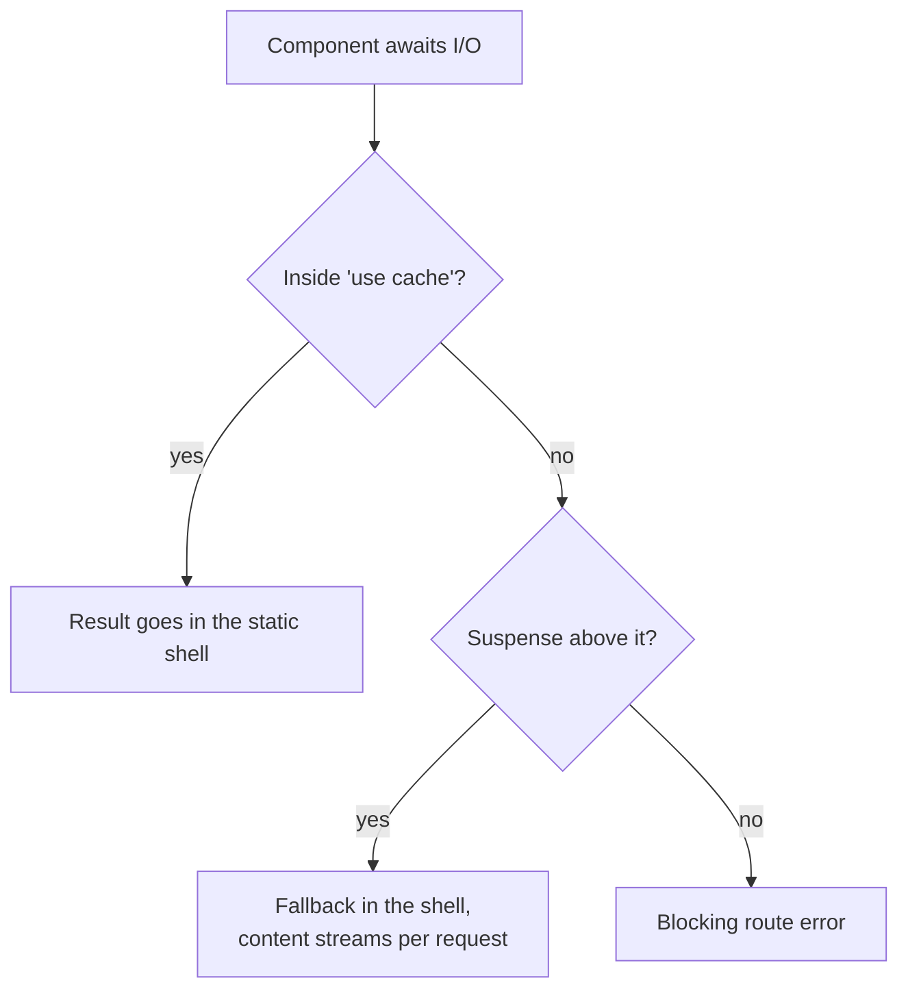

# Recipes - Data, Caching and Revalidation

> [!summary] TL;DR
> Most "my data is wrong" bugs in Next.js 16 come down to four facts from the source. First, a Server Action only re-renders the page when something marked the path as revalidated. `updateTag` and `revalidatePath` do that; `revalidateTag(tag, 'max')` deliberately does not. Second, with `cacheComponents` every uncached read must sit under `<Suspense>` or inside `'use cache'`, or the prerender reports a blocking route. Third, `'use cache'` cannot read `cookies()` or `headers()`; pass the value in as an argument or use `'use cache: private'`. Fourth, without Cache Components a page that never touches request data is prerendered at build time and frozen. Each recipe below gives the symptom, the line that causes it, and the fix.

Every recipe follows the same shape: **Symptom** (what you see, with the exact message where there is one), **Why** (what the framework does, with a source link to Next.js v16.4.3), **Fix**, and a pointer to the part that explains the mechanism. Recipes assume `cacheComponents: true` unless they say "previous model".

## I mutated data in a Server Action but the page still shows the old value

**Symptom.** The form submits, the database row changes, the action returns without error, and the list on screen does not change until you reload. No error, no warning.

**Why.** After your action function returns, Next.js decides whether to render the page into the action response. It skips the render when `workStore.pathWasRevalidated` is still unset.[^skip-render] Only some calls set that flag. Inside the shared `revalidate()` helper, the flag is set only when there is no profile or the profile's `expire` is `0`.[^revalidate-flag] `updateTag(tag)` passes no profile, so it sets the flag.[^update-tag] `revalidateTag(tag, 'max')` passes a profile, so it does not: that is stale-while-revalidate by design, and the comment in the source says so ("server actions don't pull their own writes"). The response header that tells the client router to drop its caches follows the same rule. It only counts tags revalidated *without* a profile.[^rev-header]

**Fix.** In a Server Action where the user must see their own write, use `updateTag`. Keep `revalidateTag(tag, 'max')` for background refreshes where a short delay is fine. See [[06 Revalidation - Tags, Paths and Refresh#Choosing one|Choosing one]] for the full decision table.

```ts
// app/posts/actions.ts
'use server'

import { updateTag } from 'next/cache'
import { db } from '@/lib/db'

export async function renamePost(id: string, formData: FormData) {
  await db.post.update({ where: { id }, data: { title: String(formData.get('title')) } })
  updateTag(`post:${id}`) // expires now, and the action response carries the fresh page
  updateTag('posts')
}
```

```ts
// app/lib/posts.ts
import { cacheLife, cacheTag } from 'next/cache'

export async function getPost(id: string) {
  'use cache'
  cacheLife('hours')
  cacheTag('posts', `post:${id}`)
  return db.post.findUnique({ where: { id } })
}
```

If the data on screen is not cached at all (a plain `await db...` under `<Suspense>`), there is no tag to expire. Call `refresh()` from `next/cache` in the action: it marks the request as "dynamic data changed" so the page is re-rendered without touching any cache entry.[^refresh]

> [!tip] Pick by who must see the change
> The user who clicked: `updateTag`. Everybody else, eventually: `revalidateTag(tag, 'max')`. Nothing cached, just re-render: `refresh()`.

**Deep dive:** [[06 Revalidation - Tags, Paths and Refresh|Revalidation]] and [[07 Server Actions and Forms|Server Actions]].

## updateTag throws in my webhook Route Handler

**Symptom.** A CMS webhook calls your `route.ts`, and the log shows:

```text
updateTag can only be called from within a Server Action. To invalidate cache tags in Route Handlers or other contexts, use revalidateTag instead.
```

**Why.** `updateTag` checks the current work store and throws when there is none, or when the page path ends in `/route`.[^update-tag] Read-your-own-writes only makes sense when the same request will render the result, which a webhook never does.

**Fix.** Use the two-argument `revalidateTag`. Pass `'max'` for stale-while-revalidate, or `{ expire: 0 }` if the next visitor must not see stale content.

```ts
// app/api/revalidate/route.ts
import { revalidateTag } from 'next/cache'
import type { NextRequest } from 'next/server'

export async function POST(request: NextRequest) {
  if (request.headers.get('x-webhook-secret') !== process.env.WEBHOOK_SECRET) {
    return new Response('Unauthorized', { status: 401 })
  }
  const { slug } = (await request.json()) as { slug: string }
  revalidateTag(`post:${slug}`, 'max')
  return Response.json({ revalidated: true })
}
```

> [!warning] Single-argument revalidateTag is deprecated in 16
> `revalidateTag('posts')` still works but logs `"revalidateTag" without the second argument is now deprecated, add second argument of "max" or use "updateTag"`.[^revalidate-tag]

**Deep dive:** [[06 Revalidation - Tags, Paths and Refresh|Revalidation]] and [[08 Route Handlers and Proxy|Route Handlers]].

## revalidatePath('/blog/[slug]') does nothing

**Symptom.** You call `revalidatePath('/blog/[slug]')` after editing a post and the post stays stale. The server log has a line you probably missed:

```text
Warning: a dynamic page path "/blog/[slug]" was passed to "revalidatePath", but the "type" parameter is missing. This has no effect by default
```

**Why.** `revalidatePath` turns the path into an implicit tag (`_N_T_` plus the path). A route pattern with brackets only matches anything when you say whether you mean the `page` or the `layout`; without `type`, it warns and the tag matches nothing.[^revalidate-path]

**Fix.** Either revalidate the concrete URL, or pass the pattern with a type.

```ts
// app/blog/actions.ts
'use server'
import { revalidatePath } from 'next/cache'

export async function publish(slug: string) {
  // ...save...
  revalidatePath(`/blog/${slug}`)            // this one URL
  // or: revalidatePath('/blog/[slug]', 'page') // every post page
  // or: revalidatePath('/', 'layout')           // everything (use sparingly)
}
```

Tags are usually the better tool: one `cacheTag('posts')` in the data function covers every page that reads posts, no matter what URL renders them.

**Deep dive:** [[06 Revalidation - Tags, Paths and Refresh|Revalidation]].

## "Next.js encountered uncached data during prerendering"

**Symptom.** In dev the overlay shows a **blocking route** issue, and `next build` fails with:

```text
Route "/dashboard": Next.js encountered uncached data during prerendering.

`fetch(...)` or `connection()` accessed outside of `<Suspense>` prevents the route from being prerendered, blocking the page load and leading to a slower user experience.
```

The twin message for request data reads "encountered runtime data during prerendering" and names `cookies()`, `headers()`, `params` or `searchParams`.[^blocking-msg]

**Why.** With Cache Components, Next.js prerenders every route to build a static shell. Uncached I/O never resolves during that prerender, so it becomes a hole. When the prerender finishes, `trackDynamicHoleInStaticShell` looks at the component stack of each hole. If a `<Suspense>` boundary sits above it, the hole is allowed and its fallback goes into the shell. If not, it pushes one of the errors above.[^track-hole] There is no implicit "the whole page is dynamic" mode any more; you must say where the dynamic part starts.



**Fix.** Choose one of the three fixes the message lists.

```tsx
// app/dashboard/page.tsx
import { Suspense } from 'react'
import { cacheLife } from 'next/cache'

// [stream] fresh on every request, streamed behind a fallback
async function LiveOrders() {
  const orders = await db.order.findMany({ where: { status: 'open' } })
  return <OrderList orders={orders} />
}

// [cache] same for everyone, part of the static shell
async function Categories() {
  'use cache'
  cacheLife('days')
  return <CategoryNav items={await db.category.findMany()} />
}

export default function Page() {
  return (
    <>
      <Categories />
      <Suspense fallback={<OrdersSkeleton />}>
        <LiveOrders />
      </Suspense>
    </>
  )
}
```

The third option, `export const instant = false`, is new in 16.x. It tells Next.js that navigations into this segment are allowed to block, which silences the check for that segment.[^instant] Use it for a page that really must wait (an admin report), not as a blanket escape hatch.

> [!tip] Put Suspense as low as you can
> A `loading.tsx` wraps the whole page in Suspense, which also clears the error, but then the whole page is a fallback. Wrapping only the component that reads data keeps the rest in the shell.

**Deep dive:** [[23 PPR - Partial Prerendering with Cache Components|PPR]] and [[04 Data Fetching and Streaming|Data Fetching and Streaming]].

## cacheLife('seconds') and the page is still not static

**Symptom.** You wrapped a function in `'use cache'` with `cacheLife('seconds')` (or `revalidate: 0`), and you still get the blocking-route error, or the build output shows the segment as dynamic.

**Why.** A cache entry is only allowed into a prerender when it lives long enough to be worth it. `MIN_PRERENDERABLE_EXPIRE` is 300 seconds.[^min-expire] During a prerender, an entry with `revalidate: 0` or `expire` under 5 minutes is omitted from the shell and treated as a dynamic hole.[^omit-entry] The built-in `seconds` profile has `expire: 60`, so it never qualifies; `minutes` (`expire: 3600`) does.[^profiles]

**Fix.** Either give the data a longer `expire`, or accept that it is dynamic and wrap the reader in `<Suspense>`.

```ts
// app/lib/stock.ts
import { cacheLife } from 'next/cache'

export async function getStockLevel(sku: string) {
  'use cache'
  cacheLife({ stale: 30, revalidate: 10, expire: 600 }) // expire >= 300: allowed in the shell
  return inventory.get(sku)
}
```

| Profile | stale | revalidate | expire | In the static shell? |
| --- | --- | --- | --- | --- |
| `default` | staleTimes.static (300 s) | 15 min | never | yes |
| `seconds` | 30 s | 1 s | 1 min | no |
| `minutes` | 5 min | 1 min | 1 h | yes |
| `hours` | 5 min | 1 h | 1 day | yes |
| `max` | 5 min | 30 days | 1 year | yes |

**Deep dive:** [[05 Cache Components - use cache, cacheLife and cacheTag|Cache Components]].

## Caching data per user: cookies() can't be read inside "use cache"

**Symptom.**

```text
Route "/account": `cookies()` can't be read inside `"use cache"`. Read it outside the cached function and pass what you need as an argument.
```

The same message exists for `headers()`, and a similar one for `searchParams` and `connection()`.[^cookies-msg]

**Why.** A `'use cache'` entry is shared by every visitor. Its key is built from the function id, its serialized arguments and a build-specific part, and nothing else.[^cache-key] If the function could read cookies, one user's data would be served to the next. So `cookies()` checks the work unit store and throws when it finds itself in a `'cache'` scope.[^cookies-throw]

**Fix.** Read the cookie outside the cached function and pass the derived value in. The argument becomes part of the key, so each user gets their own entry.

```tsx
// app/account/page.tsx
import { Suspense } from 'react'
import { cookies } from 'next/headers'
import { cacheLife, cacheTag } from 'next/cache'
import { verifySession } from '@/lib/dal'

async function getOrders(userId: string) {
  'use cache'
  cacheLife('minutes')
  cacheTag(`orders:${userId}`)
  return db.order.findMany({ where: { userId } })
}

async function Orders() {
  const { userId } = await verifySession() // reads cookies(), outside the cache
  const orders = await getOrders(userId)
  return <OrderTable orders={orders} />
}

export default function Page() {
  return (
    <Suspense fallback={<TableSkeleton />}>
      <Orders />
    </Suspense>
  )
}
```

When moving the cookie read out is impractical, mark the function `'use cache: private'`. It may read `cookies()` and `headers()`, but in production it is never stored in a server cache across requests; it only dedupes inside one request and lets the client router keep the result for its `stale` time.

> [!warning] Per-user entries live in memory by default
> The default `'use cache'` handler is an in-memory LRU per server process. On serverless, each instance has its own memory, so per-user entries are often recomputed. Use `'use cache: remote'` with a configured handler when the hit rate matters; see [[44 Recipes - Performance, Config and Deployment|Recipes: Performance]]. [[05 Cache Components - use cache, cacheLife and cacheTag#Where entries live: cache handlers|Cache handlers]] explains how the default handler behaves.

**Deep dive:** [[05 Cache Components - use cache, cacheLife and cacheTag|Cache Components]] and [[27 Server-Aware Auth - Sessions, Proxy and the DAL|Server-Aware Auth]].

## "Next.js encountered the unstable value `new Date()` while prerendering"

**Symptom.** A footer that prints the year, or a "last updated 3 minutes ago" label, fails the build:

```text
Route "/": Next.js encountered the unstable value `new Date()` while prerendering.

This value can change between renders, so it must be either prerendered or computed later.
```

The same happens for `Date.now()`, `Math.random()` and `crypto.randomUUID()`.

**Why.** With Cache Components, Next.js replaces the global `Date` during builds so that reading the clock counts as I/O. `new Date()` with no arguments and `Date.now()` call `io(...)`, which aborts the prerender with this error when it runs outside any cache.[^date] The message builder lists three ways out.[^sync-io]

**Fix.** Decide whether the value belongs to the build, the request, or the browser.

```tsx
// app/components/footer.tsx
import { cacheLife } from 'next/cache'

export async function Footer() {
  'use cache'
  cacheLife('days') // the year is fixed in the shell, refreshed daily
  return <footer>© {new Date().getFullYear()} Example Inc.</footer>
}
```

```tsx
// app/components/request-time.tsx
import { connection } from 'next/server'

export async function RenderedAt() {
  await connection() // everything below runs per request; wrap the caller in <Suspense>
  return <time>{new Date().toISOString()}</time>
}
```

For "3 minutes ago", render the absolute timestamp on the server and format it relatively in a Client Component, which also avoids a hydration mismatch ([[42 Recipes - Rendering and Hydration Errors|Recipes: Rendering]]). Use `performance.now()` for timing, which is not tracked.

**Deep dive:** [[23 PPR - Partial Prerendering with Cache Components|PPR]].

## Data is fresh in dev but frozen in production (previous model)

**Symptom.** You have not enabled `cacheComponents`. Locally, every refresh shows new rows. After `next build && next start`, the page shows whatever the database held at build time, forever. `next build` marks the route with a hollow circle (static).

**Why.** Without Cache Components, a route is static unless something in it bails out. `next dev` renders every request, so you never notice. During `next build`, a `fetch` with no cache option is even cached implicitly so export workers can share it (`isImplicitBuildTimeCache`).[^build-fetch] A database call through an ORM is not tracked at all: it simply runs once at build. Dynamic APIs such as `cookies()` or `connection()` bail out by throwing a `DynamicServerError` ("couldn't be rendered statically because it used ...") that the renderer catches to mark the route dynamic.[^interrupt]

**Fix.** Tell Next.js what you want.

```tsx
// app/stats/page.tsx (previous model)
import { connection } from 'next/server'

export default async function Page() {
  await connection() // render on every request
  const stats = await db.stats.get()
  return <Stats data={stats} />
}
```

Or, if periodic freshness is enough, keep it static and add `export const revalidate = 60` (time-based ISR). The long-term fix is to enable `cacheComponents`, where an uncached read can no longer be silently frozen: it is either cached explicitly or flagged by the blocking-route check.

> [!bug] Do not swallow the bail-out
> In the previous model, wrapping `cookies()` or `connection()` in a `try/catch` that ignores errors catches the `DynamicServerError` and leaves the route static. Rethrow with `unstable_rethrow(error)` from `next/navigation`.

The opposite surprise exists too: in dev, `fetch` responses are reused across HMR refreshes (even `no-store` ones) through the `serverComponentsHmrCache`, so saving a file does not refetch.[^hmr] A full reload clears it.

**Deep dive:** [[20 Rendering Strategies - A Decision Map|Rendering Strategies]] and [[21 SSG and ISR - Static Pages and generateStaticParams|SSG and ISR]].

## Layout and page both need the current user: fetch it once

**Symptom.** The layout shows the avatar, the page shows the profile, and your database log shows `SELECT * FROM users WHERE id = ...` twice per request (three times with `generateMetadata`).

**Why.** Layouts, pages and metadata render as separate components in one React server render; props cannot flow from layout to page. Next.js dedupes identical `GET` `fetch` calls for you: `createDedupeFetch` keeps a per-request list of in-flight responses inside a `React.cache`, keyed by URL and request fields.[^dedupe] ORM calls get no such help. React's `cache(fn)` gives it to you: on the server it stores results in a cache tied to the current request through the dispatcher, keyed by each argument.[^react-cache]

**Fix.** Wrap the data function in `cache` and call it everywhere.

```ts
// app/lib/user.ts
import 'server-only'
import { cache } from 'react'
import { verifySession } from '@/lib/dal'

export const getCurrentUser = cache(async () => {
  const { userId } = await verifySession()
  return db.user.findUnique({ where: { id: userId } })
})
```

```tsx
// app/(app)/layout.tsx
export default async function Layout({ children }: { children: React.ReactNode }) {
  const user = await getCurrentUser()
  return <Shell avatar={user?.image}>{children}</Shell>
}
```

> [!warning] Three ways to get a cache miss
> - **Object arguments** are keyed by identity (a `WeakMap`), so `getPost({ id })` with a fresh object never hits. Pass primitives.[^react-cache]
> - **A new `cache()` per call site.** Create it once at module level and import it.
> - **Client Components.** In the client build of React, `cache` just calls your function.[^react-cache-client]

`React.cache` lasts one request. To share across requests, use `'use cache'`; the two combine fine.

**Deep dive:** [[04 Data Fetching and Streaming|Data Fetching and Streaming]].

## Fetching from my own /api route inside a Server Component

**Symptom.** `await fetch('/api/products')` throws `TypeError: Failed to parse URL from /api/products`. With an absolute URL it works in dev, fails during `next build` with `ECONNREFUSED`, and adds latency in production.

**Why.** Server-side `fetch` needs an absolute URL and makes a real HTTP request. At build time no server is listening, and at runtime the request leaves the process and comes back through your public domain. The docs list this as a caveat: fetch from the source in Server Components, not through Route Handlers.[^bff]

**Fix.** Move the logic into a server-only function and call it from both places.

```ts
// app/lib/products.ts
import 'server-only'
import { cacheLife, cacheTag } from 'next/cache'

export async function listProducts() {
  'use cache'
  cacheLife('hours')
  cacheTag('products')
  return db.product.findMany({ orderBy: { name: 'asc' } })
}
```

```ts
// app/api/products/route.ts  (only if mobile apps or third parties need it)
import { listProducts } from '@/app/lib/products'

export async function GET() {
  return Response.json(await listProducts())
}
```

The Server Component imports `listProducts()` directly. Client Components get the data as props, or call a Server Action.

**Deep dive:** [[02 Server and Client Components|Server and Client Components]] and [[08 Route Handlers and Proxy|Route Handlers]].

## Requests run one after another and the page is slow

**Symptom.** A page with three independent queries takes as long as all three added up. The trace shows a staircase.

**Why.** Each `await` in a component pauses that component until the promise settles. Three awaits in a row make three round trips in a row, and a child that fetches only starts after its parent finishes. This is plain JavaScript, not a Next.js cache issue. The docs walk through sequential, parallel and preloading patterns.[^parallel-docs]

**Fix.** Start independent work together, and let slow parts stream on their own.

```tsx
// app/artist/[id]/page.tsx
import { Suspense } from 'react'

export default async function Page({ params }: PageProps<'/artist/[id]'>) {
  const { id } = await params
  // start both before awaiting either
  const artistP = getArtist(id)
  const albumsP = getAlbums(id)
  const [artist, albums] = await Promise.all([artistP, albumsP])

  return (
    <>
      <ArtistHeader artist={artist} albums={albums} />
      <Suspense fallback={<PlaylistSkeleton />}>
        <Playlists artistId={id} /> {/* slow, streams separately */}
      </Suspense>
    </>
  )
}
```

When a child needs data its parent does not, pass the promise down and `use()` it in a Client Component, or kick off a `cache()`-wrapped function early (`void getPlaylists(id)`) so the child's call hits the same in-flight promise.

**Deep dive:** [[04 Data Fetching and Streaming|Data Fetching and Streaming]].

## Too many database connections in development

**Symptom.** After a few edits in `next dev`, Postgres logs `sorry, too many clients already`, or Prisma warns about many client instances.

**Why.** In dev, editing a file re-evaluates the server modules that depend on it. A module-level `new PrismaClient()` or `new Pool()` runs again on each reload, and the old pool is never closed. In production a module is evaluated once per process, so the bug only shows in dev.

**Fix.** Keep one client on `globalThis`, which survives module re-evaluation.

```ts
// app/lib/db.ts
import 'server-only'
import { PrismaClient } from '@prisma/client'

const globalForDb = globalThis as unknown as { prisma?: PrismaClient }

export const db = globalForDb.prisma ?? new PrismaClient()

if (process.env.NODE_ENV !== 'production') globalForDb.prisma = db
```

On serverless, also use the provider's pooled connection string (PgBouncer, Prisma Accelerate, Neon or Supabase poolers), since every instance opens its own pool.

**Deep dive:** [[11 Configuration, Turbopack and Deployment|Configuration and Deployment]].

## Someone else changed the data, but navigating back shows the old page

**Symptom.** Another tab, a webhook or a background job updated the data. In this tab, clicking between pages keeps showing the old version for a few minutes. A hard reload fixes it.

**Why.** The client router keeps prefetched and visited segments in memory. The defaults are `staleTimes.dynamic: 0` and `staleTimes.static: 300`, so static (prefetched) data can be reused for 5 minutes.[^stale-times] With Cache Components, the `stale` value of each `cacheLife` profile sets how long the browser may reuse that entry, and most built-in profiles use 5 minutes.[^profiles] Your own Server Actions clear this cache when they revalidate; changes made elsewhere cannot reach the browser on their own.[^reducer]

**Fix.** Pick the narrowest tool.

```tsx
// app/components/refresh-on-focus.tsx
'use client'
import { useRouter } from 'next/navigation'
import { useEffect } from 'react'

export function RefreshOnFocus() {
  const router = useRouter()
  useEffect(() => {
    const onFocus = () => router.refresh() // refetch the current route, keep client state
    window.addEventListener('focus', onFocus)
    return () => window.removeEventListener('focus', onFocus)
  }, [router])
  return null
}
```

Lower the `stale` time on data that changes often (`cacheLife({ stale: 30, revalidate: 60, expire: 3600 })`; 30 seconds is the minimum the router will prefetch). For live data (chat, prices), fetch on the client with polling, SSE or TanStack Query ([[26 TanStack Query - Server Prefetch and Hydration|TanStack Query]]).

**Deep dive:** [[03 Linking, Navigation and Prefetching|Linking and Prefetching]].

## Summary

Data bugs in Next.js 16 are rarely random. A Server Action shows its own write only when it calls something that marks the page revalidated (`updateTag`, `revalidatePath`, `refresh`), while `revalidateTag(tag, 'max')` is for background refreshes. The Cache Components prerender asks every uncached read to choose: cache it, put it under Suspense, or opt the segment out with `instant = false`. Per-user caching works by passing the user id into `'use cache'` or by `'use cache: private'`, never by reading cookies inside a shared cache. For sharing data within one request, use `React.cache` with primitive arguments; for sharing across requests, use `'use cache'`. The next recipe set, [[41 Recipes - Routing and Navigation|Routing and Navigation]], moves from data to URLs.

### Key takeaways

- **`updateTag` vs `revalidateTag(tag, 'max')`**: only the first makes the action re-render the page, because a profile means stale-while-revalidate.
- **`refresh()`**: re-renders dynamic data from an action without touching any cache entry.
- **`revalidatePath` with brackets**: needs `'page'` or `'layout'`, or it only logs a warning.
- **Blocking-route error**: a hole without `<Suspense>` above it; fix with Suspense, `'use cache'`, or `instant = false`.
- **Short cache lives are dynamic**: entries with `expire` under 5 minutes are kept out of the static shell.
- **No request data in `'use cache'`**: pass the user id as an argument, or use `'use cache: private'`.
- **Clock reads are I/O**: `new Date()` during a prerender needs `'use cache'`, `connection()`, or the client.
- **Previous model freezes at build**: a page with no dynamic API is prerendered once; use `connection()` or `revalidate`.
- **`React.cache`**: per-request dedupe on the server, keyed by argument identity, a no-op in the client build.

← [[28 Client-Only Auth - Tokens in the Browser|Client-Only Auth]] · [[00 Next.js in Practice Index|Index]] · [[41 Recipes - Routing and Navigation|Recipes: Routing]] →

[^skip-render]: `executeActionAndPrepareForRender` (skip check at L1487-L1491) — [packages/next/src/server/app-render/action-handler.ts#L1461-L1493](https://github.com/vercel/next.js/blob/v16.4.3/packages/next/src/server/app-render/action-handler.ts#L1461-L1493)
[^revalidate-flag]: `revalidate` (sets `pathWasRevalidated` only without a profile or with `expire: 0`, L251-L263) — [packages/next/src/server/web/spec-extension/revalidate.ts#L138-L264](https://github.com/vercel/next.js/blob/v16.4.3/packages/next/src/server/web/spec-extension/revalidate.ts#L138-L264)
[^update-tag]: `updateTag` — [packages/next/src/server/web/spec-extension/revalidate.ts#L58-L76](https://github.com/vercel/next.js/blob/v16.4.3/packages/next/src/server/web/spec-extension/revalidate.ts#L58-L76)
[^rev-header]: `addRevalidationHeader` (`isTagRevalidated` counts only tags without a profile) — [packages/next/src/server/app-render/action-handler.ts#L163-L216](https://github.com/vercel/next.js/blob/v16.4.3/packages/next/src/server/app-render/action-handler.ts#L163-L216)
[^refresh]: `refresh` — [packages/next/src/server/web/spec-extension/revalidate.ts#L83-L103](https://github.com/vercel/next.js/blob/v16.4.3/packages/next/src/server/web/spec-extension/revalidate.ts#L83-L103)
[^revalidate-tag]: `revalidateTag` (single-argument deprecation warning) — [packages/next/src/server/web/spec-extension/revalidate.ts#L37-L51](https://github.com/vercel/next.js/blob/v16.4.3/packages/next/src/server/web/spec-extension/revalidate.ts#L37-L51)
[^revalidate-path]: `revalidatePath` — [packages/next/src/server/web/spec-extension/revalidate.ts#L110-L136](https://github.com/vercel/next.js/blob/v16.4.3/packages/next/src/server/web/spec-extension/revalidate.ts#L110-L136)
[^blocking-msg]: `createRuntimeBodyError`, `createDynamicBodyError` — [packages/next/src/server/app-render/blocking-route-messages.ts#L1-L22](https://github.com/vercel/next.js/blob/v16.4.3/packages/next/src/server/app-render/blocking-route-messages.ts#L1-L22)
[^track-hole]: `trackDynamicHoleInStaticShell` (Suspense check at L757-L761) — [packages/next/src/server/app-render/dynamic-rendering-validation.ts#L718-L784](https://github.com/vercel/next.js/blob/v16.4.3/packages/next/src/server/app-render/dynamic-rendering-validation.ts#L718-L784)
[^instant]: `instant` route segment config — [nextjs.org/docs/app/api-reference/file-conventions/route-segment-config/instant](https://nextjs.org/docs/app/api-reference/file-conventions/route-segment-config/instant)
[^min-expire]: `MIN_PRERENDERABLE_EXPIRE` — [packages/next/src/server/use-cache/constants.ts#L3-L5](https://github.com/vercel/next.js/blob/v16.4.3/packages/next/src/server/use-cache/constants.ts#L3-L5)
[^omit-entry]: short-lived entries omitted from the prerender — [packages/next/src/server/use-cache/use-cache-wrapper.ts#L3331-L3345](https://github.com/vercel/next.js/blob/v16.4.3/packages/next/src/server/use-cache/use-cache-wrapper.ts#L3331-L3345)
[^profiles]: default `cacheLife` profiles — [packages/next/src/server/config-shared.ts#L2346-L2382](https://github.com/vercel/next.js/blob/v16.4.3/packages/next/src/server/config-shared.ts#L2346-L2382)
[^cookies-msg]: `createCookiesInUseCacheError` and siblings — [packages/next/src/server/use-cache/use-cache-messages.ts#L35-L75](https://github.com/vercel/next.js/blob/v16.4.3/packages/next/src/server/use-cache/use-cache-messages.ts#L35-L75)
[^cache-key]: `cacheKeyParts = [id, args, implementationPart]` — [packages/next/src/server/use-cache/use-cache-wrapper.ts#L2278-L2291](https://github.com/vercel/next.js/blob/v16.4.3/packages/next/src/server/use-cache/use-cache-wrapper.ts#L2278-L2291)
[^cookies-throw]: `cookies()` throwing in a `'cache'` work unit — [packages/next/src/server/request/cookies.ts#L61-L69](https://github.com/vercel/next.js/blob/v16.4.3/packages/next/src/server/request/cookies.ts#L61-L69)
[^date]: `createNow`, `createDate` — [packages/next/src/server/node-environment-extensions/date.tsx#L14-L48](https://github.com/vercel/next.js/blob/v16.4.3/packages/next/src/server/node-environment-extensions/date.tsx#L14-L48); `io` — [packages/next/src/server/node-environment-extensions/io-utils.tsx#L14-L38](https://github.com/vercel/next.js/blob/v16.4.3/packages/next/src/server/node-environment-extensions/io-utils.tsx#L14-L38)
[^sync-io]: `createSyncIOErrorImpl` — [packages/next/src/server/app-render/sync-io-messages.ts#L27-L43](https://github.com/vercel/next.js/blob/v16.4.3/packages/next/src/server/app-render/sync-io-messages.ts#L27-L43)
[^build-fetch]: implicit build-time fetch cache — [packages/next/src/server/lib/patch-fetch.ts#L627-L643](https://github.com/vercel/next.js/blob/v16.4.3/packages/next/src/server/lib/patch-fetch.ts#L627-L643)
[^interrupt]: `throwToInterruptStaticGeneration` — [packages/next/src/server/app-render/dynamic-rendering.ts#L159-L175](https://github.com/vercel/next.js/blob/v16.4.3/packages/next/src/server/app-render/dynamic-rendering.ts#L159-L175); `connection()` (`prerender-legacy` case) — [packages/next/src/server/request/connection.ts#L30-L134](https://github.com/vercel/next.js/blob/v16.4.3/packages/next/src/server/request/connection.ts#L30-L134)
[^hmr]: HMR cache lookup in `fetch` — [packages/next/src/server/lib/patch-fetch.ts#L1049-L1055](https://github.com/vercel/next.js/blob/v16.4.3/packages/next/src/server/lib/patch-fetch.ts#L1049-L1055); [nextjs.org/docs/app/api-reference/config/next-config-js/serverComponentsHmrCache](https://nextjs.org/docs/app/api-reference/config/next-config-js/serverComponentsHmrCache)
[^dedupe]: `createDedupeFetch` — [packages/next/src/server/lib/dedupe-fetch.ts#L43-L131](https://github.com/vercel/next.js/blob/v16.4.3/packages/next/src/server/lib/dedupe-fetch.ts#L43-L131)
[^react-cache]: React `cache` (server build, vendored) — [packages/next/src/compiled/react/cjs/react.react-server.development.js#L599-L641](https://github.com/vercel/next.js/blob/v16.4.3/packages/next/src/compiled/react/cjs/react.react-server.development.js#L599-L641)
[^react-cache-client]: React `cache` (client build, vendored) — [packages/next/src/compiled/react/cjs/react.development.js#L994-L998](https://github.com/vercel/next.js/blob/v16.4.3/packages/next/src/compiled/react/cjs/react.development.js#L994-L998)
[^bff]: "Server Components" caveat — [docs/01-app/02-guides/backend-for-frontend.mdx#L877-L885](https://github.com/vercel/next.js/blob/v16.4.3/docs/01-app/02-guides/backend-for-frontend.mdx#L877-L885)
[^parallel-docs]: sequential, parallel and preloading examples — [docs/01-app/01-getting-started/06-fetching-data.mdx#L378-L606](https://github.com/vercel/next.js/blob/v16.4.3/docs/01-app/01-getting-started/06-fetching-data.mdx#L378-L606)
[^stale-times]: `staleTimes` defaults — [packages/next/src/server/config-shared.ts#L2467-L2470](https://github.com/vercel/next.js/blob/v16.4.3/packages/next/src/server/config-shared.ts#L2467-L2470)
[^reducer]: `serverActionReducer` cache eviction after a revalidating action — [packages/next/src/client/components/router-reducer/reducers/server-action-reducer.ts#L349-L374](https://github.com/vercel/next.js/blob/v16.4.3/packages/next/src/client/components/router-reducer/reducers/server-action-reducer.ts#L349-L374)
