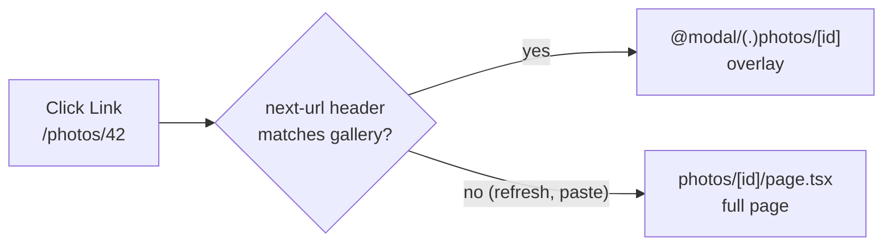

# Recipes - Routing and Navigation

> [!summary] TL;DR
> Most App Router "bugs" are the router doing what its data model says. Soft navigations re-render only the segments that changed and keep every parallel slot's last state; hard navigations rebuild the tree from the URL and fall back to `default.tsx` (or a 404, or in 16.x a build error). Intercepting routes are just rewrites that fire only when the `next-url` header says where you came from. `redirect()` and `notFound()` work by throwing. `useSearchParams` makes the nearest Suspense boundary dynamic. Once those four facts are in your head, the recipes below are short.

Each recipe follows the same shape: **Symptom** (what you see, with the exact message when there is one), **Why** (what the source does), **Fix** (code), and a link to the part that explains the mechanism in depth. The file tree conventions behind all of this are in [[01 The App Router - Files, Segments and Layouts|The App Router]], and the client router in [[03 Linking, Navigation and Prefetching|Linking and Navigation]].

## Open a page as a modal but keep a shareable URL

**Symptom.** You want `/photos/42` to open as an overlay on top of the gallery when clicked, but to render as a full page when someone pastes the link or refreshes.

**Why.** An intercepting route (`(.)`, `(..)`, `(..)(..)`, `(...)`) is compiled into a rewrite.[^markers] For every interception path, `generateInterceptionRoutesRewrites` emits a rule whose source is the intercepted URL and whose `has` condition is a regex on the `next-url` request header, which carries the URL the user is currently on.[^rewrites][^next-url] The client router sends that header on soft navigations. A fresh document request does not, so the rewrite does not fire and the canonical page renders. The markers are resolved against URL segments, not folders: route groups and `@slots` are stripped first, so `(..)` means "one URL segment up".[^extract]



**Fix.** Put the interception inside a named slot next to the page it overlays, and keep the canonical page.

```text
app/
  layout.tsx              renders {children} and {modal}
  page.tsx                the gallery
  photos/[id]/page.tsx    canonical full page
  @modal/
    default.tsx           returns null
    (.)photos/[id]/page.tsx
```

```tsx
// app/layout.tsx
export default function RootLayout({
  children,
  modal,
}: LayoutProps<'/'>) {
  return (
    <html lang="en">
      <body>
        {children}
        {modal}
      </body>
    </html>
  )
}
```

```tsx
// app/@modal/(.)photos/[id]/page.tsx
import { Modal } from '@/app/ui/modal'
import { PhotoView } from '@/app/ui/photo-view'

export default async function PhotoModal({ params }: PageProps<'/photos/[id]'>) {
  const { id } = await params
  return (
    <Modal>
      <PhotoView id={id} />
    </Modal>
  )
}
```

```tsx
// app/ui/modal.tsx
'use client'
import { useRouter } from 'next/navigation'

export function Modal({ children }: { children: React.ReactNode }) {
  const router = useRouter()
  return (
    <dialog open aria-modal onClose={() => router.back()} onCancel={() => router.back()}>
      <button onClick={() => router.back()} aria-label="Close">Close</button>
      {children}
    </dialog>
  )
}
```

`PhotoView` stays a Server Component: only the `Modal` shell needs `'use client'`.

> [!warning] 16.x: the canonical page is mandatory
> With `strictRouteMatching` (on by default in 16.4.3) the build fails if an interception route has no matching ordinary page:[^canonical-default][^canonical-check]
> `The following interception routes do not have a canonical route: ... Every interception route must have a matching non-interception route so the URL can be loaded directly or refreshed.`[^canonical-error]
> Add `app/photos/[id]/page.tsx`. Refresh and shared links need it anyway.

**Deep dive:** [[01 The App Router - Files, Segments and Layouts#Intercepting routes|The App Router: intercepting routes]].

## "Missing required default.js file for parallel route", or a 404 on refresh

**Symptom.** One of three things:

- `next build` (or the dev overlay) fails with `Missing required default.js file for parallel route at app/dashboard/@analytics` and `The parallel route slot "analytics" is missing a default.js file.`[^missing-default-err][^missing-default-rs]
- Navigating with `<Link>` works, but refreshing the same URL shows a 404.
- The modal from the previous recipe works, but the home page 404s on first load.

**Why.** On a soft navigation the client keeps every slot's last active subpage, even if it does not match the new URL; the server only renders from the first segment that changed.[^partial] On a hard load there is no previous state, so each slot must be resolved from the URL alone. When the app loader builds the tree and a slot has no match, it looks for `<slot>/default`. If there is none:[^loader-default]

- for the implicit `children` slot it uses a built-in default that calls `notFound()` (or one that renders `null` inside interception subtrees);[^builtin-default]
- for a named slot it throws `MissingDefaultParallelRouteError`, unless the slot sits under a catch-all or the segment has no child routes.

The second rule is new: before 16, an unmatched named slot silently rendered a 404 at request time.

**Fix.** Add a `default.tsx` to every named slot (and to `children` where a sibling slot has deeper routes). Pick what it should show when the slot's state is unknown.

```tsx
// app/@modal/default.tsx
export default function Default() {
  return null
}
```

```tsx
// app/dashboard/@analytics/default.tsx
// Keep the pre-16 behaviour on purpose: unknown state means 404.
import { notFound } from 'next/navigation'

export default function Default() {
  notFound()
}
```

**Deep dive:** [[01 The App Router - Files, Segments and Layouts#From folders to a loader tree|The App Router]] for how the loader tree is built.

## The modal stays open after navigating away

**Symptom.** You close the photo modal by clicking a `<Link href="/about">` in the header. The about page renders underneath, but the modal is still on top.

**Why.** Same rule as above: on a soft navigation, a slot whose subtree does not match the new URL keeps its last active state.[^partial] `/about` does not match anything in `@modal`, so the router keeps showing `(.)photos/[id]`. `router.back()` works because it restores the previous history entry, where `@modal` was empty.

**Fix.** Give the slot something that matches every other URL and renders nothing. A catch-all inside the slot does it.

```tsx
// app/@modal/[...catchAll]/page.tsx
export default function CatchAll() {
  return null
}
```

Keep `@modal/default.tsx` for hard loads, and use `router.back()` for the close button so the browser history stays honest.

**Deep dive:** [[03 Linking, Navigation and Prefetching#Rendering the new route|Linking and Navigation]] (how the client merges the new tree into the cached one).

## Highlight the active link in a navigation bar

**Symptom.** You want `aria-current="page"` and a style on the current nav item. Your layout is a Server Component and has no access to the URL, and the `params` prop of a layout does not include child segments.

**Why.** Layouts are not re-rendered on navigation, so they cannot be the source of truth for "where am I".[^partial] The current URL lives in the client router. `usePathname()` reads it from `PathnameContext`, and `useSelectedLayoutSegment()` returns the active segment one level below the layout that renders it.[^usepathname][^segment]

**Fix.** Extract a tiny Client Component for the link and keep the nav itself on the server.

```tsx
// app/ui/nav-link.tsx
'use client'
import Link from 'next/link'
import { usePathname } from 'next/navigation'

export function NavLink({ href, children }: { href: string; children: React.ReactNode }) {
  const pathname = usePathname()
  const active = href === '/' ? pathname === '/' : pathname.startsWith(href)
  return (
    <Link href={href} aria-current={active ? 'page' : undefined} data-active={active}>
      {children}
    </Link>
  )
}
```

For tabs inside a section layout, `useSelectedLayoutSegment()` is cleaner because it ignores everything above the layout:

```tsx
// app/settings/tabs.tsx
'use client'
import Link from 'next/link'
import { useSelectedLayoutSegment } from 'next/navigation'

const tabs = [
  { segment: null, href: '/settings', label: 'Profile' },
  { segment: 'billing', href: '/settings/billing', label: 'Billing' },
]

export function Tabs() {
  const segment = useSelectedLayoutSegment()
  return tabs.map((t) => (
    <Link key={t.href} href={t.href} aria-current={segment === t.segment ? 'page' : undefined}>
      {t.label}
    </Link>
  ))
}
```

> [!note]
> `usePathname()` returns the path without `basePath` and before rewrites are applied, which is what you want for comparisons. With Cache Components on, using it in a route with unknown params makes that component a dynamic hole during prerender, so wrap it in `<Suspense>` if the nav sits in a dynamic segment.[^usepathname]

**Deep dive:** [[02 Server and Client Components|Server and Client Components]] (keep the Client boundary small).

## Keep filters and search in the URL

**Symptom.** You store a search box and filters in `useState`; refresh and back lose them, and links cannot be shared. When you switch to `useSearchParams`, the build fails with:

`useSearchParams() should be wrapped in a suspense boundary at page "/products". Read more: https://nextjs.org/docs/messages/missing-suspense-with-csr-bailout`[^csr-bailout]

or, with Cache Components enabled:

``Route "/products": Next.js encountered URL data `useSearchParams()` in a Client Component outside of `<Suspense>`.``[^client-hook-err]

**Why.** Search params are not known at build time. In a prerender, `useSearchParams()` calls `useDynamicSearchParams`, which throws `BailoutToCSRError` in the legacy model (everything up to the nearest Suspense boundary becomes client-rendered) or suspends on a never-resolving promise under Cache Components (the component becomes a dynamic hole).[^use-sp][^dyn-sp] Without a boundary there is nowhere to stop, so the build reports it. In dev, pages render per request and nothing fails, which is why this shows up only in `next build`.

**Fix.** Wrap the URL-reading component in `<Suspense>`, write with `router.replace`, and let the page read `searchParams` on the server.

```tsx
// app/products/page.tsx
import { Suspense } from 'react'
import { Filters } from './filters'
import { ProductList } from './product-list'

export default function Page({ searchParams }: PageProps<'/products'>) {
  return (
    <>
      <Suspense fallback={<div className="filters-skeleton" />}>
        <Filters />
      </Suspense>
      <Suspense fallback={<p>Loading products...</p>}>
        <ProductList searchParams={searchParams} />
      </Suspense>
    </>
  )
}
```

```tsx
// app/products/filters.tsx
'use client'
import { usePathname, useRouter, useSearchParams } from 'next/navigation'
import { useTransition } from 'react'

export function Filters() {
  const router = useRouter()
  const pathname = usePathname()
  const searchParams = useSearchParams()
  const [isPending, startTransition] = useTransition()

  function setParam(key: string, value: string) {
    const next = new URLSearchParams(searchParams)
    if (value) next.set(key, value)
    else next.delete(key)
    startTransition(() => {
      router.replace(`${pathname}?${next}`, { scroll: false })
    })
  }

  return (
    <input
      type="search"
      defaultValue={searchParams.get('q') ?? ''}
      onChange={(e) => setParam('q', e.target.value)}
      aria-busy={isPending}
    />
  )
}
```

`router.replace` already runs inside `startTransition`; wrapping it yourself only gives you `isPending`.[^router-queue] Because the page's search changed, the server re-renders the page segment (layouts are reused).[^partial]

**Client-only state.** If the server does not need the value (a tab, an open accordion), skip the server round trip and call `window.history.replaceState(null, '', '?tab=specs')`. Next patches `pushState`/`replaceState` so `useSearchParams` and `usePathname` see the new URL.[^history]

**Library option.** `nuqs` (v2) wraps this pattern in a typed `useQueryState('q', parseAsString.withDefault(''))` hook, with shallow updates by default and an opt-in `shallow: false` when the server should re-render. Mount `NuqsAdapter` from `nuqs/adapters/next/app` in the root layout.

**Deep dive:** [[04 Data Fetching and Streaming|Data Fetching and Streaming]] and, for the error string, [[42 Recipes - Rendering and Hydration Errors|Recipes: Rendering]].

## The page does not scroll to the top, or hash links land under a sticky header

**Symptom.** After clicking a link, the new page keeps the old scroll position. Or `<Link href="/docs#install">` scrolls so the heading hides under your fixed header. Or the dev console warns: ``Detected `scroll-behavior: smooth` on the `<html>` element.``[^smooth]

**Why.** The App Router does not blindly scroll to `0`. After a navigation, the first changed segment checks whether its top edge is already inside the viewport (between `scroll-padding-top` and the bottom). Only if it is not does it set `scrollTop = 0`, and then `scrollIntoView()` if still needed. With a hash it finds the element by `id`, then by `name`, then calls `scrollIntoView()`. If the hash target does not exist, the scroll is dropped.[^scroll-handler][^hash-node] `scroll={false}` on `<Link>` or `router.push(href, { scroll: false })` turns the whole thing off.[^link-scroll]

So "no scroll to top" usually means the changed segment starts near the top of the viewport (a short page inside a tall shared layout) or the scroll container is not the document.

**Fix.**

```css
/* app/globals.css */
html {
  scroll-padding-top: 4rem; /* height of the sticky header; Next reads this too */
}
```

```tsx
// app/layout.tsx
// Opt in so Next can turn smooth scrolling off during route changes
// and keep it for in-page hash jumps.
<html lang="en" data-scroll-behavior="smooth">
```

If your app scrolls an inner `<main className="overflow-auto">` instead of the window, Next will not reset it. Reset it yourself:

```tsx
// app/ui/scroll-reset.tsx
'use client'
import { usePathname } from 'next/navigation'
import { useEffect } from 'react'

export function ScrollReset({ targetId }: { targetId: string }) {
  const pathname = usePathname()
  useEffect(() => {
    document.getElementById(targetId)?.scrollTo({ top: 0 })
  }, [pathname, targetId])
  return null
}
```

**Deep dive:** [[03 Linking, Navigation and Prefetching#Scrolling and focus|Linking and Navigation]].

## Show feedback while a navigation is pending

**Symptom.** Clicking a link to a dynamic page does nothing visible for a second, and users click again.

**Why.** Navigation is a transition: React keeps the old UI on screen until the new tree is ready, unless a Suspense boundary (`loading.tsx`) is reached first.[^router-queue] If prefetching was off or the route has no `loading.tsx`, there is nothing to show. `<Link>` tracks its own pending state with `useOptimistic` and exposes it through `LinkStatusContext`, which `useLinkStatus()` reads; the hook only works in a descendant of the `<Link>`.[^link-status]

**Fix.** Prefer a `loading.tsx` for the route. For inline feedback, use `useLinkStatus`:

```tsx
// app/ui/pending-link.tsx
'use client'
import Link, { useLinkStatus } from 'next/link'

function Spinner() {
  const { pending } = useLinkStatus()
  return <span aria-hidden className={pending ? 'spinner is-pending' : 'spinner'} />
}

export function PendingLink(props: React.ComponentProps<typeof Link>) {
  return (
    <Link {...props}>
      {props.children}
      <Spinner />
    </Link>
  )
}
```

For `router.push` from a button, wrap the call in `useTransition` and use `isPending`, as in the filters recipe. Delay the spinner with a CSS `animation-delay` of ~100ms so fast navigations do not flash it.

**Deep dive:** [[03 Linking, Navigation and Prefetching#useLinkStatus: feedback for case 3|Linking and Navigation]].

## Return a real 404 for an unknown slug

**Symptom.** `/blog/does-not-exist` renders your page with `undefined` data, or crashes with `Cannot read properties of null`, and returns status 200.

**Why.** A dynamic segment matches any string. Nothing checks that the slug exists unless you do. `notFound()` throws an error whose digest is `NEXT_HTTP_ERROR_FALLBACK;404`; the nearest `not-found.tsx` renders, the status is set to 404 and a `noindex` robots tag is added.[^notfound] For a fixed set of slugs, `export const dynamicParams = false` makes the build infer the `NOT_FOUND` fallback mode, so any param outside `generateStaticParams` is a 404 without running your code.[^dynparams][^fallback]

**Fix.**

```tsx
// app/blog/[slug]/page.tsx
import { notFound } from 'next/navigation'
import { getPost, getAllSlugs } from '@/lib/posts'

export const dynamicParams = false // optional: only build-time slugs exist

export async function generateStaticParams() {
  return (await getAllSlugs()).map((slug) => ({ slug }))
}

export default async function Post({ params }: PageProps<'/blog/[slug]'>) {
  const { slug } = await params
  const post = await getPost(slug)
  if (!post) notFound()
  return <article>{post.title}</article>
}
```

```tsx
// app/blog/[slug]/not-found.tsx
import Link from 'next/link'

export default function NotFound() {
  return (
    <main>
      <h1>Post not found</h1>
      <Link href="/blog">All posts</Link>
    </main>
  )
}
```

Call `notFound()` in `generateMetadata` too if it fetches the post, so you do not emit metadata for a missing page.

**Deep dive:** [[10 Errors, Redirects and Request Lifecycle APIs|Errors and Redirects]] and [[21 SSG and ISR - Static Pages and generateStaticParams|SSG and ISR]].

## redirect() inside try/catch does nothing

**Symptom.** A login check calls `redirect('/login')` inside a `try` block, and instead of redirecting, your `catch` logs `Error: NEXT_REDIRECT`.

**Why.** `redirect()` never returns. It throws an `Error('NEXT_REDIRECT')` whose `digest` encodes the type, URL and status; the framework catches it higher up and turns it into a `Location` header, a meta refresh while streaming, or a client navigation from a Server Action.[^redirect] Your `catch` swallowed it. `notFound()`, `forbidden()` and `unauthorized()` work the same way.

**Fix.** Call `redirect()` after the `try`, or rethrow framework errors first with `unstable_rethrow`, which rethrows router errors, CSR bailouts and prerender interrupts (and walks `error.cause`).[^rethrow]

```tsx
// app/account/page.tsx
import { redirect, unstable_rethrow } from 'next/navigation'
import { getUser } from '@/lib/dal'

export default async function Account() {
  let user
  try {
    user = await getUser()
  } catch (err) {
    unstable_rethrow(err)
    console.error(err)
  }
  if (!user) redirect('/login')
  return <h1>Hi {user.name}</h1>
}
```

> [!tip]
> In a Server Action, `redirect()` defaults to a `push` history entry; everywhere else it defaults to `replace`.[^redirect]

**Deep dive:** [[10 Errors, Redirects and Request Lifecycle APIs|Errors and Redirects]].

## Add locale prefixes (/en, /fr) with proxy.ts

**Symptom.** Next 16 has no `i18n` config for the App Router, and your old `middleware.ts` prints ``The "middleware" file convention is deprecated. Please use "proxy" instead.``[^proxy-deprecated]

**Why.** In 16 the request hook is `proxy.ts` (exported function `proxy`), it runs on the Node.js runtime, and it cannot set `runtime`.[^proxy-const] Locale routing is a plain `[lang]` segment above the root layout plus a redirect in proxy when the prefix is missing. `NextResponse.redirect` sets `Location` with a 307 by default; `NextResponse.rewrite` sets `x-middleware-rewrite` so the URL bar keeps the original path.[^next-response]

**Fix.**

```ts
// proxy.ts
import { NextResponse, type NextRequest } from 'next/server'
import { match } from '@formatjs/intl-localematcher'
import Negotiator from 'negotiator'

const locales = ['en', 'fr', 'de'] as const
const defaultLocale = 'en'

function getLocale(req: NextRequest) {
  const languages = new Negotiator({
    headers: { 'accept-language': req.headers.get('accept-language') ?? '' },
  }).languages()
  return match(languages, locales, defaultLocale)
}

export function proxy(req: NextRequest) {
  const { pathname } = req.nextUrl
  const hasLocale = locales.some((l) => pathname === `/${l}` || pathname.startsWith(`/${l}/`))
  if (hasLocale) return

  const url = req.nextUrl.clone()
  url.pathname = `/${getLocale(req)}${pathname}`
  return NextResponse.redirect(url)
}

export const config = {
  matcher: ['/((?!api|_next/static|_next/image|favicon.ico|sitemap.xml|robots.txt).*)'],
}
```

```tsx
// app/[lang]/layout.tsx
import { lang } from 'next/root-params'

export async function generateStaticParams() {
  return [{ lang: 'en' }, { lang: 'fr' }, { lang: 'de' }]
}

export default async function RootLayout({ children }: LayoutProps<'/[lang]'>) {
  return (
    <html lang={await lang()}>
      <body>{children}</body>
    </html>
  )
}
```

`next/root-params` (new in 16.3) gives any Server Component the root `lang` without prop drilling; with Cache Components each root param needs at least one value from `generateStaticParams` or the build fails. If you prefer `/` to stay English without a prefix, rewrite instead of redirect for the default locale.

**Deep dive:** [[08 Route Handlers and Proxy#Proxy: the renamed middleware|Route Handlers and Proxy]].

## Protect every page in a route group

**Symptom.** You put all private pages under `app/(app)/...` and want one place to require login. A matcher like `'/(app)/:path*'` in `proxy.ts` never runs, and an auth check in `app/(app)/layout.tsx` sometimes lets a logged-out user see a page after client-side navigation.

**Why.** Route groups and slots are removed from the URL by `normalizeAppPath`; a folder named `(app)` contributes nothing to the path, so proxy (which matches URLs) can never see it.[^normalize] Layouts are skipped on soft navigation: the server starts rendering at the first segment whose route or params changed, so a layout shared by both pages does not run again.[^partial]

**Fix.** Use proxy for a cheap, optimistic cookie check on real URL prefixes, and do the authoritative check next to the data in a Data Access Layer that every page and action calls.

```ts
// proxy.ts
import { NextResponse, type NextRequest } from 'next/server'

const protectedPrefixes = ['/dashboard', '/settings', '/billing']

export function proxy(req: NextRequest) {
  const isProtected = protectedPrefixes.some((p) => req.nextUrl.pathname.startsWith(p))
  if (isProtected && !req.cookies.has('session')) {
    const url = new URL('/login', req.url)
    url.searchParams.set('next', req.nextUrl.pathname)
    return NextResponse.redirect(url)
  }
}

export const config = { matcher: ['/dashboard/:path*', '/settings/:path*', '/billing/:path*'] }
```

```ts
// lib/dal.ts
import 'server-only'
import { cache } from 'react'
import { redirect } from 'next/navigation'
import { cookies } from 'next/headers'
import { decrypt } from '@/lib/session'

export const verifySession = cache(async () => {
  const session = await decrypt((await cookies()).get('session')?.value)
  if (!session?.userId) redirect('/login')
  return session
})
```

Call `verifySession()` in each page (and every Server Action), not only in the layout. If the private section has its own URL prefix, put the prefix in the folder (`app/(app)/dashboard/...`) so the matcher stays simple.

**Deep dive:** [[27 Server-Aware Auth - Sessions, Proxy and the DAL#Step 4: The Data Access Layer|Server-Aware Auth]].

## "You cannot have two parallel pages that resolve to the same path"

**Symptom.** After splitting the app into `(marketing)` and `(shop)` groups, the build fails with `You cannot have two parallel pages that resolve to the same path. Please check /(marketing)/page and /(shop)/page.`[^dup-webpack][^dup-rs]

**Why.** Groups are invisible in the URL, so `app/(marketing)/page.tsx` and `app/(shop)/page.tsx` both normalise to `/`.[^normalize] The tree builder refuses two `children` pages for one path.

**Fix.** Exactly one group may own each URL. Move the second `page.tsx` under a real segment (`app/(shop)/shop/page.tsx`), or keep the shared page at `app/page.tsx` outside both groups. Groups that each have their own root layout (multiple root layouts) still cannot share a URL; navigating between root layouts is also a full page load.

**Deep dive:** [[01 The App Router - Files, Segments and Layouts#Route groups|The App Router]].

## Serve the app under a sub-path with basePath

**Symptom.** Deployed under `example.com/docs`, links work but images 404, a hand-written `fetch('/api/search')` hits the wrong app, and a link pasted in an email as `/docs/docs/intro` doubles the prefix.

**Why.** `basePath` is inlined at build time. The client router prefixes every `<Link>` and `router.push` target through `addBasePath`.[^addbasepath] On the server, `redirect()` in a render gets the prefix added to its `Location` header, and redirects from Server Actions are resolved as app-relative and prefixed too.[^redirect-basepath][^action-basepath] Anything that is not routed through Next (a plain `fetch`, an ``, `next/image` `src` strings, CSS `url()`) is not touched, and `usePathname()` returns the path without the prefix.

**Fix.**

```ts
// next.config.ts
import type { NextConfig } from 'next'

const nextConfig: NextConfig = {
  basePath: '/docs',
}
export default nextConfig
```

```tsx
// app/lib/base-path.ts
export const basePath = process.env.NEXT_PUBLIC_BASE_PATH ?? ''
export const withBase = (p: string) => `${basePath}${p}`
```

```tsx
// app/ui/search.tsx
'use client'
import Image from 'next/image'
import Link from 'next/link'
import { withBase } from '@/app/lib/base-path'

export function Search() {
  // Link: no prefix, Next adds it.
  // Image src, fetch, CSS: add it yourself.
  return (
    <>
      <Link href="/intro">Intro</Link>
      <Image src={withBase('/logo.png')} alt="" width={32} height={32} />
      <button onClick={() => fetch(withBase('/api/search?q=next'))}>Search</button>
    </>
  )
}
```

Set `NEXT_PUBLIC_BASE_PATH=/docs` at build time alongside the config so both agree. In `proxy.ts`, `req.nextUrl.pathname` is already stripped of the base path.

**Deep dive:** [[11 Configuration, Turbopack and Deployment|Configuration and Deployment]].

## Summary

The App Router keeps two kinds of state: the URL, and the last active subtree for every segment and slot. Soft navigations reuse that state and re-render only from the first changed segment, which is why layouts do not rerun, why slots stick, and why an intercepting route can show a modal. Hard navigations rebuild from the URL alone, which is why `default.tsx` and canonical pages must exist (16.x enforces both at build time). Control flow helpers like `redirect()` and `notFound()` work by throwing, URL reads like `useSearchParams` need a Suspense boundary to stream, and `basePath` and route groups only affect what Next routes itself. The next part, [[42 Recipes - Rendering and Hydration Errors|Recipes: Rendering]], covers the errors that come from the server/client boundary.

### Key takeaways

- **Intercepting routes**: compiled to rewrites conditioned on the `next-url` header, so they fire only on soft navigation; a canonical page is required in 16.x.
- **`default.tsx`**: what a slot renders when its state cannot be recovered on a hard load; named slots without one fail the build in 16.x.
- **Sticky slots**: a slot keeps its last state on soft navigation, so close modals with `router.back()` or a `[...catchAll]` page that returns `null`.
- **Active links**: read `usePathname()` or `useSelectedLayoutSegment()` in a small Client Component; layouts do not re-render on navigation.
- **URL state**: `useSearchParams` needs `<Suspense>`; write with `router.replace` when the server should re-render, or `history.replaceState` (or nuqs) when it should not.
- **Scroll**: Next scrolls only if the changed segment's top is out of view, honours `scroll-padding-top`, and needs `data-scroll-behavior="smooth"` to manage smooth scrolling.
- **404s and redirects**: `notFound()` and `redirect()` throw; never swallow them in `catch`, or use `unstable_rethrow`. `dynamicParams = false` turns unknown params into 404s.
- **proxy.ts**: replaces middleware, runs on Node.js, matches URLs (not route groups), and is for optimistic checks; authorize in the DAL.
- **`basePath`**: added to Link, router and `redirect()` targets, not to `fetch`, image `src` or CSS.

← [[40 Recipes - Data, Caching and Revalidation|Recipes: Data]] · [[00 Next.js in Practice Index|Index]] · [[42 Recipes - Rendering and Hydration Errors|Recipes: Rendering]] →

[^markers]: `INTERCEPTION_ROUTE_MARKERS` — [packages/next/src/shared/lib/router/utils/interception-routes.ts#L3-L9](https://github.com/vercel/next.js/blob/v16.4.3/packages/next/src/shared/lib/router/utils/interception-routes.ts#L3-L9)
[^rewrites]: `generateInterceptionRoutesRewrites` — [packages/next/src/lib/generate-interception-routes-rewrites.ts#L9-L60](https://github.com/vercel/next.js/blob/v16.4.3/packages/next/src/lib/generate-interception-routes-rewrites.ts#L9-L60)
[^next-url]: `NEXT_URL = 'next-url'` — [packages/next/src/client/components/app-router-headers.ts#L15](https://github.com/vercel/next.js/blob/v16.4.3/packages/next/src/client/components/app-router-headers.ts#L15)
[^extract]: `extractInterceptionRouteInformation` (normalizes groups, resolves each marker) — [packages/next/src/shared/lib/router/utils/interception-routes.ts#L145-L214](https://github.com/vercel/next.js/blob/v16.4.3/packages/next/src/shared/lib/router/utils/interception-routes.ts#L145-L214)
[^canonical-default]: `strictRouteMatching: true` default — [packages/next/src/server/config-shared.ts#L2486](https://github.com/vercel/next.js/blob/v16.4.3/packages/next/src/server/config-shared.ts#L2486)
[^canonical-check]: `findMissingCanonicalInterceptionRoutes` called during build — [packages/next/src/build/entries.ts#L451-L461](https://github.com/vercel/next.js/blob/v16.4.3/packages/next/src/build/entries.ts#L451-L461)
[^canonical-error]: `MissingCanonicalInterceptionRoutesError` — [packages/next/src/shared/lib/errors/missing-canonical-interception-routes-error.ts#L3-L18](https://github.com/vercel/next.js/blob/v16.4.3/packages/next/src/shared/lib/errors/missing-canonical-interception-routes-error.ts#L3-L18)
[^missing-default-err]: `MissingDefaultParallelRouteError` — [packages/next/src/shared/lib/errors/missing-default-parallel-route-error.ts#L3-L14](https://github.com/vercel/next.js/blob/v16.4.3/packages/next/src/shared/lib/errors/missing-default-parallel-route-error.ts#L3-L14)
[^missing-default-rs]: Turbopack issue title for the same check — [crates/next-core/src/app_structure.rs#L1477-L1485](https://github.com/vercel/next.js/blob/v16.4.3/crates/next-core/src/app_structure.rs#L1477-L1485)
[^partial]: `renderComponentsOnThisLevel` (where server rendering starts on navigation) — [packages/next/src/server/app-render/walk-tree-with-flight-router-state.tsx#L140-L153](https://github.com/vercel/next.js/blob/v16.4.3/packages/next/src/server/app-render/walk-tree-with-flight-router-state.tsx#L140-L153)
[^loader-default]: slot default resolution and the missing-default check in the app loader — [packages/next/src/build/webpack/loaders/next-app-loader/index.ts#L754-L813](https://github.com/vercel/next.js/blob/v16.4.3/packages/next/src/build/webpack/loaders/next-app-loader/index.ts#L754-L813)
[^builtin-default]: built-in `ParallelRouteDefault` calls `notFound()` — [packages/next/src/client/components/builtin/default.tsx#L1-L8](https://github.com/vercel/next.js/blob/v16.4.3/packages/next/src/client/components/builtin/default.tsx#L1-L8); `ParallelRouteDefaultNull` — [default-null.tsx#L1-L6](https://github.com/vercel/next.js/blob/v16.4.3/packages/next/src/client/components/builtin/default-null.tsx#L1-L6)
[^usepathname]: `usePathname` — [packages/next/src/client/components/navigation.ts#L112-L139](https://github.com/vercel/next.js/blob/v16.4.3/packages/next/src/client/components/navigation.ts#L112-L139); `useDynamicRouteParams` — [packages/next/src/server/app-render/dynamic-rendering-client.ts#L27-L78](https://github.com/vercel/next.js/blob/v16.4.3/packages/next/src/server/app-render/dynamic-rendering-client.ts#L27-L78)
[^segment]: `useSelectedLayoutSegment` — [packages/next/src/client/components/navigation.ts#L322-L351](https://github.com/vercel/next.js/blob/v16.4.3/packages/next/src/client/components/navigation.ts#L322-L351)
[^csr-bailout]: missing Suspense error for a CSR bailout — [packages/next/src/server/app-render/app-render.tsx#L4419-L4430](https://github.com/vercel/next.js/blob/v16.4.3/packages/next/src/server/app-render/app-render.tsx#L4419-L4430)
[^client-hook-err]: `ClientHookDynamicError` — [packages/next/src/server/dynamic-rendering-utils.ts#L44-L57](https://github.com/vercel/next.js/blob/v16.4.3/packages/next/src/server/dynamic-rendering-utils.ts#L44-L57)
[^use-sp]: `useSearchParams` — [packages/next/src/client/components/navigation.ts#L55-L92](https://github.com/vercel/next.js/blob/v16.4.3/packages/next/src/client/components/navigation.ts#L55-L92)
[^dyn-sp]: `useDynamicSearchParams` (hang under Cache Components, `BailoutToCSRError` in legacy prerender) — [packages/next/src/server/app-render/dynamic-rendering-client.ts#L80-L138](https://github.com/vercel/next.js/blob/v16.4.3/packages/next/src/server/app-render/dynamic-rendering-client.ts#L80-L138)
[^router-queue]: `navigate`, `push`, `replace` (wrapped in `startTransition`, `scroll: false` handling, `addBasePath`) — [packages/next/src/client/components/sequential-router-queue.ts#L47-L119](https://github.com/vercel/next.js/blob/v16.4.3/packages/next/src/client/components/sequential-router-queue.ts#L47-L119)
[^history]: patched `pushState`/`replaceState` — [packages/next/src/client/components/app-router.tsx#L356-L418](https://github.com/vercel/next.js/blob/v16.4.3/packages/next/src/client/components/app-router.tsx#L356-L418)
[^smooth]: `disableSmoothScrollDuringRouteTransition` and the `data-scroll-behavior` warning — [packages/next/src/shared/lib/router/utils/disable-smooth-scroll.ts#L5-L49](https://github.com/vercel/next.js/blob/v16.4.3/packages/next/src/shared/lib/router/utils/disable-smooth-scroll.ts#L5-L49)
[^scroll-handler]: `getScrollPaddingTopInPixels`, `getScrollTargetState` and `InnerScrollHandler` — [packages/next/src/client/components/layout-router.tsx#L67-L114](https://github.com/vercel/next.js/blob/v16.4.3/packages/next/src/client/components/layout-router.tsx#L67-L114) and [#L146-L280](https://github.com/vercel/next.js/blob/v16.4.3/packages/next/src/client/components/layout-router.tsx#L143-L277)
[^hash-node]: `getHashFragmentDomNode` — [packages/next/src/client/components/layout-router.tsx#L124-L138](https://github.com/vercel/next.js/blob/v16.4.3/packages/next/src/client/components/layout-router.tsx#L124-L138)
[^link-scroll]: `scroll` prop and `linkClicked` — [packages/next/src/client/app-dir/link.tsx#L78-L93](https://github.com/vercel/next.js/blob/v16.4.3/packages/next/src/client/app-dir/link.tsx#L78-L93) and [#L253-L318](https://github.com/vercel/next.js/blob/v16.4.3/packages/next/src/client/app-dir/link.tsx#L253-L318)
[^link-status]: `useOptimistic` link status, `LinkStatusContext`, `useLinkStatus` — [packages/next/src/client/app-dir/link.tsx#L344](https://github.com/vercel/next.js/blob/v16.4.3/packages/next/src/client/app-dir/link.tsx#L344) and [#L793-L806](https://github.com/vercel/next.js/blob/v16.4.3/packages/next/src/client/app-dir/link.tsx#L793-L806)
[^notfound]: `notFound` — [packages/next/src/client/components/not-found.ts#L6-L28](https://github.com/vercel/next.js/blob/v16.4.3/packages/next/src/client/components/not-found.ts#L6-L28)
[^dynparams]: inferred fallback mode, `NOT_FOUND` when `dynamicParams` is false — [packages/next/src/build/static-paths/app.ts#L1160-L1169](https://github.com/vercel/next.js/blob/v16.4.3/packages/next/src/build/static-paths/app.ts#L1160-L1169)
[^fallback]: `FallbackMode.NOT_FOUND` — [packages/next/src/lib/fallback.ts#L19-L23](https://github.com/vercel/next.js/blob/v16.4.3/packages/next/src/lib/fallback.ts#L19-L23)
[^redirect]: `getRedirectError` and `redirect` — [packages/next/src/client/components/redirect.ts#L10-L41](https://github.com/vercel/next.js/blob/v16.4.3/packages/next/src/client/components/redirect.ts#L10-L41)
[^rethrow]: `unstable_rethrow` (server) — [packages/next/src/client/components/unstable-rethrow.ts#L19-L33](https://github.com/vercel/next.js/blob/v16.4.3/packages/next/src/client/components/unstable-rethrow.ts#L19-L33)
[^proxy-deprecated]: middleware deprecation warning — [packages/next/src/build/index.ts#L1525-L1541](https://github.com/vercel/next.js/blob/v16.4.3/packages/next/src/build/index.ts#L1525-L1541)
[^proxy-const]: `MIDDLEWARE_FILENAME` and `PROXY_FILENAME` — [packages/next/src/lib/constants.ts#L49-L54](https://github.com/vercel/next.js/blob/v16.4.3/packages/next/src/lib/constants.ts#L49-L54); runtime rules in the [Proxy docs](https://nextjs.org/docs/app/api-reference/file-conventions/proxy#runtime)
[^next-response]: `NextResponse.redirect` and `NextResponse.rewrite` — [packages/next/src/server/web/spec-extension/response.ts#L117-L143](https://github.com/vercel/next.js/blob/v16.4.3/packages/next/src/server/web/spec-extension/response.ts#L117-L143)
[^normalize]: `normalizeAppPath` — [packages/next/src/shared/lib/router/utils/app-paths.ts#L23-L52](https://github.com/vercel/next.js/blob/v16.4.3/packages/next/src/shared/lib/router/utils/app-paths.ts#L23-L52); `isGroupSegment` — [packages/next/src/shared/lib/segment.ts#L7-L10](https://github.com/vercel/next.js/blob/v16.4.3/packages/next/src/shared/lib/segment.ts#L7-L10)
[^dup-webpack]: duplicate path error in the app loader — [packages/next/src/build/webpack/loaders/next-app-loader/index.ts#L980-L985](https://github.com/vercel/next.js/blob/v16.4.3/packages/next/src/build/webpack/loaders/next-app-loader/index.ts#L980-L985)
[^dup-rs]: Turbopack issue title — [crates/next-core/src/app_structure.rs#L1389-L1398](https://github.com/vercel/next.js/blob/v16.4.3/crates/next-core/src/app_structure.rs#L1389-L1398)
[^addbasepath]: `addBasePath` — [packages/next/src/client/add-base-path.ts#L1-L12](https://github.com/vercel/next.js/blob/v16.4.3/packages/next/src/client/add-base-path.ts#L1-L12)
[^redirect-basepath]: render-time redirect `Location` prefixed with `basePath` — [packages/next/src/server/app-render/app-render.tsx#L9091-L9101](https://github.com/vercel/next.js/blob/v16.4.3/packages/next/src/server/app-render/app-render.tsx#L9091-L9101)
[^action-basepath]: `getAppRelativeRedirectUrl` for Server Actions — [packages/next/src/server/app-render/action-handler.ts#L363-L399](https://github.com/vercel/next.js/blob/v16.4.3/packages/next/src/server/app-render/action-handler.ts#L363-L399)
