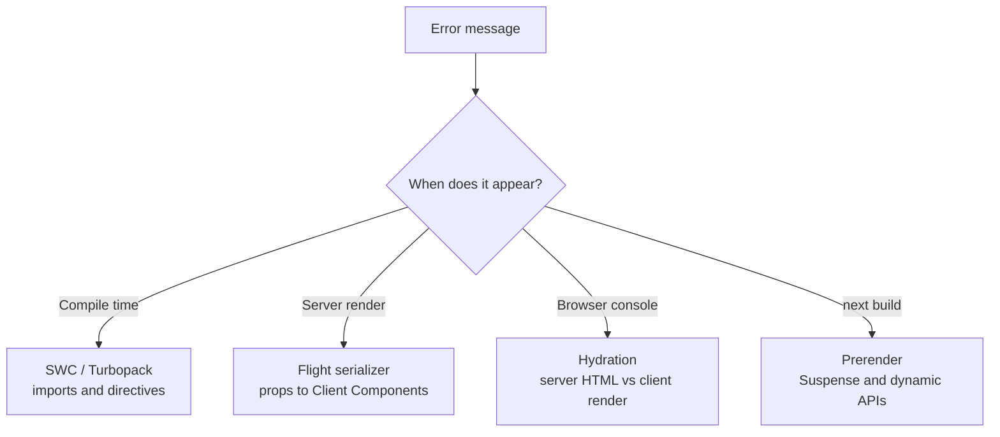

# Recipes - Rendering and Hydration Errors

> [!summary] TL;DR
> Most rendering errors in Next.js 16 come from one of three places. **The Flight serializer** rejects props that cannot cross the server-to-client boundary (functions, event handlers, class instances). **The SWC transform** rejects client-only APIs in Server Components at compile time (`useState`, `createContext`, `ssr: false`). **React's hydration** complains when the HTML from the server differs from what the first client render produces (dates, `typeof window` branches, `localStorage`, invalid nesting). A fourth group is prerender bailouts: `useSearchParams` or `cookies()` outside `<Suspense>`, and `DynamicServerError` swallowed by a `try/catch`. Each recipe below quotes the exact message, links where it is thrown in v16.4.3, and gives the fix.

The recipes are grouped in that order: boundary errors first, then build-time import errors, then hydration, then prerendering. Search the page for the first words of your error message.



## Event handlers cannot be passed to Client Component props

**Symptom.** The page fails to render on the server with:

```text
Error: Event handlers cannot be passed to Client Component props.
  <button onClick={function onClick} children=...>
                  ^^^^^^^^^^^^^^^^^^
If you need interactivity, consider converting part of this to a Client Component.
```

**Why.** A Server Component's output is serialized into the RSC payload. When the Flight serializer meets a function, it first checks whether it is a Server Action (`$$typeof === SERVER_REFERENCE_TAG`). If not, and the prop name matches `/^on[A-Z]/`, it throws this error.[^flight-fn] A function is code, not data, so there is nothing to send. This happens even on a plain `<button>` in a Server Component, because the host element is rendered in the browser from the payload.

**Fix.** Move the interactive part into a small Client Component and keep the page on the server.

```tsx
// app/posts/[slug]/like-button.tsx
'use client'

import { useState } from 'react'

export function LikeButton({ initial }: { initial: number }) {
  const [likes, setLikes] = useState(initial)
  return <button onClick={() => setLikes((n) => n + 1)}>{likes} likes</button>
}
```

```tsx
// app/posts/[slug]/page.tsx
import { LikeButton } from './like-button'

export default async function Page({ params }: PageProps<'/posts/[slug]'>) {
  const { slug } = await params
  const post = await getPost(slug)
  return (
    <article>
      <h1>{post.title}</h1>
      <LikeButton initial={post.likes} />
    </article>
  )
}
```

If the click should change data on the server, pass a Server Action instead: a function marked `'use server'` serializes as a reference, so `<form action={likePost}>` works from a Server Component.

**Deep dive:** [[02 Server and Client Components#Crossing the boundary: props must serialize|Server and Client Components]], [[07 Server Actions and Forms]].

## Functions cannot be passed directly to Client Components

**Symptom.**

```text
Error: Functions cannot be passed directly to Client Components unless you explicitly
expose it by marking it with "use server". Or maybe you meant to call this function
rather than return it.
  <DataTable rows={[...]} formatCell={function formatCell}>
```

A close cousin appears for class instances and objects with a null prototype:

```text
Only plain objects, and a few built-ins, can be passed to Client Components from Server
Components. Classes or null prototypes are not supported.
```

**Why.** Same serializer, same branch. A function prop that is not an `on*` handler and not a Server Action falls through to this error.[^flight-fn] Class instances fail the prototype check a few lines earlier: only plain objects, arrays, `Date`, `Map`, `Set`, typed arrays, promises and a few other built-ins have a wire format.[^flight-proto] ORM rows (Prisma `Decimal`, Mongoose documents) and `new URL()` objects are typical offenders.

**Fix.** Pass data, and keep the behaviour on the client side of the boundary.

```tsx
// app/reports/page.tsx (Server Component)
import { DataTable } from './data-table'

export default async function Page() {
  const rows = await db.report.findMany()
  // Turn ORM objects into plain JSON-safe values
  const plain = rows.map((r) => ({ id: r.id, total: r.total.toString(), at: r.createdAt }))
  // Pass a format *name*, not a formatter function
  return <DataTable rows={plain} format="currency" />
}
```

```tsx
// app/reports/data-table.tsx
'use client'

const formatters = {
  currency: (v: string) => new Intl.NumberFormat('en-US', { style: 'currency', currency: 'USD' }).format(+v),
  plain: (v: string) => v,
}

export function DataTable({ rows, format }: { rows: { id: string; total: string; at: Date }[]; format: keyof typeof formatters }) {
  const fmt = formatters[format]
  return (
    <table>
      <tbody>
        {rows.map((r) => (
          <tr key={r.id}><td>{fmt(r.total)}</td></tr>
        ))}
      </tbody>
    </table>
  )
}
```

> [!tip] "Maybe you meant to call this function"
> If the prop is `children` and the value is a component, React throws the sibling message "Functions are not valid as a child of Client Components" instead. You wrote `{Header}` where you meant `<Header />`.[^flight-fn]

**Deep dive:** [[02 Server and Client Components]].

## useState, createContext or a provider library fails in a Server Component

**Symptom.** One of these, usually the first time you add a UI kit, a state library or a theme provider to `app/layout.tsx`:

```text
You're importing a module that depends on `useState` into a React Server Component module.
This API is only available in Client Components. To fix, mark the file (or its parent)
with the `"use client"` directive.
```

```text
createContext only works in Client Components. Add the "use client" directive at the top
of the file to use it.
```

**Why.** Files under `app/` are Server Components unless a `'use client'` boundary is above them. The SWC transform keeps a list of React APIs that are invalid in the server layer (`useState`, `useEffect`, `useRef`, `createContext`, `Component`, `useActionState` and more, plus `useRouter`, `usePathname` and `useSearchParams` from `next/navigation`) and reports a compile error when a server module imports one.[^rsc-apis][^rsc-msg] That only catches your own source. A library in `node_modules` that calls `createContext` without shipping `'use client'` gets past the transform, and then fails at runtime because the `react-server` build of React has no `createContext`. Next rewrites the resulting `createContext is not a function` into the friendlier message above.[^format-ctx]

**Fix.** Create one client providers file and render it from the root layout. The layout stays a Server Component, and everything passed as `children` can still be server-rendered.

```tsx
// app/providers.tsx
'use client'

import { ThemeProvider } from 'some-theme-lib'
import { Toaster } from 'some-toast-lib'

export function Providers({ children }: { children: React.ReactNode }) {
  return (
    <ThemeProvider attribute="data-theme">
      {children}
      <Toaster />
    </ThemeProvider>
  )
}
```

```tsx
// app/layout.tsx
import { Providers } from './providers'

export default function RootLayout({ children }: LayoutProps<'/'>) {
  return (
    <html lang="en">
      <body>
        <Providers>{children}</Providers>
      </body>
    </html>
  )
}
```

The same wrapper works for a third-party component with no directive: re-export it from a file that starts with `'use client'` (`export { Carousel } from 'some-carousel'`) and import your wrapper instead.

> [!warning] Do not put `'use client'` on the layout itself
> It turns the whole tree below it into client code and removes server rendering of data for every page. Push the boundary down to the leaf that needs state.

**Deep dive:** [[02 Server and Client Components]]; for why hooks need the client runtime, [[09 Hooks - Why Order Matters|React Concepts: hooks]].

## "is an async Client Component"

**Symptom.** In the browser console, sometimes followed by an infinite suspend loop:

```text
<ProductList> is an async Client Component. Only Server Components can be async at the
moment. This error is often caused by accidentally adding `'use client'` to a module that
was originally written for the server.
```

**Why.** React's client renderer checks the component's type tag in `renderWithHooks`. An `AsyncFunction` gets this warning.[^async-warn] If the component keeps returning a new promise on every render, the shell suspends over and over, and after 100 tries `trackUsedThenable` throws the hard error with "An unknown Component".[^async-throw] The usual cause is the message's own hint: someone added `'use client'` to a file that does `await db.query()`.

**Fix.** Fetch on the server and pass the promise (or the data) down. In the Client Component, read it with `use()`.

```tsx
// app/products/page.tsx
import { Suspense } from 'react'
import { ProductList } from './product-list'

export default function Page() {
  const products = getProducts() // start the request, do not await
  return (
    <Suspense fallback={<p>Loading products...</p>}>
      <ProductList products={products} />
    </Suspense>
  )
}
```

```tsx
// app/products/product-list.tsx
'use client'

import { use } from 'react'

export function ProductList({ products }: { products: Promise<Product[]> }) {
  const list = use(products)
  return <ul>{list.map((p) => <li key={p.id}>{p.name}</li>)}</ul>
}
```

**Deep dive:** [[04 Data Fetching and Streaming]].

## window is not defined (a browser-only library)

**Symptom.** A chart, map or editor library crashes during server rendering:

```text
ReferenceError: window is not defined
```

Moving it into a Server Component with `dynamic(..., { ssr: false })` then gives a compile error:

```text
`ssr: false` is not allowed with `next/dynamic` in Server Components. Please move it into
a Client Component.
```

**Why.** `'use client'` does not mean "browser only". Client Components are also rendered to HTML on the server, so any module that touches `window` or `document` at import time breaks. `next/dynamic` with `ssr: false` wraps the lazy component in `BailoutToCSRForNextDynamic`, which throws `BailoutToCSRError` when `typeof window === 'undefined'` inside a Suspense boundary, so the server emits the fallback and the browser renders the real thing.[^loadable][^bailout-dyn] That trick only makes sense in a module that runs during SSR as a Client Component, so the SWC transform forbids it in Server Components.[^ssr-false]

**Fix.** Put the `dynamic()` call in a Client Component.

```tsx
// app/dashboard/chart-client.tsx
'use client'

import dynamic from 'next/dynamic'

export const Chart = dynamic(() => import('./chart'), {
  ssr: false,
  loading: () => <div className="chart-skeleton" aria-busy="true" />,
})
```

```tsx
// app/dashboard/page.tsx (Server Component)
import { Chart } from './chart-client'

export default async function Page() {
  const series = await getSeries()
  return <Chart data={series} />
}
```

If only a call (not the import) needs `window`, skip `dynamic()` and run it in `useEffect`, which never runs on the server. Give the skeleton the same size as the chart to avoid layout shift.

**Deep dive:** [[24 CSR - Client-Rendered Islands]].

## Module not found: Can't resolve 'fs'

**Symptom.** Turbopack (the default bundler in 16) fails the build or the dev overlay shows:

```text
Module not found: Can't resolve 'fs'
https://nextjs.org/docs/messages/module-not-found
```

The import trace ends in a file with `'use client'`, or in a utility imported by one.

**Why.** Turbopack titles every failed resolve "Module not found: Can't resolve ...", and Next adds the docs link.[^tp-resolve][^tp-link] The browser build gets polyfills for a set of Node built-ins (`buffer`, `crypto`, `path`, `stream`, `url`, `util` and others), but not `fs`, `net` or `child_process`.[^aliases] So the error means server code leaked into the client module graph. A shared `lib/posts.ts` that reads files and also exports a `formatDate` helper is the classic case: a Client Component imports the helper and drags `fs` along.

**Fix.** Split the module and fence the server half with `server-only`, so the next leak fails with a clear message instead of a resolve error.

```ts
// lib/posts.server.ts
import 'server-only'
import { readFile } from 'node:fs/promises'

export async function readPost(slug: string) {
  return readFile(`content/${slug}.md`, 'utf8')
}
```

```ts
// lib/format.ts  (safe on both sides)
export const formatDate = (iso: string) => iso.slice(0, 10)
```

In client modules, Turbopack aliases `server-only` to an error: "'server-only' cannot be imported from a Client Component module".[^server-only] The SWC transform raises a similar error for `next/headers` and `server-only` imported below a `'use client'` boundary.[^rsc-client-import]

**Deep dive:** [[02 Server and Client Components]].

## Hydration failed because the server rendered HTML didn't match the client

**Symptom.** In development, the overlay shows a diff and the console says:

```text
Hydration failed because the server rendered text didn't match the client. As a result
this tree will be regenerated on the client. This can happen if a SSR-ed Client Component
used:
- A server/client branch `if (typeof window !== 'undefined')`.
- Variable input such as `Date.now()` or `Math.random()` which changes each time it's called.
- Date formatting in a user's locale which doesn't match the server.
- External changing data without sending a snapshot of it along with the HTML.
- Invalid HTML tag nesting.
```

For attributes only, you get the softer "A tree hydrated but some attributes of the server rendered HTML didn't match the client properties. This won't be patched up."

**Why.** During hydration React walks the existing DOM and claims each node instead of creating it. When text or element types differ, `throwOnHydrationMismatch` queues this error and throws, and React client-renders from the nearest Suspense or error boundary, throwing away the server HTML for that subtree.[^hydr-throw] Attribute differences are only logged in development by `emitPendingHydrationWarnings`, and the attribute is left as the server rendered it.[^hydr-attr] Next's dev overlay recognises both messages and the "In HTML, `<div>` cannot be a child of `<p>`" nesting warnings, and shows the component diff.[^overlay]

**Fix.** Read the diff in the overlay, find the first differing node, then pick the matching recipe:

| Diff shows | Cause | Recipe |
| --- | --- | --- |
| Two different times or numbers | `Date`, `Math.random()`, `toLocaleString` | Dates and locales, below |
| Text only on one side | `typeof window`, `localStorage` in render | Browser-only values, below |
| Extra attributes on `html`/`body` | Browser extension, theme script | `suppressHydrationWarning`, below |
| `div` inside `p`, `a` inside `a` | Invalid HTML nesting | Fix the markup |

Invalid nesting is worth calling out: the browser's HTML parser silently moves a `<div>` out of a `<p>`, so the DOM really differs from what React rendered. Use `<div>` or `<span>` and the error disappears.

**Deep dive:** [[02 Server and Client Components]]; why the first client render must be pure, [[03 What Rendering Really Means#Why rendering must be pure|React Concepts: pure rendering]].

## Dates, times and locales differ between server and browser

**Symptom.** A hydration diff like `+ 15/06/2026` / `- 6/15/2026`, or `+ 3 minutes ago` / `- 2 minutes ago`. It often appears only in production, where the server runs in UTC with an `en-US` locale.

**Why.** `toLocaleDateString()` and `Intl.DateTimeFormat` use the runtime's time zone and locale. The server formats with its settings, the browser re-runs the same Client Component with the user's, and the text node differs, which is exactly the mismatch path above.[^hydr-throw] Relative times also drift because seconds pass between the two renders.

**Fix.** Choose by what the user should see.

1. **A fixed format and zone** (simplest, no flash). Pass an explicit `timeZone` and locale so both sides agree.

```tsx
// app/components/event-date.tsx
const fmt = new Intl.DateTimeFormat('en-GB', { dateStyle: 'medium', timeZone: 'UTC' })
export const EventDate = ({ iso }: { iso: string }) => <time dateTime={iso}>{fmt.format(new Date(iso))}</time>
```

2. **The user's own locale, after hydration.** Render a stable value first, then swap in an effect. Expect a short visual change.

```tsx
// app/components/relative-time.tsx
'use client'

import { useEffect, useState } from 'react'

export function RelativeTime({ iso }: { iso: string }) {
  const [label, setLabel] = useState(iso.slice(0, 10)) // same on server and first client render
  useEffect(() => {
    const rtf = new Intl.RelativeTimeFormat(undefined, { numeric: 'auto' })
    const mins = Math.round((Date.parse(iso) - Date.now()) / 60000)
    setLabel(rtf.format(mins, 'minute'))
  }, [iso])
  return <time dateTime={iso}>{label}</time>
}
```

3. **The user's locale with no flash.** The Next docs recommend an inline script placed after the element that rewrites the text before first paint, plus `suppressHydrationWarning` so React keeps the corrected DOM. See the guide "How to prevent flash before hydration" (`docs/01-app/02-guides/preventing-flash-before-hydration.mdx`), which also shows a `useId`-based reusable version for client navigations.

> [!tip] Reproduce it locally
> Start the dev server with `TZ=UTC LANG=ja_JP.UTF-8 next dev` (the docs' suggestion). If your laptop and browser share a locale, you will never see this bug until production.

**Deep dive:** [[09 Metadata, Images, Fonts and Scripts]] for inline scripts; [[08 The Commit Phase and Effects|React Concepts: effects]] for why effects run after hydration.

## A value from localStorage, window or matchMedia causes a mismatch

**Symptom.** Hydration error where the server side shows the default (`Sign in`, light icon, closed panel) and the client shows the stored state. Often introduced by "fixing" `window is not defined` with a `typeof window` branch.

**Why.** The server cannot read the browser. A branch like `typeof window !== 'undefined' ? localStorage.cart : []` gives different output on the two renders, which is the first item on React's own list in the error.[^hydr-throw]

**Fix.** Keep the first client render identical to the server, then read the browser. `useSyncExternalStore` makes that explicit: `getServerSnapshot` is used during SSR and hydration, and React switches to the real value right after.

```tsx
// app/components/use-media-query.ts
'use client'

import { useSyncExternalStore } from 'react'

export function useMediaQuery(query: string) {
  return useSyncExternalStore(
    (onChange) => {
      const mql = window.matchMedia(query)
      mql.addEventListener('change', onChange)
      return () => mql.removeEventListener('change', onChange)
    },
    () => window.matchMedia(query).matches, // client snapshot
    () => false, // server snapshot, also used for hydration
  )
}
```

For a one-off value, the effect pattern from the previous recipe works too. If the value must be correct in the very first HTML, it has to come from the request: store it in a cookie and read it on the server with `await cookies()` (that makes the route dynamic, see [[22 SSR - Rendering Per Request]]).

**Deep dive:** [[24 CSR - Client-Rendered Islands]].

## What suppressHydrationWarning really does

**Symptom.** You added `suppressHydrationWarning` to `<body>` and the mismatch in a child is still reported, or you added it everywhere and real bugs disappeared.

**Why.** It is a single-element opt-out, not a subtree switch. In `prepareToHydrateHostInstance`, React skips the text check only when that element's own children are a string or number and the prop is `true`.[^hydr-suppress] In `diffHydratedProperties`, the attribute comparison loop is skipped for that element only.[^hydr-props] Children elements are still checked. When the check is skipped, the DOM wins: React keeps the server text and attributes and does not patch them.

**Fix.** Use it for exactly two cases:

- `<html>` and `<body>`, where browser extensions (password managers, translators, dark-mode extensions) and your own theme script add attributes before React loads.
- One leaf element whose text an inline script deliberately rewrites (the date recipe above).

```tsx
// app/layout.tsx
export default function RootLayout({ children }: LayoutProps<'/'>) {
  return (
    <html lang="en" suppressHydrationWarning>
      <body>{children}</body>
    </html>
  )
}
```

Everywhere else, fix the cause. Silencing a real mismatch leaves stale server text on screen.

**Deep dive:** [[02 Server and Client Components]].

## The theme flashes light, then turns dark

**Symptom.** On a hard refresh the page paints in the default theme for a frame, then switches. Reading the theme in a Client Component instead causes a hydration error.

**Why.** The server does not know the saved preference. Reading `localStorage` in render mismatches; reading it in `useEffect` runs after paint, which is the flash. Reading a `theme` cookie with `cookies()` in the root layout fixes the HTML but makes every route request-time, which is usually a bad trade for a static site.

**Fix.** A tiny blocking script in the document head sets the attribute before the first paint, and `suppressHydrationWarning` on `<html>` accepts the changed attribute. This is the pattern from the Next docs guide on preventing flash. A `beforeInteractive` script would delay hydration, so see [[09 Metadata, Images, Fonts and Scripts|next/script]] before choosing that strategy.

```tsx
// app/layout.tsx
const themeScript = `(function(){try{var t=localStorage.getItem("theme")||(matchMedia("(prefers-color-scheme: dark)").matches?"dark":"light");document.documentElement.setAttribute("data-theme",t)}catch(e){}})()`

export default function RootLayout({ children }: LayoutProps<'/'>) {
  return (
    <html lang="en" data-theme="light" suppressHydrationWarning>
      <head>
        <script dangerouslySetInnerHTML={{ __html: themeScript }} />
      </head>
      <body>{children}</body>
    </html>
  )
}
```

```css
/* app/globals.css */
:root[data-theme='light'] { --bg: #fff; --fg: #111; }
:root[data-theme='dark']  { --bg: #111; --fg: #eee; }
body { background: var(--bg); color: var(--fg); }
```

Style both themes from CSS variables, not from React state, so the first paint is already right. Theme toggle icons that depend on the current theme should read the attribute through `useSyncExternalStore` (previous recipe) or be styled with CSS (`[data-theme='dark'] .sun { display: none }`).

**Deep dive:** [[09 Metadata, Images, Fonts and Scripts]].

## useSearchParams() should be wrapped in a suspense boundary

**Symptom.** `next build` fails on a page that worked in dev:

```text
useSearchParams() should be wrapped in a suspense boundary at page "/products".
Read more: https://nextjs.org/docs/messages/missing-suspense-with-csr-bailout
```

With `cacheComponents: true` the message is different:

```text
Route "/products": Next.js encountered URL data `useSearchParams()` in a Client Component
outside of `<Suspense>`.
This blocks prerendering because the value is only available at runtime.
```

**Why.** At build time there is no query string. In the legacy prerender, `useDynamicSearchParams` throws `BailoutToCSRError`, meaning "render this part in the browser". If no Suspense boundary catches it, the whole page would become client-rendered, so the renderer logs this error and fails.[^use-sp][^csr-bailout] Under Cache Components the hook instead suspends on a promise that never resolves during prerender and carries a `ClientHookDynamicError`; without a boundary there is no static shell to emit.[^client-hook-err] Development renders per request, so the problem only shows up in `next build`.

**Fix.** Wrap the smallest component that reads the params in `<Suspense>` with a fallback that has the same size.

```tsx
// app/products/page.tsx
import { Suspense } from 'react'
import { Filters } from './filters'

export default function Page() {
  return (
    <>
      <h1>Products</h1>
      <Suspense fallback={<div className="filters-skeleton" />}>
        <Filters />
      </Suspense>
    </>
  )
}
```

If the page needs the params on the server anyway, take `searchParams` as a page prop and pass the values down, and the client hook is no longer needed for the first render. The same applies to `usePathname()` and `useParams()` on routes with unknown params.

**Deep dive:** [[23 PPR - Partial Prerendering with Cache Components]], [[03 Linking, Navigation and Prefetching]].

## Dynamic server usage: Route couldn't be rendered statically

**Symptom.** In build logs or error reporting:

```text
Error: Dynamic server usage: Route /dashboard couldn't be rendered statically because it
used `cookies`. See more info here: https://nextjs.org/docs/messages/dynamic-server-error
```

**Why.** Without Cache Components, a static prerender stops at the first request-time API by throwing a `DynamicServerError` (digest `DYNAMIC_SERVER_USAGE`) from `throwToInterruptStaticGeneration`, and Next marks the route dynamic.[^dse][^throw-interrupt] It is control flow, not a failure. You see it as an error when your own `try/catch` around `cookies()`, `headers()` or a `fetch` with `cache: 'no-store'` catches it and logs or reports it, or when the route sets `export const dynamic = 'error'`. See [[20 Rendering Strategies - A Decision Map#What counts as dynamic|What counts as dynamic]] for why a page is marked ƒ (dynamic).

**Fix.** Let Next's internal errors pass through your catch blocks with `unstable_rethrow`, which rethrows router errors, CSR bailouts, `DynamicServerError` and prerender interruptions.[^rethrow]

```tsx
// app/dashboard/page.tsx
import { cookies } from 'next/headers'
import { unstable_rethrow } from 'next/navigation'

export default async function Page() {
  try {
    const session = (await cookies()).get('session')?.value
    return <Dashboard user={await loadUser(session)} />
  } catch (err) {
    unstable_rethrow(err) // must be first in the catch
    reportError(err)
    return <p>Could not load your dashboard.</p>
  }
}
```

The same function also keeps `redirect()` and `notFound()` working inside `try` blocks.

**Deep dive:** [[10 Errors, Redirects and Request Lifecycle APIs]], [[22 SSR - Rendering Per Request]].

## Next.js encountered runtime data during prerendering

**Symptom.** With `cacheComponents: true`, the build (and the dev overlay) reports:

```text
Route "/account": Next.js encountered runtime data during prerendering.

`cookies()`, `headers()`, `params`, or `searchParams` accessed outside of `<Suspense>`
prevents the route from being prerendered, blocking the page load and leading to a
slower user experience.

Ways to fix this:
  - [stream] Provide a placeholder with `<Suspense fallback={...}>` around the data access
  - [block] Set `export const instant = false` to allow a blocking route
```

The uncached-data variant says "encountered uncached data during prerendering" and lists `fetch(...)` or `connection()`, with an extra `[cache]` option to use `"use cache"`.

> [!info] The message changed in 16.x
> Earlier releases said "Uncached data was accessed outside of `<Suspense>`" or "Route used `cookies()`...". In v16.4.3 both are replaced by these two structured messages, and the escape hatch is the new `instant` segment config rather than a `dynamic` export.[^blocking-msg]

**Why.** Under Cache Components every route must produce a static shell. Request data read above any Suspense boundary would make the whole page wait for the request, so the dynamic-rendering validation turns it into an error.[^blocking-msg]

**Fix.** Push the access below a boundary, or cache it. The full set of fixes is in the data recipes.

```tsx
// app/account/page.tsx
import { Suspense } from 'react'
import { cookies } from 'next/headers'

export default function Page() {
  return (
    <main>
      <h1>Your account</h1>
      <Suspense fallback={<p>Loading profile...</p>}>
        <Profile />
      </Suspense>
    </main>
  )
}

async function Profile() {
  const session = (await cookies()).get('session')?.value
  const user = await getUser(session)
  return <p>Signed in as {user.name}</p>
}
```

**Deep dive:** [[40 Recipes - Data, Caching and Revalidation]], [[23 PPR - Partial Prerendering with Cache Components]], [[05 Cache Components - use cache, cacheLife and cacheTag]].

## Summary

Rendering errors in Next.js 16 sort into four layers, and the message tells you which one you hit. The Flight serializer rejects anything that is not data at the server-to-client boundary, so pass values or Server Actions and keep behaviour in Client Components. The SWC transform and Turbopack catch client APIs in server modules and server modules in client bundles, so use a providers file, `dynamic(..., { ssr: false })` from a Client Component, and `server-only` fences. Hydration requires the first client render to equal the server HTML, so delay browser-only values with effects or `useSyncExternalStore`, fix dates with explicit zones or an inline script, and reserve `suppressHydrationWarning` for `<html>` and deliberate rewrites. Prerender errors mean request data sits above a Suspense boundary; [[40 Recipes - Data, Caching and Revalidation|the data recipes]] cover the caching side.

### Key takeaways

- **Flight serializer**: functions become "Event handlers cannot be passed" (for `on*` props) or "Functions cannot be passed directly"; only Server Actions cross as functions.
- **Plain objects only**: class instances and ORM rows fail the prototype check; map them to JSON-safe values first.
- **`'use client'` providers file**: the fix for `useState`, `createContext` and third-party providers in `layout.tsx`, without making the layout a Client Component.
- **Async Client Components**: not supported; fetch on the server and pass a promise to `use()`.
- **`ssr: false`**: only allowed inside a Client Component; it works by throwing a CSR bailout during SSR.
- **`Can't resolve 'fs'`**: server code leaked into the client graph; split the module and add `import 'server-only'`.
- **Hydration**: text mismatches re-render the subtree on the client; attribute mismatches are only warned about and left unpatched.
- **`suppressHydrationWarning`**: one element deep, the DOM wins; use it on `<html>` and for inline-script rewrites such as theme and locale dates.
- **Prerender bailouts**: `useSearchParams` and request APIs need a `<Suspense>` boundary, and `unstable_rethrow` keeps `DynamicServerError` out of your catch blocks.

← [[41 Recipes - Routing and Navigation|Recipes: Routing]] · [[00 Next.js in Practice Index|Index]] · [[43 Recipes - Forms, Mutations and Uploads|Recipes: Forms]] →

[^flight-fn]: function branch of `renderModelDestructive` (Server Action check, `on*` handler error, "Functions are not valid as a child", "Functions cannot be passed directly") — [packages/next/src/compiled/react-server-dom-turbopack/cjs/react-server-dom-turbopack-server.node.development.js#L3056-L3092](https://github.com/vercel/next.js/blob/v16.4.3/packages/next/src/compiled/react-server-dom-turbopack/cjs/react-server-dom-turbopack-server.node.development.js#L3056-L3092)
[^flight-proto]: prototype check, "Only plain objects, and a few built-ins" — [packages/next/src/compiled/react-server-dom-turbopack/cjs/react-server-dom-turbopack-server.node.development.js#L2996-L3006](https://github.com/vercel/next.js/blob/v16.4.3/packages/next/src/compiled/react-server-dom-turbopack/cjs/react-server-dom-turbopack-server.node.development.js#L2996-L3006)
[^rsc-apis]: `invalid_server_lib_apis_mapping` (React, react-dom and next/navigation APIs banned in Server Components) — [crates/next-custom-transforms/src/transforms/react_server_components.rs#L648-L697](https://github.com/vercel/next.js/blob/v16.4.3/crates/next-custom-transforms/src/transforms/react_server_components.rs#L648-L697)
[^rsc-msg]: `RSCErrorKind::NextRscErrReactApi` message — [crates/next-custom-transforms/src/transforms/react_server_components.rs#L343-L351](https://github.com/vercel/next.js/blob/v16.4.3/crates/next-custom-transforms/src/transforms/react_server_components.rs#L343-L351)
[^format-ctx]: `formatServerError` rewrite of `createContext is not a function` — [packages/next/src/lib/format-server-error.ts#L65-L71](https://github.com/vercel/next.js/blob/v16.4.3/packages/next/src/lib/format-server-error.ts#L65-L71)
[^async-warn]: async Client Component warning in `renderWithHooks` — [packages/next/src/compiled/react-dom/cjs/react-dom-client.development.js#L8004-L8018](https://github.com/vercel/next.js/blob/v16.4.3/packages/next/src/compiled/react-dom/cjs/react-dom-client.development.js#L8004-L8018)
[^async-throw]: `trackUsedThenable` shell-suspend limit and error — [packages/next/src/compiled/react-dom/cjs/react-dom-client.development.js#L6310-L6317](https://github.com/vercel/next.js/blob/v16.4.3/packages/next/src/compiled/react-dom/cjs/react-dom-client.development.js#L6310-L6317)
[^loadable]: `Loadable` wraps `ssr: false` in Suspense and `BailoutToCSRForNextDynamic` — [packages/next/src/shared/lib/lazy-dynamic/loadable.tsx#L51-L69](https://github.com/vercel/next.js/blob/v16.4.3/packages/next/src/shared/lib/lazy-dynamic/loadable.tsx#L51-L69)
[^bailout-dyn]: `BailoutToCSRForNextDynamic` — [packages/next/src/shared/lib/lazy-dynamic/dynamic-bailout-to-csr.tsx#L21-L35](https://github.com/vercel/next.js/blob/v16.4.3/packages/next/src/shared/lib/lazy-dynamic/dynamic-bailout-to-csr.tsx#L21-L35)
[^ssr-false]: `RSCErrorKind::NextSsrDynamicFalseNotAllowed` — [crates/next-custom-transforms/src/transforms/react_server_components.rs#L377-L381](https://github.com/vercel/next.js/blob/v16.4.3/crates/next-custom-transforms/src/transforms/react_server_components.rs#L377-L381)
[^tp-resolve]: `ResolvingIssue::title` ("Module not found: Can't resolve") — [turbopack/crates/turbopack-core/src/issue/resolve.rs#L36-L43](https://github.com/vercel/next.js/blob/v16.4.3/turbopack/crates/turbopack-core/src/issue/resolve.rs#L36-L43)
[^tp-link]: Turbopack issue formatting adds the module-not-found docs link — [packages/next/src/shared/lib/turbopack/utils.ts#L125-L131](https://github.com/vercel/next.js/blob/v16.4.3/packages/next/src/shared/lib/turbopack/utils.ts#L125-L131)
[^aliases]: `NEXT_ALIASES`, the browser polyfills for Node built-ins (no `fs`) — [crates/next-core/src/next_import_map.rs#L676-L731](https://github.com/vercel/next.js/blob/v16.4.3/crates/next-core/src/next_import_map.rs#L676-L731)
[^server-only]: `insert_server_only_error_alias` — [crates/next-core/src/next_import_map.rs#L1655-L1678](https://github.com/vercel/next.js/blob/v16.4.3/crates/next-core/src/next_import_map.rs#L1655-L1678)
[^rsc-client-import]: `RSCErrorKind::NextRscErrClientImport` — [crates/next-custom-transforms/src/transforms/react_server_components.rs#L335-L342](https://github.com/vercel/next.js/blob/v16.4.3/crates/next-custom-transforms/src/transforms/react_server_components.rs#L335-L342)
[^hydr-throw]: `throwOnHydrationMismatch` — [packages/next/src/compiled/react-dom/cjs/react-dom-client.development.js#L5538-L5557](https://github.com/vercel/next.js/blob/v16.4.3/packages/next/src/compiled/react-dom/cjs/react-dom-client.development.js#L5538-L5557)
[^hydr-attr]: `emitPendingHydrationWarnings` — [packages/next/src/compiled/react-dom/cjs/react-dom-client.development.js#L5741-L5755](https://github.com/vercel/next.js/blob/v16.4.3/packages/next/src/compiled/react-dom/cjs/react-dom-client.development.js#L5741-L5755)
[^overlay]: `isHydrationError` in the dev overlay — [packages/next/src/next-devtools/shared/react-19-hydration-error.ts#L9-L26](https://github.com/vercel/next.js/blob/v16.4.3/packages/next/src/next-devtools/shared/react-19-hydration-error.ts#L9-L26)
[^hydr-suppress]: `prepareToHydrateHostInstance` text check with `suppressHydrationWarning` — [packages/next/src/compiled/react-dom/cjs/react-dom-client.development.js#L5626-L5632](https://github.com/vercel/next.js/blob/v16.4.3/packages/next/src/compiled/react-dom/cjs/react-dom-client.development.js#L5626-L5632)
[^hydr-props]: `diffHydratedProperties` skips the prop diff when `suppressHydrationWarning` is set — [packages/next/src/compiled/react-dom/cjs/react-dom-client.development.js#L23112-L23119](https://github.com/vercel/next.js/blob/v16.4.3/packages/next/src/compiled/react-dom/cjs/react-dom-client.development.js#L23112-L23119)
[^use-sp]: `useDynamicSearchParams` (CSR bailout in `prerender-legacy`, hanging promise in `prerender-client`) — [packages/next/src/server/app-render/dynamic-rendering-client.ts#L80-L139](https://github.com/vercel/next.js/blob/v16.4.3/packages/next/src/server/app-render/dynamic-rendering-client.ts#L80-L139)
[^csr-bailout]: `prerenderToStream` reports an uncaught `BailoutToCSRError` — [packages/next/src/server/app-render/app-render.tsx#L10288-L10298](https://github.com/vercel/next.js/blob/v16.4.3/packages/next/src/server/app-render/app-render.tsx#L10288-L10298)
[^client-hook-err]: `ClientHookDynamicError` — [packages/next/src/server/dynamic-rendering-utils.ts#L44-L57](https://github.com/vercel/next.js/blob/v16.4.3/packages/next/src/server/dynamic-rendering-utils.ts#L44-L57)
[^dse]: `DynamicServerError` — [packages/next/src/client/components/hooks-server-context.ts#L1-L9](https://github.com/vercel/next.js/blob/v16.4.3/packages/next/src/client/components/hooks-server-context.ts#L1-L9)
[^throw-interrupt]: `throwToInterruptStaticGeneration` — [packages/next/src/server/app-render/dynamic-rendering.ts#L159-L175](https://github.com/vercel/next.js/blob/v16.4.3/packages/next/src/server/app-render/dynamic-rendering.ts#L159-L175)
[^rethrow]: `unstable_rethrow` — [packages/next/src/client/components/unstable-rethrow.ts#L19-L33](https://github.com/vercel/next.js/blob/v16.4.3/packages/next/src/client/components/unstable-rethrow.ts#L19-L33)
[^blocking-msg]: `createRuntimeBodyError` and `createDynamicBodyError` — [packages/next/src/server/app-render/blocking-route-messages.ts#L1-L22](https://github.com/vercel/next.js/blob/v16.4.3/packages/next/src/server/app-render/blocking-route-messages.ts#L1-L22)
