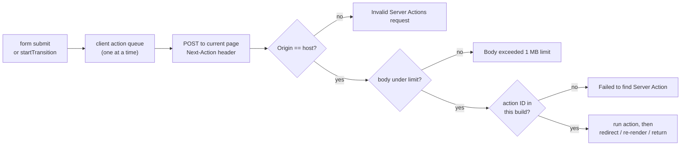

# Recipes - Forms, Mutations and Uploads

> [!summary] TL;DR
> A Server Action is a POST to the current page, run through `handleAction`. That one fact explains most form bugs. The POST body is capped at 1 MB unless you raise `experimental.serverActions.bodySizeLimit`. The `Origin` header must match the host, or the action is rejected as CSRF. The action ID belongs to one build, so an old tab gets "Failed to find Server Action" after a deploy. `redirect()` works by throwing a `NEXT_REDIRECT` error, so a `try/catch` can swallow it. On the client, actions go through one queue, so they run one at a time, and React only tracks pending and optimistic state inside a transition. Each recipe below gives the symptom, the line that causes it, and the fix.

Every recipe has the same shape: **Symptom** (what you see, with the exact message where there is one), **Why** (what the framework does, with a source link to Next.js v16.4.3 or the React build it bundles), **Fix**, and a **Deep dive** link to the part that explains the mechanism. The React code quoted here is `19.3.0-canary`, the build vendored in `packages/next/src/compiled`.



## My submit button never shows a pending state

**Symptom.** You call `useFormStatus()` and `pending` is always `false`. Or you `await` the action inside `onSubmit` and keep a `useState` flag that flickers or never resets on error.

**Why.** `useFormStatus` is a thin wrapper. It reads `HostTransitionContext`, which React provides on the `<form>` host element *while a form action runs*.[^form-status] A component can only read a context provided by an ancestor. If `useFormStatus` is called in the same component that renders the `<form>`, there is no `<form>` above it and the value never changes.

**Fix.** Either take `pending` from `useActionState`, or move the button into its own child component so it renders inside the form.

```tsx
// app/ui/submit-button.tsx
'use client'

import { useFormStatus } from 'react-dom'

export function SubmitButton({ children }: { children: React.ReactNode }) {
  const { pending } = useFormStatus() // reads the <form> above this component
  return (
    <button type="submit" disabled={pending} aria-disabled={pending}>
      {pending ? 'Saving…' : children}
    </button>
  )
}
```

```tsx
// app/ui/signup-form.tsx
'use client'

import { useActionState } from 'react'
import { signup } from '@/app/actions'

export function SignupForm() {
  // third value: true while the action is running
  const [state, formAction, isPending] = useActionState(signup, { ok: false })
  return (
    <form action={formAction}>
      <input name="email" type="email" />
      <button disabled={isPending}>Sign up</button>
    </form>
  )
}
```

**Deep dive:** [[07 Server Actions and Forms|Server Actions and Forms]].

## How do I show field-level validation errors from the server?

**Symptom.** You validate with zod in the action and `throw` on bad input. In development you see the zod message in the overlay; in production the user sees an error boundary, or nothing.

**Why.** An action's return value is serialized back to the caller, so it is the right channel for expected failures. A thrown error is the channel for bugs (see the recipe on production error messages below). `useActionState` turns the action into a reducer: it calls `action(prevState, formData)` and stores whatever you return as the new state.

**Fix.** Validate with `safeParse` and return the flattened errors. This uses zod 4 (`zod@4.1`), where `z.flattenError(error)` replaces the old `error.flatten()` method and string formats like `z.email()` are top-level.

```ts
// app/signup/actions.ts
'use server'

import { z } from 'zod'
import { redirect } from 'next/navigation'
import { db } from '@/lib/db'

const Signup = z.object({
  email: z.email('Enter a valid email'),
  password: z.string().min(12, 'At least 12 characters'),
})

export type SignupState = {
  fieldErrors?: { email?: string[]; password?: string[] }
  formError?: string
  values?: { email?: string }
}

export async function signup(
  _prev: SignupState,
  formData: FormData,
): Promise<SignupState> {
  const parsed = Signup.safeParse(Object.fromEntries(formData))
  if (!parsed.success) {
    return {
      fieldErrors: z.flattenError(parsed.error).fieldErrors,
      values: { email: String(formData.get('email') ?? '') },
    }
  }

  const exists = await db.user.findUnique({ where: { email: parsed.data.email } })
  if (exists) return { formError: 'That email is taken', values: { email: parsed.data.email } }

  await db.user.create({ data: parsed.data })
  redirect('/welcome') // outside any try/catch, see the redirect recipe
}
```

```tsx
// app/signup/signup-form.tsx
'use client'

import { useActionState } from 'react'
import { signup, type SignupState } from './actions'
import { SubmitButton } from '@/app/ui/submit-button'

export function SignupForm() {
  const [state, formAction] = useActionState<SignupState, FormData>(signup, {})
  return (
    <form action={formAction} noValidate>
      <label htmlFor="email">Email</label>
      <input
        id="email"
        name="email"
        type="email"
        defaultValue={state.values?.email}
        aria-invalid={!!state.fieldErrors?.email}
        aria-describedby="email-error"
      />
      <p id="email-error" aria-live="polite">{state.fieldErrors?.email?.[0]}</p>

      <label htmlFor="password">Password</label>
      <input id="password" name="password" type="password" />
      <p aria-live="polite">{state.fieldErrors?.password?.[0]}</p>

      {state.formError && <p role="alert">{state.formError}</p>}
      <SubmitButton>Create account</SubmitButton>
    </form>
  )
}
```

> [!tip] Why `values` comes back too
> React 19 resets an uncontrolled `<form>` after its action finishes. Echo the safe fields back and feed them to `defaultValue`, or the user retypes everything after one mistake. Never echo the password.

**Deep dive:** [[07 Server Actions and Forms|Server Actions and Forms]].

## My form must work before JavaScript loads

**Symptom.** On a slow connection, clicking submit before hydration does nothing, or the page posts and reloads with no feedback.

**Why.** When you pass a Server Action (or the `formAction` from `useActionState`) to `<form action>`, React renders a real HTML form that posts `multipart/form-data` to the current URL. Next.js treats a multipart POST without the `Next-Action` header as a possible "MPA action".[^req-meta] It decodes the action from the form fields, runs it, then calls `decodeFormState` so the server render of the page already contains the `useActionState` result.[^mpa] A `redirect()` in that path becomes a plain `303 See Other`.[^redirect-catch] Nothing of this works if the submission lives only in an `onSubmit` handler, because that code has not loaded yet.

**Fix.** Use `<form action={...}>` (not `onSubmit` plus `fetch`), keep inputs uncontrolled with `name` attributes, pass extra arguments with `.bind` instead of closures over client state, and return state that the server render can show.

```tsx
// app/posts/[id]/delete-button.tsx
import { deletePost } from './actions'

export function DeleteButton({ id }: { id: string }) {
  // bound args are serialized into the form, so this works without JS
  const deleteThis = deletePost.bind(null, id)
  return (
    <form action={deleteThis}>
      <button type="submit">Delete</button>
    </form>
  )
}
```

If the form lives on a different URL from where the result should show, pass the permalink as the third argument: `useActionState(action, initial, '/posts/new')`. React then posts the no-JS submission there.

**Deep dive:** [[07 Server Actions and Forms|Server Actions and Forms]].

## My optimistic update warns "An optimistic state update occurred outside a transition or action"

**Symptom.** In the console:

```text
An optimistic state update occurred outside a transition or action. To fix, move the update to an action, or wrap with startTransition.
```

The optimistic item flashes and disappears, or never shows.

**Why.** An optimistic update is a temporary layer that React drops when the surrounding transition ends. React checks for an active transition when you call the setter from `useOptimistic`, and warns when there is none.[^optimistic] Without a transition there is nothing to wait for, so the layer is reverted at once.

**Fix.** Call the optimistic setter inside a form action (React wraps those in a transition) or inside `startTransition`, and `await` the Server Action in the same function.

```tsx
// app/todos/todo-list.tsx
'use client'

import { useOptimistic, startTransition } from 'react'
import { addTodo, toggleTodo } from './actions'

type Todo = { id: string; title: string; done: boolean; pending?: boolean }

export function TodoList({ todos }: { todos: Todo[] }) {
  const [optimistic, apply] = useOptimistic(
    todos,
    (state, change: { type: 'add'; todo: Todo } | { type: 'toggle'; id: string }) =>
      change.type === 'add'
        ? [...state, change.todo]
        : state.map((t) => (t.id === change.id ? { ...t, done: !t.done } : t)),
  )

  async function add(formData: FormData) {
    // form actions already run inside a transition
    const title = String(formData.get('title'))
    apply({ type: 'add', todo: { id: crypto.randomUUID(), title, done: false, pending: true } })
    await addTodo(title) // the action calls updateTag('todos'), so `todos` refreshes
  }

  return (
    <>
      <ul>
        {optimistic.map((t) => (
          <li key={t.id} aria-busy={t.pending}>
            <label>
              <input
                type="checkbox"
                checked={t.done}
                onChange={() =>
                  startTransition(async () => {
                    apply({ type: 'toggle', id: t.id })
                    await toggleTodo(t.id)
                  })
                }
              />
              {t.title}
            </label>
          </li>
        ))}
      </ul>
      <form action={add}>
        <input name="title" required />
      </form>
    </>
  )
}
```

The base value (`todos`) must change when the action finishes, otherwise React reverts to the old list. That is why the action ends with `updateTag` or `refresh()`: the action response then carries the re-rendered page and new props.

**Deep dive:** [[07 Server Actions and Forms|Server Actions and Forms]], and [[07 Priorities, Transitions and Concurrency|React Concepts: transitions]] for what a transition is.

## redirect() inside my action does nothing, or I see "NEXT_REDIRECT" in my logs

**Symptom.** The action runs, but the browser stays on the form. Your error logger or toast shows an `Error: NEXT_REDIRECT`.

**Why.** `redirect(url)` never returns. It builds an `Error` whose message is `NEXT_REDIRECT` and whose `digest` is `NEXT_REDIRECT;push;/url;307;`, then throws it.[^redirect] Inside an action the default type is `push`. `handleAction` catches that error with `isRedirectError` and turns it into an `x-action-redirect` header for client calls, or a 303 for no-JS posts.[^redirect-catch] If your own `catch` gets there first, the framework never sees it.

**Fix.** Call `redirect` after the `try/catch`, or rethrow framework errors with `unstable_rethrow`, which rethrows redirects, `notFound()` and the other internal control-flow errors.[^rethrow] Put revalidation before the redirect, since code after it never runs.

```ts
// app/posts/actions.ts
'use server'

import { redirect, unstable_rethrow } from 'next/navigation'
import { updateTag } from 'next/cache'
import { db } from '@/lib/db'

export async function createPost(_prev: { error?: string }, formData: FormData) {
  let id: string
  try {
    const post = await db.post.create({ data: { title: String(formData.get('title')) } })
    id = post.id
  } catch (err) {
    unstable_rethrow(err) // safe even if a helper inside the try calls redirect()
    return { error: 'Could not save the post' }
  }

  updateTag('posts')
  redirect(`/posts/${id}`) // outside the try: nothing can swallow it
}
```

**Deep dive:** [[10 Errors, Redirects and Request Lifecycle APIs|Errors, Redirects and Request Lifecycle APIs]].

## After the action, the page still shows the old data

**Symptom.** The mutation succeeded, but the list on screen updates only after a reload.

**Why.** The action response contains a fresh render of the page only when the action invalidated something. `updateTag(tag)` expires the tag right away (and is allowed only in Server Actions).[^update-tag] `revalidateTag(tag, 'max')` is stale-while-revalidate, so the action's own render still sees the old value.[^revalidate-tag] `refresh()` re-renders the current route without touching cached data, for views that read uncached state.[^refresh] `revalidatePath` on a dynamic route pattern without a `type` argument only logs a warning and has no effect.[^revalidate-path]

**Fix.** Pick by what the user must see:

```ts
// app/cart/actions.ts
'use server'

import { updateTag, refresh, revalidatePath } from 'next/cache'

export async function addToCart(productId: string) {
  await db.cart.add(productId)
  updateTag('cart')             // cached data: read-your-own-writes
}

export async function markNotificationsRead() {
  await db.notifications.markAllRead()
  refresh()                     // page reads uncached data: just re-render it
}

export async function publish(slug: string) {
  await db.post.publish(slug)
  revalidatePath('/blog/[slug]', 'page') // a pattern needs the type
}
```

> [!warning] `refresh` and `updateTag` throw outside actions
> Both check where they run. Calling them from a Route Handler throws "updateTag can only be called from within a Server Action." (or the `refresh` equivalent). In a Route Handler use `revalidateTag(tag, 'max')` or `revalidatePath`.

The data-side version of this problem, including the `pathWasRevalidated` flag that decides the re-render, is in [[40 Recipes - Data, Caching and Revalidation|Recipes: Data and Caching]]. **Deep dive:** [[06 Revalidation - Tags, Paths and Refresh|Revalidation]].

## Calling an action from onClick: isPending is wrong and parallel calls run in series

**Symptom.** In development:

```text
An async function with useActionState was called outside of a transition. This is likely not what you intended (for example, isPending will not update correctly). Either call the returned function inside startTransition, or pass it to an `action` or `formAction` prop.
```

Or you fire three actions with `Promise.all` and they take three times as long as one.

**Why.** React marks the action node as a transition only when it was dispatched inside one. When the dispatcher's async return value resolves outside a transition, it logs this warning and `isPending` never flips.[^action-state] Separately, Next.js routes every Server Action call through the router's action queue. A new action is appended to `actionQueue.last` and only starts when the previous one settles; navigations jump the queue and discard the pending action's state.[^queue] The server does not serialize them, the client does.

**Fix.** Wrap manual calls in `startTransition` (or `useTransition` for a local pending flag). Do parallel work inside one action.

```tsx
// app/settings/save-all.tsx
'use client'

import { useTransition } from 'react'
import { saveAll } from './actions'

export function SaveAll({ ids }: { ids: string[] }) {
  const [isPending, startTransition] = useTransition()
  return (
    <button
      disabled={isPending}
      onClick={() => startTransition(async () => { await saveAll(ids) })}
    >
      {isPending ? 'Saving…' : 'Save all'}
    </button>
  )
}
```

```ts
// app/settings/actions.ts
'use server'

export async function saveAll(ids: string[]) {
  await Promise.all(ids.map((id) => db.setting.save(id))) // parallel on the server
}
```

For reads, do not use an action at all: fetch in a Server Component or a Route Handler. **Deep dive:** [[07 Server Actions and Forms|Server Actions and Forms]].

## File upload fails with "Body exceeded 1 MB limit."

**Symptom.** Small images upload; a phone photo fails with a 413 and this message:

```text
Body exceeded 1 MB limit.
To configure the body size limit for Server Actions, see: https://nextjs.org/docs/app/api-reference/next-config-js/serverActions#bodysizelimit
```

**Why.** `handleAction` sets `defaultBodySizeLimit = '1 MB'` and reads `serverActions?.bodySizeLimit` from config.[^body-default] On Node it pipes the request through a `Transform` that counts bytes and fails with that `ApiError(413, ...)` once the count passes the limit.[^body-transform] The option still lives under `experimental` in 16.4.3: it is declared on `ExperimentalConfig`.[^config]

**Fix.** For modest files, raise the limit and check size and type in the action too, since the limit is per request, not per file. See [[07 Server Actions and Forms#On the server: handleAction|handleAction]] for where the limit is applied.

```ts
// next.config.ts
import type { NextConfig } from 'next'

const nextConfig: NextConfig = {
  experimental: {
    serverActions: { bodySizeLimit: '5mb' },
  },
}
export default nextConfig
```

```ts
// app/avatar/actions.ts
'use server'

const MAX = 4 * 1024 * 1024
const TYPES = ['image/png', 'image/jpeg', 'image/webp']

export async function uploadAvatar(_prev: { error?: string }, formData: FormData) {
  const file = formData.get('avatar')
  if (!(file instanceof File) || file.size === 0) return { error: 'Choose a file' }
  if (file.size > MAX) return { error: 'Max 4 MB' }
  if (!TYPES.includes(file.type)) return { error: 'PNG, JPEG or WebP only' }

  const bytes = Buffer.from(await file.arrayBuffer())
  await storage.put(`avatars/${crypto.randomUUID()}`, bytes, file.type)
  return {}
}
```

For anything larger than a few megabytes, do not send the bytes through your server at all. See the next recipe. **Deep dive:** [[07 Server Actions and Forms|Server Actions and Forms]].

## Uploading large files (videos, archives) without a body limit

**Symptom.** Raising `bodySizeLimit` to `'500mb'` makes uploads slow, memory spikes, and serverless functions time out or hit the platform's own request limit. A Route Handler alternative silently receives a truncated file and logs "Request body exceeded 10MB ...".

**Why.** An action body is parsed on your server, so every byte passes through your function. A Route Handler has no Server Action limit, but when the app has a `proxy.ts`, Next.js clones the request body so both proxy and handler can read it. The clone is capped by `experimental.proxyClientMaxBodySize`, default 10 MB, and past that it ends the stream early and logs "Request body exceeded ... Only the first 10MB will be available unless configured."[^proxy-body]

**Fix.** Let the browser upload straight to object storage with a presigned URL. The Server Action only authorizes the upload and records the result. This uses `@aws-sdk/client-s3` and `@aws-sdk/s3-request-presigner` v3.

```ts
// app/uploads/actions.ts
'use server'

import { S3Client, PutObjectCommand } from '@aws-sdk/client-s3'
import { getSignedUrl } from '@aws-sdk/s3-request-presigner'
import { z } from 'zod'
import { verifySession } from '@/lib/dal'

const s3 = new S3Client({ region: process.env.AWS_REGION })
const Input = z.object({
  name: z.string().max(200),
  type: z.enum(['video/mp4', 'application/zip']),
  size: z.number().int().positive().max(2 * 1024 ** 3), // 2 GB
})

export async function createUpload(input: z.input<typeof Input>) {
  const session = await verifySession() // auth check in every action
  const { type, size } = Input.parse(input)
  const key = `uploads/${session.userId}/${crypto.randomUUID()}`

  const url = await getSignedUrl(
    s3,
    new PutObjectCommand({
      Bucket: process.env.UPLOAD_BUCKET,
      Key: key,
      ContentType: type,
      ContentLength: size, // signed, so the client cannot send more
    }),
    { expiresIn: 300 },
  )
  return { url, key }
}

export async function completeUpload(key: string) {
  const session = await verifySession()
  if (!key.startsWith(`uploads/${session.userId}/`)) throw new Error('Forbidden')
  await db.file.create({ data: { key, ownerId: session.userId } })
}
```

```tsx
// app/uploads/uploader.tsx
'use client'

import { useState, useTransition } from 'react'
import { createUpload, completeUpload } from './actions'

export function Uploader() {
  const [status, setStatus] = useState('')
  const [isPending, startTransition] = useTransition()

  function onChange(e: React.ChangeEvent<HTMLInputElement>) {
    const file = e.target.files?.[0]
    if (!file) return
    startTransition(async () => {
      const { url, key } = await createUpload({ name: file.name, type: file.type as never, size: file.size })
      const res = await fetch(url, { method: 'PUT', body: file, headers: { 'Content-Type': file.type } })
      if (!res.ok) return setStatus('Upload failed')
      await completeUpload(key)
      setStatus('Uploaded')
    })
  }

  return (
    <label>
      Upload a file
      <input type="file" onChange={onChange} disabled={isPending} />
      <span aria-live="polite">{isPending ? 'Uploading…' : status}</span>
    </label>
  )
}
```

The bucket needs a CORS rule allowing `PUT` from your origin. Use `XMLHttpRequest` instead of `fetch` if you need upload progress events. **Deep dive:** [[08 Route Handlers and Proxy|Route Handlers and Proxy]].

## "Failed to find Server Action" after a deploy

**Symptom.** Right after a release, some users' forms fail. The server logs:

```text
Failed to find Server Action "7f3a...". This request might be from an older or newer deployment.
Read more: https://nextjs.org/docs/messages/failed-to-find-server-action
```

The browser gets an `UnrecognizedActionError`: `Server Action "7f3a..." was not found on the server.`

**Why.** The client only holds an action ID; the server looks it up in its build's manifest and throws `getActionNotFoundError` on a miss.[^not-found] `handleAction` answers with an empty 409 body and an `x-nextjs-action-not-found: 1` header (a 400 if the ID does not even look like one), and logs only a warning, because without skew protection this is expected.[^unrecognized] The client router sees the header and throws `UnrecognizedActionError`.[^client-not-found] IDs change between builds, and closed-over values are encrypted with a key that defaults to a fresh one per build. On several instances built separately, the key must match too: `getActionEncryptionKey` uses `NEXT_SERVER_ACTIONS_ENCRYPTION_KEY` when set, otherwise the key from the build manifest.[^enc-key]

**Fix.** On Vercel, keep skew protection on. Self-hosted: build once and run that image everywhere, set a `deploymentId` so mismatched clients do a hard navigation, set a shared `NEXT_SERVER_ACTIONS_ENCRYPTION_KEY` (base64, 16, 24 or 32 bytes) at build time, and give the user a retry path. The deployment side is covered in [[44 Recipes - Performance, Config and Deployment#"Failed to find Server Action" right after a deploy|the deployment recipe]].

```tsx
// app/ui/use-safe-action.ts
'use client'

import { unstable_isUnrecognizedActionError } from 'next/navigation'

export async function callSafely<T>(fn: () => Promise<T>): Promise<T | undefined> {
  try {
    return await fn()
  } catch (err) {
    if (unstable_isUnrecognizedActionError(err)) {
      // this tab runs an older build than the server
      window.location.reload()
      return
    }
    throw err
  }
}
```

`unstable_isUnrecognizedActionError` is exported from `next/navigation` and only works on the client.[^is-unrecognized] **Deep dive:** [[11 Configuration, Turbopack and Deployment|Configuration and Deployment]].

## "Invalid Server Actions request." behind a reverse proxy or tunnel

**Symptom.** Actions work on `localhost` but fail behind nginx, a CDN, or a dev tunnel. The server logs something like:

```text
`x-forwarded-host` header with value `localhost:3000` does not match `origin` header with value `app.example.com` from a forwarded Server Actions request. Aborting the action.
```

and the client receives a 500 with `Invalid Server Actions request.`

**Why.** This is the built-in CSRF check. `handleAction` takes the host of the `Origin` header and compares it with `x-forwarded-host` (or `host`). On a mismatch it accepts the request only if `isCsrfOriginAllowed` matches the origin against `serverActions.allowedOrigins`; otherwise it logs the line above and rejects.[^csrf] A request with no `Origin` header at all is let through with a warning. The allow list matches hosts with `*` (one label) and `**` (one or more labels), and a lone `*` never matches.[^csrf-match]

**Fix.** First, make the proxy forward the public host (`proxy_set_header X-Forwarded-Host $host;` in nginx). If the public host really differs from what the server sees, list the browser-visible host:

```ts
// next.config.ts
import type { NextConfig } from 'next'

const nextConfig: NextConfig = {
  experimental: {
    serverActions: {
      allowedOrigins: ['app.example.com', '*.preview.example.com'],
    },
  },
}
export default nextConfig
```

Do not "fix" this by stripping the `Origin` header in the proxy. That turns off the protection. **Deep dive:** [[07 Server Actions and Forms#A security checklist|Server Actions and Forms]].

## My action throws but production only shows "An error occurred in the Server Components render"

**Symptom.** In development the client sees your message (`Error: Email already used`). In production it sees:

```text
An error occurred in the Server Components render. The specific message is omitted in production builds to avoid leaking sensitive details. A digest property is included on this error instance which may provide additional details about the nature of the error.
```

**Why.** On the server, Next.js's error handler gives each thrown error a `digest` (a hash of message and stack) and logs the full error there.[^digest] The production Flight client never receives the message, only the digest, and replaces the error with this generic one.[^prod-error] That is a security feature: an exception can carry SQL, paths or tokens.

**Fix.** Return expected failures as values (see the validation recipe). Let only real bugs throw, catch them in an `error.tsx`, and use the `digest` shown there to find the full error in your server logs.

```tsx
// app/settings/error.tsx
'use client'

export default function Error({ error, reset }: { error: Error & { digest?: string }; reset: () => void }) {
  return (
    <div role="alert">
      <p>Something went wrong. Reference: {error.digest}</p>
      <button onClick={reset}>Try again</button>
    </div>
  )
}
```

**Deep dive:** [[10 Errors, Redirects and Request Lifecycle APIs|Errors, Redirects and Request Lifecycle APIs]].

## Compile errors: "must be async functions" and inline 'use server' in a Client Component

**Symptom.** The build fails with one of these:

```text
Only async functions are allowed to be exported in a "use server" file.
```

```text
Server Actions must be async functions.
```

```text
It is not allowed to define inline "use server" annotated Server Actions in Client Components.
```

**Why.** The SWC transform that turns `'use server'` functions into references enforces these rules at compile time. Every export of a `'use server'` file becomes a callable endpoint, so it must be an async function (no constants, no sync helpers, no re-exported objects).[^swc-export] Inline actions must be async too.[^swc-inline-sync] An inline action needs a server closure to encrypt (see [[07 Server Actions and Forms#Closure encryption|Closure encryption]]), which a Client Component module does not have.[^swc-client]

**Fix.** Put actions in their own `'use server'` file and import them into the Client Component, or define them inline in a Server Component and pass them down as props. Move shared constants and schemas to a plain module.

```ts
// app/posts/schema.ts  (plain module: constants and zod schemas live here)
import { z } from 'zod'
export const PostInput = z.object({ title: z.string().min(1).max(120) })
```

```ts
// app/posts/actions.ts
'use server'

import { PostInput } from './schema'

export async function savePost(_prev: unknown, formData: FormData) {
  const parsed = PostInput.safeParse(Object.fromEntries(formData))
  if (!parsed.success) return { error: 'Invalid title' }
  // ...
  return { ok: true }
}
```

**Deep dive:** [[02 Server and Client Components|Server and Client Components]] and [[07 Server Actions and Forms|Server Actions and Forms]].

## Anyone can call my action: auth and rate limiting

**Symptom.** A bot hammers your "send invite" action. Or a user who should not see the admin page can still trigger its delete action with a crafted POST.

**Why.** An action is a POST to a page with a `Next-Action` header; `getServerActionRequestMetadata` recognizes it from the header and method alone.[^req-meta] Hiding the button or gating the page does not gate the endpoint. See [[07 Server Actions and Forms#A security checklist|the security checklist]] for the full list. Next.js gives you CSRF and body-size checks, not authentication or rate limits.

**Fix.** At the top of every action: verify the session, check ownership, validate input, then rate-limit expensive work. This uses `@upstash/ratelimit@2` with Redis; any shared store works, but not an in-memory `Map` when you run more than one instance.

```ts
// lib/rate-limit.ts
import 'server-only'
import { Ratelimit } from '@upstash/ratelimit'
import { Redis } from '@upstash/redis'
import { headers } from 'next/headers'

const limiter = new Ratelimit({
  redis: Redis.fromEnv(),
  limiter: Ratelimit.slidingWindow(5, '1 m'),
  prefix: 'rl:actions',
})

export async function limit(scope: string, userId?: string) {
  const h = await headers()
  const ip = h.get('x-forwarded-for')?.split(',')[0]?.trim() ?? 'unknown'
  const { success, reset } = await limiter.limit(`${scope}:${userId ?? ip}`)
  return { ok: success, retryAfter: Math.ceil((reset - Date.now()) / 1000) }
}
```

```ts
// app/team/actions.ts
'use server'

import { z } from 'zod'
import { verifySession } from '@/lib/dal'
import { limit } from '@/lib/rate-limit'

export async function sendInvite(_prev: { error?: string }, formData: FormData) {
  const session = await verifySession()                       // 1. who
  const email = z.email().safeParse(formData.get('email'))   // 2. what
  if (!email.success) return { error: 'Invalid email' }
  if (!(await db.team.isAdmin(session.userId))) return { error: 'Not allowed' } // 3. may they

  const rl = await limit('invite', session.userId)            // 4. how often
  if (!rl.ok) return { error: `Too many invites, try again in ${rl.retryAfter}s` }

  await mailer.sendInvite(email.data, session.userId)
  return {}
}
```

Only trust `x-forwarded-for` when your proxy or platform sets it. **Deep dive:** [[27 Server-Aware Auth - Sessions, Proxy and the DAL|Server-Aware Auth]].

## Summary

Every recipe here follows from what a Server Action is: a POST to the current page, handled by `handleAction`, identified by a build-specific ID, and dispatched on the client through one queue inside React transitions. The server side explains the 1 MB body limit, the `Origin` versus host CSRF check, "Failed to find Server Action" after deploys, and generic production errors. The client side explains `useFormStatus` reading the nearest `<form>`, `isPending` and optimistic state needing a transition, and actions running one after another. Return expected failures as values, keep `redirect()` out of `try/catch`, choose `updateTag` or `refresh` so the response carries the new page, and send large files straight to storage. For the caching side of mutations, see [[40 Recipes - Data, Caching and Revalidation|Recipes: Data and Caching]]; the next part covers performance and deployment.

### Key takeaways

- **`useFormStatus`**: reads the `<form>` above the component, so use it in a child button or take `isPending` from `useActionState`.
- **Validation**: return `z.flattenError(...).fieldErrors` and echoed values from the action; thrown messages are hidden in production behind a `digest`.
- **Progressive enhancement**: `<form action={serverAction}>` posts as a multipart MPA action before hydration, and `redirect` becomes a 303.
- **`useOptimistic` and `useActionState`**: both need a transition (a form action or `startTransition`), or React warns and the state is wrong.
- **`redirect()`**: throws a `NEXT_REDIRECT` error; call it outside `try/catch` or use `unstable_rethrow`, after any revalidation.
- **Seeing the change**: `updateTag` and `refresh` re-render in the same response; `revalidateTag(tag, 'max')` does not.
- **Action queue**: client actions run one at a time, so do parallel work inside one action.
- **Uploads**: the default limit is `1 MB` under `experimental.serverActions.bodySizeLimit`; large files go to storage with a presigned URL.
- **Deploys and proxies**: build once, set `deploymentId` and a shared `NEXT_SERVER_ACTIONS_ENCRYPTION_KEY`, forward the public host or set `allowedOrigins`, and always authenticate and rate-limit inside the action.

← [[42 Recipes - Rendering and Hydration Errors|Recipes: Rendering]] · [[00 Next.js in Practice Index|Index]] · [[44 Recipes - Performance, Config and Deployment|Recipes: Performance]] →

[^form-status]: `useFormStatus` → `useHostTransitionStatus` (React 19.3 canary bundled in Next) — [packages/next/src/compiled/react-dom/cjs/react-dom.development.js#L435-L437](https://github.com/vercel/next.js/blob/v16.4.3/packages/next/src/compiled/react-dom/cjs/react-dom.development.js#L435-L437) and [packages/next/src/compiled/react-dom/cjs/react-dom-client.development.js#L9428-L9430](https://github.com/vercel/next.js/blob/v16.4.3/packages/next/src/compiled/react-dom/cjs/react-dom-client.development.js#L9428-L9430)
[^req-meta]: `getServerActionRequestMetadata` — [packages/next/src/server/lib/server-action-request-meta.ts#L6-L52](https://github.com/vercel/next.js/blob/v16.4.3/packages/next/src/server/lib/server-action-request-meta.ts#L6-L52)
[^mpa]: MPA action path: `decodeAction`, then `decodeFormState` — [packages/next/src/server/app-render/action-handler.ts#L1115-L1186](https://github.com/vercel/next.js/blob/v16.4.3/packages/next/src/server/app-render/action-handler.ts#L1115-L1186)
[^redirect-catch]: `handleAction` redirect handling (`x-action-redirect` for fetch actions, 303 for MPA) — [packages/next/src/server/app-render/action-handler.ts#L1342-L1376](https://github.com/vercel/next.js/blob/v16.4.3/packages/next/src/server/app-render/action-handler.ts#L1342-L1376)
[^optimistic]: `dispatchOptimisticSetState` warning — [packages/next/src/compiled/react-dom/cjs/react-dom-client.development.js#L9563-L9573](https://github.com/vercel/next.js/blob/v16.4.3/packages/next/src/compiled/react-dom/cjs/react-dom-client.development.js#L9563-L9573)
[^redirect]: `getRedirectError` and `redirect` — [packages/next/src/client/components/redirect.ts#L10-L41](https://github.com/vercel/next.js/blob/v16.4.3/packages/next/src/client/components/redirect.ts#L10-L41); `REDIRECT_ERROR_CODE`, `isRedirectError` — [packages/next/src/client/components/redirect-error.ts#L3-L42](https://github.com/vercel/next.js/blob/v16.4.3/packages/next/src/client/components/redirect-error.ts#L3-L42)
[^rethrow]: `unstable_rethrow` (server) — [packages/next/src/client/components/unstable-rethrow.ts#L19-L33](https://github.com/vercel/next.js/blob/v16.4.3/packages/next/src/client/components/unstable-rethrow.ts#L19-L33)
[^update-tag]: `updateTag` — [packages/next/src/server/web/spec-extension/revalidate.ts#L58-L76](https://github.com/vercel/next.js/blob/v16.4.3/packages/next/src/server/web/spec-extension/revalidate.ts#L58-L76)
[^revalidate-tag]: `revalidateTag` — [packages/next/src/server/web/spec-extension/revalidate.ts#L37-L50](https://github.com/vercel/next.js/blob/v16.4.3/packages/next/src/server/web/spec-extension/revalidate.ts#L37-L50)
[^refresh]: `refresh` — [packages/next/src/server/web/spec-extension/revalidate.ts#L83-L103](https://github.com/vercel/next.js/blob/v16.4.3/packages/next/src/server/web/spec-extension/revalidate.ts#L83-L103)
[^revalidate-path]: `revalidatePath` (dynamic path warning) — [packages/next/src/server/web/spec-extension/revalidate.ts#L110-L135](https://github.com/vercel/next.js/blob/v16.4.3/packages/next/src/server/web/spec-extension/revalidate.ts#L110-L135)
[^action-state]: `handleActionReturnValue` outside-transition warning — [packages/next/src/compiled/react-dom/cjs/react-dom-client.development.js#L8798-L8817](https://github.com/vercel/next.js/blob/v16.4.3/packages/next/src/compiled/react-dom/cjs/react-dom-client.development.js#L8798-L8817)
[^queue]: `dispatchAction` (router action queue) — [packages/next/src/client/components/app-router-instance.ts#L152-L227](https://github.com/vercel/next.js/blob/v16.4.3/packages/next/src/client/components/app-router-instance.ts#L152-L227)
[^body-default]: `defaultBodySizeLimit = '1 MB'` — [packages/next/src/server/app-render/action-handler.ts#L843-L851](https://github.com/vercel/next.js/blob/v16.4.3/packages/next/src/server/app-render/action-handler.ts#L843-L851)
[^body-transform]: `sizeLimitTransform` (Node runtime) — [packages/next/src/server/app-render/action-handler.ts#L1058-L1078](https://github.com/vercel/next.js/blob/v16.4.3/packages/next/src/server/app-render/action-handler.ts#L1058-L1078)
[^config]: `serverActions` on `ExperimentalConfig` — [packages/next/src/server/config-shared.ts#L1302-L1315](https://github.com/vercel/next.js/blob/v16.4.3/packages/next/src/server/config-shared.ts#L1302-L1315)
[^proxy-body]: `DEFAULT_BODY_CLONE_SIZE_LIMIT` and `cloneBodyStream` — [packages/next/src/server/body-streams.ts#L5](https://github.com/vercel/next.js/blob/v16.4.3/packages/next/src/server/body-streams.ts#L5) and [#L78-L120](https://github.com/vercel/next.js/blob/v16.4.3/packages/next/src/server/body-streams.ts#L78-L120); limit read from `proxyClientMaxBodySize` — [packages/next/src/server/lib/router-utils/resolve-routes.ts#L188-L193](https://github.com/vercel/next.js/blob/v16.4.3/packages/next/src/server/lib/router-utils/resolve-routes.ts#L188-L193)
[^not-found]: `getActionNotFoundError` — [packages/next/src/server/app-render/manifests-singleton.ts#L25-L29](https://github.com/vercel/next.js/blob/v16.4.3/packages/next/src/server/app-render/manifests-singleton.ts#L25-L29)
[^unrecognized]: `getUnrecognizedActionStatusCode` — [packages/next/src/server/app-render/action-handler.ts#L99-L107](https://github.com/vercel/next.js/blob/v16.4.3/packages/next/src/server/app-render/action-handler.ts#L99-L107); `handleUnrecognizedAction` — [#L649-L671](https://github.com/vercel/next.js/blob/v16.4.3/packages/next/src/server/app-render/action-handler.ts#L649-L670)
[^client-not-found]: client `UnrecognizedActionError` throw — [packages/next/src/client/components/router-reducer/reducers/server-action-reducer.ts#L177-L183](https://github.com/vercel/next.js/blob/v16.4.3/packages/next/src/client/components/router-reducer/reducers/server-action-reducer.ts#L177-L183)
[^enc-key]: `getActionEncryptionKey` — [packages/next/src/server/app-render/encryption-utils.ts#L67-L91](https://github.com/vercel/next.js/blob/v16.4.3/packages/next/src/server/app-render/encryption-utils.ts#L67-L91)
[^is-unrecognized]: `unstable_isUnrecognizedActionError` — [packages/next/src/client/components/unrecognized-action-error.ts#L26-L34](https://github.com/vercel/next.js/blob/v16.4.3/packages/next/src/client/components/unrecognized-action-error.ts#L26-L34); export — [packages/next/src/client/components/navigation.ts#L353](https://github.com/vercel/next.js/blob/v16.4.3/packages/next/src/client/components/navigation.ts#L353)
[^csrf]: CSRF origin check in `handleAction` — [packages/next/src/server/app-render/action-handler.ts#L710-L762](https://github.com/vercel/next.js/blob/v16.4.3/packages/next/src/server/app-render/action-handler.ts#L710-L762)
[^csrf-match]: `matchWildcardDomain`, `isCsrfOriginAllowed` — [packages/next/src/server/app-render/csrf-protection.ts#L6-L94](https://github.com/vercel/next.js/blob/v16.4.3/packages/next/src/server/app-render/csrf-protection.ts#L6-L94)
[^digest]: `createReactServerErrorHandler` digest assignment — [packages/next/src/server/app-render/create-error-handler.tsx#L55-L116](https://github.com/vercel/next.js/blob/v16.4.3/packages/next/src/server/app-render/create-error-handler.tsx#L55-L116)
[^prod-error]: `resolveErrorProd` in the production Flight client — [packages/next/src/compiled/react-server-dom-webpack/cjs/react-server-dom-webpack-client.edge.production.js#L1904-L1909](https://github.com/vercel/next.js/blob/v16.4.3/packages/next/src/compiled/react-server-dom-webpack/cjs/react-server-dom-webpack-client.edge.production.js#L1904-L1909) (the browser build uses the minified React error 441: [react-server-dom-webpack-client.browser.production.js#L1701-L1705](https://github.com/vercel/next.js/blob/v16.4.3/packages/next/src/compiled/react-server-dom-webpack/cjs/react-server-dom-webpack-client.browser.production.js#L1701-L1705))
[^swc-export]: `ExportedSyncFunction` error — [crates/next-custom-transforms/src/transforms/server_actions.rs#L3796-L3811](https://github.com/vercel/next.js/blob/v16.4.3/crates/next-custom-transforms/src/transforms/server_actions.rs#L3796-L3811)
[^swc-inline-sync]: `InlineSyncFunction` error — [crates/next-custom-transforms/src/transforms/server_actions.rs#L3867-L3879](https://github.com/vercel/next.js/blob/v16.4.3/crates/next-custom-transforms/src/transforms/server_actions.rs#L3867-L3879)
[^swc-client]: `InlineUseServerInClientComponent` error — [crates/next-custom-transforms/src/transforms/server_actions.rs#L3856-L3866](https://github.com/vercel/next.js/blob/v16.4.3/crates/next-custom-transforms/src/transforms/server_actions.rs#L3856-L3866)
