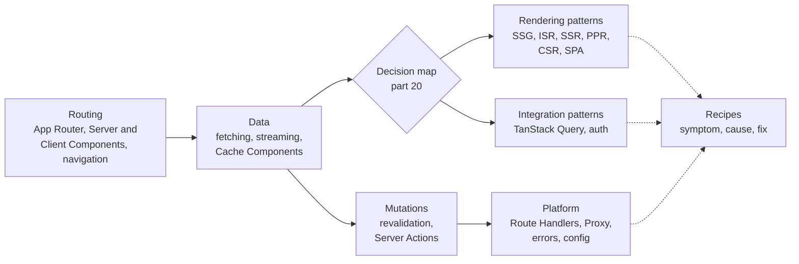

# Next.js in Practice

Next.js 16 changed a lot of what you thought you knew. Middleware is now `proxy.ts`, `params` and `cookies()` are only async, Turbopack is the default bundler, and caching is opt-in through Cache Components, `'use cache'` and tags. This course explains how the framework actually works today, and then how to build real things with it: which rendering strategy to pick, how to wire TanStack Query or an auth layer into the server model, and how to fix the errors you will meet.

It is written for working React developers who use Next.js, or are about to, and want reasons instead of rules of thumb. Every page is pinned to **Next.js v16.4.3** ([source on GitHub](https://github.com/vercel/next.js/tree/v16.4.3)), and every claim about how something works links to the exact lines at that tag, so you can check it and the line numbers stay true.

The course has three tracks:

- **Features** (parts 01 to 11): one built-in feature per part, how it works under the hood and how to use it well.
- **Patterns** (parts 20 to 28): complete strategies built from the features, from static generation to partial prerendering, client-only SPAs, TanStack Query and two styles of authentication.
- **Recipes** (parts 40 to 44): short entries that go from a symptom to its cause in the source to a fix.

> [!tip] How to read this
> If you are deciding how to build something, start with [[20 Rendering Strategies - A Decision Map|the rendering decision map]] and follow its links into the patterns. If you are new to the App Router, read parts 01 to 04 in order: each one builds on the last. If something is broken today, go straight to the recipe part for your problem and follow its links back into the features. The [[00 Next.js in Practice Index|index]] has a one-line summary of every part.

This course pairs with the two React courses in the vault. Next.js is built on React Server Components, Suspense and transitions, and when a part needs those it links to [[react-explain|React Internals]] (React 19 line by line) or [[react-concepts|How React Works]] (the same ideas in plain language) instead of re-explaining them.

## Parts

1. [[00 Next.js in Practice Index|Index: from request to pixels]]
2. [[01 The App Router - Files, Segments and Layouts|The App Router: files, segments and layouts]]
3. [[02 Server and Client Components|Server and Client Components]]
4. [[03 Linking, Navigation and Prefetching|Linking, navigation and prefetching]]
5. [[04 Data Fetching and Streaming|Data fetching and streaming]]
6. [[05 Cache Components - use cache, cacheLife and cacheTag|Cache Components: use cache, cacheLife and cacheTag]]
7. [[06 Revalidation - Tags, Paths and Refresh|Revalidation: tags, paths and refresh]]
8. [[07 Server Actions and Forms|Server Actions and forms]]
9. [[08 Route Handlers and Proxy|Route Handlers and Proxy]]
10. [[09 Metadata, Images, Fonts and Scripts|Metadata, images, fonts and scripts]]
11. [[10 Errors, Redirects and Request Lifecycle APIs|Errors, redirects and request lifecycle APIs]]
12. [[11 Configuration, Turbopack and Deployment|Configuration, Turbopack and deployment]]
13. [[20 Rendering Strategies - A Decision Map|Rendering strategies: a decision map]]
14. [[21 SSG and ISR - Static Pages and generateStaticParams|SSG and ISR: static pages and generateStaticParams]]
15. [[22 SSR - Rendering Per Request|SSR: rendering per request]]
16. [[23 PPR - Partial Prerendering with Cache Components|PPR: partial prerendering with Cache Components]]
17. [[24 CSR - Client-Rendered Islands|CSR: client-rendered islands]]
18. [[25 Fully Client-Side - SPA and Static Export|Fully client-side: SPA and static export]]
19. [[26 TanStack Query - Server Prefetch and Hydration|TanStack Query: server prefetch and hydration]]
20. [[27 Server-Aware Auth - Sessions, Proxy and the DAL|Server-aware auth: sessions, Proxy and the DAL]]
21. [[28 Client-Only Auth - Tokens in the Browser|Client-only auth: tokens in the browser]]
22. [[40 Recipes - Data, Caching and Revalidation|Recipes: data, caching and revalidation]]
23. [[41 Recipes - Routing and Navigation|Recipes: routing and navigation]]
24. [[42 Recipes - Rendering and Hydration Errors|Recipes: rendering and hydration errors]]
25. [[43 Recipes - Forms, Mutations and Uploads|Recipes: forms, mutations and uploads]]
26. [[44 Recipes - Performance, Config and Deployment|Recipes: performance, config and deployment]]

## The learning path

