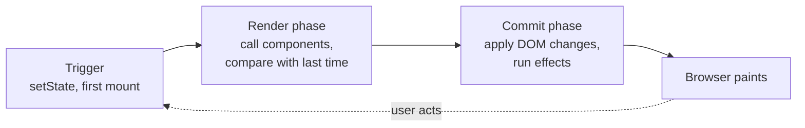

# The Big Idea: UI Is a Function of State

> [!summary] TL;DR
> In React you never say "change this text" or "add that row". You write a function that says what the UI should look like for the current state, and React works out what has to change on the screen. It does that in two phases: **render** (call your components to get a fresh description) and **commit** (apply the differences to the real DOM).

Every React developer has had the moment where something feels like magic. You call `setItems`, and a new row appears in the list. You never touched the list. You never found a DOM node, never called `appendChild`, never removed the "empty list" message. How did the screen know?

The answer is one idea, and the rest of this course is about how React makes it work.

## Two ways to build a UI

Imagine the shopping list app without React. The user types "Eggs" and clicks Add. With plain DOM code, you write the steps yourself:

```js
// imperative: you describe the steps
addButton.addEventListener("click", () => {
  const li = document.createElement("li");
  li.textContent = input.value;
  list.appendChild(li);
  input.value = "";
  counter.textContent = `${list.children.length} items`;
  emptyMessage.hidden = true;
});
```

This is **imperative** code: a list of instructions that move the screen from one state to the next. It works, but every new feature multiplies the transitions you have to get right. Toggling an item, deleting one, filtering the list: each one needs its own "from here to there" code, and each one has to remember to update the counter and the empty message. Forget one, and the screen quietly lies.

React asks for something different. You describe what the screen should be for any state, and you stop caring how it got there:

```jsx
function App() {
  const [items, setItems] = useState([{ id: 1, name: "Milk", done: false }]);
  const [text, setText] = useState("");
  return (
    <main>
      <Header count={items.length} />
      <AddItem
        text={text}
        onChange={setText}
        onAdd={() => {
          setItems([...items, { id: Date.now(), name: text, done: false }]);
          setText("");
        }}
      />
      <List
        items={items}
        onToggle={(id) =>
          setItems(items.map((i) => (i.id === id ? { ...i, done: !i.done } : i)))
        }
      />
    </main>
  );
}
```

This is **declarative** code. Nothing in it says "append a row". It says: given these `items`, the header shows this count and the list shows these rows. The click handler doesn't touch the screen at all. It only changes the data.

## UI = f(state)

The shortest way to say this is:

**UI = f(state)**

Your component is the `f`. Give it the same state and props, and it returns the same description of the UI. When the state changes, React calls `f` again, gets a new description, and makes the screen match.

This turns a hard problem into an easier one. Instead of writing every transition between every pair of states, you write one function that handles every state. The counter can't drift out of sync with the list, because both are computed from the same `items` every time.

> [!tip] Mental model
> Your component is a recipe, not a set of edits. React calls the recipe whenever the ingredients (state, props, context) might have changed, and takes care of turning "the new result" into "the edits the DOM needs".

The analogy has a limit worth knowing now: `f` is not *quite* a pure math function. Components hold state through hooks, and they schedule side effects. React handles both in a controlled way, which later parts explain. During the call itself, though, your component should behave like a pure function. [[03 What Rendering Really Means|Part 3]] explains why that matters so much.

## The division of labour

React splits the work between you and itself:

- **You describe.** Your components return a description of the UI for the current state. You decide *what* should be on screen.
- **React reconciles.** It compares the new description with what it produced last time and works out what actually changed. This is called **reconciliation**.
- **React commits.** It applies just those changes to the real DOM, then runs the effects that asked to run after the update.

You own the first step. React owns the other two. That is why React code rarely calls DOM APIs: the DOM is React's responsibility, and when you touch it directly you are working around the model, sometimes for good reasons (focus, measuring, third-party widgets), but always deliberately.

## Render and commit: the two phases

Everything React does after a state change falls into two phases. You'll see these words in every part of this course, so it pays to pin them down now.



**Render** means React calls your components to get a fresh description and compares it with the previous one. Nothing on the screen changes during render. It is pure calculation, which is why React can, in some cases, pause it, throw it away, or do it again.

**Commit** means React takes the list of changes it found and applies them to the DOM: insert this node, update that attribute, remove that row. Then it runs your effects. Commit is never paused halfway, because a half-applied update would show the user a broken screen.

The word "render" trips people up because in everyday speech it means "draw on the screen". In React it doesn't. Rendering is calling your function. Drawing pixels is the browser's job, after commit. Keeping those apart solves a lot of confusion, and [[03 What Rendering Really Means|part 3]] is all about it.

## What React is not

A few popular beliefs about React are wrong, and they get in the way of the real model.

### It is not fine-grained reactivity

Signal-based libraries (Solid, Svelte 5 runes, Preact Signals) track exactly which piece of the DOM depends on which piece of data, and update only that piece when the data changes. React does not do that.

When state changes, React re-runs the **whole component** that owns the state, and by default the components it renders too. It doesn't know which line of your JSX used `items.length`. It finds out what changed by calling your function again and comparing the result. That is a deliberate trade: your components stay plain JavaScript functions with no special reactive values, and React pays for it by doing more work per update. Memoization and the React Compiler, covered in [[11 Memoization and the React Compiler|part 11]], exist to cut that work back down.

### The "virtual DOM" is not a speed trick

You may have heard that React is fast "because of the virtual DOM". That is backwards. Building a description, comparing it with the previous one, and then touching the DOM is *more* work than a hand-written `li.textContent = "Eggs"`. A careful imperative update will usually beat React.

What the comparison buys you is **correctness with little effort**: you write declarative code that handles every state, and React keeps DOM writes down to what actually changed. It makes the declarative style affordable. It doesn't make it free, and it doesn't make it faster than doing the minimal work by hand.

The React team itself doesn't lean on the term "virtual DOM" much any more. The descriptions are called **elements**, and React's working copy of your tree is made of **fibers**. Both get their own part.

> [!warning] Fewer DOM writes is not the same as less work
> React avoids unnecessary DOM changes, but it still calls your components to find that out. A component that does something expensive during render pays that cost on every re-render, even when the DOM ends up untouched.

## The road ahead

Each part takes one piece of the render → commit loop and opens it up:

1. **The big idea** (this part): UI = f(state), render and commit.
2. **Elements, components and the tree**: what JSX turns into and the three trees React deals with.
3. **What rendering really means**: what triggers a render and why it must be pure.
4. **State updates**: why state is a snapshot and how batching works.
5. **Reconciliation**: how React compares old and new and what keys are for.
6. **Fiber**: the data structure that lets React pause work.
7. **Priorities and transitions**: why some updates can wait.
8. **The commit phase and effects**: when the DOM changes and when your effects run.
9. **Hooks**: where state lives and why call order matters.
10. **Events**: one listener at the root, and how a click becomes a priority.
11. **Memoization and the React Compiler**: how React skips work.
12. **A click, start to finish**: everything above, in one replay.

## Common misconceptions

- **"React updates only the parts of the page that use the changed data"**: React re-runs the component that owns the state and, by default, its children, then compares results. Only the DOM writes are minimal, not the work to find them.
- **"The virtual DOM makes React faster than plain DOM code"**: comparing descriptions costs extra. It lets declarative code stay reasonably fast, not faster than careful hand-written updates.
- **"Render means drawing on the screen"**: rendering is React calling your components. The DOM changes in commit, and the browser paints after that.
- **"In React you shouldn't think about the DOM at all"**: you describe the UI declaratively, but some jobs (focus, measurement, integrating non-React widgets) still need the real DOM, through refs and effects.

## Summary

React's core idea is that UI is a function of state: you write components that describe what the screen should look like, and React handles moving the real DOM from the old description to the new one. It does this in two phases, render (call your components and compare the result with last time) and commit (apply the changes and run effects). React re-runs whole components rather than tracking each data dependency, and its comparison step buys correctness at an acceptable cost, not raw speed. Next, [[02 Elements, Components and the Tree|part 2]] looks at what a "description of the UI" actually is.

### Key takeaways

- **Declarative UI**: you describe what the screen should be for any state, not the steps to change it.
- **UI = f(state)**: a component maps state and props to a description of the UI, so derived values can't drift out of sync.
- **Division of labour**: you describe, React reconciles (finds what changed) and commits (applies it).
- **Render phase**: React calls your components and compares results; nothing on screen changes.
- **Commit phase**: React applies the changes to the DOM in one go, then runs effects.
- **Not fine-grained**: React re-runs components to find changes instead of tracking which DOM node depends on which value.
- **Not a speed trick**: the comparison makes declarative code affordable, not faster than minimal hand-written DOM updates.

**Go deeper:** [[00 React Internals Index|React Internals: from createRoot to pixels]]

---

← [[react-concepts|Prev]] · [[react-concepts|Index]] · [[02 Elements, Components and the Tree|Next]] →
