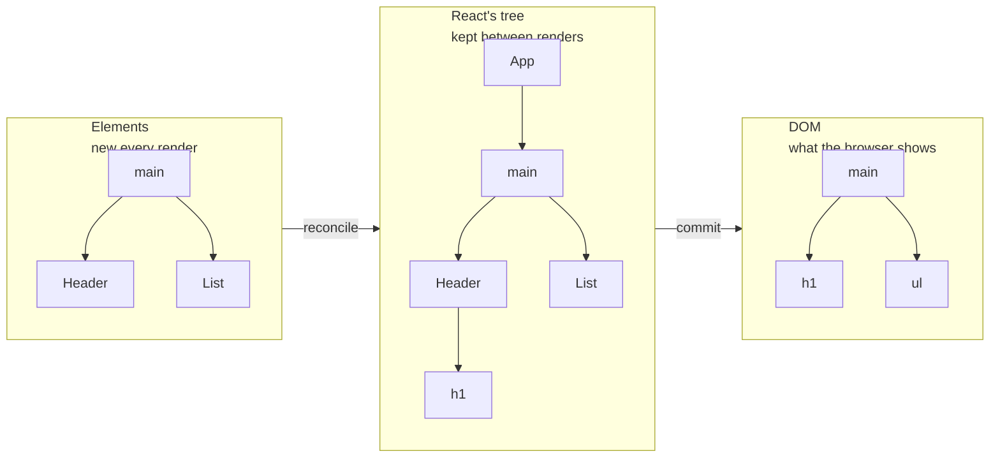
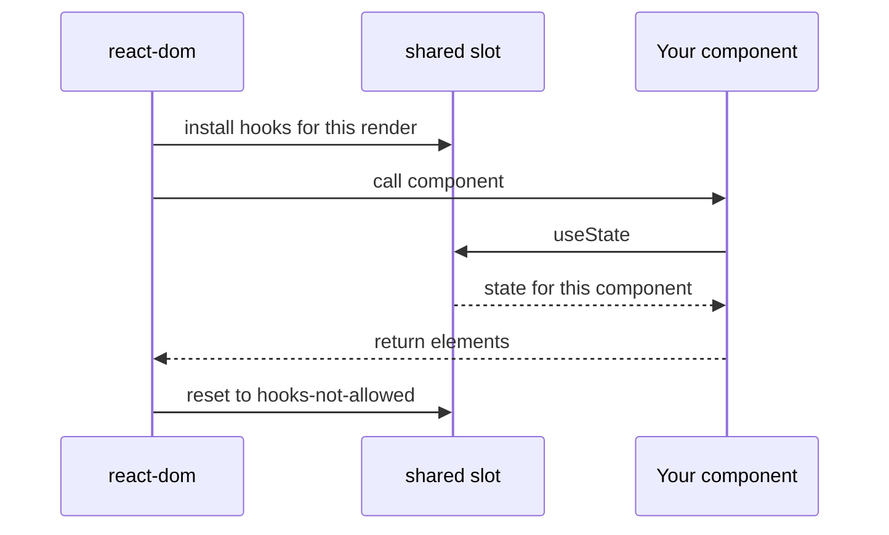

# Elements, Components and the Tree

> [!summary] TL;DR
> JSX is just a function call that returns a small, immutable object called an **element**: a type, props and a key. Components are functions that return elements, and React (not you) calls them. React keeps its own long-lived tree to match each fresh description to what is already on screen, and the renderer you install, `react-dom`, is what plugs that machinery into the `react` package you import.

[[01 The Big Idea - UI Is a Function of State|Part 1]] said your component returns "a description of the UI". That phrase hides a question most developers never ask: what exactly *is* `<Header count={2} />`? It isn't a DOM node. It isn't a component instance. You can log it, store it in a variable, pass it around. So what is it, and how does React turn it into a heading on the page?

## JSX is a function call

Browsers don't understand JSX. Your build tool compiles it away before the code runs. Since React 17, the default output (the "automatic runtime") calls a function named `jsx` from `react/jsx-runtime`. React 19 requires this runtime.

```jsx
// what you write
<Header count={items.length} />

// roughly what the compiler emits
import { jsx as _jsx } from "react/jsx-runtime";
_jsx(Header, { count: items.length });
```

Children go into the props object, and a `key`, if you write one, is passed as a separate argument:

```jsx
// what you write
<Item key={item.id} item={item} onToggle={onToggle} />

// roughly what the compiler emits
_jsx(Item, { item: item, onToggle: onToggle }, item.id);
```

You may have seen `React.createElement(type, props, ...children)` in older tutorials. It does the same job with a different calling convention. Either way, the point is the same: **JSX is ordinary JavaScript that builds a value.** There's no template language, no magic. That's why you can use `map`, `&&` and ternaries inside it: they're just expressions producing arguments.

## Elements are plain objects

What does `_jsx` return? A small object. In production it looks roughly like this:

```js
{
  $$typeof: Symbol.for("react.transitional.element"),
  type: Header,            // a function, or a string like "li"
  key: null,               // string or null
  props: { count: 1 },     // includes children (and ref, in React 19)
}
```

That's an **element**. Four things matter:

- **`type`** says what to render. A string like `"main"` or `"li"` means a host element (a DOM node in the browser). A function like `Header` means a component.
- **`props`** holds everything you passed, including `children`. In React 19, `ref` is also just a prop.
- **`key`** is an identity hint for lists. React pulls it out of props, which is why a component can't read `props.key`. [[05 Reconciliation - Finding What Changed|Part 5]] explains what it is used for.
- **`$$typeof`** is a Symbol that marks the object as a genuine React element. JSON can't contain Symbols, so a malicious JSON payload can't pretend to be an element.

Elements are **cheap and immutable**. Every render creates a fresh batch of them, and they are thrown away soon after. In development React even freezes them, so mutating `element.props` throws. You never update an element. You make a new one.

> [!tip] Mental model
> An element is a lightweight note that says "put a `Header` here with `count: 1`". It describes, it doesn't do. Writing the note is cheap, and React writes a fresh set of notes on every render.

## Components are functions that return elements

A component is a function that takes props and returns elements:

```jsx
function Header({ count }) {
  return <h1>Shopping list ({count})</h1>;
}

function List({ items, onToggle }) {
  return (
    <ul>
      {items.map((item) => (
        <Item key={item.id} item={item} onToggle={onToggle} />
      ))}
    </ul>
  );
}
```

Notice what `App` does *not* do: it never calls `Header(...)`. It creates an element whose `type` is `Header`. Calling the function is React's job, and React decides when. That separation is what makes the rest of React possible. Because React does the calling, it can set things up beforehand (which component is rendering, where its state lives), skip the call when nothing changed, or call it again later.

> [!warning] Don't call components as functions
> `{Header({ count })}` will appear to work, but `Header` is then just part of the parent's code. It has no place of its own in React's tree, so any hooks it calls would belong to the parent, and React can't skip it or keep its state separately. Always render components as `<Header count={count} />`.

## Three trees, not one

When people say "the React tree", they mean one of three different things. Keeping them apart clears up a lot of confusion.



1. **The element tree.** What your components return on a given render. It's partial: `App` returns elements for `main`, `Header`, `AddItem` and `List`, but not for the `h1` inside `Header`, because `Header` hasn't been called yet. It's rebuilt from scratch every time.
2. **React's internal tree.** One node for every mounted component and every host element. It lives as long as the component stays on screen, and it's where state, hooks and pending work are stored. React calls these nodes **fibers**, and [[06 Fiber - Work You Can Pause|part 6]] is about them. Your components appear in this tree; in the DOM they leave no trace.
3. **The DOM tree.** Only host elements: `main`, `h1`, `ul`, `li`. `App`, `Header` and `List` don't exist in the DOM at all.

The element tree is the *input*. React's tree is the *memory*. The DOM is the *output*. Rendering walks React's tree, calls your components to get fresh elements, and updates the tree to match. Commit then copies the changes into the DOM.

This also explains where state lives. It can't live in elements, because elements are new every render. It can't live in your function, because a function call ends. It lives in React's tree, on the node for that component instance, which survives from one render to the next.

## react and react-dom: describing vs doing

You install two packages, and they have very different jobs.

**`react`** is small. It contains `jsx`, `useState`, `memo`, `createContext`, `startTransition` and friends. It knows nothing about the DOM, nothing about fibers, nothing about how rendering works. It is mostly the vocabulary for describing UI.

**`react-dom`** is a **renderer**. It contains the actual machinery: the reconciler that walks React's tree, the scheduler integration, and the code that creates and updates DOM nodes. Other renderers (React Native, or `react-three-fiber` for 3D scenes) carry the same kind of machinery but create native views or 3D objects instead of DOM nodes.

This split is why one component model works on many platforms. Your `Header` returns `<h1>` and has no idea who will turn that into something visible.

## Where hooks get their power

That split raises a puzzle. `useState` comes from `react`, and `react` knows nothing about rendering. So how does `useState` find the right component's state?

Conceptually, `react` keeps a shared slot for "the current hooks implementation", often called the **dispatcher**. The `useState` you import is a thin forwarder: it looks in that slot and calls whatever it finds there.

```js
// simplified pseudocode, not real source
function useState(initial) {
  const dispatcher = shared.currentDispatcher;
  return dispatcher.useState(initial);
}
```

Right before React calls one of your components, the renderer puts its own hooks implementation into that slot, one for the first render (mount) and one for later renders (update). When your component returns, the slot is switched to a version that throws if you call a hook.



That one design explains the error everyone has seen at least once, "Invalid hook call":

- You called a hook outside a component's render, for example in an event handler, so the slot held no working hooks implementation.
- Or your bundle contains **two copies** of React. The renderer filled the slot in one copy, and your component imported `useState` from the other, whose slot was never filled.

## Common misconceptions

- **"JSX creates DOM nodes"**: JSX creates plain element objects. DOM nodes are created later, by the renderer, during commit.
- **"An element is a component instance"**: an element is a throwaway description. The long-lived thing that holds state is React's internal node for that component.
- **"React re-creates the DOM every render because elements are new every time"**: new elements are compared against React's tree, and only real differences reach the DOM.
- **"`useState` is wired to your component when you import it"**: the imported function only forwards to whatever hooks implementation the renderer installed for the component currently rendering.

## Summary

JSX compiles to `jsx` calls that return small, immutable element objects with a `type`, `props` and `key`, recreated on every render. Components are functions that return elements, and React calls them, which is what lets it manage state, skip work and re-run code. Keep three trees apart: the throwaway element tree, React's long-lived internal tree where state lives, and the DOM, which contains only host elements. The `react` package describes, a renderer like `react-dom` does the work, and hooks reach the renderer through a shared slot it fills just before your component runs. [[03 What Rendering Really Means|Part 3]] looks at exactly when and why React calls your components.

### Key takeaways

- **JSX**: compiles to `jsx(type, props, key)` calls from `react/jsx-runtime`; it's ordinary JavaScript building values.
- **Elements**: plain objects with `type`, `props`, `key` and a `$$typeof` Symbol; immutable and recreated every render.
- **Components**: functions from props to elements, called by React, never by you.
- **Three trees**: the element tree is input, React's internal tree is memory, the DOM is output.
- **State location**: state lives on React's long-lived node for a component instance, not in elements or in your function.
- **Renderers**: `react` is the vocabulary; `react-dom` contains the reconciler and the DOM code.
- **Dispatcher**: hooks forward to an implementation the renderer installs right before your component runs, which is why hooks fail outside render or with two copies of React.

**Go deeper:** [[01 Bootstrap - Packages, JSX and the Dispatcher|Bootstrap: packages, JSX and the dispatcher]] · [[05 The Fiber Data Structure|The fiber data structure]]

---

← [[01 The Big Idea - UI Is a Function of State|Prev]] · [[react-concepts|Index]] · [[03 What Rendering Really Means|Next]] →
