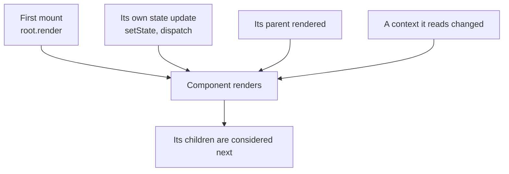
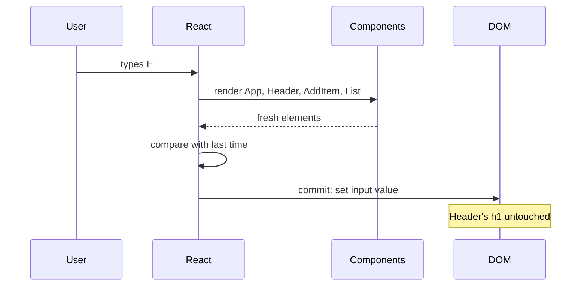

# What Rendering Really Means

> [!summary] TL;DR
> A render is React calling your component function to get fresh elements. Four things trigger one: the first mount, a state update, a parent re-rendering, and a context change. Renders must be pure because React may call your component more than once or throw the result away, and a re-render only changes the DOM if the commit finds real differences.

"My component re-renders too often." Every React developer has said it, usually after adding a `console.log` and watching it fire on every keystroke. But what is a re-render, exactly? Is it slow? Does it touch the DOM? And why does `Header` re-render when you type into the input, even though its props have nothing to do with the text field?

## Rendering is calling your function

Strip away the jargon and a render is this: React calls your component with its current props, your function runs top to bottom, and it returns elements. That's it.

```jsx
function Header({ count }) {
  console.log("Header rendered");
  return <h1>Shopping list ({count})</h1>;
}
```

Every time `"Header rendered"` appears in the console, React called `Header`. It doesn't mean anything changed on screen. It means React asked `Header` for an up-to-date description.

When React renders a component, it then looks at the elements that component returned and continues into its children: it renders those children too, unless it can prove a child doesn't need it (more on that below). So a render starts at some component and **flows down** through the tree.

## The four triggers

A component renders for one of four reasons.



**1. The first mount.** `createRoot(container).render(<App />)` starts everything. React calls `App`, then every component under it, and builds the DOM for the first time.

**2. A state update.** Calling a state setter (from `useState`, `useReducer`, or a store subscription via `useSyncExternalStore`) schedules a render of the component that owns that state. Note the word *owns*: calling `setItems` re-renders `App`, because `App` called `useState`, no matter which child invoked the setter.

**3. The parent rendered.** When `App` renders, it returns new elements for `Header`, `AddItem` and `List`. By default React renders those children too. This is the one that surprises people. Typing in the input calls `setText`, which renders `App`, which renders `Header`, even though `Header`'s `count` didn't change.

**4. A context changed.** If a component reads a context with `useContext` (or `use`) and the provider's `value` changes, that component renders, even if everything between it and the provider was skipped.

Notice what is *not* on the list: props changing on their own. Props never change spontaneously. They change because a parent rendered and passed something new, which is trigger 3.

> [!tip] Mental model
> A render starts at the component whose state changed and flows downward, re-running each component below it unless React can prove that component's input is exactly the same as last time.

## Why rendering must be pure

React has one rule for the code that runs during render: **it must be pure**. Given the same props, state and context, it must return the same elements, and it must not change anything outside itself. No mutating objects you didn't create during this render, no network requests, no writing to `document`, no `setTimeout`.

The reason is not style. It's that React reserves the right to call your component in ways you don't see:

- **More than once.** In development, `<StrictMode>` deliberately calls your components twice per render to flush out impure code. If double-calling breaks something, the render was impure.
- **And then throw it away.** With concurrent features (transitions, Suspense), React can start rendering, get interrupted by something more urgent, and discard the half-finished work. Your function ran, but its result never reached the screen.
- **Again, later.** A render that was discarded, or that suspended while waiting for data, may be retried from scratch.

```jsx
let renderCount = 0;

function List({ items }) {
  renderCount++;              // impure: mutates something outside the render
  items.sort(byName);         // impure: mutates a prop React may still be using
  return <ul>{/* ... */}</ul>;
}
```

Both lines break the rule. `renderCount` will count renders that never committed, and `items.sort` mutates an array that belongs to the parent's state. Sort a copy instead (`[...items].sort(byName)` or `items.toSorted(byName)`).

Anything that must happen exactly once per update that actually reached the screen belongs in an **event handler** (if the user caused it) or an **effect** (if it should follow a commit). [[08 The Commit Phase and Effects|Part 8]] covers effects.

> [!warning] StrictMode double rendering is development-only
> Production never calls your component twice for one render. If something only misbehaves in development, StrictMode is probably showing you an impurity that production would hit more rarely, for example when a transition render gets interrupted.

## Render vs commit

[[01 The Big Idea - UI Is a Function of State|Part 1]] introduced the two phases. Here is the line between them, drawn for a single keystroke in the shopping list:



During **render**, React calls components and compares results. During **commit**, it applies only the differences. `Header` rendered, but its `<h1>` text is the same as before, so commit doesn't touch it.

## Re-render does not mean DOM update

This is the single most useful thing to internalize from this part. A re-render is a function call plus a comparison. A DOM update happens only when the comparison finds a difference.

That cuts both ways:

- **Re-renders are usually cheap.** A component that returns a few elements costs microseconds to call. Rendering `Header` on every keystroke is fine.
- **Re-renders are not free.** If a component does expensive work during render (filtering 10,000 items, formatting dates in a big table), that work runs on every render, even when the DOM ends up unchanged.

So the question is rarely "how do I stop all re-renders?" It's "is any render doing expensive work, or rendering a large subtree, that it doesn't need to?"

## Bailouts: when React skips a component

React doesn't blindly re-run everything. For each component it reaches during a render, it asks a quick question: can I reuse last time's result? Conceptually, it skips calling the component when:

- the props object is **the same object** as last time (a reference check, not a deep compare),
- the component has **no pending state update** of its own, and
- no **context** it reads has changed.

If all three hold, React skips the call. It doesn't stop there, though: if a component deeper down has its own pending update, React keeps walking toward it. If nothing below has work either, React skips the whole subtree at once.

Here is the catch. When `App` renders, the JSX `<Header count={items.length} />` creates a **new props object**, even if `count` is unchanged. Same values, different object, so the reference check fails and `Header` renders. That's why trigger 3 exists: children of a re-rendering parent almost always get fresh props.

The bailout does kick in when the parent did *not* render. Suppose each `Item` kept its own `editing` state. Calling `setEditing(true)` in one `Item` schedules a render for that `Item` only. React walks down from the root, skips `App`, `Header`, `AddItem` and `List` without calling them (their props objects are the same as last time, and they have no updates of their own), renders the one `Item`, and leaves the other items alone.

`React.memo` changes the check for one component from "same props object" to "same props, compared key by key". The React Compiler goes further by reusing the very same element objects when inputs haven't changed. Both are covered in [[11 Memoization and the React Compiler|part 11]].

> [!warning] Setting the same state can still render once
> If you call a setter with a value equal to the current one (`Object.is`), React often skips the render entirely. But not always: in some cases it calls your component, sees nothing changed, and throws the result away before touching the children. Don't rely on "no render at all" for correctness.

## Common misconceptions

- **"A re-render means the DOM was updated"**: a re-render is a function call plus a comparison. The DOM changes only where the comparison found differences.
- **"A component re-renders when its props change"**: props only change because the parent rendered, and by default children render whenever their parent does, even if props are equal.
- **"Re-renders are always a performance problem"**: most renders are cheap. The problem is expensive work during render, or large subtrees rendering for no reason.
- **"My component only runs when it is going to be shown"**: React may call it twice in development, or run it and then discard the result, so render code must be pure.

## Summary

Rendering is React calling your component to get fresh elements, then continuing into its children. Four things trigger it: the first mount, a state update in the component, its parent rendering, and a context it reads changing. React may call a component more than once or discard the result, which is why render code must be pure and side effects belong in handlers and effects. A re-render does not imply a DOM update, and React skips components whose props object, own state and context are all unchanged, a check fresh JSX props usually fail. [[04 State Updates - Snapshots and Batching|Part 4]] looks at what actually happens when you call a setter.

### Key takeaways

- **Rendering**: React calls your function and gets elements back; nothing on screen changes yet.
- **Four triggers**: first mount, own state update, parent render, changed context; props never change on their own.
- **Flows down**: a render starts at the component whose state changed and continues into its children.
- **Purity**: React may call components twice (StrictMode, development only), discard renders, or retry them.
- **Render vs commit**: render calculates, commit applies only the differences to the DOM.
- **Re-render is not a DOM update**: calls are usually cheap; expensive work during render is the real cost.
- **Bailouts**: same props object, no own update and unchanged context let React skip a component, and clean subtrees are skipped whole.
- **Fresh props**: every JSX call creates a new props object, so a re-rendering parent re-renders its children unless memoized.

**Go deeper:** [[06 The Work Loop - Render Phase|The work loop: render phase]] · [[20 Walkthrough - First Render End to End|Walkthrough: first render end to end]]

---

← [[02 Elements, Components and the Tree|Prev]] · [[react-concepts|Index]] · [[04 State Updates - Snapshots and Batching|Next]] →
