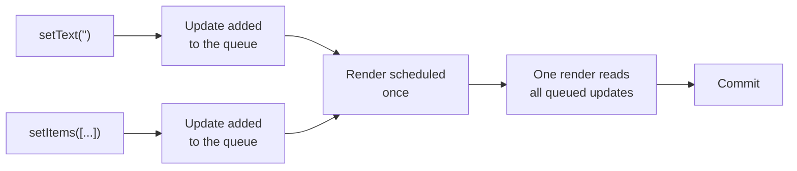
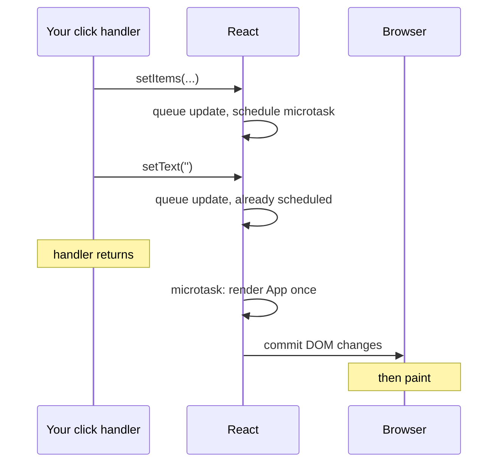

# State Updates: Snapshots and Batching

> [!summary] TL;DR
> State inside a render is a snapshot: a constant that never changes for the life of that render. Calling a setter doesn't change it; it **queues an update** and asks React for a new render. React batches every update made in the same event into one render, which for a click runs right after your handler returns.

Here is a bug almost every React developer writes once:

```jsx
function handleAdd() {
  setText("");
  console.log(text); // still the old text. Why?
}
```

You just set `text` to `""`, and the next line says it's still `"Eggs"`. It feels as if `setText` is "async" and hasn't finished yet. That's not quite what's going on, and the real explanation makes a whole family of puzzles go away.

## State is a snapshot

Look at the shopping list's `App` again:

```jsx
function App() {
  const [items, setItems] = useState([{ id: 1, name: "Milk", done: false }]);
  const [text, setText] = useState("");
  // ...
}
```

`text` is declared with `const`. It's a local variable of *this call* of `App`. When React renders `App`, it hands you the current value, and that value stays fixed until the function returns. Every handler you create during that render closes over the same `text`.

So during one render, `text` is a **snapshot**: a photo of the state at the moment React called your component. `setText("")` can't reach into that photo and change it. It's a `const`, and JavaScript wouldn't allow it even if React wanted to.

The new value shows up in the **next render**, as a new `text` in a new call of `App`, with new handlers that close over it.

> [!tip] Mental model
> Each render is a frame of film. State, props and every handler in that frame belong to it and never change. A setter doesn't edit the current frame; it asks React to shoot the next one.

## A setter queues an update

So what does `setText("")` actually do? Roughly three things, all synchronously, before it returns:

1. It creates a small **update** object that says "set this state to `""`".
2. It adds the update to a **queue** that belongs to this piece of state, stored in React's tree next to the component (see [[02 Elements, Components and the Tree|part 2]]).
3. It tells React that this component needs to render, and React schedules that render for later.

The update is recorded immediately. What's deferred is the **render** that will read it. That's why "setState is async" is misleading: nothing is waiting on a promise, and there is nothing to `await`. It's better described as **queued and batched**.



## Values vs updater functions

A setter accepts either a new value or a function. The difference matters as soon as you queue more than one update for the same state.

Suppose you add a "quick add" button that adds two items at once:

```jsx
function quickAdd() {
  setItems([...items, { id: 1001, name: "Bread", done: false }]);
  setItems([...items, { id: 1002, name: "Butter", done: false }]);
}
```

Only Butter appears. Both lines read the same snapshot of `items`, so the second update says "replace the list with the old list plus Butter", overwriting the first.

Pass an **updater function** instead, and React applies the updates in order, each one receiving the result of the previous:

```jsx
function quickAdd() {
  setItems((prev) => [...prev, { id: 1001, name: "Bread", done: false }]);
  setItems((prev) => [...prev, { id: 1002, name: "Butter", done: false }]);
}
```

During the next render, React walks the queue: start from the current list, apply the first updater, then the second. Both items land.

The rule of thumb: **if the new state depends on the old state, use an updater.** A plain value is fine when you're replacing state outright, like `setText("")`.

> [!warning] Updaters must be pure
> React may run your updater right when you call the setter (to check whether anything changed) or later, during the next render, and in development StrictMode may call it twice. Don't put side effects (logging analytics, mutating `prev`) inside it.

## Automatic batching

Look at the add handler in the running example:

```jsx
onAdd={() => {
  setItems([...items, { id: Date.now(), name: text, done: false }]);
  setText("");
}}
```

Two setters, two pieces of state. Yet `App` renders **once**, not twice. That's **batching**: React collects every update queued during the same event and processes them all in a single render.

There's no special "batch" mode you have to enter. Batching falls out of how scheduling works: the first setter asks React to schedule a render, and later setters find a render already scheduled, so they just add their updates to the queue. When the render runs, it sees all of them.

Since React 18 (with `createRoot`), this works **everywhere**: in React event handlers, in `setTimeout` callbacks, in promise callbacks after `await fetch(...)`, and in listeners you attached yourself with `addEventListener`. Before React 18, only updates inside React event handlers were batched, and two setters in a `setTimeout` caused two separate renders.

## When does the render actually happen?

For a click, a key press, or another discrete user event, the answer is: **right after your handler finishes**, before the browser gets a chance to paint.

When you call the first setter, React schedules its work in a **microtask**, the same queue a resolved promise uses. Microtasks run as soon as the current JavaScript finishes executing. So your handler runs to completion first, every setter queues its update, and only then does the microtask run. For updates from discrete events like a click, React then renders and commits right there, synchronously, inside that microtask.



Updates from less urgent sources (a timer, a network response) are still batched, but React gives them a lower priority and renders them in a scheduled task shortly after rather than in the microtask. Updates inside `startTransition` get lower priority still. [[07 Priorities, Transitions and Concurrency|Part 7]] explains how priorities work.

This also explains the opening puzzle. `console.log(text)` runs inside your handler, before the microtask, so no new render has happened yet. And even after it happens, *this* handler's `text` is still the old snapshot. The new value lives in the next render's closure.

## Setting the same value

If you call a setter with a value that is the same as the current state, React can skip the render. "The same" means `Object.is`, which for objects means **the same reference**, not the same contents.

```jsx
setText(text);                 // same string: React can skip the render
setItems(items);               // same array: React can skip the render
setItems([...items]);          // new array, same contents: renders
```

This is why mutating state and then setting it doesn't work:

```jsx
items.push(newItem);
setItems(items);               // same reference: React sees "no change"
```

React sees the same array it already has and bails out, and your mutation is invisible. Always create a new object or array.

As [[03 What Rendering Really Means|part 3]] warned, "can skip" isn't "always skips". Sometimes React has to call your component before it can tell nothing changed, and then throws the result away without rendering the children.

## flushSync: the escape hatch

Occasionally you need the DOM to reflect an update *right now*, on the next line of your handler. The classic case is scrolling to a newly added item:

```jsx
import { flushSync } from "react-dom";

function handleAdd() {
  flushSync(() => {
    setItems((prev) => [...prev, { id: Date.now(), name: text, done: false }]);
  });
  listRef.current.lastElementChild.scrollIntoView(); // new row is in the DOM
}
```

`flushSync` makes React render **and commit** the updates inside the callback before `flushSync` returns, instead of waiting for the microtask. It's a deliberate de-optimisation: it forces an extra synchronous render and works against batching. Reach for it only when you need the DOM updated before your next line, for scrolling, focus or measuring.

## The stale closure gotcha

Snapshots have a famous side effect. Anything that holds on to a handler or callback from an old render keeps seeing that render's state.

```jsx
function AddItem({ text, onAdd }) {
  function handleSlowAdd() {
    setTimeout(() => {
      console.log(`Adding ${text}`); // text from the render that created this
      onAdd();
    }, 2000);
  }
  // ...
}
```

If the user keeps typing during those two seconds, the timeout still logs the old `text`, and the `onAdd` it calls is also from the old render, so it adds the old text. The callback is a closure over a frame of film that has already been replaced.

Effects and intervals have the same problem when they capture state and aren't recreated. The fixes depend on what you need:

- **Updater functions** when you only need the latest state to compute the next state: `setItems(prev => ...)` never sees a stale `items`.
- **A ref** when a long-lived callback must read the latest value: refs are a mutable box that every render shares.
- **`useEffectEvent`** for logic inside an effect that should read the latest props and state without re-running the effect.

## Common misconceptions

- **"setState is async"**: the update is queued synchronously during the call. What's deferred is the render, and there is no promise to `await`.
- **"After `setX(5)`, `x` is 5"**: `x` is a constant snapshot for the current render. The new value only exists in the next render.
- **"Two setters mean two renders"**: since React 18, every update from the same event is batched into one render, including updates in timeouts and promise callbacks.
- **"`setItems(items)` after `items.push()` will re-render"**: `Object.is` sees the same array and React can skip the render. Create a new array.

## Summary

State in React is a snapshot: each render gets constant values, and the handlers created during that render keep seeing them. A setter doesn't change the variable; it queues an update and schedules a render, and updater functions let queued updates build on each other. React batches every update from one event into a single render, which for a click runs in a microtask right after your handler returns, and `Object.is` equality lets it skip work when nothing changed. `flushSync` forces an immediate commit when you need it, and stale closures are the price of snapshots. [[05 Reconciliation - Finding What Changed|Part 5]] follows the render that all of these updates trigger, and how React compares old and new.

### Key takeaways

- **Snapshot**: state, props and handlers are fixed for the life of one render.
- **Setters queue**: a setter records an update immediately and schedules a render; the variable never changes in place.
- **Updater functions**: `setX(prev => ...)` chains queued updates; use one whenever the new state depends on the old.
- **Automatic batching**: all updates from the same event produce one render, in handlers, timeouts, promises and native listeners alike.
- **Timing**: a click's updates render and commit in a microtask right after the handler returns, before paint; less urgent updates render a little later.
- **`Object.is` bailout**: setting the same reference can skip the render, which is why mutating state and setting it fails.
- **`flushSync`**: renders and commits immediately for scroll, focus or measuring, at the cost of batching.
- **Stale closures**: old callbacks see old snapshots; use updaters, refs or `useEffectEvent`.

**Go deeper:** [[12 setState - dispatchSetState and Batching|setState: dispatchSetState and batching]] · [[11 Hooks on Update|Hooks on update]]

---

← [[03 What Rendering Really Means|Prev]] · [[react-concepts|Index]] · [[05 Reconciliation - Finding What Changed|Next]] →
