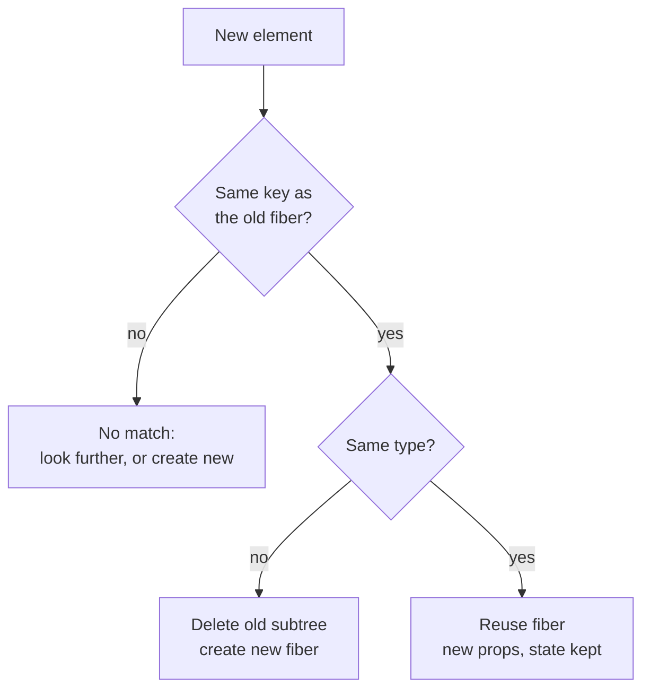

# Reconciliation - Finding What Changed

> [!summary] TL;DR
> React doesn't compute the minimal difference between two trees. It walks the new elements next to the old fibers and applies two cheap rules: a different type means "throw away and rebuild", and a key says which old child a new child is among its siblings. When an element is matched, its fiber, its state and its DOM node are kept. Whatever changed gets marked with flags, and the commit applies them later.

Your shopping list re-renders. `App` returns a fresh tree of elements: a `<main>`, a `<Header>`, an `<AddItem>`, a `<List>` with three `<Item>`s. Last time it returned almost the same tree. React has to work out what to keep, update or destroy, on every render, without becoming the slow part of your app.

That comparison is called **reconciliation**. Its rules explain three things you have probably run into: why your component's state sometimes resets for no visible reason, why the key warning exists, and why `key={index}` can make an input show the wrong text.

## Why not just diff the trees?

Computer science has a general answer to "what is the smallest set of edits that turns tree A into tree B?". The known algorithms cost about O(n³). For a UI with 1,000 nodes that is a billion operations per render. Nobody wants that.

React gives up on the *minimal* answer and settles for a good-enough one that is roughly linear. It makes two assumptions:

1. **Two elements of different types produce different trees.** If a `<div>` became a `<section>`, or `<Item>` became `<EditableItem>`, React doesn't look for similarities inside. It tears the old subtree down and builds the new one.
2. **Keys identify children among siblings.** When a parent renders a list, the `key` tells React which new child corresponds to which old child, even if they changed position.

Both are almost always right for real UIs, and when they aren't, `key` lets you correct them.

## What React actually compares

React does not compare old JSX with new JSX. The old side is the **fiber tree**: the long-lived objects React keeps for every mounted component and DOM node (see [[02 Elements, Components and the Tree|Elements, Components and the Tree]]). The new side is the fresh elements your component just returned.

For each parent, React goes through the new child elements and asks of each one: is there an old fiber here that this element *is*?



When both key and type match, React **reuses the fiber**. It gets the new props, but it keeps its hook state and its DOM node. That reuse is the entire point. Keeping the DOM node is what keeps an input's cursor, focus and scroll position. Keeping the fiber is what keeps your `useState` values.

When the type differs, React deletes the old fiber and everything below it, and creates new ones. All state in that subtree is gone, and all its DOM nodes are removed and recreated.

> [!tip] Mental model
> State doesn't live "in your component". It lives at a position in the tree, and React keeps it there as long as each render puts an element of the same type, with the same key, in that position.

## State lives at a position

That model explains a whole family of surprises. Consider a toggle in `App`:

```jsx
{editing ? <AddItem text={text} onChange={setText} /> : <AddItem text="" onChange={() => {}} />}
```

Both branches render `<AddItem>` in the same spot. Same type, same (absent) key, so React sees one component that got new props. Any local state inside `AddItem` survives the switch, even though you wrote two different JSX expressions.

Now the opposite:

```jsx
{editing ? <EditableHeader count={items.length} /> : <Header count={items.length} />}
```

Different types in the same spot. React destroys `Header`'s subtree and mounts `EditableHeader` from scratch. Any state inside is reset, and the DOM below it is rebuilt.

> [!warning] Don't define components inside components
> ```jsx
> function List({ items }) {
>   function Row({ item }) { return <li>{item.name}</li>; } // new function every render
>   return <ul>{items.map(i => <Row key={i.id} item={i} />)}</ul>;
> }
> ```
> `Row` is a brand-new function on every render of `List`, so its type never matches the previous one. Every row remounts on every render: state lost, DOM recreated. Move `Row` to the top level of the module.

## Keys: telling siblings apart

Without keys, React matches children by position: the first old child against the first new child, the second against the second, and so on. That works until the list changes shape. Your `List` renders:

```jsx
function List({ items, onToggle }) {
  return (
    <ul>
      {items.map(item => <Item key={item.id} item={item} onToggle={onToggle} />)}
    </ul>
  );
}
```

With `key={item.id}`, React can tell that "Milk" is still "Milk" after you insert "Eggs" in front of it. Conceptually it builds a lookup from key to old fiber for the children it couldn't match in order, and each new child finds its old self there. Matched fibers keep their state. Unmatched new children are created. Old fibers nobody claimed are deleted.

The algorithm has a fast path for the common cases: an unchanged list, items edited in place, or new items appended at the end. It only falls back to the key lookup when it hits a key mismatch. It also only walks forward, so some reorders cost more than you'd expect: moving the *last* item to the *front* makes React move every other item instead of moving one. It is still correct, just not minimal.

### Why index keys are a correctness bug

Suppose each `Item` holds a little local state, such as an uncontrolled `<input>` for a note:

```jsx
items.map((item, index) => <Item key={index} item={item} />)
```

Now prepend "Eggs" to `[Milk, Bread]`. The keys are positions, so:

| Key | Old fiber held | New element |
|---|---|---|
| 0 | Milk (note: "2 litres") | Eggs |
| 1 | Bread | Milk |
| 2 | (none) | Bread |

Key 0 matches key 0 with the same type, so React reuses Milk's fiber and gives it Eggs' props. The note "2 litres" now sits next to Eggs. The state stayed at the position while the data moved. Nothing crashed and nothing warned, but the screen is wrong.

Stable ids from your data (`item.id`) make keys follow the *item*. Use the index only for lists that never reorder, insert or delete, and never hold state per row.

## Using `key` on purpose to reset state

Since a different key means "this is a different child", you can use `key` outside lists, to tell React that something is a new thing:

```jsx
<ItemEditor key={selectedItem.id} item={selectedItem} />
```

When `selectedItem` changes, the key changes, so React discards the old `ItemEditor` (state, effects, DOM) and mounts a fresh one. This is the cleanest way to reset a form when the thing it edits changes, with no effect that copies props into state.

## The cheapest check: the same element object

Matching tells React *which* fiber a new element belongs to. It still has to decide whether that fiber needs to re-render. The first question is very cheap: **are the new props the same object as last time?**

Every JSX expression creates a new element with a new props object, so normally the answer is no. Even if every prop value is identical, the child renders again. That's why a state change in `App` re-renders `Header`, `AddItem` and `List` too. By default the whole subtree below the updated component re-renders.

But if a component returns *the very same element object* it returned last time, its props are the very same object. If that child also has no pending update of its own and no context it reads has changed, React skips it without calling it. If nothing below it is waiting for work either, React reuses the whole subtree as it is. You get that identity when:

- an element comes in from above as `children` and you render it unchanged,
- an element is cached with `useMemo`,
- the React Compiler caches JSX for you (see [[11 Memoization and the React Compiler|Memoization and the React Compiler]]).

`memo` is the other tool. It replaces the identity check with a shallow comparison of each prop, which a fresh inline function or object literal defeats.

## What gets written down: flags

Reconciliation doesn't touch the DOM. It writes down what the commit phase will have to do, as **flags** on fibers. Conceptually:

- **Placement**: this fiber's DOM needs to be inserted, or moved to a new position.
- **Update**: something about this fiber changed, such as DOM attributes or an effect that must re-run. Host DOM updates are actually marked a little later, while React builds DOM nodes on the way back up the tree.
- **Deletion**: these old children are gone. The parent keeps a list of them, because they are no longer part of the new child list.

One nice detail: on a first render, React only marks the top of the new tree for Placement. It builds the whole DOM subtree off-screen, then inserts it with one operation. The same goes for any newly mounted subtree later: one insertion at its top, not one per node.

## Common misconceptions

- **"React diffs the virtual DOM against the real DOM."**: React compares new elements against its fiber tree, never against the DOM. It reads the DOM only when it applies the flags in the commit.
- **"React only re-renders what changed."**: React re-renders the updated component and, by default, everything below it. Reconciliation then finds out which of those renders actually changed the DOM. Skipping a child needs the same element object, `memo`, or the compiler.
- **"Keys are a performance hint."**: Keys decide identity, and identity decides where state lives. A wrong key is a correctness bug before it is a performance one.
- **"Two JSX expressions mean two components."**: React only sees type and position. Two expressions that put the same type in the same spot are the same component with new props.

## Summary

Reconciliation is how React matches each render's new elements against the fibers it already has, using two rules instead of a full tree diff: a different type rebuilds the subtree, and keys identify children among siblings. A match keeps the fiber, its state and its DOM node, which is why state lives at a position in the tree and why `key` can both preserve and reset it. Reusing the exact same element object is the cheapest way to skip a child entirely. The result of all this is a tree of flags (Placement, Update, Deletion) that the commit applies later. Next, [[06 Fiber - Work You Can Pause|Fiber]] looks at the objects this walk runs over and why React can pause it.

### Key takeaways

- **No general tree diff**: the minimal answer costs about O(n³), so React uses two heuristics that are roughly linear.
- **Different type**: React destroys the old subtree, state and DOM included, and mounts a new one.
- **Same type and key**: React reuses the fiber, passing new props while keeping hook state and the DOM node.
- **State lives at a position**: it survives as long as each render puts the same type with the same key in that spot.
- **Stable keys**: ids from your data make state follow the item; index keys make it follow the position, which breaks on insert or reorder.
- **`key` as a reset**: changing a component's key makes React discard it and mount a fresh one.
- **Element identity**: the same element object means the same props object, so React skips that child without calling it.
- **Flags**: reconciliation records Placement, Update and Deletion for the commit instead of touching the DOM.

**Go deeper:** [[07 beginWork and Reconciliation|beginWork and Reconciliation]]

---

← [[04 State Updates - Snapshots and Batching|Prev]] · [[react-concepts|Index]] · [[06 Fiber - Work You Can Pause|Next]] →
