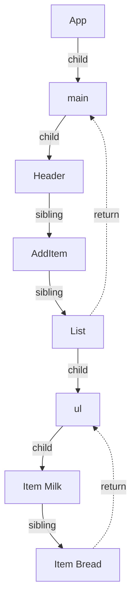
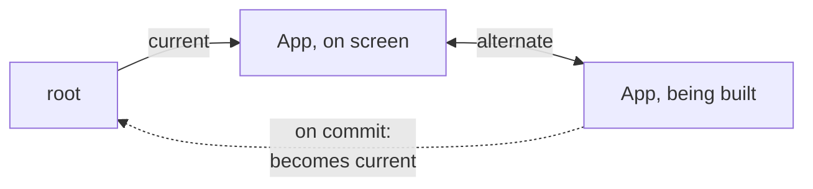

# Fiber - Work You Can Pause

> [!summary] TL;DR
> A fiber is a small, long-lived object for one component or DOM node, and it is also one unit of work. Fibers are linked with child, sibling and parent pointers, so React walks the tree with a plain loop instead of recursion. A loop can stop after any fiber and pick up later, and a half-built tree can simply be dropped. React keeps two versions of the tree, the one on screen and the one being built, and swaps them on commit.

You type into the shopping list's search box while a big filtered list re-renders. Ideally the letters appear immediately and the list catches up a moment later. For that to be possible, React must be able to stop in the middle of rendering a tree, let the browser handle your keystroke, and then either continue or start over.

That sounds simple. With ordinary JavaScript function calls, it is impossible. This part is about the data structure React built to get around that: the **fiber**.

## The call stack can't be paused

The obvious way to render a tree is recursion: render `App`, then for each child render the child, and so on. Before React 16, React worked like that. The trouble is the JavaScript call stack.

Once a recursive walk starts, the only way out is to finish it, or to throw. You can't say "stop here, give the browser a turn, and resume at this exact node in 5 ms". The partial progress lives in stack frames, and stack frames disappear when you return. A deep tree therefore meant one long, unbreakable chunk of work. If it took 100 ms, the page was frozen for 100 ms.

React's answer is to stop using the call stack as its to-do list. It moves the "where am I in the tree" information into ordinary objects on the heap, where it survives between turns.

## A fiber is a node and a unit of work

For every mounted component instance, DOM element and text node, React keeps a **fiber**. Your elements are short-lived descriptions, recreated on every render. Fibers are what React keeps between renders. A fiber holds, conceptually:

- **what it is**: a function component, a host element like `ul`, a text node, and so on,
- **its inputs**: the props for this render and the props it finished with last time,
- **its state**: for a function component, its list of hooks,
- **its output**: for host fibers, the real DOM node,
- **flags**: what the commit has to do for it (from [[05 Reconciliation - Finding What Changed|Reconciliation]]),
- **pending work**: whether it, or anything below it, has an update waiting.

And it is linked to its neighbours with three pointers:

- **child**: its *first* child,
- **sibling**: the next child of the same parent,
- **return**: its parent. It is called "return" because that is where the walk goes back to once this fiber is finished, like a return address.

Here is part of the shopping list as fibers:



Children form a linked list, not an array. With these three pointers you can walk the whole tree, down, across and back up, with a loop and a single variable that says "the fiber I'm on".

> [!tip] Mental model
> A render is a to-do list where each item is one fiber, and React's only bookmark is "the next fiber to work on". Keep the bookmark, and you can stop and resume at any item. Drop it, and the unfinished work is gone.

## The work loop: down, then back up

The render walk is depth-first, done by hand. On each fiber, React does a "begin" step on the way down and a "complete" step on the way back up.

- **Begin** (going down): call the component, or read a host element's children, and reconcile the result into child fibers. Then move to the first child.
- **Complete** (coming up): once a fiber has no more children to visit, finish it. For host fibers this is where DOM nodes are created or their changes are prepared. Then move to the sibling, or, if there is none, up to the parent and complete that.

In simplified pseudocode (not React's real code):

```js
// simplified
let fiber = rootOfTheWork;
while (fiber !== null) {
  const child = begin(fiber);
  if (child) { fiber = child; continue; }
  while (fiber && !fiber.sibling) { complete(fiber); fiber = fiber.return; }
  if (fiber) { complete(fiber); fiber = fiber.sibling; }
}
```

For a render of `List`, the order is: begin `List`, begin `ul`, begin `Item Milk`, complete `Item Milk`, begin `Item Bread`, complete `Item Bread`, complete `ul`, complete `List`. A parent always completes after all its children. That is why React can build a new DOM subtree bottom-up, off-screen, and insert it with a single operation later.

The loop doesn't visit every fiber on every update. Each fiber knows whether anything below it has pending work. When nothing does, React skips the whole subtree without walking into it. A `setState` deep in the tree visits the path from the root down to that component, then whatever below it actually re-renders.

## Two trees: current and work-in-progress

React never edits the tree that's on screen while rendering. It keeps two versions of each fiber:

- **current**: what's committed and on screen right now.
- **work-in-progress**: the version being built for the next screen, based on current plus the pending updates.

Each fiber points to its other version (its *alternate*). When a render starts, React creates or reuses the work-in-progress fiber for each fiber it visits. Both versions share the same DOM node, because there is only one DOM.



When the render finishes and React commits, it doesn't copy anything. It points the root at the work-in-progress tree, which becomes current. The old current becomes the scratch space for the next render. Graphics programmers call this **double buffering**: draw the next frame in a back buffer, then flip.

The analogy has one limit. In graphics, the back buffer is complete pixels. Here, the work-in-progress tree only describes changes. The actual DOM edits still happen during the commit, after the swap is decided ([[08 The Commit Phase and Effects|The Commit Phase and Effects]]).

## Yielding between units, sometimes

Because the loop's only state is "the next fiber", React can check the clock between two fibers and decide to stop. It returns from the loop, lets the browser handle input or paint, and later calls the loop again from the same fiber.

> [!warning] Most renders are not interrupted
> Yielding only happens for some kinds of work. A click's update, an update from a timer or a `fetch` callback, and the very first `root.render` all run to completion in one go, even under `createRoot`. Interruptible, time-sliced rendering is mainly for transitions, Suspense retries and idle or offscreen work. You opt into it with `startTransition` or `useDeferredValue`, covered in [[07 Priorities, Transitions and Concurrency|Priorities, Transitions and Concurrency]].

And React only checks between fibers, never inside one. If a single component takes 200 ms to run, those 200 ms still block the page. Fibers make the work *pausable at fiber boundaries*. They don't make slow components fast.

## Throwing work away

The other thing the bookmark buys is the ability to abandon a render. Suppose a transition render of a big list is halfway done when you click a checkbox. The click is more urgent. React throws away the half-built work-in-progress tree, starts a fresh one from current, renders and commits the click, and later starts the transition again on top of the new state.

Nothing is lost by discarding it. The work-in-progress tree was never shown, and the updates that produced it are still queued, so React can render them again later. Discarding is cheap because there is no call stack to unwind. React just stops using that tree.

This has a direct consequence for your code: **a render may run and never be committed.** Your component function can be called, its output thrown away, and called again. That's why render must be pure: no subscriptions, no mutations of outside objects, no DOM reads during render. Work that must happen once per *committed* screen belongs in an effect.

## What fibers bought, in one list

- **Pause and resume**: stop after any fiber, continue later from the same one.
- **Abort**: drop an unfinished tree when something more urgent arrives.
- **Skip**: jump over subtrees that have no pending work.
- **Unwind**: when something throws or suspends, walk up the return pointers to the nearest boundary, instead of relying on JavaScript exceptions crossing arbitrary frames.
- **No stack overflow** on very deep trees.

The cost is memory: each fiber is a fairly large object, and an updated component has two of them.

## Common misconceptions

- **"Fiber is the virtual DOM."**: Elements are the throwaway descriptions people usually mean by "virtual DOM". Fibers are the long-lived objects React compares against, stores state in and schedules work on, and many fibers (components, providers, Suspense) have no DOM at all.
- **"React re-creates the tree on every render."**: Elements are re-created. Fibers are reused through their alternate, and untouched subtrees are skipped entirely.
- **"With createRoot, every render is interruptible."**: The initial render and normal updates run without yielding. Interruption is mainly for transitions, retries and idle work.
- **"Fiber is a React 18 concurrency feature."**: Fibers have existed since React 16. Later versions added the scheduling that uses their ability to pause.

## Summary

The JavaScript call stack can't be paused, so React moved its rendering progress into fibers: long-lived objects, one per component or DOM node, linked by child, sibling and return pointers. A render is a loop that begins each fiber going down and completes it coming back up, with one bookmark for the next fiber. That lets React yield between fibers when the work is time-sliced, mainly for transitions, and throw away a half-built tree when something more urgent arrives. React keeps a current tree and a work-in-progress tree and swaps them on commit, which is why a render can run and never be shown. Next, [[07 Priorities, Transitions and Concurrency|Priorities, Transitions and Concurrency]] covers who decides what is urgent.

### Key takeaways

- **Recursion can't pause**: progress kept in stack frames is lost on return, so a recursive render is one unbreakable chunk.
- **Fiber**: a long-lived object per component or DOM node that is both a tree node and one unit of work.
- **child, sibling, return**: three pointers that let a plain loop walk the tree with a single bookmark.
- **Begin and complete**: work goes down through begin, then back up through complete, so parents finish after their children.
- **Current and work-in-progress**: React builds the next tree beside the one on screen and swaps a pointer on commit.
- **Yielding**: checked between fibers only, and only for time-sliced work like transitions; normal updates and the first render run to completion.
- **Discarding**: an unfinished tree can be dropped because its updates stay queued, which is why render must be pure.

**Go deeper:** [[05 The Fiber Data Structure|The Fiber Data Structure]] · [[06 The Work Loop - Render Phase|The Work Loop]]

---

← [[05 Reconciliation - Finding What Changed|Prev]] · [[react-concepts|Index]] · [[07 Priorities, Transitions and Concurrency|Next]] →
