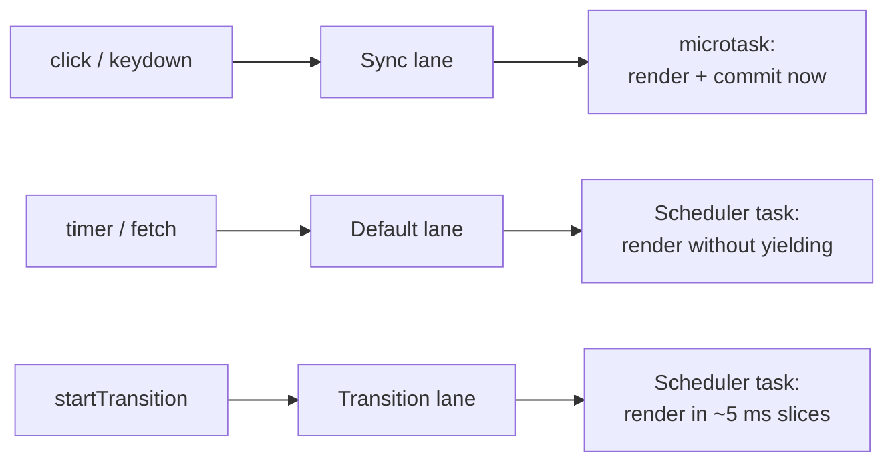
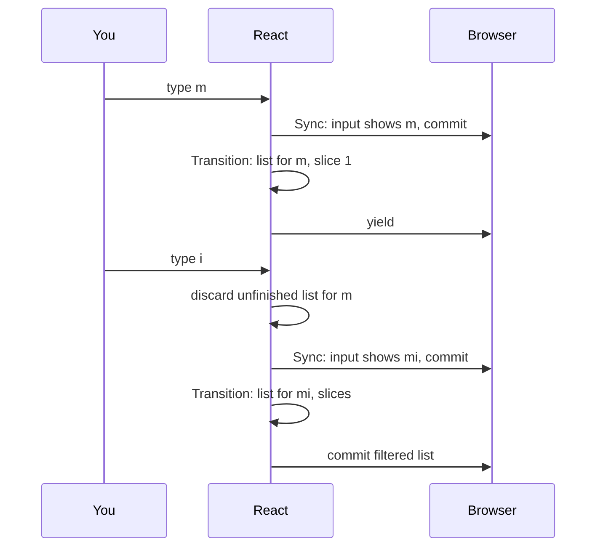

# Priorities, Transitions and Concurrency

> [!summary] TL;DR
> Every update gets a priority, called a **lane**. Clicks and key presses are urgent and render right away without yielding. Ordinary updates are scheduled a little later but still run to completion. Transitions are the only common updates React renders in small, interruptible slices, so urgent work can cut in front, and a transition that waits too long is eventually forced to finish.

Add a filter box to the shopping list. You type "mi", and `List` re-renders a few thousand items to show only the matches. If every keystroke has to wait for that list, the input feels sticky. What you want is for the letter to appear in the box immediately and the list to follow when it can.

React can do that, but only if you tell it which update is the urgent one. This part explains how React ranks updates, what "concurrent" actually means in React 19, and where the limits are.

## Not all updates are equal

When you call a state setter, React tags the update with a **lane**, which is a priority. Conceptually, the main ones are:

| Lane | Where it comes from | How it renders |
|---|---|---|
| **Sync** | discrete input: `click`, `keydown`, `input`, and `flushSync` | right away, before the browser paints, never yields |
| **Continuous** | `mousemove`, `scroll`, `wheel`, `pointermove` | soon, never yields within the render |
| **Default** | updates outside any event: timers, `fetch` callbacks, the first `root.render` | in a later task, never yields within the render |
| **Transition** | `startTransition`, `useTransition`, `useDeferredValue` | in slices, can be interrupted |
| **Retry** | a Suspense boundary retrying after data arrived | in slices |
| **Idle** | idle-priority work | only when nothing else is pending |

React then picks the most urgent pending lanes and renders them together. Urgent lanes also batch: if a click update and a timer update are both waiting, one render handles both.

The table's last column is the part people get wrong. Under `createRoot`, most updates are still rendered **in one go**. A Default update is *started* asynchronously, but once it starts, it runs to completion. Only transitions (and retries, idle and offscreen work) are time-sliced.



## The urgent path: sync updates

When your click handler calls `setText` or `setItems`, the update gets the Sync lane. React doesn't hand it to the Scheduler at all. It queues a microtask, and in that microtask it renders and commits. That happens before the browser gets control back from the event, so the user sees the result in the very next frame.

That's the right behaviour for direct feedback: the checkbox should tick when you click it, the letter should appear when you type it. It also means a slow component in that render blocks the page for as long as it takes.

## Transitions: "this can wait"

`startTransition` marks the updates inside it as non-urgent:

```jsx
function App() {
  const [filter, setFilter] = useState("");
  const [query, setQuery] = useState("");
  const [isPending, startTransition] = useTransition();

  function onFilterChange(e) {
    setFilter(e.target.value);                         // urgent: the input
    startTransition(() => setQuery(e.target.value));   // can wait: the list
  }
  return (
    <main>
      <input value={filter} onChange={onFilterChange} />
      <List items={items} query={query} dimmed={isPending} />
    </main>
  );
}
```

One keystroke now produces two updates in two lanes. `setFilter` is Sync, so the input updates immediately. `setQuery` is a Transition, so the filtered list renders afterwards, in slices. `useTransition` also gives you an `isPending` flag, which lets you show that the list is catching up.

Inside a transition render, React works through the fibers ([[06 Fiber - Work You Can Pause|Fiber]]) and checks the clock between them. After about 5 ms it stops, returns control to the browser so it can handle input and paint, and continues in the next slice.

> [!tip] Mental model
> Urgent updates are rendered start to finish the moment they arrive. A transition is rendered in short slices, and React is willing to throw that work away and start it again whenever something more urgent shows up.

## Interruption means restarting

Say you type m, then "i", while the list for "m" is still rendering in slices. The "i" keystroke is Sync, which is more urgent than the transition in progress. React does not pause the transition and come back to it. It **throws away** the half-built transition tree, renders and commits the urgent update, and later renders the transition again from scratch, on top of the new state.



No update is lost. The transition's updates were never removed from their queues, so the restarted render sees all of them, including the newest query. Only strictly more urgent work interrupts a transition. A plain Default update, for example, waits for the transition render instead of cutting in.

That's also why the render phase must be pure. Your component may be called for a render that is then discarded.

> [!warning] Slices are per fiber, not per component
> React checks the clock *between* fibers. A single component that takes 50 ms to render still blocks the main thread for 50 ms, transition or not. Transitions keep the page responsive when the work is spread across many components, not when one component is slow.

## useDeferredValue: the same idea from the reading side

Sometimes you don't own the setter. You receive a value, such as a `query` prop, and you want the expensive part of your UI to lag behind it. `useDeferredValue` does that:

```jsx
function List({ items, query }) {
  const deferredQuery = useDeferredValue(query);
  const visible = items.filter(i => i.name.includes(deferredQuery));
  return <ul>{visible.map(i => <Item key={i.id} item={i} />)}</ul>;
}
```

The urgent render can keep using the old value, so it stays fast. React then schedules extra work in a transition-class lane to render with the new value, and that work is interruptible like any transition. You get the transition behaviour without wrapping the setter yourself.

## Suspense: "not ready yet"

A component can tell React that it can't render yet, for example because the data it reads with `use(promise)` hasn't arrived. React then needs somewhere to stop. That's what a `<Suspense>` boundary is:

```jsx
<Suspense fallback={<p>Loading list…</p>}>
  <List items={items} query={query} />
</Suspense>
```

How React reacts depends on the kind of render:

- In a **render that doesn't yield** (sync or default), React unwinds to the nearest Suspense boundary and shows its fallback.
- In a **transition render**, React has more room. It can wait for the promise without giving up, and when the data arrives, re-render just the component that was waiting instead of the whole subtree.

When the data arrives, React schedules a **retry** in its own lane, which is also time-sliced. Think of a Suspense boundary as a fence: whatever happens below it, the "not ready" state stops there, and the rest of the page keeps rendering.

## The Scheduler: taking turns with the browser

Non-sync work goes through React's **Scheduler**, a small separate package that knows nothing about components. It keeps a queue of tasks ordered by deadline and runs them in short slices.

- Each slice runs for about **5 ms**. Then the Scheduler yields so the browser can handle input and paint.
- It schedules the next slice with a `MessageChannel` message, which comes back as a normal task, quickly, and without the minimum delay nested `setTimeout` calls get.
- When a render yields mid-tree, React hands the Scheduler a "continue me" function. The next slice picks up at the same fiber.

It is cooperative. The Scheduler can't stop running code. It only gets control back when React checks the clock between fibers and decides to yield.

## Starvation protection: lanes expire

If you keep typing, Sync updates keep arriving, and a transition could in principle be restarted forever. React prevents that. Each pending lane gets an expiration time: about 250 ms for Sync and Continuous work, about 5 seconds for Default and transition work. A lane that is still pending after its time is marked **expired**, and React renders it without yielding, in one go, so it finally finishes. Idle and offscreen work never expires.

So a transition is "low priority", not "maybe never". Under constant pressure it will eventually stop yielding and complete.

## Common misconceptions

- **"createRoot makes all rendering concurrent."**: The first render and normal updates run without yielding. Interruptible rendering is opt-in, through `startTransition` and `useDeferredValue`.
- **"A transition makes slow code faster."**: It moves that work behind urgent updates and spreads it across slices. The total work is the same, and a single slow component still blocks.
- **"An interrupted render resumes where it stopped."**: When more urgent work cuts in, the unfinished tree is thrown away and the transition is rendered again later. Resuming from the same fiber happens only when React yielded and nothing else changed.
- **"Low priority work can be starved forever."**: Lanes expire. An expired transition is rendered in one go.

## Summary

React ranks updates with lanes: Sync for discrete input, Continuous for things like scrolling, Default for updates outside events, Transition for work you mark as non-urgent, plus Retry and Idle. In React 19, only transitions, retries and idle or offscreen work are time-sliced. Everything else is rendered in one go once it starts. A transition renders in roughly 5 ms slices through the Scheduler, is thrown away and restarted when urgent work arrives, and is forced to finish if it waits too long. Suspense boundaries mark where "not ready yet" stops. Next, [[08 The Commit Phase and Effects|The Commit Phase and Effects]] covers what happens once a render finishes.

### Key takeaways

- **Lanes**: every update gets a priority, and React renders the most urgent pending lanes together.
- **Sync updates**: clicks and key presses render and commit in a microtask, before the next paint, without yielding.
- **Default updates**: start later in a Scheduler task, but run to completion once started.
- **`startTransition` and `useTransition`**: mark updates as interruptible; the urgent part of the same event still renders immediately.
- **Interruption**: urgent work discards the unfinished transition tree, which is rendered again later on top of the new state.
- **`useDeferredValue`**: lets part of the UI lag behind a value by rendering the new value as transition-class work.
- **Suspense**: a boundary with a fallback where "not ready yet" stops; data arriving triggers a retry.
- **Scheduler and expiration**: work runs in about 5 ms slices with paints in between, and lanes that wait too long expire and finish in one go.

**Go deeper:** [[04 Lanes and the Scheduler|Lanes and the Scheduler]] · [[03 root.render - Scheduling the First Update|root.render]]

---

← [[06 Fiber - Work You Can Pause|Prev]] · [[react-concepts|Index]] · [[08 The Commit Phase and Effects|Next]] →
