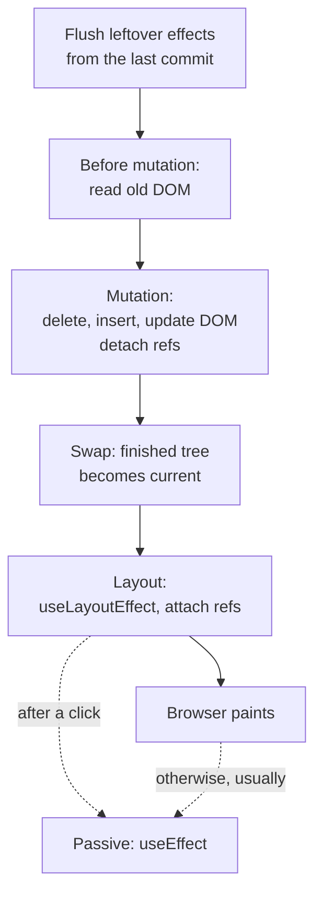

# The Commit Phase and Effects

> [!summary] TL;DR
> Once a render is finished, React commits it in one synchronous block that can't be interrupted: it changes the DOM, swaps the finished tree in as current, then runs layout effects and attaches refs, all before the browser can paint. `useEffect` runs later, usually after paint, except after a discrete update like a click, when React runs it at the end of the commit. Cleanups always run before the next setups.

You check off "Milk" in the shopping list. The render from the earlier parts produced a finished work-in-progress tree, full of flags that say what to change. Nothing on screen has moved yet. Your `Header` wants to put the remaining count in `document.title`, and an `Item` wants to measure its own height to animate the strike-through.

Which of those runs first? Can the measurement see the new DOM? Will the user ever see a half-updated list? This part answers that by walking through the **commit**, the phase where React applies a render to the screen.

## Commit is one uninterruptible block

The render phase can be paused, discarded and restarted ([[06 Fiber - Work You Can Pause|Fiber]]). The commit can't. Once React starts committing, it runs from the first DOM change to the last layout effect without yielding.

That's deliberate. If React stopped halfway through changing the DOM, the browser could paint a screen where some items are updated and others aren't. Doing all the DOM work in one synchronous block means the user only ever sees the old screen or the new one.

It also means a commit has a fixed order, in sub-phases, and you can rely on it.



## Step 0: finish the previous commit's effects

Before applying a new tree, React first runs any `useEffect` work from the previous commit that hasn't run yet. The rule is simple: effects of commit N always run before commit N+1 changes the DOM. So an effect never wakes up to a screen that is two updates ahead of it.

## Before mutation: last look at the old DOM

This short phase reads the DOM as it is now, before anything changes. React saves which element has focus and what text is selected, so it can restore them afterwards. It also temporarily disables its event system, so DOM changes that fire events synchronously (such as a `blur` when a focused node is removed) can't re-enter React in the middle of the commit.

For class components, this is where `getSnapshotBeforeUpdate` runs, which is the last chance to read something like a scroll position before a list grows.

## Mutation: change the DOM

Now React applies the flags from reconciliation ([[05 Reconciliation - Finding What Changed|Reconciliation]]):

- **Deletions**: for removed components, React runs their layout-effect cleanups and detaches their refs (calls the ref with `null`, or runs the ref's cleanup function). Then it removes the topmost DOM node of the deleted subtree with one operation. Descendants leave with it.
- **Insertions and moves**: new or moved fibers get their DOM nodes inserted at the right position. A newly mounted subtree was built off-screen, so it goes in with one insertion at its top.
- **Updates**: changed attributes and text are written onto existing DOM nodes.

Two kinds of effect code also run here:

- **`useInsertionEffect`** runs its cleanup and setup during mutation, before any layout effect. It exists for CSS-in-JS libraries that must inject `<style>` tags before anything measures the page. You will rarely write one yourself.
- **`useLayoutEffect` cleanups** for components whose layout effects are about to re-run.

At the end of mutation, React restores focus and selection and re-enables events.

## The swap

Right after mutation, React points the root at the finished tree. The work-in-progress tree is now **current**, and the old one becomes scratch space for the next render.

The timing is exact on purpose. Code that runs during mutation, such as cleanups for things being removed, sees the old tree as current. Code that runs in the next phase sees the new one.

## Layout: the DOM is ready, the screen isn't

Now React runs `useLayoutEffect` setups and attaches refs (`ref.current = node`, or calls your ref callback). Class components get `componentDidMount` and `componentDidUpdate` here.

At this point the DOM is fully updated and in the document. `getBoundingClientRect()` gives real numbers. The browser has not painted yet, because the JavaScript task is still running. That's what makes layout effects the right place to measure and adjust:

```jsx
function Item({ item, onToggle }) {
  const ref = useRef(null);
  const [height, setHeight] = useState(0);
  useLayoutEffect(() => {
    setHeight(ref.current.getBoundingClientRect().height);
  }, [item.done]);
  return <li ref={ref} onClick={() => onToggle(item.id)}>{item.name}</li>;
}
```

The `setHeight` here is treated as urgent, so React renders and commits it in the same task, before paint. The user never sees the frame with the old height. That's how "measure, then set state" avoids a flicker.

Layout effects run children first: a parent's layout effect can rely on its children's refs already being set.

> [!warning] Layout effects delay the first pixel
> Everything in `useLayoutEffect` runs before the browser can paint, and reading layout there forces the browser to compute it right away. Keep layout effects to measure-and-adjust work. Data fetching, subscriptions and logging belong in `useEffect`.

## Passive effects: `useEffect`

`useEffect` setups are **passive** effects. React doesn't run them inside the commit block. At the start of the commit it schedules a separate task for them, and the task usually runs after the browser has painted:

```jsx
function Header({ count }) {
  useEffect(() => {
    document.title = `${count} items left`;
  }, [count]);
  return <h1>Shopping list ({count})</h1>;
}
```

Updating the title doesn't need to block the screen, so a passive effect is the right home.

There is an important exception. When the commit came from a **discrete update** (a click, a key press, `flushSync`), React runs the passive effects at the end of the commit, synchronously, **before** the browser paints. The result of an interaction is then immediately consistent, effects included. Checking off "Milk" is a click, so `Header`'s effect runs before that frame is painted.

> [!warning] "useEffect runs after paint" is a heuristic
> For non-discrete updates React schedules effects in a separate task, and React yields so the browser can paint first. Whether the browser actually paints between the two tasks is up to the browser. And after a click, effects run before paint by design. If you need "before paint", use `useLayoutEffect`. If you truly need "after paint", don't rely on `useEffect` timing.

> [!tip] Mental model
> Everything from the first DOM change to the last layout effect is one block of JavaScript, and the browser can only paint after it. `useEffect` is "soon after the commit": usually after paint, but before paint when the commit came from a click.

## Cleanup order

When an effect's dependencies change, React runs its cleanup from the previous render, with the previous values, before running the new setup. Across the tree, the order is stronger than that:

- All layout cleanups run during mutation, before any layout setup runs.
- In the passive phase, **all** `useEffect` cleanups in the tree run before **any** `useEffect` setup. That includes cleanups for components that were removed in this commit.
- Within each pass, children run before parents.

So one effect's setup never sees another effect's stale subscription still in place. Effects whose dependencies didn't change are skipped entirely: no cleanup, no setup.

## StrictMode runs effects twice in development

Under `<StrictMode>` in development, React mounts a component, runs its effect cleanups, then runs its effect setups again. It does this on purpose: if your effect doesn't clean up properly (a subscription that's never removed, a timer that's never cleared), the double run makes that visible on your machine. It happens only in development. Production runs each setup once per mount.

If an effect breaks when it runs twice, the fix is a correct cleanup, not a ref that prevents the second run.

## Choosing an effect

| You need to… | Use |
|---|---|
| Inject styles before layout is read (library authors) | `useInsertionEffect` |
| Measure the DOM and adjust before the user sees it | `useLayoutEffect` |
| Subscribe, fetch, log, sync with something outside React | `useEffect` |
| Compute something from props or state | no effect, compute it during render |

Default to `useEffect`. Reach for `useLayoutEffect` only when the user would otherwise see a wrong frame.

## Common misconceptions

- **"React may paint a half-updated DOM."**: The DOM changes, the swap and the layout effects are one synchronous block, so the browser can only paint once all of them are done.
- **"useEffect always runs after paint."**: After a click or key press, React runs passive effects at the end of the commit, before paint. For other updates, "after paint" is the usual outcome, not a guarantee.
- **"Effects running twice means React is buggy."**: That's StrictMode in development, testing your cleanups. Production runs each setup once per mount.
- **"Refs are set during render."**: Refs are detached in mutation and attached in layout, during the commit. Reading `ref.current` during render shows the previous commit's value.

## Summary

The commit applies a finished render in one synchronous, uninterruptible block: it flushes leftover effects from the previous commit, reads the old DOM before mutation, changes the DOM and detaches refs in mutation, swaps the finished tree in as current, then runs layout effects and attaches refs before the browser can paint. Passive effects (`useEffect`) run in a separate task, usually after paint, but at the end of the commit when the update was discrete, such as a click. All cleanups run before the matching setups, and StrictMode in development runs effects twice to test those cleanups. Next, [[09 Hooks - Why Order Matters|Hooks - Why Order Matters]] looks at how React keeps track of all these effects and state between renders.

### Key takeaways

- **Uninterruptible commit**: DOM changes, the swap and layout effects run as one block, so users never see a half-updated screen.
- **Before mutation**: React reads the old DOM, saves focus and selection, and runs `getSnapshotBeforeUpdate`.
- **Mutation**: deletions, insertions and updates hit the DOM, refs detach, and `useInsertionEffect` and layout cleanups run.
- **The swap**: the finished tree becomes current between mutation and layout, so removal code sees the old tree and mount code the new one.
- **Layout**: `useLayoutEffect` and ref attachment run children first, with real layout but before paint; state set there commits before paint.
- **Passive effects**: `useEffect` runs in a later task, usually after paint, but at the end of the commit for discrete updates like clicks.
- **Cleanup order**: all cleanups run before any setups, including those of removed components, and unchanged effects are skipped.
- **StrictMode**: in development, effects run setup, cleanup and setup again on mount to expose missing cleanups.

**Go deeper:** [[09 Commit Phase - Mutation, Layout, Passive Effects|Commit Phase]] · [[08 completeWork - Building DOM Nodes|completeWork]]

---

← [[07 Priorities, Transitions and Concurrency|Prev]] · [[react-concepts|Index]] · [[09 Hooks - Why Order Matters|Next]] →
