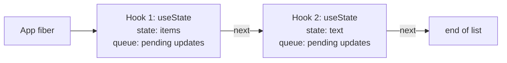

# Hooks: Why Order Matters

> [!summary] TL;DR
> Every component instance keeps its hooks as an ordered list on its fiber, one entry per hook call, in the order you made them. On the next render React walks that list again in step with your calls, so the third hook you call is paired with the third entry from last time. Position is the only identity a hook has, and the Rules of Hooks exist to keep that position stable.

Look at the shopping list app:

```jsx
function App() {
  const [items, setItems] = useState([{ id: 1, name: "Milk", done: false }]);
  const [text, setText] = useState("");
  // ...
}
```

Two calls to `useState`, no names, no keys. React has never seen the words `items` or `text`; those are your local variable names. Yet on every render the first call gets the list back and the second gets the input text. How does React know which is which?

It counts.

## Where hook state actually lives

Your component is a function. It runs, returns elements, and its local variables are gone. Anything that survives between renders has to live somewhere else, and that somewhere is the component's **fiber**: the long-lived object React keeps for each component instance in the tree (see [[06 Fiber - Work You Can Pause|Fiber]]).

A function component's fiber has a field that points at the first hook. Each hook points at the next one. Conceptually it is a linked list, built in the order your calls happen:



There is no index variable and no map of names. React keeps a cursor that points at "the current hook" and moves it one step forward each time you call a hook.

Because the list hangs off the fiber, it belongs to that **instance**. Two `<Item>` components each have their own fiber, so each has its own hook list. Unmount a component and its fiber, and its hook list, are gone.

## Two dispatchers: mount and update

Here is a detail that explains a lot. The `useState` you import from `react` does almost nothing itself. It forwards the call to whatever "dispatcher" the renderer has installed right now.

Before React calls your component, it installs one of two sets of hook implementations:

- **Mount**: this instance has never rendered. Each hook call *creates* a new entry and appends it to the list.
- **Update**: the instance rendered before. Each hook call *takes the next entry* from the previous render's list and continues from it.

After your function returns, React swaps in a dispatcher whose hooks throw. That is why calling a hook from an event handler or a `setTimeout` gives you an "Invalid hook call" error instead of silently corrupting something.

```js
// simplified pseudocode, not real source
function renderComponent(fiber, Component, props) {
  dispatcher = fiber.isFirstRender ? MountHooks : UpdateHooks;
  const children = Component(props);   // your hook calls run in here
  dispatcher = ThrowingHooks;          // hooks outside render now throw
  return children;
}
```

So the same line `useState("")` means "create a slot with `""` in it" on the first render and "give me the next slot" on every render after that. The initial value is only read on mount. On update it is ignored.

## Order is the identity

Put those pieces together. On a re-render, React does not look up "the `text` state". It takes the next entry from the list the previous render built, and hands you what is in it. The *n*-th hook call in this render is paired with the *n*-th entry from the last committed render.

Now break the order:

```jsx
function Bad({ showFilter }) {
  if (showFilter) {
    const [filter, setFilter] = useState("all"); // slot 1, but only sometimes
  }
  const [text, setText] = useState("");          // slot 1 or slot 2
  // ...
}
```

Render with `showFilter = true` and the list is `["all", ""]`. Flip it to `false`, and the `text` call is now the *first* hook call, so it gets paired with the first entry and reads `"all"`. No error, just the wrong value. If the kinds don't match, say a state call lands on an effect's entry, React throws ("Should have a queue..."). Call more hooks than last time, and React throws "Rendered more hooks than during the previous render". Call fewer, and it throws too.

> [!tip] Mental model
> A component's hooks are a numbered row of boxes on its fiber. Every render walks the row from left to right, one box per hook call, so a hook *is* its position in that row.

The Rules of Hooks are just this model written as rules:

- **Only call hooks at the top level**, not inside conditions, loops or after an early `return`, so every render makes the same calls in the same order.
- **Only call hooks from components or custom hooks**, because only there is a dispatcher installed and a fiber being rendered.

Why not keys, like `useState("text", "")`? Position keeps the API short and lets custom hooks compose without namespacing. The cost is a rule a linter enforces.

> [!warning] Early returns count as conditions
> `if (!items.length) return <Empty />;` placed *above* a `useState` or `useEffect` call changes how many hooks run. Put every hook call before the first early return.

## What each hook keeps in its box

Every entry has the same shape: a slot for "what this hook remembers", plus a queue used only by state hooks. What goes in the slot depends on the hook.

| Hook | What its entry stores |
| --- | --- |
| `useState` / `useReducer` | the current state, plus a queue of pending updates and a setter bound to it |
| `useEffect` / `useLayoutEffect` | an effect object: your function, its deps, and a holder for the cleanup |
| `useRef` | a plain `{ current }` box, the same object forever |
| `useMemo` | the last value and the deps it was computed from |
| `useCallback` | the last function and its deps |

### `useState`: state plus a queue

`useState` is `useReducer` with a built-in reducer: if you pass a function, it is called with the old state, otherwise your value replaces it. Its entry holds the current state and a **queue**. Calling `setItems` doesn't change the entry on the spot. It adds an update to the queue and asks React to render. On the next render, the `useState` call processes the queue and returns the new state (the batching story is in [[04 State Updates - Snapshots and Batching|State Updates]]).

The setter is created once, on mount, already bound to this fiber and this queue. That's why React can route `setItems(...)` from a click handler straight to the right place without searching the tree. It is also why the setter is **stable**: it's the same function on every render, so leaving it out of effect deps is safe.

### `useEffect`: an effect object and its deps

`useEffect` stores an effect object: the function you passed, the deps array, and a small holder where React keeps the cleanup function your effect returns. On every render React compares the new deps with the stored ones, element by element, with `Object.is`.

- Deps unchanged: the effect is recorded but marked "nothing to do", and the commit phase skips it.
- Deps changed, or no deps array at all: it is marked to run after commit, cleaning up the previous run first.

Objects and functions created during render are new every time, so they are never equal to last render's. That's the classic "my effect runs on every render" bug.

### `useRef`: a box

`useRef` stores one object, `{ current: initialValue }`, and returns that same object on every render. Writing `ref.current` schedules nothing: no queue, no update, no render. That's what makes refs the right place for values that shouldn't cause a render, and why reading them to decide what to render is fragile.

### `useMemo` and `useCallback`: one remembered value

`useMemo` stores the last value and the deps it came from. If the deps are equal, you get the old value back. If not, your function runs again. `useCallback(fn, deps)` is the same thing with the function itself as the value: the *new* function you pass in is thrown away when deps match, which is how you get a stable identity.

The cache holds exactly **one** previous value, and React reserves the right to drop it. Treat it as a performance hint, never as a guarantee your code depends on. Part 11 covers when it actually helps.

## Hooks that don't take a box

Two hooks break the pattern.

**`useContext`** never creates a list entry. It reads the current value from the nearest Provider and records "this fiber depends on this context" in a separate list on the fiber, so React knows to re-render it when the value changes. Strictly speaking, the implementation would survive a conditional `useContext`. The rule still applies to it anyway, for consistency and so React can change the implementation later. Follow the rule.

**`use`** is the documented exception. For a promise, it uses its own counter of "how many promises have I read so far" instead of the hook list. That is why `use` may be called inside `if` blocks and loops.

(The React Compiler adds a third, `useMemoCache`, which also keeps its storage off the list. More on that in [[11 Memoization and the React Compiler|Memoization and the Compiler]].)

## Custom hooks are just functions

A custom hook has no special status inside React. There is no "custom hook" entry on the fiber. When `App` calls a custom hook, the hooks *inside* it run as part of `App`'s render and land in `App`'s list, in order, as if you had written them inline.

```jsx
function useItems() {
  const [items, setItems] = useState([]);
  const add = (name) => setItems([...items, { id: Date.now(), name, done: false }]);
  return { items, add };
}

function App() {
  const { items, add } = useItems(); // slot 1 lives on App's fiber
  const [text, setText] = useState(""); // slot 2
  // ...
}
```

Three consequences follow:

- **Two components calling `useItems` get two independent lists of items.** Custom hooks share logic, not state.
- **The rules apply through them.** A conditional `useItems()` call is a conditional `useState` call.
- **The `use` prefix is a convention for the linter**, so it knows to check the rules inside. React itself never looks at the name.

## Common misconceptions

- **"React matches `useState` calls by variable name"**: it never sees your names. It matches by call order, nothing else.
- **"Hooks store state inside the function"**: the function keeps nothing between calls. The state is on the fiber, which outlives every call.
- **"`useMemo` guarantees the value is computed once"**: it remembers one previous value per instance, and React may drop it.
- **"`useContext` is exempt from the rules because it doesn't take a slot"**: it doesn't take a slot, but the rule still applies to it.

## Summary

A component's hooks live on its fiber as an ordered list, created on the first render by the mount dispatcher and walked in step by the update dispatcher on every render after. Nothing is named or keyed: a hook's identity is its position, and the Rules of Hooks exist to keep that position stable across renders. Each entry stores what its hook needs: state and an update queue, an effect object and its deps, a ref box, or a memoized value with deps. `useContext` and `use` keep their data elsewhere, and custom hooks simply add entries to the calling component's list. Next, the event system: how a click reaches the handler that calls your setter.

### Key takeaways

- **Hook list on the fiber**: each component instance stores its hooks as an ordered list, one entry per call.
- **Mount vs update dispatcher**: the first render creates entries, later renders take the next entry, and outside render hooks throw.
- **Order is the identity**: the *n*-th call is paired with the *n*-th entry from the last render, so conditional calls read the wrong state or throw.
- **`useState`**: state plus a queue of updates, with a setter bound once to the fiber and queue, so it is stable.
- **`useEffect`**: an effect object whose deps are compared with `Object.is` every render to decide whether it runs.
- **`useRef`**: one mutable box; writing it schedules nothing.
- **`useMemo` / `useCallback`**: one remembered value and its deps, which React may drop.
- **`useContext`, `use` and custom hooks**: the first two don't take a slot (the rule still applies to `useContext`), and custom hooks just add their hooks to the caller's list.

**Go deeper:** [[10 Hooks on Mount|Hooks on Mount]] · [[11 Hooks on Update|Hooks on Update]]

---

← [[08 The Commit Phase and Effects|Prev]] · [[react-concepts|Index]] · [[10 Events - One Listener at the Root|Next]] →
