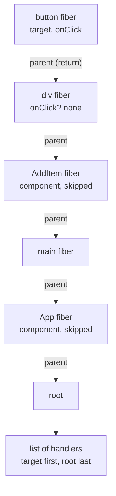
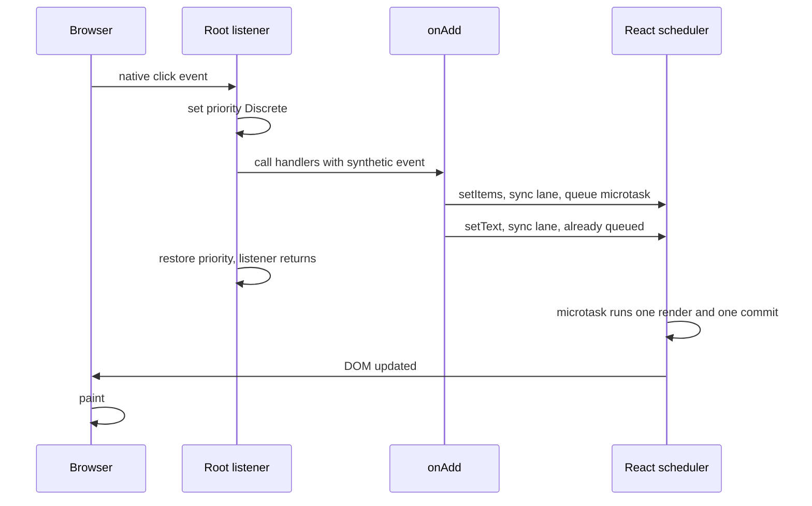

# Events: One Listener at the Root

> [!summary] TL;DR
> When you create a root, React puts one capture and one bubble listener per event type on the root container, and never adds your handlers to individual elements. When an event arrives, React finds the fiber for the target, walks up the *component* tree collecting matching handlers, and calls them with one shared synthetic event. The listener also sets a priority, which is why a `setState` in a click handler is urgent, batched, and on screen before the next paint.

In the shopping list app, `AddItem` renders something like this:

```jsx
function AddItem({ text, onChange, onAdd }) {
  return (
    <div className="add-item">
      <input value={text} onChange={(e) => onChange(e.target.value)} />
      <button onClick={onAdd}>Add</button>
    </div>
  );
}
```

It reads as if React calls `addEventListener("click", ...)` on the button and `addEventListener("input", ...)` on the input. It doesn't. Neither of your functions is ever registered with the browser. So how does a click end up calling them, and why does the order of `setItems` and `setText` inside `onAdd` never cause a flicker?

## One listener per event type, on the root

When you call `createRoot(container)`, React walks a list of every native event type it supports and installs, on the container element itself:

- one **capture-phase** listener per event type, and
- one **bubble-phase** listener per event type (for events that bubble).

That's it. Rendering `onClick` or `onChange` on an element just stores a prop. Nothing is attached, and nothing needs to be removed when the prop changes or the element unmounts.

This technique is called **event delegation**. A list with 10,000 rows and an `onClick` on each would otherwise need 10,000 listeners, re-attached on every mount. With delegation, a handler costs nothing beyond the prop, and you can pass a new arrow function every render with no add/remove churn. The price is one walk up the tree per event.

> [!note] Why the root container and not `document`?
> Up to React 16, everything was delegated to `document`. React 17 moved it to the root container, so several React roots (or React versions) on one page don't fight over `stopPropagation()`, and React trees embedded in non-React pages behave.

## From DOM node to fiber

The browser delivers the native event to the root listener with `event.target` set to the actual DOM node, say the "Add" button. React needs the *fiber* for that node, because that's where your props are.

When React creates a DOM node, it stashes two hidden properties on it: a pointer to the node's fiber, and the node's latest committed props. So the lookup is a property read on `event.target`. If the target isn't a React-owned node (content set with `innerHTML`, a third-party widget), React walks up the DOM parents until it finds one that is.

## Collecting handlers by walking the fiber tree

Now React has the target fiber and an event name, such as `onClick`. It walks **up the fiber tree**, from the target to the root, and at each *host* fiber (a real DOM element like `<button>` or `<div>`) it checks the current props for a matching handler. Each match goes on a list.



Then React calls the list. For the bubble phase (`onClick`) it goes from target to root, like native bubbling. For the capture phase (`onClickCapture`) it runs the same kind of list backwards, from root to target. Capture and bubble are simulated, not borrowed from the browser.

Three consequences follow from "walk the fiber tree":

- **Only DOM elements contribute.** `<MyButton onClick={...}>` on a component is just a prop. It only counts once some `<button>` inside receives it.
- **Handlers are always the latest committed ones.** React reads them from the props it stashed on the DOM node during the last commit, so there is never a stale listener to re-bind.
- **Events bubble through portals by React parentage.** A modal rendered with `createPortal` into `document.body` sits outside your app in the DOM, but its fiber's parent is still the component that rendered it. A click inside the modal bubbles to that component's `onClick`, because React walks fiber parents, not DOM parents.

> [!tip] Mental model
> React owns one doorbell per event type, at the root. When it rings, React looks up which fiber was touched and walks up the component tree, calling every matching handler it passes on the way.

## Synthetic events: one per dispatch

Your handler receives a `SyntheticEvent`, not the native event. React creates **one** synthetic event per dispatch and passes that same object to every handler on the list, updating `currentTarget` for each one. It normalises cross-browser differences and keeps the original on `e.nativeEvent`.

- `e.preventDefault()` and `e.stopPropagation()` call the native methods and set flags. When a handler stops propagation, React stops walking its list.
- An error thrown in one handler is reported, but it doesn't stop the other handlers from running.
- `e.persist()` still exists but does nothing. Event pooling, which reused event objects and forced you to call `persist()` before async access, was removed in React 17. You can read `e.target` inside a `setTimeout` today.

## Priority is baked into the listener

Here is the link to everything about updates. When React installs a listener, it wraps it according to the **kind of event**:

| Event priority | Examples | What `setState` gets |
| --- | --- | --- |
| Discrete | `click`, `keydown`, `input`, `mousedown`, `pointerup`, `focusin` | the sync lane: most urgent |
| Continuous | `mousemove`, `pointermove`, `scroll`, `wheel`, `drag` | a high, continuous lane |
| Default | everything else | the default lane |

The wrapper sets the "current update priority" *around* the call to your handlers and restores it afterwards. A discrete wrapper also clears any surrounding transition, so a click is never accidentally inside one. When your handler calls `setItems`, React asks "what's the current priority?", finds Discrete, and gives the update the **sync lane** (lanes are covered in [[07 Priorities, Transitions and Concurrency|Priorities and Transitions]]).

So priority isn't something your update carries in from nowhere. It comes from *where the update was made*: inside a click, it's urgent. Inside `startTransition`, it's a transition lane. That's the whole trick.

## Why updates in a click are batched

`onAdd` calls two setters:

```jsx
onAdd={() => {
  setItems([...items, { id: Date.now(), name: text, done: false }]);
  setText("");
}}
```

Neither call renders anything. Each one adds an update to its hook's queue, marks the fiber as having sync work, and asks React to schedule the root. Scheduling is deduplicated: the first call queues one **microtask**, the second call sees it's already queued.



When the listener returns and the JavaScript stack is empty, the microtask runs. Sync-lane work doesn't wait for a scheduler task: React renders and commits right there, both updates together, in **one** render. Microtasks run before the browser gets a chance to paint, so the user never sees the list updated but the input still full. The details of that render are in [[04 State Updates - Snapshots and Batching|State Updates]], and the full trip is in part 12.

> [!warning] Native listeners and React handlers don't interleave
> - A listener you add with `addEventListener` on the button itself fires **before** any React handler, because React only hears the event once it bubbles up to the root.
> - `e.stopPropagation()` in a React handler stops the native event at the root container. It can keep it from reaching `document` or `window` listeners, but never from listeners below the root, which already ran.
> - `e.nativeEvent.stopImmediatePropagation()` doesn't stop other React handlers: they're all called from one native listener.
> - Calling `el.click()` from your own code fires the event synchronously inside your code, so the render microtask waits until your code finishes. Use `flushSync` if you need the DOM updated in between.

## Events that aren't delegated

Some native events don't bubble in the DOM: `scroll`, `scrollend`, `load`, `invalid`, `toggle`, `cancel`, `close`, and all the media events (`play`, `ended`, ...). For these React gets only a capture listener on the root, and *also* attaches a listener directly to the element that needs it when it creates that element.

A few related quirks are worth knowing:

- **`onScroll` doesn't bubble** (since React 17). Its handlers are collected on the target only, like the native event.
- **`onMouseEnter` / `onMouseLeave`** aren't the native `mouseenter`. React computes them from `mouseover` / `mouseout` pairs.
- **`onFocus` / `onBlur` bubble**, because React implements them with the native `focusin` / `focusout`.

## Common misconceptions

- **"React attaches my `onClick` to the button"**: it attaches one listener per event type to the root container and finds your handler by walking the fiber tree.
- **"Events inside a portal bubble to the portal's DOM parent"**: React handlers bubble along the *component* tree, so they reach the component that rendered the portal.
- **"You must call `e.persist()` before using the event asynchronously"**: pooling was removed in React 17, and `persist()` is a no-op.
- **"Several `setState` calls in a handler cause several renders"**: they're queued and rendered once, in a microtask after the handler returns, before paint.

## Summary

React never registers your handlers with the browser. `createRoot` installs one capture and one bubble listener per event type on the container, and each event finds its target's fiber through a hidden property on the DOM node, walks the fiber tree collecting handlers from host elements, and calls them with one shared synthetic event. Because the walk follows fiber parents, events bubble through portals by component structure. The listener also sets the update priority around your handlers, so a click's `setState` calls get the sync lane, are batched, and render together in a microtask before the browser paints. Next: what happens when that render reaches components whose inputs didn't change, and how memoization and the compiler help.

### Key takeaways

- **Delegation at the root**: one capture and one bubble listener per event type on the root container, installed once by `createRoot`.
- **DOM node to fiber**: a hidden property on each React-created DOM node points at its fiber and its latest committed props.
- **Fiber walk**: React walks up the fiber tree from the target, collecting handlers only from DOM elements, so events bubble through portals by React parentage.
- **Capture and bubble**: simulated by running one collected list backwards (capture) or forwards (bubble).
- **Synthetic event**: one object per dispatch, shared by every handler; `persist()` is a no-op since pooling was removed.
- **Priority from the event**: discrete events such as click give `setState` the sync lane, continuous events a lower one.
- **Batching**: setters only queue updates and one microtask, so all of a handler's updates render together after it returns, before paint.
- **Non-delegated events**: events that don't bubble, such as `scroll` and media events, are also attached to the element itself.

**Go deeper:** [[13 The Event System|The Event System]]

---

← [[09 Hooks - Why Order Matters|Prev]] · [[react-concepts|Index]] · [[11 Memoization and the React Compiler|Next]] →
