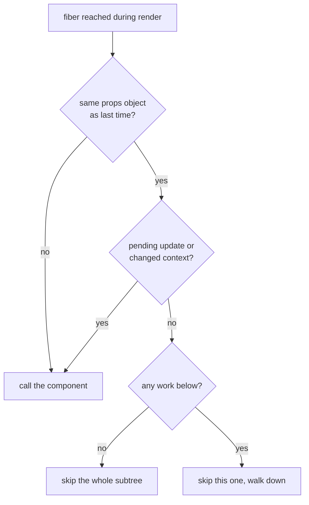

# Memoization and the React Compiler

> [!summary] TL;DR
> React has always been able to skip a child whose props object is the very same one as last time, but plain JSX makes a new props object on every render, so that skip rarely fires. `React.memo`, `useMemo` and `useCallback` are ways of handing React the same references again. The React Compiler does that for you at build time, caching values and elements per component instance, so unchanged subtrees bail out. React still re-renders from the component that owns the state: it just does less work below it.

Type one letter into the shopping list's input. `text` changes, so `App` re-renders. Fair enough. But put a `console.log` in `Header`, `List` and `Item`, and you'll see every one of them run too, even though the list didn't change at all. Nothing on screen changes except the input. Why did React call all those functions, and what are the tools for stopping it?

## Why components re-render

A component's function runs again when one of three things happens:

- **its own state changed** (a `setState` on one of its hooks),
- **a context it reads changed**, or
- **its parent re-rendered** and handed it new props.

The third is the one that surprises people. When `App` runs, it returns a fresh tree of elements: `<Header count={items.length} />` is a new object with a new props object `{ count: 1 }`, every time. React compares props by **reference**, not by content. `{ count: 1 }` from this render is not the same object as `{ count: 1 }` from last render, so `Header` counts as having new props and runs (see [[03 What Rendering Really Means|What Rendering Means]]).

There is a cheap skip built into React. When it reaches a fiber during render, it checks:



The very first check is "is it literally the same object?". Plain JSX almost never passes it below a component that re-rendered, because every render creates new elements. So by default **a re-render cascades through the whole subtree below the component that updated**.

That cascade usually costs less than it sounds: re-running a component is not touching the DOM. Reconciliation (see [[05 Reconciliation - Finding What Changed|Reconciliation]]) still writes only what actually changed. But for big subtrees or expensive components, the wasted function calls add up.

## `React.memo`: skip if the props look the same

Wrapping a component in `React.memo` adds a second check: if the props object is new but each prop is `Object.is`-equal to the previous one, skip calling the function.

```jsx
const Header = React.memo(function Header({ count }) {
  return <h1>Shopping list ({count})</h1>;
});
```

Typing into the input now leaves `Header` alone: `count` is the same number. This works because numbers compare by value. Objects, arrays and functions compare by **identity**, and that's where it gets tricky.

## Reference identity is the whole game

Try the same with `List`:

```jsx
const List = React.memo(function List({ items, onToggle }) { /* ... */ });

// in App
<List items={items} onToggle={(id) => setItems(items.map(/* ... */))} />
```

`items` is fine: typing doesn't touch it, so it's the same array reference. But `onToggle` is an arrow function created inline, so it is a **new function on every render**. `memo` sees a changed prop and renders `List` anyway. The memo did nothing except cost a comparison.

This is what `useCallback` and `useMemo` are for: keeping a reference the same across renders until its inputs change.

```jsx
const onToggle = useCallback(
  (id) => setItems((prev) => prev.map((i) => (i.id === id ? { ...i, done: !i.done } : i))),
  [] // setItems is stable, and the updater reads prev, not items
);
```

With the functional updater, `onToggle` no longer captures `items`, so it can stay the same function forever. (Written as `setItems(items.map(...))`, it would need `[items]` as deps and would change whenever the list does.)

As [[09 Hooks - Why Order Matters|the hooks part]] showed, `useMemo` and `useCallback` each remember one value and the deps it came from. They help in two situations:

1. **The value is expensive to compute**, and you don't want to redo it when its inputs are unchanged.
2. **The value's identity matters to someone else**: a `memo` child's prop, an effect's deps, another hook's deps.

Outside those, they do nothing useful.

> [!warning] `children` defeats `memo`
> `<Card>{<p>Hello</p>}</Card>` passes a new `<p>` element on every render, so `children` is a new prop every time and a memoized `Card` re-renders anyway.

## The cost of over-memoizing

Memoization isn't free:

- Every `useMemo` and `useCallback` allocates a deps array and compares it on each render.
- The remembered value keeps memory alive, and React may drop it anyway, so correctness must never depend on it.
- A `memo` whose props change every render is pure overhead: the comparison, then the render.
- It's one broken link away from useless: a single inline object or function in the chain undoes everything downstream, and nothing tells you.

Getting it right by hand means tracking identity through every prop, every render, in every component. That bookkeeping is exactly what a compiler is good at.

## The React Compiler, conceptually

The React Compiler is a **build-time** Babel plugin. It reads each component and hook, works out which values depend on which inputs, and rewrites the function so it caches its own intermediate values and JSX. Your source stays the same, and the output is ordinary JavaScript.

At runtime, a compiled component starts by asking React for a small cache array, through a hook called `useMemoCache`. That array lives on the component's fiber, separate from the hook list, so it's per instance: two `<Item>`s have two caches. Each group of related values gets a few slots: the inputs it was computed from, and the result.

```js
// simplified idea of a compiled App, not real output
function App() {
  const $ = useMemoCache(6);              // this instance's cache
  const [items, setItems] = useState(/* ... */);
  const [text, setText] = useState("");
  let header;
  if ($[0] !== items.length) {            // input changed: rebuild
    header = <Header count={items.length} />;
    $[0] = items.length; $[1] = header;
  } else header = $[1];                   // unchanged: the SAME element
  // ...same pattern for onToggle, List, AddItem
}
```

The key line is the `else`: when the inputs didn't change, the component returns **the same element object** as last time. The same element means the same props object, and the same props object passes React's very first bailout check. Nothing in React changed to make that happen. The compiler just feeds the skip that was always there.

Back to typing one letter, compiled:

- `App` renders: it owns `text`, so it always does.
- `<Header>` comes from the cache (`items.length` didn't change), so `Header` is skipped.
- `onToggle` and `<List>` come from the cache (`items` didn't change), so `List` and every `Item` are skipped.
- `<AddItem>` is rebuilt (`text` changed), so `AddItem` renders.

The DOM writes are exactly the same as without the compiler: the input's value. What disappears is the wasted function calls and the reconciling of subtrees that were never going to change.

> [!tip] Mental model
> Re-renders still flow top-down from the component that owns the state. With the compiler, each component hands its children the same element objects when their inputs didn't change, so the cascade stops at the first level where nothing changed.

## What the compiler is not

**It isn't fine-grained reactivity.** Signals-style libraries update the one DOM node bound to a value. React with the compiler still re-renders `App` when `text` changes, and still reconciles what it returned. The work just shrinks.

**It doesn't change React itself.** The scheduler, lanes, the render work loop, reconciliation and the commit phase run the same code with or without it. The only runtime piece it needs is `useMemoCache`.

**It doesn't share memoization.** Every instance has its own cache. Two components computing the same thing compute it once each.

**It isn't quite `React.memo`.** A compiled child that receives a new element with shallow-equal props still runs its function, cheaply, reusing its own cache. `memo` would skip the call entirely.

## What it doesn't fix

The compiler assumes your components follow the Rules of React, especially that **render is pure**. Where that's not true, it changes behaviour:

- **Impure render code freezes.** `const now = Date.now()` in render may be computed once per mount and never again. Read clocks and randomness in handlers or effects.
- **Mutable values outside React.** Reading a mutable module-level object in render can show a stale value forever. Use state, context or `useSyncExternalStore`.
- **Mutation it can't detect.** It rejects what it can prove is wrong, but something like `items.push(x)` on a prop can slip through and cache stale output.
- **Libraries that mutate in place**, returning the same object while its contents change. Some are on a known list and the component is skipped. Others aren't detected.

By default, a component the compiler can't safely handle (say it calls a hook conditionally) is **left exactly as you wrote it**, silently. Your app still works; it just doesn't get the benefit.

> [!warning] Debugging a component that breaks only when compiled
> Add the `"use no memo"` directive to it. If the bug goes away, look for a Rules of React violation in that component before suspecting the compiler.

## What changes in your mental model

What **changes**:

- Most manual `useMemo`, `useCallback` and `memo` become unnecessary. Keep existing ones as escape hatches, for example to pin an effect dependency. The docs advise against ripping them out without testing.
- Objects and functions created in render are stable when their inputs are, so "my effect runs every render because of an inline object" mostly goes away.
- Purity goes from good advice to load-bearing.

What **doesn't**:

- Who re-renders: the state owner, every time.
- The render and commit phases, priorities, batching and effect timing.
- The DOM work: only what changed is written, as before.

## Common misconceptions

- **"A component re-renders only when its props change"**: by default it re-renders whenever its parent does, because JSX creates new props objects every time.
- **"`React.memo` everywhere makes the app faster"**: it only helps when every prop keeps its identity, and costs a comparison when they don't.
- **"With the compiler, the parent no longer re-renders"**: the component that owns the state always runs; the compiler makes its children's elements stable.
- **"The compiler makes React fine-grained like signals"**: React still renders top-down; unchanged subtrees just bail out.

## Summary

A component re-renders when its state changes, a context it reads changes, or its parent re-renders, and the last one cascades because plain JSX creates new props objects each time. React's built-in skip only fires for the *same* props object, so `React.memo`, `useMemo` and `useCallback` are all ways of preserving reference identity, and they're wasted the moment one reference in the chain changes. The React Compiler does this bookkeeping at build time: each component caches values and elements in a per-instance array from `useMemoCache`, keyed on their inputs, so it returns the same element objects and React's existing bailouts take over. It isn't fine-grained reactivity, it doesn't change React's phases, and it relies on pure render. Next, a single click followed from start to finish, using everything so far.

### Key takeaways

- **Why children re-render**: a parent's render creates new element and props objects, and React compares props by reference.
- **The built-in bailout**: same props object and no pending work means the component is skipped, along with its subtree when nothing below has work.
- **`React.memo`**: skips the function when every prop is `Object.is`-equal, so it needs stable references.
- **`useMemo` / `useCallback`**: keep a value or function's identity until its deps change; useful for expensive work and for identity-sensitive consumers.
- **Over-memoizing**: deps arrays, comparisons and memory cost something, and one unstable prop makes the rest pointless.
- **React Compiler**: a build-time plugin that memoizes inside each component with a per-instance cache from `useMemoCache`, returning the same elements so bailouts fire.
- **Not fine-grained**: the state owner still re-renders and React's render and commit phases are unchanged.
- **Purity is load-bearing**: impure render code, external mutation and in-place-mutating libraries can freeze; `"use no memo"` is the first debugging step.

**Go deeper:** [[14 React Compiler - How It Works|React Compiler]] · [[15 Rendering With vs Without the Compiler|With vs Without the Compiler]]

---

← [[10 Events - One Listener at the Root|Prev]] · [[react-concepts|Index]] · [[12 A Click, Start to Finish|Next]] →
