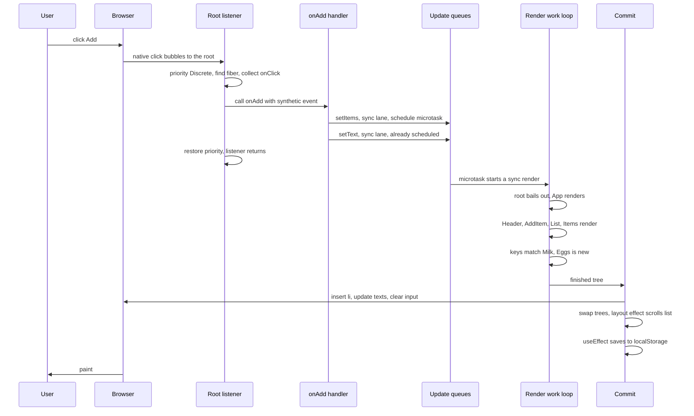
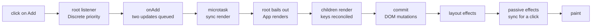

# A Click, Start to Finish

> [!summary] TL;DR
> A click reaches React through the listener on the root, which finds your handler and marks its updates as urgent. Your two `setState` calls only queue updates; once the handler returns, a microtask renders from the root, skips everything that has no work, re-runs `App` and its children, matches list items by key, and commits the DOM changes in one go. Layout effects run next and, because this update came from a click, `useEffect` runs before the browser paints too.

Every part so far looked at one piece of the machine. This one runs the whole machine once. The user has typed "Eggs" into the shopping list's input and clicks **Add**. Between that click and "Eggs" appearing on screen, nearly every idea in this series gets used. Here's the version of the app we'll follow, with two effects added so there's something to see at the end:

```jsx
function App() {
  const [items, setItems] = useState([{ id: 1, name: "Milk", done: false }]);
  const [text, setText] = useState(""); // the user has typed "Eggs"
  useEffect(() => {
    localStorage.setItem("items", JSON.stringify(items));
  }, [items]);
  return (
    <main>
      <Header count={items.length} />
      <AddItem text={text} onChange={setText} onAdd={() => { setItems([...items, { id: Date.now(), name: text, done: false }]); setText(""); }} />
      <List items={items} onToggle={(id) => setItems(items.map(i => i.id === id ? { ...i, done: !i.done } : i))} />
    </main>
  );
}

function List({ items, onToggle }) {
  const ulRef = useRef(null);
  useLayoutEffect(() => {
    ulRef.current.scrollTop = ulRef.current.scrollHeight; // keep the newest item in view
  }, [items.length]);
  return <ul ref={ulRef}>{items.map(item => <Item key={item.id} item={item} onToggle={onToggle} />)}</ul>;
}
```

`AddItem` renders an `<input>` and a `<button onClick={onAdd}>Add</button>`.

## The whole trip at a glance



## Before the click: what's already in place

Nothing about this click starts from scratch. When the app first mounted:

- `createRoot` put one listener per event type on the root container ([[10 Events - One Listener at the Root|Events]]).
- Every component got a fiber, and `App`'s fiber holds a hook list: slot 1 for `items`, slot 2 for `text`, slot 3 for the effect ([[09 Hooks - Why Order Matters|Hooks]]).
- Every DOM node React created carries a hidden pointer to its fiber and its latest committed props.
- The `setItems` and `setText` functions were created once, bound to `App`'s fiber and to their hook's queue.

## 1. The click reaches the root

The browser fires `click` on the button. React's handler isn't on the button, so the event bubbles up the DOM until it hits the root container, where React's bubble listener for `click` is waiting.

That listener was wrapped with a priority when it was installed: `click` is a **discrete** event. Before doing anything else, React sets the current update priority to Discrete. Then it reads the fiber pointer off `event.target` to get the button's fiber, walks up the fiber tree collecting `onClick` handlers from DOM elements, finds exactly one (yours), wraps the native event in a synthetic event, and calls `onAdd`.

## 2. The handler queues two updates

`onAdd` runs:

```jsx
setItems([...items, { id: Date.now(), name: "Eggs", done: false }]);
setText("");
```

Neither call renders anything. Each setter:

1. Picks a **lane**. It asks "what's the current priority?", finds Discrete, and gets the **sync lane** ([[07 Priorities, Transitions and Concurrency|Priorities]]).
2. Adds an update to its hook's queue. (A setter can sometimes compute the new state on the spot and skip work when nothing would change, but here both values differ from the current ones, so both updates stay.)
3. Marks `App`'s fiber as having sync work, and marks every ancestor up to the root with "a descendant has sync work". That trail of marks is what lets the render find `App` quickly.
4. Asks React to schedule the root. The first call queues a **microtask**. The second finds it already queued.

Inside the handler, `items` and `text` are still the old values: they're constants from the render that created this function. That's the snapshot model from [[04 State Updates - Snapshots and Batching|State Updates]].

The handler returns. React restores the previous priority, and the listener returns to the browser.

## 3. The microtask: render right now

The JavaScript stack is empty, so the browser runs microtasks before anything else, including painting. React's microtask looks at the root, sees sync-lane work, and renders it **immediately**, without handing it to the scheduler as a separate task. Both updates are in the same lane, so one render handles both. That's batching, and it's why the user never sees "Eggs" in the list while the input still says "Eggs".

A sync render runs from start to finish without yielding. The fiber work loop does the same unit of work a transition render would: take a fiber, do its work, move to the next. The difference is that the sync loop never stops to check whether the browser needs the thread ([[06 Fiber - Work You Can Pause|Fiber]]).

## 4. Render: from the root down to `App`

Rendering always starts at the root, but it doesn't re-run everything. The root itself has no update and its props didn't change, so it **bails out**. It does see the trail of marks saying a descendant has sync work, so it moves down instead of stopping.

`App`'s props object is the same as last time (the root passed the old one), but `App` has a pending sync update, so React calls `App()`. This time React installs the update dispatcher, and the hooks walk `App`'s list in order:

- Slot 1, `useState`: processes its queue and returns the new array with Milk and Eggs.
- Slot 2, `useState`: processes its queue and returns `""`.
- Slot 3, `useEffect`: compares deps `[items]` with last time. `items` is a new array, so the effect is marked to run after commit.

The state changed, so `App`'s output counts. It returns a brand-new tree of elements ([[03 What Rendering Really Means|Rendering]]).

## 5. Render: the children

`<main>` is the same element type in the same place, so its fiber is reused with new props. Its three children:

- **`Header`** gets `count={2}`, a new props object, so it renders.
- **`AddItem`** gets `text=""` and a new `onAdd`, so it renders.
- **`List`** gets a new `items` array and a new `onToggle`, so it renders. Its `useLayoutEffect` deps `[items.length]` went from `[1]` to `[2]`, so the layout effect is marked too.

Notice that here even `React.memo` or the React Compiler wouldn't skip anything: all three really did get new inputs. Memoization helps when a typed letter changes `text` but leaves `Header` and `List` alone. A click that changes the list touches everything that depends on the list.

## 6. Reconciling the list by key

`List` returns an array of `<Item>` elements, and this is where keys earn their keep ([[05 Reconciliation - Finding What Changed|Reconciliation]]). React compares the new children with the old fibers:

| New element | Key | Match? | Result |
| --- | --- | --- | --- |
| `<Item item={Milk}>` | `1` | yes, same key and type | reuse the fiber, update its props |
| `<Item item={Eggs}>` | the new `Date.now()` id | no old fiber | create a fiber, mark it for **placement** |

The Milk `Item` still re-renders: its `item` is the same object, but `onToggle` is a new function, so its props changed. Its output is the same as before, though, so it won't cause any visible DOM change. The Eggs `Item` renders for the first time, with fresh hooks created by the mount dispatcher.

## 7. Completing the tree

As the work loop finishes each fiber and walks back up, it does the "complete" step. For the new Eggs `<li>`, that means **creating its DOM node now**, off-screen, not attached to the page yet. For existing DOM elements whose props changed, it just flags "check this during commit". No DOM change is visible yet, and none of this can be seen by the user. The render produced a finished tree and a set of flags saying where work is needed.

## 8. Commit: change the DOM, in one go

The commit runs synchronously and never yields ([[08 The Commit Phase and Effects|Commit]]):

1. **Mutation.** React walks only the flagged parts of the tree. It inserts the new `<li>` into the `<ul>`, updates the header's text from 1 to 2, sets the input's value to `""`, and refreshes the hidden props stored on changed nodes so the *next* click finds the new `onAdd`. Elements whose props didn't actually change get no writes.
2. **Swap.** The finished tree becomes the current tree. From now on, this is "what's on screen".
3. **Layout effects.** `List`'s `useLayoutEffect` runs. The DOM already contains Eggs, so `scrollHeight` is correct, and the scroll happens before anything is painted. No flicker.

## 9. Passive effects: before paint, this time

Usually `useEffect` waits for a separate task and tends to run after the browser paints. But this commit came from a **discrete event**, so React flushes passive effects at the end of the commit, while still inside the microtask. `App`'s effect saves the two items to `localStorage` right now. React does this so the result of a click is fully settled before the next input can arrive.

If an effect had called `setState` here, that sync update would be rendered and committed too, still before paint.

> [!warning] "useEffect always runs after paint" isn't true
> For updates from discrete events like this click, `useEffect` runs before the browser paints. For the first render and for transitions, it usually runs after. Use `useLayoutEffect` when you *need* "before paint"; don't rely on either timing for `useEffect`.

## 10. Paint

The microtask finishes, the browser's click task ends, and the browser finally gets the main thread back. It recalculates styles, lays out the page, and paints. The user sees "Eggs" at the bottom of the scrolled list, a count of 2, and an empty input, all at once. Everything from the click to the `localStorage` write ran in one uninterrupted task.



> [!tip] Mental model
> An event only *queues* work; React then does that work in two strict phases. Render figures out what changed and can be thrown away, while commit applies the changes and runs effects. For a click, all of it fits inside one browser task, before the next paint.

## Common misconceptions

- **"`setItems` updates `items` immediately"**: it queues an update. `items` in the handler is still the old snapshot, and the new value appears on the next render.
- **"Two `setState` calls mean two renders"**: both get the sync lane and are rendered together in one microtask.
- **"React re-renders the whole app on every click"**: rendering starts at the root but skips everything without work, and only components below the updated one run again.
- **"Every re-rendered component touches the DOM"**: the Milk `Item` re-rendered and changed nothing visible in the DOM. Commit writes only what actually changed.

## Summary

One click exercised the whole machine. The root listener set a Discrete priority, found the button's fiber and called your handler, whose two setters queued sync-lane updates, left a trail of marks to the root and scheduled one microtask. That microtask rendered from the root, bailed out where nothing had work, re-ran `App` with its hooks in order, re-rendered its children and reconciled the list by key, then committed every DOM change in one go, ran the layout effect, and, because the update came from a click, flushed `useEffect` before paint. The model to keep: events queue, render computes, commit applies, and the browser paints only when all of that is done.

### Key takeaways

- **Root listener**: the click is caught at the root, where React finds the target's fiber, collects `onClick` handlers and sets Discrete priority.
- **Setters queue**: `setItems` and `setText` each add an update with the sync lane and mark the path to the root.
- **Snapshot**: inside the handler, `items` and `text` keep the values from the render that created it.
- **Batching**: one microtask renders both updates together after the handler returns.
- **Sync render**: sync-lane work renders immediately in that microtask and never yields.
- **Bail out to the work**: the root skips itself and follows the marks down to `App`, which re-runs its hooks in order.
- **Children re-render**: `Header`, `AddItem` and `List` all get new inputs, so even memoization wouldn't skip them here.
- **Keys**: the Milk fiber is matched and reused, the Eggs element gets a new fiber and a placement.
- **Commit**: DOM mutations, then the tree swap, then layout effects, all synchronously.
- **Effects and paint**: for a click, `useEffect` is flushed at the end of the commit, before the browser paints the new frame.

**Go deeper:** [[21 Walkthrough - setState to Pixels|setState to Pixels]] · [[20 Walkthrough - First Render End to End|First Render End to End]]

---

← [[11 Memoization and the React Compiler|Prev]] · [[react-concepts|Index]] · [[react-concepts|Next]] →
