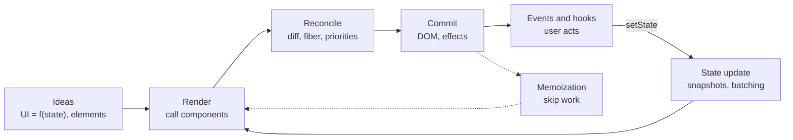

# How React Works

You use React every day. You know that `setState` "triggers a re-render", that keys "help React", that `useEffect` "runs after render". This course replaces those half-sentences with a model you can actually reason with: what a render is, why state looks stale right after you set it, how React decides what changed, why it can pause work, what the commit phase does, and why the rules of hooks exist.

It is written for working React developers who have never looked inside. You need no knowledge of React's source. Every part explains one idea in plain terms, with one small shopping list app as the running example, so each new concept lands on code you have already seen. Diagrams show the flows, and every part ends with a short recap.

This is the conceptual companion to [[react-explain|React Internals]]. That course walks through React 19.3.1 line by line, with every claim tied to the source. This one stays at the level of ideas and never asks you to read React's code. They pair well: read a part here to get the model, then follow its **Go deeper** link into React Internals when you want to see exactly how the model is implemented.

> [!tip] How to read this
> Read the parts in order the first time: each one builds on the vocabulary of the one before. Parts 1 to 4 cover what you write and what a render is. Parts 5 to 8 cover how React finds and applies changes. Parts 9 to 11 cover hooks, events and memoization. Part 12 replays a single click from start to finish and ties everything together. If you only have twenty minutes, read [[01 The Big Idea - UI Is a Function of State|part 1]] and [[12 A Click, Start to Finish|part 12]].

## Parts

1. [[01 The Big Idea - UI Is a Function of State|The big idea: UI is a function of state]]
2. [[02 Elements, Components and the Tree|Elements, components and the tree]]
3. [[03 What Rendering Really Means|What rendering really means]]
4. [[04 State Updates - Snapshots and Batching|State updates: snapshots and batching]]
5. [[05 Reconciliation - Finding What Changed|Reconciliation: finding what changed]]
6. [[06 Fiber - Work You Can Pause|Fiber: work you can pause]]
7. [[07 Priorities, Transitions and Concurrency|Priorities, transitions and concurrency]]
8. [[08 The Commit Phase and Effects|The commit phase and effects]]
9. [[09 Hooks - Why Order Matters|Hooks: why order matters]]
10. [[10 Events - One Listener at the Root|Events: one listener at the root]]
11. [[11 Memoization and the React Compiler|Memoization and the React Compiler]]
12. [[12 A Click, Start to Finish|A click, start to finish]]

## The learning path

