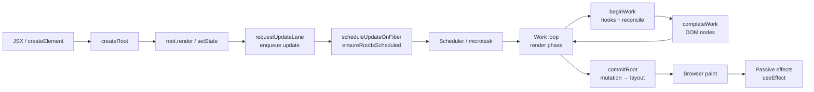

# React Internals: from `createRoot` to pixels

> [!summary] TL;DR
> React does its work in two phases. The **render phase** is pure and *can* be interrupted (in practice only for transition, retry and idle work, because the first mount and clicks render synchronously): it calls your components and diffs the old fiber tree against the new one. The **commit phase** is synchronous: it changes the DOM and runs effects. Everything else exists to decide *when* to run those phases (lanes + Scheduler) and *how little* work they can get away with (bailouts). The React Compiler leaves that machinery alone. It rewrites your components so they hand React the *same objects* when nothing changed, which lets the existing bailouts kick in.

All pages are pinned to **React v19.3.1**. Footnotes link to the v19.3.1 tag on GitHub with exact line ranges. The compiler examples were compiled with the real `babel-plugin-react-compiler@1.0.0`.

## Start here: the two stories

1. [[20 Walkthrough - First Render End to End|First Render Walkthrough]]: `createRoot(el).render(<App/>)` all the way to the first paint.
2. [[21 Walkthrough - setState to Pixels|setState Walkthrough]]: a click calls `setCount(c => c + 1)`, and this page follows it until you see the new number.

Each walkthrough is the short narrative. The pages below are the deep dives it links into.

## The big picture

## Deep dives

### Setup
- [[01 Bootstrap - Packages, JSX and the Dispatcher|01 · Bootstrap]]: how `react`, `react-dom`, the reconciler and the scheduler fit together, what JSX compiles to, and how `useState` reaches the reconciler.
- [[02 createRoot - FiberRoot and HostRoot|02 · createRoot]]: `FiberRootNode`, the `HostRoot` fiber, and root event listeners.
- [[03 root.render - Scheduling the First Update|03 · root.render]]: the first update object and how it gets scheduled.

### Core machinery
- [[04 Lanes and the Scheduler|04 · Lanes & Scheduler]]: priorities as bitmasks, plus time slicing with MessageChannel.
- [[05 The Fiber Data Structure|05 · Fiber]]: the unit of work, and double buffering with `current` and `alternate`.

### Render phase
- [[06 The Work Loop - Render Phase|06 · Work Loop]]: `performUnitOfWork` and the depth-first walk.
- [[07 beginWork and Reconciliation|07 · beginWork & Reconciliation]]: bailouts, child diffing and keys.
- [[10 Hooks on Mount|10 · Hooks on Mount]]: how the hook linked list gets built.
- [[11 Hooks on Update|11 · Hooks on Update]]: processing update queues, plus deps comparison.
- [[08 completeWork - Building DOM Nodes|08 · completeWork]]: off-screen DOM construction and bubbling flags.

### Commit phase
- [[09 Commit Phase - Mutation, Layout, Passive Effects|09 · Commit Phase]]: DOM mutation, the tree swap, layout effects, paint, then passive effects.

### Updates
- [[13 The Event System|13 · Event System]]: root delegation, synthetic events, and how event priority is decided.
- [[12 setState - dispatchSetState and Batching|12 · setState]]: lanes, the eager bailout, and batching.

### React Compiler
- [[14 React Compiler - How It Works|14 · React Compiler]]: the Babel pipeline, real compiled output and `useMemoCache`.
- [[15 Rendering With vs Without the Compiler|15 · With vs Without Compiler]]: the same app traced both ways.

## Reading order suggestions
- **Quick tour:** 20 → 21 → 15.
- **Full depth:** 01 → 15 in order, then reread 20 and 21.
- **Only care about the compiler:** 07 (bailout section) → 14 → 15.
