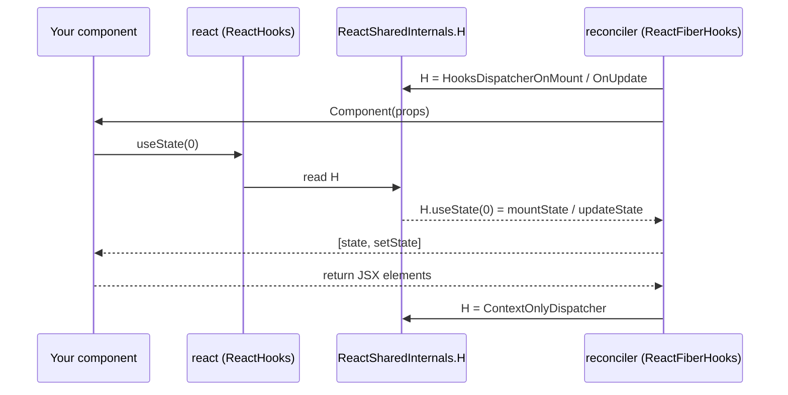

# Bootstrap - Packages, JSX and the Dispatcher

> [!summary] TL;DR
> `react` is a small package. It builds plain element objects (`jsx()`) and holds one shared mutable object, `ReactSharedInternals`, with slots like `H` (the hooks dispatcher) and `T` (the current transition). It knows nothing about fibers or the DOM. `react-dom` bundles the reconciler, which is compiled against a DOM "host config", and right before it calls your component it puts its own dispatcher into `ReactSharedInternals.H`. That is how `useState` imported from `react` ends up running reconciler code.

## The package split, and why it is shaped this way

The first surprise is that the code you import from is not the code that does the work.

| Package | What it contains | Knows about fibers? | Knows about DOM? |
|---|---|---|---|
| `react` | `jsx`/`createElement`, `Component`, hook *stubs* (`useState` and friends), `startTransition`, `memo`, `lazy`, context objects, `ReactSharedInternals` | No | No |
| `react-reconciler` | The fiber work loop, `beginWork`/`completeWork`/commit, hooks implementation, lanes | Yes | No (talks to a host config) |
| `react-dom` | `createRoot`, `hydrateRoot`, `flushSync`, portals, plus a **bundled copy of the reconciler** built against `ReactFiberConfigDOM`, plus the event system | Yes (bundled) | Yes |
| `scheduler` | A priority task queue on top of `MessageChannel` (see [[04 Lanes and the Scheduler\|Lanes & Scheduler]]) | No | No |

`react-dom`'s `package.json` lists only `scheduler` as a dependency and `react` as a peer dependency.[^domdeps] The reconciler is not a runtime dependency. It is inlined into the `react-dom` bundle at build time. The Rollup bundle for `react-dom/client` keeps `react` and `react-dom` external[^bundle], and the build marks all `dependencies` and `peerDependencies` of a package as external too.[^getdeps] So `react-dom-client.production.js` contains a full private copy of the reconciler. `react-native` and `react-three-fiber` (via the public `react-reconciler` npm package) each ship their own copy.

Why split it like this?

- **One component model, many renderers.** A component written against `react` runs under DOM, Native, ART or a custom renderer. Only the host config changes.
- **Libraries depend only on `react`.** A component library should not pin `react-dom`, so `react` has to be importable with no renderer present.
- **A single source of truth for "who is rendering right now".** That is the shared internals object below.

> [!warning] Misconception: "React keeps a virtual DOM and diffs it against the real DOM"
> React never diffs against the DOM. It compares **new elements** (cheap, throwaway objects made by `jsx()`) with the **current fiber tree** (long-lived, mutable work units; see [[05 The Fiber Data Structure|Fiber]]). It only touches the DOM in the commit phase, through host-config calls. "Virtual DOM" is a fair marketing word for elements, but the structure that does the work is the fiber tree.

## The JSX transform

Since React 17 the "automatic runtime" compiles JSX into calls to `react/jsx-runtime`, not `React.createElement`. React 19 requires it, because ref-as-prop and the faster element creation depend on it.[^upgrade]

```jsx
// source
<Button kind="primary" key={id} ref={btnRef}>Save</Button>

// output (automatic runtime, production)
import { jsx as _jsx } from "react/jsx-runtime";
_jsx(Button, { kind: "primary", ref: btnRef, children: "Save" }, id);
```

Notice what changed compared with `createElement(type, props, ...children)`:

- `children` goes into the props object. It is not passed as varargs.
- `key` is a **separate third argument**. The compiler pulls it out, so the runtime does not have to scan props for it.
- `ref` stays **in props**. That is the React 19 "ref as a prop" change.

`react/jsx-runtime` exports `jsx` and `jsxs` (static children; it differs only in DEV key validation). In production both point to `jsxProd`. In DEV, `jsx`/`jsxs` are dev wrappers, and `jsxDEV` comes from `react/jsx-dev-runtime`.[^jsxexports]

### `jsxProd` and the element shape

`jsxProd` does very little work, and that is on purpose: it runs for every element in every render.[^jsxprod]

```js
// packages/react/src/jsx/ReactJSXElement.js (simplified)
export function jsxProd(type, config, maybeKey) {
  let key = null;
  if (maybeKey !== undefined) key = '' + maybeKey;
  if (hasValidKey(config)) key = '' + config.key;   // <div {...props} /> with key spread in

  let props;
  if (!('key' in config)) {
    props = config;               // reuse the compiler-created object as props: zero copy
  } else {
    props = {};
    for (const propName in config) if (propName !== 'key') props[propName] = config[propName];
  }
  return ReactElement(type, key, props, getOwner(), undefined, undefined);
}
```

The "reuse `config` as `props`" fast path is only safe because `jsx` is a *compiler target*: the compiler always passes a fresh object literal. `createElement` cannot assume that, so it always copies. The source comment says exactly this.[^jsxprod]

`ReactElement` builds the object itself:[^reactelement]

```js
// production shape
{
  $$typeof: REACT_ELEMENT_TYPE,   // Symbol.for('react.transitional.element')
  type,                            // 'div' | function | class | memo/lazy/context object...
  key,                             // string | null
  ref,                             // mirrors props.ref (deprecated accessor)
  props,                           // includes children and ref
}
```

Details worth knowing:

- **`$$typeof` is a Symbol on purpose.** JSON cannot contain Symbols. So a server response that someone tricks into rendering as `{type: 'div', props: {dangerouslySetInnerHTML: ...}}` is not treated as an element. That is the old XSS defence. In React 19 the symbol is `react.transitional.element`, not the old `react.element`.[^symbols] Elements from a copy of React 18 bundled into the same page are therefore **rejected** ("Objects are not valid as a React child"). This is often the first sign of a duplicate-React problem.
- **`element.ref` is now a deprecated mirror.** The comment says `props.ref` is the source of truth. In DEV, `element.ref` is a non-enumerable getter that warns when read.[^reactelement] For `forwardRef`-free components in 19, `ref` arrives in `props` just like any other prop.
- **DEV elements are frozen.** In DEV, `Object.freeze(element.props)` and `Object.freeze(element)` run, and extra non-enumerable fields (`_store`, `_debugInfo`, `_debugStack`, `_debugTask`) are attached.[^reactelement] Mutating props "works" in production and throws in DEV. Don't do it.
- **`_owner`** (DEV only in this version) records which component created the element. It powers owner stacks in error messages.

Elements are **immutable descriptions, created fresh on every render**. They do not have identity across renders. Fibers do. Reconciliation (see [[07 beginWork and Reconciliation|beginWork & Reconciliation]]) is the step that maps "this element at this position/key" onto "that existing fiber".

## `ReactSharedInternals`: the switchboard

`react` exports one oddly named object:

```js
// packages/react/src/ReactClient.js
export { ReactSharedInternals as __CLIENT_INTERNALS_DO_NOT_USE_OR_WARN_USERS_THEY_CANNOT_UPGRADE, ... }
```

[^clientexport] Renderers import it through `shared/ReactSharedInternals`, which is literally `React.__CLIENT_INTERNALS_DO_NOT_USE_OR_WARN_USERS_THEY_CANNOT_UPGRADE`.[^sharedshim] Because the renderer reads it from *the `react` module it was given*, both sides share the same object at runtime. The fields:[^internals]

| Field | Old name | Meaning |
|---|---|---|
| `H` | `ReactCurrentDispatcher` | The **hooks dispatcher**: an object with `useState`, `useEffect`, ... set by the renderer while a component is rendering |
| `A` | `ReactCurrentCache` | The async dispatcher (cache / `getOwner`), set by the work loop |
| `T` | `ReactCurrentBatchConfig` | The **current transition** object. `startTransition` sets it, and `requestUpdateLane` reads it |
| `S` | | Callback run when a transition starts (used by the reconciler for async actions) |
| `G` | | Gesture transition hook (behind `enableGestureTransition`) |
| DEV: `actQueue`, `thrownErrors`, `getCurrentStack`, ... | | testing (`act`) and debugging support |

Short one-letter keys are used because these properties are read on every hook call and survive minification as property names. Old long names like `ReactCurrentDispatcher.current` cost bytes and an extra hop.

`react-dom` has its own internals too. `ReactDOMSharedInternals.p` holds the **current update priority** (used by [[13 The Event System|Event System]] and `requestUpdateLane`), and `.d` holds the DOM resource dispatcher for `preload` and the like.[^domint]

### How `useState` from `react` reaches the reconciler

In `react`, a hook is just a forwarding stub:[^reacthooks]

```js
// packages/react/src/ReactHooks.js (simplified)
function resolveDispatcher() {
  const dispatcher = ReactSharedInternals.H;
  // DEV: if null, console.error('Invalid hook call...')
  return dispatcher;
}
export function useState(initialState) {
  const dispatcher = resolveDispatcher();
  return dispatcher.useState(initialState);
}
```

The reconciler installs the real implementation in `renderWithHooks`, just before it calls your function:[^renderwithhooks]

```js
// packages/react-reconciler/src/ReactFiberHooks.js (prod branch, simplified)
ReactSharedInternals.H =
  current === null || current.memoizedState === null
    ? HooksDispatcherOnMount     // useState -> mountState
    : HooksDispatcherOnUpdate;   // useState -> updateState
let children = Component(props, secondArg);
// ...
finishRenderingHooks(current, workInProgress, Component); // sets H = ContextOnlyDispatcher
```

`HooksDispatcherOnMount.useState` is `mountState`.[^mountdispatcher] When the component returns, `finishRenderingHooks` resets `H` to `ContextOnlyDispatcher`, where every hook except `readContext`/`use` is `throwInvalidHookError`.[^finishhooks][^contextonly] The work loop also wraps the whole render in `pushDispatcher`/`popDispatcher`, which sets `H = ContextOnlyDispatcher` for the duration of `renderRootSync`/`renderRootConcurrent`.[^pushdispatcher][^pushcalls]



That explains the three causes listed in the famous "Invalid hook call" error:[^throwinvalid]

1. **Hook called outside render.** `H` is `null` (no render has started yet) or `ContextOnlyDispatcher` (between components). You get a DEV `console.error` or a thrown error.
2. **Mismatched React and renderer versions.** The renderer's dispatcher lacks a method the `react` stub calls.
3. **Two copies of React.** Your component imported `react` copy B, but `react-dom` sets `H` on copy A's internals. Copy B's `H` stays `null`. Nothing is "wrong" with the hook. The two switchboards just never meet.

> [!tip] Why the mount/update dispatcher split matters
> The choice is made per component, per render, based on whether a `current` fiber with hook state exists. Mount hooks *allocate* hook objects in a linked list on `fiber.memoizedState`. Update hooks *walk* that list in order. This is the real mechanism behind the Rules of Hooks: calling hooks conditionally desynchronises the walk. See [[10 Hooks on Mount|Hooks on Mount]] and [[11 Hooks on Update|Hooks on Update]].

### StrictMode double render lives here too

In DEV, if the fiber has `StrictLegacyMode`, `renderWithHooks` calls `renderWithHooksAgain` a second time after the first call.[^strictdouble] The source comment is precise about a non-obvious detail: the second call **reuses hook state from the first**, so `useMemo` does not recompute on the second pass. To still catch impure memo functions, *user functions are double-invoked during the first pass* instead. The React 19 upgrade guide describes the visible result: `useMemo`/`useCallback` reuse the first render's result during the second render.[^upgrade] This is DEV only. Production never double-renders, so "my effect ran twice" bugs exist only on your machine, by design.

## The host config: how the reconciler stays DOM-agnostic

The reconciler imports from `./ReactFiberConfig`, but that file only throws:[^configshim]

```js
// packages/react-reconciler/src/ReactFiberConfig.js
throw new Error('This module must be shimmed by a specific renderer.');
```

At build time, Rollup's fork mechanism swaps it for `forks/ReactFiberConfig.<renderer>.js`.[^forks] For DOM, that fork re-exports `react-dom-bindings/src/client/ReactFiberConfigDOM`.[^domfork] The host config is a flat list of functions and constants the reconciler calls. A few you'll meet later:

| Host-config export | Used by | Page |
|---|---|---|
| `createInstance`, `createTextInstance`, `appendInitialChild`, `finalizeInitialChildren`, `shouldSetTextContent` | completeWork builds detached DOM | [[08 completeWork - Building DOM Nodes\|completeWork]] |
| `prepareForCommit`, `resetAfterCommit`, `appendChildToContainer`, `commitUpdate`, `commitMount`, `removeChild` | commit mutations | [[09 Commit Phase - Mutation, Layout, Passive Effects\|Commit Phase]] |
| `scheduleMicrotask`, `scheduleTimeout` | root scheduler | [[03 root.render - Scheduling the First Update\|root.render]] |
| `resolveUpdatePriority` | `requestUpdateLane` | [[04 Lanes and the Scheduler\|Lanes & Scheduler]] |
| `supportsMutation = true`, `isPrimaryRenderer = true` | selects the mutation code paths | |

Line numbers for these are in the footnotes.[^hostfns] Because the host config is resolved **at build time** and not injected at runtime, calls into it are direct function calls the minifier can inline. A runtime "renderer interface" object would add a dynamic dispatch to every DOM operation.

> [!note] DOM-specific does not mean "in the reconciler"
> Things like `className` vs `class`, `style` objects, controlled inputs and event delegation all live in `react-dom-bindings`. The reconciler only knows "create instance of `type` with `props`" and "commit an update to this instance".

## Putting it in order: what is loaded before anything renders

1. `import React from 'react'` evaluates `ReactSharedInternalsClient`: `{H: null, A: null, T: null, S: null}` (plus DEV fields).[^internals]
2. `import { createRoot } from 'react-dom/client'` evaluates the bundled reconciler and the DOM host config. The event system builds its `allNativeEvents` registry. The Scheduler picks `MessageChannel` (browser) or `setImmediate` (Node) for its host callback (see [[04 Lanes and the Scheduler|Lanes & Scheduler]]).
3. Your module graph evaluates. Every JSX expression at module top level (rare) runs `jsx()` immediately. Component bodies do not run yet.
4. `createRoot(container)` builds the FiberRoot and the HostRoot fiber and attaches listeners. See [[02 createRoot - FiberRoot and HostRoot|createRoot]].
5. `root.render(<App />)` creates **one** element (`<App />`), enqueues it as an update on the HostRoot, and schedules work. See [[03 root.render - Scheduling the First Update|root.render]]. `App` itself has still not been called. That happens in the [[06 The Work Loop - Render Phase|Work Loop]].

## With the React Compiler

The compiler does not change any of the bootstrap machinery. It rewrites *component bodies*. The one bootstrap-level touch point is an extra import in compiled modules:

```js
import { c as _c } from "react/compiler-runtime";
function Greeting(props) {
  const $ = _c(2);          // allocate/read a 2-slot memo cache for this fiber
  // ...
}
```

In React 19, `react/compiler-runtime` re-exports `useMemoCache` as `c`.[^compilerruntime] `useMemoCache` in `react` is a stub that forwards to the dispatcher like every other hook.[^usememocachestub] So `_c(n)` runs through the **same** `ReactSharedInternals.H` path described above and ends in the reconciler's `useMemoCache`, which keeps the cache array on the fiber's update queue.[^usememocacheimpl] React itself exposes the runtime as `__COMPILER_RUNTIME`.[^compilerexport] The standalone `react-compiler-runtime` npm package re-exports `React.__COMPILER_RUNTIME.c` when present and otherwise polyfills it with a `useMemo` of a sentinel-filled array, for React 17/18.[^polyfill] How the compiler decides what goes into those slots is covered in [[14 React Compiler - How It Works|React Compiler]], and the runtime effect in [[15 Rendering With vs Without the Compiler|With vs Without Compiler]].

## Summary

The code you import is not the code that does the work. `react` builds throwaway element objects and owns one shared switchboard, `ReactSharedInternals`. `react-dom` carries a private copy of the reconciler, compiled against the DOM host config, and plugs its own dispatcher into that switchboard right before calling your component. So a hook is a forwarding stub whose behaviour depends on what the renderer put in `H`. Nothing has rendered yet: [[02 createRoot - FiberRoot and HostRoot|createRoot]] builds the root objects next.

### Key takeaways

- **Package split**: `react` knows nothing about fibers or the DOM, so one component model runs under many renderers.
- **`jsxProd`**: `key` arrives as a separate argument, `ref` stays in props, and the compiler-created object is reused as `props` when no `key` is spread in.
- **React elements**: immutable, recreated every render, tagged with a `$$typeof` Symbol JSON cannot contain; fibers, not elements, have identity.
- **`ReactSharedInternals`**: the one mutable object both sides share, with slots such as `H` (hooks dispatcher) and `T` (current transition).
- **Hook stubs**: `useState` from `react` reads `ReactSharedInternals.H` and forwards the call.
- **`renderWithHooks`**: installs `HooksDispatcherOnMount` or `HooksDispatcherOnUpdate` before your component runs, then `H` is reset to `ContextOnlyDispatcher`.
- **"Invalid hook call"**: a hook outside render, mismatched versions, or two copies of React whose switchboards never meet.
- **Host config**: swapped in at build time, so DOM operations are direct function calls, not runtime dispatch.
- **React Compiler**: `_c(n)` is `useMemoCache` and goes through the same `H` path.

← [[00 React Internals Index|Prev]] · [[00 React Internals Index|Index]] · [[02 createRoot - FiberRoot and HostRoot|Next]] →

[^domdeps]: `react-dom` dependencies — [packages/react-dom/package.json#L19-L24](https://github.com/facebook/react/blob/v19.3.1/packages/react-dom/package.json#L19-L24)
[^bundle]: `react-dom/client` bundle definition — [scripts/rollup/bundles.js#L193-L200](https://github.com/facebook/react/blob/v19.3.1/scripts/rollup/bundles.js#L193-L200)
[^getdeps]: `getDependencies` treats deps and peerDeps as external — [scripts/rollup/modules.js#L49-L60](https://github.com/facebook/react/blob/v19.3.1/scripts/rollup/modules.js#L49-L60)
[^upgrade]: React 19 Upgrade Guide (new JSX transform required, `ReactDOM.render` removed, `element.ref` deprecated, StrictMode memo reuse) — https://react.dev/blog/2024/04/25/react-19-upgrade-guide
[^jsxexports]: `jsx`/`jsxs`/`jsxDEV` exports — [packages/react/src/jsx/ReactJSX.js#L17-L28](https://github.com/facebook/react/blob/v19.3.1/packages/react/src/jsx/ReactJSX.js#L17-L28)
[^jsxprod]: `jsxProd` — [packages/react/src/jsx/ReactJSXElement.js#L291-L348](https://github.com/facebook/react/blob/v19.3.1/packages/react/src/jsx/ReactJSXElement.js#L291-L348)
[^reactelement]: `ReactElement` (element shape, ref deprecation, DEV freeze) — [packages/react/src/jsx/ReactJSXElement.js#L170-L283](https://github.com/facebook/react/blob/v19.3.1/packages/react/src/jsx/ReactJSXElement.js#L170-L283)
[^symbols]: `REACT_ELEMENT_TYPE = Symbol.for('react.transitional.element')` — [packages/shared/ReactSymbols.js#L14-L18](https://github.com/facebook/react/blob/v19.3.1/packages/shared/ReactSymbols.js#L14-L18)
[^clientexport]: Internals exported from `react` — [packages/react/src/ReactClient.js#L110](https://github.com/facebook/react/blob/v19.3.1/packages/react/src/ReactClient.js#L110)
[^sharedshim]: `shared/ReactSharedInternals` reads React's export — [packages/shared/ReactSharedInternals.js#L10-L15](https://github.com/facebook/react/blob/v19.3.1/packages/shared/ReactSharedInternals.js#L10-L15)
[^internals]: `SharedStateClient` type and initial object — [packages/react/src/ReactSharedInternalsClient.js#L24-L80](https://github.com/facebook/react/blob/v19.3.1/packages/react/src/ReactSharedInternalsClient.js#L24-L80)
[^domint]: `ReactDOMSharedInternals` (`d`, `p`) — [packages/react-dom/src/ReactDOMSharedInternals.js#L46-L50](https://github.com/facebook/react/blob/v19.3.1/packages/react-dom/src/ReactDOMSharedInternals.js#L46-L50)
[^reacthooks]: `resolveDispatcher` and `useState` stub — [packages/react/src/ReactHooks.js#L24-L71](https://github.com/facebook/react/blob/v19.3.1/packages/react/src/ReactHooks.js#L24-L71)
[^renderwithhooks]: `renderWithHooks` dispatcher selection — [packages/react-reconciler/src/ReactFiberHooks.js#L505-L634](https://github.com/facebook/react/blob/v19.3.1/packages/react-reconciler/src/ReactFiberHooks.js#L505-L634)
[^mountdispatcher]: `HooksDispatcherOnMount` (`useState: mountState`) — [packages/react-reconciler/src/ReactFiberHooks.js#L3926-L3952](https://github.com/facebook/react/blob/v19.3.1/packages/react-reconciler/src/ReactFiberHooks.js#L3926-L3952)
[^finishhooks]: `finishRenderingHooks` resets `H` — [packages/react-reconciler/src/ReactFiberHooks.js#L636-L660](https://github.com/facebook/react/blob/v19.3.1/packages/react-reconciler/src/ReactFiberHooks.js#L636-L660)
[^contextonly]: `ContextOnlyDispatcher` — [packages/react-reconciler/src/ReactFiberHooks.js#L3898-L3924](https://github.com/facebook/react/blob/v19.3.1/packages/react-reconciler/src/ReactFiberHooks.js#L3898-L3924)
[^throwinvalid]: `throwInvalidHookError` — [packages/react-reconciler/src/ReactFiberHooks.js#L445-L454](https://github.com/facebook/react/blob/v19.3.1/packages/react-reconciler/src/ReactFiberHooks.js#L445-L454)
[^pushdispatcher]: `pushDispatcher` / `popDispatcher` — [packages/react-reconciler/src/ReactFiberWorkLoop.js#L2489-L2504](https://github.com/facebook/react/blob/v19.3.1/packages/react-reconciler/src/ReactFiberWorkLoop.js#L2489-L2504)
[^pushcalls]: `pushDispatcher` call sites in `renderRootSync` / `renderRootConcurrent` — [packages/react-reconciler/src/ReactFiberWorkLoop.js#L2630](https://github.com/facebook/react/blob/v19.3.1/packages/react-reconciler/src/ReactFiberWorkLoop.js#L2630) and [#L2782](https://github.com/facebook/react/blob/v19.3.1/packages/react-reconciler/src/ReactFiberWorkLoop.js#L2782)
[^strictdouble]: StrictMode double render via `renderWithHooksAgain` — [packages/react-reconciler/src/ReactFiberHooks.js#L565-L629](https://github.com/facebook/react/blob/v19.3.1/packages/react-reconciler/src/ReactFiberHooks.js#L565-L629)
[^configshim]: Host config placeholder — [packages/react-reconciler/src/ReactFiberConfig.js#L12-L20](https://github.com/facebook/react/blob/v19.3.1/packages/react-reconciler/src/ReactFiberConfig.js#L12-L20)
[^forks]: Rollup fork for `ReactFiberConfig.js` — [scripts/rollup/forks.js#L235-L263](https://github.com/facebook/react/blob/v19.3.1/scripts/rollup/forks.js#L235-L263)
[^domfork]: DOM fork re-exports `ReactFiberConfigDOM` — [packages/react-reconciler/src/forks/ReactFiberConfig.dom.js](https://github.com/facebook/react/blob/v19.3.1/packages/react-reconciler/src/forks/ReactFiberConfig.dom.js)
[^hostfns]: DOM host config functions: `prepareForCommit` L424, `resetAfterCommit` L457, `createInstance` L534, `appendInitialChild` L695, `finalizeInitialChildren` L703, `shouldSetTextContent` L744, `createTextInstance` L757, `isPrimaryRenderer` L827, `scheduleTimeout` L832, `scheduleMicrotask` L871, `supportsMutation` L889, `commitMount` L891, `commitUpdate` L999, `appendChildToContainer` L1082, `removeChild` L1213 — [packages/react-dom-bindings/src/client/ReactFiberConfigDOM.js](https://github.com/facebook/react/blob/v19.3.1/packages/react-dom-bindings/src/client/ReactFiberConfigDOM.js#L424-L1220)
[^compilerruntime]: `react/compiler-runtime` → `useMemoCache as c` — [packages/react/src/ReactCompilerRuntime.js#L10](https://github.com/facebook/react/blob/v19.3.1/packages/react/src/ReactCompilerRuntime.js#L10)
[^usememocachestub]: `useMemoCache` stub in `react` — [packages/react/src/ReactHooks.js#L212-L216](https://github.com/facebook/react/blob/v19.3.1/packages/react/src/ReactHooks.js#L212-L216)
[^usememocacheimpl]: Reconciler `useMemoCache` — [packages/react-reconciler/src/ReactFiberHooks.js#L1181-L1263](https://github.com/facebook/react/blob/v19.3.1/packages/react-reconciler/src/ReactFiberHooks.js#L1181-L1263)
[^compilerexport]: `__COMPILER_RUNTIME` export — [packages/react/src/ReactClient.js#L66](https://github.com/facebook/react/blob/v19.3.1/packages/react/src/ReactClient.js#L66) and [#L111](https://github.com/facebook/react/blob/v19.3.1/packages/react/src/ReactClient.js#L111)
[^polyfill]: `react-compiler-runtime` `c` re-export / polyfill — [compiler/packages/react-compiler-runtime/src/index.ts#L19-L40](https://github.com/facebook/react/blob/v19.3.1/compiler/packages/react-compiler-runtime/src/index.ts#L19-L40)
