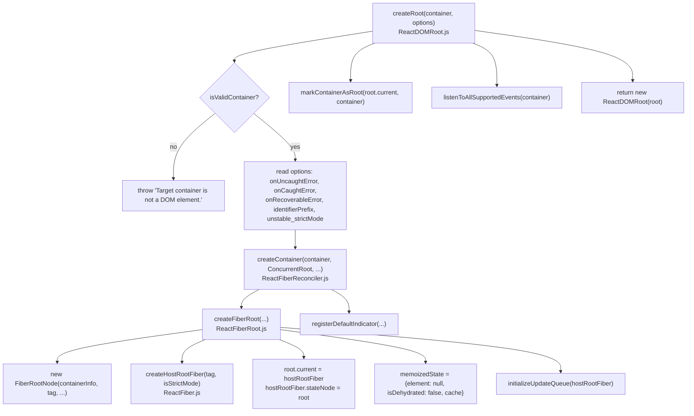
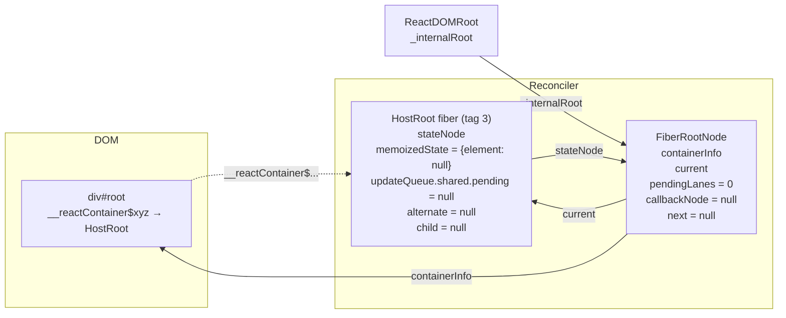

# createRoot - FiberRoot and HostRoot

> [!summary] TL;DR
> `createRoot(container)` renders nothing. It checks the container, builds two linked objects, and attaches every event listener React will ever need to the container. The two objects are a **FiberRoot** (a non-fiber bookkeeping object for the whole tree: pending lanes, scheduled callback, container) and a **HostRoot fiber** (the top of the fiber tree). Then it returns a thin `ReactDOMRoot` wrapper. The circular link `root.current.stateNode === root` is the spine everything else hangs off.

## The call chain



## Step 1: validation and options

`createRoot` lives in `react-dom/src/client/ReactDOMRoot.js` and is exported through `react-dom/client`.[^createroot][^clientexports] The first line is `isValidContainer`, which accepts an Element, a Document or a DocumentFragment. Unless `disableCommentsAsDOMContainers` is set, it also accepts a comment node with the exact text `' react-mount-point-unstable '`.[^isvalid] Anything else throws `Target container is not a DOM element.`. In practice this happens when `document.getElementById('root')` returns `null` because the script ran before the DOM was parsed.

`warnIfReactDOMContainerInDEV` then warns in DEV if the container is already marked as a root, i.e. you called `createRoot` twice on the same container (or on one previously passed to legacy `ReactDOM.render`).[^warncontainer] After that the options are copied into local variables.[^createroot] Two DEV-only checks are worth knowing:

- passing `{hydrate: true}` warns you to use `hydrateRoot`,
- passing a JSX element as the options argument (`createRoot(el, <App/>)`, a leftover habit from the old `ReactDOM.render(el, container)` argument order) prints a helpful error.

`concurrentUpdatesByDefaultOverride` is hardcoded to `false`, and the reconciler comment says it is ignored.[^createcontainer] Since `disableLegacyMode` is `true` in this build, every root is a `ConcurrentRoot`.[^flags]

> [!warning] `ReactDOM.render` is gone in 19
> `react-dom`'s main entry now exports only `createPortal`, `flushSync`, the resource hints (`preload`, `preinit`, ...), `requestFormReset`, `unstable_batchedUpdates`, `useFormState`, `useFormStatus` and `version`. There is no `render`, `hydrate`, `unmountComponentAtNode` or `findDOMNode`.[^domindex] The upgrade guide documents the migration to `createRoot(...).render(...)`.[^upgrade] Legacy mode used to make updates outside batched handlers flush synchronously. With only concurrent roots, every update now goes through lanes and the microtask scheduler (see [[03 root.render - Scheduling the First Update|root.render]]). That is why "automatic batching" is unconditional in 19.

## Step 2: `createContainer` → `createFiberRoot`

`createContainer` is a thin adapter. It fixes `hydrate = false` and `initialChildren = null`, calls `createFiberRoot`, and registers the default transition indicator.[^createcontainer] `hydrateRoot` uses the sibling `createHydrationContainer`. That one *does* enqueue an initial update right away, because hydration has to match server HTML.[^createhydration]

`createFiberRoot` is where the structure is built:[^createfiberroot]

```js
// packages/react-reconciler/src/ReactFiberRoot.js (simplified)
const root = new FiberRootNode(containerInfo, tag, hydrate, identifierPrefix,
                               onUncaughtError, onCaughtError, onRecoverableError, ...);

// Cyclic construction. This cheats the type system right now because stateNode is any.
const uninitializedFiber = createHostRootFiber(tag, isStrictMode);
root.current = uninitializedFiber;
uninitializedFiber.stateNode = root;

const initialCache = createCache();
retainCache(initialCache);
root.pooledCache = initialCache;
retainCache(initialCache);

uninitializedFiber.memoizedState = { element: initialChildren, isDehydrated: hydrate, cache: initialCache };
initializeUpdateQueue(uninitializedFiber);
return root;
```

### FiberRootNode: the fields that matter

The FiberRoot is **not a fiber**. It is a plain object with a different shape. It holds per-tree state that would be wasteful to keep on every fiber.[^fiberrootnode]

| Field | Meaning | Who reads/writes it |
|---|---|---|
| `tag` | `ConcurrentRoot` (always, with `disableLegacyMode`) | |
| `containerInfo` | the DOM container you passed | host config, commit (`appendChildToContainer`) |
| `current` | the **current** HostRoot fiber. Flipped to the finished WIP tree on every commit | work loop, commit (`root.current = finishedWork`)[^swap] |
| `pendingLanes` | bitmask of lanes with unprocessed updates | `markRootUpdated` sets bits, `markRootFinished` clears them |
| `suspendedLanes`, `pingedLanes`, `warmLanes`, `expiredLanes` | Suspense and starvation bookkeeping | `getNextLanes`, `markStarvedLanesAsExpired` |
| `expirationTimes` | a `LaneMap` (31 slots) of timestamps, for starvation | `markStarvedLanesAsExpired` |
| `entangledLanes`, `entanglements` | lanes that must render together (transitions, `useSyncExternalStore`) | |
| `callbackNode`, `callbackPriority` | the Scheduler task currently scheduled for this root, and its lane | [[03 root.render - Scheduling the First Update\|root scheduler]] |
| `next` | link in the scheduler's **linked list of roots** with pending work | `ensureRootIsScheduled` |
| `timeoutHandle`, `cancelPendingCommit` | delayed/suspended commit handles | |
| `context`, `pendingContext` | legacy context for the root (always empty for `createRoot`) | `updateContainerImpl` |
| `pooledCache`, `pooledCacheLanes` | `<Cache>`/`use` cache for newly mounting boundaries | |
| `identifierPrefix` | prefix for `useId` | |
| `onUncaughtError`, `onCaughtError`, `onRecoverableError` | your error callbacks from options | commit/error handling |
| `hiddenUpdates` | updates deferred inside hidden Offscreen trees | |
| `incompleteTransitions`, `formState` | transition tracing, form actions | |

All the lane fields start as `NoLanes`, and `callbackNode` starts as `null`.[^fiberrootnode] A few of these fields only exist behind feature flags (`indicatorLanes`, `transitionTypes`, `pendingGestures`). The constructor keeps the object shape stable by assigning them conditionally inside the constructor, never later.

> [!tip] Why a separate root object?
> Fibers are allocated in the thousands and copied by `createWorkInProgress` every render. Putting `pendingLanes`, `callbackNode` etc. on every fiber would bloat each one. Putting them on the HostRoot fiber would mean they get double-buffered, which is wrong: a scheduled callback belongs to the *tree*, not to one of its two versions. The FiberRoot is the single, stable, un-double-buffered owner of that state.

### createHostRootFiber

```js
// packages/react-reconciler/src/ReactFiber.js (simplified)
export function createHostRootFiber(tag, isStrictMode) {
  let mode = ConcurrentMode;              // disableLegacyMode || tag === ConcurrentRoot
  if (isStrictMode === true) mode |= StrictLegacyMode | StrictEffectsMode;
  if (__DEV__ || (enableProfilerTimer && isDevToolsPresent)) mode |= ProfileMode;
  return createFiber(HostRoot, null, null, mode);
}
```

[^hostrootfiber] The HostRoot fiber has `tag = HostRoot` (3), `type = null`, `pendingProps = null` and `key = null`.[^worktags] Its **`mode`** bits are inherited by every fiber created below it. Children copy `returnFiber.mode` when they are created, which is how `ConcurrentMode` reaches every node. `unstable_strictMode: true` in `createRoot` options sets strict mode for the *whole* tree. A `<StrictMode>` element only sets the bits from that subtree down (`createFiberFromTypeAndProps` adds `StrictLegacyMode | StrictEffectsMode` for `REACT_STRICT_MODE_TYPE`).[^strictmodetype]

Note that **no alternate is created yet**. The WIP copy of the HostRoot is made lazily by `createWorkInProgress(root.current, null)` in `prepareFreshStack` when the first render starts.[^preparefresh] See [[05 The Fiber Data Structure|Fiber]] for double buffering.

### The HostRoot's state and update queue

The HostRoot is unusual: its "state" is `{element, isDehydrated, cache}`, and "rendering the root" means **processing its update queue to compute a new `element`**. `initializeUpdateQueue` attaches a class-style queue:[^initqueue]

```js
fiber.updateQueue = {
  baseState: fiber.memoizedState,      // {element: null, isDehydrated: false, cache}
  firstBaseUpdate: null, lastBaseUpdate: null,
  shared: { pending: null, lanes: NoLanes, hiddenCallbacks: null },
  callbacks: null,
};
```

This is the same queue structure class components use for `this.setState`. That is why `root.render` enqueues an `Update` with `payload: {element}` (see [[03 root.render - Scheduling the First Update|root.render]]). `updateHostRoot` in beginWork then runs `processUpdateQueue` and reads `nextState.element` as the children to reconcile.[^updatehostroot] Hooks use a *different* queue shape (see [[10 Hooks on Mount|Hooks on Mount]]).

## The circular link, drawn



After the first commit, `HR.child` points to the `App` fiber, and `HR.alternate` points to the other HostRoot, the one that was the WIP tree. Every commit flips `FR.current` between the two HostRoot fibers. The `stateNode` of both points back to the same `FR`.

## Step 3: `markContainerAsRoot`

```js
node['__reactContainer$' + randomKey] = hostRoot;
```

`randomKey` is generated once per copy of `react-dom` with `Math.random().toString(36).slice(2)`.[^componenttree][^markcontainer] It is used for:

- **Dev warnings.** `warnIfReactDOMContainerInDEV` uses it (via `isContainerMarkedAsRoot`) to detect "you already called createRoot on this container".[^warncontainer]
- **Event dispatch.** When a native event fires, `getClosestInstanceFromNode` walks DOM ancestors looking for `__reactFiber$` / `__reactContainer$` keys to find the target fiber (see [[13 The Event System|Event System]]).[^closest]
- **Isolation between copies.** The random suffix means two copies of React DOM on one page (micro-frontends) never read each other's internal keys.

Note that it stores `root.current` at creation time. Since the current pointer flips, code that needs the *current* tree goes through `stateNode.current`, not this stored fiber.

## Step 4: `listenToAllSupportedEvents`

`listenToAllSupportedEvents(rootContainerElement)` runs once per container. It is guarded by a `listeningMarker` property.[^listen] For each native event in `allNativeEvents`, it attaches a **capture-phase** listener and, unless the event is in `nonDelegatedEvents` (things like `scroll`, `load` and media events that don't bubble), also a **bubble-phase** listener on the container. `selectionchange` gets attached to the `document`.

Why do this eagerly, before anything renders?

- **Delegation at the root, not `document`.** Since React 17, listeners go on the root container. This lets several React roots, or React versions, live on one page, and `e.stopPropagation()` works the way people expect against non-React handlers on `document`.
- **No per-element listeners.** Adding an `onClick` later costs nothing at the DOM level. The props are just read at dispatch time via `__reactProps$`.
- **Correct priority from the first event.** The listener wrapper (`createEventListenerWrapperWithPriority`) sets `ReactDOMSharedInternals.p` based on the event type before calling into React. That is how a `click` handler's `setState` ends up on `SyncLane` (see [[04 Lanes and the Scheduler|Lanes & Scheduler]], [[12 setState - dispatchSetState and Batching|setState]]).

The full mechanics are on [[13 The Event System|Event System]].

## Step 5: the `ReactDOMRoot` object

```js
function ReactDOMRoot(internalRoot) { this._internalRoot = internalRoot; }
ReactDOMRoot.prototype.render = function (children) { /* ... */ updateContainer(children, root, null, null); };
ReactDOMRoot.prototype.unmount = function () { /* ... */ updateContainerSync(null, root, null, null); flushSyncWork(); unmarkContainerAsRoot(container); };
```

[^reactdomroot] The public object is deliberately thin: one field, two prototype methods (`ReactDOMHydrationRoot` shares them). Points worth noticing:

- `render` no longer accepts a callback. In DEV, passing one logs "does not support the second callback argument... use useEffect()". Passing the container again logs a similar error.
- `unmount` is **synchronous**. It uses `updateContainerSync` (SyncLane) followed by `flushSyncWork()`, and in DEV it warns if called during a render. It sets `_internalRoot = null` first, so a second `render` after `unmount` throws `Cannot update an unmounted root.`.

> [!note] Cost of `createRoot`
> No fiber for your app exists yet, no component has run, no DOM node has been created. The only measurable work is the listener attachment (a few hundred `addEventListener` calls) and three small object allocations. Creating many roots (one per widget) is cheap. Each root, though, gets its own entry in the root schedule and its own commits.

## With the React Compiler

Nothing here changes. `createRoot`, the FiberRoot and the HostRoot fiber are reconciler and renderer code. The compiler only rewrites component bodies and never touches `react-dom`. The only setup difference you might see is that compiled components call `_c(n)` on their first render. That allocates the memo cache on *their own* fiber's update queue, not on the root (see [[14 React Compiler - How It Works|React Compiler]]).

← [[01 Bootstrap - Packages, JSX and the Dispatcher|Prev]] · [[00 React Internals Index|Index]] · [[03 root.render - Scheduling the First Update|Next]] →

[^createroot]: `createRoot` — [packages/react-dom/src/client/ReactDOMRoot.js#L171-L262](https://github.com/facebook/react/blob/v19.3.1/packages/react-dom/src/client/ReactDOMRoot.js#L171-L262)
[^clientexports]: `react-dom/client` exports — [packages/react-dom/src/client/ReactDOMClient.js#L52](https://github.com/facebook/react/blob/v19.3.1/packages/react-dom/src/client/ReactDOMClient.js#L52)
[^isvalid]: `isValidContainer` — [packages/react-dom-bindings/src/client/ReactDOMContainer.js#L19-L29](https://github.com/facebook/react/blob/v19.3.1/packages/react-dom-bindings/src/client/ReactDOMContainer.js#L19-L29)
[^createcontainer]: `createContainer` — [packages/react-reconciler/src/ReactFiberReconciler.js#L235-L280](https://github.com/facebook/react/blob/v19.3.1/packages/react-reconciler/src/ReactFiberReconciler.js#L235-L280)
[^flags]: `disableLegacyMode = true` — [packages/shared/ReactFeatureFlags.js#L205](https://github.com/facebook/react/blob/v19.3.1/packages/shared/ReactFeatureFlags.js#L205)
[^domindex]: `react-dom` main exports — [packages/react-dom/index.js#L10-L26](https://github.com/facebook/react/blob/v19.3.1/packages/react-dom/index.js#L10-L26)
[^upgrade]: React 19 Upgrade Guide, "Removed: ReactDOM.render" — https://react.dev/blog/2024/04/25/react-19-upgrade-guide
[^createhydration]: `createHydrationContainer` — [packages/react-reconciler/src/ReactFiberReconciler.js#L282-L351](https://github.com/facebook/react/blob/v19.3.1/packages/react-reconciler/src/ReactFiberReconciler.js#L282-L351)
[^createfiberroot]: `createFiberRoot` — [packages/react-reconciler/src/ReactFiberRoot.js#L157-L236](https://github.com/facebook/react/blob/v19.3.1/packages/react-reconciler/src/ReactFiberRoot.js#L157-L236)
[^fiberrootnode]: `FiberRootNode` constructor — [packages/react-reconciler/src/ReactFiberRoot.js#L50-L155](https://github.com/facebook/react/blob/v19.3.1/packages/react-reconciler/src/ReactFiberRoot.js#L50-L155)
[^swap]: `root.current = finishedWork` in commit — [packages/react-reconciler/src/ReactFiberWorkLoop.js#L4047-L4051](https://github.com/facebook/react/blob/v19.3.1/packages/react-reconciler/src/ReactFiberWorkLoop.js#L4047-L4051)
[^hostrootfiber]: `createHostRootFiber` — [packages/react-reconciler/src/ReactFiber.js#L529-L551](https://github.com/facebook/react/blob/v19.3.1/packages/react-reconciler/src/ReactFiber.js#L529-L551)
[^worktags]: `HostRoot = 3` — [packages/react-reconciler/src/ReactWorkTags.js#L46](https://github.com/facebook/react/blob/v19.3.1/packages/react-reconciler/src/ReactWorkTags.js#L46)
[^strictmodetype]: `<StrictMode>` sets mode bits — [packages/react-reconciler/src/ReactFiber.js#L602-L608](https://github.com/facebook/react/blob/v19.3.1/packages/react-reconciler/src/ReactFiber.js#L602-L608)
[^preparefresh]: `prepareFreshStack` creates the root WIP — [packages/react-reconciler/src/ReactFiberWorkLoop.js#L2254-L2258](https://github.com/facebook/react/blob/v19.3.1/packages/react-reconciler/src/ReactFiberWorkLoop.js#L2254-L2258)
[^initqueue]: `initializeUpdateQueue` — [packages/react-reconciler/src/ReactFiberClassUpdateQueue.js#L176-L189](https://github.com/facebook/react/blob/v19.3.1/packages/react-reconciler/src/ReactFiberClassUpdateQueue.js#L176-L189)
[^updatehostroot]: `updateHostRoot` — [packages/react-reconciler/src/ReactFiberBeginWork.js#L1831](https://github.com/facebook/react/blob/v19.3.1/packages/react-reconciler/src/ReactFiberBeginWork.js#L1831)
[^componenttree]: internal DOM keys (`__reactFiber$`, `__reactContainer$`, ...) — [packages/react-dom-bindings/src/client/ReactDOMComponentTree.js#L43-L49](https://github.com/facebook/react/blob/v19.3.1/packages/react-dom-bindings/src/client/ReactDOMComponentTree.js#L43-L49)
[^markcontainer]: `markContainerAsRoot` — [packages/react-dom-bindings/src/client/ReactDOMComponentTree.js#L113-L116](https://github.com/facebook/react/blob/v19.3.1/packages/react-dom-bindings/src/client/ReactDOMComponentTree.js#L113-L116)
[^listen]: `listenToAllSupportedEvents` — [packages/react-dom-bindings/src/events/DOMPluginEventSystem.js#L432-L459](https://github.com/facebook/react/blob/v19.3.1/packages/react-dom-bindings/src/events/DOMPluginEventSystem.js#L432-L459)
[^reactdomroot]: `ReactDOMRoot`, `render`, `unmount` — [packages/react-dom/src/client/ReactDOMRoot.js#L102-L169](https://github.com/facebook/react/blob/v19.3.1/packages/react-dom/src/client/ReactDOMRoot.js#L102-L169)
[^warncontainer]: `warnIfReactDOMContainerInDEV` — [packages/react-dom/src/client/ReactDOMRoot.js#L363-L380](https://github.com/facebook/react/blob/v19.3.1/packages/react-dom/src/client/ReactDOMRoot.js#L363-L380)
[^closest]: `getClosestInstanceFromNode` — [packages/react-dom-bindings/src/client/ReactDOMComponentTree.js#L136](https://github.com/facebook/react/blob/v19.3.1/packages/react-dom-bindings/src/client/ReactDOMComponentTree.js#L136)
