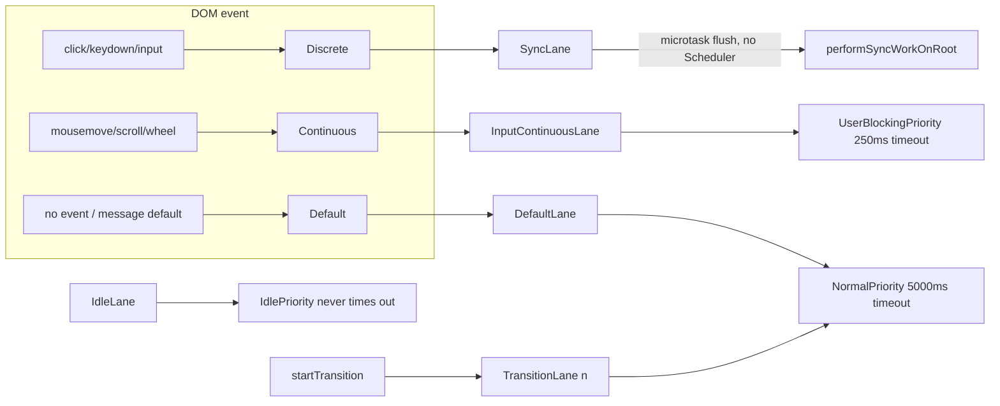

# Lanes and the Scheduler

> [!summary] TL;DR
> A **lane** is one bit in a 31-bit integer. Every update gets one lane, and a render processes a *set* of lanes (a bitmask), so batching, priority, entanglement and "which updates did this render include?" all become bitwise operations. The reconciler maps lanes to **Scheduler priorities**. The **Scheduler** is a separate package: a min-heap of tasks drained in ~5 ms slices from `MessageChannel` callbacks. In React 19, Sync lanes skip the Scheduler entirely and flush in a microtask, and only transition/retry/idle work is actually time-sliced.

## Why bitmasks?

Before lanes (React ≤ 16) React used a single `expirationTime` number per update and rendered "everything at or above priority X". That cannot express "render the transition from click A but *not* the one from click B", or "these two lanes must commit together". With a bitmask:

```js
mergeLanes(a, b)        = a | b
removeLanes(set, sub)   = set & ~sub
includesSomeLane(a, b)  = (a & b) !== 0
isSubsetOfLanes(set, s) = (set & s) === s
getHighestPriorityLane  = lanes & -lanes      // lowest set bit = highest priority
```

[^laneops] Lower bit means higher priority. `lanes & -lanes` isolates the lowest set bit in one instruction, so "most urgent pending lane" costs O(1). A `LaneMap<T>` is just a 31-element array indexed by `laneToIndex` (`31 - clz32(lane)`), used for per-lane expiration times and entanglements on the FiberRoot (see [[02 createRoot - FiberRoot and HostRoot|createRoot]]).

## The lane table (v19.3.1)

[^lanes]

| Lane(s) | Bit(s) | Produced by | Time-sliced? |
|---|---|---|---|
| `SyncHydrationLane` | 0 | selective hydration on discrete events | no |
| `SyncLane` | 1 | discrete events (`click`, `keydown`, `input`), `flushSync`, `root.unmount` | no, flushed in a microtask |
| `InputContinuousHydrationLane` / `InputContinuousLane` | 2 / 3 | continuous events (`mousemove`, `scroll`, `pointermove`, `wheel`) | no |
| `DefaultHydrationLane` / `DefaultLane` | 4 / 5 | updates outside any event (timers, fetch callbacks, top-level `root.render`) | **no** (blocking) |
| `GestureLane` | 6 | `startGestureTransition` (experimental) | no |
| `TransitionHydrationLane` | 7 | | yes |
| `TransitionLane1..14` | 8–21 | `startTransition`, `useTransition`, `useDeferredValue` (lanes 11–14 are "deferred" lanes) | **yes** |
| `RetryLane1..4` | 22–25 | Suspense retries after a promise resolves | yes |
| `SelectiveHydrationLane` | 26 | | yes |
| `IdleHydrationLane` / `IdleLane` | 27 / 28 | idle-priority work | yes |
| `OffscreenLane` | 29 | pre-rendering hidden `<Activity>`/Offscreen trees | yes |
| `DeferredLane` | 30 | placeholder for `useDeferredValue` spawned work | |

Transition lanes are handed out **round-robin** (`claimNextTransitionUpdateLane`), so independent transitions *usually* land in different lanes and can commit independently. With only 10 update lanes they eventually wrap around and share.[^claimtransition]

> [!note] `SyncUpdateLanes`: Sync, InputContinuous and Default batch together
> `SyncUpdateLanes = SyncLane | InputContinuousLane | DefaultLane`, and the first thing `getHighestPriorityLanes` does is `if (lanes & SyncUpdateLanes) return lanes & SyncUpdateLanes`.[^gethighest] So if a click (Sync) and a timer update (Default) are both pending, **one render processes both**. The 19 changelog calls this "Batch sync, default and continuous lanes (#25700)".[^upgrade] The lanes still keep their identity for scheduling, though: whether a microtask flush happens depends on `includesSyncLane`.

## Event priority ↔ lane ↔ Scheduler priority

The reconciler has a third vocabulary, **event priorities**, and they are literally lanes:[^eventpri]

```js
export const DiscreteEventPriority   = SyncLane;
export const ContinuousEventPriority = InputContinuousLane;
export const DefaultEventPriority    = DefaultLane;
export const IdleEventPriority       = IdleLane;
export function eventPriorityToLane(p) { return p; }
```

Mapping these to the Scheduler's 5 priority levels happens only when a root task is booked, in `scheduleTaskForRootDuringMicrotask`:[^mapping]



`lanesToEventPriority` collapses a lane set into one of the four event priorities. Transitions, retries and offscreen all fall under "non-idle → Default", so they get `NormalPriority` Scheduler tasks.[^lanestoevent] The DOM mapping from event name to priority lives in `getEventPriority`.[^geteventpriority] Scheduler's `ImmediatePriority` is no longer used for rendering. The comment says so directly: "now that we use microtasks for sync work we no longer use that". It is only used for the Safari microtask fallback.[^mapping]

## getNextLanes: choosing what to render

`getNextLanes(root, wipLanes, rootHasPendingCommit)` runs in the microtask and again at the start of each Scheduler task.[^getnextlanes]

1. `pendingLanes === 0` → nothing to do.
2. Consider **non-idle** lanes first. Idle work never starts while anything else is pending.
3. Prefer fresh lanes (`pending & ~suspendedLanes`). Then **pinged** suspended lanes (data arrived). Then lanes to **prewarm** (`~warmLanes`, which re-renders suspended siblings in the background; new in 19).
4. `getHighestPriorityLanes` picks the most urgent *group* (all of `SyncUpdateLanes` together, or all transition lanes pending together...).
5. **Interruption rule.** If a render is already in progress (`wipLanes`), switch only if the new lane is *strictly higher priority*. And `DefaultLane` never interrupts a transition render (comment: default "should not interrupt transition updates").

Then `getEntangledLanes` adds any lanes entangled with the chosen ones.

### Starvation: lanes expire

`markStarvedLanesAsExpired` runs each time the root is scheduled. A pending lane without an expiration time gets `now + computeExpirationTime(lane)`. A lane past its time is moved into `root.expiredLanes`.[^starved] The budgets are `syncLaneExpirationMs = 250` for Sync/InputContinuous/Gesture and `transitionLaneExpirationMs = 5000` for Default and transitions. Retry lanes expire only behind a flag, and Idle/Offscreen never expire.[^expiration][^expflags] Expired lanes make `performWorkOnRoot` choose the **sync** work loop, so a transition starved by continuous typing eventually finishes in one go.

## When does React actually time-slice?

```js
const shouldTimeSlice =
  (!forceSync && !includesBlockingLane(lanes) && !includesExpiredLane(root, lanes))
  || checkIfRootIsPrerendering(root, lanes);
```

[^shouldtimeslice] `includesBlockingLane` = Sync, InputContinuous, Default, Gesture (plus hydration variants).[^blocking] So:

| Render lanes | Entry | Loop | Yields? |
|---|---|---|---|
| Sync | microtask → `performSyncWorkOnRoot` | `workLoopSync` | never |
| InputContinuous / Default | Scheduler task (UserBlocking/Normal) | `workLoopSync` | never *within* the render |
| Transition / Retry / Idle / Offscreen | Scheduler task (Normal/Idle) | `workLoopConcurrentByScheduler` | every `shouldYield()` |
| prerendering (even for sync lanes) | Scheduler task | concurrent | yes |

```js
function workLoopConcurrentByScheduler() {
  while (workInProgress !== null && !shouldYield()) performUnitOfWork(workInProgress);
}
```

[^workloops] An alternative `workLoopConcurrent` (yield every 25 ms for non-idle, 5 ms for idle, deliberately throttling animations to ~30 fps) exists behind `enableThrottledScheduling`, which is `false` in this build.[^throttle]

> [!warning] Misconception: "concurrent rendering means React renders everything in the background"
> In 19, only **transitions** (and retries/idle/offscreen) are interruptible. A `setState` from a `fetch().then` is a Default-lane update: it is scheduled asynchronously, but once it starts it runs to completion. If you want a slow update to stay out of the way of typing, `startTransition` is the switch, not `createRoot` alone.

### Sync lanes never touch the Scheduler

When `scheduleTaskForRootDuringMicrotask` sees `includesSyncLane(nextLanes)`, it cancels any existing task, sets `callbackPriority = SyncLane`, sets `callbackNode = null`, and returns. The comment says: "Synchronous work is always flushed at the end of the microtask". `processRootScheduleInMicrotask` then calls `flushSyncWorkAcrossRoots_impl`, which runs `performSyncWorkOnRoot` for each root with sync work.[^synclane][^flushsync] A click handler's `setState` is therefore rendered and committed **before the browser gets control back from the event dispatch's microtask checkpoint**, so before the next paint. `flushSync` makes it run even before the call returns.

## Inside the Scheduler package

The Scheduler (`packages/scheduler/src/forks/Scheduler.js`) is a framework-agnostic cooperative task queue with no knowledge of React. Its state:[^schedstate]

- `taskQueue`: a **binary min-heap** of ready tasks, sorted by `sortIndex = expirationTime`, ties broken by `id` (FIFO).[^heap]
- `timerQueue`: a min-heap of **delayed** tasks (`options.delay`), sorted by `startTime`. `advanceTimers` moves them into `taskQueue` when due. React itself doesn't pass delays for rendering.

### `unstable_scheduleCallback`

```js
// simplified
var timeout = { Immediate: -1, UserBlocking: 250, Normal: 5000, Low: 10000, Idle: maxSigned31BitInt }[priority];
var expirationTime = startTime + timeout;
var newTask = { id: taskIdCounter++, callback, priorityLevel, startTime, expirationTime, sortIndex: -1 };
newTask.sortIndex = expirationTime;
push(taskQueue, newTask);
if (!isHostCallbackScheduled && !isPerformingWork) { isHostCallbackScheduled = true; requestHostCallback(); }
return newTask;     // React stores this as root.callbackNode
```

[^schedulecallback][^schedflags] Priority is encoded as **deadline**. A UserBlocking task scheduled now sorts ahead of a Normal task scheduled 4 s ago, but not ahead of one scheduled 6 s ago, because that one is already overdue. Cancellation (`unstable_cancelCallback`) just sets `task.callback = null`. Removing an arbitrary element from a heap costs O(log n) plus a search, so the dead task is popped lazily when it reaches the top.[^cancel]

### The host loop: `MessageChannel`, not `setTimeout`, not `requestIdleCallback`

```js
// simplified
if (typeof setImmediate === 'function') schedule = () => setImmediate(performWorkUntilDeadline); // Node/jsdom
else if (typeof MessageChannel !== 'undefined') {
  const channel = new MessageChannel();
  channel.port1.onmessage = performWorkUntilDeadline;
  schedule = () => channel.port2.postMessage(null);
} else schedule = () => setTimeout(performWorkUntilDeadline, 0);
```

[^hostloop] Reasons for each choice (the source comments state the first two):

- **Not `setTimeout(0)`.** Nested timeouts are clamped to ≥4 ms by browsers, so a 5 ms work slice would waste ~45% of the time idle.
- **`setImmediate` first** where it exists (Node, jsdom). It doesn't keep a Node process alive the way an open `MessageChannel` does, and it fires earlier.
- **Not `requestIdleCallback`.** It fires only when the browser thinks it's idle, can be delayed for seconds (50 ms max deadline, throttled in background tabs), and is unavailable or flaky in Safari. React needs to *keep working steadily* on high-priority-but-yieldable work, not wait for idle time.
- **Not `requestAnimationFrame`.** It only fires before paint and stops in background tabs. React wants several slices per frame and doesn't need frame alignment (comment: "It does not attempt to align with frame boundaries").

A `MessageChannel` message is a regular macrotask. The browser can run input handlers and paint between two messages, which is exactly the point of yielding.

### `performWorkUntilDeadline` → `flushWork` → `workLoop`

Each message records `startTime = now()` and runs `flushWork`. If work remains, it posts another message.[^pwud] `workLoop` peeks the heap and, for each task:[^workloop]

1. If the task **hasn't expired** and `shouldYieldToHost()` is true, break (yield to the browser).
2. Call `callback(didUserCallbackTimeout)`. React's `performWorkOnRootViaSchedulerTask` receives `didTimeout` here.
3. If the callback **returns a function**, store it as the task's new callback and **return immediately** (yield). That is React's "continuation" for an interrupted render, and it keeps the same task, position and expiration.
4. Otherwise pop the task and continue with the next one in the same slice.

```js
function shouldYieldToHost() {
  if (!enableAlwaysYieldScheduler && enableRequestPaint && needsPaint) return true;
  const timeElapsed = getCurrentTime() - startTime;
  return timeElapsed >= frameInterval;    // frameInterval = frameYieldMs = 5
}
```

[^shouldyield] The reconciler imports it as `shouldYield` (exported `unstable_shouldYield`).[^exports] `frameInterval` is 5 ms. It is not tied to the display refresh rate, so on a 60 Hz screen React yields about three times per frame. `forceFrameRate(fps)` can change it.[^forceframerate] `requestPaint()` (called by React at the end of a commit, in `flushSpawnedWork`)[^requestpaint] sets `needsPaint` so the Scheduler yields right away and the browser can paint.

> [!tip] Expired tasks are not preempted mid-task
> An expired task at the top of the heap is run even if the slice is over, but the Scheduler can't stop a callback that is running. Yielding inside a render is entirely React's job (`shouldYield()` between fibers). One expensive component, a 50 ms `render`, still blocks for 50 ms. Time slicing is cooperative and has fiber granularity.

## Putting it together for one transition

1. `startTransition(() => setTab('b'))`: `ReactSharedInternals.T` is set, so `requestUpdateLane` returns `TransitionLane1`.
2. Microtask: `getNextLanes` → `TransitionLane1`, `lanesToEventPriority` → Default → `scheduleCallback(NormalPriority, ...)`, deadline now+5000.
3. Scheduler message: `performWorkOnRoot`. Not blocking, not expired → `renderRootConcurrent` → `workLoopConcurrentByScheduler`.
4. After 5 ms, `shouldYield()` → the work loop exits with fibers left. The task returns a continuation, the Scheduler yields, and the browser handles a keypress.
5. The keypress `setState` → `SyncLane` → microtask → `getNextLanes` sees Sync, which is higher priority than the WIP transition → `performSyncWorkOnRoot`. `prepareFreshStack` **throws away** the WIP transition tree and renders the sync update.
6. Later, the transition task resumes, notices the root changed, and restarts the transition from scratch on top of the new current tree.

Step 5 is why render must be pure: work can be discarded at any time. It is also why StrictMode double-invokes render in DEV (see [[01 Bootstrap - Packages, JSX and the Dispatcher|Bootstrap]]).

## With the React Compiler

Lanes and the Scheduler are unchanged: the compiler emits no scheduling code. The indirect effect is real, though. Time slicing has fiber granularity, and compiled components skip re-rendering unchanged subtrees (memoized JSX → `bailoutOnAlreadyFinishedWork`). So a transition render visits fewer fibers, does less work per slice, and yields less often. Compiled code also makes any individual expensive `render` cheaper on re-render, which shortens the unavoidable non-preemptible chunks. See [[15 Rendering With vs Without the Compiler|With vs Without Compiler]].

← [[03 root.render - Scheduling the First Update|Prev]] · [[00 React Internals Index|Index]] · [[05 The Fiber Data Structure|Next]] →

[^laneops]: lane helpers (`getHighestPriorityLane`, `includesSomeLane`, `isSubsetOfLanes`, `mergeLanes`, `removeLanes`, `laneToIndex`, `createLaneMap`) — [packages/react-reconciler/src/ReactFiberLane.js#L756-L823](https://github.com/facebook/react/blob/v19.3.1/packages/react-reconciler/src/ReactFiberLane.js#L756-L823)
[^lanes]: lane constants — [packages/react-reconciler/src/ReactFiberLane.js#L41-L110](https://github.com/facebook/react/blob/v19.3.1/packages/react-reconciler/src/ReactFiberLane.js#L41-L110)
[^claimtransition]: `claimNextTransitionUpdateLane` — [packages/react-reconciler/src/ReactFiberLane.js#L726-L737](https://github.com/facebook/react/blob/v19.3.1/packages/react-reconciler/src/ReactFiberLane.js#L726-L736)
[^gethighest]: `SyncUpdateLanes` and `getHighestPriorityLanes` — [packages/react-reconciler/src/ReactFiberLane.js#L56-L57](https://github.com/facebook/react/blob/v19.3.1/packages/react-reconciler/src/ReactFiberLane.js#L56-L57), [#L180-L184](https://github.com/facebook/react/blob/v19.3.1/packages/react-reconciler/src/ReactFiberLane.js#L180-L184)
[^upgrade]: React 19 Upgrade Guide, changelog "Batch sync, default and continuous lanes" — https://react.dev/blog/2024/04/25/react-19-upgrade-guide
[^eventpri]: event priorities — [packages/react-reconciler/src/ReactEventPriorities.js#L22-L53](https://github.com/facebook/react/blob/v19.3.1/packages/react-reconciler/src/ReactEventPriorities.js#L22-L53)
[^lanestoevent]: `lanesToEventPriority` — [packages/react-reconciler/src/ReactEventPriorities.js#L55-L67](https://github.com/facebook/react/blob/v19.3.1/packages/react-reconciler/src/ReactEventPriorities.js#L55-L67)
[^mapping]: lane → Scheduler priority switch — [packages/react-reconciler/src/ReactFiberRootScheduler.js#L480-L503](https://github.com/facebook/react/blob/v19.3.1/packages/react-reconciler/src/ReactFiberRootScheduler.js#L480-L503)
[^geteventpriority]: `getEventPriority` — [packages/react-dom-bindings/src/events/ReactDOMEventListener.js#L312-L416](https://github.com/facebook/react/blob/v19.3.1/packages/react-dom-bindings/src/events/ReactDOMEventListener.js#L312-L416)
[^getnextlanes]: `getNextLanes` — [packages/react-reconciler/src/ReactFiberLane.js#L249-L361](https://github.com/facebook/react/blob/v19.3.1/packages/react-reconciler/src/ReactFiberLane.js#L249-L361)
[^starved]: `markStarvedLanesAsExpired` — [packages/react-reconciler/src/ReactFiberLane.js#L541-L588](https://github.com/facebook/react/blob/v19.3.1/packages/react-reconciler/src/ReactFiberLane.js#L541-L588)
[^expiration]: `computeExpirationTime` — [packages/react-reconciler/src/ReactFiberLane.js#L477-L539](https://github.com/facebook/react/blob/v19.3.1/packages/react-reconciler/src/ReactFiberLane.js#L477-L539)
[^expflags]: expiration constants — [packages/shared/ReactFeatureFlags.js#L147-L149](https://github.com/facebook/react/blob/v19.3.1/packages/shared/ReactFeatureFlags.js#L147-L149)
[^shouldtimeslice]: `shouldTimeSlice` in `performWorkOnRoot` — [packages/react-reconciler/src/ReactFiberWorkLoop.js#L1165-L1181](https://github.com/facebook/react/blob/v19.3.1/packages/react-reconciler/src/ReactFiberWorkLoop.js#L1165-L1181)
[^blocking]: `includesBlockingLane` — [packages/react-reconciler/src/ReactFiberLane.js#L684-L694](https://github.com/facebook/react/blob/v19.3.1/packages/react-reconciler/src/ReactFiberLane.js#L684-L694)
[^workloops]: `workLoopSync`, `workLoopConcurrent`, `workLoopConcurrentByScheduler` — [packages/react-reconciler/src/ReactFiberWorkLoop.js#L2772-L2777](https://github.com/facebook/react/blob/v19.3.1/packages/react-reconciler/src/ReactFiberWorkLoop.js#L2772-L2777), [#L3056-L3079](https://github.com/facebook/react/blob/v19.3.1/packages/react-reconciler/src/ReactFiberWorkLoop.js#L3056-L3079)
[^throttle]: `enableThrottledScheduling = false` — [packages/shared/ReactFeatureFlags.js#L76](https://github.com/facebook/react/blob/v19.3.1/packages/shared/ReactFeatureFlags.js#L76); selection at [ReactFiberWorkLoop.js#L3014-L3017](https://github.com/facebook/react/blob/v19.3.1/packages/react-reconciler/src/ReactFiberWorkLoop.js#L3014-L3017)
[^synclane]: sync branch of `scheduleTaskForRootDuringMicrotask` — [packages/react-reconciler/src/ReactFiberRootScheduler.js#L442-L456](https://github.com/facebook/react/blob/v19.3.1/packages/react-reconciler/src/ReactFiberRootScheduler.js#L442-L456)
[^flushsync]: `flushSyncWorkAcrossRoots_impl` — [packages/react-reconciler/src/ReactFiberRootScheduler.js#L185-L247](https://github.com/facebook/react/blob/v19.3.1/packages/react-reconciler/src/ReactFiberRootScheduler.js#L185-L247)
[^schedstate]: Scheduler module state — [packages/scheduler/src/forks/Scheduler.js#L76-L101](https://github.com/facebook/react/blob/v19.3.1/packages/scheduler/src/forks/Scheduler.js#L76-L101)
[^heap]: min-heap `compare` — [packages/scheduler/src/SchedulerMinHeap.js#L91-L95](https://github.com/facebook/react/blob/v19.3.1/packages/scheduler/src/SchedulerMinHeap.js#L91-L95)
[^schedulecallback]: `unstable_scheduleCallback` — [packages/scheduler/src/forks/Scheduler.js#L335-L427](https://github.com/facebook/react/blob/v19.3.1/packages/scheduler/src/forks/Scheduler.js#L335-L427)
[^schedflags]: Scheduler timeouts and `frameYieldMs` — [packages/scheduler/src/SchedulerFeatureFlags.js#L10-L18](https://github.com/facebook/react/blob/v19.3.1/packages/scheduler/src/SchedulerFeatureFlags.js#L10-L18)
[^hostloop]: host callback selection (setImmediate / MessageChannel / setTimeout) — [packages/scheduler/src/forks/Scheduler.js#L530-L568](https://github.com/facebook/react/blob/v19.3.1/packages/scheduler/src/forks/Scheduler.js#L530-L568)
[^pwud]: `performWorkUntilDeadline` — [packages/scheduler/src/forks/Scheduler.js#L498-L528](https://github.com/facebook/react/blob/v19.3.1/packages/scheduler/src/forks/Scheduler.js#L498-L528)
[^workloop]: Scheduler `workLoop` — [packages/scheduler/src/forks/Scheduler.js#L193-L266](https://github.com/facebook/react/blob/v19.3.1/packages/scheduler/src/forks/Scheduler.js#L193-L266)
[^shouldyield]: `shouldYieldToHost` / `requestPaint` — [packages/scheduler/src/forks/Scheduler.js#L452-L479](https://github.com/facebook/react/blob/v19.3.1/packages/scheduler/src/forks/Scheduler.js#L452-L479)
[^exports]: Scheduler exports (`shouldYieldToHost as unstable_shouldYield`) — [packages/scheduler/src/forks/Scheduler.js#L586-L602](https://github.com/facebook/react/blob/v19.3.1/packages/scheduler/src/forks/Scheduler.js#L586-L602)
[^forceframerate]: `forceFrameRate` — [packages/scheduler/src/forks/Scheduler.js#L481-L496](https://github.com/facebook/react/blob/v19.3.1/packages/scheduler/src/forks/Scheduler.js#L481-L496)
[^cancel]: `unstable_cancelCallback` — [packages/scheduler/src/forks/Scheduler.js#L429-L443](https://github.com/facebook/react/blob/v19.3.1/packages/scheduler/src/forks/Scheduler.js#L429-L443)
[^requestpaint]: `requestPaint()` call in `flushSpawnedWork` — [packages/react-reconciler/src/ReactFiberWorkLoop.js#L4189](https://github.com/facebook/react/blob/v19.3.1/packages/react-reconciler/src/ReactFiberWorkLoop.js#L4189)
