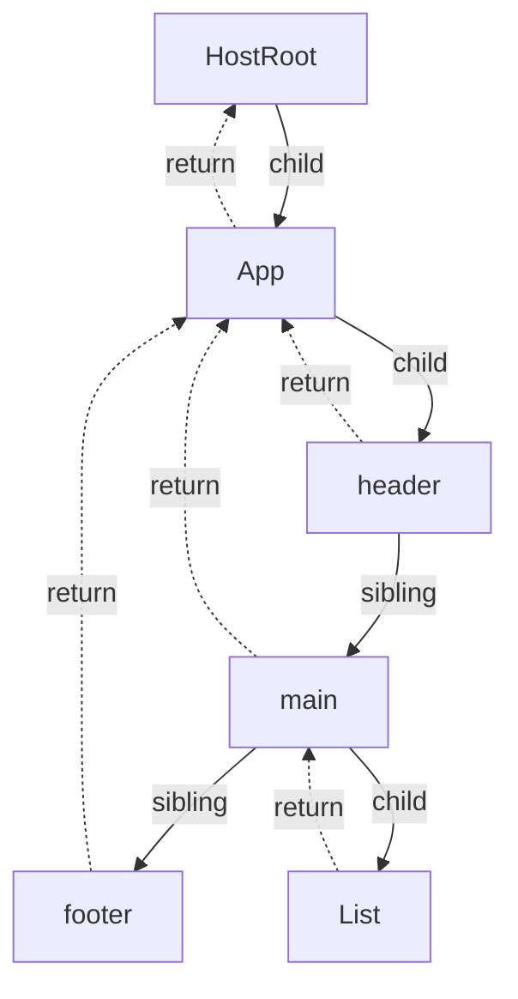
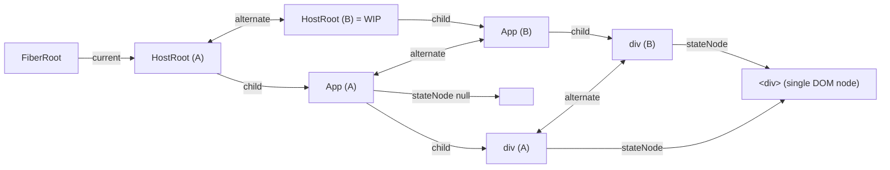

# The Fiber Data Structure

> [!summary] TL;DR
> A fiber is a mutable, long-lived object for one instance of a component, host element or text node. It is **one unit of work** and also **one node in a tree**. Fibers are linked with `child` / `sibling` / `return` pointers, not arrays, so React can walk the tree with a loop it can pause at any node. Each fiber has an `alternate`. The `current` tree (what's on screen) and the `workInProgress` tree (what's being built) reuse each other's objects. This is double buffering, and it makes a commit a single pointer swap.

## Elements vs fibers vs DOM

| | Element | Fiber | DOM node |
|---|---|---|---|
| Created by | `jsx()` every render | reconciler, once per mounted instance (+1 alternate) | `createInstance` in completeWork |
| Lifetime | one render (garbage) | as long as the component is mounted | as long as the fiber |
| Mutable | no (frozen in DEV) | yes, heavily | yes |
| Holds | `type`, `key`, `props` | everything: state, hooks, effects, lanes, links | the actual pixels |

"The virtual DOM" in the popular sense is closest to *elements*. The thing React actually diffs against, stores state in and schedules work on is the **fiber tree**. Fibers exist for components that produce no DOM (function components, context providers, Suspense, Fragments), and DOM nodes exist for only some fibers (`HostComponent`, `HostText`, ...).

## The fields

The constructor initialises every field in a fixed order so V8 sees a single hidden class for all fibers. In DEV it then calls `Object.preventExtensions(this)` so nobody can add fields later.[^fibernode] The Flow type describes each field.[^fibertype]

```js
// packages/react-reconciler/src/ReactFiber.js (simplified)
function FiberNode(tag, pendingProps, key, mode) {
  // Instance
  this.tag = tag; this.key = key; this.elementType = null; this.type = null; this.stateNode = null;
  // Fiber (tree links)
  this.return = null; this.child = null; this.sibling = null; this.index = 0;
  this.ref = null; this.refCleanup = null;
  // Inputs / outputs
  this.pendingProps = pendingProps; this.memoizedProps = null;
  this.updateQueue = null; this.memoizedState = null; this.dependencies = null;
  this.mode = mode;
  // Effects
  this.flags = NoFlags; this.subtreeFlags = NoFlags; this.deletions = null;
  // Scheduling
  this.lanes = NoLanes; this.childLanes = NoLanes;
  this.alternate = null;
  // profiler durations initialised to -0 / -1.1 (doubles) to avoid a V8 shape change
}
```

### Identity

- **`tag`**: a `WorkTag` number saying *what kind of fiber* this is. `beginWork`/`completeWork` switch on it (list below).
- **`type`**: the resolved thing to render: the function or class, the host string `'div'`, or a context object. **`elementType`** is the original `element.type` *before* resolution. They differ for `lazy()` (elementType is the lazy wrapper, type the resolved component), `memo()` and hot-reload proxies.
- **`key`**: copied from the element. Used only during child reconciliation (see [[07 beginWork and Reconciliation|beginWork & Reconciliation]]).
- **`stateNode`**: the "instance". The DOM element for `HostComponent`, the Text node for `HostText`, the class instance for `ClassComponent`, the **FiberRoot** for `HostRoot` (see [[02 createRoot - FiberRoot and HostRoot|createRoot]]), and `null` for function components (their "instance" is the hook list in `memoizedState`).

### Tree links

- **`return`**: the parent. It is called "return" and not "parent" because it is where the work loop *returns to* after finishing this fiber, like the return address on a call stack.
- **`child`**: the *first* child only.
- **`sibling`**: the next sibling. The children of a fiber are a singly linked list: `parent.child → a.sibling → b.sibling → c`.
- **`index`**: position among siblings. Used to detect moves during keyed reconciliation.

### Inputs, outputs, state

- **`pendingProps`**: the new props for this render (from the element). **`memoizedProps`**: props used the last time this fiber finished. If `oldProps === newProps` (reference equality), there are no pending lanes and the context is unchanged, beginWork can **bail out**. This is why passing the same props object matters, and it is exactly what the compiler exploits.
- **`memoizedState`**: the committed state. Its shape depends on `tag`: for function components it's the **head of the hook linked list** (see [[10 Hooks on Mount|Hooks on Mount]]), for classes it's `this.state`, and for HostRoot it's `{element, isDehydrated, cache}`.
- **`updateQueue`**: also tag-dependent. Class components and HostRoot use a circular update list (`shared.pending`). Function components use a `FunctionComponentUpdateQueue` (effect list, events, stores, and the compiler's `memoCache`).[^fcqueue] Suspense boundaries keep their retry queue here. For HostComponents it is essentially unused in 19, because the props diff moved into commit (`commitUpdate` receives old and new props).
- **`dependencies`**: the contexts this fiber read (`firstContext` list) and their lanes, used for context propagation.
- **`mode`**: bitfield (`ConcurrentMode`, `StrictLegacyMode`, `StrictEffectsMode`, `ProfileMode`...) inherited from the parent at creation.[^modes]

### Effects

- **`flags`**: a bitmask of side effects this fiber needs in commit: `Placement` (insert), `Update`, `ChildDeletion`, `Ref`, `Passive` (has `useEffect`), `Callback`, ...[^flags]
- **`subtreeFlags`**: the OR of all descendants' flags, bubbled up in `completeWork`. The commit phase skips any subtree whose `subtreeFlags` lacks the bits it cares about. This replaced the old "effect list" (`nextEffect` chain) in React 18.
- **`deletions`**: children to delete, stored on the parent because the deleted fibers are no longer in the new child list.

### Scheduling

- **`lanes`**: lanes with pending work *on this fiber itself* (a `setState` on it).
- **`childLanes`**: the OR of lanes pending anywhere *below* it. Set by `markUpdateLaneFromFiberToRoot` when an update is queued.[^childlanes] It lets beginWork skip whole subtrees in O(1): if `(childLanes & renderLanes) === 0`, there's nothing to do down there.

### Double buffering

- **`alternate`**: the other version of this fiber. `current.alternate === wip` and `wip.alternate === current`.

## WorkTag list

[^worktags]

| # | Tag | Is | `stateNode` |
|---|---|---|---|
| 0 | `FunctionComponent` | `function App()` | null |
| 1 | `ClassComponent` | `class X extends Component` | instance |
| 3 | `HostRoot` | top of tree | FiberRoot |
| 4 | `HostPortal` | `createPortal` | portal container info |
| 5 | `HostComponent` | `'div'`, `'span'`... | DOM element |
| 6 | `HostText` | string/number child | Text node |
| 7 | `Fragment` | `<>...</>`, arrays | |
| 8 | `Mode` | `<StrictMode>` etc. | |
| 9 / 10 | `ContextConsumer` / `ContextProvider` | `<Ctx.Consumer>` / `<Ctx>` | |
| 11 | `ForwardRef` | `forwardRef(...)` | |
| 12 | `Profiler` | | |
| 13 | `SuspenseComponent` | `<Suspense>` | |
| 14 / 15 | `MemoComponent` / `SimpleMemoComponent` | `memo(...)`; "simple" = function, no custom compare | |
| 16 | `LazyComponent` | `lazy(...)` before resolution | |
| 17 / 28 | `IncompleteClassComponent` / `IncompleteFunctionComponent` | threw during mount | |
| 18 | `DehydratedFragment` | hydration | |
| 19 | `SuspenseListComponent` | | |
| 22 | `OffscreenComponent` | hidden subtree (`<Activity>`, Suspense content) | |
| 23 | `LegacyHiddenComponent` | | |
| 24 | `CacheComponent` | | |
| 25 | `TracingMarkerComponent` | | |
| 26 | `HostHoistable` | `<link>`, `<meta>`, `<title>` hoisted to `<head>` | resource |
| 27 | `HostSingleton` | `<html>`, `<head>`, `<body>` | existing element |
| 29 | `Throw` | placeholder for a thrown child | |
| 30 | `ViewTransitionComponent` | `<ViewTransition>` | |
| 31 | `ActivityComponent` | `<Activity>` | |

(2 and 20 are unused; 21 is `ScopeComponent`.)

> [!tip] Plain function components are cheap
> A function component without `defaultProps`, wrapped in `memo()` without a custom compare, is retagged on mount from `MemoComponent` to `SimpleMemoComponent` (`isSimpleFunctionComponent`). It then renders on one fiber instead of a Memo fiber plus a child fiber, which gives it a fast update path.[^simplefn][^simplememo] Classes are detected by `prototype.isReactComponent`, not by `class` syntax.

## Walking the tree without recursion



The work loop is a depth-first walk done by hand:

```js
// conceptual; real code in performUnitOfWork / completeUnitOfWork
let node = root;
while (node) {
  const next = beginWork(node);          // returns node.child or null
  if (next) { node = next; continue; }
  while (node) {                          // no child: complete and go to sibling, else return up
    completeWork(node);
    if (node.sibling) { node = node.sibling; break; }
    node = node.return;
  }
}
```

The walk visits nodes in this order: begin App → begin header → complete header → begin main → begin List → complete List → complete main → begin footer → complete footer → complete App. See [[06 The Work Loop - Render Phase|Work Loop]] for the real `performUnitOfWork`.[^performunit]

**Why not recursion?** Before 16, the "stack reconciler" recursed through `render()` calls on the JS call stack. A deep tree meant a long, unbreakable synchronous chunk, because JS cannot pause a call stack and resume it later. Fibers move that stack onto the heap:

- **Pause/resume.** The loop's only state is the module variable `workInProgress`. To yield, return from the loop. To resume, call it again ([[04 Lanes and the Scheduler|Lanes & Scheduler]]).
- **Abort.** To throw away a render, drop the WIP pointer. Nothing lives on the call stack.
- **Prioritise.** `childLanes` lets the loop skip subtrees without visiting them.
- **No stack overflow** on very deep trees.
- **Error and Suspense unwinding.** "Throwing" to the nearest boundary is a walk up `return` pointers (`unwindWork`), not a JS exception crossing arbitrary frames.

The cost is memory: each fiber is a fairly big object (about 20+ fields, more in DEV), and there are two of them per instance.

## Double buffering: `current` and `workInProgress`

At most two fibers exist per mounted instance:

- **current**: what's committed and on screen. `FiberRoot.current` points to its HostRoot.
- **workInProgress (WIP)**: the version being rendered. It is built from `current` plus updates.

On commit, `root.current = finishedWork`. The WIP tree *becomes* current, and the old current becomes the pool for the next WIP.[^commitswap] The comment explains the placement: after mutation (so `componentWillUnmount` sees the old tree) but before layout (so `componentDidMount` sees the new one).

### `createWorkInProgress`

```js
// packages/react-reconciler/src/ReactFiber.js (simplified)
export function createWorkInProgress(current, pendingProps) {
  let workInProgress = current.alternate;
  if (workInProgress === null) {
    // "We use a double buffering pooling technique because we know that we'll only ever need at
    //  most two versions of a tree... This is lazily created to avoid allocating extra objects for
    //  things that are never updated."
    workInProgress = createFiber(current.tag, pendingProps, current.key, current.mode);
    workInProgress.elementType = current.elementType;
    workInProgress.type = current.type;
    workInProgress.stateNode = current.stateNode;
    workInProgress.alternate = current;
    current.alternate = workInProgress;
  } else {
    workInProgress.pendingProps = pendingProps;
    workInProgress.type = current.type;
    workInProgress.flags = NoFlags;          // reset effects from the last time this object was WIP
    workInProgress.subtreeFlags = NoFlags;
    workInProgress.deletions = null;
  }
  workInProgress.flags = current.flags & StaticMask;   // keep only "static" flags (e.g. has passive effect)
  workInProgress.childLanes = current.childLanes;
  workInProgress.lanes = current.lanes;
  workInProgress.child = current.child;                // shares current's children until reconciled
  workInProgress.memoizedProps = current.memoizedProps;
  workInProgress.memoizedState = current.memoizedState;
  workInProgress.updateQueue = current.updateQueue;
  workInProgress.dependencies = clone(current.dependencies); // mutated during render, can't share
  workInProgress.sibling = current.sibling; workInProgress.index = current.index;
  workInProgress.ref = current.ref; workInProgress.refCleanup = current.refCleanup;
  return workInProgress;
}
```

[^cwip] Things to notice:

- **Allocation is lazy.** On the first render there are no alternates at all. Mount creates fibers directly, and the HostRoot gets its alternate in `prepareFreshStack`.[^preparefresh] The *second* render allocates alternates. From the third render on, objects are recycled.
- **WIP shares data with current** (`memoizedState`, `updateQueue`, `child`) until the render overwrites it. Hooks clone their hook objects as they process them. The update queue is designed so both versions can point to the same `shared.pending`, which is why updates aren't lost when a render is thrown away.
- **`StaticMask`** flags (like `LayoutStatic`/`PassiveStatic`, "this fiber has effects at all") survive resets, so unmount knows what cleanup to run even if this render didn't schedule effects.[^staticmask]
- **`stateNode` is shared**: both versions point to the same DOM node or class instance. There's only one DOM.



After commit, `FR.current` points to HostRoot (B), and (A) becomes the scratch space for the next render.

> [!warning] Gotcha: "the fiber" for a component is two objects
> DevTools, `__reactFiber$` keys on DOM nodes and closures may hold *either* fiber, and which one is current flips on each commit. React's own code handles this by checking both: `fiber.lanes` and `alternate.lanes` are both updated when enqueuing (see [[03 root.render - Scheduling the First Update|root.render]]), and `setState` binds the *fiber at mount time* but works on either. If you ever poke at internals, never assume you hold the current one.

## Common misconceptions

- **"React re-creates the tree every render."** Elements are re-created. Fibers are reused through `alternate`, and unchanged subtrees are *cloned shallowly* or skipped entirely (`bailoutOnAlreadyFinishedWork`), so their WIP is never built.
- **"Every render touches every fiber."** With `childLanes`, a `setState` deep in the tree visits only the path from the root down to the updated fiber, and then whatever it re-renders.
- **"StrictMode doubles the fibers."** It doesn't. StrictMode in DEV calls component functions twice on the *same* WIP fiber (see [[01 Bootstrap - Packages, JSX and the Dispatcher|Bootstrap]]), and it double-invokes effects at mount on the same fibers. The tree shape is identical.
- **"Fibers are a React 18 concurrency feature."** Fibers have existed since React 16 (2017). React 18/19 just added the lanes and schedulers that use them.

## With the React Compiler

The fiber structure is identical. The compiler changes what goes *into* fibers:

- Compiled components store the `useMemoCache` array on `fiber.updateQueue.memoCache` (see [[14 React Compiler - How It Works|React Compiler]]). That is one extra array per compiled component, and it is preserved across the `current` ↔ WIP clone because `updateQueue` is shared.
- Because compiled code returns the *same element objects* when inputs haven't changed, the child fiber's `pendingProps === memoizedProps` holds, and beginWork bails out at that fiber without calling the component. That reference-equality check on fiber props is where the compiler's performance win actually shows up. See [[15 Rendering With vs Without the Compiler|With vs Without Compiler]].

## Summary

Elements are throwaway descriptions; the fiber is what React keeps. One mutable fiber exists per mounted component, host element or text node: a unit of work and a tree node in one. `child`, `sibling` and `return` pointers let a loop walk the tree and stop at any node instead of recursing. Each fiber has an `alternate`, and the `current` and `workInProgress` trees recycle each other's objects, so a commit is one pointer swap. Next: [[06 The Work Loop - Render Phase|the work loop]].

### Key takeaways

- **Elements vs fibers**: elements are recreated every render; fibers carry identity, state and scheduling while mounted.
- **`tag`, `type`, `stateNode`**: the kind of fiber, what it renders, and its instance (`null` for function components).
- **`child` / `sibling` / `return`**: linked children plus a parent pointer, so the loop can pause, abort and resume with no call stack.
- **`pendingProps` vs `memoizedProps`**: reference-equal props, no pending lanes and unchanged context let beginWork bail out.
- **`memoizedState` and `updateQueue`**: tag-dependent; the hook list for function components, `{element, isDehydrated, cache}` for the HostRoot.
- **`flags` and `subtreeFlags`**: side effects for commit, bubbled up so commit skips clean subtrees.
- **`lanes` and `childLanes`**: pending work on the fiber and below it, so beginWork skips whole subtrees in O(1).
- **`createWorkInProgress`**: lazily allocates the alternate, then reuses it, sharing data with `current` until the render overwrites it.
- **Two objects per instance**: which fiber is current flips each commit, so never assume you hold the current one.

← [[04 Lanes and the Scheduler|Prev]] · [[00 React Internals Index|Index]] · [[06 The Work Loop - Render Phase|Next]] →

[^fibernode]: `FiberNode` constructor — [packages/react-reconciler/src/ReactFiber.js#L134-L207](https://github.com/facebook/react/blob/v19.3.1/packages/react-reconciler/src/ReactFiber.js#L134-L207)
[^fibertype]: `Fiber` type — [packages/react-reconciler/src/ReactInternalTypes.js#L89-L210](https://github.com/facebook/react/blob/v19.3.1/packages/react-reconciler/src/ReactInternalTypes.js#L89-L210)
[^modes]: `TypeOfMode` bits — [packages/react-reconciler/src/ReactTypeOfMode.js#L10-L21](https://github.com/facebook/react/blob/v19.3.1/packages/react-reconciler/src/ReactTypeOfMode.js#L10-L21)
[^flags]: fiber flags (`Placement`, `Update`, `ChildDeletion`, `Callback`, `Ref`, `Passive`) — [packages/react-reconciler/src/ReactFiberFlags.js#L18-L36](https://github.com/facebook/react/blob/v19.3.1/packages/react-reconciler/src/ReactFiberFlags.js#L18-L36)
[^childlanes]: `markUpdateLaneFromFiberToRoot` sets `childLanes` — [packages/react-reconciler/src/ReactFiberConcurrentUpdates.js#L189-L208](https://github.com/facebook/react/blob/v19.3.1/packages/react-reconciler/src/ReactFiberConcurrentUpdates.js#L189-L209)
[^worktags]: WorkTags — [packages/react-reconciler/src/ReactWorkTags.js#L44-L73](https://github.com/facebook/react/blob/v19.3.1/packages/react-reconciler/src/ReactWorkTags.js#L44-L73)
[^simplefn]: `shouldConstruct` / `isSimpleFunctionComponent` — [packages/react-reconciler/src/ReactFiber.js#L303-L314](https://github.com/facebook/react/blob/v19.3.1/packages/react-reconciler/src/ReactFiber.js#L303-L314)
[^performunit]: `performUnitOfWork` — [packages/react-reconciler/src/ReactFiberWorkLoop.js#L3081](https://github.com/facebook/react/blob/v19.3.1/packages/react-reconciler/src/ReactFiberWorkLoop.js#L3081)
[^commitswap]: `root.current = finishedWork` — [packages/react-reconciler/src/ReactFiberWorkLoop.js#L4047-L4051](https://github.com/facebook/react/blob/v19.3.1/packages/react-reconciler/src/ReactFiberWorkLoop.js#L4047-L4051)
[^cwip]: `createWorkInProgress` — [packages/react-reconciler/src/ReactFiber.js#L322-L437](https://github.com/facebook/react/blob/v19.3.1/packages/react-reconciler/src/ReactFiber.js#L322-L437)
[^preparefresh]: `prepareFreshStack` → `createWorkInProgress(root.current, null)` — [packages/react-reconciler/src/ReactFiberWorkLoop.js#L2254-L2258](https://github.com/facebook/react/blob/v19.3.1/packages/react-reconciler/src/ReactFiberWorkLoop.js#L2254-L2258)
[^staticmask]: `LayoutStatic` and `StaticMask` — [packages/react-reconciler/src/ReactFiberFlags.js#L73](https://github.com/facebook/react/blob/v19.3.1/packages/react-reconciler/src/ReactFiberFlags.js#L73), [#L141](https://github.com/facebook/react/blob/v19.3.1/packages/react-reconciler/src/ReactFiberFlags.js#L141)
[^simplememo]: `updateMemoComponent` upgrades to `SimpleMemoComponent` — [packages/react-reconciler/src/ReactFiberBeginWork.js#L486-L497](https://github.com/facebook/react/blob/v19.3.1/packages/react-reconciler/src/ReactFiberBeginWork.js#L486-L497)
[^fcqueue]: `FunctionComponentUpdateQueue.memoCache` — [packages/react-reconciler/src/ReactFiberHooks.js#L249-L254](https://github.com/facebook/react/blob/v19.3.1/packages/react-reconciler/src/ReactFiberHooks.js#L249-L254)
