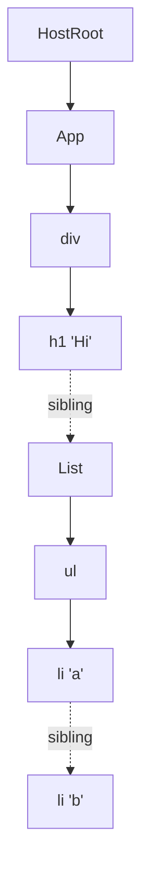

# The Work Loop - Render Phase

> [!summary] TL;DR
> `performWorkOnRoot` decides whether this render may be time-sliced, then calls `renderRootSync` or `renderRootConcurrent`. Both clone the HostRoot into a work-in-progress fiber (`prepareFreshStack` → `createWorkInProgress`) and then spin a `while` loop over a single global pointer, `workInProgress`, calling `performUnitOfWork` (→ `beginWork` going down, `completeUnitOfWork` → `completeWork` coming back up). Nothing in this phase touches the screen, so React can pause it, throw it away, or restart it. When the loop finishes, the finished tree goes to `commitRoot` ([[09 Commit Phase - Mutation, Layout, Passive Effects|Commit Phase]]).

## Where we enter

By the time you get here, an update has already been queued on a fiber and a lane assigned ([[03 root.render - Scheduling the First Update|root.render]], [[12 setState - dispatchSetState and Batching|setState]]). The root scheduler then calls into the work loop in one of two ways ([[04 Lanes and the Scheduler|Lanes & Scheduler]]):

- **Sync lanes** (e.g. a click → `SyncLane`): `scheduleTaskForRootDuringMicrotask` does *not* create a Scheduler task. It sets `root.callbackPriority = SyncLane`, and the microtask flush calls `performSyncWorkOnRoot`, which calls `performWorkOnRoot(root, lanes, forceSync = true)`.[^sched-sync][^perf-sync]
- **Everything else**: a Scheduler task is posted with `performWorkOnRootViaSchedulerTask.bind(null, root)`. That task first flushes any pending passive effects, recomputes `getNextLanes`, calls `performWorkOnRoot`, and returns *itself* as a continuation if the root still has work at that priority.[^sched-task]

That continuation return is how a time-sliced render picks up where it left off on the next macrotask. It is not a recursive call. Scheduler sees a function come back and keeps it as the same task.

## performWorkOnRoot: the shouldTimeSlice decision

```js
// ReactFiberWorkLoop.js (simplified)
export function performWorkOnRoot(root, lanes, forceSync) {
  if ((executionContext & (RenderContext | CommitContext)) !== NoContext) {
    throw new Error('Should not already be working.');
  }
  const shouldTimeSlice =
    (!forceSync &&
      !includesBlockingLane(lanes) &&
      !includesExpiredLane(root, lanes)) ||
    checkIfRootIsPrerendering(root, lanes);

  let exitStatus = shouldTimeSlice
    ? renderRootConcurrent(root, lanes)
    : renderRootSync(root, lanes, true);
  // ... loop handling RootInProgress / errors / store tearing ...
  finishConcurrentRender(root, exitStatus, finishedWork, lanes, renderEndTime);
  // ...
  ensureRootIsScheduled(root);
}
```
[^pwor]

The decision that matters is `includesBlockingLane`. Its "blocking" set is `SyncLane`, `InputContinuousLane`, **`DefaultLane`**, the hydration variants of those, and `GestureLane`.[^blocking] That has a consequence people often miss:

> [!warning] Misconception: "createRoot makes everything concurrent/time-sliced"
> The first `root.render(<App/>)` outside an event gets `DefaultLane`, and `DefaultLane` counts as blocking. So the initial mount runs through **`renderRootSync`** in one uninterrupted go, even under `createRoot`. Only Transition, Retry, Idle and Offscreen lanes actually yield to the browser mid-render. Concurrent rendering is something you opt into with `startTransition` / `useDeferredValue`. `createRoot` alone does not give it to you.

The other two inputs:
- `includesExpiredLane`: a lane that has waited too long gets marked expired, and from then on it renders synchronously so it cannot be starved.
- `checkIfRootIsPrerendering`: if the root is only *prerendering* (warming up siblings of a suspended tree that can't commit yet), React always uses the concurrent loop, even for sync lanes, so that this speculative work never blocks the main thread.[^pwor]

After the render returns, `performWorkOnRoot` handles a few exit cases:
- **`RootInProgress`**: the concurrent loop yielded. Break out. The scheduler task will return a continuation.
- **Store tearing check**: if the render was concurrent, `isRenderConsistentWithExternalStores(finishedWork)` walks the tree to check that every `useSyncExternalStore` snapshot is still current. If one changed while React was yielded, it re-renders **synchronously** with `renderRootSync(root, lanes, false)` so nothing can interleave this time.[^tearing]
- **Errors**: `RootErrored` gets one synchronous retry via `recoverFromConcurrentError`. `RootFatalErrored` resets the stack.[^pwor]
- Otherwise it calls `finishConcurrentRender`, which either commits right away or, for suspended transitions and retries, marks the root suspended and may schedule a throttled `completeRootWhenReady` via `scheduleTimeout`.[^finish] `completeRootWhenReady` can also *suspend the commit* (waiting on stylesheets/images or an active View Transition) before calling `completeRoot` → `commitRoot`.[^ready]

## renderRootSync vs renderRootConcurrent

Both functions have the same skeleton:

1. Set `executionContext |= RenderContext` and push the hooks dispatcher ([[01 Bootstrap - Packages, JSX and the Dispatcher|Bootstrap]]).
2. **If the root or the lanes changed** since the last time we were here, call `prepareFreshStack`. If not, *continue the existing work-in-progress*.[^rrs-fresh][^rrc-fresh]
3. Enter an `outer: do { try { ... workLoopX() } catch (thrownValue) { handleThrow(...) } } while (true)` loop.
4. Restore context. If `workInProgress === null` the tree is done, so clear `workInProgressRoot` and return the exit status. Otherwise return `RootInProgress`.[^rrs][^rrc-end]

They differ in how they handle a thrown promise (suspension) and in which inner loop they use:

| | `renderRootSync` | `renderRootConcurrent` |
|---|---|---|
| Inner loop | `workLoopSync` (never checks time) | `workLoopConcurrentByScheduler` (or `workLoopConcurrent` behind `enableThrottledScheduling`, which is `false` in 19.3.1)[^flags] |
| Suspended on data | Unwind immediately to the nearest Suspense boundary / fallback (`throwAndUnwindWorkLoop`) | If the thenable already resolved, *replay* the fiber. Otherwise attach `onResolution`, `break outer` (yield), and resume on ping[^rrc-suspend] |
| Can return mid-tree | Only when it switches to prerendering | Yes, whenever Scheduler says yield |

```js
function workLoopSync() {
  while (workInProgress !== null) {
    performUnitOfWork(workInProgress);
  }
}

function workLoopConcurrentByScheduler() {
  // Perform work until Scheduler asks us to yield
  while (workInProgress !== null && !shouldYield()) {
    performUnitOfWork(workInProgress);
  }
}
```
[^loops]

`shouldYield` is Scheduler's `shouldYieldToHost`. It returns `true` once about `frameYieldMs = 5`ms have passed since the current Scheduler task started, or right away if `requestPaint()` was called.[^yield] So "time slicing" in practice means checking a clock between **fibers**, never inside a component. A single component that takes 200ms will still block for 200ms.

> [!note] The experimental `workLoopConcurrent(nonIdle)` variant
> Behind `enableThrottledScheduling` there's a loop that yields every 25ms for non-idle work instead of 5ms. The source comment explains that the aim is to deliberately cap animations at ~30fps so they can't starve transition rendering.[^loops] It's off in 19.3.1, but it shows the direction: the yield interval is a scheduling policy React can tune.

## prepareFreshStack + createWorkInProgress for the root

`prepareFreshStack` is how a render starts over from scratch:

```js
// simplified
function prepareFreshStack(root, lanes) {
  // cancel a pending timeout-commit or suspended commit, if any
  // ...
  resetWorkInProgressStack();          // unwind any half-finished WIP
  workInProgressRoot = root;
  const rootWorkInProgress = createWorkInProgress(root.current, null);
  workInProgress = rootWorkInProgress;
  workInProgressRootRenderLanes = lanes;
  workInProgressRootExitStatus = RootInProgress;
  // ... reset ~15 other module-level "workInProgressRoot*" variables ...
  entangledRenderLanes = getEntangledLanes(root, lanes);
  finishQueueingConcurrentUpdates();   // move interleaved updates onto fibers
  return rootWorkInProgress;
}
```
[^pfs]

`createWorkInProgress(current, pendingProps)` is the **double-buffering** primitive ([[05 The Fiber Data Structure|Fiber]]):

- If `current.alternate === null` (true for the HostRoot on the very first render), it allocates a new fiber and links `wip.alternate = current; current.alternate = wip`.
- Otherwise it **reuses the alternate object**: it resets `flags` (keeping only `StaticMask`), `subtreeFlags` and `deletions`, and copies `child`, `memoizedProps`, `memoizedState`, `updateQueue`, `lanes`, `childLanes`, `sibling`, `index` and `ref` from `current`.[^cwip]

The WIP root starts out with `child = current.child`. In other words it begins by *pointing at the current children*. Children are cloned lazily, only as `beginWork` reaches them, either through reconciliation or through `cloneChildFibers` on a bailout ([[07 beginWork and Reconciliation|beginWork & Reconciliation]]).

> [!tip] Why reuse the alternate?
> After the first update every fiber has exactly two objects, current and alternate, which swap roles on each commit. Reusing them avoids allocating a whole new tree per render. It also explains why the render phase must be pure: the "new" fiber you write into is an object that was *previously committed*, so any half-written state is garbage until commit makes it current.

The `(workInProgressRoot !== root || workInProgressRootRenderLanes !== lanes)` check is what makes **interruption** work. If a transition render yields and a click arrives, the next `performWorkOnRoot` call gets `SyncLane`. The lanes differ, so `prepareFreshStack` runs `resetWorkInProgressStack()` (which calls `unwindInterruptedWork` up the return path to pop contexts) and starts a new WIP from `root.current`.[^reset] The half-built transition tree is simply discarded. The transition's updates are still in the queues (they were never removed, see [[11 Hooks on Update|Hooks on Update]]), so it is re-rendered from scratch later on top of the new state.

## performUnitOfWork → beginWork / completeUnitOfWork

```js
function performUnitOfWork(unitOfWork) {
  const current = unitOfWork.alternate;     // null => this fiber is mounting
  let next = beginWork(current, unitOfWork, entangledRenderLanes);
  unitOfWork.memoizedProps = unitOfWork.pendingProps;
  if (next === null) {
    completeUnitOfWork(unitOfWork);         // no child: go back up
  } else {
    workInProgress = next;                  // descend into the child
  }
}
```
[^puow]

Notes:
- **`current` is the mount/update switch for the whole render phase.** `current === null` means "this fiber has never been committed", and every `beginWork`/`completeWork` branch tests it. On the first render the HostRoot *does* have a current (created by `createRoot`, see [[02 createRoot - FiberRoot and HostRoot|createRoot]]), but every fiber below it is brand new, so `current === null` all the way down. That is why the first render is a "mount" everywhere except at the root. Page 07 explains why this means only the root's direct child gets a `Placement` flag.
- `memoizedProps = pendingProps` happens right after `beginWork`. Next render, `current.memoizedProps` is what `beginWork` compares by **identity** against the new `pendingProps` to decide on a bailout.
- `beginWork` returns the **first child** to work on next, or `null`.

`completeUnitOfWork` is the "climb back up" half:

```js
function completeUnitOfWork(unitOfWork) {
  let completedWork = unitOfWork;
  do {
    if ((completedWork.flags & Incomplete) !== NoFlags) {
      unwindUnitOfWork(completedWork, workInProgressRootDidSkipSuspendedSiblings);
      return;                                   // something threw below
    }
    const next = completeWork(completedWork.alternate, completedWork, entangledRenderLanes);
    if (next !== null) { workInProgress = next; return; } // rare: spawned work
    const siblingFiber = completedWork.sibling;
    if (siblingFiber !== null) { workInProgress = siblingFiber; return; }
    completedWork = completedWork.return;       // no sibling: complete parent
    workInProgress = completedWork;
  } while (completedWork !== null);
  if (workInProgressRootExitStatus === RootInProgress) {
    workInProgressRootExitStatus = RootCompleted;
  }
}
```
[^cuow]

So the traversal is an **iterative depth-first walk** that uses three pointers per fiber (`child`, `sibling`, `return`) instead of the JS call stack. React used to recurse (the pre-Fiber "stack reconciler"). This design is what makes yielding possible: the entire "stack" is a single variable, `workInProgress`, and you can stop after any fiber and come back later.

## Depth-first traversal on a small tree

```jsx
function App() {
  return (
    <div>
      <h1>Hi</h1>
      <List />
    </div>
  );
}
function List() { return <ul><li>a</li><li>b</li></ul>; }
```



Order of calls (B = beginWork, C = completeWork):

| # | Call | Why |
|---|---|---|
| 1 | B(HostRoot) | processes the update queue → `{element: <App/>}` |
| 2 | B(App) | runs `App()` via `renderWithHooks` |
| 3 | B(div) | reconciles `[h1, List]` |
| 4 | B(h1) | text child `"Hi"` is set via `textContent`, no fiber → returns `null` |
| 5 | **C(h1)** | creates `<h1>` DOM node. Has sibling → go to List |
| 6 | B(List) | runs `List()` |
| 7 | B(ul) | reconciles `[li, li]` |
| 8 | B(li a) → **C(li a)** | leaf. sibling → li b |
| 9 | B(li b) → **C(li b)** | no sibling → return to ul |
| 10 | **C(ul)** | creates `<ul>`, appends both `<li>` |
| 11 | **C(List)** | no sibling → return |
| 12 | **C(div)** | creates `<div>`, appends `<h1>` and `<ul>` |
| 13 | **C(App)**, **C(HostRoot)** | bubbling only; `workInProgress = null` → `RootCompleted` |

Every parent completes after all its children, which is why the DOM can be built bottom-up off-screen ([[08 completeWork - Building DOM Nodes|completeWork]]).

## First render vs update, in the loop

| | First render (mount) | Update (e.g. setState in `List`) |
|---|---|---|
| HostRoot WIP | `createWorkInProgress` allocates the alternate | reuses the alternate |
| Fibers below root | all new (`current === null`) | mostly cloned; untouched subtrees skipped |
| Fibers visited | every fiber | only the path root → `List` plus `List`'s subtree. `App`, `div` and `h1` bail out because their `lanes` don't include the render lane, and `childLanes` tells React where to descend[^bail] |
| `completeWork` on hosts | creates DOM nodes | marks `Update` if props object changed |

The update case is the big performance property: a `setState` deep in the tree does *not* re-render from the root. `beginWork` runs on the ancestors, sees they have no work of their own (`checkScheduledUpdateOrContext` is false), and `bailoutOnAlreadyFinishedWork` just clones the child pointers down the `childLanes` trail. Details are in [[07 beginWork and Reconciliation|beginWork & Reconciliation]].

## Interruption, resumption and suspension (brief)

- **Yield**: `workLoopConcurrentByScheduler` exits with `workInProgress !== null` → `renderRootConcurrent` returns `RootInProgress` → the Scheduler task returns a continuation. On the next task, `workInProgressRoot === root && lanes` match, so there is **no** `prepareFreshStack` and the loop simply resumes at `workInProgress`.[^rrc-fresh]
- **Interrupt**: higher-priority lanes arrive → lanes mismatch → `prepareFreshStack` → the old WIP is thrown away (see above).
- **Suspend**: a component calls `use(promise)` or throws a promise. That surfaces as a throw out of `beginWork`, caught by the `try/catch` in the render function and handed to `handleThrow`, which records a `workInProgressSuspendedReason` (e.g. `SuspendedOnImmediate` / `SuspendedOnData`).[^throw] In a concurrent render, React can *wait* for the promise without unwinding (`thenable.then(onResolution, onResolution); break outer`) and later **replay only that one fiber** (`replaySuspendedUnitOfWork`) instead of re-rendering the subtree.[^rrc-suspend] In a sync render it unwinds immediately to the nearest Suspense boundary, which shows its fallback.

> [!warning] The render phase may run more than once and may never commit
> Between interruption, the store-tearing re-render, error retry, suspense replays and StrictMode double-rendering, the component functions for one visible update can run several times, and a render can end up discarded entirely. That's why render must be pure: no subscriptions, no mutation of external objects, no DOM reads. Anything that must happen exactly once per *committed* result goes in an effect ([[09 Commit Phase - Mutation, Layout, Passive Effects|Commit Phase]]).

## Finishing → commit

When `completeUnitOfWork` climbs past the HostRoot, `workInProgress` becomes `null` and the exit status becomes `RootCompleted`. `performWorkOnRoot` reads `finishedWork = root.current.alternate`, which is the finished WIP root. It calls `finishConcurrentRender` → `completeRootWhenReady` → `completeRoot` → `commitRoot`.[^pwor][^finish][^ready] Despite its name, `finishConcurrentRender` is called for sync renders too.

At this point the WIP tree is complete. It has DOM nodes for new host fibers, `flags` on every fiber that needs a side effect, and `subtreeFlags` bubbled up so the commit can skip clean subtrees. Nothing has been inserted into the document yet. That happens in [[09 Commit Phase - Mutation, Layout, Passive Effects|Commit Phase]].

## With the React Compiler

The work loop is **unchanged**. The compiler rewrites your component bodies and never touches `react-reconciler` ([[14 React Compiler - How It Works|React Compiler]]). What changes is *how many fibers the loop actually processes*. Compiled components return cached JSX elements when their inputs haven't changed. As described on page 07, `beginWork` then sees `oldProps === newProps` for the children and bails out of whole subtrees, so in step "Fibers visited" above, the subtree under an updated component often shrinks to just the parts whose inputs really changed. Fewer `performUnitOfWork` calls means less render time and fewer yields. See [[15 Rendering With vs Without the Compiler|With vs Without Compiler]].

← [[05 The Fiber Data Structure|Fiber]] · [[00 React Internals Index|Index]] · [[07 beginWork and Reconciliation|beginWork & Reconciliation]] →

[^sched-sync]: `scheduleTaskForRootDuringMicrotask` sync branch — [packages/react-reconciler/src/ReactFiberRootScheduler.js#L442-L456](https://github.com/facebook/react/blob/v19.3.1/packages/react-reconciler/src/ReactFiberRootScheduler.js#L442-L456)
[^perf-sync]: `performSyncWorkOnRoot` — [packages/react-reconciler/src/ReactFiberRootScheduler.js#L608-L622](https://github.com/facebook/react/blob/v19.3.1/packages/react-reconciler/src/ReactFiberRootScheduler.js#L608-L622)
[^sched-task]: `performWorkOnRootViaSchedulerTask` — [packages/react-reconciler/src/ReactFiberRootScheduler.js#L513-L606](https://github.com/facebook/react/blob/v19.3.1/packages/react-reconciler/src/ReactFiberRootScheduler.js#L513-L606)
[^pwor]: `performWorkOnRoot` (shouldTimeSlice at L1168-L1181) — [packages/react-reconciler/src/ReactFiberWorkLoop.js#L1137-L1325](https://github.com/facebook/react/blob/v19.3.1/packages/react-reconciler/src/ReactFiberWorkLoop.js#L1137-L1325)
[^blocking]: `includesBlockingLane` — [packages/react-reconciler/src/ReactFiberLane.js#L684-L694](https://github.com/facebook/react/blob/v19.3.1/packages/react-reconciler/src/ReactFiberLane.js#L684-L694)
[^tearing]: store-consistency check and sync re-render — [packages/react-reconciler/src/ReactFiberWorkLoop.js#L1222-L1243](https://github.com/facebook/react/blob/v19.3.1/packages/react-reconciler/src/ReactFiberWorkLoop.js#L1222-L1243)
[^finish]: `finishConcurrentRender` — [packages/react-reconciler/src/ReactFiberWorkLoop.js#L1420-L1576](https://github.com/facebook/react/blob/v19.3.1/packages/react-reconciler/src/ReactFiberWorkLoop.js#L1420-L1576)
[^ready]: `completeRootWhenReady` — [packages/react-reconciler/src/ReactFiberWorkLoop.js#L1578-L1701](https://github.com/facebook/react/blob/v19.3.1/packages/react-reconciler/src/ReactFiberWorkLoop.js#L1578-L1701)
[^rrs-fresh]: `renderRootSync` fresh-stack check — [packages/react-reconciler/src/ReactFiberWorkLoop.js#L2635-L2654](https://github.com/facebook/react/blob/v19.3.1/packages/react-reconciler/src/ReactFiberWorkLoop.js#L2635-L2654)
[^rrc-fresh]: `renderRootConcurrent` fresh-stack check / resume — [packages/react-reconciler/src/ReactFiberWorkLoop.js#L2787-L2814](https://github.com/facebook/react/blob/v19.3.1/packages/react-reconciler/src/ReactFiberWorkLoop.js#L2787-L2814)
[^rrs]: `renderRootSync` — [packages/react-reconciler/src/ReactFiberWorkLoop.js#L2623-L2768](https://github.com/facebook/react/blob/v19.3.1/packages/react-reconciler/src/ReactFiberWorkLoop.js#L2623-L2768)
[^rrc-end]: `renderRootConcurrent` loop selection and exit — [packages/react-reconciler/src/ReactFiberWorkLoop.js#L3007-L3053](https://github.com/facebook/react/blob/v19.3.1/packages/react-reconciler/src/ReactFiberWorkLoop.js#L3007-L3053)
[^flags]: `enableThrottledScheduling = false`, `enableViewTransition = true` — [packages/shared/ReactFeatureFlags.js#L76-L90](https://github.com/facebook/react/blob/v19.3.1/packages/shared/ReactFeatureFlags.js#L76-L90)
[^rrc-suspend]: `renderRootConcurrent` suspended-reason switch (replay / wait on thenable) — [packages/react-reconciler/src/ReactFiberWorkLoop.js#L2820-L3005](https://github.com/facebook/react/blob/v19.3.1/packages/react-reconciler/src/ReactFiberWorkLoop.js#L2820-L3005)
[^loops]: `workLoopSync`, `workLoopConcurrent`, `workLoopConcurrentByScheduler` — [packages/react-reconciler/src/ReactFiberWorkLoop.js#L2772-L2777](https://github.com/facebook/react/blob/v19.3.1/packages/react-reconciler/src/ReactFiberWorkLoop.js#L2772-L2777) and [#L3056-L3079](https://github.com/facebook/react/blob/v19.3.1/packages/react-reconciler/src/ReactFiberWorkLoop.js#L3056-L3079)
[^yield]: `shouldYieldToHost` / `frameInterval` — [packages/scheduler/src/forks/Scheduler.js#L456-L472](https://github.com/facebook/react/blob/v19.3.1/packages/scheduler/src/forks/Scheduler.js#L456-L472); `frameYieldMs = 5` — [packages/scheduler/src/SchedulerFeatureFlags.js#L11](https://github.com/facebook/react/blob/v19.3.1/packages/scheduler/src/SchedulerFeatureFlags.js#L11)
[^pfs]: `prepareFreshStack` (state reset at L2254-L2284) — [packages/react-reconciler/src/ReactFiberWorkLoop.js#L2023-L2293](https://github.com/facebook/react/blob/v19.3.1/packages/react-reconciler/src/ReactFiberWorkLoop.js#L2023-L2293)
[^cwip]: `createWorkInProgress` — [packages/react-reconciler/src/ReactFiber.js#L323-L437](https://github.com/facebook/react/blob/v19.3.1/packages/react-reconciler/src/ReactFiber.js#L323-L437)
[^reset]: `resetWorkInProgressStack` — [packages/react-reconciler/src/ReactFiberWorkLoop.js#L1979-L2002](https://github.com/facebook/react/blob/v19.3.1/packages/react-reconciler/src/ReactFiberWorkLoop.js#L1979-L2002)
[^puow]: `performUnitOfWork` — [packages/react-reconciler/src/ReactFiberWorkLoop.js#L3081-L3123](https://github.com/facebook/react/blob/v19.3.1/packages/react-reconciler/src/ReactFiberWorkLoop.js#L3081-L3123)
[^cuow]: `completeUnitOfWork` — [packages/react-reconciler/src/ReactFiberWorkLoop.js#L3368-L3431](https://github.com/facebook/react/blob/v19.3.1/packages/react-reconciler/src/ReactFiberWorkLoop.js#L3368-L3431)
[^bail]: `bailoutOnAlreadyFinishedWork` — [packages/react-reconciler/src/ReactFiberBeginWork.js#L3826-L3865](https://github.com/facebook/react/blob/v19.3.1/packages/react-reconciler/src/ReactFiberBeginWork.js#L3826-L3865)
[^throw]: `handleThrow` — [packages/react-reconciler/src/ReactFiberWorkLoop.js#L2302-L2430](https://github.com/facebook/react/blob/v19.3.1/packages/react-reconciler/src/ReactFiberWorkLoop.js#L2302-L2430)
