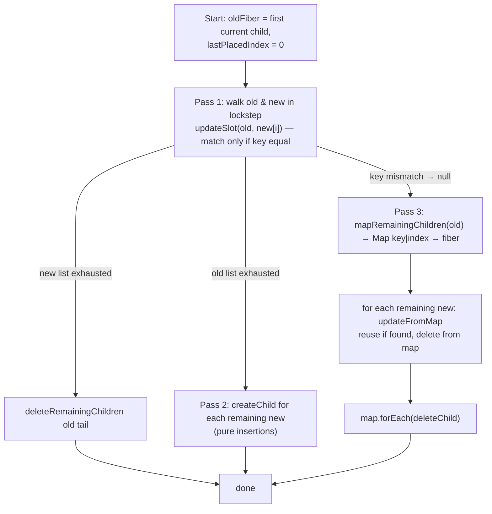

# beginWork and Reconciliation

> [!summary] TL;DR
> `beginWork(current, wip, renderLanes)` does one of two things for each fiber. Either it **bails out** (props object identical, no scheduled update or context change, so it reuses children or skips the whole subtree using `childLanes`), or it **renders** (calls your component, or reads `props.children` for host nodes) and hands the result to the **child reconciler**. The reconciler (`ReactChildFiber.js`) diffs the new elements against the current child fibers by key and type, reuses fibers (`useFiber`) or creates them (`createFiberFromElement`), and records `Placement`/`ChildDeletion` flags. The cheapest bailout of all is **`oldProps === newProps` by reference**, and that is exactly what React Compiler arranges by caching JSX elements.

## The entry decision: didReceiveUpdate

`beginWork` is called by `performUnitOfWork` for every fiber the work loop visits ([[06 The Work Loop - Render Phase|Work Loop]]). The first ~90 lines are a gate:

```js
// ReactFiberBeginWork.js (simplified)
function beginWork(current, workInProgress, renderLanes) {
  if (current !== null) {
    const oldProps = current.memoizedProps;
    const newProps = workInProgress.pendingProps;
    if (oldProps !== newProps || hasLegacyContextChanged()) {
      didReceiveUpdate = true;
    } else {
      const hasScheduledUpdateOrContext =
        checkScheduledUpdateOrContext(current, renderLanes);
      if (!hasScheduledUpdateOrContext &&
          (workInProgress.flags & DidCapture) === NoFlags) {
        didReceiveUpdate = false;
        return attemptEarlyBailoutIfNoScheduledUpdate(current, workInProgress, renderLanes);
      }
      didReceiveUpdate = false;   // (legacy-suspense special case omitted)
    }
  } else {
    didReceiveUpdate = false;     // mount
  }
  workInProgress.lanes = NoLanes;
  switch (workInProgress.tag) { /* ... */ }
}
```
[^bw-gate]

There are three inputs. Know them cold:

1. **`oldProps !== newProps`**: a *reference* comparison of the whole props object. It is not shallow and not deep. `pendingProps` is the `element.props` the parent's reconciler passed into `useFiber` (see below), and `memoizedProps` is the object stored last time.
2. **`current.lanes` includes `renderLanes`**: this fiber itself has a pending update at this priority (e.g. its own `setState`). Checked in `checkScheduledUpdateOrContext`.[^check]
3. **Context change**: context propagation is *lazy* in 19.x, so `checkScheduledUpdateOrContext` also calls `checkIfContextChanged(current.dependencies)` to see whether any context this fiber read now has a different value.[^check]

If (1) is false and (2)/(3) are false, React does not call your component at all. It goes straight to `attemptEarlyBailoutIfNoScheduledUpdate`. That function pushes whatever context-stack entries this fiber type would have pushed (host context, providers, Suspense bookkeeping), because `completeWork` will pop them regardless, and then calls `bailoutOnAlreadyFinishedWork`.[^early]

> [!note] `didReceiveUpdate` is a module-level flag, not a return value
> `beginWork` sets it to `false` in the "same props, but there *is* a scheduled update" path. The component then runs, and if a hook actually produces new state, `updateReducerImpl` calls `markWorkInProgressReceivedUpdate()` (when `!Object.is(newState, hook.memoizedState)`).[^mark][^reducer] So "a setState happened" and "this component's output must be reconciled" are separate questions. React answers the second one after rendering.

## bailoutOnAlreadyFinishedWork and childLanes

```js
function bailoutOnAlreadyFinishedWork(current, workInProgress, renderLanes) {
  if (current !== null) workInProgress.dependencies = current.dependencies;
  markSkippedUpdateLanes(workInProgress.lanes);
  if (!includesSomeLane(renderLanes, workInProgress.childLanes)) {
    // ... lazily propagate context changes, re-check ...
    return null;              // entire subtree is clean: skip it
  }
  cloneChildFibers(current, workInProgress);
  return workInProgress.child; // clean here, but something below has work
}
```
[^bailout]

Returning `null` skips the whole subtree. Because `workInProgress.child` still points at the **current** children (copied by `createWorkInProgress`), the finished tree simply shares those committed fibers. That's O(1) for an arbitrarily large subtree.

`childLanes` is what makes this safe. When `setState` is called deep in the tree, `markUpdateLaneFromFiberToRoot` walks up and ORs the lane into every ancestor's `childLanes` ([[12 setState - dispatchSetState and Batching|setState]]), and `bubbleProperties` recomputes it on the way up in the complete phase ([[08 completeWork - Building DOM Nodes|completeWork]]). So an ancestor knows "nothing here, but descend".

`cloneChildFibers` creates WIP clones of the direct children with `createWorkInProgress(currentChild, currentChild.pendingProps)`.[^clone] Look closely: it passes the child's **old** `pendingProps`, which `performUnitOfWork` copied into `memoizedProps` last time. So when the loop reaches that child, `oldProps === newProps` holds again by construction. The bailout cascades down the path, and only the fiber that actually owns the update runs.

## Dispatch by tag

After the gate, a `switch (workInProgress.tag)` routes to the type-specific function.[^bw-switch] The ones on the first-render / setState path:

### updateHostRoot

```js
function updateHostRoot(current, workInProgress, renderLanes) {
  pushHostRootContext(workInProgress);
  const prevChildren = workInProgress.memoizedState.element;
  cloneUpdateQueue(current, workInProgress);
  processUpdateQueue(workInProgress, nextProps, null, renderLanes);
  const nextState = workInProgress.memoizedState;   // { element, isDehydrated, cache }
  // ... cache provider, transitions ...
  const nextChildren = nextState.element;
  // (hydration branch omitted)
  if (nextChildren === prevChildren) {
    return bailoutOnAlreadyFinishedWork(current, workInProgress, renderLanes);
  }
  reconcileChildren(current, workInProgress, nextChildren, renderLanes);
  return workInProgress.child;
}
```
[^hostroot]

`root.render(<App/>)` enqueued an update whose payload is `{element}` ([[03 root.render - Scheduling the First Update|root.render]]). `processUpdateQueue` (the class-style queue in `ReactFiberClassUpdateQueue.js`) merges it into `memoizedState`, and the element is now the HostRoot's "child". The `throw` if `current === null` confirms that the HostRoot *always* has a current, even on the first render. That detail matters below.

### updateFunctionComponent

```js
function updateFunctionComponent(current, workInProgress, Component, nextProps, renderLanes) {
  prepareToReadContext(workInProgress, renderLanes);
  let nextChildren = renderWithHooks(current, workInProgress, Component,
                                     nextProps, context, renderLanes);
  if (current !== null && !didReceiveUpdate) {
    bailoutHooks(current, workInProgress, renderLanes);
    return bailoutOnAlreadyFinishedWork(current, workInProgress, renderLanes);
  }
  workInProgress.flags |= PerformedWork;
  reconcileChildren(current, workInProgress, nextChildren, renderLanes);
  return workInProgress.child;
}
```
[^fc]

`renderWithHooks` picks the mount or update dispatcher based on `current === null` and calls `Component(props)` ([[10 Hooks on Mount|Hooks on Mount]], [[11 Hooks on Update|Hooks on Update]]).

The **post-render bailout** handles this case: the component *was* scheduled, ran, but every state update resolved to the same value (e.g. `setCount(c => c)` after an eager-state miss), and props were identical. `bailoutHooks` restores `updateQueue` from current, clears `Passive | Update` from the WIP flags (no effects will fire) and removes the lanes.[^bailouthooks] The JSX it just produced is **thrown away** without being reconciled. This is the "React may still call your component before bailing out" caveat from the docs.

### updateHostComponent

```js
function updateHostComponent(current, workInProgress, renderLanes) {
  pushHostContext(workInProgress);
  const nextProps = workInProgress.pendingProps;
  const prevProps = current !== null ? current.memoizedProps : null;
  let nextChildren = nextProps.children;
  if (shouldSetTextContent(type, nextProps)) {
    nextChildren = null;                 // <h1>Hi</h1>: no HostText fiber
  } else if (prevProps !== null && shouldSetTextContent(type, prevProps)) {
    workInProgress.flags |= ContentReset;
  }
  // (form-action "transition-aware host component" hooks omitted)
  markRef(current, workInProgress);
  reconcileChildren(current, workInProgress, nextChildren, renderLanes);
  return workInProgress.child;
}
```
[^hc]

Nothing DOM-related happens here. The `<div>` node is created on the way *up*, in `completeWork`. `shouldSetTextContent` is the DOM host config's "single string/number child or `dangerouslySetInnerHTML`" test.[^sstc] For those, React avoids allocating a text fiber and sets `textContent` as a prop.

### memo and SimpleMemoComponent

`React.memo(Fn)` with no custom `compare`, wrapping a plain function, gets "upgraded" on mount to a `SimpleMemoComponent`: a single fiber that is both the memo boundary and the function component.[^memo] On update:

```js
function updateSimpleMemoComponent(current, workInProgress, Component, nextProps, renderLanes) {
  if (current !== null) {
    const prevProps = current.memoizedProps;
    if (shallowEqual(prevProps, nextProps) && current.ref === workInProgress.ref) {
      didReceiveUpdate = false;
      workInProgress.pendingProps = nextProps = prevProps;  // reuse the old object!
      if (!checkScheduledUpdateOrContext(current, renderLanes)) {
        workInProgress.lanes = current.lanes;
        return bailoutOnAlreadyFinishedWork(current, workInProgress, renderLanes);
      }
    }
  }
  return updateFunctionComponent(current, workInProgress, Component, nextProps, renderLanes);
}
```
[^simplememo]

`shallowEqual` compares keys with `Object.is`.[^shallow] Note the line `pendingProps = prevProps`: once memo decides the props are equivalent, it swaps in the *old* object so the identity invariant holds downstream. The general `MemoComponent` path (custom `compare`, or wrapping `forwardRef`/lazy) keeps an extra inner fiber and compares against `currentChild.memoizedProps`.[^memo]

> [!warning] Gotcha: `memo` doesn't help if any prop is a fresh object or function
> `<Row onClick={() => select(id)} style={{color}} />` creates a new arrow and a new object on every parent render, so `shallowEqual` fails and the memo boundary costs a comparison *and* a re-render. This is the manual `useCallback`/`useMemo` problem the compiler removes.

## reconcileChildren and why first render puts Placement only on the root's child

```js
export function reconcileChildren(current, workInProgress, nextChildren, renderLanes) {
  if (current === null) {
    workInProgress.child = mountChildFibers(workInProgress, null, nextChildren, renderLanes);
  } else {
    workInProgress.child = reconcileChildFibers(workInProgress, current.child, nextChildren, renderLanes);
  }
}
// ReactChildFiber.js
export const reconcileChildFibers = createChildReconciler(true);
export const mountChildFibers   = createChildReconciler(false);
```
[^rc][^exports]

`createChildReconciler(shouldTrackSideEffects)` is a closure factory. Every inner helper checks the flag. When it is `false`, `deleteChild` is a no-op, `placeChild` sets only `Forked` (for `useId`), and `placeSingleChild` sets nothing.[^delete][^place]

Now trace the first render:

- **HostRoot** has a `current` (from `createRoot`), so it uses `reconcileChildFibers` (tracking **on**). `<App/>` has no matching current child, so `createFiberFromElement` is called, and `placeSingleChild` sees `alternate === null` and sets **`Placement`** on the App fiber.
- **App**, **div**, and everything below have `current === null`, so they use `mountChildFibers` (tracking **off**). No Placement flags anywhere else.

That's deliberate. In the complete phase each new host node appends its children directly (`appendAllChildren`), so the whole DOM tree is assembled off-document, and the commit only needs *one* insertion at the top: App's Placement → the nearest host descendants are appended into the container ([[08 completeWork - Building DOM Nodes|completeWork]], [[09 Commit Phase - Mutation, Layout, Passive Effects|Commit Phase]]). One `appendChild` into a live document instead of N avoids N layout invalidations.

The same rule applies on updates to any newly mounted subtree: only the subtree's root fiber is marked, because it was created by a tracking reconciler, while its descendants were created by a mount reconciler.

## reconcileSingleElement

When the new child is a single element:

```js
function reconcileSingleElement(returnFiber, currentFirstChild, element, lanes) {
  const key = element.key;
  let child = currentFirstChild;
  while (child !== null) {
    if (child.key === key) {
      if (child.elementType === element.type /* or fragment / lazy / HMR */) {
        deleteRemainingChildren(returnFiber, child.sibling);
        const existing = useFiber(child, element.props);  // reuse
        coerceRef(existing, element);
        existing.return = returnFiber;
        return existing;
      }
      deleteRemainingChildren(returnFiber, child);         // same key, other type
      break;
    } else {
      deleteChild(returnFiber, child);
    }
    child = child.sibling;
  }
  const created = createFiberFromElement(element, returnFiber.mode, lanes);
  coerceRef(created, element);
  created.return = returnFiber;
  return created;
}
```
[^rse]

Identity rule: **same key + same type ⇒ same fiber ⇒ state preserved**. A type change (`<Foo/>` → `<Bar/>`, or `<div>` → `<span>`) destroys the old subtree, including all its state and DOM, and builds a new one. This is the ["same position, same type"](https://react.dev/learn/preserving-and-resetting-state) rule from the docs, here as code. It's also why defining a component *inside* another component is a bug: the type is a new function on each render, so the subtree remounts every time.

`useFiber(fiber, pendingProps)` is just `createWorkInProgress(fiber, pendingProps)` with `index = 0; sibling = null`.[^usefiber] Here **`pendingProps = element.props`**. That line is where element identity becomes props identity.

## reconcileChildrenArray: the list algorithm

React does not run a general tree diff (that would be O(n³)). It uses two heuristics: different types produce different trees, and keys identify children within one parent. Fibers are a singly-linked list with no back pointers, so the algorithm is forward-only:[^rca]



**Pass 1 (`updateSlot`)** handles the common case of "same list, some props changed". For each index it checks the key. If the keys match, it calls `updateElement` (reuse if same type, otherwise create new and later delete the old). On the first key mismatch it breaks out.[^slot][^ue]

**Pass 3** handles inserts, removals and reorders. All remaining old fibers go into a `Map` keyed by `key` (or `index` for unkeyed), and each new child looks up its match.[^map]

**`placeChild` and `lastPlacedIndex`** decide which reused fibers have *moved*:

```js
function placeChild(newFiber, lastPlacedIndex, newIndex) {
  newFiber.index = newIndex;
  if (!shouldTrackSideEffects) { newFiber.flags |= Forked; return lastPlacedIndex; }
  const current = newFiber.alternate;
  if (current !== null) {
    const oldIndex = current.index;
    if (oldIndex < lastPlacedIndex) {
      newFiber.flags |= Placement;   // move
      return lastPlacedIndex;
    }
    return oldIndex;                 // stays
  }
  newFiber.flags |= Placement | PlacementDEV;  // insertion
  return lastPlacedIndex;
}
```
[^place]

`lastPlacedIndex` is the highest old index among the fibers already kept in place. A reused fiber whose old index is *lower* than that must have moved left relative to something, so it gets `Placement` (the commit does an `insertBefore`). For `[A,B,C,D] → [D,A,B,C]`: D (old 3) stays and `lastPlacedIndex = 3`, then A (0), B (1) and C (2) are all `< 3`, so they all move. That's **three** DOM moves for what you'd think of as one. The algorithm is optimised for appends and in-place edits. Moving the last item to the front is its worst case. The source comment says as much: no two-ended search because fibers have no back pointers.[^rca]

> [!warning] Index keys
> With `key={index}` (or no key), keys follow *positions*, not items. Prepending to a list makes every slot match the "wrong" old fiber. Each one is reused with new props, and **state and uncontrolled DOM state (input values, focus) stay at the position** rather than following the item. That's not a performance trick, it's a correctness bug.

### Flags the reconciler emits

| Flag | Set by | Meaning for commit |
|---|---|---|
| `Placement` | `placeSingleChild`, `placeChild` | insert/move host nodes of this fiber |
| `ChildDeletion` (+ `returnFiber.deletions[]`) | `deleteChild` | unmount & remove the listed fibers[^delete] |
| `ContentReset` | `updateHostComponent` | clear text content before inserting children |
| `Ref` | `markRef` (host components, refs that changed) | detach/attach refs |
| `Update` | **not** here for host nodes. Set in `completeWork` (`markUpdate`) or by hooks with effects | see pages 08/09 |

`useFiber` vs `createFiberFromElement`: the first *recycles the alternate object* and keeps `memoizedState` (hooks), `stateNode` (the DOM node) and `child`. The second allocates a fresh fiber via `createFiberFromTypeAndProps`, which resolves the tag from the type (function → `FunctionComponent`, string → `HostComponent`, etc.).[^cffe] Keeping DOM nodes and state is the whole point of reconciliation.

## Element identity is the key bailout

Put the pieces together:

1. The parent renders and returns JSX. Each `<Child a={1}/>` compiles to `jsx(Child, {a: 1})`. `jsxProd` uses that config object literal as `props` (or copies it when there's a `key`), so **every call produces a new props object**.[^jsx]
2. The reconciler does `useFiber(child, element.props)`, so `pendingProps` is that new object.
3. `beginWork` on the child: `oldProps !== newProps` is **true**, even if all values are equal, so the child renders.

Therefore, **without memoization a re-render cascades through the entire subtree below the component that updated.** The `childLanes` bailout only protects *siblings and ancestors* of the updated fiber, not its descendants. That's the default React behaviour, and people misread it in both directions: "React re-renders everything on setState" (no, only the updated component's subtree) and "React only re-renders what changed" (no, the subtree re-renders unless something stops it).

What stops the cascade:
- **Same element object**: if the parent returns *the same element object* as last time (e.g. `children` passed through from above, an element hoisted to module scope, or one cached in `useMemo`), then `element.props` is the same object, `oldProps === newProps`, and the child bails out with no comparison at all. That's the "lift content up / pass children" optimisation.
- **`memo`**: replaces the identity check with `shallowEqual`, at the cost of a key-by-key comparison, and fails on unstable callbacks/objects.

## With the React Compiler

The compiler doesn't change any of the code above. It changes what *your component returns*. It memoizes values and JSX in a per-component cache (`const $ = _c(n)`, backed by the `useMemoCache` hook[^umc]), so when the inputs of a JSX expression are unchanged it returns **the very same element object** as last render:

```js
// Illustrative output shape (cf. compiler fixtures)
function Parent({ items }) {
  const $ = _c(2);
  let t0;
  if ($[0] !== items) {
    t0 = <List items={items} />;
    $[0] = items;
    $[1] = t0;
  } else {
    t0 = $[1];         // same ReactElement object as last render
  }
  return t0;
}
```
[^fixture]

Feed that into the pipeline: same element → `useFiber(child, element.props)` gets the *same* props object → `beginWork` takes the `oldProps === newProps` branch → `checkScheduledUpdateOrContext` false → `attemptEarlyBailoutIfNoScheduledUpdate` → subtree skipped. You get the effect of `React.memo` on every child **without `memo`, without `shallowEqual`, and without `useCallback`**, because the inline callbacks are cached too, so props stay identical. The compiler effectively turns the cheapest bailout (reference equality) from an occasional accident into the default.

Two consequences worth knowing:
- If a compiled component's *own* state changes, it still re-runs. The cache only skips recomputing the parts whose dependencies are unchanged, and the reconciler only skips children whose elements came out of the cache.
- The bailout still requires no pending lanes and no context change on the child. Context consumers below still re-render when the context value changes, compiler or not.

Full comparison: [[15 Rendering With vs Without the Compiler|With vs Without Compiler]]. How the cache is built: [[14 React Compiler - How It Works|React Compiler]].

← [[06 The Work Loop - Render Phase|Work Loop]] · [[00 React Internals Index|Index]] · [[08 completeWork - Building DOM Nodes|completeWork]] →

[^bw-gate]: `beginWork` props/lanes gate — [packages/react-reconciler/src/ReactFiberBeginWork.js#L4250-L4320](https://github.com/facebook/react/blob/v19.3.1/packages/react-reconciler/src/ReactFiberBeginWork.js#L4250-L4320)
[^bw-switch]: `beginWork` tag switch — [packages/react-reconciler/src/ReactFiberBeginWork.js#L4322-L4512](https://github.com/facebook/react/blob/v19.3.1/packages/react-reconciler/src/ReactFiberBeginWork.js#L4322-L4512)
[^check]: `checkScheduledUpdateOrContext` — [packages/react-reconciler/src/ReactFiberBeginWork.js#L3939-L3956](https://github.com/facebook/react/blob/v19.3.1/packages/react-reconciler/src/ReactFiberBeginWork.js#L3939-L3956)
[^early]: `attemptEarlyBailoutIfNoScheduledUpdate` — [packages/react-reconciler/src/ReactFiberBeginWork.js#L3958-L4224](https://github.com/facebook/react/blob/v19.3.1/packages/react-reconciler/src/ReactFiberBeginWork.js#L3958-L4224)
[^mark]: `markWorkInProgressReceivedUpdate` — [packages/react-reconciler/src/ReactFiberBeginWork.js#L3800-L3802](https://github.com/facebook/react/blob/v19.3.1/packages/react-reconciler/src/ReactFiberBeginWork.js#L3800-L3802)
[^reducer]: `updateReducerImpl` marks received update only if state changed — [packages/react-reconciler/src/ReactFiberHooks.js#L1553-L1555](https://github.com/facebook/react/blob/v19.3.1/packages/react-reconciler/src/ReactFiberHooks.js#L1553-L1555)
[^bailout]: `bailoutOnAlreadyFinishedWork` — [packages/react-reconciler/src/ReactFiberBeginWork.js#L3826-L3865](https://github.com/facebook/react/blob/v19.3.1/packages/react-reconciler/src/ReactFiberBeginWork.js#L3826-L3865)
[^clone]: `cloneChildFibers` — [packages/react-reconciler/src/ReactChildFiber.js#L2120-L2146](https://github.com/facebook/react/blob/v19.3.1/packages/react-reconciler/src/ReactChildFiber.js#L2120-L2146)
[^hostroot]: `updateHostRoot` — [packages/react-reconciler/src/ReactFiberBeginWork.js#L1831-L1949](https://github.com/facebook/react/blob/v19.3.1/packages/react-reconciler/src/ReactFiberBeginWork.js#L1831-L1949)
[^fc]: `updateFunctionComponent` (post-render bailout L1549-L1552) — [packages/react-reconciler/src/ReactFiberBeginWork.js#L1453-L1562](https://github.com/facebook/react/blob/v19.3.1/packages/react-reconciler/src/ReactFiberBeginWork.js#L1453-L1562)
[^bailouthooks]: `bailoutHooks` — [packages/react-reconciler/src/ReactFiberHooks.js#L908-L927](https://github.com/facebook/react/blob/v19.3.1/packages/react-reconciler/src/ReactFiberHooks.js#L908-L927)
[^hc]: `updateHostComponent` (begin phase) — [packages/react-reconciler/src/ReactFiberBeginWork.js#L1966-L2033](https://github.com/facebook/react/blob/v19.3.1/packages/react-reconciler/src/ReactFiberBeginWork.js#L1966-L2033)
[^sstc]: `shouldSetTextContent` — [packages/react-dom-bindings/src/client/ReactFiberConfigDOM.js#L744-L755](https://github.com/facebook/react/blob/v19.3.1/packages/react-dom-bindings/src/client/ReactFiberConfigDOM.js#L744-L755)
[^memo]: `updateMemoComponent` (SimpleMemo upgrade L486-L508) — [packages/react-reconciler/src/ReactFiberBeginWork.js#L479-L545](https://github.com/facebook/react/blob/v19.3.1/packages/react-reconciler/src/ReactFiberBeginWork.js#L479-L545)
[^simplememo]: `updateSimpleMemoComponent` — [packages/react-reconciler/src/ReactFiberBeginWork.js#L547-L618](https://github.com/facebook/react/blob/v19.3.1/packages/react-reconciler/src/ReactFiberBeginWork.js#L547-L618)
[^shallow]: `shallowEqual` — [packages/shared/shallowEqual.js#L18-L52](https://github.com/facebook/react/blob/v19.3.1/packages/shared/shallowEqual.js#L18-L52)
[^rc]: `reconcileChildren` — [packages/react-reconciler/src/ReactFiberBeginWork.js#L339-L370](https://github.com/facebook/react/blob/v19.3.1/packages/react-reconciler/src/ReactFiberBeginWork.js#L339-L370)
[^exports]: `reconcileChildFibers` / `mountChildFibers` — [packages/react-reconciler/src/ReactChildFiber.js#L2110-L2112](https://github.com/facebook/react/blob/v19.3.1/packages/react-reconciler/src/ReactChildFiber.js#L2110-L2112)
[^delete]: `deleteChild` / `deleteRemainingChildren` — [packages/react-reconciler/src/ReactChildFiber.js#L434-L465](https://github.com/facebook/react/blob/v19.3.1/packages/react-reconciler/src/ReactChildFiber.js#L434-L465)
[^place]: `placeChild` / `placeSingleChild` — [packages/react-reconciler/src/ReactChildFiber.js#L511-L550](https://github.com/facebook/react/blob/v19.3.1/packages/react-reconciler/src/ReactChildFiber.js#L511-L550)
[^rse]: `reconcileSingleElement` — [packages/react-reconciler/src/ReactChildFiber.js#L1703-L1806](https://github.com/facebook/react/blob/v19.3.1/packages/react-reconciler/src/ReactChildFiber.js#L1703-L1806); dispatched with `placeSingleChild` at [#L1887-L1899](https://github.com/facebook/react/blob/v19.3.1/packages/react-reconciler/src/ReactChildFiber.js#L1887-L1899)
[^usefiber]: `useFiber` — [packages/react-reconciler/src/ReactChildFiber.js#L502-L509](https://github.com/facebook/react/blob/v19.3.1/packages/react-reconciler/src/ReactChildFiber.js#L502-L509)
[^rca]: `reconcileChildrenArray` — [packages/react-reconciler/src/ReactChildFiber.js#L1177-L1369](https://github.com/facebook/react/blob/v19.3.1/packages/react-reconciler/src/ReactChildFiber.js#L1177-L1369)
[^slot]: `updateSlot` — [packages/react-reconciler/src/ReactChildFiber.js#L842-L983](https://github.com/facebook/react/blob/v19.3.1/packages/react-reconciler/src/ReactChildFiber.js#L842-L983)
[^ue]: `updateElement` — [packages/react-reconciler/src/ReactChildFiber.js#L580-L636](https://github.com/facebook/react/blob/v19.3.1/packages/react-reconciler/src/ReactChildFiber.js#L580-L636)
[^map]: `mapRemainingChildren` — [packages/react-reconciler/src/ReactChildFiber.js#L467-L500](https://github.com/facebook/react/blob/v19.3.1/packages/react-reconciler/src/ReactChildFiber.js#L467-L500)
[^cffe]: `createFiberFromElement` — [packages/react-reconciler/src/ReactFiber.js#L739-L765](https://github.com/facebook/react/blob/v19.3.1/packages/react-reconciler/src/ReactFiber.js#L739-L765); `createFiberFromTypeAndProps` at [#L554](https://github.com/facebook/react/blob/v19.3.1/packages/react-reconciler/src/ReactFiber.js#L554)
[^jsx]: `jsxProd` — [packages/react/src/jsx/ReactJSXElement.js#L291-L348](https://github.com/facebook/react/blob/v19.3.1/packages/react/src/jsx/ReactJSXElement.js#L291-L348)
[^umc]: `useMemoCache` — [packages/react-reconciler/src/ReactFiberHooks.js#L1181](https://github.com/facebook/react/blob/v19.3.1/packages/react-reconciler/src/ReactFiberHooks.js#L1181)
[^fixture]: compiler fixture showing a cached JSX element (`$[0]`/`t0`) — [compiler/packages/babel-plugin-react-compiler/src/__tests__/fixtures/compiler/jsx-member-expression-tag-grouping.expect.md#L14-L27](https://github.com/facebook/react/blob/v19.3.1/compiler/packages/babel-plugin-react-compiler/src/__tests__/fixtures/compiler/jsx-member-expression-tag-grouping.expect.md#L14-L27); docs: [React Compiler – react.dev](https://react.dev/learn/react-compiler)
