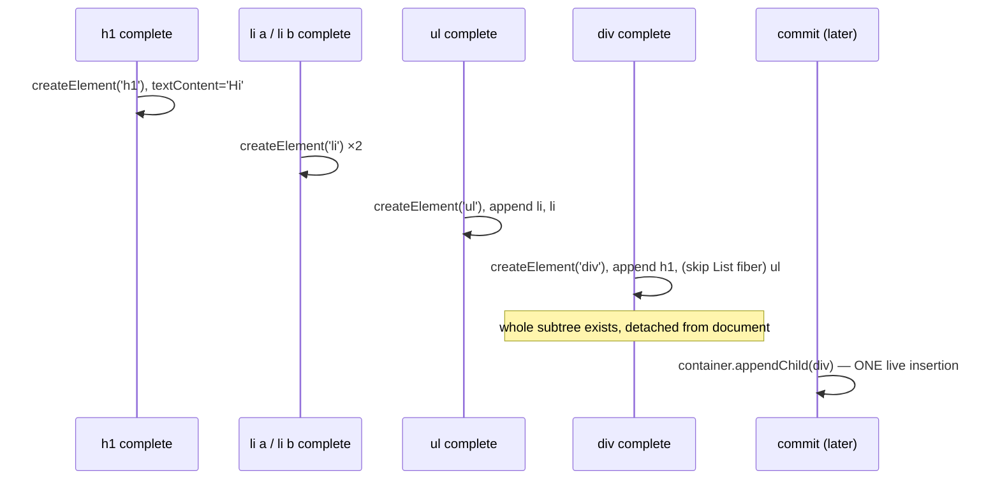

# completeWork - Building DOM Nodes

> [!summary] TL;DR
> `completeWork` runs on the way *up* the tree, once all of a fiber's children are done. For a newly mounted host fiber it creates the real DOM node (`createInstance` → `document.createElement`), appends the already-built DOM children into it (`appendAllChildren`), and sets its attributes (`finalizeInitialChildren` → `setInitialProperties`). The result is a complete DOM subtree that is **not attached to the document**. On updates, React 19 does **not** diff props here: it only checks `oldProps !== newProps` and sets the `Update` flag (`markUpdate`). The actual attribute diff happens in the commit phase (`commitUpdate` → `updateProperties`). Every fiber finishes with `bubbleProperties`, which ORs children's `flags`/`lanes` into `subtreeFlags`/`childLanes`.

## Where it's called

`completeUnitOfWork` calls `completeWork(current, workInProgress, renderLanes)` for a fiber when `beginWork` returned no child, then continues with the sibling or climbs to the parent ([[06 The Work Loop - Render Phase|Work Loop]]).[^cuow] So the order is post-order: **children complete before their parent**. That ordering is the reason the DOM can be built bottom-up.

`completeWork` is a big `switch` on `tag`.[^cw] For most non-host fibers (function components, fragments, memo, context consumers…) it does nothing but `bubbleProperties`:

```js
case LazyComponent: case SimpleMemoComponent: case FunctionComponent:
case ForwardRef: case Fragment: case Mode: case Profiler:
case ContextConsumer: case MemoComponent:
  bubbleProperties(workInProgress);
  return null;
```
[^cw-simple]

The interesting work is for `HostComponent`, `HostText` and `HostRoot`. Suspense, Offscreen/Activity and SuspenseList also have big cases (visibility toggling, retry wiring), but they're outside the first-render/setState path.

## HostComponent on mount

```js
case HostComponent: {
  popHostContext(workInProgress);
  const type = workInProgress.type;
  if (current !== null && workInProgress.stateNode != null) {
    updateHostComponent(current, workInProgress, type, newProps, renderLanes);  // update
  } else {
    const currentHostContext = getHostContext();
    const wasHydrated = popHydrationState(workInProgress);
    if (wasHydrated) {
      prepareToHydrateHostInstance(workInProgress, currentHostContext);
    } else {
      const rootContainerInstance = getRootHostContainer();
      const instance = createInstance(type, newProps, rootContainerInstance,
                                      currentHostContext, workInProgress);
      markCloned(workInProgress);
      appendAllChildren(instance, workInProgress, false, false);
      workInProgress.stateNode = instance;
      if (finalizeInitialChildren(instance, type, newProps, currentHostContext)) {
        markUpdate(workInProgress);
      }
    }
  }
  bubbleProperties(workInProgress);
  // ...
  preloadInstanceAndSuspendIfNeeded(workInProgress, /* ... */);  // suspensey images/styles
  return null;
}
```
[^cw-hc]

There are three host-config calls, all implemented by `react-dom-bindings`' `ReactFiberConfigDOM.js` ([[01 Bootstrap - Packages, JSX and the Dispatcher|Bootstrap]] covers how the reconciler is parameterised by a host config).

### 1. createInstance

```js
// ReactFiberConfigDOM.js (simplified)
export function createInstance(type, props, rootContainerInstance, hostContext, internalInstanceHandle) {
  const ownerDocument = getOwnerDocumentFromRootContainer(rootContainerInstance);
  let domElement;
  switch (hostContext) {
    case HostContextNamespaceSvg:  domElement = ownerDocument.createElementNS(SVG_NAMESPACE, type); break;
    case HostContextNamespaceMath: domElement = ownerDocument.createElementNS(MATH_NAMESPACE, type); break;
    default:
      switch (type) {
        case 'svg':    /* createElementNS */ break;
        case 'script': /* innerHTML trick so the script does NOT execute */ break;
        case 'select': /* set multiple/size before children are appended */ break;
        default:       domElement = ownerDocument.createElement(type); // or {is: props.is}
      }
  }
  precacheFiberNode(internalInstanceHandle, domElement);
  updateFiberProps(domElement, props);
  return domElement;
}
```
[^ci]

- **Host context** is a stack pushed in `beginWork` (`pushHostContext`) and popped here. It's how a `<path>` inside `<svg>` knows to use `createElementNS`. The namespace is inherited from ancestors, which you can only know top-down. That's why the stack is pushed in the begin phase even though the element is created in the complete phase.
- `<script>` is created via `innerHTML` on a throwaway `div`. Scripts created that way are inert, matching SSR behaviour.
- **`precacheFiberNode`** writes the fiber onto the node under a random key (`'__reactFiber$' + randomKey`). **`updateFiberProps`** writes the props under `'__reactProps$' + randomKey`.[^keys][^precache][^ufp] The event system relies on both: given `event.target`, it finds the fiber via `__reactFiber$`, and reads the *latest* `onClick` from `__reactProps$` ([[13 The Event System|Event System]]). This is also why `commitUpdate` calls `updateFiberProps` again on every update. Changing only a handler function results in a cheap property write and no `addEventListener` churn, because React delegates events at the root.

### 2. appendAllChildren: the off-screen tree

```js
function appendAllChildren(parent, workInProgress, needsVisibilityToggle, isHidden) {
  // supportsMutation branch (DOM)
  let node = workInProgress.child;
  while (node !== null) {
    if (node.tag === HostComponent || node.tag === HostText) {
      appendInitialChild(parent, node.stateNode);   // parent.appendChild(child)
    } else if (node.tag === HostPortal || node.tag === HostSingleton) {
      // don't descend: portals/singletons are placed independently
    } else if (node.child !== null) {
      node.child.return = node;
      node = node.child;                             // descend through components
      continue;
    }
    if (node === workInProgress) return;
    while (node.sibling === null) {
      if (node.return === null || node.return === workInProgress) return;
      node = node.return;
    }
    node.sibling.return = node.return;
    node = node.sibling;
  }
}
```
[^aac][^aic]

The walk descends through *non-host* fibers (your components, fragments) but stops at the first host fiber on each path. It only needs the **nearest host descendants**, because each of those already contains its own subtree: it ran `appendAllChildren` when *it* completed.

So, for the tree from page 06:



Why build bottom-up off-document?
- **One insertion into the live document.** Appending to a detached node doesn't trigger style recalculation or layout. Only the final `appendChild` into the container does, in the commit phase, and it does so once. That's why only App carries `Placement` on the first render ([[07 beginWork and Reconciliation|beginWork & Reconciliation]]).
- **Interruptible and discardable.** A concurrent render may be thrown away. Detached nodes that are never inserted are just garbage collected, and the user never sees a partial tree. If React inserted top-down during render, an interrupted render would leave half a UI on screen.
- **Simplicity.** A parent's children are always finished when the parent completes, so a single pass in `completeWork` suffices. The source `TODO` even mentions moving `createInstance` to `beginWork` and appending top-down as a possible alternative ("Top->down is faster in IE11").[^cw-hc]

> [!note] Portals and singletons are excluded
> A portal's children belong in a different container, and `HostSingleton` (`<html>`, `<head>`, `<body>`) reuses existing document nodes. Both get placed independently in the commit phase, so `appendAllChildren` skips descending into them.

### 3. finalizeInitialChildren → setInitialProperties

```js
export function finalizeInitialChildren(domElement, type, props, hostContext) {
  setInitialProperties(domElement, type, props);
  switch (type) {
    case 'button': case 'input': case 'select': case 'textarea':
      return !!props.autoFocus;
    case 'img':
      return true;
    default:
      return false;
  }
}
```
[^fic]

`setInitialProperties` loops over props and calls `setProp` for each one: attributes, `style`, `className`, string `children` → `textContent`, `dangerouslySetInnerHTML`. It has tag-specific paths for `input`/`select`/`textarea` (controlled value wrappers) and `img` (it sets `src`/`srcSet` *last* so `crossOrigin`/`sizes` apply before the fetch starts, and it attaches non-delegated `load`/`error` listeners).[^sip]

Attributes are set **before** the node is in the document, and **after** its children were appended. For `<select>`, children (`<option>`s) must exist before `value` is applied, which is one reason for that ordering.

A `true` return means "I need a commit-time effect on mount": `markUpdate` → `Update` flag → in the layout phase, `commitHostMount` → `commitMount`, which calls `.focus()` for `autoFocus` or re-assigns `img.src` so `onLoad` fires reliably.[^commitmount] Focus has to wait until the node is actually in the document.

## HostText

```js
case HostText: {
  const newText = newProps;
  if (current && workInProgress.stateNode != null) {
    updateHostText(current, workInProgress, current.memoizedProps, newText);
  } else {
    // (hydration branch omitted)
    markCloned(workInProgress);
    workInProgress.stateNode = createTextInstance(newText, rootContainerInstance,
                                                  currentHostContext, workInProgress);
  }
  bubbleProperties(workInProgress);
  return null;
}
```
[^cw-text]

`createTextInstance` → `document.createTextNode(text)` + `precacheFiberNode`.[^cti] Text fibers only exist for text that *isn't* the sole child (`<p>Hello {name}</p>` produces two text fibers). A sole string child is set as `textContent` via the `shouldSetTextContent` path in `beginWork`. On update, `updateHostText` simply does `if (oldText !== newText) markUpdate(wip)`, and the commit sets `textNode.nodeValue = newText`.[^uht][^ctu]

## HostRoot

HostRoot completion pops the root contexts (host container, cache, transitions). On the **first client render** (`current.child === null` and not hydrating) it sets the **`Snapshot`** flag on the root. That schedules `clearContainer(root.containerInfo)` in the before-mutation phase, so anything already in `<div id="root">` (a "Loading…" placeholder, say) is wiped before React inserts its tree.[^cw-root] See [[09 Commit Phase - Mutation, Layout, Passive Effects|Commit Phase]].

## On update: mark, don't diff

```js
// ReactFiberCompleteWork.js — mutation-mode branch of updateHostComponent
function updateHostComponent(current, workInProgress, type, newProps, renderLanes) {
  if (supportsMutation) {
    const oldProps = current.memoizedProps;
    if (oldProps === newProps) {
      // In mutation mode, this is sufficient for a bailout because
      // we won't touch this node even if children changed.
      return;
    }
    markUpdate(workInProgress);       // workInProgress.flags |= Update
  } else if (supportsPersistence) {
    // clone instance (React Native Fabric path)
  }
}
```
[^uhc][^mu]

That's the entire update logic for a DOM element in the render phase. It's an identity check followed by a flag.

> [!info] What changed from React 18
> In React ≤18, this function called the host config's `prepareUpdate()`, which ran `diffProperties` and stored an *update payload* (a flat `[key, value, key, value]` array) in `workInProgress.updateQueue`. The commit phase then applied that payload. PR #26583, "Diff properties in the commit phase instead of generating an update payload", removed it.[^pr] In 19.3.1 there is no `prepareUpdate` anywhere in the reconciler or DOM host config. The diff and the DOM writes now happen in a single pass in the commit phase. Per the PR, that avoids allocating temporary payload objects during render and reduces total work. The tradeoff is that an element whose props object changed but whose values didn't still costs a full prop loop at commit time.

At commit, `commitMutationEffectsOnFiber` sees `flags & Update` on a `HostComponent` and calls `commitHostUpdate(finishedWork, newProps, oldProps)` → the DOM config's `commitUpdate`:[^mut-hc][^chu]

```js
export function commitUpdate(domElement, type, oldProps, newProps, internalInstanceHandle) {
  // Diff and update the properties.
  updateProperties(domElement, type, oldProps, newProps);
  // Update the props handle so that we know which props are the ones with
  // with current event handlers.
  updateFiberProps(domElement, newProps);
}
```
[^cu]

`updateProperties` is the diff. For common tags (`div`, `span`, `p`, `a`, `li`, `svg`, …) it goes straight to two generic loops. The first loop unsets props present in `lastProps` but missing from `nextProps`. The second sets props where `nextProp !== lastProp`. `input`, `select`, `textarea`, `option`, `img`, custom elements and a few others have special paths (controlled values must be applied after other attributes).[^up]

> [!warning] Gotcha: "Update" doesn't mean "the DOM changed"
> A parent re-render recreates `<div className="row">` with a *new* props object, so the `<div>` fiber gets `Update` and the commit runs `updateProperties`. The loop finds every value `===`, so no DOM writes happen, but you still pay for the comparison. And `style={{...}}` literals are new objects, so `style` is always "changed" at the prop level (`setProp` → `setValueForStyles` diffs individual style keys). React DevTools' "highlight updates" shows *renders*, not DOM writes, and neither is the same as "the browser repainted".

## bubbleProperties: subtreeFlags and childLanes

Every `completeWork` path ends in `bubbleProperties(completedWork)`:

```js
function bubbleProperties(completedWork) {
  const didBailout =
    completedWork.alternate !== null &&
    completedWork.alternate.child === completedWork.child;
  let newChildLanes = NoLanes;
  let subtreeFlags = NoFlags;
  if (!didBailout) {
    let child = completedWork.child;
    while (child !== null) {
      newChildLanes = mergeLanes(newChildLanes, mergeLanes(child.lanes, child.childLanes));
      subtreeFlags |= child.subtreeFlags;
      subtreeFlags |= child.flags;
      child.return = completedWork;
      child = child.sibling;
    }
  } else {
    // Children are the current fibers (bailout): only bubble StaticMask flags.
    // ... same loop with `& StaticMask` ...
  }
  completedWork.subtreeFlags |= subtreeFlags;
  completedWork.childLanes = newChildLanes;
  return didBailout;
}
```
[^bubble]

Two aggregates are computed on the way up:

- **`subtreeFlags`**: the union of all effect flags anywhere below this fiber. The commit phase checks `parentFiber.subtreeFlags & MutationMask` (or `LayoutMask`, `PassiveMask`) before descending, so clean subtrees are skipped in O(1).[^rtme] This replaced React 17's linked "effect list". Instead of threading a list of effectful fibers through the tree during complete, React now stores one bitmask per fiber and walks the tree in the commit phase, pruning by mask. It's simpler, and it works with Suspense/Offscreen re-traversal.
- **`childLanes`**: the union of pending lanes below. After a render, this is what's *left over* (skipped lower-priority updates), and `commitRoot` reads `finishedWork.lanes | finishedWork.childLanes` as the root's remaining work.[^commitroot]

The **bailout** branch matters. When `completedWork.child` is still the *current* child (the subtree was skipped in `beginWork`), those children's `flags` belong to a previous commit and must not be re-applied, so only `StaticMask` flags are bubbled. Static flags (e.g. "this subtree contains a passive effect", "has a ref") describe the fiber's lifetime rather than one render, and they're needed when Offscreen hides or reveals a tree.

## First render vs update, summarized

| | First render | Update |
|---|---|---|
| HostComponent | `createInstance` + `appendAllChildren` + `setInitialProperties`. `Update` only for autoFocus/img | `oldProps !== newProps` → `Update` |
| HostText | `createTextNode` | `oldText !== newText` → `Update` |
| HostRoot | `Snapshot` → clear container | nothing special |
| Placement | only on HostRoot's child (from page 07) | on inserted/moved fibers |
| DOM writes during render | on *detached* nodes only | **none** (all deferred to commit) |

## With the React Compiler

`completeWork` is **unchanged**. The compiler only rewrites component code. But it changes the inputs here in two ways:

1. Subtrees that bail out in `beginWork` because the compiler returned a cached element never reach `updateHostComponent` with a fresh props object. Their host fibers take the `didBailout` path in `bubbleProperties`, so no `Update` flag and no `updateProperties` loop at commit.
2. Inside a component that *does* re-render, the compiler caches JSX at the granularity of its reactive scopes. A static `<div className="row">` whose inputs never change is created once and reused, so `oldProps === newProps` on that host fiber, which skips `markUpdate`. Without the compiler, that same div is "updated" (with a no-op diff) on every parent render.

So the compiler cuts both render-phase work and commit-phase prop diffing. See [[15 Rendering With vs Without the Compiler|With vs Without Compiler]].

← [[07 beginWork and Reconciliation|beginWork & Reconciliation]] · [[00 React Internals Index|Index]] · [[09 Commit Phase - Mutation, Layout, Passive Effects|Commit Phase]] →

[^cuow]: `completeUnitOfWork` — [packages/react-reconciler/src/ReactFiberWorkLoop.js#L3368-L3431](https://github.com/facebook/react/blob/v19.3.1/packages/react-reconciler/src/ReactFiberWorkLoop.js#L3368-L3431)
[^cw]: `completeWork` — [packages/react-reconciler/src/ReactFiberCompleteWork.js#L1082-L2112](https://github.com/facebook/react/blob/v19.3.1/packages/react-reconciler/src/ReactFiberCompleteWork.js#L1082-L2112)
[^cw-simple]: `completeWork` trivial cases — [packages/react-reconciler/src/ReactFiberCompleteWork.js#L1100-L1110](https://github.com/facebook/react/blob/v19.3.1/packages/react-reconciler/src/ReactFiberCompleteWork.js#L1100-L1110)
[^cw-hc]: `completeWork` HostComponent case — [packages/react-reconciler/src/ReactFiberCompleteWork.js#L1374-L1473](https://github.com/facebook/react/blob/v19.3.1/packages/react-reconciler/src/ReactFiberCompleteWork.js#L1374-L1473)
[^ci]: `createInstance` — [packages/react-dom-bindings/src/client/ReactFiberConfigDOM.js#L534-L664](https://github.com/facebook/react/blob/v19.3.1/packages/react-dom-bindings/src/client/ReactFiberConfigDOM.js#L534-L664)
[^keys]: internal keys — [packages/react-dom-bindings/src/client/ReactDOMComponentTree.js#L44-L45](https://github.com/facebook/react/blob/v19.3.1/packages/react-dom-bindings/src/client/ReactDOMComponentTree.js#L44-L45)
[^precache]: `precacheFiberNode` — [packages/react-dom-bindings/src/client/ReactDOMComponentTree.js#L94-L111](https://github.com/facebook/react/blob/v19.3.1/packages/react-dom-bindings/src/client/ReactDOMComponentTree.js#L94-L111)
[^ufp]: `updateFiberProps` — [packages/react-dom-bindings/src/client/ReactDOMComponentTree.js#L295-L301](https://github.com/facebook/react/blob/v19.3.1/packages/react-dom-bindings/src/client/ReactDOMComponentTree.js#L295-L301)
[^aac]: `appendAllChildren` — [packages/react-reconciler/src/ReactFiberCompleteWork.js#L245-L352](https://github.com/facebook/react/blob/v19.3.1/packages/react-reconciler/src/ReactFiberCompleteWork.js#L245-L352)
[^aic]: `appendInitialChild` — [packages/react-dom-bindings/src/client/ReactFiberConfigDOM.js#L695-L701](https://github.com/facebook/react/blob/v19.3.1/packages/react-dom-bindings/src/client/ReactFiberConfigDOM.js#L695-L701)
[^fic]: `finalizeInitialChildren` — [packages/react-dom-bindings/src/client/ReactFiberConfigDOM.js#L703-L721](https://github.com/facebook/react/blob/v19.3.1/packages/react-dom-bindings/src/client/ReactFiberConfigDOM.js#L703-L721)
[^sip]: `setInitialProperties` (img ordering at L1134-L1140) — [packages/react-dom-bindings/src/client/ReactDOMComponent.js#L1111-L1496](https://github.com/facebook/react/blob/v19.3.1/packages/react-dom-bindings/src/client/ReactDOMComponent.js#L1111-L1496)
[^commitmount]: `commitMount` — [packages/react-dom-bindings/src/client/ReactFiberConfigDOM.js#L891-L954](https://github.com/facebook/react/blob/v19.3.1/packages/react-dom-bindings/src/client/ReactFiberConfigDOM.js#L891-L954)
[^cw-text]: `completeWork` HostText case — [packages/react-reconciler/src/ReactFiberCompleteWork.js#L1474-L1508](https://github.com/facebook/react/blob/v19.3.1/packages/react-reconciler/src/ReactFiberCompleteWork.js#L1474-L1508)
[^cti]: `createTextInstance` — [packages/react-dom-bindings/src/client/ReactFiberConfigDOM.js#L757-L779](https://github.com/facebook/react/blob/v19.3.1/packages/react-dom-bindings/src/client/ReactFiberConfigDOM.js#L757-L779)
[^uht]: `updateHostText` (complete phase) — [packages/react-reconciler/src/ReactFiberCompleteWork.js#L674-L703](https://github.com/facebook/react/blob/v19.3.1/packages/react-reconciler/src/ReactFiberCompleteWork.js#L674-L703)
[^ctu]: `commitTextUpdate` — [packages/react-dom-bindings/src/client/ReactFiberConfigDOM.js#L1018-L1024](https://github.com/facebook/react/blob/v19.3.1/packages/react-dom-bindings/src/client/ReactFiberConfigDOM.js#L1018-L1024)
[^cw-root]: `completeWork` HostRoot case (`Snapshot` at L1178) — [packages/react-reconciler/src/ReactFiberCompleteWork.js#L1119-L1199](https://github.com/facebook/react/blob/v19.3.1/packages/react-reconciler/src/ReactFiberCompleteWork.js#L1119-L1199)
[^uhc]: `updateHostComponent` (complete phase) — [packages/react-reconciler/src/ReactFiberCompleteWork.js#L463-L550](https://github.com/facebook/react/blob/v19.3.1/packages/react-reconciler/src/ReactFiberCompleteWork.js#L463-L550)
[^mu]: `markUpdate` — [packages/react-reconciler/src/ReactFiberCompleteWork.js#L201-L203](https://github.com/facebook/react/blob/v19.3.1/packages/react-reconciler/src/ReactFiberCompleteWork.js#L201-L203)
[^pr]: facebook/react PR #26583 "Diff properties in the commit phase instead of generating an update payload" — https://github.com/facebook/react/pull/26583
[^mut-hc]: mutation phase HostComponent `Update` handling — [packages/react-reconciler/src/ReactFiberCommitWork.js#L2302-L2314](https://github.com/facebook/react/blob/v19.3.1/packages/react-reconciler/src/ReactFiberCommitWork.js#L2302-L2314)
[^chu]: `commitHostUpdate` — [packages/react-reconciler/src/ReactFiberCommitHostEffects.js#L114-L143](https://github.com/facebook/react/blob/v19.3.1/packages/react-reconciler/src/ReactFiberCommitHostEffects.js#L114-L143)
[^cu]: `commitUpdate` — [packages/react-dom-bindings/src/client/ReactFiberConfigDOM.js#L999-L1012](https://github.com/facebook/react/blob/v19.3.1/packages/react-dom-bindings/src/client/ReactFiberConfigDOM.js#L999-L1012)
[^up]: `updateProperties` (fast-track tags L1528-L1539, generic diff loops L2002-L2022) — [packages/react-dom-bindings/src/client/ReactDOMComponent.js#L1518-L2023](https://github.com/facebook/react/blob/v19.3.1/packages/react-dom-bindings/src/client/ReactDOMComponent.js#L1518-L2023)
[^bubble]: `bubbleProperties` — [packages/react-reconciler/src/ReactFiberCompleteWork.js#L793-L914](https://github.com/facebook/react/blob/v19.3.1/packages/react-reconciler/src/ReactFiberCompleteWork.js#L793-L914)
[^rtme]: `recursivelyTraverseMutationEffects` subtreeFlags check — [packages/react-reconciler/src/ReactFiberCommitWork.js#L2046-L2068](https://github.com/facebook/react/blob/v19.3.1/packages/react-reconciler/src/ReactFiberCommitWork.js#L2046-L2068)
[^commitroot]: `commitRoot` remaining lanes — [packages/react-reconciler/src/ReactFiberWorkLoop.js#L3736-L3766](https://github.com/facebook/react/blob/v19.3.1/packages/react-reconciler/src/ReactFiberWorkLoop.js#L3736-L3766)
