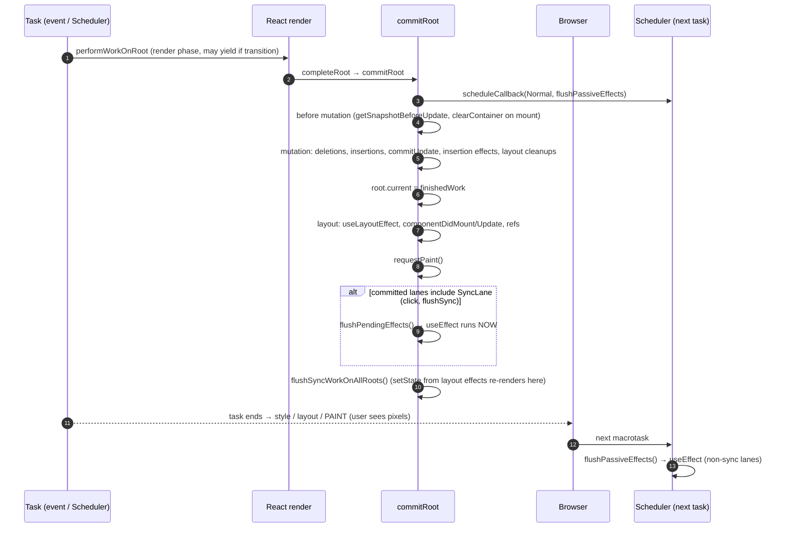

# Commit Phase - Mutation, Layout, Passive Effects

> [!summary] TL;DR
> `completeRoot` → `commitRoot` applies a finished work-in-progress tree to the DOM **synchronously and without yielding**, in fixed sub-phases. **Before mutation** reads DOM state (`getSnapshotBeforeUpdate`, focus/selection) and clears the container on the first render. **Mutation** performs deletions, insertions (`commitPlacement`) and prop updates (`commitUpdate`), and runs layout-effect *cleanups*. Then **`root.current = finishedWork`** swaps the trees. **Layout** runs `useLayoutEffect`, `componentDidMount/Update` and attaches refs. **Passive** effects (`useEffect`) are scheduled as a separate Scheduler task, or flushed at the end of the commit for sync (discrete) updates. The browser paints only after the whole JS task finishes, so layout effects always run before the user sees pixels, and passive effects usually run after.

## From render to commit

When the render loop finishes ([[06 The Work Loop - Render Phase|Work Loop]]), `performWorkOnRoot` → `finishConcurrentRender` → `completeRootWhenReady` → **`completeRoot`** → **`commitRoot`**. Older articles call this `commitRootImpl`. In 19.3.1 the split is `completeRoot` (prep) / `commitRoot` (the phases), and each phase is its own `flushXxx` function driven by a small state machine.[^cr][^commit]

`completeRoot` starts with:

```js
do {
  flushPendingEffects();
} while (pendingEffectsStatus !== NO_PENDING_EFFECTS);
```
[^cr]

So before committing a new tree, React **flushes any passive effects from the previous commit that haven't run yet**. Effects from commit N always run before commit N+1's DOM mutations. It then stashes `pendingFinishedWork`, `pendingEffectsRoot`, `pendingEffectsLanes` etc. in module state for the phase functions to use.[^pending]

The phase state machine:[^status]

```js
const NO_PENDING_EFFECTS = 0;
const PENDING_MUTATION_PHASE = 1;
const PENDING_LAYOUT_PHASE = 2;
const PENDING_AFTER_MUTATION_PHASE = 3;
const PENDING_SPAWNED_WORK = 4;
const PENDING_PASSIVE_PHASE = 5;
const PENDING_GESTURE_MUTATION_PHASE = 6;
const PENDING_GESTURE_ANIMATION_PHASE = 7;
```

The reason for having explicit states instead of one straight-line function is **View Transitions**: the mutation and layout phases may have to run inside a `document.startViewTransition()` callback, i.e. *later* and asynchronously, and anything that needs to "flush now" (a `flushSync`, a new render) can call `flushPendingEffects()` to drive the machine to completion from wherever it is.[^fpe]

## commitRoot

```js
// ReactFiberWorkLoop.js (simplified)
function commitRoot(root, finishedWork, lanes, /* ... */) {
  let remainingLanes = mergeLanes(finishedWork.lanes, finishedWork.childLanes);
  remainingLanes = mergeLanes(remainingLanes, getConcurrentlyUpdatedLanes());
  markRootFinished(root, lanes, remainingLanes, /* ... */);

  // Schedule passive effects as EARLY as possible
  if ((finishedWork.subtreeFlags & PassiveMask) !== NoFlags ||
      (finishedWork.flags & PassiveMask) !== NoFlags) {
    root.callbackNode = null;
    root.callbackPriority = NoLane;
    scheduleCallback(NormalSchedulerPriority, () => {
      flushPassiveEffects();
      return null;
    });
  }

  if (/* subtree has BeforeMutation | Mutation flags */) {
    // with DiscreteEventPriority, executionContext |= CommitContext
    commitBeforeMutationEffects(root, finishedWork, lanes);
  }

  pendingEffectsStatus = PENDING_MUTATION_PHASE;
  if (enableViewTransition && shouldStartViewTransition) {
    pendingViewTransition = startViewTransition(
      suspendedState, root.containerInfo, pendingTransitionTypes,
      flushMutationEffects, flushLayoutEffects, flushAfterMutationEffects,
      flushSpawnedWork, flushPassiveEffects, /* ... */);
  } else {
    flushMutationEffects();
    flushLayoutEffects();
    flushSpawnedWork();
  }
}
```
[^commit]

Things to notice:

- `markRootFinished` clears the committed lanes from `root.pendingLanes`. Whatever is in `finishedWork.childLanes` (updates skipped during this render) stays pending.
- The passive-effects task is posted **before** any mutation happens. A comment links this to #16714: queueing it first means it's ahead of anything the commit itself schedules.[^passive-sched]
- Every phase runs with `setCurrentUpdatePriority(DiscreteEventPriority)` and `ReactSharedInternals.T = null`. A `setState` inside a layout effect is therefore a *sync* update, not a transition, even if the render was a transition.

## 1. Before mutation

```js
export function commitBeforeMutationEffects(root, firstChild, committedLanes) {
  focusedInstanceHandle = prepareForCommit(root.containerInfo);
  // ...
  nextEffect = firstChild;
  commitBeforeMutationEffects_begin(isViewTransitionEligible);
  focusedInstanceHandle = null;
}
```
[^bme]

- **`prepareForCommit`** (DOM): saves `getSelectionInformation()` (focused element and selection range) and **disables the React event system** (`ReactBrowserEventEmitterSetEnabled(false)`), so that DOM mutations that fire synchronous events (e.g. `blur` when a focused node is removed) don't re-enter React mid-commit. `resetAfterCommit`, at the end of mutation, restores selection and focus and re-enables events.[^pfc]
- Per fiber (`commitBeforeMutationEffectsOnFiber`):[^bmeof]
  - `ClassComponent` with `Snapshot` → `getSnapshotBeforeUpdate`. This is the last moment the *old* DOM can be read (scroll position before a list grows).
  - `HostRoot` with `Snapshot` → **`clearContainer(root.containerInfo)`**. On the first client render, `completeWork` set this flag ([[08 completeWork - Building DOM Nodes|completeWork]]), so any server-less placeholder content in the container is removed (`container.textContent = ''`).[^clear]
  - `ViewTransitionComponent` → snapshot/measure old state for an upcoming View Transition.
  - With `enableEffectEventMutationPhase` off, `useEffectEvent` impls would be swapped here. In 19.3.1 the flag is **on**, so that swap happens at the start of the mutation phase instead.[^ee-flag]

## 2. Mutation

```js
function flushMutationEffects() {
  if (pendingEffectsStatus !== PENDING_MUTATION_PHASE) return;
  pendingEffectsStatus = NO_PENDING_EFFECTS;
  // ...
  if (subtreeMutationHasEffects || rootMutationHasEffect) {
    // DiscreteEventPriority, CommitContext ...
    commitMutationEffects(root, finishedWork, lanes);
    resetAfterCommit(root.containerInfo);
  }
  // The work-in-progress tree is now the current tree. This must come after
  // the mutation phase, so that the previous tree is still current during
  // componentWillUnmount, but before the layout phase, so that the finished
  // work is current during componentDidMount/Update.
  root.current = finishedWork;
  pendingEffectsStatus = PENDING_LAYOUT_PHASE;
}
```
[^fme]

### The traversal

`commitMutationEffectsOnFiber` is a recursive walk. For each fiber it calls `recursivelyTraverseMutationEffects` first, which handles **deletions** on that parent and then recurses into children *only if* `subtreeFlags & (MutationMask | Cloned)`. It then calls `commitReconciliationEffects` (**Placement**) and finally applies the fiber's own `Update` work.[^rtme][^mutof] The order within a parent is: deletions → children's effects → own placement → own update.

### Deletions

`commitDeletionEffects(root, returnFiber, deletedFiber)` finds the nearest host parent, then walks the deleted subtree:[^cde][^cdeof]

- `FunctionComponent`: runs **insertion-effect** and **layout-effect** *destroy* functions (`useInsertionEffect`/`useLayoutEffect` cleanups) right away.
- `ClassComponent`: detaches refs, calls `componentWillUnmount`.
- `HostComponent`: `safelyDetachRef` (call ref with `null`, or the React 19 ref-cleanup function). It then recurses with `hostParent = null`, so **descendants are not individually removed**. Only the topmost host node gets `removeChild`. This is the mirror image of `appendAllChildren`: a subtree goes in with one insertion and comes out with one removal.
- Passive (`useEffect`) cleanups for deleted trees are **not** run here. They run in the passive phase (`commitPassiveUnmountEffectsInsideOfDeletedTree_*`).[^passive-unmount]

### Placement: commitPlacement → insertOrAppendPlacementNode

```js
function commitPlacement(finishedWork) {
  // 1. find nearest host parent (HostComponent / HostRoot / HostPortal / HostSingleton)
  let parentFiber = finishedWork.return;
  while (parentFiber !== null) {
    if (isHostParent(parentFiber)) { hostParentFiber = parentFiber; break; }
    parentFiber = parentFiber.return;
  }
  switch (hostParentFiber.tag) {
    case HostComponent: {
      const parent = hostParentFiber.stateNode;
      if (hostParentFiber.flags & ContentReset) { resetTextContent(parent); /* ... */ }
      const before = getHostSibling(finishedWork);
      insertOrAppendPlacementNode(finishedWork, before, parent, /* ... */);
      break;
    }
    case HostRoot:
    case HostPortal: {
      const parent = hostParentFiber.stateNode.containerInfo;
      const before = getHostSibling(finishedWork);
      insertOrAppendPlacementNodeIntoContainer(finishedWork, before, parent, /* ... */);
      break;
    }
  }
}
```
[^cp]

- **`getHostSibling`** finds the DOM node to `insertBefore`. It walks forward through siblings (descending through component fibers) looking for the first host node that is *not itself* being placed. If none exists, it returns `null` and the node is appended.[^ghs] This search is the cost of not keeping a parallel list of DOM nodes, and it's one reason a large keyed reorder is more expensive than it looks.
- **`insertOrAppendPlacementNode(IntoContainer)`**: if the placed fiber is a host node, call `insertBefore`/`appendChild` on its `stateNode`. If it's a component, recurse into its children and insert each nearest host descendant.[^ioapn]

**First render, concretely.** The only fiber with `Placement` is `App` (page 07). Its host parent is the HostRoot, so `insertOrAppendPlacementNodeIntoContainer(App, null, container)` runs. App isn't a host node, so it recurses to `<div>`, which is, and calls `appendChildToContainer(container, div)` → `container.appendChild(div)`.[^actc] **That one call is the moment the whole UI enters the document.** (`appendChildToContainer` also sets `onclick` on non-root containers to work around an iOS Safari bubbling quirk, and `appendChild`/`insertBefore` will use the DOM's new `moveBefore` for moves behind `enableMoveBefore`, which is `false` in 19.3.1.[^movebefore])

### Updates

`HostComponent` with `Update` → `commitHostUpdate(finishedWork, newProps, oldProps)` → DOM `commitUpdate` → `updateProperties` (the actual prop diff, see page 08) + `updateFiberProps`.[^hc-mut][^cu] `HostText` → `textNode.nodeValue = newText`.

`FunctionComponent` with `Update`:[^fc-mut]
```js
commitHookEffectListUnmount(HookInsertion | HookHasEffect, finishedWork, finishedWork.return);
commitHookEffectListMount(HookInsertion | HookHasEffect, finishedWork);
commitHookLayoutUnmountEffects(finishedWork, finishedWork.return, HookLayout | HookHasEffect);
```
So **`useInsertionEffect` runs (cleanup + setup) during mutation**, before layout effects, which is what CSS-in-JS libraries need to inject `<style>` before anything measures. **Layout effect *cleanups* also run here**, during mutation. Setups run later, in the layout phase. All cleanups across the tree therefore run before any setup, so effect A's setup never observes effect B's stale state.

## Why `root.current = finishedWork` sits exactly between mutation and layout

The source comment says it directly.[^fme] `componentWillUnmount` and layout cleanups (mutation phase) should see the **old** tree as current, while `componentDidMount/Update` and layout setups (layout phase) should see the **new** one. Anything that reads `root.current`, such as `findDOMNode`-style lookups, event-target-to-fiber resolution, or a `setState` called from a layout effect that schedules from the current tree, gets a consistent answer. From this line on, the old current tree becomes the alternate, i.e. the scratch buffer for the next render ([[05 The Fiber Data Structure|Fiber]]).

## 3. Layout

```js
function flushLayoutEffects() {
  if (pendingEffectsStatus !== PENDING_LAYOUT_PHASE) return;
  // ...
  if (subtreeHasLayoutEffects || rootHasLayoutEffect) {
    commitLayoutEffects(finishedWork, root, lanes);
  }
  pendingEffectsStatus = PENDING_AFTER_MUTATION_PHASE;
}
```
[^fle]

`commitLayoutEffectOnFiber` recurses children first (pruned by `subtreeFlags & LayoutMask`), then:[^cleof][^rtle]

| Fiber | With flag | Does |
|---|---|---|
| Function / ForwardRef / SimpleMemo | `Update` | `commitHookLayoutEffects` → `useLayoutEffect` setups (and `useImperativeHandle`) |
| ClassComponent | `Update` / `Callback` / `Ref` | `componentDidMount` or `componentDidUpdate(prevProps, prevState, snapshot)`, `setState` callbacks, attach ref |
| HostComponent | `Update` on mount | `commitHostMount` → `commitMount` (autoFocus `.focus()`, img `src` re-assign)[^chm] |
| HostComponent | `Ref` | `safelyAttachRef` → `ref.current = node` or call ref callback, store its cleanup[^ref] |

Because the walk is children-first, **child layout effects and refs run before the parent's**. A parent's `useLayoutEffect` can rely on `childRef.current` being set. The DOM is fully mutated and in the document at this point, so `getBoundingClientRect()` returns real layout. The browser has to compute layout *synchronously* (a forced reflow) to answer, but it has **not painted**.

## 4. Spawned work, and the sync passive flush

`flushSpawnedWork` (after the optional after-mutation phase used by View Transitions):[^fsw]

1. **`requestPaint()`** tells Scheduler to set `needsPaint = true`, so `shouldYieldToHost` returns `true` at the next check and Scheduler hands the main thread back to the browser instead of running its next queued task.[^rp][^yield]
2. Sets `pendingEffectsStatus = PENDING_PASSIVE_PHASE` if there are passive effects.
3. Reports recoverable errors (`onRecoverableError`) and calls the DevTools commit hook.
4. **If the committed lanes include `SyncLane`** (discrete events like click or keydown, and `flushSync`), it calls `flushPendingEffects()` right now, so **passive effects run synchronously at the end of the commit, before the browser paints**:[^syncflush]
   ```js
   // If the passive effects are the result of a discrete render, flush them
   // synchronously at the end of the current task so that the result is
   // immediately observable. ...
   if (includesSyncLane(pendingEffectsLanes) && (disableLegacyMode || root.tag !== LegacyRoot)) {
     flushPendingEffects();
   }
   ```
5. `ensureRootIsScheduled(root)` for remaining lanes, nested-update loop detection (`nestedUpdateCount`, the source of "Maximum update depth exceeded").
6. **`flushSyncWorkOnAllRoots()`**: if a layout effect (or a sync passive effect) called `setState`, that's a sync lane, and it is **rendered and committed right here, in the same task**.[^fsw] This is why "measure in `useLayoutEffect`, then `setState`" doesn't flicker: the second render also lands before paint.

## 5. Passive effects

For non-sync lanes (Default, Transition, …), passive effects run when the Scheduler task posted in `commitRoot` fires, at Normal priority:

```js
function flushPassiveEffects() {
  if (pendingEffectsStatus !== PENDING_PASSIVE_PHASE) return false;
  const renderPriority = lanesToEventPriority(pendingEffectsLanes);
  const priority = lowerEventPriority(DefaultEventPriority, renderPriority);
  // setCurrentUpdatePriority(priority); T = null
  return flushPassiveEffectsImpl();
}
function flushPassiveEffectsImpl() {
  // ...
  executionContext |= CommitContext;
  commitPassiveUnmountEffects(root.current);   // all useEffect cleanups first
  commitPassiveMountEffects(root, root.current, lanes, transitions, /* ... */); // then setups
  // ...
  flushSyncWorkOnAllRoots();
}
```
[^fpe2][^fpei]

- **All passive cleanups across the whole tree run before any passive setup**, including cleanups for deleted subtrees.[^passive-unmount]
- Within each pass, the order is children-first (same as layout).
- A `setState` inside `useEffect` gets at most `DefaultEventPriority`, so it's batched like a normal update, unless the commit was discrete, in which case the effects already ran synchronously in step 4.

Passive effects can also be flushed **early** by other paths: the next `performWorkOnRootViaSchedulerTask` / `performSyncWorkOnRoot` calls `flushPendingEffects` before rendering, and so does `completeRoot` before committing ([[06 The Work Loop - Render Phase|Work Loop]]). The invariant is "effects of commit N run before render/commit N+1". It is not "effects run after paint".

## When does the user actually see pixels?

The browser can only paint once the current JavaScript task (and its microtasks) has finished. The whole commit, from mutation through layout effects and any sync re-render they trigger, is one synchronous block of JS, so:



| Code | Runs relative to paint |
|---|---|
| render functions | before (or discarded) |
| `useInsertionEffect`, layout cleanups | before, during mutation |
| `useLayoutEffect`, `componentDidMount`, ref attach | **before**: DOM mutated, not yet painted. Visual fixes here never flicker |
| `useEffect` from a **discrete** update (click) | **before** paint, flushed synchronously at the end of the commit |
| `useEffect` from default/transition updates (incl. first `root.render`) | **usually after** paint, in a separate Scheduler task |

This matches react.dev: "If your Effect wasn't caused by an interaction (like a click), React will generally let the browser paint the updated screen first before running your Effect", and "If your Effect is caused by an interaction (like a click), React may run your Effect before the browser paints the updated screen."[^docs-effect]

> [!warning] "useEffect runs after paint" is a heuristic, not a guarantee
> Scheduler posts tasks via `MessageChannel`. `requestPaint()` makes Scheduler yield, but whether the browser actually renders a frame between two macrotasks is up to the browser (it usually does if a frame is due). For discrete updates the docs' rule applies: effects run *before* paint. If you need "after paint", use `requestAnimationFrame`+`setTimeout`. If you need "before paint", use `useLayoutEffect`.

> [!tip] Gotcha: `useLayoutEffect` is not free
> Everything in layout effects extends the time until first paint, and reading layout there forces a synchronous reflow. Use it for measure-then-adjust work. Don't use it for data fetching or subscriptions.

## View Transitions and gestures (19.3)

`enableViewTransition` is `true` in 19.3.1.[^flags] When the committed lanes are View-Transition-eligible (transitions) and a `<ViewTransition>` is affected, `commitRoot` calls the DOM's `startViewTransition(...)`, handing it `flushMutationEffects`, `flushLayoutEffects`, `flushAfterMutationEffects`, `flushSpawnedWork` and `flushPassiveEffects` as callbacks.[^commit][^svt] The browser snapshots the old state, React mutates inside the update callback, and the browser animates between them. Mutation is *deferred* until the browser is ready, which is why the commit is a state machine. A `flushSync` during that window cancels the transition with a dev warning.[^fpe] Gesture transitions (`startGestureTransition`, `enableGestureTransition = __EXPERIMENTAL__`) add the `PENDING_GESTURE_*` states and are experimental-only.

## First render vs update

| | First render | setState update |
|---|---|---|
| Before mutation | `clearContainer` (root `Snapshot`) | `getSnapshotBeforeUpdate` for classes |
| Mutation | one `appendChild` of the whole tree | deletions, targeted inserts/moves, `updateProperties` on `Update` fibers, layout/insertion cleanups |
| Layout | every `useLayoutEffect` setup, every ref | only effects whose deps changed (`HookHasEffect`) |
| Passive | `root.render` is DefaultLane → separate task, usually after first paint | click → sync, before paint. Transition → after |

## With the React Compiler

The commit phase is **unchanged**. It consumes flags, and the compiler doesn't touch `ReactFiberCommitWork.js`. The effect is indirect:

- Fewer fibers re-render, so fewer `Update` flags on host fibers, fewer `updateProperties` loops, and smaller `subtreeFlags` footprints, which means more subtrees pruned by the `MutationMask`/`LayoutMask` checks.
- Effect dependency arrays become more stable. Objects and callbacks created in render are cached, so `useEffect(() => …, [options])` stops re-firing because `options` was a fresh literal. Fewer `HookHasEffect` flags means fewer cleanup/setup pairs in the layout and passive phases.
- Ordering and timing (layout before paint, passive after or sync for discrete) stay exactly the same.

See [[15 Rendering With vs Without the Compiler|With vs Without Compiler]] and the full timelines in [[20 Walkthrough - First Render End to End|First Render Walkthrough]] and [[21 Walkthrough - setState to Pixels|setState Walkthrough]].

← [[08 completeWork - Building DOM Nodes|completeWork]] · [[00 React Internals Index|Index]] · [[10 Hooks on Mount|Hooks on Mount]] →

[^cr]: `completeRoot` (flush-previous-effects loop at L3530-L3532) — [packages/react-reconciler/src/ReactFiberWorkLoop.js#L3511-L3723](https://github.com/facebook/react/blob/v19.3.1/packages/react-reconciler/src/ReactFiberWorkLoop.js#L3511-L3723)
[^pending]: pending-effects module state assigned in `completeRoot` — [packages/react-reconciler/src/ReactFiberWorkLoop.js#L3639-L3644](https://github.com/facebook/react/blob/v19.3.1/packages/react-reconciler/src/ReactFiberWorkLoop.js#L3639-L3644)
[^status]: pending-effects status constants — [packages/react-reconciler/src/ReactFiberWorkLoop.js#L724-L731](https://github.com/facebook/react/blob/v19.3.1/packages/react-reconciler/src/ReactFiberWorkLoop.js#L724-L731)
[^commit]: `commitRoot` — [packages/react-reconciler/src/ReactFiberWorkLoop.js#L3725-L3922](https://github.com/facebook/react/blob/v19.3.1/packages/react-reconciler/src/ReactFiberWorkLoop.js#L3725-L3922)
[^passive-sched]: early passive-effect scheduling in `commitRoot` — [packages/react-reconciler/src/ReactFiberWorkLoop.js#L3771-L3827](https://github.com/facebook/react/blob/v19.3.1/packages/react-reconciler/src/ReactFiberWorkLoop.js#L3771-L3827)
[^fpe]: `flushPendingEffects` (View Transition cancel on flushSync) — [packages/react-reconciler/src/ReactFiberWorkLoop.js#L4662-L4689](https://github.com/facebook/react/blob/v19.3.1/packages/react-reconciler/src/ReactFiberWorkLoop.js#L4662-L4689)
[^bme]: `commitBeforeMutationEffects` — [packages/react-reconciler/src/ReactFiberCommitWork.js#L352-L371](https://github.com/facebook/react/blob/v19.3.1/packages/react-reconciler/src/ReactFiberCommitWork.js#L352-L371)
[^pfc]: `prepareForCommit` / `resetAfterCommit` — [packages/react-dom-bindings/src/client/ReactFiberConfigDOM.js#L424-L462](https://github.com/facebook/react/blob/v19.3.1/packages/react-dom-bindings/src/client/ReactFiberConfigDOM.js#L424-L462)
[^bmeof]: `commitBeforeMutationEffectsOnFiber` — [packages/react-reconciler/src/ReactFiberCommitWork.js#L483-L579](https://github.com/facebook/react/blob/v19.3.1/packages/react-reconciler/src/ReactFiberCommitWork.js#L483-L579)
[^clear]: `clearContainer` — [packages/react-dom-bindings/src/client/ReactFiberConfigDOM.js#L3972-L3988](https://github.com/facebook/react/blob/v19.3.1/packages/react-dom-bindings/src/client/ReactFiberConfigDOM.js#L3972-L3988)
[^ee-flag]: `enableEffectEventMutationPhase = true` — [packages/shared/ReactFeatureFlags.js#L139](https://github.com/facebook/react/blob/v19.3.1/packages/shared/ReactFeatureFlags.js#L139)
[^fme]: `flushMutationEffects` and the `root.current` swap (L4047-L4051) — [packages/react-reconciler/src/ReactFiberWorkLoop.js#L4009-L4053](https://github.com/facebook/react/blob/v19.3.1/packages/react-reconciler/src/ReactFiberWorkLoop.js#L4009-L4053)
[^rtme]: `commitMutationEffects` / `recursivelyTraverseMutationEffects` — [packages/react-reconciler/src/ReactFiberCommitWork.js#L2027-L2068](https://github.com/facebook/react/blob/v19.3.1/packages/react-reconciler/src/ReactFiberCommitWork.js#L2027-L2068)
[^mutof]: `commitMutationEffectsOnFiber` — [packages/react-reconciler/src/ReactFiberCommitWork.js#L2072-L2843](https://github.com/facebook/react/blob/v19.3.1/packages/react-reconciler/src/ReactFiberCommitWork.js#L2072-L2843); `commitReconciliationEffects` — [#L2845-L2864](https://github.com/facebook/react/blob/v19.3.1/packages/react-reconciler/src/ReactFiberCommitWork.js#L2845-L2864)
[^cde]: `commitDeletionEffects` — [packages/react-reconciler/src/ReactFiberCommitWork.js#L1386-L1475](https://github.com/facebook/react/blob/v19.3.1/packages/react-reconciler/src/ReactFiberCommitWork.js#L1386-L1475)
[^cdeof]: `commitDeletionEffectsOnFiber` host (L1569-L1630) and function component (L1706-L1729) cases — [packages/react-reconciler/src/ReactFiberCommitWork.js#L1569-L1729](https://github.com/facebook/react/blob/v19.3.1/packages/react-reconciler/src/ReactFiberCommitWork.js#L1569-L1729)
[^passive-unmount]: `recursivelyTraversePassiveUnmountEffects` (deletions first) — [packages/react-reconciler/src/ReactFiberCommitWork.js#L5071-L5116](https://github.com/facebook/react/blob/v19.3.1/packages/react-reconciler/src/ReactFiberCommitWork.js#L5071-L5116); `commitPassiveUnmountEffectsInsideOfDeletedTree_begin` — [#L5347](https://github.com/facebook/react/blob/v19.3.1/packages/react-reconciler/src/ReactFiberCommitWork.js#L5347)
[^cp]: `commitPlacement` — [packages/react-reconciler/src/ReactFiberCommitHostEffects.js#L452-L543](https://github.com/facebook/react/blob/v19.3.1/packages/react-reconciler/src/ReactFiberCommitHostEffects.js#L452-L543)
[^ghs]: `getHostSibling` — [packages/react-reconciler/src/ReactFiberCommitHostEffects.js#L271-L328](https://github.com/facebook/react/blob/v19.3.1/packages/react-reconciler/src/ReactFiberCommitHostEffects.js#L271-L328)
[^ioapn]: `insertOrAppendPlacementNodeIntoContainer` / `insertOrAppendPlacementNode` — [packages/react-reconciler/src/ReactFiberCommitHostEffects.js#L330-L450](https://github.com/facebook/react/blob/v19.3.1/packages/react-reconciler/src/ReactFiberCommitHostEffects.js#L330-L450)
[^actc]: `appendChildToContainer` — [packages/react-dom-bindings/src/client/ReactFiberConfigDOM.js#L1082-L1133](https://github.com/facebook/react/blob/v19.3.1/packages/react-dom-bindings/src/client/ReactFiberConfigDOM.js#L1082-L1133)
[^movebefore]: `supportsMoveBefore` / `appendChild` — [packages/react-dom-bindings/src/client/ReactFiberConfigDOM.js#L1026-L1042](https://github.com/facebook/react/blob/v19.3.1/packages/react-dom-bindings/src/client/ReactFiberConfigDOM.js#L1026-L1042); `enableMoveBefore = false` — [packages/shared/ReactFeatureFlags.js#L194](https://github.com/facebook/react/blob/v19.3.1/packages/shared/ReactFeatureFlags.js#L194)
[^hc-mut]: mutation HostComponent `Update` → `commitHostUpdate` — [packages/react-reconciler/src/ReactFiberCommitWork.js#L2302-L2314](https://github.com/facebook/react/blob/v19.3.1/packages/react-reconciler/src/ReactFiberCommitWork.js#L2302-L2314)
[^cu]: `commitUpdate` — [packages/react-dom-bindings/src/client/ReactFiberConfigDOM.js#L999-L1012](https://github.com/facebook/react/blob/v19.3.1/packages/react-dom-bindings/src/client/ReactFiberConfigDOM.js#L999-L1012)
[^fc-mut]: mutation FunctionComponent case (insertion effects, layout cleanups) — [packages/react-reconciler/src/ReactFiberCommitWork.js#L2088-L2128](https://github.com/facebook/react/blob/v19.3.1/packages/react-reconciler/src/ReactFiberCommitWork.js#L2088-L2128)
[^fle]: `flushLayoutEffects` — [packages/react-reconciler/src/ReactFiberWorkLoop.js#L4055-L4152](https://github.com/facebook/react/blob/v19.3.1/packages/react-reconciler/src/ReactFiberWorkLoop.js#L4055-L4152)
[^cleof]: `commitLayoutEffectOnFiber` (function L614-L626, class L627-L645, host L681-L705) — [packages/react-reconciler/src/ReactFiberCommitWork.js#L600-L934](https://github.com/facebook/react/blob/v19.3.1/packages/react-reconciler/src/ReactFiberCommitWork.js#L600-L934)
[^rtle]: `commitLayoutEffects` / `recursivelyTraverseLayoutEffects` — [packages/react-reconciler/src/ReactFiberCommitWork.js#L3063-L3093](https://github.com/facebook/react/blob/v19.3.1/packages/react-reconciler/src/ReactFiberCommitWork.js#L3063-L3093)
[^chm]: `commitHostMount` — [packages/react-reconciler/src/ReactFiberCommitHostEffects.js#L70-L90](https://github.com/facebook/react/blob/v19.3.1/packages/react-reconciler/src/ReactFiberCommitHostEffects.js#L70-L90)
[^ref]: `commitAttachRef` / `safelyAttachRef` — [packages/react-reconciler/src/ReactFiberCommitEffects.js#L757-L840](https://github.com/facebook/react/blob/v19.3.1/packages/react-reconciler/src/ReactFiberCommitEffects.js#L757-L840)
[^fsw]: `flushSpawnedWork` (`requestPaint` L4189, `flushSyncWorkOnAllRoots` L4401) — [packages/react-reconciler/src/ReactFiberWorkLoop.js#L4154-L4437](https://github.com/facebook/react/blob/v19.3.1/packages/react-reconciler/src/ReactFiberWorkLoop.js#L4154-L4437)
[^rp]: Scheduler `requestPaint` — [packages/scheduler/src/forks/Scheduler.js#L474-L479](https://github.com/facebook/react/blob/v19.3.1/packages/scheduler/src/forks/Scheduler.js#L474-L479)
[^yield]: `shouldYieldToHost` honours `needsPaint` — [packages/scheduler/src/forks/Scheduler.js#L459-L472](https://github.com/facebook/react/blob/v19.3.1/packages/scheduler/src/forks/Scheduler.js#L459-L472)
[^syncflush]: sync passive flush for discrete renders — [packages/react-reconciler/src/ReactFiberWorkLoop.js#L4316-L4329](https://github.com/facebook/react/blob/v19.3.1/packages/react-reconciler/src/ReactFiberWorkLoop.js#L4316-L4329)
[^fpe2]: `flushPassiveEffects` — [packages/react-reconciler/src/ReactFiberWorkLoop.js#L4691-L4726](https://github.com/facebook/react/blob/v19.3.1/packages/react-reconciler/src/ReactFiberWorkLoop.js#L4691-L4726)
[^fpei]: `flushPassiveEffectsImpl` (unmount then mount at L4788-L4795) — [packages/react-reconciler/src/ReactFiberWorkLoop.js#L4728-L4875](https://github.com/facebook/react/blob/v19.3.1/packages/react-reconciler/src/ReactFiberWorkLoop.js#L4728-L4875)
[^docs-effect]: react.dev, "useEffect — Caveats" — https://react.dev/reference/react/useEffect#caveats
[^flags]: `enableViewTransition = true`, `enableGestureTransition = __EXPERIMENTAL__` — [packages/shared/ReactFeatureFlags.js#L90-L96](https://github.com/facebook/react/blob/v19.3.1/packages/shared/ReactFeatureFlags.js#L90-L96)
[^svt]: DOM `startViewTransition` — [packages/react-dom-bindings/src/client/ReactFiberConfigDOM.js#L2167](https://github.com/facebook/react/blob/v19.3.1/packages/react-dom-bindings/src/client/ReactFiberConfigDOM.js#L2167)
