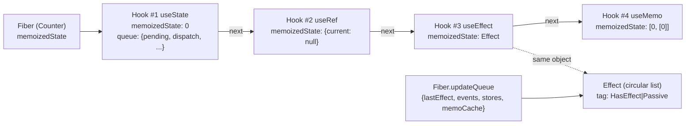

# Hooks on Mount

> [!summary] TL;DR
> A function component's first render runs inside `renderWithHooks`. It points the global hooks dispatcher (`ReactSharedInternals.H`) at the **mount** implementations, then calls your function. Each `useState`/`useEffect`/`useMemo`/`useRef` call appends one `Hook` object to a singly linked list hanging off `fiber.memoizedState`. Effects also go on a separate circular list in `fiber.updateQueue`. No names or keys are stored anywhere. A hook's identity is its **position** in the list, and that's the whole reason the rules of hooks exist.

Where we are: [[07 beginWork and Reconciliation|beginWork]] reached a `FunctionComponent` fiber with `current === null` (first mount) and called `updateFunctionComponent`, which calls `renderWithHooks`.[^ufc] Everything below happens *inside your component's function call*, during the [[06 The Work Loop - Render Phase|render phase]].

## 1. `renderWithHooks`: setting the stage

`useState` in the `react` package does almost nothing. It reads `ReactSharedInternals.H` and forwards the call to it.[^resolve][^usestate] The `react` package has no hooks logic of its own. The renderer (`react-reconciler`) installs a *dispatcher* object before it calls your component and removes it afterwards. See [[01 Bootstrap - Packages, JSX and the Dispatcher|Bootstrap]] for why it's split this way: one `react` package can serve DOM, Native and test renderers.

`renderWithHooks` does five things (simplified):[^rwh]

```js
export function renderWithHooks(current, workInProgress, Component, props, secondArg, nextRenderLanes) {
  renderLanes = nextRenderLanes;
  currentlyRenderingFiber = workInProgress;          // module-level "who am I rendering"

  workInProgress.memoizedState = null;               // hook list will be rebuilt
  workInProgress.updateQueue = null;                 // effect list will be rebuilt
  workInProgress.lanes = NoLanes;

  ReactSharedInternals.H =
    current === null || current.memoizedState === null
      ? HooksDispatcherOnMount
      : HooksDispatcherOnUpdate;

  let children = Component(props, secondArg);        // <-- your code runs here
  if (didScheduleRenderPhaseUpdateDuringThisPass) {
    children = renderWithHooksAgain(/* ... */);      // setState during render → loop
  }
  // DEV + StrictMode: renderWithHooksAgain() once more (double render)
  finishRenderingHooks(current, workInProgress, Component);
  return children;
}
```

The dispatcher decision is `current === null || current.memoizedState === null`. The second half of that condition matters. A fiber can have a `current` and still hold no hooks state, for example a component that suspended before it ever committed hooks. React treats that as a mount too. In DEV there is a third variant, `HooksDispatcherOnMountWithHookTypesInDEV`, which helps produce the "change in the order of Hooks" warning.[^rwh]

The two dispatchers are plain object literals that map each public hook to an implementation.[^dmount][^dupdate]

| Public hook | Mount | Update |
|---|---|---|
| `useState` | `mountState` | `updateState` → `updateReducer` |
| `useReducer` | `mountReducer` | `updateReducer` |
| `useEffect` | `mountEffect` | `updateEffect` |
| `useMemo` / `useCallback` | `mountMemo` / `mountCallback` | `updateMemo` / `updateCallback` |
| `useRef` | `mountRef` | `updateRef` |
| `useContext` | `readContext` | `readContext` |
| `use` | `use` | `use` |
| `useMemoCache` (compiler) | `useMemoCache` | `useMemoCache` |

The last three rows are the same function in both columns, and that's a clue. They don't take a slot in the hook list (more on this below).

After your function returns, `finishRenderingHooks` sets the dispatcher to `ContextOnlyDispatcher`. Every hook in that dispatcher is `throwInvalidHookError`.[^finish][^ctxonly] That's why calling `useState` inside an event handler or a `setTimeout` throws "Invalid hook call". It's not a lint rule. Outside a render, the dispatcher really is a minefield. `finishRenderingHooks` also checks `currentHook !== null && currentHook.next !== null` and throws *"Rendered fewer hooks than expected"* if you returned early.[^finish]

## 2. The Hook object and the list

```js
export type Hook = {
  memoizedState: any,          // what this hook "is": state value, effect object, [value, deps], ref...
  baseState: any,              // state before the first skipped update (see page 11)
  baseQueue: Update<any, any> | null, // updates skipped in a previous render, still to apply
  queue: any,                  // UpdateQueue for state/reducer hooks, null otherwise
  next: Hook | null,
};
```
[^hooktype]

`mountWorkInProgressHook` allocates one of these and links it onto the end of the list:[^mwih]

```js
function mountWorkInProgressHook(): Hook {
  const hook = { memoizedState: null, baseState: null, baseQueue: null, queue: null, next: null };
  if (workInProgressHook === null) {
    currentlyRenderingFiber.memoizedState = workInProgressHook = hook; // first hook
  } else {
    workInProgressHook = workInProgressHook.next = hook;               // append
  }
  return workInProgressHook;
}
```

`workInProgressHook` is a module-level cursor, so the file has no `index` variable at all. For a component like this:

```js
function Counter() {
  const [count, setCount] = useState(0);
  const ref = useRef(null);
  useEffect(() => { document.title = count; }, [count]);
  const doubled = useMemo(() => count * 2, [count]);
  // ...
}
```

the fiber ends up looking like this:



> [!note] `memoizedState` means two different things
> On a **class** fiber, `fiber.memoizedState` is the state object. On a **function** fiber, it's the head of the hook list. Same field, different shape. That's why the [[05 The Fiber Data Structure|Fiber]] type annotates it as `any`.

## 3. `useState` / `useReducer`: the queue and the bound dispatch

`mountState` calls `mountStateImpl`, which (simplified):[^mountstateimpl][^mountstate]

```js
const hook = mountWorkInProgressHook();
if (typeof initialState === 'function') {
  initialState = initialState();               // lazy initializer, only on mount
  // DEV StrictMode: call it a second time and throw the result away
}
hook.memoizedState = hook.baseState = initialState;
const queue = {
  pending: null,                    // circular list of not-yet-processed updates
  lanes: NoLanes,                   // for transition entanglement
  dispatch: null,
  lastRenderedReducer: basicStateReducer,
  lastRenderedState: initialState,  // used by the eager-state bailout in setState
};
hook.queue = queue;
// mountState:
const dispatch = dispatchSetState.bind(null, currentlyRenderingFiber, queue);
queue.dispatch = dispatch;
return [hook.memoizedState, dispatch];
```

Three things are worth internalising:

1. **`setState` is a bound function.** It closes over the *fiber* and the *queue*, not the component instance or a hook index. When you call it later from an event handler, React already knows where the update goes, without a tree search. See [[12 setState - dispatchSetState and Batching|setState]].
2. **The setter is stable.** It's created once on mount and stored on `queue.dispatch`. The update path just returns `queue.dispatch`.[^uri] That's why leaving `setCount` out of effect deps is safe.
3. **`useState` is `useReducer` with a built-in reducer.** `basicStateReducer` is `typeof action === 'function' ? action(state) : action`.[^bsr] `mountReducer` is the same code with your reducer and an optional `init(initialArg)`. Its dispatch is bound to `dispatchReducerAction` instead.[^mountreducer] The one behavioural difference: `dispatchReducerAction` doesn't try the eager-state bailout, because your reducer could change between renders.[^dra]

> [!warning] `fiber` in the bound dispatch may be the "wrong" twin
> `currentlyRenderingFiber` at mount is the work-in-progress fiber, which becomes `current` once it commits. After a few updates, the bound fiber may be either side of the `current`/`alternate` pair. React copes with this by marking lanes on **both** the fiber and its alternate when you dispatch (see [[12 setState - dispatchSetState and Batching|setState]]).

## 4. `useEffect`: effect objects and flags

`mountEffect` calls `mountEffectImpl(PassiveEffect | PassiveStaticEffect, HookPassive, create, deps)`. In DEV StrictMode it also adds `MountPassiveDevEffect`.[^mounteffect]

```js
function mountEffectImpl(fiberFlags, hookFlags, create, deps) {
  const hook = mountWorkInProgressHook();
  const nextDeps = deps === undefined ? null : deps;
  currentlyRenderingFiber.flags |= fiberFlags;          // "this fiber has passive work"
  hook.memoizedState = pushSimpleEffect(
    HookHasEffect | hookFlags,                          // always fires on mount
    createEffectInstance(),                             // { destroy: undefined }
    create,
    nextDeps,
  );
}
```
[^mounteffectimpl]

There are two levels of flags here, and it's easy to mix them up:

- **Fiber flags** (`PassiveEffect`) on `fiber.flags`. These bubble up as `subtreeFlags` in [[08 completeWork - Building DOM Nodes|completeWork]], so the [[09 Commit Phase - Mutation, Layout, Passive Effects|commit phase]] can skip whole subtrees that have nothing to do.
- **Hook effect tags** (`HasEffect = 0b0001`, `Insertion = 0b0010`, `Layout = 0b0100`, `Passive = 0b1000`) on each `Effect.tag`.[^hooktags] At commit time, `commitHookEffectListMount(HookPassive | HookHasEffect, fiber)` walks the effect ring and runs only the effects whose tag contains *all* of those bits.[^chelm]

`pushSimpleEffect` builds `{tag, create, deps, inst, next}` and `pushEffectImpl` appends it to a **circular** list on `fiber.updateQueue.lastEffect`, creating the `FunctionComponentUpdateQueue` (`{lastEffect, events, stores, memoCache}`) lazily.[^pushsimple][^pusheffectimpl][^fcuq] The list is circular with a pointer to the *last* element, so append is O(1) and `lastEffect.next` is the head. React uses this trick all over (update queues too).

So each effect lives in two places. The hook's `memoizedState` points at the Effect object, so the next render can read the previous `deps`. The fiber's `updateQueue` ring is what the commit phase iterates. The `inst` object (`{destroy}`) is shared across renders for the effect's whole lifetime. That's where the cleanup function returned by your effect is stored.[^effecttype]

`useLayoutEffect` and `useInsertionEffect` take the same path with `HookLayout`/`UpdateEffect` and `HookInsertion` respectively. Only the timing differs, and the commit phase owns the timing.

## 5. `useRef`, `useMemo`, `useCallback`

These are almost boring, which is the point:

```js
function mountRef(initialValue) {
  const hook = mountWorkInProgressHook();
  const ref = { current: initialValue };
  hook.memoizedState = ref;      // the same object forever; updateRef just returns it
  return ref;
}
```
[^mountref][^updateref]

`mountMemo` calls `nextCreate()` and stores `[nextValue, nextDeps]`. In StrictMode DEV it calls `nextCreate()` a second time to surface impure factories.[^mountmemo] `mountCallback` stores `[callback, nextDeps]` *without calling anything*.[^mountcb] `useCallback(fn, deps)` really is `useMemo(() => fn, deps)` minus one closure.

> [!tip] A ref is just a hook slot holding a mutable object
> Writing `ref.current` doesn't schedule anything. No queue, no lanes, no fiber is involved. That's exactly why refs are the escape hatch for "values that shouldn't cause a render", and also why reading `ref.current` during render is fragile under concurrent rendering. A render that gets thrown away can still have mutated it.

## 6. Hooks that don't take a slot: `useContext`, `use`, `useMemoCache`

**`useContext`** is `readContext` in both dispatchers.[^dmount] `readContext` reads `context._currentValue` (pushed by the nearest Provider during beginWork). It then appends a `{context, memoizedValue, next}` item to `fiber.dependencies`. It never calls `mountWorkInProgressHook`.[^readctx][^readctxconsumer] Context dependencies are a separate list that context propagation scans when a Provider's value changes. A consequence: `useContext` doesn't strictly need a stable call order. The *rule* still applies to it for consistency and future-proofing, but the implementation would survive a conditional `useContext`.

**`use(usable)`**: for a thenable it calls `useThenable`, which uses its own counter (`thenableIndexCounter`) into a `thenableState` array instead of the hook list. For a context it calls `readContext`.[^use][^usethenable] That's why `use` is the one hook you may call inside `if` and loops: it's indexed by *how many thenables you've awaited so far*, and that's reset on replay. One subtle bit: if a component suspends on `use` before it reaches any hooks, `useThenable` re-picks the mount vs update dispatcher for the hooks that come after it. A replay may then see an empty WIP list.[^usethenable]

## 7. Why the rules of hooks exist

Put the pieces together. On update, `updateWorkInProgressHook` doesn't look up "the `count` state". It takes `currentHook.next`, the next node in the *previous* render's list, and clones it.[^uwih] The *n*-th hook call in this render is paired with the *n*-th node from the last committed render. That's all there is to it.

```js
function Bad({ show }) {
  if (show) useState('a');     // hook #1 only when show
  const [n] = useState(0);     // hook #1 or #2 depending on show!
}
```

When `show` flips from `true` to `false`, `useState(0)` gets paired with the node that held `'a'`, so it returns `'a'`. If the kinds differ (say an effect node gets reused for state), the queue is `null` and you get *"Should have a queue. You are likely calling Hooks conditionally"*.[^uri] If the new render calls *more* hooks than the old list has, `updateWorkInProgressHook` throws *"Rendered more hooks than during the previous render"*.[^uwih] With fewer, you get the `finishRenderingHooks` error from section 1. The official rule text is on react.dev.[^rulesdoc]

Why design it this way instead of keys? Positional identity keeps the API key-free (`useState(0)`, not `useState('count', 0)`), composes freely through custom hooks without namespacing, and lets lookup be a pointer bump instead of a map lookup. The cost is a rule a linter has to enforce. The React team considers that a good trade.

## 8. StrictMode: the double invoke, precisely

In DEV, if the fiber has `StrictLegacyMode` in its mode, `renderWithHooks` calls your component **twice**. The second call goes through `renderWithHooksAgain`.[^rwh][^rwha] Precisely:

- The **first** call runs with the *mount* dispatcher and `shouldDoubleInvokeUserFnsInHooksDEV = true`. Inside it, `mountState`'s lazy initializer, `mountReducer`'s `init`, and `mountMemo`'s factory are each called twice, and the second result is thrown away.[^mountstateimpl][^mountreducer][^mountmemo]
- The **second** call uses `HooksDispatcherOnRerender`. `renderWithHooksAgain` resets `currentHook`/`workInProgressHook` to `null` but keeps `workInProgress.memoizedState`. So `updateWorkInProgressHook` walks and *reuses* the hook list the first call built.[^rwha][^uwih] The ref object, the state, and the memoized value are identical between the two calls. Only the component body is re-executed.
- Effects aren't run twice during render. StrictMode's "mount → unmount → mount" effect simulation happens at commit time (`doubleInvokeEffectsInDEVIfNecessary`, driven by `MountPassiveDevEffect`/`MountLayoutDevEffect`).[^dbleffects]

> [!warning] Misconception: "StrictMode renders my component twice so state initialises twice"
> The initializer *function* runs twice, but there's only one hook node and the first result is kept. If your initializer has side effects (it subscribes to something, increments a global counter), you'll see them twice. If it's pure, you'll never notice.

## With the React Compiler

The compiler rewrites your component so it starts with `const $ = _c(N)`, where `_c` is imported from `react/compiler-runtime`. On React 19, `_c` *is* `useMemoCache`: `ReactCompilerRuntime.js` re-exports `useMemoCache as c`, and the runtime package uses `React.__COMPILER_RUNTIME.c` when present. It only falls back to a `useMemo`-based polyfill for React < 19.[^ccompilerrt][^cruntime] `useMemoCache` dispatches through `ReactSharedInternals.H` like any other hook.[^reacthooksmc] The full transform is in [[14 React Compiler - How It Works|React Compiler]].

There is no `mountMemoCache`. A single `useMemoCache` function sits in all three dispatchers, and it **doesn't touch the hook linked list at all**.[^umc][^dmount] Simplified:

```js
function useMemoCache(size) {
  let updateQueue = currentlyRenderingFiber.updateQueue;
  let memoCache = updateQueue?.memoCache;
  if (memoCache == null) {
    const current = currentlyRenderingFiber.alternate;
    const currentMemoCache = current?.updateQueue?.memoCache;
    if (currentMemoCache != null) {
      memoCache = {                                   // update: copy-on-write clone
        data: enableNoCloningMemoCache
          ? currentMemoCache.data
          : currentMemoCache.data.map(array => array.slice()),
        index: 0,
      };
    }
  }
  if (memoCache == null) memoCache = { data: [], index: 0 };   // mount: brand-new
  if (updateQueue === null) {
    updateQueue = createFunctionComponentUpdateQueue();
    currentlyRenderingFiber.updateQueue = updateQueue;
  }
  updateQueue.memoCache = memoCache;

  let data = memoCache.data[memoCache.index];
  if (data === undefined) {
    data = memoCache.data[memoCache.index] = new Array(size);
    for (let i = 0; i < size; i++) data[i] = REACT_MEMO_CACHE_SENTINEL; // "never computed"
  }
  memoCache.index++;
  return data;
}
```

Where it lives: **`fiber.updateQueue.memoCache`**, which is `{data: Array<Array<mixed>>, index}`. `data` is an array of cache arrays, one per `useMemoCache` call in the component. Compiled components normally call it once. `index` is a cursor that works like the hook-list cursor.[^fcuq][^umc]

On mount, the cache array is allocated with `size` slots, each filled with `REACT_MEMO_CACHE_SENTINEL`, which is `Symbol.for('react.memo_cache_sentinel')`.[^umc][^sentinel] Compiled code checks `if ($[0] === Symbol.for("react.memo_cache_sentinel"))` for "computed once" values, and `if ($[0] !== props.x)` for dependency checks. On the first render, every check fails and every block computes. The compiler is "free" on mount only in the sense that it adds one array allocation and some comparisons.

Gotchas worth knowing:

- Because it uses `updateQueue` rather than a hook slot, `useMemoCache` doesn't shift the positions of your other hooks. The compiler still always emits it unconditionally as the first statement.
- `renderWithHooks` sets `workInProgress.updateQueue = null` at the start of every render.[^rwh] That's why the update path has to pull the cache from `alternate`. See [[11 Hooks on Update|Hooks on Update]] for the copy-on-write and bailout behaviour.
- On a render-phase re-render (and the StrictMode second pass), `resetFunctionComponentUpdateQueue` only resets `memoCache.index = 0` and keeps the arrays.[^resetfcuq] The second pass sees a warm cache.
- In DEV, if `ignorePreviousDependencies` is set (Fast Refresh swapped the component type), the cache array is reallocated. A different `size` on the same call logs an error.[^umc]

Comparison with [[15 Rendering With vs Without the Compiler|manual memoization]]: a hand-written `useMemo` costs one Hook node plus a `[value, deps]` tuple per call. The compiler's cache costs one flat array per component, however many values it memoizes.

## Summary

A function component's first render runs inside `renderWithHooks`, which installs the mount dispatcher on `ReactSharedInternals.H`, calls your function, and then swaps in a dispatcher that throws. Each hook call appends one `Hook` node to a linked list on `fiber.memoizedState`, and effects also go on a circular ring in `fiber.updateQueue`. Nothing is named or keyed: a hook's identity is its position in that list, and the rules of hooks follow directly from it. The compiler's `useMemoCache` sidesteps the list entirely and keeps its cache on `fiber.updateQueue.memoCache`. [[11 Hooks on Update|Hooks on Update]] shows how the next render walks this list in step.

### Key takeaways

- **`renderWithHooks`**: picks `HooksDispatcherOnMount` when `current === null || current.memoizedState === null`, then installs `ContextOnlyDispatcher`, so hooks outside render throw.
- **`mountWorkInProgressHook`**: appends a node using a module-level cursor; there is no index variable.
- **`mountState`**: `useState` is `useReducer` with `basicStateReducer`, and its setter is `dispatchSetState` bound to the fiber and queue, created once and stable.
- **`mountEffectImpl`**: sets a fiber flag (`PassiveEffect`) that bubbles to `subtreeFlags`, plus hook tags (`HookHasEffect | HookPassive`) that the commit phase filters on.
- **`useRef`**: a hook slot holding a mutable object; writing `ref.current` schedules nothing.
- **`useContext` and `use`**: neither takes a hook slot; `readContext` writes to `fiber.dependencies` and `use` has its own thenable counter (the rules of hooks still apply to `useContext`).
- **Rules of hooks**: on update the *n*-th call is paired with the *n*-th node from the last render, so conditional calls read the wrong state or throw.
- **StrictMode**: the second call reuses the hook list from the first, so only the body and initializer functions run twice.
- **`useMemoCache`**: one flat array per component, filled with `REACT_MEMO_CACHE_SENTINEL` on mount.

---
← [[09 Commit Phase - Mutation, Layout, Passive Effects|Prev]] · [[00 React Internals Index|Index]] · [[11 Hooks on Update|Next]] →

[^ufc]: `updateFunctionComponent` calls `renderWithHooks` — [packages/react-reconciler/src/ReactFiberBeginWork.js#L1453-L1562](https://github.com/facebook/react/blob/v19.3.1/packages/react-reconciler/src/ReactFiberBeginWork.js#L1453-L1562)
[^resolve]: `resolveDispatcher` reads `ReactSharedInternals.H` — [packages/react/src/ReactHooks.js#L24-L42](https://github.com/facebook/react/blob/v19.3.1/packages/react/src/ReactHooks.js#L24-L42)
[^usestate]: public `useState` — [packages/react/src/ReactHooks.js#L66-L71](https://github.com/facebook/react/blob/v19.3.1/packages/react/src/ReactHooks.js#L66-L71)
[^rwh]: `renderWithHooks` — [packages/react-reconciler/src/ReactFiberHooks.js#L505-L634](https://github.com/facebook/react/blob/v19.3.1/packages/react-reconciler/src/ReactFiberHooks.js#L505-L634)
[^dmount]: `HooksDispatcherOnMount` — [packages/react-reconciler/src/ReactFiberHooks.js#L3926-L3952](https://github.com/facebook/react/blob/v19.3.1/packages/react-reconciler/src/ReactFiberHooks.js#L3926-L3952)
[^dupdate]: `HooksDispatcherOnUpdate` — [packages/react-reconciler/src/ReactFiberHooks.js#L3954-L3980](https://github.com/facebook/react/blob/v19.3.1/packages/react-reconciler/src/ReactFiberHooks.js#L3954-L3980)
[^finish]: `finishRenderingHooks` (resets dispatcher, "Rendered fewer hooks" check) — [packages/react-reconciler/src/ReactFiberHooks.js#L636-L753](https://github.com/facebook/react/blob/v19.3.1/packages/react-reconciler/src/ReactFiberHooks.js#L636-L753)
[^ctxonly]: `ContextOnlyDispatcher` (every hook = `throwInvalidHookError`) — [packages/react-reconciler/src/ReactFiberHooks.js#L3898-L3924](https://github.com/facebook/react/blob/v19.3.1/packages/react-reconciler/src/ReactFiberHooks.js#L3898-L3924)
[^hooktype]: `Hook` type — [packages/react-reconciler/src/ReactFiberHooks.js#L197-L203](https://github.com/facebook/react/blob/v19.3.1/packages/react-reconciler/src/ReactFiberHooks.js#L197-L203)
[^mwih]: `mountWorkInProgressHook` — [packages/react-reconciler/src/ReactFiberHooks.js#L983-L1002](https://github.com/facebook/react/blob/v19.3.1/packages/react-reconciler/src/ReactFiberHooks.js#L983-L1002)
[^mountstateimpl]: `mountStateImpl` — [packages/react-reconciler/src/ReactFiberHooks.js#L1920-L1946](https://github.com/facebook/react/blob/v19.3.1/packages/react-reconciler/src/ReactFiberHooks.js#L1920-L1946)
[^mountstate]: `mountState` (binds `dispatchSetState`) — [packages/react-reconciler/src/ReactFiberHooks.js#L1948-L1960](https://github.com/facebook/react/blob/v19.3.1/packages/react-reconciler/src/ReactFiberHooks.js#L1948-L1960)
[^uri]: `updateReducerImpl` ("Should have a queue" error; returns `queue.dispatch`) — [packages/react-reconciler/src/ReactFiberHooks.js#L1316-L1589](https://github.com/facebook/react/blob/v19.3.1/packages/react-reconciler/src/ReactFiberHooks.js#L1316-L1589)
[^bsr]: `basicStateReducer` — [packages/react-reconciler/src/ReactFiberHooks.js#L1265-L1268](https://github.com/facebook/react/blob/v19.3.1/packages/react-reconciler/src/ReactFiberHooks.js#L1265-L1268)
[^mountreducer]: `mountReducer` — [packages/react-reconciler/src/ReactFiberHooks.js#L1270-L1305](https://github.com/facebook/react/blob/v19.3.1/packages/react-reconciler/src/ReactFiberHooks.js#L1270-L1305)
[^dra]: `dispatchReducerAction` (no eager-state path) — [packages/react-reconciler/src/ReactFiberHooks.js#L3583-L3624](https://github.com/facebook/react/blob/v19.3.1/packages/react-reconciler/src/ReactFiberHooks.js#L3583-L3624)
[^mounteffect]: `mountEffect` — [packages/react-reconciler/src/ReactFiberHooks.js#L2697-L2719](https://github.com/facebook/react/blob/v19.3.1/packages/react-reconciler/src/ReactFiberHooks.js#L2697-L2719)
[^mounteffectimpl]: `mountEffectImpl` — [packages/react-reconciler/src/ReactFiberHooks.js#L2640-L2655](https://github.com/facebook/react/blob/v19.3.1/packages/react-reconciler/src/ReactFiberHooks.js#L2640-L2655)
[^hooktags]: Hook effect tags — [packages/react-reconciler/src/ReactHookEffectTags.js#L12-L20](https://github.com/facebook/react/blob/v19.3.1/packages/react-reconciler/src/ReactHookEffectTags.js#L12-L20)
[^chelm]: `commitHookEffectListMount` (`(effect.tag & flags) === flags`) — [packages/react-reconciler/src/ReactFiberCommitEffects.js#L141-L247](https://github.com/facebook/react/blob/v19.3.1/packages/react-reconciler/src/ReactFiberCommitEffects.js#L141-L247)
[^pushsimple]: `pushSimpleEffect` — [packages/react-reconciler/src/ReactFiberHooks.js#L2588-L2603](https://github.com/facebook/react/blob/v19.3.1/packages/react-reconciler/src/ReactFiberHooks.js#L2588-L2603)
[^pusheffectimpl]: `pushEffectImpl` (circular list on `updateQueue.lastEffect`) — [packages/react-reconciler/src/ReactFiberHooks.js#L2605-L2622](https://github.com/facebook/react/blob/v19.3.1/packages/react-reconciler/src/ReactFiberHooks.js#L2605-L2622)
[^fcuq]: `FunctionComponentUpdateQueue` type and `createFunctionComponentUpdateQueue` — [packages/react-reconciler/src/ReactFiberHooks.js#L249-L254](https://github.com/facebook/react/blob/v19.3.1/packages/react-reconciler/src/ReactFiberHooks.js#L249-L254), [#L1075-L1082](https://github.com/facebook/react/blob/v19.3.1/packages/react-reconciler/src/ReactFiberHooks.js#L1075-L1082)
[^effecttype]: `EffectInstance` / `Effect` types — [packages/react-reconciler/src/ReactFiberHooks.js#L219-L229](https://github.com/facebook/react/blob/v19.3.1/packages/react-reconciler/src/ReactFiberHooks.js#L219-L229)
[^mountref]: `mountRef` — [packages/react-reconciler/src/ReactFiberHooks.js#L2628-L2633](https://github.com/facebook/react/blob/v19.3.1/packages/react-reconciler/src/ReactFiberHooks.js#L2628-L2633)
[^updateref]: `updateRef` — [packages/react-reconciler/src/ReactFiberHooks.js#L2635-L2638](https://github.com/facebook/react/blob/v19.3.1/packages/react-reconciler/src/ReactFiberHooks.js#L2635-L2638)
[^mountmemo]: `mountMemo` — [packages/react-reconciler/src/ReactFiberHooks.js#L2944-L2961](https://github.com/facebook/react/blob/v19.3.1/packages/react-reconciler/src/ReactFiberHooks.js#L2944-L2961)
[^mountcb]: `mountCallback` — [packages/react-reconciler/src/ReactFiberHooks.js#L2923-L2928](https://github.com/facebook/react/blob/v19.3.1/packages/react-reconciler/src/ReactFiberHooks.js#L2923-L2928)
[^readctx]: `readContext` — [packages/react-reconciler/src/ReactFiberNewContext.js#L553-L567](https://github.com/facebook/react/blob/v19.3.1/packages/react-reconciler/src/ReactFiberNewContext.js#L553-L567)
[^readctxconsumer]: `readContextForConsumer` (appends to `fiber.dependencies`) — [packages/react-reconciler/src/ReactFiberNewContext.js#L580-L627](https://github.com/facebook/react/blob/v19.3.1/packages/react-reconciler/src/ReactFiberNewContext.js#L580-L627)
[^use]: `use` — [packages/react-reconciler/src/ReactFiberHooks.js#L1159-L1179](https://github.com/facebook/react/blob/v19.3.1/packages/react-reconciler/src/ReactFiberHooks.js#L1159-L1179)
[^usethenable]: `useThenable` — [packages/react-reconciler/src/ReactFiberHooks.js#L1098-L1157](https://github.com/facebook/react/blob/v19.3.1/packages/react-reconciler/src/ReactFiberHooks.js#L1098-L1157)
[^uwih]: `updateWorkInProgressHook` — [packages/react-reconciler/src/ReactFiberHooks.js#L1004-L1073](https://github.com/facebook/react/blob/v19.3.1/packages/react-reconciler/src/ReactFiberHooks.js#L1004-L1073)
[^rulesdoc]: Rules of Hooks — react.dev, https://react.dev/reference/rules/rules-of-hooks
[^rwha]: `renderWithHooksAgain` — [packages/react-reconciler/src/ReactFiberHooks.js#L791-L857](https://github.com/facebook/react/blob/v19.3.1/packages/react-reconciler/src/ReactFiberHooks.js#L791-L857)
[^dbleffects]: `doubleInvokeEffectsOnFiber` / `doubleInvokeEffectsInDEVIfNecessary` — [packages/react-reconciler/src/ReactFiberWorkLoop.js#L5328-L5388](https://github.com/facebook/react/blob/v19.3.1/packages/react-reconciler/src/ReactFiberWorkLoop.js#L5328-L5388)
[^ccompilerrt]: `react/compiler-runtime` re-exports `useMemoCache as c` — [packages/react/src/ReactCompilerRuntime.js#L10](https://github.com/facebook/react/blob/v19.3.1/packages/react/src/ReactCompilerRuntime.js#L10)
[^cruntime]: `react-compiler-runtime` `c` (uses `React.__COMPILER_RUNTIME.c`, else `useMemo` polyfill) — [compiler/packages/react-compiler-runtime/src/index.ts#L19-L39](https://github.com/facebook/react/blob/v19.3.1/compiler/packages/react-compiler-runtime/src/index.ts#L19-L39)
[^reacthooksmc]: public `useMemoCache` — [packages/react/src/ReactHooks.js#L212-L216](https://github.com/facebook/react/blob/v19.3.1/packages/react/src/ReactHooks.js#L212-L216)
[^umc]: `useMemoCache` (reconciler) — [packages/react-reconciler/src/ReactFiberHooks.js#L1181-L1263](https://github.com/facebook/react/blob/v19.3.1/packages/react-reconciler/src/ReactFiberHooks.js#L1181-L1263)
[^sentinel]: `REACT_MEMO_CACHE_SENTINEL` — [packages/shared/ReactSymbols.js#L41-L43](https://github.com/facebook/react/blob/v19.3.1/packages/shared/ReactSymbols.js#L41-L43)
[^resetfcuq]: `resetFunctionComponentUpdateQueue` — [packages/react-reconciler/src/ReactFiberHooks.js#L1084-L1096](https://github.com/facebook/react/blob/v19.3.1/packages/react-reconciler/src/ReactFiberHooks.js#L1084-L1096)
